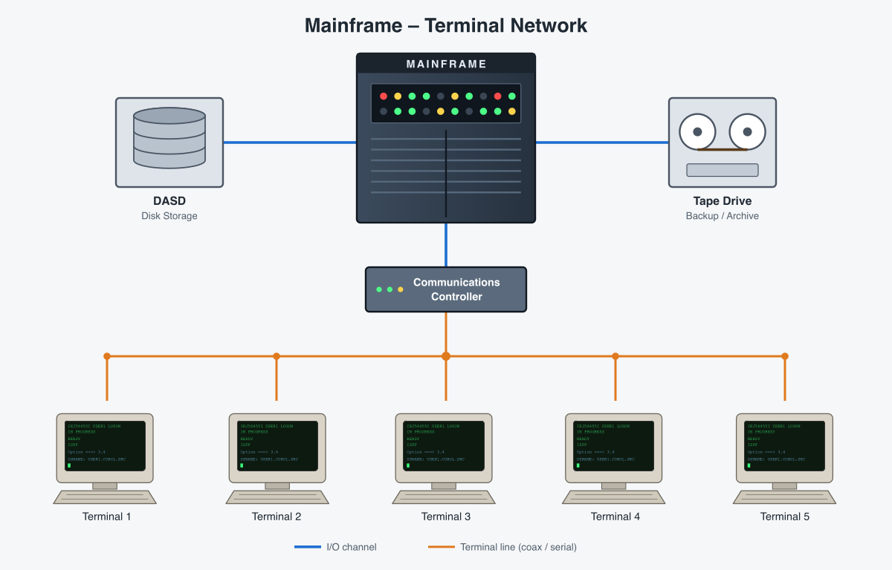
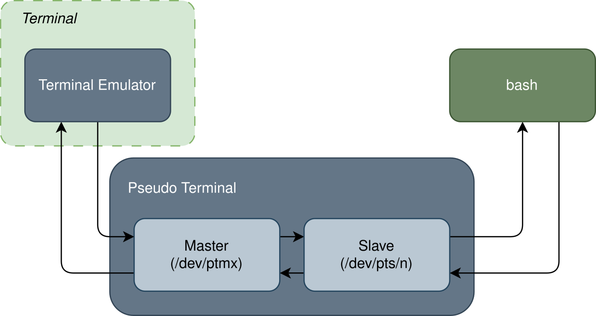
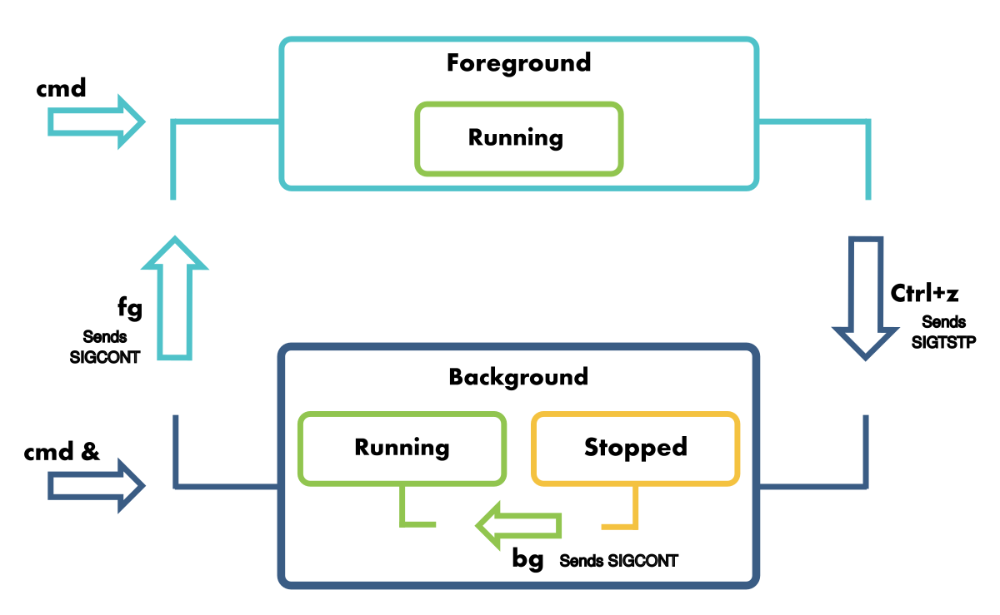

# 04. The Command Line

In the third lab you learned to redirect what a command reads and writes, and to inspect the processes of the system.
In this lab you will look closer at the **shell** and at the **terminal** it runs in. You will run commands in the
**background**, stop them and bring them back, and send them **signals**. You will set **variables** and see which of
them reach the commands you start. At the end you will find out exactly what the shell does with a line of text before
a command starts: how it splits it into **words**, what the **quotes** and the **globs** do, and how it finds the
**program** to run.

The most important idea of this lab is that the command never sees what you type. The shell reads the line, replaces
the variables and the globs, removes the quotes, sets up the redirects, finds the program and only then starts it, with
a list of words as its parameters.

## Objectives

- Understand what a **terminal**, a **pseudo terminal** and a **shell** are, and use the **virtual terminals**
- Send **signals** to processes with `kill` command and with the keyboard, and **handle** a signal with `trap`
- Run commands in the **background** and manage them as **jobs** with `&`, `jobs`, `fg`, `bg` and `kill %N`
- See how the processes of a terminal are grouped in **process groups** and **sessions**, and keep a command running
  after the terminal closes with `nohup`
- Use **shell variables** and **environment variables**, with `export`, `unset`, `printenv` and `env`, and the special
  parameters `$?`, `$$` and `$!`
- Split a command line into its **parts**: the assignments, the command, its parameters and the redirects
- Use **quotes** and `\` to control how the shell splits words and replaces variables
- Select files with **globs**: `*`, `?`, `[...]`, `[!...]`, `**` and `{...}`
- Tell **built-in** commands from **external** ones with `type`, and understand how the shell searches the `PATH`

## Resources

1. _[Razvan Deaconescu, Razvan Rughinis, Mihai Carabas, Alexandru Radovici, Utilizarea Sistemelor de
   Operare, Printech 2021](https://github.com/systems-cs-pub-ro/carte-uso/releases/download/uso-ed1-2021/uso.pdf)_
   - Chapter 4 - _Procese_, sections 4.3.3, 4.5.2 and 4.6.1
   - Chapter 7 - _Interfața în linia de comandă_, sections 7.1 and 7.2.3 - 7.2.5
   - Chapter 9 - _Pornirea sistemului_, section 9.6.1
2. _Brian Ward, How LINUX Works, 3rd Edition, No Starch Press, 2021_
   - Chapter 2 - _Basic Commands and Directory Hierarchy_, sections 2.1, 2.2, 2.4.2, 2.8 - 2.10 and 2.16
   - Chapter 3 - _Devices_, section 3.4
   - Chapter 11 - _Introduction to Shell Scripts_, section 11.2
3. The lecture slides: [04. Command Line Interface](/docs/lectures/04)
4. The manual pages: `man bash` (search for `QUOTING`, `EXPANSION`, `Pathname Expansion`, `JOB CONTROL`, `SIGNALS` and
   `Shell Variables`), `man 7 signal`, `man kill`, `man nohup`, `man env`, `man printenv`, `man tty` and `man ps`

## Terminals

In the past, a computer was shared by many users. Each of them had a **terminal**: a keyboard and a screen (or a
printer), without a processor, connected to the computer by a cable. These terminals were _TeleTypes_, and Linux still
calls a terminal a **TTY**.



The terminals only sent the keys to the computer and printed what it sent back: all the programs ran on the
mainframe.

Today, the kernel gives every program that runs in a terminal a **terminal device**, a special file in `/dev`. The
program reads the keys from it and writes the text to it, through the file descriptors `0`, `1` and `2`.

| Device                                  | What it is                                                                                         |
| --------------------------------------- | -------------------------------------------------------------------------------------------------- |
| `/dev/tty1` ... `/dev/tty6`             | the **virtual terminals** of the kernel: each one uses the screen and the keyboard of the computer, one at a time |
| `/dev/pts/0`, `/dev/pts/1`, ...         | the **pseudo terminals**: one for every terminal window or tab, and for every SSH connection |
| `/dev/tty`                              | always the terminal of the process that opens it                                                   |

### Virtual Terminals

A computer today has one screen and one keyboard, but the kernel makes them look like several terminals: the
**virtual terminals**. Each one works like one of the old terminals, with its own login and its own programs, but
only one of them is on the screen at a time.


The kernel shows only one of them at a time. On `/dev/tty1` in the image above, `agetty` printed the login prompt, and
after the login the shell of `alice`, `bash`, uses the same terminal. The graphical interface runs in one of the
virtual terminals too, usually the first or the second one. Before you leave it, find out which one, so you know how to come back.
Run this in a terminal in Sway:

```shell-session
[student@fedora ~]$ loginctl show-session $XDG_SESSION_ID -p VTNr
VTNr=2
```

`loginctl` asks `systemd` about your login session: here, Sway runs in the second virtual terminal, `/dev/tty2`.
<kbd>Ctrl</kbd>+<kbd>Alt</kbd>+<kbd>F&lt;n&gt;</kbd> switches to the virtual terminal `n`:

| Keys                                                           | Goes to                                                                    |
| -------------------------------------------------------------- | -------------------------------------------------------------------------- |
| <kbd>Ctrl</kbd>+<kbd>Alt</kbd>+<kbd>F3</kbd> ... <kbd>F6</kbd> | a text mode terminal, `/dev/tty3` ... `/dev/tty6`                          |
| <kbd>Ctrl</kbd>+<kbd>Alt</kbd>+<kbd>F2</kbd>                   | back to Sway, if `VTNr` is `2` (<kbd>F1</kbd> if it is `1`)                |

In a text mode terminal, a program called `agetty` waits for a user. Log in with your user and password: `login` checks
them and starts your shell, `bash`.

```shell-session
fedora login: student
Password:
[student@fedora ~]$ tty
/dev/tty3
[student@fedora ~]$ exit
```

- `tty` prints the name of the terminal of the shell: this time a virtual terminal, `/dev/tty3`.
- `exit` closes the shell and `agetty` waits for a new login.
- <kbd>Ctrl</kbd>+<kbd>Alt</kbd>+<kbd>F2</kbd> goes back to Sway, with all your windows exactly as you left them: Sway
  kept running while you were away.

:::caution

In a **VirtualBox** virtual machine, <kbd>Ctrl</kbd>+<kbd>Alt</kbd>+<kbd>F3</kbd> is caught by your own operating
system, not by the virtual machine. Use <kbd>Host</kbd>+<kbd>F3</kbd> instead (the <kbd>Host</kbd> key is usually the
right <kbd>Ctrl</kbd>), and <kbd>Host</kbd>+<kbd>F2</kbd> to go back. Other virtual machines have a menu to send these
keys.

:::

:::tip

If you do not know where Sway is, try <kbd>Ctrl</kbd>+<kbd>Alt</kbd>+<kbd>F1</kbd> and <kbd>F2</kbd>. One of them is
Sway; the other one shows a login screen or a text terminal.

:::

### Terminal Emulators

The graphical interface, Xorg or Wayland (Sway is a Wayland compositor), takes over one of the virtual terminals and
draws on the screen through the _framebuffer_ of the kernel. In it, a terminal is a **graphical application**, a
**terminal emulator**: `foot`, `kitty`, `ptyxis`, `alacritty`, `ghostty`, ... Each window of a terminal emulator asks
the kernel for a **pseudo terminal**: it opens `/dev/ptmx`, and the kernel creates a new `/dev/pts/<n>`.


A pseudo terminal has two ends. The terminal emulator keeps one end, the **master**, and reads and writes it like
a file. The other end, the **slave**, is the file `/dev/pts/<n>`: it behaves exactly like a real terminal. When the
emulator starts the shell, it redirects `/dev/pts/<n>` as the `0`, `1` and `2` of the shell.



The keys you press are written by the emulator into the master, and the shell reads them from the slave. What the shell
writes into the slave comes out of the master, and the emulator draws it in its window. The shell does not know that
there is a window: it only sees a terminal.

```shell-session
[student@fedora ~]$ tty
/dev/pts/0
[student@fedora ~]$ ps
    PID TTY          TIME CMD
   2817 pts/0    00:00:00 bash
   3104 pts/0    00:00:00 ps
[student@fedora ~]$ ls /dev/pts
0  1  ptmx
[student@fedora ~]$ ls -l /proc/$$/fd/0
lrwx------. 1 student student 64 Oct 20 10:02 /proc/2817/fd/0 -> /dev/pts/0
```

- This shell runs in the first terminal window, `/dev/pts/0`, and `ps` shows only the processes of this terminal.
- There are two windows open, so there are two pseudo terminals, `0` and `1`.
- The standard input of the shell is the pseudo terminal, as you saw in lab 03.

:::tip

A pseudo terminal is a file: what you write into it appears in the window of that terminal. With two terminals,
`echo hello > /dev/pts/1` run in the first one writes `hello` in the second one.

:::

## Signals

A **signal** is a short message that the operating system sends to a process: a **number**, with a name that starts
with `SIG`. When a signal arrives, the process stops what it is doing and runs the **default action** of the signal,
or, if it has one, its own **signal handler**, and then continues.

| Default action | What happens to the process                                              |
| -------------- | ------------------------------------------------------------------------ |
| _Term_    | it ends                                                                  |
| _Core_    | it ends and leaves a copy of its memory (a _core dump_), for debugging   |
| _Stop_         | it is paused, until it receives `SIGCONT`                                |
| _Cont_     | it continues, if it was stopped; otherwise nothing happens                                         |
| _Ign_       | nothing, the signal is thrown away                                                                  |

:::info

On Fedora, the core dumps do not appear as files in the current directory: `systemd-coredump` keeps them.
`coredumpctl list` shows them, the newest last.

:::

:::info

On Fedora, the core dumps do not appear as files in the current directory: `systemd-coredump` keeps them.
`coredumpctl list` shows them, the newest last.

:::

The signals you will use most often:

| Number | Signal    | Default action | Sent when                                                                    | Can be handled? |
| ------ | --------- | -------------- | ---------------------------------------------------------------------------- | --------------- |
| `1`    | `SIGHUP`  | Term      | the terminal closed (_hang up_)                                              | yes             |
| `2`    | `SIGINT`  | Term      | you pressed <kbd>Ctrl</kbd>+<kbd>C</kbd> (_interrupt_)                       | yes             |
| `3`    | `SIGQUIT` | Core      | you pressed <kbd>Ctrl</kbd>+<kbd>\\</kbd>                                     | yes             |
| `9`    | `SIGKILL` | Term      | someone wants the process to end **now**                                     | **no**          |
| `15`   | `SIGTERM` | Term      | someone asks the process to end; the default of `kill`                       | yes             |
| `18`   | `SIGCONT` | Cont       | `fg` or `bg` continues a stopped job                                         | yes, but it continues anyway             |
| `19`   | `SIGSTOP` | Stop           | someone wants the process to stop **now**                                    | **no**          |
| `20`   | `SIGTSTP` | Stop           | you pressed <kbd>Ctrl</kbd>+<kbd>Z</kbd>                                      | yes             |
| `21`   | `SIGTTIN` | Stop           | a background process tried to read from the terminal                         | yes             |

The numbers `18` to `21` are for x86 and ARM computers; other processors use other numbers. Use the **names** in
commands, `kill -CONT`, not `kill -18`: they work everywhere. `man 7 signal` has the full list.

### Sending a Signal: `kill`

Despite its name, `kill` **sends a signal**. Only `SIGTERM`, its default, asks the process to end.

| Command                         | What it does                                                    |
| ------------------------------- | --------------------------------------------------------------- |
| `kill -l`                       | Lists all the signals, with their numbers                       |
| `kill -l <NUMBER>`         | Prints the name of a signal: `kill -l 15` prints `TERM`                               |
| `kill <PID>`                    | Sends `SIGTERM`, the default, to the process                                 |
| `kill -KILL <PID>`              | Sends `SIGKILL`; `kill -9 <PID>` and `kill -SIGKILL <PID>` are the same |
| `kill -STOP <PID>`              | Stops the process                                               |
| `kill -CONT <PID>`              | Continues the stopped process                                   |
| `kill <PID1> <PID2> ...`        | Sends the signal (`SIGTERM`, or the one you give) to several processes                           |
| `kill %<N>`                     | Sends the signal to job `N` of this shell (see [jobs](#foreground-and-background)) |

Start `sleep 1000` in the second terminal and send it signals from the first one:

```shell-session
[student@fedora ~]$ pgrep sleep
3150
[student@fedora ~]$ kill -STOP 3150
[student@fedora ~]$ ps -o pid,stat,cmd -p 3150
    PID STAT CMD
   3150 T+   sleep 1000
[student@fedora ~]$ kill -CONT 3150
[student@fedora ~]$ ps -o pid,stat,cmd -p 3150
    PID STAT CMD
   3150 S+   sleep 1000
[student@fedora ~]$ kill 3150
[student@fedora ~]$ ps -o pid,stat,cmd -p 3150
    PID STAT CMD
```

- `SIGSTOP` paused `sleep`: its state became `T` (stopped).
- `SIGCONT` continued it: it is waiting again (`S`).
- `SIGTERM` ended it: `ps` finds no process with this PID, and the second terminal prints `Terminated`.

:::caution

Use `kill -KILL` only when `kill` alone does not work. `SIGTERM` lets a program clean up before it ends (save its
files, delete its temporary files), `SIGKILL` does not give it any chance.

:::

### Keys That Send Signals

The terminal turns some keys into signals for the process that runs in the **foreground**, the one that reads the
keyboard:

| Keys                          | Sends     | What happens, by default                                                                 |
| ----------------------------- | --------- | ---------------------------------------------------------------------------- |
| <kbd>Ctrl</kbd>+<kbd>C</kbd>  | `SIGINT`  | the foreground job ends                                                             |
| <kbd>Ctrl</kbd>+<kbd>\\</kbd> | `SIGQUIT` | the foreground job ends, and the system saves a core dump                                      |
| <kbd>Ctrl</kbd>+<kbd>Z</kbd>  | `SIGTSTP` | the foreground job is stopped, and the shell shows the prompt (see [below](#foreground-and-background)) |
| <kbd>Ctrl</kbd>+<kbd>D</kbd>  | no signal | at the start of a line, _end of file_: the program reads nothing more                            |

```shell-session
[student@fedora ~]$ sleep 100
^C
[student@fedora ~]$ sleep 100
^\Quit (core dumped)
[student@fedora ~]$ sleep 100
^Z
[1]+  Stopped                 sleep 100
```

:::info

<kbd>Ctrl</kbd>+<kbd>D</kbd> at the prompt of the shell is the end of **its** input: the shell ends, and the terminal
window closes.

:::

### Handling a Signal: `trap`

A program can replace the default action of a signal with its own **signal handler**: a part of its code that runs
when the signal arrives, instead of the default action. A `bash` script sets a handler with `trap`, which runs a
command or a function.. Create the file `~/lab04/stubborn.sh` with `nano`:

```bash
#!/bin/bash

# the signal handler
function no_interruptions_please () {
    echo "No interruptions please"
}

# register the signal handler
trap no_interruptions_please SIGINT

while true; do
    echo "working"
    sleep 1
done
```

```shell-session
[student@fedora lab04]$ bash stubborn.sh
working
working
^CNo interruptions please
working
^CNo interruptions please
working
^\Quit (core dumped)
```

- The script writes `working` every second, forever.
- <kbd>Ctrl</kbd>+<kbd>C</kbd> sends `SIGINT`: the script runs its handler, prints the message, and keeps working.
- <kbd>Ctrl</kbd>+<kbd>\\</kbd> sends `SIGQUIT`, which has no handler: the script ends.

| Command                         | What it does                                                    |
| ------------------------------- | --------------------------------------------------------------- |
| `trap '<command>' <SIGNAL>`     | Runs `command` when `SIGNAL` arrives; the quotes make it **one** word         |
| `trap '' <SIGNAL>`              | **Ignores** the signal                                          |
| `trap - <SIGNAL>`               | Goes back to the default action                                 |
| `trap -p`                       | Prints the handlers                                             |

:::info

`trap` keeps the handler as **text**, and the shell runs that text when the signal arrives, as if you typed it then.
The quotes decide **when** a variable in it is replaced:

:::info

`SIGKILL` and `SIGSTOP` cannot be handled or ignored: `trap` cannot change them. This is why `kill -KILL` always ends a
process.

:::

## Foreground and Background

A terminal has **one** job in the **foreground**: it reads the keyboard and receives the signals
of the keys, and the shell waits for it to end before it shows the prompt again. All the commands you ran so far ran
in the foreground.

The shell can also start commands in the **background**. They are called **jobs**: the shell does not wait for them
and shows the prompt right away, so they run at the same time as the commands you type. A job is either _running_ or
_stopped_.



A command starts in the foreground (`cmd`) or in the background (`cmd &`). <kbd>Ctrl</kbd>+<kbd>Z</kbd> stops the
foreground process and moves it to the background, `bg` continues a stopped job in the background, and `fg` brings a job
back to the foreground. The rest of this section shows each of them.

### Starting a Job: `&`

Put `&` at the end of a command to run it in the background:

```shell-session
[student@fedora ~]$ sleep 100 &
[1] 4242
[student@fedora ~]$ sleep 200 &
[2] 4250
[student@fedora ~]$ jobs
[1]-  Running                 sleep 100 &
[2]+  Running                 sleep 200 &
[student@fedora ~]$ echo $!
4250
[student@fedora ~]$ kill %1
[student@fedora ~]$
[1]-  Terminated              sleep 100
```

- `[1]` is the **job ID**, which exists only in this shell; `4242` is the **PID**, for the whole system.
- `jobs` lists the jobs of this shell: `+` marks the current job (the last one), `-` the previous one.
- `$!` is the PID of the last job started with `&`.
- `%1` means _job 1_: `kill %1` sent `SIGTERM` to it, and the shell said that it ended when it showed the next prompt.

| Command        | What it does                                                         |
| -------------- | -------------------------------------------------------------------- |
| `command &`    | Runs `command` in the background, as a job                           |
| `jobs`         | Lists the jobs of this shell                                         |
| `jobs -l`      | Lists them with their PIDs                                           |
| `fg %<N>`      | Brings job `N` to the **foreground** (and continues it, if it is stopped) |
| `bg %<N>`      | Continues the **stopped** job `N` in the **background**              |
| `kill %<N>`    | Sends `SIGTERM` to job `N`                                           |
| `fg`, `bg`     | Without `%<N>`, they work on the current job, the one with `+`       |

:::caution

A job still writes to the same terminal: its output gets mixed with the commands you type. Redirect its output, for
example `find / -name passwd > found.txt 2> /dev/null &`.

:::

### Stopping and Continuing: `fg` and `bg`

A command that runs in the foreground can be moved to the background later:

1. press <kbd>Ctrl</kbd>+<kbd>Z</kbd>: the command is stopped (`SIGTSTP`), and the shell prints its job ID, for
   example `[1]+  Stopped`, and shows the prompt;
2. find its job ID with `jobs`;
3. run `bg %<N>`: the job continues (`SIGCONT`) in the background.

:::tip
`fg %<N>` brings it back to the foreground.
:::

```shell-session
[student@fedora ~]$ sleep 100 > /dev/null
^Z
[1]+  Stopped                 sleep 100 > /dev/null
[student@fedora ~]$ jobs
[1]+  Stopped                 sleep 100 > /dev/null
[student@fedora ~]$ bg %1
[1]+ sleep 100 > /dev/null &
[student@fedora ~]$ jobs
[1]+  Running                 sleep 100 > /dev/null &
[student@fedora ~]$ fg %1
sleep 100 > /dev/null
^C
```

- After <kbd>Ctrl</kbd>+<kbd>Z</kbd>, `sleep` is stopped and the shell shows the prompt.
- `bg` continued it in the background (the shell prints it with an `&` at the end).
- `fg` brought it back to the foreground: the shell waits for it again, and <kbd>Ctrl</kbd>+<kbd>C</kbd> reaches it.

:::tip

<kbd>Ctrl</kbd>+<kbd>Z</kbd> is useful when you forgot the `&`, or when you want to leave a program for a moment, for
example `nano` or `less`, run a command, then go back with `fg`.

:::

### Jobs That Read the Keyboard

Only the foreground process can read the keyboard. A job that tries to read it receives `SIGTTIN` and is **stopped**:

```shell-session
[student@fedora ~]$ cat &
[1] 4321
[student@fedora ~]$
[1]+  Stopped                 cat
[student@fedora ~]$ fg
cat
hello
hello
^D
```

`cat` without parameters reads the keyboard, so it stopped right away. `fg` brought it to the foreground, where it can
read: it printed back every line, until <kbd>Ctrl</kbd>+<kbd>D</kbd>.

:::info

You cannot close a shell that still has stopped jobs at the first try: `exit` prints `There are stopped jobs.`, and
only a second `exit` closes it (and ends the jobs).

:::

## Sessions and Process Groups

The kernel groups the processes of a terminal in two levels:

| Group             | What it is                                                                 | Its ID: the PID of its **leader**                                           | Its leader                                     |
| ----------------- | -------------------------------------------------------------------------- | ------------------------------------------------ | ---------------------------------------------- |
| **process group** | one **job**: all the processes of one command line, `sleep 100 \| cat` is one group of two processes | `PGID`: the first process of the command line | the **group leader**                           |
| **session**       | all the process groups of **one terminal**                                 | `SID`, the PID of the shell                       | the **session leader**: the shell, `s` in `STAT` |

The terminal is the **controlling terminal** of the session. Its input, and the signals of the keys
(<kbd>Ctrl</kbd>+<kbd>C</kbd>, <kbd>Ctrl</kbd>+<kbd>Z</kbd>, ...), go to the **foreground process group**, so they
reach **every** process of the foreground job. `+` in the `STAT` column of `ps` marks the processes of the foreground
group.

```shell-session
[student@fedora ~]$ echo $$
3000
[student@fedora ~]$ sleep 100 | cat &
[1] 4243
[student@fedora ~]$ ps -o pid,ppid,pgid,sid,tty,stat,comm
    PID    PPID    PGID     SID TT       STAT COMMAND
   3000    2990    3000    3000 pts/0    Ss   bash
   4242    3000    4242    3000 pts/0    S    sleep
   4243    3000    4242    3000 pts/0    S    cat
   4250    3000    4250    3000 pts/0    R+   ps
```

- `bash` is the session leader: its PID is the `SID` of all the processes of the terminal, and it has an `s` in `STAT`.
- `sleep` and `cat` are one job, so one group: `4242`, the PID of `sleep`, the first process of the job.
- `ps` runs in the foreground (`+`), in a group of its own.

### Closing the Terminal: `SIGHUP` and `nohup`

When the terminal closes, the kernel sends `SIGHUP` (_hang up_) to the session leader, the shell. The shell sends
`SIGHUP` to all its jobs, and they end. A command started with **`nohup`** ignores `SIGHUP`, so it keeps running:

```shell-session
[student@fedora ~]$ sleep 1000 &
[1] 4300
[student@fedora ~]$ nohup sleep 2000 > /dev/null &
[2] 4301
nohup: ignoring input
```

Close this terminal window, and look for the two jobs from another terminal:

```shell-session
[student@fedora ~]$ pgrep -a sleep
4301 sleep 2000
[student@fedora ~]$ ps -o pid,ppid,sid,tty,comm -p 4301
    PID    PPID     SID TT       COMMAND
   4301       1    3000 ?        sleep
```

- `sleep 1000` received `SIGHUP` and ended.
- `sleep 2000` ignored it and keeps running, without a terminal (`?`); its parent ended, so its new parent is PID `1`.

:::info

If you do not redirect its output, `nohup` writes it into the file `nohup.out`, because the terminal will not exist
anymore: `nohup: ignoring input and appending output to 'nohup.out'`.

:::

:::caution

If the shell is killed with `SIGKILL`, it cannot send `SIGHUP` to its jobs anymore: they keep running, without a
terminal, even without `nohup`.

:::

## Environment Variables

Every process has an **environment**: a list of variables, each written as `NAME=value`. Programs read it to configure
themselves: `HOME` tells them the home directory of the user, `LANG` the language, and `PATH` where to look for
programs. The names are case-sensitive (`HOME` and `home` are different variables) and, by convention, in
**UPPER CASE**.

A process **receives** its environment from its parent when it starts: usually a **copy** of the parent's environment.
From then on the two are separate: a change in one does not reach the other.

| Command            | What it does                                                        |
| ------------------ | ------------------------------------------------------------------- |
| `printenv`         | Prints all the environment variables                                |
| `printenv <NAME>`  | Prints the value of one variable                                    |
| `env`              | Prints all the environment variables, like `printenv`               |
| `echo $NAME`       | The **shell** replaces `$NAME` with its value, then `echo` prints it |

```shell-session
[student@fedora ~]$ printenv HOME
/home/student
[student@fedora ~]$ echo "I am $USER, my shell is $SHELL"
I am student, my shell is /bin/bash
[student@fedora ~]$ env | wc -l
35
```

### Shell Variables and `export`

The shell has two kinds of variables:

- **shell variables**: they exist only inside this shell;
- **environment variables**: they are part of the environment, so every command started from this shell receives a
  copy.

| Syntax                  | What it does                                                                 |
| ----------------------- | ---------------------------------------------------------------------------- |
| `NAME=value`            | Creates a **shell variable**, or changes the value of an existing variable                     |
| `export NAME`           | Makes the variable an **environment variable**: every command started **from now on** receives it                                        |
| `export NAME=value`     | Both at once                                                                 |
| `NAME=value command`    | An environment variable **only for** `command`; the shell does not keep it  |
| `unset NAME`            | Deletes the variable, from the shell and from the environment                                                          |
| `$NAME`              | Replaced by the shell with the value, or with nothing if the variable does not exist          |
| `${NAME}`            | The same, with clear limits: `"${NAME}_old"` is the value followed by `_old`; `"$NAME_old"` is the variable `NAME_old` |

```shell-session
[student@fedora ~]$ GREETING=hello
[student@fedora ~]$ echo $GREETING
hello
[student@fedora ~]$ bash -c 'echo "child: $GREETING"'
child:
[student@fedora ~]$ export GREETING
[student@fedora ~]$ bash -c 'echo "child: $GREETING"'
child: hello
[student@fedora ~]$ unset GREETING
[student@fedora ~]$ echo "[$GREETING]"
[]
```

- `GREETING=hello` created a shell variable, and the shell replaced `$GREETING` with `hello`.
- `bash -c '...'` starts a **new** shell, a child, that runs the text between the quotes. The child did not receive
  `GREETING`: it was not part of the environment.
- After `export`, the child received a copy of it.
- After `unset`, the variable does not exist anymore, and `$GREETING` is replaced with nothing.

:::danger

**No spaces** around `=`. `GREETING = hello` runs the command `GREETING`, with the parameters `=` and `hello`:
`bash: GREETING: command not found`. Put the value between quotes when it has spaces: `GREETING="good morning"`.

:::

:::info

A process can change only **its own** environment, and the environment of the children it starts **after** that. A
child can never change a variable of its parent: this is why `export` and `unset` are commands of the shell, not
programs.

:::

### A Variable for One Command

`NAME=value` written **before** a command puts the variable only in the environment of that command:

```shell-session
[student@fedora ~]$ date +%H:%M
11:47
[student@fedora ~]$ TZ=Asia/Tokyo date +%H:%M
18:47
[student@fedora ~]$ echo "[$TZ]"
[]
[student@fedora ~]$ ls /nope
ls: cannot access '/nope': No such file or directory
[student@fedora ~]$ LANG=ro_RO.UTF-8 ls /nope
ls: nu se poate accesa '/nope': Fișier sau director inexistent
```

- `TZ` (_time zone_) changed the time zone only for that `date`; the shell did not keep it.
- `LANG` changed the language of the messages of `ls` (if the Romanian language is installed).

### Variables Defined by the System

When the prompt shows up, the shell already has many variables, set when you logged in or by its startup files:

| Variable          | Value                                                                  |
| ----------------- | ---------------------------------------------------------------------- |
| `HOME`            | your home directory, `~`                                               |
| `USER`            | your user name                                                         |
| `SHELL`           | your shell, from `/etc/passwd`                                         |
| `PWD`, `OLDPWD`   | the current directory and the previous one (`cd -` goes to `OLDPWD`)   |
| `PATH`            | the directories with the programs, separated by `:` (see [The `PATH` Search](#the-path-search)) |
| `LANG`            | the language and the encoding of the characters                        |
| `PS1`             | the prompt; a **shell variable**, not exported                         |

:::tip

`PS1` is the text of the prompt, with some special sequences: `\u` is the user, `\h` the computer, `\w` the current
directory, `\$` is `$` (or `#` for `root`). Try `PS1='\u in \w \$ '`. The change lasts until you close the terminal.

:::

### Special Parameters: `$?`, `$$` and `$!`

The shell sets a few more values that you can only read:

| Parameter | Value                                                                       |
| --------- | --------------------------------------------------------------------------- |
| `$?`      | the **exit code** of the last command: `0` means _success_, anything else an error |
| `$$`      | the PID of the shell                                                        |
| `$!`      | the PID of the job most recently sent to the background, with `&` or `bg`                                   |

```shell-session
[student@fedora ~]$ ls /nope
ls: cannot access '/nope': No such file or directory
[student@fedora ~]$ echo $?
2
[student@fedora ~]$ echo $?
0
```

`ls` failed, with the exit code `2`. The second `echo $?` prints the exit code of the first `echo`, which succeeded: `$?`
changes after **every** command.

## The Command Line

Before a command starts, the shell reads the whole line and splits it into parts:

```shell-session
[student@fedora lab04]$ LANG=C sort -r "$HOME/my notes.txt" my\ list.txt *.csv > sorted.txt 2> errors.txt
```

| Part                  | In the example                                  | What it is                                                            |
| --------------------- | ----------------------------------------------- | --------------------------------------------------------------------- |
| assignments           | `LANG=C`                                        | `NAME=value` words **at the start**: variables only for this command  |
| the command           | `sort`                                          | the first word that is not an assignment or a redirect               |
| the parameters        | `-r`, `"$HOME/my notes.txt"`, `my\ list.txt`, `*.csv` | everything else: options, file names, texts                     |
| redirects             | `> sorted.txt`, `2> errors.txt`                 | a redirect and the word after it; they are for the shell, not for the command, and can be **anywhere** |

Then, step by step:

1. it **splits** the line into words at the spaces, except inside quotes and after a `\`;
2. it **sets apart** the assignments and the redirects;
3. it **replaces** `$NAME` and `~` with their values;
4. it **splits** again the values of the variables that were not between quotes;
5. it **expands the globs** (`*.csv`) into the names of the matching files;
6. it **removes** the quotes and the `\`;
7. it sets up the redirects and **runs** the command, with the words that are left as its parameters.

`sort` receives 5 parameters: `-r`, `/home/student/my notes.txt`, `my list.txt`, `a.csv` and `b.csv`. It never sees the
quotes, the `$`, the `*` or the redirects.

:::tip

To see the words that a command receives, use `printf '[%s]\n'` instead of the command: it prints every parameter
between brackets, on its own line.

```shell-session
[student@fedora lab04]$ printf '[%s]\n' -r "$HOME/my notes.txt" my\ list.txt *.csv
[-r]
[/home/student/my notes.txt]
[my list.txt]
[a.csv]
[b.csv]
```

:::

### The Order of Redirects

The redirects can be written anywhere in the line, even before the command, and the shell applies them **from left to
right**:

```shell-session
[student@fedora lab04]$ 2> errors.txt ls > list.txt /nope .
[student@fedora lab04]$ ls /nope > all.txt 2>&1
[student@fedora lab04]$ ls /nope 2>&1 > all.txt
ls: cannot access '/nope': No such file or directory
```

- The first line is the same as `ls /nope . > list.txt 2> errors.txt`.
- `> all.txt 2>&1`: first `1` goes to `all.txt`, then `2` goes where `1` goes **now**, also into `all.txt`.
- `2>&1 > all.txt`: first `2` goes where `1` goes now, the **display**, then only `1` changes to `all.txt`. The error is
  on the display.

## Quoting and Escaping

Some characters have a special meaning for the shell: the space, `$`, `*`, `?`, `[`, `{`, `~`, `>`, `<`, `|`, `&`, `;`,
`#`, `'`, `"` and `\`. **Quotes** and `\` turn the special meaning off:

| Written as    | What it does                                                                    |
| ------------- | ------------------------------------------------------------------------------- |
| `'...'`       | **single quotes**: everything inside is plain text, nothing is replaced         |
| `"..."`       | **double quotes**: `$NAME` is still replaced, but the result stays **one** word; globs are not expanded |
| `\`           | the next character is plain text: `\ ` is a space that does not split, `\$` is a `$` |

With `NAME="Alice   Smith"` (three spaces), this is what `echo` receives:

| You type                       | `echo` receives                 | Why                                                         |
| ------------------------------ | ------------------------------- | ----------------------------------------------------------- |
| `echo $NAME`                   | `Alice`, `Smith`                | no quotes: replaced, then split at the spaces               |
| `echo "$NAME"`                 | `Alice   Smith`                 | double quotes: replaced, **one** word, the spaces are kept  |
| `echo '$NAME'`                 | `$NAME`                         | single quotes: **nothing** is replaced                      |
| `echo \$NAME`                  | `$NAME`                         | `\$`: the `$` is just a character                           |
| `echo my\ file.txt`            | `my file.txt`                   | `\ `: the space does not split                              |
| `echo "\$NAME is $NAME"`       | `$NAME is Alice   Smith`        | inside `"..."`, `\$` is a `$`, `$NAME` is replaced          |
| `echo "it's" 'say "hi"'`       | `it's`, `say "hi"`              | each kind of quotes protects the other one                  |
| `echo 'a\b'`                   | `a\b`                           | inside `'...'`, `\` is just a character                     |

```shell-session
[student@fedora ~]$ NAME="Alice   Smith"
[student@fedora ~]$ echo $NAME
Alice Smith
[student@fedora ~]$ echo "$NAME"
Alice   Smith
[student@fedora ~]$ printf '[%s]\n' $NAME
[Alice]
[Smith]
```

`echo $NAME` received two words and printed them with one space between them: the three spaces were lost.

:::tip

Put **every** variable between double quotes, `"$NAME"`, unless you really want it split into words. A file name with
a space in a variable breaks a command without them: `rm $FILE` with `FILE="my notes.txt"` tries to delete `my` and
`notes.txt`.

:::

## Globbing

A **glob** is a pattern for file names. The shell replaces it with the names of the matching files, in alphabetical
order, before the command starts. In this directory:

```shell-session
[student@fedora glob]$ ls
docs  notes.txt  photo1.png  photo2.png  photo3.png  photoA.png  report.md  todo.txt
```

| Glob              | Matches                                         | `echo` receives                                         |
| ----------------- | ----------------------------------------------- | ------------------------------------------------------- |
| `*.txt`           | `*`: any characters, or none (but not `/`)                    | `notes.txt`, `todo.txt`                                 |
| `photo?.png`      | `?`: exactly one character                      | `photo1.png`, `photo2.png`, `photo3.png`, `photoA.png`  |
| `photo[12].png`   | `[12]`: one character, `1` or `2`                 | `photo1.png`, `photo2.png`                              |
| `photo[0-9].png`  | `[0-9]`: one character in the range             | `photo1.png`, `photo2.png`, `photo3.png`                |
| `photo[!0-9].png` | `[!0-9]`: one character **not** in the range (`[^0-9]` also works)    | `photoA.png`                                            |
| `docs/**/*.txt`   | `**`: any directories, at any depth (needs `shopt -s globstar`) | `docs/2026/exam.txt`, `docs/plan.txt`   |
| `{a,b,c}.pdf`     | `{...}`: one word for each, **even if the file does not exist** | `a.pdf`, `b.pdf`, `c.pdf`               |
| `*.pdf`           | no file matches                                 | `*.pdf`, the glob as it is                              |

:::caution

When no file matches, `bash` gives the glob **as it is** to the command: `ls *.pdf` prints
`ls: cannot access '*.pdf': No such file or directory`. Other shells, like `zsh`, print an error and do not run the
command at all.

:::

:::info

- `*` and `?` do not match the `.` at the beginning of a hidden file: `*` does not include `.bashrc`, but `.*` does.
- `{...}` is not a glob: it makes the words even if there are no files, which is useful to create them, for example
  `mkdir -p 2026/{jan,feb,mar}` or `touch photo{4..6}.png` (`{4..6}` is `4 5 6`).
- `**` works only after `shopt -s globstar`; without it, it is the same as `*`.
- Between quotes, a glob is plain text: `echo "*.txt"` prints `*.txt`. This is how you give a pattern to a command that
  understands it by itself, like `find . -name "*.txt"`.

:::

## Running a Command

### Built-in and External Commands

Not every command is a program:

| Kind                 | What it is                                                         | Examples                                         | Help         |
| -------------------- | ------------------------------------------------------------------ | ------------------------------------------------ | ------------ |
| **built-in** command | part of the shell: it runs **inside** it, without a new process     | `cd`, `export`, `unset`, `exit`, `jobs`, `fg`, `bg`, `trap`, `type` | `help <name>` |
|                      | some are built in only to be faster, and also exist as programs    | `echo`, `printf`, `kill`, `pwd`                  |              |
| **external** command | an executable file on the disk, found in `PATH`; the shell starts it as a **child process** | `ls`, `sort`, `grep`, `sleep`, `bash`  | `man <name>` |

`type` tells which one a command is:

```shell-session
[student@fedora ~]$ type cd
cd is a shell builtin
[student@fedora ~]$ type sort
sort is /usr/bin/sort
[student@fedora ~]$ type ls
ls is aliased to `ls --color=auto'
[student@fedora ~]$ type -a echo
echo is a shell builtin
echo is /usr/bin/echo
```

- `cd` is built in, `sort` is the file `/usr/bin/sort`.
- `ls` is an **alias**: a short name for another command line, here `ls --color=auto`.
- `-a` shows **all** the meanings of the name: `echo` is built in, and there is also a program with the same name. The
  shell uses the first one.

:::info

`cd`, `export`, `unset` and `exit` **must** be built in: they change the shell itself, its current directory, its
variables, or stop it. A program started by the shell is a child process, and a child cannot change its parent.

:::

### The `PATH` Search

The kernel can only start a program from its **path**. When the first word is a name, the shell has to find the file:

1. if the word has a `/`, it is a path: **absolute** (`/usr/bin/sort`) or **relative** to the current directory
   (`./hello`, `bin/hello`, `../tools/hello`), used as it is;
2. otherwise, if it is an alias or a built-in command, the shell runs it itself;
3. otherwise, the shell searches the directories of the `PATH` variable, **from left to right**, and runs the **first**
   file with that name;
4. if no directory has it: `command not found`.

```shell-session
[student@fedora ~]$ echo $PATH
/home/student/.local/bin:/home/student/bin:/usr/local/bin:/usr/bin
[student@fedora ~]$ cd ~/lab04
[student@fedora lab04]$ ls bin
hello
[student@fedora lab04]$ hello
bash: hello: command not found
[student@fedora lab04]$ bin/hello
Hello!
[student@fedora lab04]$ PATH="$PATH:$HOME/lab04/bin"
[student@fedora lab04]$ hello
Hello!
[student@fedora lab04]$ type hello
hello is /home/student/lab04/bin/hello
```

- The shell does **not** look in the current directory, so `hello` alone was not found.
- `bin/hello` has a `/`, so it is a path, and the shell ran it.
- After adding `~/lab04/bin` at the end of `PATH`, the shell found `hello` there.

:::caution

Add directories to `PATH`, never replace it: `PATH=~/lab04/bin` alone leaves the shell without `/usr/bin`, and `ls`,
`cat` and almost every other command become `command not found`. Close the terminal and open a new one to get the old
`PATH` back.

:::

:::tip

On Fedora, `~/.local/bin` and `~/bin` are already in `PATH`: copy a program of your own there and it works from any
directory, in every new terminal.

:::

## Troubleshooting

| Problem                                                 | Solution                                                                                                       |
| ------------------------------------------------------- | -------------------------------------------------------------------------------------------------------------- |
| <kbd>Ctrl</kbd>+<kbd>C</kbd> does not stop a program    | It handles or ignores `SIGINT`: try <kbd>Ctrl</kbd>+<kbd>\\</kbd>, or <kbd>Ctrl</kbd>+<kbd>Z</kbd> followed by `kill %1`; as a last resort, `kill -KILL <PID>` from another terminal |
| `kill` does not end a process                           | It handles `SIGTERM`: use `kill -KILL <PID>`                                                                   |
| A stopped process does not react to `kill`              | It receives the signal when it continues: `kill -CONT <PID>`, or use `kill -KILL <PID>`                        |
| `bash: kill: (4242) - Operation not permitted`          | The process belongs to another user                                                                            |
| `bash: kill: %1: no such job` or `fg: current: no such job` | The job belongs to another terminal (every shell has its own jobs), or it has already ended; use the PID       |
| `[1]+  Stopped` right after `command &`                 | The job tries to read the keyboard: bring it to the foreground with `fg`, or redirect its input                |
| `There are stopped jobs.` when you close the shell      | Continue or end them (`fg`, `kill %N`); a second `exit` ends them                                              |
| A job writes over the commands you type                 | Redirect its output to a file, or to `/dev/null`                                                               |
| `bash: NAME: command not found` after `NAME = value`    | No spaces around `=`                                                                                           |
| A child does not see a variable                         | It is a shell variable: `export` it                                                                            |
| `bash: <command>: command not found`                    | Check the name, then `echo $PATH`: the directory of the program is not in `PATH`, or `PATH` was replaced; open a new terminal |
| A file in the current directory is `command not found`  | The shell does not search the current directory: run it as `./name`                                            |
| `cannot access '*.pdf'`                                 | No file matches the glob, so the command received it as it is                                                  |
| A name with a space becomes two files                   | Put it, or the variable that holds it, between double quotes                                                   |
| The shell shows `>` and waits                           | A quote is not closed: close it, or press <kbd>Ctrl</kbd>+<kbd>C</kbd> and type the line again                 |

## Exercises

The exercises get harder as you go:

- 🧪 [First Steps](#first-steps) (exercises 1 - 23) goes once through **everything** in this lab, with easy exercises;
- 🏠 [Going Further](#going-further) (exercises 24 - 51) has more exercises to do at home, harder as you go;
- 📝 [Challenges](#challenges) (exercises 52 - 62) has the hardest ones.

Exercise 1 creates the files and directories that all the other exercises start from. Run the commands in `~/lab04`,
unless the exercise says otherwise. If you change or delete one of the files from exercise 1, run its commands again to
get it back.

Some exercises ask for things that the lab does not show you, for example an option that is not in the tables
above. Find it in the **manual page** of the command (`man <command>`), as explained in
[Searching in a Manual Page](/docs/labs/02#searching-in-a-manual-page) in lab 02. `jobs`, `fg`, `bg`, `trap`, `export`
and the other built-in commands do not have a manual page of their own: use `help <command>`, for example `help trap`,
or search `man bash`.

Keep **two terminals side by side** in Sway: the first one to run the commands, and the second one to run the commands
that you inspect, or to check the results. Many exercises use the PID of a process: it is different on your computer,
use the one that `pgrep`, `ps` or `$!` prints for you.

:::danger

Do not use `sudo` to send signals: `sudo kill` can end the processes of the system. Send signals only to your own
processes, and check the PID twice before `kill -KILL`.

:::

### 🧪 First Steps {/* #first-steps */}

1. **The practice tree**:
   1. run these commands to create the files used in the exercises (copy them from the browser with
      <kbd>Ctrl</kbd>+<kbd>C</kbd> and paste them in the terminal with <kbd>Ctrl</kbd>+<kbd>Shift</kbd>+<kbd>V</kbd>):

      ```bash
      mkdir -p ~/lab04/bin ~/lab04/glob/docs/2026
      cd ~/lab04
      printf 'pear\nfig\n' > 'my notes.txt'
      printf 'cherry\nBanana\napple\n' > 'my list.txt'
      printf 'banana,3\napple,5\n' > a.csv
      printf 'cherry,1\nkiwi,7\n' > b.csv
      printf '#!/bin/bash\necho Hello!\n' > bin/hello
      chmod +x bin/hello
      cat > stubborn.sh << 'EOF'
      #!/bin/bash

      # the signal handler
      function no_interruptions_please () {
          echo "No interruptions please"
      }

      # register the signal handler
      trap no_interruptions_please SIGINT

      while true; do
          echo "working"
          sleep 1
      done
      EOF
      cd ~/lab04/glob
      touch notes.txt todo.txt report.md photo1.png photo2.png photo3.png photoA.png docs/plan.txt docs/2026/exam.txt
      cd ~/lab04
      ```

   2. run `tree` in `~/lab04`;
   3. print `stubborn.sh` with `cat`.

   **Check:** you see `bin/hello`, the two `.csv` files, `my list.txt`, `my notes.txt`, `stubborn.sh` and the `glob`
   directory with 9 files; `stubborn.sh` is the script from [Handling a Signal](#handling-a-signal-trap). `chmod +x`
   makes `hello` a program that can be run (you will learn about it in the lab about permissions). <small>→ [Navigation](/docs/labs/02#navigation)</small>

**Terminals**

2. **Which terminal**:
   1. print the terminal of the shell, in both terminals;
   2. list the pseudo terminals in `/dev/pts`;
   3. open a third terminal and list them again, then close it.

   **Check:** each shell has its own `/dev/pts/<n>`; the third terminal adds one more number to the list, and its
   number disappears after you close it. <small>→ [Terminal Emulators](#terminal-emulators)</small>

3. **Write to another terminal**:
   1. find the terminal of the second shell, with `tty`;
   2. from the first terminal, write `hello from the first terminal` into the second one, with `echo` and a redirect.

   **Check:** the text appears in the second terminal, without anything typed there. <small>→ [Terminal Emulators](#terminal-emulators)</small>

4. **A virtual terminal**:
   1. in a terminal in Sway, find out in which virtual terminal Sway runs, with `loginctl`;
   2. switch to the third virtual terminal with <kbd>Ctrl</kbd>+<kbd>Alt</kbd>+<kbd>F3</kbd> (<kbd>Host</kbd>+<kbd>F3</kbd>
      in VirtualBox);
   3. log in as `student`, print the name of the terminal and list its processes with `ps`;
   4. log out with `exit`;
   5. switch back to Sway, using the number that `loginctl` printed.

   **Check:** `VTNr` is `1` or `2`; `tty` prints `/dev/tty3`, and `ps` shows a `bash` on `tty3`; after `exit`, the
   terminal asks for a login again; back in Sway, your windows are exactly as you left them. <small>→ [Virtual Terminals](#virtual-terminals)</small>

**Signals**

5. **The list of signals**:
   1. list all the signals with `kill`;
   2. print the name of signal `9` and the number of `SIGCONT`, with `kill -l`.

   **Check:** signal `9` is `KILL`, and `CONT` is `18`. <small>→ [Sending a Signal](#sending-a-signal-kill)</small>

6. **Stop and continue**:
   1. in the second terminal, run `sleep 1000`;
   2. in the first terminal, find its PID and stop it with a signal;
   3. show its state with `ps -o pid,stat,cmd -p <PID>`, and look at the second terminal;
   4. continue it, show its state again, and run `jobs` in the second terminal;
   5. end it with `kill %1` in the second terminal.

   **Check:** the state is `T` after `SIGSTOP` and `S` after `SIGCONT`, without the `+`. As soon as `sleep` stopped,
   the second shell printed `[1]+  Stopped (signal)`, took the terminal back and showed the prompt, so after
   `SIGCONT`, `jobs` shows `sleep` as `Running` in the background. <small>→ [Sending a Signal](#sending-a-signal-kill)</small>

7. **Keys and signals**:
   1. run `sleep 100` and end it with <kbd>Ctrl</kbd>+<kbd>C</kbd>;
   2. run it again and end it with <kbd>Ctrl</kbd>+<kbd>\\</kbd>;
   3. run it again and stop it with <kbd>Ctrl</kbd>+<kbd>Z</kbd>;
   4. list the jobs.

   **Check:** the terminal shows `^C` after <kbd>Ctrl</kbd>+<kbd>C</kbd>, `Quit (core dumped)` after
   <kbd>Ctrl</kbd>+<kbd>\\</kbd> (only `Quit` if core dumps are turned off), and `Stopped` after
   <kbd>Ctrl</kbd>+<kbd>Z</kbd>; `sleep` is still in the list of jobs. End it with `kill %1`. <small>→ [Keys That Send Signals](#keys-that-send-signals)</small>

8. **A stubborn script**:
   1. run `bash stubborn.sh`;
   2. press <kbd>Ctrl</kbd>+<kbd>C</kbd> a few times;
   3. stop it with <kbd>Ctrl</kbd>+<kbd>\\</kbd>.

   **Check:** <kbd>Ctrl</kbd>+<kbd>C</kbd> prints `No interruptions please` and the script keeps working;
   <kbd>Ctrl</kbd>+<kbd>\\</kbd> ends it. <small>→ [Handling a Signal](#handling-a-signal-trap)</small>

**Foreground and background**

9. **Two jobs**:
   1. start `sleep 300` and `sleep 400` in the background;
   2. list the jobs, and then the jobs with their PIDs;
   3. print the PID of the last job with `$!`;
   4. end the first job using its job ID;
   5. end the second job too, and list the jobs again.

   **Check:** `jobs` shows `[1]` and `[2]`, with `+` at `[2]`; `$!` is the PID of `sleep 400`; after the next command,
   the shell prints `[1]-  Terminated`; at the end, `jobs` prints nothing. <small>→ [Starting a Job](#starting-a-job-)</small>

10. **To the background and back**:
    1. run `sleep 200 > /dev/null` in the foreground;
    2. stop it with the keyboard;
    3. continue it in the background, and check with `jobs` that it runs;
    4. bring it back to the foreground, and end it with the keyboard.

    **Check:** `jobs` shows `Stopped`, then `Running`; after `fg`, the prompt does not show up until you press
    <kbd>Ctrl</kbd>+<kbd>C</kbd>. <small>→ [Stopping and Continuing](#stopping-and-continuing-fg-and-bg)</small>

11. **The current job**:
    1. start `sleep 300`, `sleep 400` and `sleep 500` in the background;
    2. list the jobs, and find the current one;
    3. run `fg` **without** a job ID, and end the job with <kbd>Ctrl</kbd>+<kbd>C</kbd>;
    4. list the jobs again, and end the others with `kill`.

    **Check:** the current job (`+`) is `sleep 500`, the last one started, and `fg` brought it to the foreground; after
    it ended, `sleep 400` became the current job. <small>→ [Starting a Job](#starting-a-job-)</small>

**Sessions**

12. **Session and groups**:
    1. print the PID of your shell;
    2. start `sleep 100 | cat` in the background;
    3. list the processes of the terminal with the columns `pid`, `ppid`, `pgid`, `sid`, `tty`, `stat` and `comm`.

    **Check:** all the processes have the PID of the shell as their `SID`; `sleep` and `cat` have the same `PGID`, the
    PID of `sleep`; `bash` has `s` and `ps` has `+` in `STAT`. <small>→ [Sessions and Process Groups](#sessions-and-process-groups)</small>

13. **Close the terminal**:
    1. open a new terminal and start `sleep 1000 &` and `nohup sleep 2000 > /dev/null &` in it;
    2. close the window of this terminal;
    3. in another terminal, look for the two `sleep` processes;
    4. end `sleep 2000` with `kill`.

    **Check:** only `sleep 2000` is still running, without a terminal (`?`). Its parent ended, so it was adopted: its
    new parent is PID `1`, or a process that adopts orphans, like `systemd --user` (see which one with
    `ps -o pid,comm -p <PPID>`). <small>→ [Closing the Terminal](#closing-the-terminal-sighup-and-nohup)</small>

**Variables**

14. **Read variables**:
    1. print `HOME`, `USER` and `SHELL` with `printenv`;
    2. print the sentence `I am student and I live in /home/student` with `echo` and the variables `USER` and `HOME`;
    3. count the environment variables.

    **Check:** the sentence has your user and your home directory; there are a few dozen variables. <small>→ [Environment Variables](#environment-variables)</small>

15. **Shell variable or environment variable**:
    1. set the shell variable `COLOR` to `blue`, and print it;
    2. check with `printenv COLOR` and with `bash -c 'echo "$COLOR"'` whether it is in the environment;
    3. export it, and check again;
    4. delete it, and print it again.

    **Check:** before `export`, `printenv` prints nothing and the child prints an empty line; after it, both print
    `blue`; after `unset`, `echo` prints an empty line. <small>→ [Shell Variables and `export`](#shell-variables-and-export)</small>

16. **Only for one command**:
    1. print the time with `date +%H:%M`;
    2. print the time in Tokyo and in New York (`America/New_York`), by setting `TZ` only for `date`;
    3. print `TZ`.

    **Check:** the three times are different, and `TZ` is empty in the shell. <small>→ [A Variable for One Command](#a-variable-for-one-command)</small>

17. **Exit codes**:
    1. run `ls ~/lab04` and print its exit code;
    2. run `ls /nope` and print its exit code;
    3. run `grep apple a.csv` and `grep pear a.csv`, and print the exit code after each of them;
    4. run `echo $?` twice in a row.

    **Check:** `ls` has the exit code `0`, then `2`; `grep` has `0` when it finds the text and `1` when it does not;
    the second `echo $?` always prints `0`. <small>→ [Special Parameters](#special-parameters---and-)</small>

**The command line**

18. **The words of a command**: Use `printf '[%s]\n'` to see the words that the shell gives to a command:
    1. `printf '[%s]\n' one two   three`;
    2. `printf '[%s]\n' "one two   three"`;
    3. `printf '[%s]\n' ~ "~" '$HOME' "$HOME"`.

    **Check:** the first line gives 3 words, the second one only 1, with the spaces kept; `~` and `"$HOME"` become
    `/home/student`, `"~"` and `'$HOME'` stay as they are. <small>→ [The Command Line](#the-command-line) · [Quoting and Escaping](#quoting-and-escaping)</small>

19. **Quotes and variables**:
    1. set `NAME="Alice   Smith"`;
    2. print it with `echo`, without quotes, between double quotes and between single quotes;
    3. print the text `$NAME is Alice   Smith` with a single `echo` and **one** pair of double quotes.

    **Check:** without quotes, the three spaces become one; between double quotes they are kept; between single quotes
    `echo` prints `$NAME`; the last `echo` prints `$NAME is Alice   Smith`, with the three spaces. <small>→ [Quoting and Escaping](#quoting-and-escaping)</small>

20. **A dollar sign**: Print the text `The price is $5` with `echo`:
    1. first with double quotes and nothing else, and see what goes wrong;
    2. with single quotes;
    3. with a `\` and no quotes;
    4. with double quotes and a `\`.

    **Check:** step 1 prints `The price is`: the shell replaced `$5` with nothing. `$5` is the fifth **positional
    parameter**, a parameter given to a script, and it is empty in your shell. Single quotes and `\` turn off the
    meaning of `$`, so steps 2, 3 and 4 print `The price is $5`. <small>→ [Quoting and Escaping](#quoting-and-escaping)</small>

21. **Globs**: Go to `~/lab04/glob` and, with `echo`, print:
    1. all the `.png` files;
    2. the photos with a single digit after `photo`;
    3. the photos whose name does **not** have a digit after `photo`;
    4. all the files whose name has exactly 8 characters (count the extension too);
    5. all the `.pdf` files;
    6. the names `photo7.png` and `photo8.png`, with `{...}`.

    **Check:** `photoA.png` is in the first and the third list, not in the second one; the fourth list is `todo.txt`;
    the fifth `echo` prints `*.pdf`, because no file matches; the last one prints both names, even if the files do not
    exist. <small>→ [Globbing](#globbing)</small>

22. **Built-in or external**:
    1. find out with `type` what `cd`, `ls`, `sort`, `type` and `sleep` are;
    2. show all the meanings of `kill` and of `echo`;
    3. print the `PATH`, and find in which of its directories `sort` is.

    **Check:** `cd` and `type` are built in, `ls` is an alias, `sort` and `sleep` are in `/usr/bin`; `kill` and `echo`
    are built in, and also exist as programs in `/usr/bin`. For a program you already ran, `type` says `hashed`, for
    example `sleep is hashed (/usr/bin/sleep)`: the shell remembers where it found it. <small>→ [Built-in and External Commands](#built-in-and-external-commands) · [The `PATH` Search](#the-path-search)</small>

23. **Command not found**:
    1. run `sl` (a typo of `ls`), and print the exit code;
    2. find out with `type` whether `sl` exists;
    3. run `/usr/bin/nope`, and print the exit code.

    **Check:** the shell searched all the directories of `PATH` and found no `sl`: the exit code is `127`, the code of
    the shell for _command not found_; `/usr/bin/nope` is a path that does not exist, and its exit code is `127` too.
    If the shell offers to install a package for `sl`, answer `N`. <small>→ [The `PATH` Search](#the-path-search) · [Special Parameters](#special-parameters---and-)</small>

### 🏠 Going Further {/* #going-further */}

24. **The terminal in ps**:
    1. list the processes of the terminal with `ps`;
    2. print the `0`, `1` and `2` file descriptors of the shell, from `/proc/$$/fd`.

    **Check:** the `TTY` column of `ps` and the three links in `/proc/$$/fd` show the same pseudo terminal as `tty`. <small>→ [Terminal Emulators](#terminal-emulators) · [The `/proc` File System](/docs/labs/03#the-proc-file-system)</small>

25. **Names and numbers**:
    1. in the second terminal, run `sleep 1000`;
    2. in the first terminal, end it with `kill`, giving the signal `SIGTERM` by its **number**;
    3. run `sleep 1000` again and end it, giving `SIGTERM` by its **name**, with the `SIG` in front.

    **Check:** both times the second terminal prints `Terminated`: `kill -15`, `kill -TERM` and `kill -SIGTERM` send
    the same signal. <small>→ [Sending a Signal](#sending-a-signal-kill)</small>

26. **End a process**:
    1. in the second terminal, run `sleep 1000`;
    2. in the first terminal, end it with `kill` and its default signal;
    3. run `sleep 1000` again, and end it with `SIGKILL`.

    **Check:** the second terminal prints `Terminated` the first time and `Killed` the second time. <small>→ [Sending a Signal](#sending-a-signal-kill)</small>

27. **SIGINT from kill**:
    1. in the second terminal, run `bash stubborn.sh`;
    2. in the first terminal, find the PID of the script (look for `stubborn` with `pgrep -f`);
    3. send it `SIGINT` with `kill`;
    4. end it with `SIGTERM`.

    **Check:** `SIGINT` sent with `kill` has the same effect as <kbd>Ctrl</kbd>+<kbd>C</kbd>: the message appears in the
    second terminal; `SIGTERM` ends the script, because it has no handler for it. <small>→ [Sending a Signal](#sending-a-signal-kill) · [Handling a Signal](#handling-a-signal-trap)</small>

28. **Leave an editor for a moment**:
    1. open `stubborn.sh` with `nano`;
    2. stop `nano` with <kbd>Ctrl</kbd>+<kbd>Z</kbd> (if it does not stop, press <kbd>Ctrl</kbd>+<kbd>T</kbd>, then
       <kbd>Ctrl</kbd>+<kbd>Z</kbd>), and run `ls`;
    3. go back to `nano`, and quit it;
    4. do the same with `less stubborn.sh`.

    **Check:** `nano` and `less` come back exactly as you left them. <small>→ [Stopping and Continuing](#stopping-and-continuing-fg-and-bg)</small>

29. **A job that reads**:
    1. start `cat` in the background;
    2. list the jobs;
    3. bring it to the foreground, type two lines, and end its input.

    **Check:** `cat` is `Stopped` right away; in the foreground it prints back every line you type, and
    <kbd>Ctrl</kbd>+<kbd>D</kbd> ends it. <small>→ [Jobs That Read the Keyboard](#jobs-that-read-the-keyboard)</small>

30. **A job with its own output**:
    1. search the whole file system for files named `passwd` with `find`, in the background, with the output in
       `found.txt` and the errors thrown away;
    2. run `jobs` until the job is `Done`;
    3. print `found.txt`.

    **Check:** nothing from `find` appears in the terminal, and `found.txt` has `/etc/passwd`. <small>→ [Starting a Job](#starting-a-job-) · [Special Files](/docs/labs/03#special-files)</small>

31. **Jobs belong to a shell**:
    1. in the second terminal, start `sleep 600` in the background;
    2. in the first terminal, list the jobs;
    3. in the first terminal, find the PID of `sleep 600` with `pgrep -f 'sleep 600'`, and end it.

    **Check:** `jobs` prints nothing in the first terminal: every shell has only its own jobs. `kill %1` does not work
    there, but `kill <PID>` does, and the second terminal prints `Terminated` after its next command. <small>→ [Starting a Job](#starting-a-job-)</small>

32. **One key, the whole group**:
    1. run `sleep 100 | sleep 200` in the second terminal;
    2. in the first terminal, list the two processes with `pgrep -a sleep`;
    3. press <kbd>Ctrl</kbd>+<kbd>C</kbd> in the second terminal, and list them again.

    **Check:** both `sleep` processes ended at the same time: the signal reached the whole foreground group. <small>→ [Sessions and Process Groups](#sessions-and-process-groups)</small>

33. **Spaces around `=`**:
    1. run `GREETING = hello`;
    2. run `GREETING=good morning`;
    3. set `GREETING` to `good morning` correctly, and print it.

    **Check:** the first command is `command not found` for `GREETING`, the second one for `morning`, because the
    shell ran `morning` with `GREETING=good` in its environment. <small>→ [Shell Variables and `export`](#shell-variables-and-export)</small>

34. **The previous directory**:
    1. go to `/etc`, then to `~/lab04`;
    2. print `PWD` and `OLDPWD`;
    3. run `cd -`, and print them again.

    **Check:** `cd -` takes you back to `/etc`, and the two variables swap their values. <small>→ [Variables Defined by the System](#variables-defined-by-the-system)</small>

35. **Inherited by the children**:
    1. export the variable `LEVEL` with the value `1`;
    2. start a new `bash` (just type `bash`), print `LEVEL`, and set it to `2`;
    3. leave the child with `exit`, and print `LEVEL` again.

    **Check:** the child printed `1`, received from its parent; after `exit`, the parent still has `1`: the child
    changed only its own copy. <small>→ [Shell Variables and `export`](#shell-variables-and-export)</small>

36. **The PID of the shell**:
    1. print the PID of your shell with `$$`, and compare it with the line of `bash` printed by `ps`;
    2. start a new `bash` (type `bash`), and print `$$` and `ps` again;
    3. leave it with `exit`, and print `$$` once more.

    **Check:** inside the new `bash`, `$$` is a different number, and `ps` shows two `bash` processes; after `exit`,
    `$$` is the first number again. <small>→ [Special Parameters](#special-parameters---and-)</small>

37. **The environment from /proc**:
    1. in the second terminal, run `MESSAGE=secret sleep 1000`;
    2. in the first terminal, find the PID of `sleep` and show its environment from `/proc/<PID>/environ`, with the
       `\0` bytes replaced by new lines (look in `man tr` for how to replace a character), keeping only the line of
       `MESSAGE`;
    3. look for `MESSAGE` in the environment of the second shell in the same way.

    **Check:** `sleep` has `MESSAGE=secret`, the shell of the second terminal does not. `/proc/<PID>/environ` shows the
    environment that a process received when it **started**: a variable that the shell exports later does not appear
    there. <small>→ [A Variable for One Command](#a-variable-for-one-command) · [The `/proc` File System](/docs/labs/03#the-proc-file-system)</small>

38. **The language of the messages**:
    1. run `ls /nope` with `LANG` set to `ro_RO.UTF-8` only for `ls`;
    2. sort `my list.txt` with `sort` (the name has a space), then with `LANG=C` only for `sort`.

    **Check:** the error is in Romanian (if the language is installed); `sort` prints `apple`, `Banana`, `cherry`, but
    with `LANG=C` it prints `Banana` first: it compares the bytes, and all the upper case letters come before the lower
    case ones. <small>→ [A Variable for One Command](#a-variable-for-one-command)</small>

39. **A new prompt**:
    1. set `PS1` so that the prompt shows the user, the path of the current directory (with `~` for your home
       directory) and the `$` (see the tip in [Variables Defined by the System](#variables-defined-by-the-system));
    2. go to `~/lab04/glob`;
    3. check whether `PS1` is an environment variable.

    **Check:** the prompt changes right away and shows `~/lab04/glob`; `printenv PS1` prints nothing: it is a shell
    variable. Close the terminal to get the old prompt back. <small>→ [Variables Defined by the System](#variables-defined-by-the-system)</small>

40. **Split a command line**: Without running it, write the words that `sort` receives, and where its output and its
    errors go, for:

    ```bash
    LANG=C sort -r "$HOME/my notes.txt" my\ list.txt *.csv > sorted.txt 2> errors.txt
    ```

    then replace `sort` with `printf '[%s]\n'` and remove the `> sorted.txt` redirect, to check your answer.

    **Check:** 5 words: `-r`, `/home/student/my notes.txt`, `my list.txt`, `a.csv` and `b.csv`. The output of `sort`
    goes into `sorted.txt` and its errors into `errors.txt`; `LANG=C` is only in its environment. <small>→ [The Command Line](#the-command-line)</small>

41. **Redirects anywhere**:
    1. run `2> errors.txt ls > list.txt /nope .`;
    2. print the two files;
    3. write the same command with the redirects at the end.

    **Check:** `list.txt` has the files of `~/lab04` and `errors.txt` the error for `/nope`, both times. <small>→ [The Order of Redirects](#the-order-of-redirects)</small>

42. **The order of redirects**:
    1. run `ls /nope . > all.txt 2>&1` and print `all.txt`;
    2. run `ls /nope . 2>&1 > all.txt` and print `all.txt`.

    **Check:** the first time, both the list and the error are in the file; the second time, the error is on the
    display, because `2` was copied from `1` before `1` changed. <small>→ [The Order of Redirects](#the-order-of-redirects)</small>

43. **Variables with spaces**:
    1. set `FILE="my notes.txt"`;
    2. run `cat $FILE`, then `cat "$FILE"`;
    3. set `OPTS="-t, -k2 -n"` and sort `a.csv` and `b.csv` with `sort $OPTS`, then with `sort "$OPTS"`.

    **Check:** `cat $FILE` looks for `my` and `notes.txt`; `cat "$FILE"` works. `sort $OPTS` receives three options
    and sorts the lines by the number after the comma: `cherry,1`, `banana,3`, `apple,5`, `kiwi,7`. `sort "$OPTS"`
    receives one word, so `-t` takes `, -k2 -n` as the separator: `sort: multi-character tab`. <small>→ [Quoting and Escaping](#quoting-and-escaping)</small>

44. **Special names**:
    1. create the files `rock & roll.txt`, `it's mine.txt` and `$HOME.txt` with **one** `touch` command;
    2. list them with `ls`, then with `ls -N`;
    3. delete them with **one** `rm` command, this time using `\` instead of quotes.

    **Check:** `ls` shows the names between quotes, only for display; `ls -N` shows exactly these three names, and
    `$HOME.txt` is not `/home/student.txt`. `rm` deletes all three. <small>→ [Quoting and Escaping](#quoting-and-escaping)</small>

45. **Names from braces**:
    1. in `~/lab04`, create the directories `trips/2025` and `trips/2026` with one `mkdir -p` command and `{...}`;
    2. create the files `jan.txt`, `feb.txt` and `mar.txt` in both directories, with one `touch` command;
    3. show the result with `tree trips`.

    **Check:** `tree` shows two directories with three files each; check what the shell made of the words with
    `echo trips/{2025,2026}/{jan,feb,mar}.txt`. <small>→ [Globbing](#globbing)</small>

46. **More globs**: In `~/lab04/glob`:
    1. print all the `.txt` files from `glob`, at any depth (turn `globstar` on first);
    2. print only `photo1.png` and `photo2.png`, with one glob;
    3. create `photo4.png`, `photo5.png` and `photo6.png` with one `touch` and a `{...}` range;
    4. print the hidden files of your home directory with `echo ~/.*`, and check whether the list has `.` and `..`;
       find the `shopt` option that decides this in `man bash`.

    **Check:** the first list has `docs/2026/exam.txt`, `docs/plan.txt`, `notes.txt` and `todo.txt`; `photo?.png` now
    matches 7 files; `~/.*` has `.bashrc` and the other hidden files, but not `.` and `..`: the option `globskipdots`
    is on by default since `bash` 5.2. <small>→ [Globbing](#globbing)</small>

47. **Glob or text**: In `~/lab04/glob`:
    1. run `find . -name *.txt`;
    2. run `find . -name "*.txt"`;
    3. find out why the first one fails, using `printf '[%s]\n'` instead of `find`.

    **Check:** without quotes, the shell replaced `*.txt` with `notes.txt todo.txt` before `find` started, so `find`
    received the wrong parameters (`find: paths must precede expression`); with quotes, `find` received the pattern
    and found all 4 files. <small>→ [Globbing](#globbing)</small>

48. **Run a program from a directory**: In `~/lab04`:
    1. run `hello`;
    2. run it with a relative path, then with an absolute path;
    3. go to `~/lab04/bin` and run it from there;
    4. add `~/lab04/bin` at the **end** of `PATH`, go to your home directory and run `hello`.

    **Check:** `hello` alone is `command not found`, but `bin/hello`, `/home/student/lab04/bin/hello` and, in `bin`,
    `./hello` work; after the change of `PATH`, `hello` works from any directory, and `type hello` shows its path
    (`hello is hashed (...)`, because you already ran it). <small>→ [The `PATH` Search](#the-path-search)</small>

49. **A broken PATH**: Open a new terminal:
    1. set `PATH` to `/tmp`, and run `ls`;
    2. run `/usr/bin/ls`;
    3. run `cd ~` and `echo $HOME`;
    4. close the terminal.

    **Check:** `ls` is `command not found`, but `/usr/bin/ls` works, because it is a path; `cd` and `echo` still
    work, because they are built in. <small>→ [The `PATH` Search](#the-path-search)</small>

50. **Your own bin**:
    1. create `~/.local/bin`, if it does not exist, and copy `bin/hello` there;
    2. open a **new** terminal and run `hello` from your home directory;
    3. find out from where it was started.

    **Check:** `type hello` prints `hello is hashed (/home/student/.local/bin/hello)`: on Fedora, this directory is
    already in `PATH`. <small>→ [The `PATH` Search](#the-path-search)</small>

51. **Who wins**:
    1. create the directory `~/lab04/first` with two programs, `ls` and `echo`, that print `Not the real ls!` and
       `Not the real echo!` (do as for `bin/hello` in exercise 1: `printf` with **single** quotes, then `chmod +x`);
    2. add `~/lab04/first` at the **beginning** of `PATH`;
    3. run `ls`, `\ls`, `/usr/bin/ls` and `echo hi`;
    4. run `type -a ls` and `type -a echo`;
    5. close the terminal.

    **Check:** `ls` and `\ls` (which skips the alias) both print `Not the real ls!`: the alias only replaces the word
    `ls` with `ls --color=auto`, and this `ls` is still searched in `PATH`, where `~/lab04/first` comes first.
    `/usr/bin/ls` is a path, so there is no search. `echo hi` prints `hi`: a built-in command comes before the `PATH`
    search. `type -a` lists the meanings in the order the shell tries them. <small>→ [The `PATH` Search](#the-path-search)</small>

### 📝 Challenges {/* #challenges */}

52. **Ignore and restore**:
    1. edit `stubborn.sh` so that it also **ignores** `SIGTERM`;
    2. run it in the second terminal, and try to end it from the first terminal with `kill`, then with `kill -KILL`;
    3. in your shell, make `SIGINT` print `Not now`, press <kbd>Ctrl</kbd>+<kbd>C</kbd> at the prompt, then go back to
       the default action.

    **Check:** `kill` does nothing to the script, `kill -KILL` ends it; `trap -p` shows the handler of your shell
    before you remove it. <small>→ [Handling a Signal](#handling-a-signal-trap)</small>

53. **Kill the shell**:
    1. open a new terminal, and start `sleep 1000 &` and `sleep 2000 &` in it;
    2. print the PID of this shell;
    3. from another terminal, end this shell with `SIGKILL`;
    4. list the processes of the session of the killed shell (look in `man ps` for the option that selects a session),
       with the columns `pid`, `ppid`, `sid`, `tty` and `comm`;
    5. end the two `sleep` processes.

    **Check:** the window closed, but both `sleep` processes are still running, without a terminal; their new parent is
    PID `1`, or a process that adopts orphans, like `systemd --user`. The shell could not send `SIGHUP` to them. <small>→ [Closing the Terminal](#closing-the-terminal-sighup-and-nohup)</small>

54. **A session in text mode**:
    1. log in on `/dev/tty3` (<kbd>Ctrl</kbd>+<kbd>Alt</kbd>+<kbd>F3</kbd>) and start `sleep 1000 &`;
    2. go back to Sway, and list the processes of that terminal with `ps -t tty3 -o pid,ppid,sid,stat,comm`;
    3. find the session leader of `tty3`, and its parent;
    4. go back to `tty3`, end `sleep`, and log out.

    **Check:** `bash` is the session leader: it has `s` in `STAT`, and its PID is the `SID` of `sleep`; its parent is
    `login`, which checked your password and started it. <small>→ [Virtual Terminals](#virtual-terminals) · [Sessions and Process Groups](#sessions-and-process-groups)</small>

55. **Why cd is built in**: Fedora also has a program called `cd`, in `/usr/bin`.
    1. find it with `type -a cd`;
    2. go to your home directory, run `/usr/bin/cd /tmp`, and print the current directory;
    3. explain what happened.

    **Check:** the current directory is still your home directory: `/usr/bin/cd` ran as a child process and changed
    only its own current directory, then ended. <small>→ [Built-in and External Commands](#built-in-and-external-commands)</small>

56. **Your own alias**:
    1. add the line `alias lt='ls -lt'` at the end of `~/.bashrc`, with `nano`;
    2. run `lt` in the same terminal, then in a **new** terminal;
    3. in the old terminal, run `source ~/.bashrc`, and try `lt` again;
    4. find out with `type` what `lt` is.

    **Check:** in the old terminal, `lt` is `command not found` at first: `bash` reads `~/.bashrc` only when it starts,
    or when you ask it to with `source`; in the new terminal, and after `source`, `lt` lists the files, the newest
    first, and `type` prints ``lt is aliased to `ls -lt'``. <small>→ [Built-in and External Commands](#built-in-and-external-commands)</small>

57. **An empty environment**: Look in `man env` for the option that starts a command with an **empty** environment.
    1. run `env` with this option, followed by `bash -c 'echo "[$HOME] [$PATH]"'`;
    2. run `env` with this option, followed by `bash -c 'ls'`;
    3. run `env` with this option, followed by `TZ=Asia/Tokyo /usr/bin/date`.

    **Check:** `HOME` is empty, `PATH` has a default value that `bash` sets by itself, so `ls` still works; `date`
    prints the time in Tokyo: the only variable it received is `TZ`. <small>→ [Environment Variables](#environment-variables)</small>

58. **Background PIDs**:
    1. start `sleep 300 | sleep 400` in the background;
    2. print `$!`, and list the jobs with their PIDs;
    3. end the whole job with one `kill`, using the job ID.

    **Check:** `$!` is the PID of `sleep 400`, the last process of the pipe; `jobs -l` shows both PIDs; `kill %1` ends
    both processes, because it sends the signal to the whole process group. <small>→ [Starting a Job](#starting-a-job-) · [Sessions and Process Groups](#sessions-and-process-groups)</small>

59. **Count with globs**: Go to `/usr/bin` and, without `ls` or `find`, using only a glob:
    1. print, one per line, the programs whose name starts with `g` and has exactly 4 characters (use
       `printf '%s\n'`);
    2. count them, in the same command line;
    3. do the same for the programs whose name ends with a digit;
    4. go back to `~/lab04`.

    **Check:** the first count is the same as `find /usr/bin -maxdepth 1 -name 'g???' | wc -l`; the first list has
    `gzip` and `grep`, and the third one has `python3`. <small>→ [Globbing](#globbing) · [Pipes](/docs/labs/03#pipes-)</small>

60. **Another shell**:
    1. install `zsh` with `sudo dnf install zsh`, and start it by typing `zsh` (if it shows a configuration menu, press
       <kbd>q</kbd>);
    2. in `~/lab04/glob`, run `echo *.pdf` and `echo docs/**/*.txt`;
    3. set `NAME="Alice   Smith"` and run `printf '[%s]\n' $NAME`;
    4. leave `zsh` with `exit`, open a **new** terminal (so that `globstar` is off), go to `~/lab04/glob`, set `NAME`
       again and run the same three commands in `bash`.

    **Check:** `zsh` prints `zsh: no matches found: *.pdf` and does not run `echo`; it understands `**` without any
    option, and it does **not** split `$NAME` into words. `bash` prints `*.pdf`, only `docs/2026/exam.txt` (without
    `globstar`, `**` is `*`), and two words. <small>→ [Globbing](#globbing) · [Quoting and Escaping](#quoting-and-escaping)</small>

61. **The exit code of a signal**:
    1. run `sleep 100`, stop it with <kbd>Ctrl</kbd>+<kbd>C</kbd>, and print the exit code;
    2. do the same with <kbd>Ctrl</kbd>+<kbd>\\</kbd>;
    3. run `bash -c 'kill -KILL $$'` (a shell that sends `SIGKILL` to itself) and print the exit code.

    **Check:** the exit codes are `130`, `131` and `137`: a process ended by a signal has the exit code `128` + the
    number of the signal (`2`, `3` and `9`). <small>→ [Special Parameters](#special-parameters---and-) · [Signals](#signals)</small>

62. **Clean up**:
    1. end all your `sleep` processes with **one** command (look in `man pkill` for how to match the exact name);
    2. delete `~/.local/bin/hello`, `~/lab04/first`, `~/lab04/trips`, `glob/photo4.png`, `glob/photo5.png`,
       `glob/photo6.png`, `found.txt`, `list.txt`, `errors.txt`, `all.txt` and `sorted.txt` with one `rm` command,
       without errors for the ones that do not exist (use `{...}` for the photos);
    3. remove the `lt` alias from the end of `~/.bashrc`, with `nano`.

    **Check:** `pgrep sleep` prints nothing, `ls ~/lab04` shows only the files from exercise 1, and `ls ~/lab04/glob`
    shows the same 7 names as before exercise 46. <small>→ [Managing Files](/docs/labs/02#managing-files)</small>

## Wrap-up Questions

Use the **last 5 minutes** of the lab to answer these questions together with your colleagues and the teaching
assistant. There are no wrong answers for the last two.

1. What is the difference between a **terminal**, a **terminal emulator** and a **shell**?
2. What is the difference between `SIGTERM` and `SIGKILL`? Why can't `SIGKILL` be handled?
3. What happens when you press <kbd>Ctrl</kbd>+<kbd>C</kbd>, <kbd>Ctrl</kbd>+<kbd>Z</kbd> and <kbd>Ctrl</kbd>+<kbd>D</kbd>?
4. What is the difference between a **job ID** and a **PID**?
5. Why do the jobs of a terminal end when you close it? How can you keep one running?
6. What is the difference between a **shell variable** and an **environment variable**?
7. Why can't a child process change a variable of its parent?
8. What is the difference between `"$NAME"` and `'$NAME'`?
9. Why does the shell not run a program from the current directory without `./`?
10. Which of the keys, globs or shortcuts from this lab will you use most often?
