# 05. Users and Permissions

In the fourth lab you learned what the shell does with a command line, and how it starts the programs and sends them
signals. In this lab you will find out **with which user id** these programs are running. You will look at the **users** and the
**groups** of the system, at the files that keep them, `/etc/passwd`, `/etc/shadow` and `/etc/group`, and at how the
system checks a **password** without ever storing it. You will run commands as `root` with `sudo`, create new users,
and then decide who may read, write and run your files, with `chmod`, `chown` and `umask`. At the end you will meet
the **special permissions**: the `setuid` bit that lets `passwd` change your password, the `setgid` bit for shared
directories and the **sticky bit** of `/tmp`.

The most important idea of this lab is that the kernel does not know any names. Every process carries a **label**, the
number of its user (the **UID**) and the numbers of its groups, and every file has an **owner**, a **group** and three
sets of **permissions**. Every time a process opens a file, the kernel compares the two.
The most important idea of this lab is that the kernel does not know any names, only **numbers**. Every process
carries a **label**: the number of its user (the **UID**) and the numbers of its groups (the **GIDs**). Every file
keeps the number of its **owner**, the number of its **group**, and three sets of **permissions**: for the owner, for
the group and for everybody else. Every time a process opens a file, the kernel compares the label of the process with
the owner and the group of the file, picks **one** of the three sets, and checks if it allows what the process asks
for.
## Objectives

- Understand what a **user** and a **group** are for the kernel: a **UID** and a **GID**
- Find out who you are with `whoami`, `id` and `groups`, and which user runs every process with `ps`
- Understand the **credentials** of a process, its **real**, **effective** and **saved** UID, which of them the kernel
  checks, and when they change
- Read the users database, `/etc/passwd`, and the groups database, `/etc/group`, with `getent`
- Understand how `/etc/shadow` keeps the passwords as **hashes** with **salt**, and how a password is checked
- Understand what happens when you **log in**: `agetty`, `login` and the shell
- Run commands as `root`, or as another user, with `sudo` and `su`, and avoid the **redirect trap** with `tee`
- Create, change and delete users and groups with `useradd`, `passwd`, `usermod`, `groupadd`, `gpasswd` and `userdel`
- Read the **permissions** of a file with `ls -l` and `stat`, and understand `r`, `w` and `x` for files and directories
- Change the permissions with `chmod` (letters and numbers), the owner with `chown` and `chgrp`, and the default
  permissions with `umask`
- Use the **special permissions**: `setuid`, `setgid` and the **sticky bit**
- Understand why the **prompt** cannot be trusted to tell who you are

## Resources

1. _[Razvan Deaconescu, Razvan Rughinis, Mihai Carabas, Alexandru Radovici, Utilizarea Sistemelor de
   Operare, Printech 2021](https://github.com/systems-cs-pub-ro/carte-uso/releases/download/uso-ed1-2021/uso.pdf)_
   - Chapter 5 - _Utilizatori_
   - Chapter 9 - _Pornirea sistemului_, section 9.6.1
2. _Brian Ward, How LINUX Works, 3rd Edition, No Starch Press, 2021_
   - Chapter 2 - _Basic Commands and Directory Hierarchy_, sections 2.17 and 2.20
   - Chapter 7 - _System Configuration: Logging, System Time, Batch Jobs, and Users_, sections 7.3, 7.4, 7.9 and 7.10
3. The lecture slides: [05. Users](/docs/lectures/05)
4. The manual pages: `man 5 passwd`, `man 5 shadow`, `man 5 group`, `man id`, `man getent`, `man 5 nsswitch.conf`,
   `man sudo`, `man su`, `man useradd`, `man usermod`, `man userdel`, `man gpasswd`, `man chage`, `man chmod`,
   `man chown`, `man chgrp`, `man stat`, `man login.defs` and `man bash` (search for `umask` and `PROMPTING`)

## Fedora and Ubuntu

The lab computers run **Fedora**, with the **Sway** window manager, and all the examples in this lab come from them.
At home, you may use Fedora or **Ubuntu**: every command in this lab works on both, but some names, defaults and
outputs are different. When an example or a check does not match what you see on Ubuntu, look for it in this table
first:

|                                                      | Fedora                               | Ubuntu                                     |
| ---------------------------------------------------- | ------------------------------------ | ------------------------------------------ |
| the prompt                                           | `[student@fedora ~]$`                | `student@ubuntu:~$`, in color              |
| the group of the **administrators**, who may `sudo`  | `wheel`, GID `10`                    | `sudo`, GID `27` (you are also in `adm`, `cdrom`, ...) |
| the `.` after the permissions in `ls -l`, `context=` in `id`    | shown: the **SELinux** labels        | not shown                                  |
| the shell of a new user made with `useradd`          | `/bin/bash`                          | `/bin/sh`, unless you give `-s /bin/bash`  |
| a new home directory                                 | `drwx------` (`700`)                 | `drwxr-x---` (`750`)                       |
| `/etc/shadow`                                        | `---------- root root`               | `-rw-r----- root shadow`                   |
| `/usr/bin/sudo`                                      | `---s--x--x` (`4111`)                | `-rwsr-xr-x` (`4755`)                      |
| a password not set yet, or locked with `passwd -l`                   | `!!` in front of the hash, or alone            | `!` in front of the hash, or alone                   |
| the `umask` of a regular user                        | `0022`                               | `0002`                                     |
| installing a package                                 | `sudo dnf install <PACKAGE>`         | `sudo apt install <PACKAGE>`               |

Your user may also have another name than `student`: use your own name wherever the lab says `student`.

## Users

For you, a user is a **name**, like `student`. For the kernel, a user is only a **number**, the **UID** (_User ID_).
Every **process** carries the UID of the user that started it, as a **label**, for its whole lifetime, and a child process
**inherits** the label of its parent. When a process asks the kernel to do something, to open a file or to send a
signal, the kernel looks at this label and decides if the process is **allowed** to do it.

Users are not only people. Many services of the system run as a user of their own: if one of them has a bug, or is attacked, it can only touch its own files, not the files of the
other services or of the people.

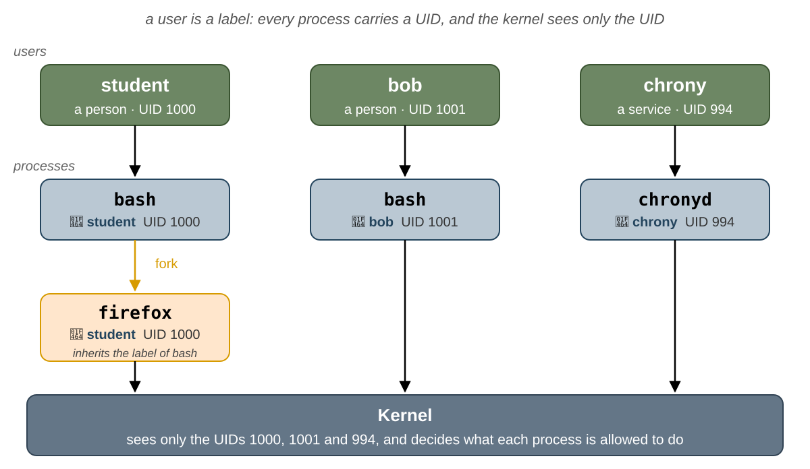

### Who Am I: `whoami` and `id`

| Command          | What it prints                                                                          |
| ---------------- | --------------------------------------------------------------------------------------- |
| `whoami`         | the user name associated with the current effective user ID                                                    |
| `id`             | the whole label of the process: the UID, the primary group (GID) and all the groups, with their names   |
| `id -u`, `id -g` | only the UID, only the GID of the primary group                                                              |
| `id -un`         | only the name of the user, like `whoami`                                                |
| `id -nG`         | only the names of the groups                                                            |
| `id <USER>`, `groups <USER>` | the label of a user, read from the users and groups databases                      |
| `groups`         | the names of your groups, like `id -nG`                                                 |

```shell-session
[student@fedora ~]$ whoami
student
[student@fedora ~]$ id
uid=1000(student) gid=1000(student) groups=1000(student),10(wheel) context=unconfined_u:unconfined_r:unconfined_t:s0-s0:c0.c1023
[student@fedora ~]$ id root
uid=0(root) gid=0(root) groups=0(root)
```

- `student` has the UID `1000` and the primary group `student`, with the GID `1000`.
- It is also a member of the group `wheel`: on Fedora, the members of `wheel` are the **administrators**, who may use
  `sudo` (see [`sudo`](#sudo)).
- `context=...` is the **SELinux** label of the process, a second security system that Fedora uses. This lab does
  not need it, and Ubuntu does not show it.
- `root` is the user with the UID `0`, the administrator.

### UID Ranges

| UID           | Kind              | Used for                                                       | Examples on Fedora                  |
| ------------- | ----------------- | -------------------------------------------------------------- | ----------------------------------- |
| `0`           | `root`            | the administrator, the kernel skips most of the checks for it | `root`                              |
| `1` - `999`   | **system users**  | services; they cannot log in, because their shell is `nologin`                               | `bin`, `daemon`, `dbus`, `chrony`   |
| `1000` - ...  | **regular users** | people                                                         | `student`                           |
| `65534`       | `nobody`          | files whose real owner is unknown, and processes that must have no rights                                      | `nobody`                            |

These ranges are only a **convention**: for the kernel, every UID except `0` is the same. They are set in
`/etc/login.defs`, the settings file of `useradd` and of the other commands that create users, which take the next
free UID from the right range:

```shell-session
[student@fedora ~]$ grep -E '^(UID|SYS_UID)_(MIN|MAX)' /etc/login.defs
UID_MIN                  1000
UID_MAX                 60000
SYS_UID_MIN               201
SYS_UID_MAX               999
```

### The User of a Process

`ps` shows the user of every process in the column `USER` (or `UID`, as a number):

```shell-session
[student@fedora ~]$ ps -o user,uid,pid,ppid,comm
USER       UID     PID    PPID COMMAND
student   1000    2817    2805 bash
student   1000    3104    2817 ps
[student@fedora ~]$ ps -eo user | sort | uniq -c
      4 chrony
      2 dbus
      ...
    156 root
     51 student
```

- `bash` and `ps` run as `student`: `ps` is a child of `bash`, and it inherited its label.
- `ps -eo user` prints the user of **every** process; `sort | uniq -c` counts them (see
  [Pipes](/docs/labs/03#pipes-) in lab 03). Most of the processes of the system run as `root`.

:::info

`ps` gets only the UIDs from the kernel. To print a name, it looks up each UID in the users database; if the UID is
not there, for example because the user was deleted, it prints the number. `ls -l`, `id` and the prompt do the same.

:::

### The Credentials of a Process

The label of a process is more than one UID and a list of groups. For every process, the kernel keeps a small record,
the **credentials** of the process: **four** UIDs, **four** GIDs and the list of the **supplementary groups**. Think
of it as an ID card that the **kernel** keeps for the process: the kernel looks at it every time the process asks for
something, and the process cannot change it as it likes.

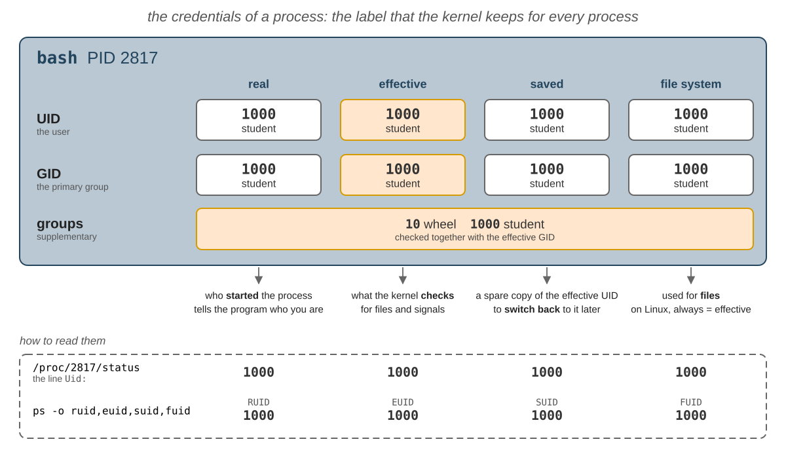

| Credential                  | What it is                                                                                          |
| --------------------------- | --------------------------------------------------------------------------------------------------- |
| **real** UID and GID        | the user who **started** the process, and their primary group; programs read them to find out who you are       |
| **effective** UID and GID   | the ones that the kernel **checks**, when the process opens a file or sends a signal                |
| **saved** UID and GID       | a spare copy of the effective ones, made when the program starts, so that it can put its rights aside for a while and **take them back** |
| **file system** UID and GID | used only for files; on Linux, they always follow the effective ones, so you can ignore them        |
| **supplementary groups**    | the other groups of the process, checked together with the effective GID; copied from the groups database at login, and by `su` and `sudo`                           |


:::note

For your shell, the four UIDs are all `1000` and the four GIDs are all `1000`. Why does the kernel keep four copies of
the same number? Because they are **not always** the same: a program with the `setuid` bit, like `passwd`, changes the
effective and the saved UID, but keeps the real one. `login`, `su` and `sudo` do something else: they change **all**
of them, for the shell or the command that they start.

:::

#### Which Credentials Are Checked

The kernel does not look at all the credentials every time. It depends on what the process asks for:


- **opening a file**: the effective UID is compared with the **owner** of the file, and the effective GID and the
  supplementary groups with the **group** of the file (see [Which Permissions Apply?](#which-permissions-apply));
- **sending a signal**, with `kill`: the real or the effective UID of the sender must be the real or the saved UID of
  the target. You can end a `passwd` that **you** started, even if it runs as `root`, because its real UID is yours;
  `bob` cannot;
- **changing its own UIDs**: a process that is not `root` may only take a UID that it **already has**, its real, its
  effective or its saved one. A process **cannot** make itself `root`. Only a process whose effective UID is `0` may
  take any UID.

#### How the Credentials Change

A process gets its credentials from its parent. This table shows what happens to them at each step of the life of a
process, and the only two cases that change them:


| When                                           | What happens to the UIDs                                                                          |
| ---------------------------------------------- | ------------------------------------------------------------------------------------------------- |
| `fork`, a new child                             | the child gets a **copy** of the credentials of its parent                                        |
| `exec` of a regular program                    | **nothing** changes                                                                               |
| `exec` of a program with the `setuid` bit      | the effective and the saved UID become the **owner** of the executable file; the real UID is inherited from the parent process; the `setgid` bit does the same for the GIDs, with the **group** of the file (see [`setuid`](#setuid)) |
| a process whose effective UID is `0` calls `setgid()`, `initgroups()` and `setuid()` | **all** the GIDs, the supplementary groups and **all** the UIDs change, in this order: this is how `login`, `su` and `sudo` give a process the label of a user (see [Logging In](#logging-in) and [`sudo`](#sudo)) |

#### Seeing the Credentials

There are two ways to see the credentials of a process:

```shell-session
[student@fedora ~]$ ps -o pid,ruser,euser,suser,comm -p $$
    PID RUSER    EUSER    SUSER    COMMAND
   2817 student  student  student  bash
[student@fedora ~]$ grep -E '^(Uid|Gid|Groups):' /proc/$$/status
Uid:	1000	1000	1000	1000
Gid:	1000	1000	1000	1000
Groups:	10 1000
```

- `ps -o` takes the names of the columns: `ruser` is the real user, `euser` the effective one and `suser` the saved
  one. `man ps` lists all of them, for the UIDs, the GIDs and the groups, in the section `STANDARD FORMAT SPECIFIERS`.
- The `Uid:` and `Gid:` lines of `/proc/<PID>/status` have 4 numbers: real, effective, saved and file system; `Groups:`
  has the supplementary groups (`man 5 proc`). Everybody can read the `status` file of any process.

Try to make a process `root` without any help. `python3` can ask the kernel for its UIDs, with `os.getresuid()`
(_get real, effective and saved UID_), and to change them, with `os.setuid()`:

```shell-session
[student@fedora ~]$ python3 -c 'import os; print(os.getresuid()); os.setuid(0)'
(1000, 1000, 1000)
Traceback (most recent call last):
  File "<string>", line 1, in <module>
    import os; print(os.getresuid()); os.setuid(0)
                                      ~~~~~~~~~^^^
PermissionError: [Errno 1] Operation not permitted
```

The kernel refuses: `0` is none of the three UIDs of the process. The only ways to get `root` are to start a program
that **already** runs as `root`, like `sudo`, or one with the `setuid` bit, like `passwd`.

## The Users Database

### `/etc/passwd`

The local users are kept in `/etc/passwd`, a text file with **one user on every line**, and the fields separated by
`:`. **Everyone** can read it, because every program that shows a user name needs it.

```shell-session
[student@fedora ~]$ ls -l /etc/passwd
-rw-r--r--. 1 root root 2245 Oct 20 09:12 /etc/passwd
[student@fedora ~]$ head -3 /etc/passwd
root:x:0:0:Super User:/root:/bin/bash
bin:x:1:1:bin:/bin:/usr/sbin/nologin
daemon:x:2:2:daemon:/sbin:/usr/sbin/nologin
[student@fedora ~]$ grep student /etc/passwd
student:x:1000:1000:Student:/home/student:/bin/bash
```

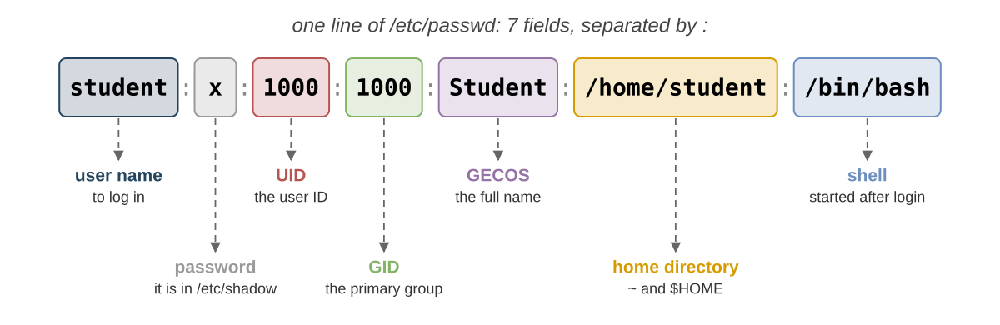

| Field | In the example     | What it is                                                                                    |
| ----- | ------------------ | --------------------------------------------------------------------------------------------- |
| 1     | `student`          | the **user name**, the one you log in with                                                    |
| 2     | `x`                | the password: `x` means that it is kept in `/etc/shadow`                                      |
| 3     | `1000`             | the **UID**                                                                                   |
| 4     | `1000`             | the **GID** of the **primary group**                                                          |
| 5     | `Student`          | the **GECOS** field: the full name, sometimes followed by the room and phone numbers, with `,` |
| 6     | `/home/student`    | the **home directory**: the current directory after login, `~` and `$HOME`                    |
| 7     | `/bin/bash`        | the **shell**, the program started after login; `/usr/sbin/nologin` refuses the login         |

:::info

The `.` after the permissions, `-rw-r--r--.`, means that the file has an **SELinux** label. You will see it on almost
every file on Fedora: ignore it in this lab. Ubuntu does not show it.

:::

### `getent`

`/etc/passwd` is not the only place where users can be kept: in a university or a company, the accounts are usually
on a **server** in the network (LDAP, Active Directory, ...). That is why **no**  program do not read `/etc/passwd` directly by
themselves: they ask the **C library**, with `getpwnam()` (from a name to a user) and `getpwuid()` (from a UID to a
user). The C library reads `/etc/nsswitch.conf` to find out where to look for the users, the passwords and the groups,
and in which order. So `ls`, `ps` and `id` work the same way whether a user is kept in `/etc/passwd` or on a server.

```shell-session
[student@fedora ~]$ grep -E '^(passwd|shadow|group):' /etc/nsswitch.conf
passwd:     files systemd
shadow:     files
group:      files systemd
```

`files` means the files in `/etc`, `systemd` the users that `systemd` creates by itself (your system may also have
`sss`, a network server). `getent` (_get entries_) asks the C library, exactly like `ls` and `id` do, so it finds a user
wherever it is kept:

| Command                           | Finds                                                      |
| --------------------------------- | ---------------------------------------------------------- |
| `getent passwd <NAME>` or `<UID>` | the user with this **name**, or this **UID**               |
| `getent passwd`                   | **all** the users                                          |
| `getent group <NAME>` or `<GID>`  | the group with this name, or this GID                      |
| `getent group`                    | **all** the groups                                         |
| `sudo getent shadow <NAME>`       | the line of the user from `/etc/shadow`, only for `root`   |

:::tip

When nothing is found, `getent` prints **nothing**, without an error.

:::

```shell-session
[student@fedora ~]$ getent passwd 0
root:x:0:0:Super User:/root:/bin/bash
[student@fedora ~]$ getent passwd student
student:x:1000:1000:Student:/home/student:/bin/bash
[student@fedora ~]$ getent passwd nobody
nobody:x:65534:65534:Kernel Overflow User:/:/usr/sbin/nologin
```

:::tip

The output has the same format as `/etc/passwd`. Use `getent` instead of `grep` on `/etc/passwd` when you look for a
user: `grep root /etc/passwd` also finds every line that has `root` somewhere else, for example in the home
directory.

:::

## Passwords

### `/etc/shadow`

`/etc/passwd` must be readable by everyone, so the passwords cannot stay there. They are kept in `/etc/shadow`, that
only `root` can read:

```shell-session
[student@fedora ~]$ ls -l /etc/shadow
----------. 1 root root 1207 Oct 20 09:12 /etc/shadow
[student@fedora ~]$ cat /etc/shadow
cat: /etc/shadow: Permission denied
[student@fedora ~]$ sudo grep student /etc/shadow
student:$y$j9T$Xr3aB7tPq2LkV9sD1fGh0J$9mQeT4bW1sZxH8cDr5Ny2kLpA7uVq3oEw6iFj0gHt1M:20737:0:99999:7:::
```

On Fedora, `/etc/shadow` has **no** permissions at all, `----------`: only `root` can read it, because the kernel
skips the checks for `root`. On Ubuntu, it is `-rw-r----- root shadow`: the group `shadow` may read it too, so that a
few programs can check passwords without being `root`. Each line has 9 fields, separated by `:`:

| Field | In the example     | What it is                                                                                 |
| ----- | ------------------ | ------------------------------------------------------------------------------------------ |
| 1     | `student`          | the user name, the same as in `/etc/passwd`                                                |
| 2     | `$y$j9T$Xr3a...`   | the **hash** of the password; `!`, `!!` or `*` at the start means that the account is **locked**: no password works |
| 3     | `20737`            | the day of the last password change, counted from 1 January 1970                          |
| 4     | `0`                | the minimum number of days between two password changes                                   |
| 5     | `99999`            | the maximum number of days before the password **must** be changed, `99999` is never       |
| 6     | `7`                | how many days before the expiry the user is warned                                         |
| 7     | _empty_            | how many days after the expiry the account can still be used                               |
| 8     | _empty_            | the day when the account expires; empty is never                                           |
| 9     | _empty_            | reserved                                                                                   |

`chage -l` (_change age_) prints the fields 3 - 8 as dates:

```shell-session
[student@fedora ~]$ sudo chage -l student
Last password change                                    : Oct 11, 2026
Password expires                                        : never
Password inactive                                       : never
Account expires                                         : never
Minimum number of days between password change          : 0
Maximum number of days between password change          : 99999
Number of days of warning before password expires       : 7
[student@fedora ~]$ date -d '1970-01-01 + 20737 days'
Sun Oct 11 12:00:00 AM EEST 2026
```

### Hashes and Salt

The password itself is **never** stored, only its **hash**: the result of a **one-way** function. It is easy to
compute the hash of a password, but there is no way to compute the password from the hash: the only way back is to
**guess** a password, hash it, and compare. The second field of `/etc/shadow` is made of parts separated by `$`:

| Part         | In the example            | What it is                                                                       |
| ------------ | ------------------------- | -------------------------------------------------------------------------------- |
| algorithm    | `y`                       | the hash function: `y` is _yescrypt_, `6` is _SHA-512_, `1` is the old _MD5_     |
| parameters   | `j9T`                     | the cost of the algorithm: how much work a hash takes                            |
| **salt**     | `Xr3aB7tPq2LkV9sD1fGh0J`  | a random text, different for every user, added to the password before hashing   |
| hash         | `9mQeT4bW1sZx...`         | the hash of the salt and the password                                            |

:::note

To **check** a password, `login` (or `sudo`, or `passwd`) reads the algorithm, the parameters and the salt from
`/etc/shadow`, hashes the typed password with them, and compares the result with the stored hash. If they are equal,
the password is correct. `openssl passwd` computes a hash in the same way (`-6` is _SHA-512_):

:::


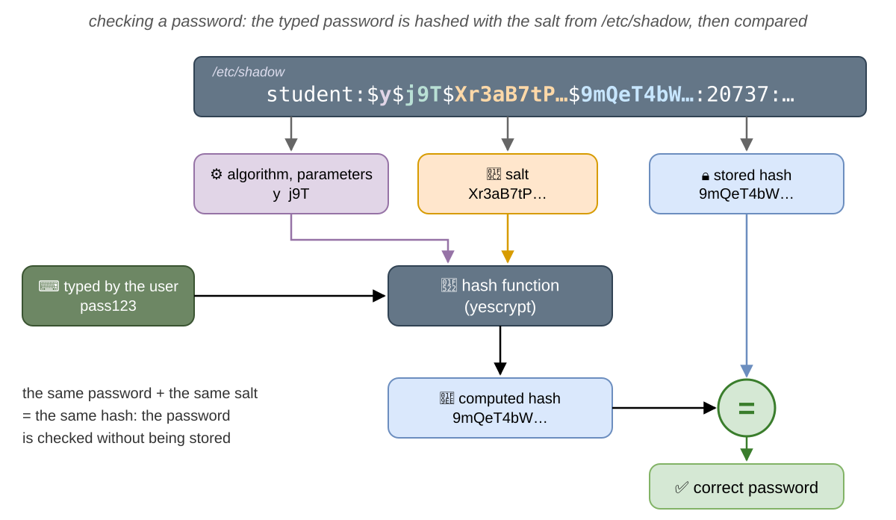

```shell-session
[student@fedora ~]$ openssl passwd -6 -salt Xr3aB7tP pass123
$6$Xr3aB7tP$Z1hKbIRkawX63bJfb3tDz.QpCpVlFdOHOBw1ZdK7Oe/6P0K3E0OUwMhyG7PXhsJPPu.ZobCXoTYNxvAQ3HExk0
[student@fedora ~]$ openssl passwd -6 -salt Xr3aB7tP pass123
$6$Xr3aB7tP$Z1hKbIRkawX63bJfb3tDz.QpCpVlFdOHOBw1ZdK7Oe/6P0K3E0OUwMhyG7PXhsJPPu.ZobCXoTYNxvAQ3HExk0
[student@fedora ~]$ openssl passwd -6 -salt Xr3aB7tP pass124
$6$Xr3aB7tP$msVqpr1xVM/DA2zRy9MVn8yIL5iisMXZpqd3XHD5Ix0aQ5QqD8D3Q91LXVy0w9hPqQLzRYsUVEH5g5oBfNp9//
[student@fedora ~]$ openssl passwd -6 -salt Lp0wQ2zM pass123
$6$Lp0wQ2zM$Uo9XUE/86KtNuRc.TcZpxeM0kWUejWZuFOaRQSujvsfACi8WRK55XpaV3Z3WE8TLEWQBF9Jgn4ByzOvO43Ukw0
```

- The same password and the same salt always give the **same** hash: this is how the password is checked.
- One different letter gives a completely different hash.
- The same password with another salt gives another hash: two users with the same password have different lines in
  `/etc/shadow`.

:::info

Why is the hash not in `/etc/passwd`, which everyone can read? Because the check works for an attacker too: with a
copy of the hash, they can hash one password after another, on their own computer, until one of them gives the same
hash. Nobody sees these tries, and nothing slows them down, unlike `login`, which waits after a wrong password and
writes it in the log. A slow algorithm, like _yescrypt_, makes every try cost more, and the salt makes the attacker
start again for every user, but a simple password is still found quickly. That is why only `root` can read
`/etc/shadow`: the programs that check passwords, `login`, `sudo` and `passwd`, run as `root`, so they can read it.

:::

### Changing a Password: `passwd`

| Command                 | What it does                                                    |
| ----------------------- | --------------------------------------------------------------- |
| `passwd`                | changes **your** password; it asks for the old one first        |
| `sudo passwd <USER>`    | changes the password of another user (only `root` can do it)    |
| `sudo passwd -l <USER>` | **locks** the password: adds `!!` (Ubuntu: `!`) in front of the hash, so no password works |
| `sudo passwd -u <USER>` | unlocks it: removes the `!`, and the **old** password works again                                                     |
| `sudo passwd -S <USER>` | prints the state of the password: set, locked or empty                                 |

:::caution

When you type a password in the terminal, **nothing** appears on the screen. Type it anyway and press
<kbd>Enter</kbd>. Fedora refuses passwords that are too short or too simple, unless you are `root`.

:::

## Groups

A **group** is a set of users. A group has no rights by itself: a file can give permissions to a group, and `sudo`
trusts one group, and then every member gets these rights. Like a user, a group has a **name** and a number, the
**GID** (_Group ID_), and the kernel knows only the number. Every user has:

- **one primary group**, the GID in `/etc/passwd`: the new files of the user get this group. On Fedora and Ubuntu,
  `useradd` creates a group with the same name as the user, only for them;
- any number of **supplementary groups**, listed in `/etc/group`, for example `wheel`.

The local groups are kept in `/etc/group`, one group per line, with 4 fields:

```shell-session
[student@fedora ~]$ getent group wheel
wheel:x:10:student
[student@fedora ~]$ getent group student
student:x:1000:
```

| Field | In the example | What it is                                                                                |
| ----- | -------------- | ----------------------------------------------------------------------------------------- |
| 1     | `wheel`        | the name of the group                                                                     |
| 2     | `x`            | the password of the group, almost never used                                              |
| 3     | `10`           | the **GID**                                                                               |
| 4     | `student`      | the **members**, separated by `,`: the users that have it as a **supplementary** group   |

:::caution

The users that have a group as their **primary** group are **not** listed in its last field: `student` is the only
member of the group `student`, but the list is empty. Use `id <USER>` to see all the groups of a user.

:::

## Logging In

When you log in, a process gets the label of your user. On a text terminal, `/dev/tty3` for example:

1. `systemd` starts `agetty` on the terminal, as `root`; it prints `login:` and reads the user name;
2. `agetty` **becomes** `login` (it runs `exec`), still as `root`, and it asks for the password;
3. `login` finds the user with the C library, and checks the password with the hash from `/etc/shadow`;
4. a child of `login` sets its **GID**, its **groups** and, at the end, its **UID** to the ones of the user; after that,
   it can **never** go back to `root`;
5. the child changes to the **home directory** and runs (`exec`) the **shell** from `/etc/passwd`.

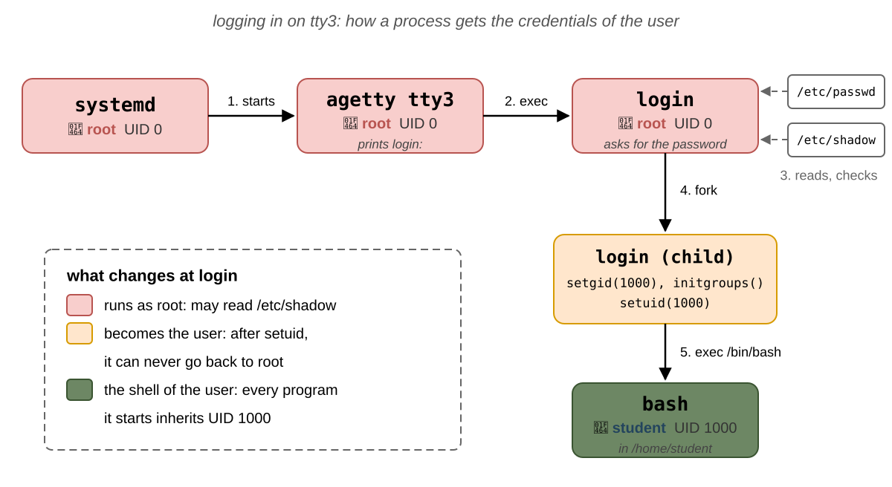

```shell-session
[student@fedora ~]$ ps -t tty3 -o user,pid,ppid,comm
USER         PID    PPID COMMAND
root        5120       1 login
student     5191    5120 bash
```

`login` still runs as `root`, and waits for the shell to end; the shell runs as `student`. Every program you start from
it inherits this label. A graphical login and `ssh` do the same steps.

:::info

The groups are copied from the groups database only when a process gets the label of a user: at login, and by `su` and
`sudo`. If you are added to a new group, the processes that are already running do not have it, and neither do their
children: a new terminal window is a child of Sway, which got its groups when you logged in. To get the new group,
**log out and log in again**, or, for one shell only, start a login shell with `su - student`, or run
`newgrp <GROUP>`.

:::

## The `root` User

`root` is the user with the UID `0`. For a process whose effective UID is `0`, the kernel **skips** most of its
checks: it can read and write any file, send signals to any process, mount disks and change the network. Installing
software and adding users need `root` for the same reason: they write files that belong to `root`, in `/usr` and in
`/etc`. The home directory of `root` is `/root`, not `/home/root`, so that `root` can still log in when `/home` is on
another disk that does not work.

The kernel looks only at the **number**: `root` is just the name of the UID `0`, usually on the first line of
`/etc/passwd`. Two user names with the same UID are the **same user** for the kernel: this is how an attacker can hide
a second `root`.

:::danger

A mistake as `root` can destroy the whole system: `root` gets no `Permission denied` to stop it. Work as a regular
user, and become `root` only for the commands that need it.

:::

## Becoming `root`: `sudo` and `su`

### `sudo`

`sudo` runs **one command** as `root`. It asks for **your** password, not the one of `root`, and it lets you do it only
if you are an **administrator**. A user is an administrator if they are a member of one special group, whose name
depends on the distribution:

| Distribution                 | The group of the administrators |
| ---------------------------- | ------------------------------- |
| Fedora, Red Hat, CentOS      | `wheel`                         |
| Ubuntu, Debian, Linux Mint   | `sudo`                          |

To make a user an administrator, add them to this group; to take the right away, remove them from it (see
[Managing Users and Groups](#managing-users-and-groups)). `student` is in `wheel`, so it may use `sudo`:

```shell-session
[student@fedora ~]$ cat /etc/shadow
cat: /etc/shadow: Permission denied
[student@fedora ~]$ sudo whoami
[sudo] password for student:
root
[student@fedora ~]$ sudo whoami
root
```

- `sudo` itself runs as `root`, and it starts the command as `root` too: `whoami` prints `root`.
- It remembers the password for **5 minutes**, in this terminal: the second `sudo` did not ask for it.
- A user who is not an administrator gets `bob is not in the sudoers file.`, and the command does not start.

`sudo` writes **every** command in the system log: who ran what, as whom, and from which directory.

```shell-session
[student@fedora ~]$ sudo journalctl -t sudo | tail -2
Oct 27 10:02:11 fedora sudo[3311]:  student : TTY=pts/0 ; PWD=/home/student ; USER=root ; COMMAND=/usr/bin/whoami
Oct 27 10:02:20 fedora sudo[3315]:  student : TTY=pts/0 ; PWD=/home/student ; USER=root ; COMMAND=/usr/bin/journalctl -t sudo
```

While the command runs, `sudo` does not go away: it waits for the command to end and passes on the signals that it
receives. On Fedora, `sudo` also runs the command in a **new pseudo terminal** of its own (the option `use_pty`, see
[Terminal Emulators](/docs/labs/04#terminal-emulators) in lab 04), so there are **two** `sudo` processes: the first one
stays on your terminal, the second one opens the new pseudo terminal and starts the command in it. With `sudo sleep 300`
running in a shell with the PID `2817`:

```shell-session
[student@fedora ~]$ pstree -pu 2817
bash(2817)───sudo(3320,root)───sudo(3321)───sleep(3322)
[student@fedora ~]$ ps -o pid,ppid,tty,comm -p 3320,3321,3322
    PID    PPID TT       COMMAND
   3320    2817 pts/0    sudo
   3321    3320 pts/2    sudo
   3322    3321 pts/2    sleep
```

- `pstree -p` shows the PIDs, and `-u` the user, where it changes: `sudo` runs as `root`, and so does everything under
  it.
- The second `sudo` and `sleep` are on `pts/2`, not on `pts/0`: `ps -t pts/0` does **not** show the command started
  with `sudo`. Find it with `pstree`, `pgrep` or the PPID instead.

:::info

The new pseudo terminal protects you: a program started with `sudo` cannot type commands into your own terminal after
it ends. Some distributions do not use it (`sudo` 1.9.14 and later use it by default); there, `pstree` shows only one
`sudo`.

:::

| Command                 | What it does                                                                   |
| ----------------------- | ------------------------------------------------------------------------------ |
| `sudo <command>`        | runs `command` as `root`                                                       |
| `sudo -u <USER> <command>` | runs the command as another user; it asks for **your** password, not theirs                                              |
| `sudo -i`               | starts a **login shell** of `root`, in `/root`, with the variables of `root`   |
| `sudo -s`               | starts a shell as `root`, in the current directory                             |
| `sudo -E <command>`     | keeps your environment variables, except `PATH`; without it, `sudo` removes most of them      |
| `sudo -l`               | lists what you are allowed to run                                              |
| `sudo -k`               | forgets the password: the next `sudo` asks again                               |
| `sudo !!`               | runs the **previous** command again, with `sudo`: `bash` replaces `!!` before `sudo` starts   |

:::info

The group of the administrators is chosen in the settings of `sudo`, the file `/etc/sudoers`. You do not need to
change it, or to understand it, in this lab: you only add users to the group, or remove them from it. If you are
curious, the line `%wheel  ALL=(ALL)  ALL` near its end is the one that gives the group `wheel` its rights.

:::

### `su`

`su` (_switch user_) starts a **shell** as another user, and asks for the password of **that** user:

| Command          | What it does                                                                    |
| ---------------- | ------------------------------------------------------------------------------- |
| `su - <USER>`    | starts a **login shell** of the user: their home directory, variables and groups |
| `su -`           | the same, for `root`; it asks for the password of `root`                        |
| `exit`           | leaves the shell, back to your own                                              |

```shell-session
[student@fedora ~]$ su -
Password:
su: Authentication failure
[student@fedora ~]$ sudo -i
[root@fedora ~]# whoami
root
[root@fedora ~]# exit
logout
[student@fedora ~]$
```

On Fedora and on Ubuntu, `root` usually has **no password** (it is locked in `/etc/shadow`), unless you set one when you
installed the system: `su -` does not work, and `sudo -i` is the way to get a shell of `root`. With `su`, everybody who
becomes `root` has to know the same password, and the log cannot tell who it was; with `sudo`, everyone uses their own.

:::tip

The prompt shows `#` instead of `$` in a shell of `root`. Leave it with `exit` as soon as you are done.

:::

### The Redirect Trap

`sudo` runs the **command**, not the whole line. The **redirects** are done by your shell, which runs as you,
**before** `sudo` starts:

```shell-session
[student@fedora ~]$ sudo echo "192.168.1.20 printer" >> /etc/hosts
bash: /etc/hosts: Permission denied
[student@fedora ~]$ echo "192.168.1.20 printer" | sudo tee -a /etc/hosts
192.168.1.20 printer
```


- In the first line, `bash` tries to open `/etc/hosts` for `>>`, as `student`, and fails: `sudo echo` never starts.
- In the second line, `tee` runs as `root`: it reads the text from the pipe and writes it into the file **and** on the
  screen. `-a` (_append_) adds it at the end, like `>>`; without it, `tee` replaces the content of the file, like `>`.

:::tip

`tee` also prints the text on the screen. To hide it, send its output to `/dev/null`:

`echo "192.168.1.20 printer" | sudo tee -a /etc/hosts > /dev/null`. This redirect is also done by your shell, as you, but it works because of the permissions of `/dev/null`: they are `rw-rw-rw-` (`666`), so every user may write to it.


:::

## Managing Users and Groups

The commands below change `/etc/passwd`, `/etc/shadow` and `/etc/group` for you, so they need `sudo`:

| Command                             | What it does                                                                  |
| ----------------------------------- | ----------------------------------------------------------------------------- |
| `sudo useradd -m <USER>`            | creates a user, with a group of the same name; `-m` creates the home directory, `-c` sets the full name, `-s` the shell |
| `sudo passwd <USER>`                | sets the password of the user             |
| `sudo groupadd <GROUP>`             | creates a group                                                               |
| `sudo usermod -aG <GROUP> <USER>`   | **adds** the user to a supplementary group                                    |
| `sudo usermod <OPTIONS> <USER>`     | **changes** a user that already exists; it takes most of the options of `useradd`: `-c` the full name, `-s` the shell, ... |
| `sudo gpasswd -a <USER> <GROUP>`    | also adds the user to the group                                               |
| `sudo gpasswd -d <USER> <GROUP>`    | removes the user from the group                                               |
| `sudo userdel -r <USER>`            | deletes the user; `-r` also deletes its home directory                        |
| `sudo groupdel <GROUP>`             | deletes a group; it refuses if the group is the primary group of a user                                                                |

```shell-session
[student@fedora ~]$ sudo useradd -m -c "Dave Brown" dave
[student@fedora ~]$ sudo passwd dave
New password:
Retype new password:
passwd: password updated successfully
[student@fedora ~]$ sudo usermod -aG students dave
[student@fedora ~]$ id dave
uid=1003(dave) gid=1004(dave) groups=1004(dave),1003(students)
[student@fedora ~]$ ls -ld /home/dave
drwx------. 3 dave dave 80 Oct 27 10:15 /home/dave
```

The numbers may be different on your computer: `useradd` takes the next free UID and GID.

A new user is **not** an administrator. `sudo` works for `student` because `student` is in `wheel`; `dave` is not,
so `sudo` refuses him, even with his correct password:

```shell-session
[student@fedora ~]$ su - dave
Password:
[dave@fedora ~]$ sudo whoami
[sudo] password for dave:
dave is not in the sudoers file.
[dave@fedora ~]$ exit
logout
[student@fedora ~]$ sudo usermod -aG wheel dave
[student@fedora ~]$ su - dave
Password:
[dave@fedora ~]$ sudo whoami
[sudo] password for dave:
root
[dave@fedora ~]$ exit
logout
[student@fedora ~]$ sudo gpasswd -d dave wheel
Removing user dave from group wheel
```

- The first `sudo` fails: `dave` is not in `wheel`, the group of the administrators. The attempt is still written in
  the log.
- After he is added to `wheel`, a **new login** (`su - dave`) has the new group, and `sudo` works, with **his** own
  password.
- `gpasswd -d` takes the right away again.

:::danger

Never forget the `-a` of `usermod -aG`. `usermod -G students dave` **replaces** all the supplementary groups of `dave`
with `students`. Run it on yourself and you lose `wheel`, and with it `sudo`.

:::

`usermod` changes the fields of `/etc/passwd` for you, and `userdel` removes the user, with their group and, with `-r`,
their home directory:

```shell-session
[student@fedora ~]$ sudo usermod -c "David Brown" dave
[student@fedora ~]$ getent passwd dave
dave:x:1003:1004:David Brown:/home/dave:/bin/bash
[student@fedora ~]$ sudo userdel -r dave
[student@fedora ~]$ id dave
id: 'dave': no such user
[student@fedora ~]$ ls -d /home/dave
ls: cannot access '/home/dave': No such file or directory
```

`userdel` refuses to delete a user who is still logged in, or has processes running: it prints
`userdel: user dave is currently used by process 4321`. Log the user out first.

## File Permissions

### Owner, Group and Permissions

Every file and directory has **one owner** (a user), **one group**, and three sets of **permissions**: for the
**owner** (`u`, _user_), for the **group** (`g`) and for all the **others** (`o`). The owner and the group are kept as
numbers, a UID and a GID, and they are independent: the owner does not have to be a member of the group. `ls -l` shows
them:

```shell-session
[student@fedora lab05]$ ls -l notes.txt
-rw-r-----. 1 student students 9 Oct 27 10:20 notes.txt
```

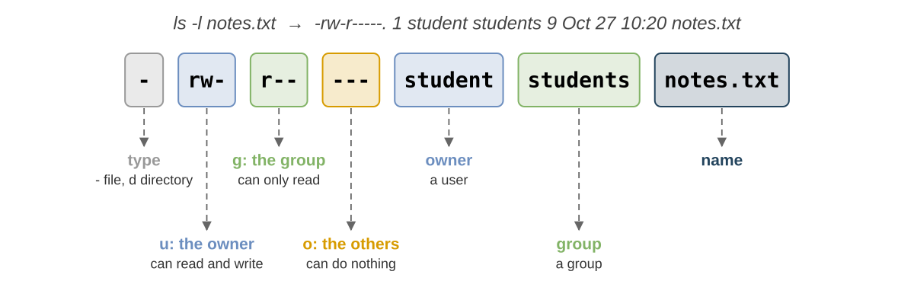

| Part          | In the example | What it is                                                                              |
| ------------- | -------------- | --------------------------------------------------------------------------------------- |
| type          | `-`            | `-` a file, `d` a directory, `l` a symbolic link, `c` and `b` devices                   |
| `u`           | `rw-`          | the owner, `student`, can **read** and **write** the file                               |
| `g`           | `r--`          | the members of the group `students` can only **read** it                                |
| `o`           | `---`          | everybody else can do **nothing**                                                       |
| owner         | `student`      | the user that owns the file, usually the one that created it                            |
| group         | `students`     | the group of the file, usually the primary group of the one that created it             |

`stat` prints the same information, in the format you ask for:

```shell-session
[student@fedora lab05]$ stat -c '%A %a %U %G %n' notes.txt /etc/passwd /etc/shadow
-rw-r----- 640 student students notes.txt
-rw-r--r-- 644 root root /etc/passwd
---------- 0 root root /etc/shadow
```

`%A` are the permissions as letters, `%a` as a number (see [`chmod`](#chmod)), `%U` the owner, `%G` the group and `%n`
the name.

### `r`, `w` and `x`

The same letters have a different meaning for files and for directories:

| Permission  | Value | For a file                       | For a directory                                                          |
| ----------- | ----- | -------------------------------- | ------------------------------------------------------------------------ |
| `r` read    | `4`   | read the content (`cat`, `less`) | **list** the names of the files inside (`ls`); `ls -l` also needs `x`, as it reads each file's details, which means "entering" the directory |

| `w` write   | `2`   | change the content               | **create**, **delete** and **rename** the files inside, only together with `x`, as it needs to enter the directory first |

| `x` execute | `1`   | run it as a program              | **enter** it (`cd`) and reach the files inside, if you know their names  |


A directory is a file whose content is a **list of names**, each pointing to a file. `r` reads this list, `w` changes
it, and `x` uses it to reach a file. This has two consequences:

- creating, renaming or **deleting** a file is a change of the **directory**, not of the file: with `w` on a directory
  you can delete a file that you cannot even read;
- to reach a file, you need `x` on **every** directory of its path: `cat /home/student/lab05/notes.txt` needs `x` on
  `/`, `/home`, `/home/student` and `/home/student/lab05`.

```shell-session
[student@fedora lab05]$ ls -ld noread noenter
d--x------. 2 student student 60 Oct 27 10:20 noread
dr--------. 2 student student 60 Oct 27 10:20 noenter
[student@fedora lab05]$ ls noread
ls: cannot open directory 'noread': Permission denied
[student@fedora lab05]$ cat noread/secret.txt
top secret
[student@fedora lab05]$ ls noenter
ls: cannot access 'noenter/secret.txt': Permission denied
secret.txt
[student@fedora lab05]$ cd noenter
bash: cd: noenter: Permission denied
```

- `noread` has `x` but no `r`: its names cannot be listed, but a file whose name you **know** can be opened.
- `noenter` has `r` but no `x`: `ls` can read the names, but not reach the files to show them; `cd` cannot enter it.

:::info

On Fedora, the home directories are `drwx------`: the other users cannot even enter yours, so they cannot reach your
files, whatever their permissions. On Ubuntu, they are `drwxr-x---`: the members of your primary group may also list
and enter it, but this group usually has no other member. An older Ubuntu, or one upgraded from an older version, may
still have `drwxr-xr-x`, open to everybody: check yours with `ls -ld ~`.

:::

### Which Permissions Apply?

The kernel checks the label of the process in this **order**, and the first match decides:

1. if the UID of the process is `0`, `root`: everything is allowed (except running a file without any `x`);
2. if the UID is the **owner** of the file: the `u` permissions are used;
3. if one of the groups of the process is the **group** of the file: the `g` permissions are used;
4. otherwise: the `o` permissions are used.

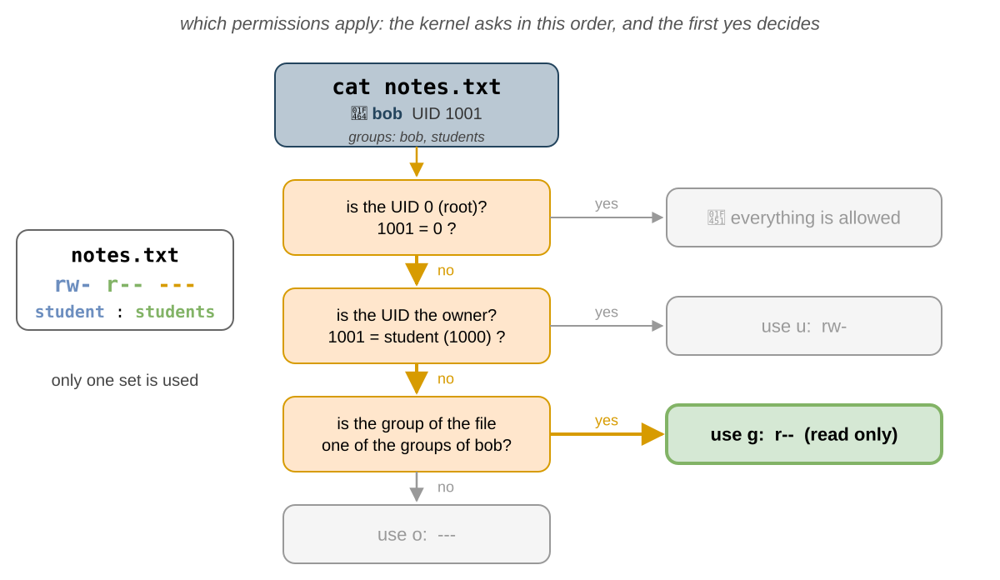

For `notes.txt` above, `-rw-r----- student students`:

| Process run by | Its groups                | Uses  | Read | Write |
| -------------- | ------------------------- | ----- | ---- | ----- |
| `root`         | `root`                    | -     | yes  | yes   |
| `student`      | `student`, `wheel`        | `u`   | yes  | yes   |
| `bob`          | `bob`, `students`         | `g`   | yes  | no    |
| `carol`        | `carol`                   | `o`   | no   | no    |

:::caution

Only **one** set is used. With `----rw----`, the owner can do **nothing**, even if they are in the group: the owner
already matched at step 2, so the `g` permissions are never checked.

:::

### `chmod`

`chmod` (_change mode_) changes the permissions. Only the **owner** of the file (or `root`) can run it. The
permissions can be written with **letters**:

| Part   | Letters                                                      |
| ------ | ------------------------------------------------------------ |
| who    | `u` the owner, `g` the group, `o` the others (**not** the owner and **not** a member of the group), `a` all three   |

| how    | `+` adds, `-` removes, `=` sets exactly these                |
| what   | `r`, `w`, `x`                                                |

| Command                     | What it does                                                                      |
| --------------------------- | --------------------------------------------------------------------------------- |
| `chmod u+x script.sh`       | adds `x` for the owner                                                            |
| `chmod g+w,o-r notes.txt`   | adds `w` for the group and removes `r` for the others                             |
| `chmod go-rwx notes.txt`    | removes everything for the group and the others                                   |
| `chmod a=r readme.txt`      | sets `r--` for everybody                                                          |
| `chmod -R g+rX project`     | for the group, adds `r` to `project` and everything inside, and `x` only to the directories and to the files that are already executable for someone |

| `chmod u=rw,go=r notes.txt` | sets exactly `rw-` for the user and `r--` for the group and others (`rw-r--r--`); `=` replaces the old permissions instead of adding to them |


or with **numbers**, in octal: `r` is `4`, `w` is `2` and `x` is `1`. Add them for each of `u`, `g` and `o`:

| Letters     | `u`         | `g`       | `o`       | Number |
| ----------- | ----------- | --------- | --------- | ------ |
| `rw-r-----` | 4 + 2 = `6` | 4 = `4`   | `0`       | `640`  |
| `rwxr-xr-x` | 4 + 2 + 1 = `7` | 4 + 1 = `5` | 4 + 1 = `5` | `755` |
| `rw-r--r--` | `6`         | `4`       | `4`       | `644`  |
| `rw-------` | `6`         | `0`       | `0`       | `600`  |

```shell-session
[student@fedora lab05]$ ls -l myid.sh
-rw-r--r--. 1 student student 18 Oct 27 10:20 myid.sh
[student@fedora lab05]$ ./myid.sh
bash: ./myid.sh: Permission denied
[student@fedora lab05]$ chmod u+x myid.sh
[student@fedora lab05]$ ./myid.sh
student
[student@fedora lab05]$ chmod 600 myid.sh
[student@fedora lab05]$ ls -l myid.sh
-rw-------. 1 student student 18 Oct 27 10:20 myid.sh
```

:::tip

Use the letters to **change** some permissions and keep the others (`chmod g+w`), and the numbers to **set** all of
them at once (`chmod 640`). With `-R`, use the letters: `chmod -R 644 box` also removes the `x` of the directories,
and then nobody can enter them, not even `chmod`; `chmod -R u=rwX,go=rX box` gives the files `rw-r--r--` and the
directories `rwxr-xr-x`.

:::

### `umask`

New files do not get all the permissions: the program that creates them asks for `rw-rw-rw-` (`666`) for a file and
`rwxrwxrwx` (`777`) for a directory, and the kernel **removes** the bits of the **`umask`** of the process. `umask` is a
built-in command of the shell (`help umask`), and every process inherits it from its parent.

```shell-session
[student@fedora lab05]$ umask
0022
[student@fedora lab05]$ touch new.txt
[student@fedora lab05]$ mkdir newdir
[student@fedora lab05]$ ls -ld new.txt newdir
-rw-r--r--. 1 student student  0 Oct 27 10:25 new.txt
drwxr-xr-x. 2 student student 40 Oct 27 10:25 newdir
```

|                      | File        | Directory   |
| -------------------- | ----------- | ----------- |
| the program asks for | `666` `rw-rw-rw-` | `777` `rwxrwxrwx` |
| `umask 022` removes  | `022` `----w--w-` | `022` `----w--w-` |
| the result           | `644` `rw-r--r--` | `755` `rwxr-xr-x` |

- `022` removes `w` for the group and for the others.
- A new file is never executable: `umask` can only **remove** bits, and programs do not ask for `x` for files.
- `umask 077` makes every new file private: `600` for files and `700` for directories. It lasts until the shell ends.

:::info

Some systems use `umask 002` for the regular users: then the new files are `rw-rw-r--`. This is safe because every user
has a primary group of their own, with no other members.

:::

### `chown` and `chgrp`

| Command                              | What it does                                                         |
| ------------------------------------ | -------------------------------------------------------------------- |
| `sudo chown bob notes.txt`           | the owner becomes `bob`                                              |
| `sudo chown bob:students notes.txt`  | the owner becomes `bob` and the group `students`                     |
| `chown :students notes.txt`          | only the group, like `chgrp`                                         |
| `chgrp students notes.txt`           | only the group                                                       |
| `chown -R`, `chgrp -R`               | the directory and everything inside it                               |
| `sudo chown 1005 notes.txt`         | the owner becomes the UID `1005`, even if there is not user with UID 1005             |


- Only `root` can give a file to another user: otherwise, anyone could fill the disk of another user, or hide what
  they did.
- The owner can change the group of a file, but only to one of the groups of their **process**.

```shell-session
[student@fedora lab05]$ chown carol notes.txt
chown: changing ownership of 'notes.txt': Operation not permitted
[student@fedora lab05]$ sudo chown carol notes.txt
[student@fedora lab05]$ ls -l notes.txt
-rw-r-----. 1 carol students 9 Oct 27 10:20 notes.txt
```

## Special Permissions

There are three more bits, shown by `ls -l` in the place of an `x`:

| Bit        | Number | `ls -l` shows              | On a program                                       | On a directory                                                                     |
| ---------- | ------ | -------------------------- | -------------------------------------------------- | ---------------------------------------------------------------------------------- |
| **setuid** | `4000` | `-rwsr-xr-x`               | runs with the effective UID of the **owner** of the file | ignored                                                                      |
| **setgid** | `2000` | `-rwxr-sr-x`, `drwxrwsr-x` | runs with the effective GID of the **group** of the file | new files get the **group of the directory**; new directories also get the bit |
| **sticky** | `1000` | `drwxrwxrwt`               | ignored                                            | a file can be deleted or renamed only by its owner, the owner of the directory and `root` |

With letters, they are `u+s`, `g+s` and `+t`; with numbers, the 4th digit in front: `chmod 2775 project` is
`rwxrwsr-x`. A **capital** `S` or `T` means that the bit is set, but the `x` under it is not.

### `setuid`

`passwd` must write your new hash into `/etc/shadow`, which only `root` can change. `/usr/bin/passwd` belongs to
`root` and has the **setuid** bit: whoever starts it, the process runs as `root`.

```shell-session
[student@fedora ~]$ ls -l /usr/bin/passwd /usr/bin/sudo /usr/bin/su
-rwsr-xr-x. 1 root root  32648 Jul 24 03:00 /usr/bin/passwd
-rwsr-xr-x. 1 root root  56920 Jul 24 03:00 /usr/bin/su
---s--x--x. 1 root root 262536 Jul 24 03:00 /usr/bin/sudo
```

When a program with the setuid bit starts, the kernel changes two of its [credentials](#the-credentials-of-a-process):
the **effective** and the **saved** UID become the owner of the file, `root`. The **real** UID stays the one of the
user who started it. Run `passwd` in one terminal (do not type anything), and look at it from another one:

```shell-session
[student@fedora ~]$ ps -o pid,ruser,euser,suser,comm -C passwd
    PID RUSER    EUSER    SUSER    COMMAND
   6011 student  root     root     passwd
```

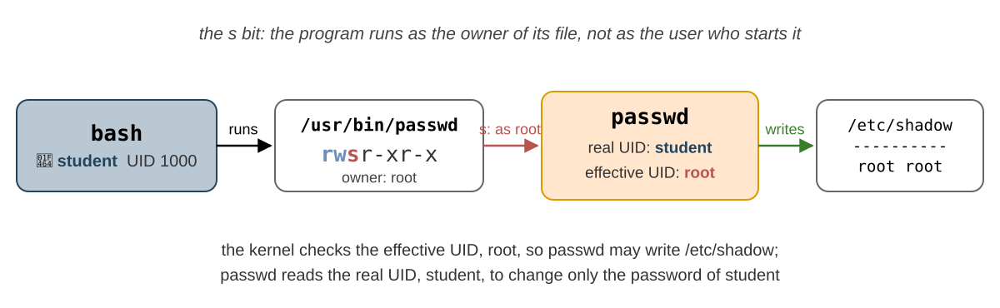

The kernel checks the effective UID, so `passwd` may write `/etc/shadow`. `passwd` reads the real UID to find out who
started it, so it changes only **your** password.

#### The Saved UID

A careful setuid program does not work as `root` all the time: it works as **you**, and uses `root` only for the few
steps that need it, so that a bug in the rest of it can only do what you could do anyway. The **saved** UID makes this
possible. After the `exec`, the `Uid:` line of the program is `1000 0 0 0`:

1. the program sets its **effective** UID to its real one, `1000` (`Uid: 1000 1000 0 1000`): `root` stays only in
   the saved UID;
2. when it needs `root` again, it sets its effective UID back to `0` (`Uid: 1000 0 0 0`): this is allowed, because
   `0` is its saved UID;
3. when it does not need `root` any more, it sets **all three** UIDs to `1000` (`Uid: 1000 1000 1000 1000`): `0` is
   none of its UIDs now, so it can never go back.


:::danger

Never add `+s` to a program that belongs to `root`: it runs as `root` for **everybody**, and one bug in it makes
anybody `root`. A setuid copy of `bash` gives a shell of `root` to every user. Leave the setuid bit to the programs that
are made for it: `passwd`, `su`, `sudo`.

:::

:::info

The kernel ignores the setuid and the setgid bit on **scripts**, like `myid.sh`. A script does not run by itself: the
kernel starts the program on its first line, `/bin/bash`, and gives it the script to read. A `bash` with the label of
`root` would be dangerous, because the user who starts it can change what it does, for example with environment
variables. So the bits work only for compiled programs, like `passwd`.

:::

### `setgid` on a Directory

When several users work in the same directory, the new files should belong to the group of the project, not to the
primary group of each user. The **setgid** bit on a directory does this:

```shell-session
[student@fedora ~]$ sudo mkdir /srv/project
[student@fedora ~]$ sudo chgrp students /srv/project
[student@fedora ~]$ sudo chmod 2775 /srv/project
[student@fedora ~]$ ls -ld /srv/project
drwxrwsr-x. 2 root students 40 Oct 27 10:40 /srv/project
[student@fedora ~]$ sudo -u bob touch /srv/project/bob.txt
[student@fedora ~]$ ls -l /srv/project
total 0
-rw-r--r--. 1 bob students 0 Oct 27 10:41 bob.txt
```

`bob.txt` belongs to `bob`, but its group is `students`, the group of the directory, not `bob`.

### The Sticky Bit

`/tmp` must be writable by everyone, so everyone has `w` on it. Without anything else, anyone could delete the files
of the others. The **sticky** bit, `t`, allows deleting or renaming a file in the directory only to the **owner of the
file**, the owner of the directory and `root`:

```shell-session
[student@fedora ~]$ ls -ld /tmp
drwxrwxrwt. 21 root root 520 Oct 27 10:00 /tmp
```

:::tip

`find` can look for the special bits: `find /usr -perm -4000` prints the files that have **at least** the setuid bit.

:::

## The Prompt

The prompt of `bash` is built from the shell variable `PS1` (see lab 04). On Fedora, it is `[\u@\h \W]\$ ` (on Ubuntu,
`\u@\h:\w\$ `, with colors):

| Escape | Meaning                                                          | For `student`   | For `root` |
| ------ | ---------------------------------------------------------------- | --------------- | ---------- |
| `\u`   | the **user**                                                     | `student`       | `root`     |
| `\h`   | the **host** name                                                | `fedora`        | `fedora`   |
| `\W`   | the name of the current directory (`\w` is the whole path)       | `lab05`         | `~`        |
| `\$`   | `$` for the users, `#` for the UID `0`                           | `$`             | `#`        |

The prompt is only **text**, and any user can change it:

```shell-session
[student@fedora ~]$ PS1='[root@fedora \W]# '
[root@fedora ~]# whoami
student
[root@fedora ~]# cat /etc/shadow
cat: /etc/shadow: Permission denied
```

:::caution

Do not trust the prompt to tell you who you are. `whoami` and `id` ask the **kernel** for the label of the process.

:::

### Changing the Prompt

`PS1` can hold any text, and these escapes (`man bash`, section `PROMPTING`):

| Escape     | Replaced with                                                                       |
| ---------- | ----------------------------------------------------------------------------------- |
| `\u`, `\h` | the user; the host name, up to the first `.`                                        |
| `\w`, `\W` | the whole path of the current directory, with `~` for your home; only its last name |
| `\$`       | `$`, or `#` if the effective UID is `0`                                             |
| `\t`, `\A` | the time, as `HH:MM:SS` and `HH:MM`                                                 |
| `\d`       | the date, like `Tue Oct 27`                                                         |
| `\j`       | the number of jobs of the shell (lab 04)                                            |
| `\n`       | a new line                                                                          |
| `\e`       | the escape character, which starts a color code                                     |
| `\[`, `\]` | put around a color code: it takes no space on the screen                            |

```shell-session
[student@fedora lab05]$ PS1='\A \u in \w \$ '
10:52 student in ~/lab05 $ PS1='[\u@\h \W]\$ '
[student@fedora lab05]$
```

The colors are written as `\e[<code>m`: `31` red, `32` green, `33` yellow, `34` blue, `1;` in front makes them bold,
and `0` goes back to normal. The `\[` and `\]` around them tell `bash` that they take no space on the screen; without
them, long commands are drawn over the prompt.

```bash
PS1='\[\e[1;32m\]\u@\h\[\e[0m\]:\[\e[1;34m\]\w\[\e[0m\]\$ '
```

:::tip

A change of `PS1` lasts until the shell ends. To keep it, add the line `PS1='...'` at the end of `~/.bashrc`; `bash`
reads it when it starts (`source ~/.bashrc` reads it now). `root` has its own `/root/.bashrc`, so you can give the
shells of `root` a red prompt, that you cannot miss.

:::

## Troubleshooting

| Problem                                                       | Solution                                                                                                  |
| ------------------------------------------------------------- | --------------------------------------------------------------------------------------------------------- |
| `Permission denied` on a file                                 | `ls -l` the file and `id`: find which set applies to you (owner, group or others) and what it allows      |
| `Permission denied` on a file that has `r` for you            | One of the directories of its path has no `x` for you: `ls -ld` each of them                              |
| `./script.sh: Permission denied`                              | The file has no `x`: `chmod u+x script.sh`                                                                |
| `Operation not permitted` for `chmod` or `chown`              | Only the owner may run `chmod`, and only `root` may change the owner: use `sudo`                          |
| `student is not in the sudoers file.`                         | The user is not an administrator: not in `wheel` (Fedora) or `sudo` (Ubuntu); an administrator must run `sudo usermod -aG wheel student`, then log in again |
| `sudo echo ... > file`: `Permission denied`                   | The redirect is done by your shell, before `sudo`: use `echo ... \| sudo tee file`                        |
| `su: Authentication failure` for `su -`                       | `root` has no password on Fedora and Ubuntu: use `sudo -i`                                                         |
| A new group does not show up in `id`                          | The groups are read at login: log in again, or start a new login shell with `su - <USER>`                 |
| `usermod -G` removed my groups                                | You forgot `-a`; add them back with `sudo usermod -aG <GROUP> <USER>`                                     |
| `passwd`: `BAD PASSWORD: The password is shorter than 8 characters` | Choose a longer, less simple password                                                               |
| `useradd: user 'bob' already exists`                          | The user is already there: check with `id bob`                                                            |
| `userdel: user bob is currently used by process 1234`         | `bob` still has processes: end them, or log `bob` out first                                               |
| `rm: remove write-protected regular file?`                    | You do not have `w` on the file, but you have it on the directory: answer `y` to delete it anyway         |
| `rm: cannot remove ... Operation not permitted` in `/tmp`     | The sticky bit: only the owner of the file can delete it                                                  |
| A file shows a number instead of an owner in `ls -l`          | The user was deleted, but the file still has its UID                                                      |

## Exercises

The exercises get harder as you go:

- 🧪 [First Steps](#first-steps) (exercises 1 - 27) goes once through **everything** in this lab: each exercise
  shows **one** command or **one** idea, in a few short steps, to do in the lab;
- 🏠 [Going Further](#going-further) (exercises 28 - 51) has longer exercises to do at home: each one starts with
  a **goal**, a situation to solve or a question to answer, and puts together several commands;
- 📝 [Challenges](#challenges) (exercises 52 - 60) has the hardest ones.

Exercise 1 creates the files that all the other exercises start from, and exercises 2 - 3 ask **you** to create the
users, the group and the shared directory used by the rest of the lab. Run the commands in `~/lab05`, unless the
exercise says otherwise. If you change or delete one of the files from exercise 1, run its commands again to get it
back.

In exercises 2 - 3 you create two more users, `bob` and `carol`, with the password `uso2026`, and the group
`students`, with `bob` as its only member. In the exercises, `student` plays the **owner** of the files, `bob` a member
of their **group**, and `carol` one of the **others**. Your home directory is closed to the other users, so the files
that they must reach are in `/srv/lab05`.

The checks give the values of the lab computers, with Fedora. If you work at home on Ubuntu, some of them are
different, as shown in [Fedora and Ubuntu](#fedora-and-ubuntu): for example, the group of the administrators is `sudo`
instead of `wheel`.

### Finding the Command and Its Options

The exercises do not tell you the exact commands and options: they tell you **what** to do, and a 💡 hint tells you
**where** to look. Most of the time you know the command from the lab, and you have to find the **option** in its manual
page, as explained in [Searching in a Manual Page](/docs/labs/02#searching-in-a-manual-page) in lab 02: open
`man <command>`, type <kbd>/</kbd> and the word from the hint, and press <kbd>n</kbd> until you find it.

When you do not know the command, search the **short descriptions** of all the manual pages with `man -k`:

```shell-session
[student@fedora ~]$ man -k 'group'
chgrp (1)            - change group ownership
gpasswd (1)          - administer /etc/group and /etc/gshadow
groupadd (8)         - create a new group
groupdel (8)         - delete a group
...
```

| Where to look                     | For                                                                               |
| --------------------------------- | --------------------------------------------------------------------------------- |
| `man -k <word>`                   | a command whose description has `<word>`                                          |
| `man <command>`, then `/<word>`   | an option of the command                                                          |
| `help <command>`                  | the built-in commands of `bash`, like `umask`                                     |
| `man ps`, `/STANDARD FORMAT`      | the names of the columns for `ps -o`, for example the users and groups of a process |
| `man 5 proc`, `/status`           | the lines of `/proc/<PID>/status`, for example `Uid:` and `Groups:`               |

Many exercises ask you to **inspect the credentials** of a process: its real and effective user, its groups. Use the
two ways from [The Credentials of a Process](#the-credentials-of-a-process): `ps -o` with the right columns, and the
`Uid:`, `Gid:` and `Groups:` lines of `/proc/<PID>/status`. Keep **two terminals** side by side: one to start the
process, one to inspect it.

:::danger

Use `sudo` only where the exercise asks for it. Do not change the permissions or the owner of anything outside
`~/lab05`, `/srv/lab05` and `/srv/project`: `sudo chmod -R` or `sudo chown -R` on a directory of the system can break it
for good. Never remove yourself (`student`) from the group of the administrators,
`wheel` on Fedora and `sudo` on Ubuntu, or you lose `sudo`.

:::

### 🧪 First Steps {/* #first-steps */}

Do these exercises in order, during the lab. Each one starts with what it wants you to achieve, and tries **one**
command, or **one** idea, from the lab: read the section linked at the end of the exercise if you get stuck.

1. **The practice tree**: Create the files and directories that the other exercises use, in `~/lab05`.

    1. run these commands to create the files used in the exercises (copy them from the browser with
       <kbd>Ctrl</kbd>+<kbd>C</kbd> and paste them in the terminal with <kbd>Ctrl</kbd>+<kbd>Shift</kbd>+<kbd>V</kbd>):

       ```bash
       mkdir -p ~/lab05/box ~/lab05/noread ~/lab05/noenter
       cd ~/lab05
       printf 'buy milk\n' > notes.txt
       printf 'my first box\n' > box/item.txt
       printf 'top secret\n' > noread/secret.txt
       printf 'top secret\n' > noenter/secret.txt
       printf '#!/bin/bash\nid -un\n' > myid.sh
       ```

    2. show the tree of `~/lab05`.

    **Check:** `~/lab05` has the directories `box`, `noread` and `noenter`, and the files `myid.sh`, `notes.txt`,
    `box/item.txt` and the two `secret.txt`. <small>→ [Navigation](/docs/labs/02#navigation)</small>

**Creating the users**

2. **Two new users and a group**: Create `bob` and `carol`, the two users who play a member of your group and a
    stranger in the rest of the lab, and the group `students`, with `bob` as its only member.

    1. check that `bob` and `carol` do not exist yet;
    2. create the user `bob`, with a home directory, the shell `/bin/bash` and the full name `Bob Jones`, and the user
       `carol`, with a home directory, the shell `/bin/bash` and the full name `Carol White`;
    3. set the password of both of them to `uso2026`;
    4. create the group `students`, and add `bob` to it, as a **supplementary** group, without removing his other
       groups;
    5. print the labels of `bob` and `carol`, the line of `students` from the groups database, and the owners of the
       directories in `/home`.

    💡 `man useradd`: search for `home`, `shell` and `comment` (the full name is the GECOS field); Fedora gives a new
    user `/bin/bash` anyway, but Ubuntu gives `/bin/sh`. `man -k group` finds the command that creates a group; in
    `man usermod`, search for `-G` and then for `append`.

    **Check:** before, `no such user`; after, `bob` and `carol` have the next free UIDs (`1001` and `1002`) and a
    group of their own each, and they own `/home/bob` and `/home/carol`; `students` lists only `bob`. Setting the
    password may warn `BAD PASSWORD: The password is shorter than 8 characters`, but `root` may set it anyway. <small>→ [Managing Users and Groups](#managing-users-and-groups) · [Groups](#groups)</small>

3. **A shared directory**: Prepare `/srv/lab05`, the directory where `bob` and `carol` will try to reach your files,
    since they cannot enter your home directory.

    1. create `/srv/lab05` as `root`;
    2. make yourself its owner and `students` its group, with **one** command;
    3. create in it, as yourself, the file `plan.txt`, with the text `the plan`, and `report.txt`, with the text
       `the report`;
    4. give `report.txt` the group `students` and the permissions `rw-r-----`;
    5. list the directory itself, then its content.

    

    💡 [`chown` and `chgrp`](#chown-and-chgrp): `man chown`, search for `OWNER:GROUP`. You are not a member of
    `students`, so changing the group needs `root` too. `man ls`: search for `directory` to list the directory itself.

    **Check:** `/srv/lab05` is `drwxr-xr-x student students`; `report.txt` is `-rw-r----- student students` and
    `plan.txt` is `-rw-r--r--` (`-rw-rw-r--` on Ubuntu, because of the `umask`) with your own group. <small>→ [Owner, Group and Permissions](#owner-group-and-permissions)</small>

**Users**

4. **Who am I**: Find out which user and which groups the kernel sees for your shell, and for the other users.

    1. print your user name, with two different commands;
    2. print your whole label, then only your UID, then only the **names** of your groups;
    3. print the labels of `bob`, `carol` and `root`, without logging in as them;
    4. print the lines of the group of the administrators (`wheel`, or `sudo` on Ubuntu), of `students` and of
       `student` from the groups database.

    💡 `man id`: search for `name`, `user` and `groups`; [`getent`](#getent) reads the groups database too.

    **Check:** the name is `student`, the UID `1000`; your groups are `student` and the group of the administrators
    (Ubuntu: `sudo`, and a few more); `root` has the UID `0`, and `bob` is also in `students`. The group of the
    administrators lists `student`, but `student` lists nobody: a user is not listed in its primary group. <small>→ [Who Am I](#who-am-i-whoami-and-id) · [Groups](#groups)</small>

5. **The credentials of your shell**: See all the credentials that the kernel keeps for your shell, and learn the two
    ways to read them.

    1. print the PID of your shell;
    2. print its real user, its effective user, its saved user and its supplementary groups, with **one** `ps` command;
    3. print the `Uid:`, `Gid:` and `Groups:` lines of its `status` file in `/proc`;
    4. find out, in the manual, what each of the 4 numbers of `Uid:` is.

    💡 `$$` is the PID of the shell (lab 04); `man ps`, section `STANDARD FORMAT SPECIFIERS`: search for `real user`,
    `effective user`, `saved user` and `supplementary`; `man 5 proc`: search for `Uid`.

    **Check:** the real, the effective and the saved user are all `student`; `Uid:` has 4 times `1000`: real,
    effective, saved and file system UID; `Groups:` has `10` and `1000`, the GIDs of `wheel` and `student`
    (on Ubuntu, `27` for `sudo`, and the GIDs of your other groups). <small>→ [The Credentials of a Process](#the-credentials-of-a-process)</small>

6. **The users of the processes**: Find out which users run the processes of the system, and how many processes each of
    them has.

    1. list the processes of your terminal, with their user and UID;
    2. count the processes of **every** user of the system;
    3. find the two users with the most processes.

    💡 `man ps`: search for `every process` and for `user`; count them with `sort` and `uniq` (lab 03).

    **Check:** the processes of your terminal run as `student`; `root` and `student` have the most processes. <small>→ [The User of a Process](#the-user-of-a-process) · [Pipes](/docs/labs/03#pipes-)</small>

**The users database**

7. **The users database**: Read your own account in the users database, look up other users by name and by UID, and
    find out how many users exist only to run services.

    1. print the permissions of `/etc/passwd`, and your line, once from the file and once from the users database;
       find in it your UID, your home directory and your shell;
    2. find the users with the UIDs `0` and `65534`, and print the line of `bob`;
    3. count all the users, and the users whose shell is `nologin`;
    4. print the UID limits for the regular and the system users.

    💡 `man getent`: the `DATABASES` are `passwd`, `group`, `shadow`, ...; `man grep`: search for `count`;
    `man login.defs`: search for `UID_MIN`.

    **Check:** everyone can read `/etc/passwd`; your line has 7 fields, `student:x:1000:1000:...:/home/student:/bin/bash`;
    `0` is `root`, `65534` is `nobody`; there are a few dozen users, and most of them have `nologin`: they are the
    system users, with a UID below `1000`. <small>→ [`/etc/passwd`](#etcpasswd) · [`getent`](#getent) · [UID Ranges](#uid-ranges)</small>

**Passwords**

8. **`/etc/shadow`**: See where the passwords are kept, who may read them, how a password is stored, and when it was
    last changed.

    1. print the permissions of `/etc/shadow`, then try to print it;
    2. print your line and the line of `bob`, and find the algorithm of your hash;
    3. print the password dates of your account;
    4. turn the third field of your line into a date.

    💡 `man 5 shadow` explains the fields; `man 5 crypt` lists the algorithms (search for `yescrypt`); `man chage`:
    search for `list`; `man date`: search for `--date` (the date can be `1970-01-01 + N days`).

    **Check:** `/etc/shadow` is `----------` (Ubuntu: `-rw-r----- root shadow`), and you cannot read it; your hash
    starts with `$y$`, _yescrypt_; steps 3 and 4 give the same date: the day you last set your password (or installed
    the system). <small>→ [`/etc/shadow`](#etcshadow)</small>

9. **Hash a password**: See how a hash depends on the password and on the salt.

    With `openssl`:

    1. hash the password `pass123` with _SHA-512_ and the salt `abc`, twice;
    2. hash it again with the salt `xyz`;
    3. hash `pass124` with the salt `abc`.

    💡 `man openssl-passwd`: search for `SHA512` and for `salt`.

    **Check:** the first two hashes are the same; with another salt, or one different letter, the hash is completely
    different. <small>→ [Hashes and Salt](#hashes-and-salt)</small>

10. **Who runs `passwd`**: See what the `setuid` bit of `passwd` changes in the credentials of the process.

    1. in the second terminal, start `passwd`, and do **not** type anything;
    2. in the first terminal, find its PID, and print its real, its effective and its saved user;
    3. print the `Uid:` line of its `status` file, and compare it with the one of your shell: which of the UIDs changed?
    4. end `passwd` with <kbd>Ctrl</kbd>+<kbd>C</kbd>.

    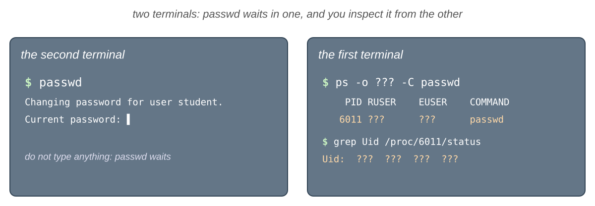

    💡 `man ps`: search for `command name`, to select a process by its name instead of its PID.

    **Check:** the real user is `student`, the effective and the saved user are `root`; `Uid:` is `1000 0 0 0`. The
    `s` bit of `/usr/bin/passwd` changed the effective and the saved UID, but not the real one: `passwd` still knows who
    started it. <small>→ [`setuid`](#setuid) · [The Credentials of a Process](#the-credentials-of-a-process)</small>

**Logging in**

11. **Log in as `bob`**: Follow a real login on a text terminal, and see which process runs as which user.

    1. switch to the third virtual terminal and log in as `bob`;
    2. print the user, the current directory and the label of the shell;
    3. go back to Sway (at home, to your graphical desktop), and list the processes of `tty3` with their user, real
       user, PID, PPID and name;
    4. print the supplementary groups of the shell of `bob`, with `ps`;
    5. go back to `tty3`, and log out.

    💡 <kbd>Ctrl</kbd>+<kbd>Alt</kbd>+<kbd>F3</kbd> (<kbd>Host</kbd>+<kbd>F3</kbd> in VirtualBox), and back with
    <kbd>Ctrl</kbd>+<kbd>Alt</kbd>+<kbd>F1</kbd> or <kbd>F2</kbd>; `man ps`: search for `Select by`, to see all the
    ways to choose the processes, and find the one for a terminal.

    **Check:** the shell runs as `bob`, in `/home/bob`, with the groups `bob` and `students`; `login` runs as `root`
    and is the parent of the `bash` of `bob`. <small>→ [Logging In](#logging-in) · [Virtual Terminals](/docs/labs/04#virtual-terminals)</small>

**Becoming `root`**

12. **`sudo`**: Run commands as `root` with `sudo`, and see how it remembers your password, what it allows you to do
    and what it writes in the log.

    1. print your user and your label as `root`;
    2. do it again, and see that the password is not asked;
    3. make `sudo` forget the password, and try once more;
    4. list what you are allowed to run with `sudo`;
        5. try to print the first line of `/etc/shadow` as yourself; then run the **same** command again as `root`,

       without typing the command again;

    6. print the last 5 commands that were run with `sudo`, from the system log;
    7. (optional) print the end of `/etc/sudoers` as `root`, and find the line that mentions the group of the
       administrators (`%wheel`, or `%sudo` on Ubuntu); you do not have to understand the rest of the file.

    💡 `man sudo`: search for `invalidate` and for `list`; `man bash`: search for `HISTORY EXPANSION` and then for
    `!!`; `man journalctl`: search for `identifier`.

    **Check:** the user is `root`, `uid=0(root)`; after the password is forgotten, it is asked again; the list ends with
    `(ALL) ALL` (Ubuntu: `(ALL : ALL) ALL`): as an administrator, you may run any command, as any user. `bash` prints
    the command that `!!` became, then runs it. The log shows your commands, with your user, your terminal and the
    directory. <small>→ [`sudo`](#sudo)</small>

13. **`su` and `sudo`**: Become another user, or `root`, in a new shell, with `su` and with `sudo`, and see the
    difference.

    1. become `bob` with `su`, with a **login** shell; print the user and the current directory; leave;
    2. try to become `root` with `su`;
    3. start a login shell of `root` with `sudo`, print the user and the current directory, and leave it.

    💡 `man su`: search for `login`; `man sudo`: search for `login` too.

    **Check:** `su` asks for the password of `bob` and starts in `/home/bob`; `su` to `root` fails with
    `Authentication failure` (unless `root` has a password); the shell of `root` starts in `/root`, with a `#` in the
    prompt. <small>→ [`su`](#su)</small>

14. **The redirect trap**: Write into a file of `root`, and see why putting `sudo` in front of `echo` is not enough.

    1. create the empty file `/srv/lab05/root.txt` as `root`, and look at its owner;
    2. add the line `hello` at its end with `sudo echo` and `>>`;
    3. find a way that works, with a command that writes to a file **and** to the screen.

    💡 `man tee`: search for `append`.

    **Check:** step 2 fails with `Permission denied`, because your shell opens the file; at the end, the file has
    `hello`. <small>→ [The Redirect Trap](#the-redirect-trap)</small>

15. **Which commands need `root`**: Learn to tell which actions need `root`, before you run them.

    **Before** you run them, guess which of these commands need `root`. Then run them **without** `sudo`, check your
    guesses, and run again with `sudo` only the ones that failed because of the permissions:

    1. `touch ~/a.txt` and `touch /tmp/my.data`;
    2. `cat /etc/passwd` and `cat /etc/shadow`;
    3. `touch /etc/test.conf`;
    4. `ip address show`;
    5. `ls /root`;
    6. `systemctl restart systemd-resolved`;
    7. at the end, delete the three files you created.

    **Check:** reading `/etc/passwd`, showing the network and writing in your home directory or in `/tmp` are allowed
    to everybody; `/etc/shadow`, writing in `/etc`, `/root` and restarting a service need `root`. `systemctl` may ask
    for your password in a window, instead of failing. <small>→ [The `root` User](#the-root-user) · [`sudo`](#sudo)</small>

**Managing users and groups**

16. **Create a user**: Create a new account, `dave`, see when it becomes usable, and see that a new user cannot use
    `sudo`.

    1. create the user `dave`, with a home directory, the shell `/bin/bash` and the full name `Dave Brown`;
    2. print his line from the users database and his line from `/etc/shadow`;
    3. give him a password, and print his line from `/etc/shadow` again;
    4. print his label and the permissions of his home directory, and try to list what is inside it;
    5. become `dave`, with a login shell, and try to print your user as `root`, with the password of `dave`; leave, and
       find the attempt of `dave` in the log of `sudo`.

    💡 `man useradd`: search for `home`, `shell` and `comment`.

    **Check:** before step 3, the password field in `/etc/shadow` is `!` or `!!`: nobody can log in as `dave` yet;
    after it, the field is a hash that starts with `$y$`. `dave` has the next free UID and a group `dave` of his own;
    `/home/dave` is `drwx------` (Ubuntu: `drwxr-x---`), and you are neither `dave` nor in his group, so you cannot
    list it. `sudo` refuses `dave`: `dave is not in the sudoers file.`, because he is not in the group of the
    administrators; the log has a line for `dave` with `user NOT in sudoers`. <small>→ [Managing Users and Groups](#managing-users-and-groups) · [`/etc/shadow`](#etcshadow) · [`sudo`](#sudo)</small>

17. **Change a user**: Change an existing account, its full name and its shell, and see which fields of `/etc/passwd`
    change.

    After each step, print the line of `dave` from the users database, and find the field that changed:

    1. change the full name of `dave` to `David Brown`;
    2. change his shell to `/usr/sbin/nologin`, and try to become `dave` with `su`;
    3. give him back the shell `/bin/bash`, and become `dave` again; leave his shell.

    💡 `man usermod`: search for `comment` and for `shell`.

    **Check:** the 5th field becomes `David Brown`, the 7th `/usr/sbin/nologin`; with this shell, `su` fails with
    `This account is currently not available.`, even with the right password; with `/bin/bash`, it works again. <small>→ [Managing Users and Groups](#managing-users-and-groups) · [`/etc/passwd`](#etcpasswd)</small>

18. **Groups of a user**: Add a user to a group and remove him from it, with the two commands that can do it, and create
    and delete a group.

    After each step, print the groups of `dave`:

    1. add `dave` to `students`, without removing his other groups;
    2. create the group `tas`, and add `dave` to it, this time with the command that **administers** a group;
    3. remove `dave` from `students`, with the same command;
    4. delete the group `tas`.

    💡 `man usermod`: search for `append`; `man gpasswd`: search for `add` and for `delete`; `man -k group` finds the
    command that deletes a group.

    **Check:** `dave` is in `dave` and `students`, then also in `tas`, then only in `dave` and `tas`, and at the end
    only in `dave`; `getent group tas` prints nothing. <small>→ [Managing Users and Groups](#managing-users-and-groups) · [Groups](#groups)</small>

19. **Delete a user**: Delete an account completely: the user, his group and his home directory.

    1. in the second terminal, become `dave` with a login shell; in the first terminal, try to delete `dave`;
    2. leave the shell of `dave`, and delete him together with his home directory;
    3. check that the user `dave`, the group `dave` and `/home/dave` are all gone.

    💡 `man userdel`: search for `home`.

    **Check:** while `dave` is logged in, `userdel` refuses: `user dave is currently used by process ...`; at the end,
    `id dave` prints `no such user`, `getent group dave` prints nothing, and `/home/dave` does not exist. <small>→ [Managing Users and Groups](#managing-users-and-groups)</small>

**File permissions**

20. **Read the permissions**: Learn to read who owns a file, and what each user may do with it.

    1. print the permissions, the owner and the group of `notes.txt`, `/etc/passwd`, `/etc/shadow` and `/usr/bin/ls`,
       and of the directories `/tmp` and `~` (not their content);
    2. print the same with `stat`, as letters **and** as numbers, with the owner, the group and the name.

    💡 `man stat`: search for `%a`, `%A`, `%U`, `%G` and `--format`.

    **Check:** for each file, say who the owner is and what the owner, the group and the others can do; `~` is
    `drwx------` (`700`) on Fedora, `drwxr-x---` (`750`) on Ubuntu. <small>→ [Owner, Group and Permissions](#owner-group-and-permissions)</small>

21. **`chmod`**: Change the permissions one at a time, with letters, or all at once, with a number, and see that a
    program needs `x` to run.

    1. on `notes.txt`, remove `r` for the group and the others;
    2. remove `w` for yourself, and try to add a line to it; add `w` back, and add the line;
    3. set the permissions of `notes.txt` back to `rw-r--r--` with **one** command, with letters;
    4. run `./myid.sh`; give it `rwxr-xr-x`, with a number, and run it again;
    5. give `myid.sh` the permissions `rw-------`, with a number, and try to run it.

    **Check:** after step 1, `notes.txt` is `-rw-------`; in step 2 your own shell gets `Permission denied`; after
    step 3 it is `-rw-r--r--` again. Without `x`, `./myid.sh` gives `Permission denied`; with `755`, it prints
    `student`; with `600`, it is denied again. <small>→ [`chmod`](#chmod)</small>

22. **`r` and `x` for directories**: See what `r` and `x` allow on a directory, one without the other.

    1. give `noread` only `x` for you (`--x------`) and `noenter` only `r` (`r--------`);
    2. try to list them, to enter them, and to print the `secret.txt` inside them;
    3. give both of them back `rwxr-xr-x`.

    **Check:** `noread` cannot be listed, but `noread/secret.txt` can be printed; `noenter` lists the name with an
    error, but cannot be entered and its file cannot be printed. The error comes from the colors of `ls`, which need
    the details of the file: `\ls noenter` lists the name without it.<small>→ [`r`, `w` and `x`](#r-w-and-x)</small>

23. **Who can read the report**: See which of the three sets of permissions applies to the owner, to a member of the
    group and to the others.

    `/srv/lab05/report.txt` is `rw-r----- student students`.

    1. print it as yourself, as `bob` and as `carol`;
    2. try to add a line to it as `bob`.

    💡 `man sudo`: search for `-u user` to run a command as another user (it asks for **your** password); to write as
    `bob`, use the trick from [The Redirect Trap](#the-redirect-trap).

    **Check:** you and `bob` can read it, `carol` cannot; `bob` cannot write it: he gets the `g` permissions, `r--`. <small>→ [Which Permissions Apply?](#which-permissions-apply)</small>

24. **`umask`**: Predict the permissions of a new file and of a new directory from the `umask`.

    1. print your `umask`, as a number and as letters;
    2. guess the permissions of a new file and of a new directory, then create `new.txt` and `newdir` and check.

    💡 `help umask`: search for `symbolic`.

    **Check:** with `0022` (`u=rwx,g=rx,o=rx`), `new.txt` is `rw-r--r--` and `newdir` is `rwxr-xr-x`; with `0002`
    (Ubuntu), the group also gets `w`: `rw-rw-r--` and `rwxrwxr-x`. <small>→ [`umask`](#umask)</small>

25. **`chown`**: Give a file to another user, and find out who is allowed to do it.

    1. give `notes.txt` to `carol`, as yourself;
    2. do it as `root`, and list it;
    3. give it back to your user **and** your group, with one command.

    💡 `man chown`: search for `colon`, to change the group to the login group of the user.

    **Check:** as yourself, `Operation not permitted`; as `root`, the owner becomes `carol`; at the end it is yours
    again. <small>→ [`chown` and `chgrp`](#chown-and-chgrp)</small>

**Special permissions**

26. **Special bits on the system**: Recognize the special bits on the programs and the directories of the system.

    1. print the permissions of `/usr/bin/passwd`, `/usr/bin/su` and `/usr/bin/sudo`, and of the directory `/tmp`;
    2. print them as numbers.

    **Check:** the three programs have an `s` in the place of the `x` of the owner (`4755`, and `4111` for `sudo` on
    Fedora); `/tmp` has a `t` (`1777`). <small>→ [Special Permissions](#special-permissions)</small>

**The prompt**

27. **The prompt**: Change what the prompt of `bash` shows, and see that it is only text, which the kernel does not
    look at.

    1. print the value of `PS1`;
    2. change the prompt to `student in ~/lab05 $`, with the user, the **whole** path and the `$` of the user;
    3. add the time in front, as `HH:MM`;
    4. change the prompt so that it looks like the prompt of `root`; print your user, your UID and the effective user
       of your shell, and try to print `/etc/shadow`;
    5. go back to the original prompt.

    💡 `man bash`: search for `PROMPTING`.

    **Check:** the original is `[\u@\h \W]\$ ` on Fedora (`\u@\h:\w\$ ` with colors on Ubuntu); the prompt changes
    right away, and the path changes when you `cd`. With the fake prompt of `root`, the user is still `student`, the
    UID `1000`, and `/etc/shadow` is still denied: the kernel looks at the credentials, not at the prompt. <small>→ [The Prompt](#the-prompt) · [Changing the Prompt](#changing-the-prompt)</small>

### 🏠 Going Further {/* #going-further */}

Each exercise starts with its **goal**: what must be true at the end, or what you must find out. The steps lead you
there, but you choose the commands. At the end, check the goal itself, not only that each command worked.

**Users and passwords**

28. **Audit the users database**: An attacker who becomes `root` often adds a second user with the UID `0`: a hidden
    `root`, with an innocent name. Check that your system has no such user, list the people who have a home directory,
    and find out whether all the users are in `/etc/passwd`.

    1. find all the users whose UID is `0`;
    2. find the users whose home directory is in `/home`, and count them;
    3. find where the C library looks for the users, the passwords and the groups;
    4. compare the number of users in the database with the number of lines of `/etc/passwd`.

    💡 the UID is the 3rd field and the home directory the 6th: `man cut`, search for `delimiter` and for `fields`, then
    filter the lines with `grep` (lab 03). Why is `grep 0` alone not enough? `man 5 nsswitch.conf` tells where the
    users are kept.

    **Check:** only `root` has the UID `0`; the users in `/home` are `student`, `bob` and `carol`; `files` is the first
    place where the C library looks; if the two numbers are different, the extra users come from `systemd`. <small>→ [`/etc/passwd`](#etcpasswd) · [`getent`](#getent)</small>

29. **What `/etc/shadow` tells**: Find out what `/etc/shadow` tells an administrator: which accounts can be used with a
    password, and whether two users have the same password.

    1. print the line of `root` from `/etc/shadow`, and the state of its password;
    2. print the lines of 5 system users;
    3. `bob` and `carol` both have the password `uso2026`: print their lines, and compare their salts and their hashes.

    💡 `man passwd`: search for `status`.

    **Check:** the password field of `root` and of the system users starts with `!` or `*`, or is only `!` or `*`: no
    password can log in as them. The salts of `bob` and `carol` are different, so their hashes are different too:
    nobody can tell from `/etc/shadow` that they have the same password. <small>→ [`/etc/shadow`](#etcshadow) · [Hashes and Salt](#hashes-and-salt)</small>

30. **Accounts on hold**: `bob` goes on holiday, and the internship of `carol` ended on 1 January 2020. Stop both
    accounts without deleting anything and without touching their passwords, then let them back in: they must log in
    with their **old** passwords.

    1. lock the account of `bob`, and print his line from `/etc/shadow`;
    2. try to become `bob` with `su`, with the right password; unlock the account, and try again;
    3. make the account of `carol` expire on 1 January 2020, and print her password dates and her line in
       `/etc/shadow`;
    4. try to become `carol`; then remove the expiry date.

    💡 `man passwd`: search for `lock`; `man chage`: search for `expiredate`, and for `-1`.

    **Check:** the hash of `bob` starts with `!!` (Ubuntu: `!`) and `su` fails with `Authentication failure`; after the
    unlock, the `!` disappear and `su` works. The 8th field of the line of `carol` is now a number of days, and `su`
    refuses the expired account; after step 4 the field is empty again. <small>→ [Changing a Password](#changing-a-password-passwd) · [`/etc/shadow`](#etcshadow)</small>

31. **A new colleague, from the first day to the last**: `erin` joins the team, becomes an administrator, and leaves
    after a while. Manage her account from the first day to the last, without looking at the lab, only with the manual
    pages.

    Check every step before you go to the next one:

    1. create her account: a home directory, the shell `/bin/bash`, the full name `Erin Gray`, the supplementary group
       `students` and a password, with as few commands as you can;
    2. log in as `erin` on the third virtual terminal, and check that she starts in `/home/erin`, is in `students`, and
       that `sudo` refuses her;
    3. she becomes an administrator: while she is still logged in on `tty3`, make her one; in **the same shell** of
       `erin`, print the groups of the shell and try `sudo` again; then log out, log in again, and try once more;
    4. she changes her name: make her full name `Erin Black`;
    5. she leaves: log her out, and delete her account, her group and her home directory.

    💡 `man useradd`: search for `shell` and for `groups`; `man usermod`; `man userdel`; the group of the
    administrators is in the table of [`sudo`](#sudo).

    **Check:** after step 1, `id erin` shows `students` and her line has `Erin Gray` and `/bin/bash`; at step 3, the old
    shell of `erin` does not have the group of the administrators, so `sudo` still refuses her; after a new login,
    `sudo` works, with the password of `erin`; after step 4, only the 5th field changed; at the end, `id erin`,
    `getent group erin` and `ls -d /home/erin` find nothing. <small>→ [Managing Users and Groups](#managing-users-and-groups) · [Logging In](#logging-in)</small>

32. **A new group needs a new login**: You add yourself to `students`, but not all your processes get the new group.
    Find out which of them have it, why, and what the kernel checks when you use the group.

    1. add yourself to `students`;
    2. print your groups from the database, and the groups of your shell;
    3. print the `Groups:` line of `/proc/$$/status`;
    4. open a **new** terminal, and print the groups of its shell;
    5. start a **login shell** of yourself with `su`, print its groups and its `Groups:` line;
    6. in this login shell, and then in your **old** terminal, try to change the group of `notes.txt` to `students`;
       at the end, give `notes.txt` its old group back.
    7. remove yourself from `students`.
 
    **Check:** the database has `students`; the running shell, and the new window, do not have it (no GID of
    `students` in `Groups:`), because their credentials were set when you logged in; the new login shell has it. In the
    login shell, the group of `notes.txt` changes; in the old terminal you get `Operation not permitted`, even if
    `/etc/group` lists you in `students`: the kernel checks the groups of the **process**. <small>→ [Logging In](#logging-in) · [The Credentials of a Process](#the-credentials-of-a-process) · [`chown` and `chgrp`](#chown-and-chgrp)</small>

**`sudo`**

33. **Is it the permissions?**: Learn to tell, from the error, when `sudo` helps and when it does not.

    Run each command without `sudo`, decide if the error is about **permissions** (then `sudo` fixes it) or something
    else (then `sudo` does not help), and check with `sudo`:

    1. `cat /var/log/kill/them/all.log`;
    2. `userdel hariseldon`;
    3. `chown $USER /home/search/and/destroy`;
    4. `cat /root/missing.txt`;
    5. `dnf install sports-illustrated` (on Ubuntu, `apt install sports-illustrated`).

    **Check:** when the error was about permissions, `sudo` makes it go away, and the command may then fail again with
    the **real** error: the user, the file or the package does not exist. When the error was about something else,
    `sudo` gives the same error. <small>→ [`sudo`](#sudo)</small>

34. **`sudo` as another user**: Run commands as `bob`, without knowing his password, check that they get the **whole**
    label of `bob`, and find out what `bob` may do in `/srv/lab05`.

    1. print the user and the label of a process that runs as `bob`, started with `sudo`;
    2. try to create the file `/srv/lab05/bob.txt` as `bob`;
    3. start a **login** shell of `bob` with `sudo`, print the current directory, and leave it;
    4. in the second terminal, run `sleep 300` as `bob`, with `sudo`; in the first terminal, print the real and
       effective user, the real and effective group and the supplementary groups of `sleep`, and the `Uid:`, `Gid:`
       and `Groups:` lines of its `status` file.

    💡 `man sudo`: search for `-u user` and for `login`; `man ps`, section `STANDARD FORMAT SPECIFIERS`: search for
    `real group`, `effective group` and `supplementary`.

    **Check:** the process runs as `bob`, with the groups `bob` and `students`; `bob` cannot create the file: the group
    of `/srv/lab05` has only `r-x`; the login shell starts in `/home/bob`, and `sudo` asked for **your** password, not
    the one of `bob`. For `sleep`, everything is `bob`: `Uid:` is 4 times `1001`, and `Groups:` has the GIDs of `bob`
    and `students`, as after a login. <small>→ [`sudo`](#sudo) · [The Credentials of a Process](#the-credentials-of-a-process)</small>

35. **The credentials of `sudo`**: Find out how `sudo` changes the credentials of the command that it starts, and who
    may then end the command with `kill`.

    For steps 3 - 5, **first** write down your guess, then check it:

    1. in the second terminal, print the PID of the shell, then run `sleep 300` as `root`; in the first terminal, show
       the tree of processes of the second shell, with the PIDs, and list these processes with their PID, PPID,
       terminal, real and effective user;
    2. print the `Uid:` line of `sudo` and of `sleep`, and compare them with the `passwd` of exercise 10: which
       program is like `passwd`, and which one is different?
    3. can you end the `sleep` with `kill` and its PID?
    4. send the signal to the `sudo` process instead, and look at what happened to `sleep`;
    5. in the second terminal, start `passwd`, and do not type anything; can you end it with `kill` from the first
       terminal? Can `bob` (run `kill` as `bob` with `sudo`)?

    💡 `man pstree`: search for `pid`; `ps -p` takes several PIDs, separated by `,`; `man pgrep` finds the PID of a
    process from its name. Do not look for `sleep` with `ps -t` and the terminal of the second shell: `sudo` runs it on a
    new pseudo terminal (see [`sudo`](#sudo)). For
    `kill`, use the rule from [Which Credentials Are Checked](#which-credentials-are-checked): print the real and the
    saved UID of the target, and the real and the effective UID of the sender.

    **Check:** the tree is `bash───sudo───sudo───sleep`: the first `sudo` is on the terminal of the second shell, the
    second one on a **new** pseudo terminal, with `sleep`, its child. The first
    `sudo` is like `passwd`: its `Uid:` is `1000 0 0 0`, because it is a setuid program. For `sleep`, `Uid:` is
    `0 0 0 0`: `sudo`, as `root`, set **all** the UIDs of its child. So you cannot end the `sleep`, but you **can** end
    `sudo`, whose real UID is yours, and `sudo` passes the signal on to its child. You can end your `passwd`, its real
    UID is yours; `bob` gets `Operation not permitted`. <small>→ [`sudo`](#sudo) · [Which Credentials Are Checked](#which-credentials-are-checked)</small>

36. **Play a setuid program**: See how the saved UID lets a setuid program put `root` aside and take it back, by acting
    as one, as in [The Saved UID](#the-saved-uid).

    After each step, print the `Uid:` line of the `python3` process from the second terminal, and try to read the first
    line of `/etc/shadow` from `python3`:

    1. in the first terminal, start `python3` as `root`; print its real, effective and saved UID;
    2. become `student` in the real and the effective UID, but keep `root` in the saved UID;
    3. take `root` back, in the effective UID only;
    4. set all three UIDs to `1000`, and try to take `root` back once more.

    

    💡 In `python3`, `import os` first, then `help(os.getresuid)`, `help(os.setresuid)` and `help(os.seteuid)`;
    `open('/etc/shadow').readline()` reads the first line of a file; `exit()` leaves `python3`.

    **Check:** `Uid:` is `0 0 0 0`, then `1000 1000 0 1000` and `/etc/shadow` is denied, then `1000 0 0 0` and it can
    be read again, because `0` was the saved UID; after the last step, `Uid:` is `1000 1000 1000 1000` and
    `seteuid(0)` fails with `Operation not permitted`. The 4th number, the file system UID, always follows the 2nd. <small>→ [The Saved UID](#the-saved-uid) · [Which Credentials Are Checked](#which-credentials-are-checked)</small>

37. **The shells of `root`**: There are two ways to get a shell of `root` with `sudo`. Find out how they differ, which
    of your variables reach a command started with `sudo`, and where `sudo` looks for programs.

    1. in `~/lab05`, start a shell of `root` that stays in the current directory, and print the current directory
       and `$HOME`; leave it;
    2. do the same with a **login** shell of `root`;
    3. export the variable `COURSE` with the value `ISO`; print it from a command started with `sudo`, then from one
       started with `sudo` that keeps your environment;
    4. compare your `PATH` with the `PATH` that `sudo` gives to a command.

    💡 `man sudo`: search for `shell` and for `preserve-env`; `printenv` prints the value of one variable, and you can
    run it with `sudo`.

    **Check:** the first shell stays in `~/lab05`, the login shell starts in `/root`; both have `HOME=/root`. By
    default, `sudo` removed `COURSE`; `sudo` also uses a `PATH` of its own, so a program from your `~/.local/bin` is
    not found by `sudo`. <small>→ [`sudo`](#sudo) · [Environment Variables](/docs/labs/04#environment-variables)</small>

38. **Shells inside shells**: Follow the user of every process when you start shells inside shells, and see that not
    even `root` can log in as a system user.

    1. in the first terminal, print the PID of the shell;
    2. start a login shell of `root` with `sudo`; from it, try to become `daemon` and `bin` with `su`, and print the
       shell of `daemon` from the users database;
    3. still in the shell of `root`, start a login shell of `bob` with `su` (`root` is not asked for a password);
    4. in the second terminal, show the tree of processes of the first shell, with the PIDs and the users, and print
       the real and effective user of every process in this tree, with `ps`;
    5. leave the shells one by one, and show the tree after each step.

    

    💡 `man pstree`: search for `uid` and for `pid`; `ps -p` takes the PIDs that `pstree` printed, separated by `,`.
    `ps -t` with the first terminal is not enough: `sudo` starts its command on a new pseudo terminal.

    **Check:** even `root` gets `This account is currently not available.`: the shell of `daemon` is
    `/usr/sbin/nologin`, a program that prints this message and ends. The tree is
    `bash───sudo───sudo───bash───su───bash`: two `sudo`, because `sudo` runs the shell of `root` on a new pseudo
    terminal; `pstree` shows the user where it changes: `sudo(...,root)` and the last `bash(...,bob)`; `su` runs as
    `root`, and its child as `bob`. Every `exit` removes the last shell. <small>→ [`su`](#su) · [`/etc/passwd`](#etcpasswd) · [Listing Processes](/docs/labs/03#listing-processes-ps)</small>

**Permissions**

39. **Who may delete a file**: Find out who may delete or rename a file: the one who can write the file, or the one who
    can write the directory.

    1. copy `notes.txt` to `ro.txt`, and make it read only for everyone; try to add a line to it; then rename it to
       `ro2.txt` and delete it;
    2. give the group of `/srv/lab05` the permission to write;
    3. as `bob`, create `/srv/lab05/bob.txt`;
    4. as `bob`, delete `/srv/lab05/plan.txt`, a file that belongs to **you** and that `bob` cannot write;
    5. create `plan.txt` again, with the text `the plan`.
    6. take back the `w` of the group on `/srv/lab05`.
   
    **Check:** you cannot write `ro.txt`, but you can rename it and delete it (after `y`): you have `w` on `~/lab05`.
    `bob` can create files in `/srv/lab05` now; `rm` asks `remove write-protected regular file`, and after `y` the file
    is gone: deleting a file is writing the **directory**. <small>→ [`r`, `w` and `x`](#r-w-and-x)</small>

40. **`x` on every directory**: `bob` needs to read your `notes.txt`. Find the **smallest** change that lets him,
    without letting him see the names of your other files.

    1. as `bob`, print `notes.txt` from your `~/lab05`, with its absolute path;
    2. find out why it fails, by looking at the permissions of every directory of the path;
    3. give the others **only** `x` on your home directory, and try again; then try to list your home directory as
       `bob`;
    4. take the `x` back.

    **Check:** `/home/student` is `drwx------` (Ubuntu: `drwxr-x---`), and `bob` is one of the others, so he cannot
    pass through it; with `x` for the others, `bob` reads `notes.txt` (it is `rw-r--r--`), but cannot list your home
    directory: he has no `r` on it. <small>→ [`r`, `w` and `x`](#r-w-and-x)</small>

41. **Octal by hand**: Learn to switch between the letters and the numbers of the permissions without help.

    Without the computer:

    1. write as numbers: `rwxr-x---`, `rw-rw-r--`, `r--------`, `rwx--x--x`, `rw-r--r--`;
    2. write as letters: `751`, `664`, `400`, `700`, `555`;
    3. check your answers on a file `test.txt`.

    **Check:** set each value on `test.txt` in the form you started from, and print the other form with `stat`: it must
    be the one you wrote. <small>→ [`chmod`](#chmod)</small>

:::info

**Permission puzzles(exercises 42 and 47-55)**: In each exercise, set the permissions (and the group, if you need it) so that **exactly** the
given users can do the given things, and nothing more. You are not a member of `students`, so giving a file this group
needs `root`, as in exercise 3. Then test every user (`student`, `bob` and `carol`) by reading, listing, writing or
running the files.

:::
42. **The owner is checked first**: Show that the kernel uses only **one** set of permissions, even when another set
    would allow more.

        1. copy `notes.txt` to `first.txt`, and give its group to `students` (you are not a member: use `root`);
    2. give it `----rw-r--`;
    3. try to read it yourself, as `bob` and as `carol`; then try to write it as `bob`.

    **Check:** you, the owner, cannot read it; `bob` can read and write it (the `g` set), and `carol` can read it (the
    `o` set). <small>→ [Which Permissions Apply?](#which-permissions-apply)</small>

43. **A private `umask`**: Make every new file of your shell private, and find out for which processes, and for how
    long, this lasts.

    In a new terminal:

    1. set the `umask` so that the new files and directories are private, then create `private.txt` and `privdir`;
    2. print the `umask` of a child `bash`;
    3. print the `Umask:` line of the `status` file of your shell;
    4. close the terminal, open a new one, and print the `umask`.

    💡 `man 5 proc`: search for `Umask`.

    **Check:** `private.txt` is `rw-------` and `privdir` is `rwx------`; the child prints the same `umask` as its
    parent: the kernel keeps a `umask` for every process, and a child inherits it, like the credentials; the new
    terminal has the old `umask` again. <small>→ [`umask`](#umask)</small>

44. **Special bits at work**: Find the programs that run with the **group** of their file, and show that in `/tmp` your
    files are safe from deletion, even if you let everybody write them.

    1. find the files in `/usr` that have the `setgid` bit, without the errors; list them, and look at their group;
    2. create the file `/tmp/student.txt`, and give everybody `w` on it;
    3. as `bob`, try to delete it, then to add a line to it;
    4. delete it yourself.

    💡 `man find`: search for `-perm`, and for `/mode`.

    **Check:** the setgid programs have an `s` in the place of the `x` of the group; each runs with the group of its
    file, for example `tty` or `utmp` on Fedora, `shadow` or `crontab` on Ubuntu, and not as `root`. `bob` cannot
    delete `/tmp/student.txt`: `Operation not permitted`, because of the `t` of `/tmp`. He cannot add a line to it
    either, although it is `rw-rw-rw-`: in a sticky directory, the kernel also stops opening the files of somebody
    else with `>>` (`sysctl fs.protected_regular` is not `0`), to protect them from tricks with names in `/tmp`. <small>→ [Special Permissions](#special-permissions) · [The Sticky Bit](#the-sticky-bit)</small>

**The prompt**

45. **A richer prompt**: Make the prompt show the time and the number of jobs, let you type the command on a new line,
    and stand out in color in a long output.

    1. make the prompt look like this, then start `sleep 100 &`, and look at the prompt:

       ```text
       10:52 student@fedora ~/lab05 (jobs: 0)
       $
       ```

    2. make the user and the host **green** and the path **blue**;
    3. write a long command that goes over the end of the line; then remove the `\[` and `\]` from `PS1`, and do it
       again.

    💡 `man bash`, section `PROMPTING`: search for `jobs` and for `newline`.

    **Check:** the number of jobs becomes `1`, and the command is typed on the second line. With `\[...\]`, the long
    command wraps correctly; without them, `bash` counts the color codes as characters, and the line is drawn over
    itself. <small>→ [Changing the Prompt](#changing-the-prompt)</small>

46. **A prompt that tells the truth, and stays**: Unlike the fake `root` of the First Steps, make a prompt that shows
    the UID of the shell, so that it changes by itself, and keep it for every new terminal.

    1. make a prompt that shows your UID, from a variable of `bash`, and the `$` or `#`;
    2. start a login shell of `root`, set the **same** `PS1` in it, and look at the prompt; leave it;
    3. add your `PS1` at the end of `~/.bashrc`, open a new terminal, and check the prompt;
    4. start a login shell of `root`, and look at its prompt.

    💡 `man bash`: search for `EUID`; write `PS1` between **single** quotes, so that the variable is replaced every
    time the prompt is shown, not once when you set it.

    **Check:** your prompt shows `1000` and `$`; the shell of `root` shows `0` and `#`: `\$` and `$EUID` come from the
    credentials of the shell, not from a text you typed. The new terminal has your prompt; the shell of `root` does
    not: it reads `/root/.bashrc`, not yours. <small>→ [Changing the Prompt](#changing-the-prompt)</small>

**Permission puzzles**: In each exercise, set the permissions (and the group, if you need it) so that **exactly** the
given users can do the given things, and nothing more. Then test every user (`student`, `bob` and `carol`) by
reading, listing, writing or running the files.

47. **Read only for the group**: Share a file with the group `students`, for reading only.

    `/srv/lab05/grades.txt`, with the text `bob: 10`:

    - `student` can read and change it;
    - the members of `students` can only read it;
    - nobody else can do anything.

    

    **Check:** `bob` reads it but cannot write it; `carol` gets `Permission denied`; `ls -l` shows the group
    `students`. <small>→ [`chmod`](#chmod) · [`chown` and `chgrp`](#chown-and-chgrp)</small>

48. **A public directory**: Publish files that everybody may read, but only you may change.

    `/srv/lab05/public`, with two files, `a.txt` and `b.txt`:

    - everybody can list the directory and read the files;
    - only `student` can create, delete or change files in it;
    - use **one** `chmod` with letters for the directory and all the files.

    

    Start by closing `public` and everything inside it to the group and the others, with **one** command, and check
    that `carol` cannot read `a.txt`; then open it as asked.

    💡 `man chmod`: search for `recursive`, and for the capital `X`.

    **Check:** while it is closed, `public` is `drwx------` and `a.txt` is `-rw-------`; at the end, `carol` lists
    `public` and reads `a.txt`, but cannot create `public/c.txt` or change `a.txt`; the files did not get an `x`. <small>→ [`chmod`](#chmod)</small>

49. **A script for the group**: Let the group run a script, without letting it change the script.

    `/srv/lab05/tool.sh`, a copy of `myid.sh`:

    - the members of `students` can run it, but not change it;
    - nobody else can read or run it.

    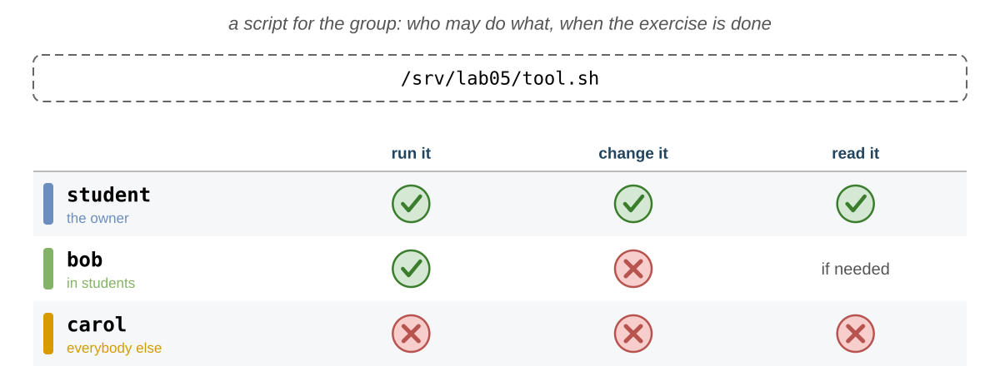

    First try to give the group only `x` and run it as `bob`; then find the right permissions.

    **Check:** with only `x` for the group, `bob` gets `Permission denied`: think about what `bash` must do with the
    file to run the commands inside it. With the right permissions, `bob` runs it and it prints `bob`; `carol` can
    neither read it nor run it. <small>→ [`r`, `w` and `x`](#r-w-and-x)</small>

50. **Known names only**: Hide a file in a directory, so that only those who know its name can read it.

    `/srv/lab05/hidden`, with the file `key.txt`:

    - the members of `students` can read `key.txt` if they know its name, but cannot list the directory;
    - nobody else can do anything.

    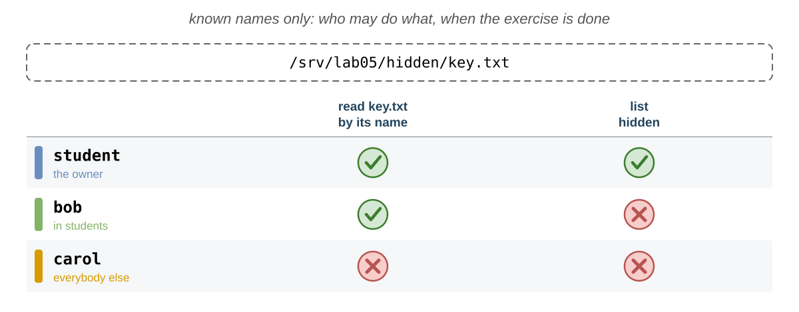

    **Check:** `bob` can print `hidden/key.txt`, but `ls hidden` is denied; `carol` cannot reach `key.txt`, even with
    its name. <small>→ [`r`, `w` and `x`](#r-w-and-x)</small>

51. **A private list**: Help `bob` share a file from his home directory with his group, and with nobody else.

    As `bob`:

    

    1. close `/home/bob` to everybody except `bob` (it is already like this on Fedora, not on Ubuntu); create
       `/home/bob/todo.txt` with the text `Bob's TODO list`, readable and writable **only** by `bob`; check that
       `carol` cannot read it;
    2. change it so that the members of the group `bob` can also read it, and nobody else can do anything;
    3. leave, add yourself (`student`) to the group `bob`, and try to read the file from a **new login shell**;
    4. find out why it still fails, and let `bob` change the right directory so that it works, without letting `carol`
       in;
    5. remove yourself from the group `bob`.

    **Check:** at step 3 it is still denied, although you are in the group `bob` and the file gives its group `r`: look
    at **every** directory of the path. After the fix you can read the file, but you cannot list `/home/bob`, and
    `carol` still gets nothing. <small>→ [Which Permissions Apply?](#which-permissions-apply) · [`r`, `w` and `x`](#r-w-and-x)</small>

### 📝 Challenges {/* #challenges */}

52. **An offline attack**: Find a password from its hash, the way an attacker with a copy of `/etc/shadow` would.

    A user has this line in a stolen copy of `/etc/shadow`:

    ```text
    mallory:$6$uso2026$YT5ail.RilPFhAJ4Zo6bXZ6qayzFgl959rpxQZDutFYsI3F/Yq4zt5BFc04bFuFJN7PE9Scof6J8VZUPjp7Y20:20737:0:99999:7:::
    ```

    You know that the password is one of `123456`, `password`, `qwerty`, `dragon` and `letmein`. Find which one, with
    **one** command line.

    💡 find the algorithm and the salt in the hash; `man openssl-passwd`: one command can hash several passwords;
    `man grep`: search for `line-number`.

    **Check:** exactly one of the hashes you computed is the same as the one of `mallory`, and its line number tells you
    which password it is. This is why `/etc/shadow` must not be readable, and why common passwords are dangerous. <small>→ [Hashes and Salt](#hashes-and-salt)</small>

53. **All the credentials of a process**: Predict all the UIDs and GIDs of three processes, check them with a single
    command, and then find every process that has the power of `root` and was started from a terminal.

    For your shell, a `sleep` started with `sudo` and a `passwd` waiting for a password:

    1. **first** fill in the table on paper, from [How the Credentials Change](#how-the-credentials-change);
    2. then print, in **one** `ps` command, with a column for each: the real, effective, saved and file system UID,
       and the real and effective GID, and compare;
    3. find all the processes that run with the effective user `root` but have a terminal, and show for each its
       terminal, its real and effective user, and its command.

    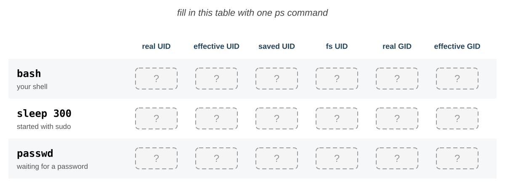

    💡 `man ps`, `STANDARD FORMAT SPECIFIERS`: search for `saved` and for `filesystem`; `-p` takes several PIDs,
    separated by `,`; `man ps`: search for `effective user`; the processes without a terminal have `?` in the `TTY`
    column, remove them with `grep` (lab 03).

    **Check:** the shell has `1000` everywhere; `sleep` has `0` everywhere; `passwd` has the real UID `1000` and the
    other three `0`: these are the 4 numbers of the `Uid:` line of `/proc/<PID>/status`. In step 3 you see the `login`
    of every virtual terminal where somebody is logged in, the `sudo` and `su` that are still running, and the shells
    of `root`; the real user tells you who started each of them. <small>→ [The Credentials of a Process](#the-credentials-of-a-process)</small>

54. **A project for the group**: Build a project directory for a group, where the files belong to the group and nobody
    can delete the work of the others.

        Create again the user `dave` in the group `students`. If `/srv/project` exists from the lab, delete it first. Then
    make `/srv/project` so that:

    - only `root` owns it, and only the members of `students` can enter it, list it and create files in it;
    - every new file in it belongs to the group `students`, whoever creates it;
    - a member cannot delete or rename the files of another member.

    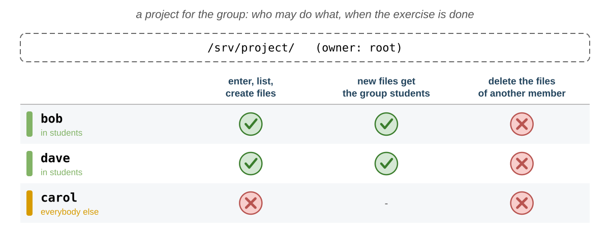

    Create a file in it as `bob`, one as `dave`, and try to delete the file of `dave` as `bob`; try to list it as
    `carol`.

    **Check:** both files have the group `students`, even if `bob` and `dave` have other primary groups; `bob` gets
    `Operation not permitted` when he deletes the file of `dave`; `carol` gets `Permission denied`; you needed **two**
    special bits. <small>→ [`setgid` on a Directory](#setgid-on-a-directory) · [The Sticky Bit](#the-sticky-bit)</small>

55. **A homework box**: Build a box where the students hand in their homework, without seeing or touching the homework
    of the others, while the teacher may still clean it.

    Make `/srv/lab05/homework` so that:

    - the members of `students` can hand in files (create them), but cannot list the directory, so they cannot see
      the names of the others;
    - they cannot delete or replace the files of the others, even if they guess the names;
    - `student`, the teacher, can do everything;
    - `carol` can do nothing.

    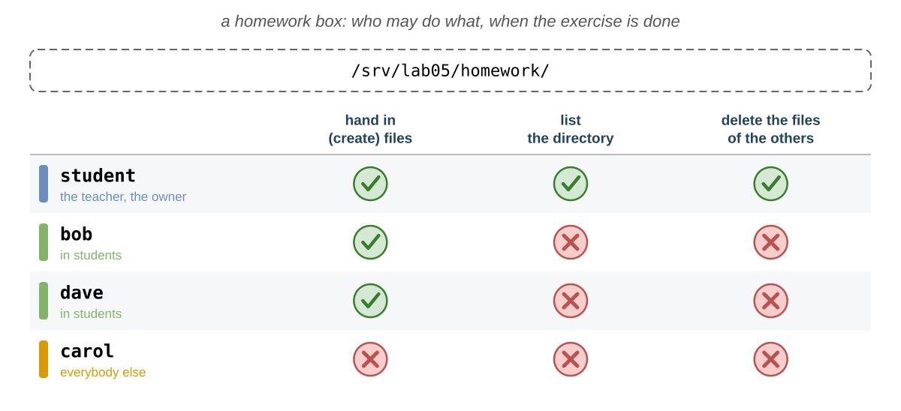

    Hand in `bob.txt` as `bob`, and `dave.txt` as `dave`; as `bob`, try to list the directory and to delete `dave.txt`;
    then, as the teacher, delete `dave.txt`.

    **Check:** `bob` can create files, but cannot list the directory or delete `dave.txt` (`Operation not permitted`);
    you see both files, and you **can** delete `dave.txt`: the **owner of the directory** may delete any file in it,
    even with the sticky bit; `carol` gets `Permission denied` for everything. <small>→ [`r`, `w` and `x`](#r-w-and-x) · [The Sticky Bit](#the-sticky-bit)</small>

56. **All the special bits**: Find out what a capital `S` or `T` means in `ls -l`, find all the programs of the system
    that run as their owner, and understand the permissions of `sudo`.

    1. copy `notes.txt` to `cap.txt`, and give it the setuid bit **without** `x` for the owner;
    2. create the directory `capdir` with `rwxrwx---` and the sticky bit, with **one** number; list them, and print
       their permissions as numbers;
    3. list all the setuid files in `/usr`, in the format of `ls -l`, without the errors, and count them;
    4. explain why `sudo` is `---s--x--x` on Fedora (on Ubuntu, it is `-rwsr-xr-x`: what more does it allow?).

    💡 `man find`: search for `-perm` and for `-ls`.

    **Check:** `cap.txt` is `-rwSr--r--` (`4644`) and `capdir` is `drwxrwx--T` (`1770`): a capital letter means that
    the bit is set, but the `x` under it is not. There are a few dozen setuid programs, all owned by `root`. For `sudo`,
    say for each of `r`, `w`, `x` and `s` who has it, and what it allows them to do. <small>→ [Special Permissions](#special-permissions) · [`setuid`](#setuid)</small>

57. **Scripts and programs**: See why the setuid bit works for programs but not for scripts, and why a setuid program of
    `root` is dangerous.

    1. as `root`, copy `myid.sh` to `/srv/lab05/rootid.sh` and give it `4755`; run it;
    2. as `root`, copy `/usr/bin/sleep` to `/srv/lab05/rootsleep` and give it `4755`; run `/srv/lab05/rootsleep 300` in
       the second terminal, and inspect its credentials from the first one;
    3. delete both copies **right away**.

    **Check:** the script prints `student`: the kernel ignores the setuid bit on scripts. `rootsleep` has the real UID
    `1000` and the effective UID `0`: a setuid program of `root` runs as `root` for everybody. This is why you must
    never do it with a program that can write files or start other programs. <small>→ [`setuid`](#setuid) · [The Credentials of a Process](#the-credentials-of-a-process)</small>

58. **An administrator, the other way**: A colleague who uses the **other** distribution tells you to make `bob` an
    administrator by adding him to **their** group of the administrators: `sudo` if you are on Fedora, `wheel` if you
    are on Ubuntu. Find out if this works on your system, and why.

    1. check if your colleague's group exists on your system;
    2. create it if it does not exist, add `bob` to it, and try to print his user as `root`, from a new login shell of
       `bob`;
    3. remove `bob` from the group; delete the group if you created it;
    4. make `bob` an administrator the way of **your** distribution, and try again from a new login shell; then take
       the right away.

    💡 [`sudo`](#sudo): the table of the groups of the administrators.

    **Check:** in your colleague's group, `bob` is still refused: `bob is not in the sudoers file.` The **name** of a
    group gives no right by itself; `sudo` trusts only the group it was set up for, `wheel` on Fedora and `sudo` on
    Ubuntu. In that group, `bob` may use `sudo`, with his own password. <small>→ [`sudo`](#sudo) · [Managing Users and Groups](#managing-users-and-groups)</small>

59. **The UID is what matters**: Show that a file belongs to a UID, not to a name, and what happens when a UID is used
    again.

    1. find the UID of `carol`, then delete her **without** her home directory;
    2. list `/home` with names, then with numbers;
    3. create the user `grace`, without a home directory, with the UID that `carol` had;
    4. list `/home` again, then delete `grace` and `/home/carol`.

    💡 `man ls`: search for `numeric`; `man useradd`: search for `uid` and for `no-create-home`.

    **Check:** after `carol` is deleted, `/home/carol` belongs to a number (`1002`): the files keep only the UID; when
    `grace` gets this UID, she becomes the owner of all the files of `carol`. Before a UID is reused, the files of the
    old user must be deleted. <small>→ [Users](#users)</small>

60. **Clean up**: Leave the system as it was before the lab.

    1. delete the users `bob`, `carol` (if she still exists) and `dave`, with their home directories, and the group
       `students`;
    2. delete `/srv/lab05` and `/srv/project`;
    3. delete `~/lab05` (if it fails, find out which directory has no `w` or `x` for you);
    4. remove your `PS1` from `~/.bashrc`.

    **Check:** `bob`, `carol`, `dave` and `students` are not in the databases any more; `/srv` does not have `lab05`
    and `project`. <small>→ [Managing Users and Groups](#managing-users-and-groups)</small>

## Wrap-up Questions

Use the **last 5 minutes** of the lab to answer these questions together with your colleagues and the teaching
assistant. There are no wrong answers for the last two.

1. What is a **user** for the kernel? And a **group**?
2. Why can everyone read `/etc/passwd`, but only `root` can read `/etc/shadow`?
3. How does `login` check a password if the password is not stored anywhere? What is the **salt** for?
4. What is the difference between the **real** and the **effective** UID of a process? When are they different? What is
   the **saved** UID for?
5. What is the difference between `sudo` and `su`? Why does `sudo` work for `student`, but not for a new user?
6. Why does `sudo echo text > /etc/hosts` fail?
7. What do `r`, `w` and `x` mean for a directory? Why can you delete a file that you cannot write?
8. Why does a new group not work until you log in again?
9. Why can you not trust the prompt to tell you who you are?
10. Which permissions will you give to your own files from now on?
