# 05. Users and Permissions

In the fourth lab you learned what the shell does with a command line, and how it starts the programs and sends them
signals. In this lab you will find out **which user** runs these programs. You will meet the **users** and the
**groups** of the system, find out where they are kept, `/etc/passwd`, `/etc/group` and `/etc/shadow`, and how to look
them up with `getent`. You will run commands as `root` with `sudo`, see how the system checks a **password** without
ever storing it, and create new users. Then you will decide who may read, write and run your files, with `chmod`,
`chown` and `umask`. At the end you will meet the **special permissions**: the `setuid` bit that lets `passwd` change
your password, the `setgid` bit for shared directories and the **sticky bit** of `/tmp`.

The most important idea of this lab is that the kernel does not know any names, only **numbers**. Every process carries
the number of its user (the **UID**) and the numbers of its groups (the **GIDs**): the **label of the process**. Every
file keeps the number of its **owner**, the number of its **group**, and three sets of **permissions**: for the owner,
for the group and for everybody else. Every time a process opens a file, the kernel compares the label of the process
with the owner and the group of the file, picks **one** of the three sets, and checks if it allows what the process asks
for.

## Objectives

- Understand what a **user** and a **group** are, for people and for the kernel: a **UID** and a **GID**
- Find out who you are with `whoami`, `id` and `groups`, and which user runs every process with `ps`
- Find out where the users and the groups are kept: `/etc/passwd`, `/etc/group` and `/etc/shadow`
- Look up users and groups with `getent`
- Run commands as `root`, or as another user, with `sudo` and `su`, and avoid the **redirect trap** with `tee`
- Understand how `/etc/shadow` keeps the passwords as **hashes** with **salt**, and how a password is checked
- Create, change and delete users and groups with `useradd`, `passwd`, `usermod`, `groupadd`, `gpasswd` and `userdel`
- Understand what happens when you **log in**, and why a new group needs a new login
- Read the **permissions** of a file with `ls -l` and `stat`, and understand `r`, `w` and `x` for files and directories
- Change the permissions with `chmod` (letters and numbers), the owner with `chown` and `chgrp`, and the default
  permissions with `umask`
- Use the **special permissions**: `setuid`, `setgid` and the **sticky bit**
- Understand why the **prompt** cannot be trusted to tell who you are

## Resources

1. _[Razvan Deaconescu, Razvan Rughinis, Mihai Carabas, Alexandru Radovici, Utilizarea Sistemelor de
   Operare, Printech 2021](https://github.com/systems-cs-pub-ro/carte-uso/releases/download/uso-ed1-2021/uso.pdf)_
   - Chapter 5 - _Utilizatori_
   - Chapter 9 - _Pornirea sistemului_, section 9.6.1
2. _Brian Ward, How LINUX Works, 3rd Edition, No Starch Press, 2021_
   - Chapter 2 - _Basic Commands and Directory Hierarchy_, sections 2.17 and 2.20
   - Chapter 7 - _System Configuration: Logging, System Time, Batch Jobs, and Users_, sections 7.3, 7.4, 7.9 and 7.10
3. The lecture slides: [05. Users](/docs/lectures/05)
4. The manual pages: `man 5 passwd`, `man 5 shadow`, `man 5 group`, `man id`, `man getent`,
   `man sudo`, `man su`, `man useradd`, `man usermod`, `man userdel`, `man gpasswd`, `man chage`, `man chmod`,
   `man chown`, `man chgrp`, `man stat`, `man login.defs`, `man openssl-passwd`, `man 5 proc` and `man bash` (search
   for `umask` and `PROMPTING`)

## Fedora and Ubuntu

The lab computers run **Fedora** with **Sway**, and the examples come from them. At home you may also use **Ubuntu**:
the commands are the same, but some names and defaults differ:

|                                                              | Fedora                              | Ubuntu                                                 |
| ------------------------------------------------------------ | ----------------------------------- | ------------------------------------------------------ |
| the prompt                                                   | `[student@fedora ~]$`               | `student@ubuntu:~$`, in color                          |
| the group of the **administrators**, who may `sudo`          | `wheel`, GID `10`                   | `sudo`, GID `27` (you are also in `adm`, `cdrom`, ...) |
| the `.` after the permissions in `ls -l`, `context=` in `id` | shown: ignore them in this lab      | not shown                                              |
| the shell of a new user made with `useradd`                  | `/bin/bash`                         | `/bin/sh`, unless you give `-s /bin/bash`              |
| a new home directory                                         | `drwx------` (`700`)                | `drwxr-x---` (`750`)                                   |
| `/etc/shadow`                                                | `---------- root root`              | `-rw-r----- root shadow`                               |
| `/usr/bin/sudo`                                              | `---s--x--x` (`4111`)               | `-rwsr-xr-x` (`4755`)                                  |
| a password not set yet, or locked with `passwd -l`           | `!!` in front of the hash, or alone | `!` in front of the hash, or alone                     |
| the `umask` of a regular user                                | `0022`                              | `0002`                                                 |
| installing a package                                         | `sudo dnf install <PACKAGE>`        | `sudo apt install <PACKAGE>`                           |

Ubuntu 25.10 and later use `sudo-rs`, whose messages differ a little. If your user is not `student`, use your own name
wherever the lab says `student`.

## Users

A **user** is an **account**: a name, like `student`, a password, a home directory and the program that starts when it
logs in, usually a shell. Users keep the work of different people apart: a program that `bob` starts cannot touch the
files of `carol`, unless she allows it.

Services run as users of their own too: a bug in one of them can then touch only its own files.

For the kernel, a user is only a **number**, the **UID** (_User ID_); the programs translate it into a name for you.

### Who Am I: `whoami` and `id`

| Command                      | What it prints                                                                            |
| ---------------------------- | ----------------------------------------------------------------------------------------- |
| `whoami`                     | the name of the user that runs the command                                                |
| `id`                         | the label of the process: the UID, the primary group (GID) and all the groups             |
| `id -u`, `id -g`             | only the UID, only the GID of the primary group                                           |
| `id -un`                     | only the name of the user, like `whoami`                                                  |
| `id -nG`                     | only the names of the groups                                                              |
| `groups`                     | the names of your groups, like `id -nG`                                                   |
| `id <USER>`, `groups <USER>` | what the users and groups databases say about a user: the label they get when they log in |

```shell-session
[student@fedora ~]$ whoami
student
[student@fedora ~]$ id
uid=1000(student) gid=1000(student) groups=1000(student),10(wheel) context=unconfined_u:unconfined_r:unconfined_t:s0-s0:c0.c1023
[student@fedora ~]$ id root
uid=0(root) gid=0(root) groups=0(root)
```

- `id` printed the label of your shell: the UID, the primary group and all the groups. The members of `wheel` are the
  **administrators**, who may use [`sudo`](#sudo). Ignore `context=...`: this lab does not need it.
- `id root` printed what the system knows about `root`, the administrator: the UID `0`.

### UID Ranges

| UID          | Kind              | Used for                                                                  | Examples on Fedora                |
| ------------ | ----------------- | ------------------------------------------------------------------------- | --------------------------------- |
| `0`          | `root`            | the administrator; the kernel skips most of the checks for it             | `root`                            |
| `1` - `999`  | **system users**  | services; most of them cannot log in, because their shell is `nologin`    | `bin`, `daemon`, `dbus`, `chrony` |
| `1000` - ... | **regular users** | people                                                                    | `student`                         |
| `65534`      | `nobody`          | files whose real owner is unknown, and processes that must have no rights | `nobody`                          |

These ranges are only a **convention**, set in `/etc/login.defs`: for the kernel, every UID except `0` is the same.

### The User of a Process

Every **process** carries the UID of the user that started it and the GIDs of its groups: the **label of the process**.
Think of a badge: the kernel looks at it every time the process opens a file or sends a signal, and decides if it is
**allowed**. A child **inherits** the label of its parent: everything you start from your shell runs as you.

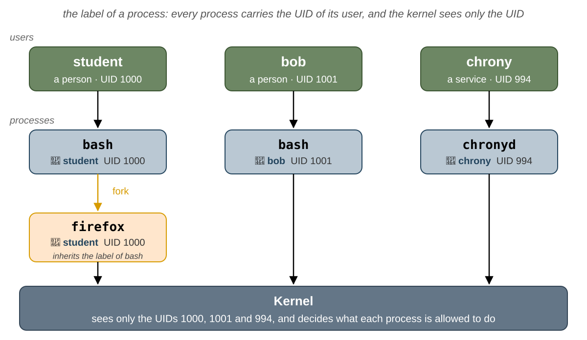

`ps` shows the user of every process in the column `USER` (`UID` for the number):

```shell-session
[student@fedora ~]$ ps -o user,uid,pid,ppid,comm
USER       UID     PID    PPID COMMAND
student   1000    2817    2805 bash
student   1000    3104    2817 ps
[student@fedora ~]$ ps -eo user | sort | uniq -c
      4 chrony
      2 dbus
      ...
    156 root
     51 student
```

- `bash` and `ps` run as `student`: `ps` is a child of `bash`.
- `ps -eo user | sort | uniq -c` counted the processes of every user (see [Pipes](/docs/labs/03#pipes-) in lab 03): most
  of them run as `root`.

:::info

`ps`, `ls -l` and `id` get only numbers from the kernel and look up the names; a UID without a user, for example of a
deleted user, is printed as a number.

:::

:::note

A process can have more than one UID at a time (`passwd` does). The exercises at home and the challenges need these
details: they are in [The Credentials of a Process](#the-credentials-of-a-process).

:::

## Groups

A **group** is a set of users, with a name and a number, the **GID** (_Group ID_). A file can give permissions to a
group, for example to the students of a project, without opening it to everybody: every member gets them.

Every user has:

- **one primary group**, which the new files of the user get; `useradd` creates one with the same name as the user, so
  `student` has the primary group `student`;
- any number of **supplementary groups**, for example `wheel`, the group of the administrators.

## The Users and Groups Databases

### `/etc/passwd`

The local users are kept in `/etc/passwd`, **one user per line**, with the fields separated by `:`. **Everyone** can
read it: every program that shows a user name needs it.

```shell-session
[student@fedora ~]$ ls -l /etc/passwd
-rw-r--r--. 1 root root 2245 Oct 20 09:12 /etc/passwd
[student@fedora ~]$ head -3 /etc/passwd
root:x:0:0:Super User:/root:/bin/bash
bin:x:1:1:bin:/bin:/usr/sbin/nologin
daemon:x:2:2:daemon:/sbin:/usr/sbin/nologin
```

- `ls -l` showed that only `root` may change it, but everybody may read it (on Fedora, ignore the `.` after the
  permissions).
- `head -3` showed the format. To **look up** a user, use [`getent`](#getent):

```shell-session
[student@fedora ~]$ getent passwd student
student:x:1000:1000:Student:/home/student:/bin/bash
```

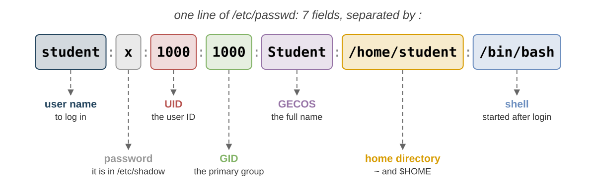

| Field | In the example  | What it is                                                                                     |
| ----- | --------------- | ---------------------------------------------------------------------------------------------- |
| 1     | `student`       | the **user name**, the one you log in with                                                     |
| 2     | `x`             | the password: `x` means that it is kept in `/etc/shadow` (see [Passwords](#passwords))         |
| 3     | `1000`          | the **UID**                                                                                    |
| 4     | `1000`          | the **GID** of the **primary group**                                                           |
| 5     | `Student`       | the **GECOS** field: the full name, sometimes followed by the room and phone numbers, with `,` |
| 6     | `/home/student` | the **home directory**: the current directory after login, `~` and `$HOME`                     |
| 7     | `/bin/bash`     | the **shell**, the program started after login; `/usr/sbin/nologin` refuses the login          |

### `/etc/group`

The local groups are kept in `/etc/group`, one group per line, with 4 fields. Everybody can read it too.

```shell-session
[student@fedora ~]$ getent group wheel
wheel:x:10:student
[student@fedora ~]$ getent group student
student:x:1000:
```

| Field | In the example | What it is                                                                             |
| ----- | -------------- | -------------------------------------------------------------------------------------- |
| 1     | `wheel`        | the name of the group                                                                  |
| 2     | `x`            | not used in this lab                                                                   |
| 3     | `10`           | the **GID**                                                                            |
| 4     | `student`      | the **members**, separated by `,`: the users that have it as a **supplementary** group |

:::caution

The users whose **primary** group it is are **not** listed: the group `student` has an empty list. Use `id <USER>` to
see all the groups of a user.

:::

:::danger

Do not edit `/etc/passwd`, `/etc/group` or `/etc/shadow` with a text editor: one wrong `:` can stop every user, `root`
too, from logging in. Use the commands from [Managing Users and Groups](#managing-users-and-groups).

:::

### `getent`

Users and groups can also come from a **server** in the network (LDAP, Active Directory) or from `systemd`. So the
programs do not read the files: they ask the **C library** (the code that every program uses to talk to the system),
which looks in all these places, listed in `/etc/nsswitch.conf`. Together, these places make the **users database** and
the **groups database**.

`getent` (_get entries_) asks the C library in the same way, and prints the result in the format of the files:

| Command                           | Finds                                                    |
| --------------------------------- | -------------------------------------------------------- |
| `getent passwd <NAME>` or `<UID>` | the user with this **name**, or this **UID**             |
| `getent passwd`                   | all the users                                            |
| `getent group <NAME>` or `<GID>`  | the group with this name, or this GID                    |
| `getent group`                    | all the groups                                           |
| `sudo getent shadow <NAME>`       | the line of the user from `/etc/shadow`, only for `root` |

```shell-session
[student@fedora ~]$ getent passwd 0
root:x:0:0:Super User:/root:/bin/bash
[student@fedora ~]$ getent passwd nobody
nobody:x:65534:65534:Kernel Overflow User:/:/usr/sbin/nologin
[student@fedora ~]$ getent passwd alice
[student@fedora ~]$
```

- `getent passwd 0` found `root`, and `getent passwd nobody` found `nobody`.
- `getent passwd alice` printed **nothing**, without an error: there is no such user.

:::caution

**Always look up users and groups with `getent`**

Use `getent passwd` and `getent group`, not `cat` or `grep` on the files: the files have only the local accounts. In
this lab, **the users database** means `getent passwd`, and **the groups database** means `getent group`.

:::

## The `root` User

`root` is the administrator, the user with the UID `0`. For `root`, the kernel **skips** most of its checks: it can read
and write any file, signal any process and change the system, so installing software and creating users need it. Its
home directory is `/root`.

The kernel looks only at the **number**: two user names with the UID `0` are both `root`. This is how an attacker can
hide a second `root`.

:::danger

A mistake as `root` can destroy the whole system: `root` gets no `Permission denied` to stop it. Work as a regular
user, and become `root` only for the commands that need it.

:::

## Becoming `root`: `sudo` and `su`

### `sudo`

`sudo` runs **one command** as `root`. It asks for **your** password, and it works only for the **administrators**: the
members of one group, whose name depends on the distribution:

| Distribution               | The group of the administrators |
| -------------------------- | ------------------------------- |
| Fedora, Red Hat, CentOS    | `wheel`                         |
| Ubuntu, Debian, Linux Mint | `sudo`                          |

To make a user an administrator, add them to this group (see [Managing Users and Groups](#managing-users-and-groups)).
`student` is in `wheel`:

```shell-session
[student@fedora ~]$ cat /etc/shadow
cat: /etc/shadow: Permission denied
[student@fedora ~]$ sudo whoami
[sudo] password for student:
root
[student@fedora ~]$ sudo whoami
root
```

- `cat /etc/shadow` failed: only `root` may read this file.
- `sudo whoami` asked for the password of `student`, then ran `whoami` as `root`.
- The second `sudo` did not ask again: `sudo` remembers the password for a few minutes (**5** on Fedora), in this
  terminal.
- A user who is not an administrator gets `bob is not in the sudoers file.`

`sudo` logs **every** command: who ran what, as whom, and from which directory:

```shell-session
[student@fedora ~]$ sudo journalctl -t sudo | tail -2
Oct 27 10:02:11 fedora sudo[3311]:  student : TTY=pts/0 ; PWD=/home/student ; USER=root ; COMMAND=/usr/bin/whoami
Oct 27 10:02:20 fedora sudo[3315]:  student : TTY=pts/0 ; PWD=/home/student ; USER=root ; COMMAND=/usr/bin/journalctl -t sudo
```

| Command                    | What it does                                                                                |
| -------------------------- | ------------------------------------------------------------------------------------------- |
| `sudo <COMMAND>`           | runs the command as `root`                                                                  |
| `sudo -u <USER> <COMMAND>` | runs the command as another user; it asks for **your** password, not theirs                 |
| `sudo -i`                  | starts a **login shell** of `root`, in `/root`, with the variables of `root`                |
| `sudo -k`                  | forgets the password: the next `sudo` asks again                                            |
| `sudo !!`                  | runs the **previous** command again, with `sudo`: `bash` replaces `!!` before `sudo` starts |

`sudo` waits for its command to end and passes on the signals it receives. On Fedora, it also runs the command in a
**new pseudo terminal** (see [Terminal Emulators](/docs/labs/04#terminal-emulators) in lab 04), so there are **two**
`sudo` processes. For `sudo sleep 300` started from the shell `2817`:

```shell-session
[student@fedora ~]$ pstree -pu 2817
bash(2817)───sudo(3320,root)───sudo(3321)───sleep(3322)
[student@fedora ~]$ ps -o pid,ppid,tty,comm -p 3320,3321,3322
    PID    PPID TT       COMMAND
   3320    2817 pts/0    sudo
   3321    3320 pts/2    sudo
   3322    3321 pts/2    sleep
```

- `pstree -pu` showed the PIDs and, where it changes, the user: everything under `sudo` runs as `root`.
- The second `sudo` and `sleep` are on `pts/2`, not on `pts/0`: `ps -t pts/0` does **not** find them; use `pstree` or
  `pgrep`.

:::info

The new pseudo terminal stops a program started with `sudo` from typing commands into your terminal after it ends.
Before `sudo` 1.9.14 it was not the default, and `pstree` shows only one `sudo`.

:::

### `su`

`su` (_switch user_) starts a **shell** as another user, and asks for the password of **that** user:

| Command       | What it does                                                                     |
| ------------- | -------------------------------------------------------------------------------- |
| `su - <USER>` | starts a **login shell** of the user: their home directory, variables and groups |
| `su -`        | the same, for `root`; it asks for the password of `root`                         |
| `exit`        | leaves the shell, back to your own                                               |

```shell-session
[student@fedora ~]$ su -
Password:
su: Authentication failure
[student@fedora ~]$ sudo -i
[root@fedora ~]# whoami
root
[root@fedora ~]# exit
logout
[student@fedora ~]$
```

- `su -` failed: `root` usually has **no password** on Fedora and Ubuntu (it is locked, see
  [`/etc/shadow`](#etcshadow)).
- `sudo -i` started a shell of `root` with **your** password; `exit` left it.

With `su`, everybody who becomes `root` shares one password; with `sudo`, everyone uses their own, and every command is
logged. Use `su` to become **another regular user**.

:::tip

The prompt shows `#` instead of `$` in a shell of `root`. Leave it with `exit` as soon as you are done.

:::

### The Redirect Trap

`sudo` runs the **command**, not the whole line. The **redirects** are done by your shell, which runs as you,
**before** `sudo` starts:

```shell-session
[student@fedora ~]$ sudo echo "192.168.1.20 printer" >> /etc/hosts
bash: /etc/hosts: Permission denied
[student@fedora ~]$ echo "192.168.1.20 printer" | sudo tee -a /etc/hosts
192.168.1.20 printer
```

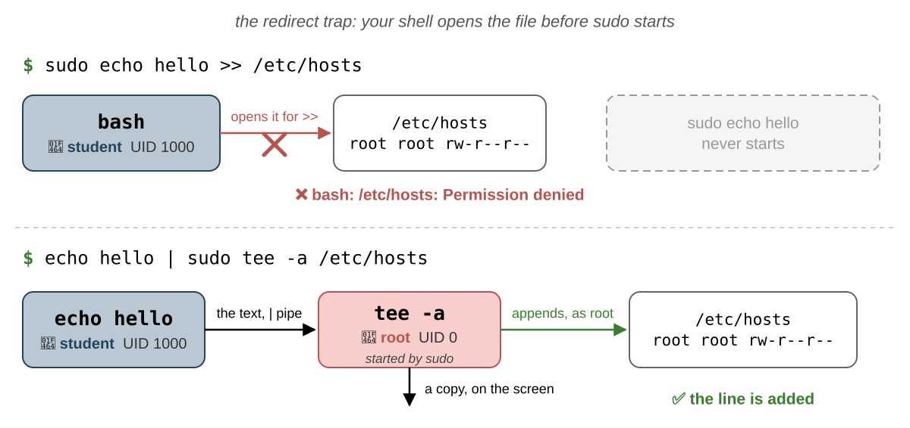

- `bash` opened `/etc/hosts` for `>>` as `student`, before `sudo` started, and failed.
- `tee` ran as `root`: it wrote the text from the pipe into the file **and** on the screen. `-a` (_append_) adds at the
  end, like `>>`; without it, `tee` replaces the content, like `>`.

:::tip

To hide the output of `tee`, add `> /dev/null`: everybody may write to `/dev/null`, so this redirect works as you.

:::

## Passwords

### `/etc/shadow`

`/etc/passwd` must be readable by everyone, so the passwords cannot stay there. They are kept in `/etc/shadow`, that
only `root` can read:

```shell-session
[student@fedora ~]$ ls -l /etc/shadow
----------. 1 root root 1207 Oct 20 09:12 /etc/shadow
[student@fedora ~]$ getent shadow student
[student@fedora ~]$ sudo getent shadow student
student:$y$j9T$Xr3aB7tPq2LkV9sD1fGh0J$9mQeT4bW1sZxH8cDr5Ny2kLpA7uVq3oEw6iFj0gHt1M:20737:0:99999:7:::
```

- On Fedora, `/etc/shadow` has **no** permissions: only `root`, for whom the kernel skips the checks, can read it. On
  Ubuntu, it is `-rw-r----- root shadow`.
- As `student`, `getent shadow` printed nothing; with `sudo`, it printed the line.

Each line has 9 fields, separated by `:`:

| Field | In the example   | What it is                                                                                                           |
| ----- | ---------------- | -------------------------------------------------------------------------------------------------------------------- |
| 1     | `student`        | the user name, the same as in `/etc/passwd`                                                                          |
| 2     | `$y$j9T$Xr3a...` | the **hash** of the password; `!`, `!!` or `*` at the start means that the password is **locked**: no password works |
| 3     | `20737`          | the day of the last password change, counted from 1 January 1970                                                     |
| 4     | `0`              | the minimum number of days between two password changes                                                              |
| 5     | `99999`          | the maximum number of days before the password **must** be changed, `99999` is never                                 |
| 6     | `7`              | how many days before the expiry the user is warned                                                                   |
| 7     | _empty_          | how many days after the expiry the account can still be used                                                         |
| 8     | _empty_          | the day when the **account** expires; empty is never                                                                 |
| 9     | _empty_          | reserved                                                                                                             |

`chage -l` (_change age_) prints the fields 3 - 8 as dates:

```shell-session
[student@fedora ~]$ sudo chage -l student
Last password change                                    : Oct 11, 2026
Password expires                                        : never
Password inactive                                       : never
Account expires                                         : never
Minimum number of days between password change          : 0
Maximum number of days between password change          : 99999
Number of days of warning before password expires       : 7
[student@fedora ~]$ date -d '1970-01-01 + 20737 days'
Sun Oct 11 12:00:00 AM EEST 2026
```

:::note

A locked password (field 2) stops only the logins **with a password**: a user who logs in with `ssh` and a key still
gets in. To stop **every** login, make the account expire (field 8, `chage -E`).

:::

### Hashes and Salt

The password itself is **never** stored, only its **hash**: the result of a **one-way** function. Computing the hash of
a password is easy; finding the password from the hash is not: the only way is to **guess** a password, hash it and
compare. The second field of `/etc/shadow` has parts separated by `$`:

| Part       | In the example           | What it is                                                                    |
| ---------- | ------------------------ | ----------------------------------------------------------------------------- |
| algorithm  | `y`                      | the hash function: `y` is _yescrypt_, `6` is _SHA-512_, `1` is the old _MD5_  |
| parameters | `j9T`                    | the cost of the algorithm: how much work a hash takes                         |
| **salt**   | `Xr3aB7tPq2LkV9sD1fGh0J` | a random text, different for every user, added to the password before hashing |
| hash       | `9mQeT4bW1sZx...`        | the hash of the salt and the password                                         |

To **check** a password, `login`, `sudo` or `passwd` hashes the typed password with the algorithm, the parameters and
the salt from `/etc/shadow`, and compares the result with the stored hash.

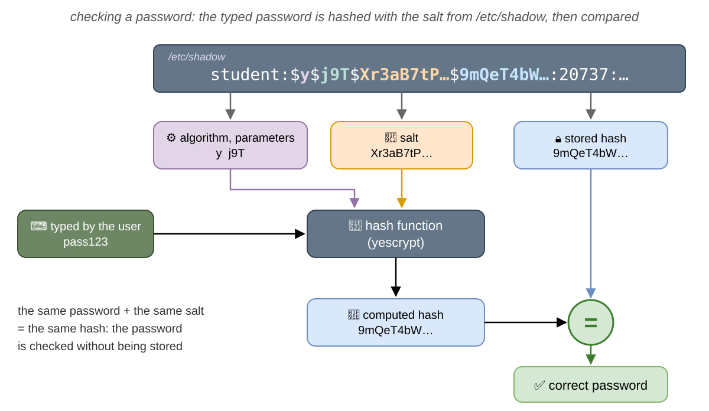

`openssl passwd` computes a hash in the same way (`-6` is _SHA-512_):

```shell-session
[student@fedora ~]$ openssl passwd -6 -salt Xr3aB7tP pass123
$6$Xr3aB7tP$Z1hKbIRkawX63bJfb3tDz.QpCpVlFdOHOBw1ZdK7Oe/6P0K3E0OUwMhyG7PXhsJPPu.ZobCXoTYNxvAQ3HExk0
[student@fedora ~]$ openssl passwd -6 -salt Xr3aB7tP pass123
$6$Xr3aB7tP$Z1hKbIRkawX63bJfb3tDz.QpCpVlFdOHOBw1ZdK7Oe/6P0K3E0OUwMhyG7PXhsJPPu.ZobCXoTYNxvAQ3HExk0
[student@fedora ~]$ openssl passwd -6 -salt Xr3aB7tP pass124
$6$Xr3aB7tP$msVqpr1xVM/DA2zRy9MVn8yIL5iisMXZpqd3XHD5Ix0aQ5QqD8D3Q91LXVy0w9hPqQLzRYsUVEH5g5oBfNp9//
[student@fedora ~]$ openssl passwd -6 -salt Lp0wQ2zM pass123
$6$Lp0wQ2zM$Uo9XUE/86KtNuRc.TcZpxeM0kWUejWZuFOaRQSujvsfACi8WRK55XpaV3Z3WE8TLEWQBF9Jgn4ByzOvO43Ukw0
```

- The same password and salt gave the **same** hash: this is how the check works.
- One different letter, or another salt, gave a completely different hash: two users with the same password have
  different lines in `/etc/shadow`.

:::info

Why is the hash not in `/etc/passwd`? With a copy of the hash, an attacker can try passwords on their own computer, as
fast as it can hash, and nobody sees the tries. A slow algorithm, like _yescrypt_, and the salt make this harder, but a
simple password is still found quickly. So only `root` can read `/etc/shadow`, and the programs that check passwords run
as `root`.

:::

### Changing a Password: `passwd`

| Command                 | What it does                                                                               |
| ----------------------- | ------------------------------------------------------------------------------------------ |
| `passwd`                | changes **your** password; it asks for the old one first                                   |
| `sudo passwd <USER>`    | changes the password of another user (only `root` can do it)                               |
| `sudo passwd -l <USER>` | **locks** the password: adds `!!` (Ubuntu: `!`) in front of the hash, so no password works |
| `sudo passwd -u <USER>` | unlocks it: removes the `!`, and the **old** password works again                          |
| `sudo passwd -S <USER>` | prints the state of the password: set, locked or empty                                     |

:::caution

When you type a password in the terminal, **nothing** appears on the screen. Type it anyway and press
<kbd>Enter</kbd>. Fedora refuses passwords that are too short or too simple, unless you are `root`.

:::

## Managing Users and Groups

These commands change `/etc/passwd`, `/etc/shadow` and `/etc/group`, so they need `sudo`:

| Command                           | What it does                                                                                                               |
| --------------------------------- | -------------------------------------------------------------------------------------------------------------------------- |
| `sudo useradd -m <USER>`          | creates a user, with a group of the same name; `-m` creates the home directory, `-c` sets the full name, `-s` the shell    |
| `sudo passwd <USER>`              | sets the password of the user                                                                                              |
| `sudo groupadd <GROUP>`           | creates a group                                                                                                            |
| `sudo usermod -aG <GROUP> <USER>` | **adds** the user to a supplementary group                                                                                 |
| `sudo usermod <OPTIONS> <USER>`   | **changes** a user that already exists; it takes most of the options of `useradd`: `-c` the full name, `-s` the shell, ... |
| `sudo gpasswd -a <USER> <GROUP>`  | also adds the user to the group                                                                                            |
| `sudo gpasswd -d <USER> <GROUP>`  | removes the user from the group                                                                                            |
| `sudo userdel -r <USER>`          | deletes the user and their group; `-r` also deletes the home directory                                                     |
| `sudo groupdel <GROUP>`           | deletes a group; it refuses if the group is the primary group of a user                                                    |

```shell-session
[student@fedora ~]$ sudo useradd -m -c "Dave Brown" dave
[student@fedora ~]$ sudo passwd dave
New password:
Retype new password:
passwd: password updated successfully
[student@fedora ~]$ sudo usermod -aG students dave
[student@fedora ~]$ id dave
uid=1003(dave) gid=1004(dave) groups=1004(dave),1003(students)
[student@fedora ~]$ ls -ld /home/dave
drwx------. 3 dave dave 80 Oct 27 10:15 /home/dave
```

- `useradd` created `dave`, with the next free UID, a group `dave` and `/home/dave`.
- Until `passwd dave`, nobody could log in as `dave`.
- `usermod -aG` added him to `students`, a group made before with `groupadd`. The numbers may differ on your computer.

A new user is **not** an administrator, so `sudo` refuses `dave`, even with his correct password:

```shell-session
[student@fedora ~]$ su - dave
Password:
[dave@fedora ~]$ sudo whoami
[sudo] password for dave:
dave is not in the sudoers file.
[dave@fedora ~]$ exit
logout
[student@fedora ~]$ sudo usermod -aG wheel dave
[student@fedora ~]$ su - dave
Password:
[dave@fedora ~]$ sudo whoami
[sudo] password for dave:
root
[dave@fedora ~]$ exit
logout
[student@fedora ~]$ sudo gpasswd -d dave wheel
Removing user dave from group wheel
```

- The first `sudo` failed, and the attempt was logged.
- After `usermod -aG wheel`, a **new login** had the new group, and `sudo` worked with **his** password.
- `gpasswd -d` took the right away.

:::danger

Never forget the `-a` of `usermod -aG`: `usermod -G students dave` **replaces** all the supplementary groups of `dave`.
Run it on yourself and you lose `wheel`, and with it `sudo`.

:::

`usermod` changes the fields of a user; `userdel -r` deletes the user, their group and their home directory:

```shell-session
[student@fedora ~]$ sudo usermod -c "David Brown" dave
[student@fedora ~]$ getent passwd dave
dave:x:1003:1004:David Brown:/home/dave:/bin/bash
[student@fedora ~]$ sudo userdel -r dave
[student@fedora ~]$ id dave
id: 'dave': no such user
[student@fedora ~]$ ls -d /home/dave
ls: cannot access '/home/dave': No such file or directory
```

`userdel` refuses a user who still has processes (`user dave is currently used by process 4321`): log the user out
first.

## Logging In

When you log in, a process gets the UID and the groups of your user. On a text terminal, like `/dev/tty3`:

1. `systemd` starts `agetty` on the terminal, as `root`; it prints `login:` and reads the user name;
2. `agetty` **becomes** `login` (it runs `exec`), still as `root`, and it asks for the password;
3. `login` finds the user in the users database, and checks the password with the hash from `/etc/shadow`;
4. a child of `login` sets its groups and, at the end, its UID to the ones of the user; after that, it can **never** go
   back to `root`;
5. the child changes to the **home directory** and runs (`exec`) the **shell** from `/etc/passwd`.

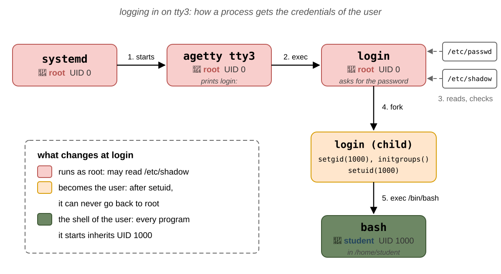

```shell-session
[student@fedora ~]$ ps -t tty3 -o user,pid,ppid,comm
USER         PID    PPID COMMAND
root        5120       1 login
student     5191    5120 bash
```

`login` stays as `root` and waits for the shell, which runs as `student`. A graphical login, `ssh` and `su` do the same
steps.

:::info

**A new group needs a new login**

The groups enter the label of a process only at login, and with `su` and `sudo`. After you are added to a group, the
programs that already run, and the terminals they open, do not have it: **log out and log in again**, or start a login
shell with `su - student`. `id student` reads the database and shows the new group at once; `id` shows the label of your
shell.

:::

## File Permissions

### Owner, Group and Permissions

Every file has **one owner** (a user), **one group**, and three sets of **permissions**: for the **owner** (`u`,
_user_), the **group** (`g`) and the **others** (`o`). The owner does not have to be in the group. `ls -l` shows them:

```shell-session
[student@fedora lab05]$ ls -l notes.txt
-rw-r-----. 1 student students 9 Oct 27 10:20 notes.txt
```

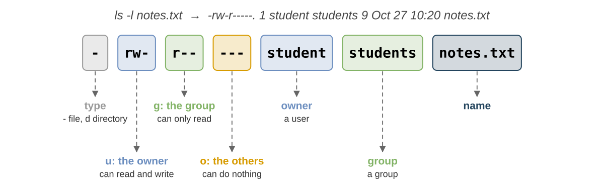

| Part  | In the example | What it is                                                                  |
| ----- | -------------- | --------------------------------------------------------------------------- |
| type  | `-`            | `-` a file, `d` a directory, `l` a symbolic link, `c` and `b` devices       |
| `u`   | `rw-`          | the owner, `student`, can **read** and **write** the file                   |
| `g`   | `r--`          | the members of the group `students` can only **read** it                    |
| `o`   | `---`          | everybody else can do **nothing**                                           |
| owner | `student`      | the user that owns the file, usually the one that created it                |
| group | `students`     | the group of the file, usually the primary group of the one that created it |

`stat` prints them in the format you ask for:

```shell-session
[student@fedora lab05]$ stat -c '%A %a %U %G %n' notes.txt /etc/passwd /etc/shadow
-rw-r----- 640 student students notes.txt
-rw-r--r-- 644 root root /etc/passwd
---------- 0 root root /etc/shadow
```

`%A` are the permissions as letters, `%a` as a number (see [`chmod`](#chmod)), `%U` the owner, `%G` the group and `%n`
the name.

### `r`, `w` and `x`

The same letters have a different meaning for files and for directories:

| Permission  | Value | For a file                       | For a directory                                                                         |
| ----------- | ----- | -------------------------------- | --------------------------------------------------------------------------------------- |
| `r` read    | `4`   | read the content (`cat`, `less`) | **list** the names of the files inside (`ls`)                                           |
| `w` write   | `2`   | change the content               | **create**, **delete** and **rename** the files inside; it works only together with `x` |
| `x` execute | `1`   | run it as a program              | **enter** it (`cd`) and reach the files inside, if you know their names                 |

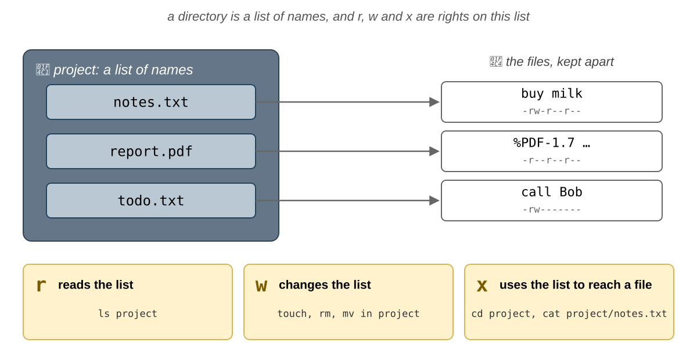

A directory is a **list of names**: `r` reads the list, `w` changes it, and `x` uses it to reach a file. So:

- deleting or renaming a file changes the **directory**, not the file: with `w` on a directory you can delete a file
  that you cannot even read;
- to reach a file you need `x` on **every** directory of its path: `cat /home/student/lab05/notes.txt` needs `x` on `/`,
  `/home`, `/home/student` and `/home/student/lab05`;
- `ls -l` needs `x` too: it reaches every file to read its details.

```shell-session
[student@fedora lab05]$ ls -ld noread noenter
d--x------. 2 student student 60 Oct 27 10:20 noread
dr--------. 2 student student 60 Oct 27 10:20 noenter
[student@fedora lab05]$ ls noread
ls: cannot open directory 'noread': Permission denied
[student@fedora lab05]$ cat noread/secret.txt
top secret
[student@fedora lab05]$ ls noenter
ls: cannot access 'noenter/secret.txt': Permission denied
secret.txt
[student@fedora lab05]$ cd noenter
bash: cd: noenter: Permission denied
```

- `noread` (`x`, no `r`): `ls` failed, but `cat` opened a file whose name it **knew**.
- `noenter` (`r`, no `x`): `ls` read the name, but could not reach the file to color it, so it also printed an error;
  `cd` failed.

:::info

Home directories are `drwx------` on Fedora: the other users cannot reach your files at all. On Ubuntu they are
`drwxr-x---` (an older Ubuntu may have `drwxr-xr-x`): check yours with `ls -ld ~`.

:::

### Which Permissions Apply?

The kernel checks these rules in **order**, and the first match decides:

1. if the user of the process is `root`, the UID `0`: everything is allowed (except running a file without any `x`);
2. if the user of the process is the **owner** of the file: the `u` permissions are used;
3. if one of the groups of the process is the **group** of the file: the `g` permissions are used;
4. otherwise: the `o` permissions are used.

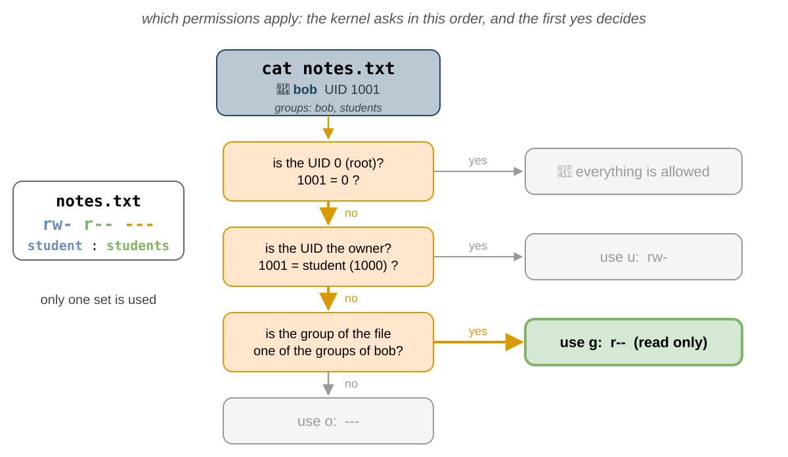

For `notes.txt` above, `-rw-r----- student students`:

| Process run by | Its groups         | Uses | Read | Write |
| -------------- | ------------------ | ---- | ---- | ----- |
| `root`         | `root`             | -    | yes  | yes   |
| `student`      | `student`, `wheel` | `u`  | yes  | yes   |
| `bob`          | `bob`, `students`  | `g`  | yes  | no    |
| `carol`        | `carol`            | `o`  | no   | no    |

:::caution

Only **one** set is used: with `----rw----`, the owner can do **nothing**, even if they are in the group.

:::

### `chmod`

`chmod` (_change mode_) changes the permissions; only the **owner** (or `root`) may run it. With **letters**:

| Part | Letters                                                                                                  |
| ---- | -------------------------------------------------------------------------------------------------------- |
| who  | `u` the owner, `g` the group, `o` the others (**not** the owner and **not** in the group), `a` all three |
| how  | `+` adds, `-` removes, `=` sets exactly these                                                            |
| what | `r`, `w`, `x`                                                                                            |

| Command                     | What it does                                                                                                                          |
| --------------------------- | ------------------------------------------------------------------------------------------------------------------------------------- |
| `chmod u+x script.sh`       | adds `x` for the owner                                                                                                                |
| `chmod g+w,o-r notes.txt`   | adds `w` for the group and removes `r` for the others                                                                                 |
| `chmod go-rwx notes.txt`    | removes everything for the group and the others                                                                                       |
| `chmod a=r readme.txt`      | sets `r--` for everybody                                                                                                              |
| `chmod u=rw,go=r notes.txt` | sets exactly `rw-r--r--`: `=` replaces the old permissions instead of adding to them                                                  |
| `chmod -R g+rX project`     | for the group, adds `r` to `project` and everything inside, and `x` only to the directories and to the files that already have an `x` |

With **numbers**, in octal: `r` is `4`, `w` is `2`, `x` is `1`, added for each of `u`, `g` and `o`:

| Letters     | `u`             | `g`         | `o`         | Number |
| ----------- | --------------- | ----------- | ----------- | ------ |
| `rw-r-----` | 4 + 2 = `6`     | 4 = `4`     | `0`         | `640`  |
| `rwxr-xr-x` | 4 + 2 + 1 = `7` | 4 + 1 = `5` | 4 + 1 = `5` | `755`  |
| `rw-r--r--` | `6`             | `4`         | `4`         | `644`  |
| `rw-------` | `6`             | `0`         | `0`         | `600`  |

```shell-session
[student@fedora lab05]$ ls -l myid.sh
-rw-r--r--. 1 student student 18 Oct 27 10:20 myid.sh
[student@fedora lab05]$ ./myid.sh
bash: ./myid.sh: Permission denied
[student@fedora lab05]$ chmod u+x myid.sh
[student@fedora lab05]$ ./myid.sh
student
[student@fedora lab05]$ chmod 600 myid.sh
[student@fedora lab05]$ ls -l myid.sh
-rw-------. 1 student student 18 Oct 27 10:20 myid.sh
```

- `./myid.sh` failed without `x`; after `chmod u+x`, it ran.
- `chmod 600` set all the permissions at once.

:::tip

Use letters to **change** some permissions (`chmod g+w`), and numbers to **set** all of them (`chmod 640`). With `-R`,
use letters: `chmod -R 644 box` also removes the `x` of the directories, so nobody can enter them;
`chmod -R u=rwX,go=rX box` gives `rw-r--r--` to the files and `rwxr-xr-x` to the directories.

:::

### `umask`

A program asks for `rw-rw-rw-` (`666`) for a new file and `rwxrwxrwx` (`777`) for a new directory; the kernel then
**removes** the bits of the **`umask`** of the process. `umask` is a built-in command of the shell (`help umask`),
inherited by every child.

```shell-session
[student@fedora lab05]$ umask
0022
[student@fedora lab05]$ touch new.txt
[student@fedora lab05]$ mkdir newdir
[student@fedora lab05]$ ls -ld new.txt newdir
-rw-r--r--. 1 student student  0 Oct 27 10:25 new.txt
drwxr-xr-x. 2 student student 40 Oct 27 10:25 newdir
```

|                      | File              | Directory         |
| -------------------- | ----------------- | ----------------- |
| the program asks for | `666` `rw-rw-rw-` | `777` `rwxrwxrwx` |
| `umask 022` removes  | `022` `----w--w-` | `022` `----w--w-` |
| the result           | `644` `rw-r--r--` | `755` `rwxr-xr-x` |

- A new file is never executable: `umask` only **removes** bits.
- `umask 077` makes new files `600` and new directories `700`, until the shell ends.

### `chown` and `chgrp`

| Command                             | What it does                                                       |
| ----------------------------------- | ------------------------------------------------------------------ |
| `sudo chown bob notes.txt`          | the owner becomes `bob`                                            |
| `sudo chown bob:students notes.txt` | the owner becomes `bob` and the group `students`                   |
| `chown :students notes.txt`         | only the group, like `chgrp`                                       |
| `chgrp students notes.txt`          | only the group                                                     |
| `chown -R`, `chgrp -R`              | the directory and everything inside it                             |
| `sudo chown 1005 notes.txt`         | the owner becomes the UID `1005`, even if there is no user with it |

- Only `root` can give a file to another user.
- The owner can change the group of a file only to one of the groups of their **process**.

```shell-session
[student@fedora lab05]$ chown carol notes.txt
chown: changing ownership of 'notes.txt': Operation not permitted
[student@fedora lab05]$ sudo chown carol notes.txt
[student@fedora lab05]$ ls -l notes.txt
-rw-r-----. 1 carol students 9 Oct 27 10:20 notes.txt
```

## Special Permissions

There are three more bits, shown by `ls -l` in the place of an `x`:

| Bit        | Number | `ls -l` shows              | On a program                        | On a directory                                                                            |
| ---------- | ------ | -------------------------- | ----------------------------------- | ----------------------------------------------------------------------------------------- |
| **setuid** | `4000` | `-rwsr-xr-x`               | runs as the **owner** of the file   | ignored                                                                                   |
| **setgid** | `2000` | `-rwxr-sr-x`, `drwxrwsr-x` | runs with the **group** of the file | new files get the **group of the directory**; new directories also get the bit            |
| **sticky** | `1000` | `drwxrwxrwt`               | ignored                             | a file can be deleted or renamed only by its owner, the owner of the directory and `root` |

With letters, they are `u+s`, `g+s` and `+t`; with numbers, the 4th digit in front: `chmod 2775 project` is
`rwxrwsr-x`. A **capital** `S` or `T` means that the bit is set, but the `x` under it is not.

### `setuid`

`passwd` must write `/etc/shadow`, which only `root` can change. `/usr/bin/passwd` belongs to `root` and has the
**setuid** bit: whoever starts it, it runs as `root`.

```shell-session
[student@fedora ~]$ ls -l /usr/bin/passwd /usr/bin/sudo /usr/bin/su
-rwsr-xr-x. 1 root root  32648 Jul 24 03:00 /usr/bin/passwd
-rwsr-xr-x. 1 root root  56920 Jul 24 03:00 /usr/bin/su
---s--x--x. 1 root root 262536 Jul 24 03:00 /usr/bin/sudo
```

`sudo` and `su` are setuid programs too. Run `passwd` in one terminal, without typing anything, and look at it from
another one:

```shell-session
[student@fedora ~]$ ps -o pid,ruser,user,comm -C passwd
    PID RUSER    USER     COMMAND
   6011 student  root     passwd
```

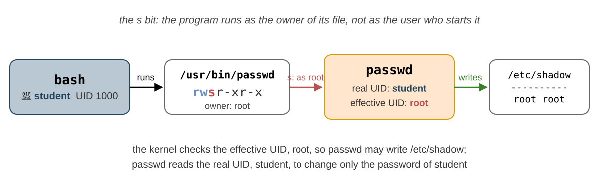

`passwd` runs as `root` (`USER`), so it may write `/etc/shadow`; the kernel also keeps who **started** it (`RUSER`, the
_real user_), so `passwd` changes only **your** password. See
[The Credentials of a Process](#the-credentials-of-a-process).

:::danger

Never add `+s` to a program of `root`: it then runs as `root` for **everybody**, and one bug in it makes anybody `root`.

:::

:::info

The kernel ignores the setuid and setgid bits on **scripts**: it starts `/bin/bash`, which then opens the script by its
name, and in between a user could replace the file.

:::

### `setgid` on a Directory

In a shared directory, the new files should get the group of the project, not the primary group of each user. The
**setgid** bit on the directory does this:

```shell-session
[student@fedora ~]$ sudo mkdir /srv/project
[student@fedora ~]$ sudo chgrp students /srv/project
[student@fedora ~]$ sudo chmod 2775 /srv/project
[student@fedora ~]$ ls -ld /srv/project
drwxrwsr-x. 2 root students 40 Oct 27 10:40 /srv/project
[student@fedora ~]$ sudo -u bob touch /srv/project/bob.txt
[student@fedora ~]$ ls -l /srv/project
total 0
-rw-r--r--. 1 bob students 0 Oct 27 10:41 bob.txt
```

`bob.txt` got the group of the directory, `students`, not `bob`.

:::caution

If you are not in the group of the directory, set the bit as `root`: otherwise the kernel silently removes it.

:::

### The Sticky Bit

Everyone has `w` on `/tmp`, so anyone could delete the files of the others. The **sticky** bit, `t`, allows only the
**owner of the file**, the owner of the directory and `root` to delete or rename a file:

```shell-session
[student@fedora ~]$ ls -ld /tmp
drwxrwxrwt. 21 root root 520 Oct 27 10:00 /tmp
```

:::tip

`find` can look for the special bits: `find /usr -perm -4000` prints the files that have **at least** the setuid bit.

:::

## The Prompt

The prompt of `bash` is built from the shell variable `PS1` (see
[Shell Variables](/docs/labs/04#shell-variables-and-export) in lab 04). On Fedora, it is `[\u@\h \W]\$ ` (on
Ubuntu, `\u@\h:\w\$ `, with colors):

| Escape | Meaning                                                    | For `student` | For `root` |
| ------ | ---------------------------------------------------------- | ------------- | ---------- |
| `\u`   | the **user**                                               | `student`     | `root`     |
| `\h`   | the **host** name                                          | `fedora`      | `fedora`   |
| `\W`   | the name of the current directory (`\w` is the whole path) | `lab05`       | `~`        |
| `\$`   | `$` for the users, `#` for the UID `0`                     | `$`           | `#`        |

The prompt is only **text**, and any user can change it:

```shell-session
[student@fedora ~]$ PS1='[root@fedora \W]# '
[root@fedora ~]# whoami
student
[root@fedora ~]# cat /etc/shadow
cat: /etc/shadow: Permission denied
```

:::caution

Do not trust the prompt to tell you who you are. `whoami` and `id` ask the **kernel** for the label of the process.

:::

### Changing the Prompt

`PS1` can hold any text, and these escapes (`man bash`, section `PROMPTING`):

| Escape     | Replaced with                                                                       |
| ---------- | ----------------------------------------------------------------------------------- |
| `\u`, `\h` | the user; the host name, up to the first `.`                                        |
| `\w`, `\W` | the whole path of the current directory, with `~` for your home; only its last name |
| `\$`       | `$`, or `#` if the UID is `0`                                                       |
| `\t`, `\A` | the time, as `HH:MM:SS` and `HH:MM`                                                 |
| `\d`       | the date, like `Tue Oct 27`                                                         |
| `\j`       | the number of jobs of the shell (lab 04)                                            |
| `\n`       | a new line                                                                          |

```shell-session
[student@fedora lab05]$ PS1='\A \u in \w \$ '
10:52 student in ~/lab05 $ PS1='[\u@\h \W]\$ '
[student@fedora lab05]$
```

:::tip

A change of `PS1` lasts until the shell ends; to keep it, add `PS1='...'` at the end of `~/.bashrc`.

:::

## The Credentials of a Process

:::note

**Going deeper**

You do not need this section for the exercises of the lab, the 🧪 First Steps. Read it at home: the 🏠 Going Further
exercises and the 📝 Challenges use it.

:::

For every process, the kernel keeps its **credentials**: **four** UIDs, **four** GIDs and the **supplementary groups**.
Only the kernel changes them, by strict rules.

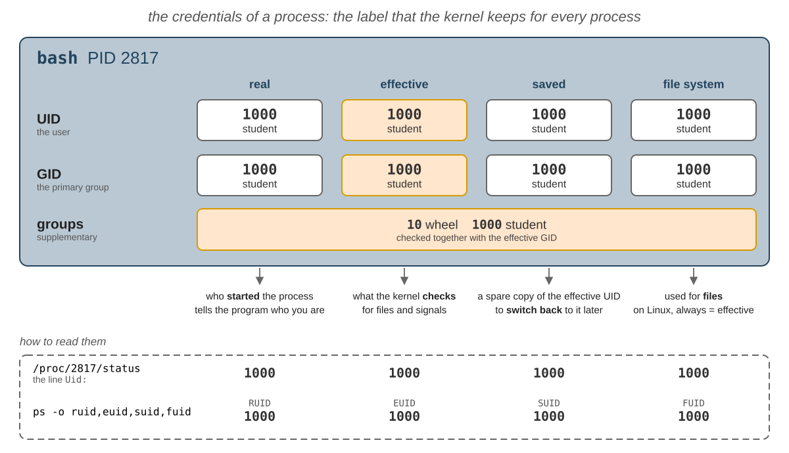

| Credential                  | What it is                                                                                                                                 |
| --------------------------- | ------------------------------------------------------------------------------------------------------------------------------------------ |
| **real** UID and GID        | the user who **started** the process, and their primary group; programs read them to find out who you are                                  |
| **effective** UID and GID   | the ones that the kernel **checks**, when the process opens a file; `ps` shows the effective user in the column `USER`                     |
| **saved** UID and GID       | a spare copy of the effective ones, made when the program starts, so that it can put its rights aside for a while and **take them back**   |
| **file system** UID and GID | used only for files; on Linux, they always follow the effective ones, so you can ignore them                                               |
| **supplementary groups**    | the other groups of the process, checked together with the effective GID; copied from the groups database at login, and by `su` and `sudo` |

For your shell, all the UIDs and GIDs are `1000`. They differ in two cases: a `setuid` program changes the effective and
the saved UID, but not the real one; `login`, `su` and `sudo` change **all** of them for the program they start.

### Which Credentials Are Checked

What the kernel checks depends on what the process asks for:

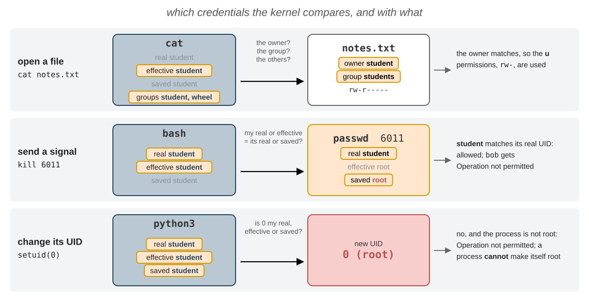

- **opening a file**: the effective UID is compared with the **owner** of the file, and the effective GID and the
  supplementary groups with the **group** of the file (see [Which Permissions Apply?](#which-permissions-apply));
- **sending a signal**, with `kill`: the real or the effective UID of the sender must be the real or the saved UID of
  the target. You can end a `passwd` that **you** started, even if it runs as `root`, because its real UID is yours;
  `bob` cannot;
- **changing its own UIDs**: a process that is not `root` may only take a UID that it **already has**, its real, its
  effective or its saved one. A process **cannot** make itself `root`. Only a process whose effective UID is `0` may
  take any UID.

### How the Credentials Change

What happens to the UIDs at each step of the life of a process:

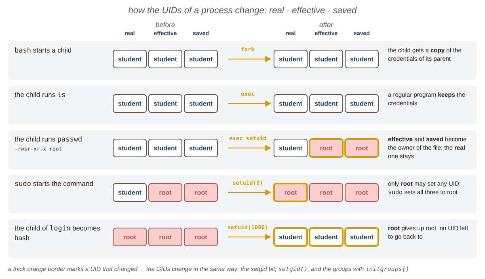

| When                                                                                 | What happens to the UIDs                                                                                                                                                                                           |
| ------------------------------------------------------------------------------------ | ------------------------------------------------------------------------------------------------------------------------------------------------------------------------------------------------------------------ |
| `fork`, a new child                                                                  | the child gets a **copy** of the credentials of its parent                                                                                                                                                         |
| `exec` of a regular program                                                          | **nothing** changes                                                                                                                                                                                                |
| `exec` of a program with the `setuid` bit                                            | the effective and the saved UID become the **owner** of the file; the real UID does not change; the `setgid` bit does the same for the GIDs, with the **group** of the file                                        |
| a process whose effective UID is `0` calls `setgid()`, `initgroups()` and `setuid()` | **all** the GIDs, the supplementary groups and **all** the UIDs change, in this order: this is how `login`, `su` and `sudo` give a process the label of a user (see [Logging In](#logging-in) and [`sudo`](#sudo)) |

### Seeing the Credentials

There are two ways to see the credentials of a process:

```shell-session
[student@fedora ~]$ ps -o pid,ruser,euser,suser,comm -p $$
    PID RUSER    EUSER    SUSER    COMMAND
   2817 student  student  student  bash
[student@fedora ~]$ grep -E '^(Uid|Gid|Groups):' /proc/$$/status
Uid:	1000	1000	1000	1000
Gid:	1000	1000	1000	1000
Groups:	10 1000
```

- `ps -o` took the names of the columns: `ruser` is the real user, `euser` the effective one and `suser` the saved
  one. `man ps` lists all of them, for the UIDs, the GIDs and the groups, in the section `STANDARD FORMAT SPECIFIERS`.
- The `Uid:` and `Gid:` lines of `/proc/<PID>/status` have 4 numbers: real, effective, saved and file system; `Groups:`
  has the supplementary groups (`man 5 proc`). Everybody can read the `status` file of any process.

A process cannot make itself `root`. `python3` can read its UIDs with `os.getresuid()` and try to change them with
`os.setuid()`:

```shell-session
[student@fedora ~]$ python3 -c 'import os; print(os.getresuid()); os.setuid(0)'
(1000, 1000, 1000)
Traceback (most recent call last):
  File "<string>", line 1, in <module>
    import os; print(os.getresuid()); os.setuid(0)
                                      ~~~~~~~~~^^^
PermissionError: [Errno 1] Operation not permitted
```

The kernel refused: `0` is none of the UIDs of the process. To get `root`, a process must start a setuid program of
`root` (`sudo`, `su`, `passwd`) or be started by a process that already runs as `root` (`login`).

### The Saved UID

A careful setuid program works as **you**, and uses `root` only for the steps that need it, so that a bug elsewhere can
do only what you could do. The **saved** UID makes this possible. After the `exec`, its `Uid:` line is `1000 0 0 0`:

1. the program sets its **effective** UID to its real one, `1000` (`Uid: 1000 1000 0 1000`): `root` stays only in
   the saved UID;
2. when it needs `root` again, it sets its effective UID back to `0` (`Uid: 1000 0 0 0`): this is allowed, because
   `0` is its saved UID;
3. when it does not need `root` any more, it sets **all three** UIDs to `1000` (`Uid: 1000 1000 1000 1000`): `0` is
   none of its UIDs now, so it can never go back.

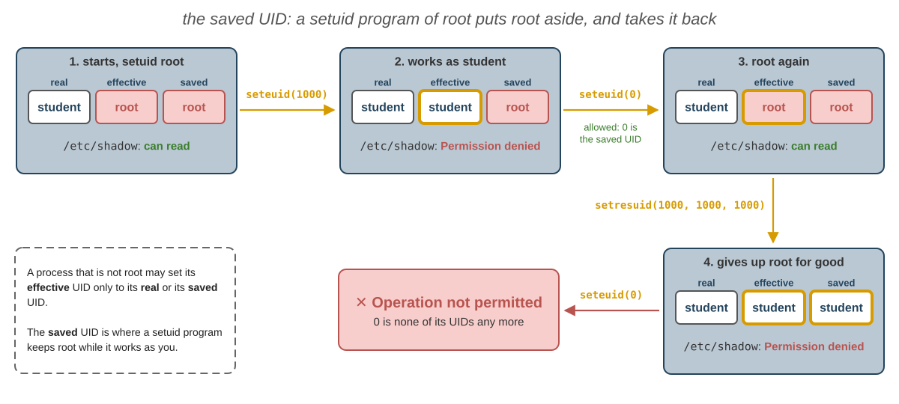

## Troubleshooting

| Problem                                                             | Solution                                                                                                                                                    |
| ------------------------------------------------------------------- | ----------------------------------------------------------------------------------------------------------------------------------------------------------- |
| A user that `ps` or `ls` shows is not in `/etc/passwd`              | It is not a local user: always look up users with `getent passwd`, and groups with `getent group`                                                           |
| `Permission denied` on a file                                       | `ls -l` the file and `id`: find which set applies to you (owner, group or others) and what it allows                                                        |
| `Permission denied` on a file that has `r` for you                  | One of the directories of its path has no `x` for you: `ls -ld` each of them                                                                                |
| `./script.sh: Permission denied`                                    | The file has no `x`: `chmod u+x script.sh`                                                                                                                  |
| `Operation not permitted` for `chmod` or `chown`                    | Only the owner may run `chmod`, and only `root` may change the owner: use `sudo`                                                                            |
| `student is not in the sudoers file.`                               | The user is not an administrator: not in `wheel` (Fedora) or `sudo` (Ubuntu); an administrator must run `sudo usermod -aG wheel student`, then log in again |
| `sudo echo ... > file`: `Permission denied`                         | The redirect is done by your shell, before `sudo`: use `echo ... \| sudo tee file`                                                                          |
| `su: Authentication failure` for `su -`                             | `root` has no password on Fedora and Ubuntu: use `sudo -i`                                                                                                  |
| A new group does not show up in `id`                                | The groups are read at login: log in again, or start a new login shell with `su - <USER>`                                                                   |
| `usermod -G` removed my groups                                      | You forgot `-a`; add them back with `sudo usermod -aG <GROUP> <USER>`                                                                                       |
| `passwd`: `BAD PASSWORD: The password is shorter than 8 characters` | Choose a longer, less simple password; as `root`, you may set it anyway                                                                                     |
| `useradd: user 'bob' already exists`                                | The user is already there: check with `id bob`                                                                                                              |
| `userdel: user bob is currently used by process 1234`               | `bob` still has processes: end them, or log `bob` out first                                                                                                 |
| `rm: remove write-protected regular file?`                          | You do not have `w` on the file, but you have it on the directory: answer `y` to delete it anyway                                                           |
| `rm: cannot remove ... Operation not permitted` in `/tmp`           | The sticky bit: only the owner of the file can delete it                                                                                                    |
| A file shows a number instead of an owner in `ls -l`                | The user was deleted, but the file still has its UID                                                                                                        |

## Exercises

- 🧪 [First Steps](#first-steps) (exercises 1 - 14): one idea at a time, in the order of the lab, to do in the lab;
- 🏠 [Going Further](#going-further) (exercises 15 - 32): longer exercises, to do at home; many of them look at the
  **label** of a process, explained in [The Credentials of a Process](#the-credentials-of-a-process);
- 📝 [Challenges](#challenges) (exercises 33 - 39): the hardest ones, like the ones at the exam.

:::danger

Use `sudo` only where the exercise asks for it, and never on the directories of the system. Never remove yourself
(`student`) from the group of the administrators, `wheel` on Fedora and `sudo` on Ubuntu, or you lose `sudo`.

:::

### 🧪 First Steps {/* #first-steps */}

Do these exercises in order, during the lab. Each one starts with what it wants you to achieve, and tries **one** idea
from the lab: read the section linked at the end of the exercise if you get stuck. Run the commands in `~/lab05`,
unless the exercise says otherwise.

**Users and groups**

1. **The practice tree**: Create the files and directories that the other exercises use, in `~/lab05`.

    1. run these commands (copy them from the browser with <kbd>Ctrl</kbd>+<kbd>C</kbd> and paste them in the terminal
       with <kbd>Ctrl</kbd>+<kbd>Shift</kbd>+<kbd>V</kbd>):

       ```bash
       mkdir -p ~/lab05/noread ~/lab05/noenter
       cd ~/lab05
       printf 'buy milk\n' > notes.txt
       printf 'top secret\n' > noread/secret.txt
       printf 'top secret\n' > noenter/secret.txt
       printf '#!/bin/bash\nid -un\n' > myid.sh
       ```

    2. show the tree of `~/lab05`.

    **Check:** `~/lab05` has the directories `noread` and `noenter`, each with a `secret.txt`, and the files
    `myid.sh` and `notes.txt`. <small>→ [Navigation](/docs/labs/02#navigation)</small>

2. **Who am I**: Find out your user name, your UID and your groups, and which user runs the commands you start.

    1. print your user name, with two different commands;
    2. print your UID, your primary group and all your groups with **one** command; then only your UID, then only the
       **names** of your groups;
    3. print what the system knows about the user `root`, without becoming `root`;
    4. list the processes of your terminal, with the user that runs each of them.

    💡 `man id`: search for `name`, `user` and `groups`; `man ps`: search for `-o` and for `user`.

    **Check:** the name is `student` and the UID `1000`; your primary group is `student` (`1000`), and your groups are
    `student` and `wheel` (Ubuntu: `sudo`, and a few more); `root` has the UID `0` and only the group `root`. `bash` and
    `ps` run as `student`: `ps` was started from your shell, and it runs as the same user. <small>→ [Who Am I](#who-am-i-whoami-and-id) · [Groups](#groups) · [The User of a Process](#the-user-of-a-process)</small>

**The users and groups databases**

3. **Your account in the databases**: Find your own account in the users and the groups databases, and read every
    field of it.

    1. print the permissions of `/etc/passwd` and of `/etc/group`;
    2. print your line from the users database, and say what each of its 7 fields is;
    3. print the lines of the groups `wheel` (Ubuntu: `sudo`) and `student` from the groups database; then print the
       groups of the user `student` with `id`;
    4. find the user with the UID `0` and the group with the GID `10` (Ubuntu: `27`), by their **numbers**;
    5. print the users whose shell is **not** `nologin`.

    💡 `man getent`: the `DATABASES` are `passwd`, `group`, `shadow`, ...; `man 5 passwd` and `man 5 group` explain
    the fields; `man grep`: search for `invert`.

    **Check:** both files are `-rw-r--r-- root root`. Your line is
    `student:x:1000:1000:Student:/home/student:/bin/bash`: name, password (`x`: it is elsewhere), UID, GID of the
    primary group, full name, home directory and shell. `wheel` is `wheel:x:10:student`, but `student` is
    `student:x:1000:`: the members of a **primary** group are not listed. The UID `0` is `root`, the GID `10` is `wheel`
    (Ubuntu: `27`, `sudo`). Besides `root` and `student`, only a few system users have another program than `nologin`:
    `sync` (`/bin/sync`), and on Fedora also `shutdown` and `halt` (on Ubuntu, some have `/bin/false`); none of them
    gives a shell. <small>→ [`/etc/passwd`](#etcpasswd) · [`/etc/group`](#etcgroup) · [`getent`](#getent)</small>

**Becoming `root`**

4. **`sudo`**: Run commands as `root`, see how `sudo` remembers your password, write into a file of `root`, and
    start a shell of `root`.

    1. print your user as `root`; do it again, and see that the password is not asked;
    2. make `sudo` forget the password, and print your user as `root` again;
    3. try to print the first line of `/etc/shadow` as yourself; then run the **same** command again as `root`, without
       typing it again;
    4. create the directory `/srv/lab05` and the empty file `/srv/lab05/root.txt`, as `root`; try to add the line
       `hello` at the end of the file with `sudo echo` and `>>`; then do it with a command that writes to a file **and**
       to the screen, and print the file;
    5. start a login shell of `root`, print the user and the current directory, and leave it.

    💡 `man sudo`: search for `invalidate` and `login`; `man bash`: search for `HISTORY EXPANSION` and then for
    `!!`; `man tee`: search for `append`.

    **Check:** the user is `root`; after `sudo` forgets the password, it asks again. As yourself, `/etc/shadow` gives
    `Permission denied`; `!!` prints the command it became, runs it, and shows the line of `root`. `sudo echo` with `>>`
    fails with `Permission denied`: your shell opens the file, not `sudo`; at the end, the file has `hello`. The shell
    of `root` starts in `/root`, with `#` in the prompt. <small>→ [`sudo`](#sudo) · [The Redirect Trap](#the-redirect-trap)</small>

**Managing users and groups**

5. **Two new users and a group**: Create `bob` and `carol`, who play a member of your group and a stranger in the rest
    of the lab, and the group `students`, with `bob` as its only member.

    1. check that `bob` and `carol` do not exist yet;
    2. create the user `bob`, with a home directory, the shell `/bin/bash` and the full name `Bob Jones`, and the user
       `carol`, the same way, with the full name `Carol White`;
    3. set the password of both of them to `uso2026`;
    4. create the group `students`, and add `bob` to it, without removing his other groups;
    5. print the groups of `bob` and `carol`, the line of `students` from the groups database, and the owners of the
       directories in `/home`.

    💡 `man useradd`: search for `home`, `shell` and `comment` (the full name); `man -k group` finds the command that
    creates a group; `man usermod`: search for `-G` and then for `append`.

    **Check:** before, `id` says `no such user`; after, `bob` and `carol` have the UIDs `1001` and `1002` and a group
    of their own each, and they own `/home/bob` and `/home/carol`; `students` is `students:x:1003:bob`. Setting the
    password may warn `BAD PASSWORD: The password is shorter than 8 characters`, but `root` may set it anyway. <small>→ [Managing Users and Groups](#managing-users-and-groups)</small>

6. **A temporary user**: Create the account `dave`, change it, put it in a group and take it out, and delete it
    without leaving anything behind.

    1. create `dave`, with a home directory, the shell `/bin/bash` and the full name `Dave Brown`, **without** a
       password; print his line from the users database and from `/etc/shadow` (with `getent`, as `root`);
    2. change his full name to `David Brown`, and print his line again;
    3. add him to `students` with `gpasswd`, print his groups; then remove him from `students`, and print them again;
    4. delete `dave` together with his home directory, and check that the user, his group and `/home/dave` are gone.

    💡 `man usermod`: search for `comment`; `man gpasswd`: search for `add` and for `delete`; `man userdel`: search for
    `home`.

    **Check:** the password field of `dave` is `!!` (Ubuntu: `!`): nobody can log in as him yet. After step 2, only the
    5th field changed. His groups are `dave students`, then only `dave`. At the end, `id dave` prints `no such user`,
    `getent group dave` prints nothing, and `ls -d /home/dave` says `No such file or directory`. <small>→ [Managing Users and Groups](#managing-users-and-groups) · [`/etc/shadow`](#etcshadow)</small>

**Logging in**

7. **Become another user**: Log in as `bob` on a text terminal, and become `carol` with `su`.

    1. switch to the third virtual terminal and log in as `bob`; print the user, the current directory and the groups;
       try to print your user as `root` with `sudo`; log out, and go back to Sway (at home, to your graphical
       desktop);
    2. in a terminal, become `carol` with a **login** shell; print the user and the current directory; leave with
       `exit`, and print the user again.

    💡 <kbd>Ctrl</kbd>+<kbd>Alt</kbd>+<kbd>F3</kbd> (<kbd>Host</kbd>+<kbd>F3</kbd> in VirtualBox), and back with
    <kbd>Ctrl</kbd>+<kbd>Alt</kbd>+<kbd>F1</kbd> or <kbd>F2</kbd>; `man su`: search for `login`.

    **Check:** the shell of `bob` runs in `/home/bob`, with the groups `bob` and `students`; `sudo` refuses him:
    `bob is not in the sudoers file.`. `su` asks for the password of `carol`, not yours; her shell starts in
    `/home/carol`; after `exit` you are `student` again. <small>→ [Logging In](#logging-in) · [`su`](#su) · [Virtual Terminals](/docs/labs/04#virtual-terminals)</small>

**File permissions**

8. **Read the permissions**: Learn to read who owns a file and what each user may do with it, and predict the
    permissions of a new file.

    1. print the permissions, the owner and the group of `notes.txt`, `/etc/passwd`, `/etc/shadow` and of the
       directory `~` itself (not its content);
    2. print the same with `stat`, as letters **and** as numbers, with the owner, the group and the name;
    3. print your `umask`; **guess** the permissions of a new file and of a new directory, then create `new.txt` and
       `newdir` and check;
    4. set the `umask` to `077`, create `private.txt`, and print its permissions; then set the `umask` back to the
       value of step 3, because the next exercises need it.

    💡 `man ls`: search for `directories themselves`; `man stat`: search for `%a`, `%A`, `%U`, `%G` and `--format`.

    **Check:** `notes.txt` is `-rw-r--r-- student student` (`644`; Ubuntu: `-rw-rw-r--`, `664`); `/etc/passwd` is
    `-rw-r--r-- root root` (`644`); `/etc/shadow` is `---------- root root` (`0`; Ubuntu: `-rw-r----- root shadow`,
    `640`); `~` is `drwx------` (`700`) on Fedora, `drwxr-x---` (`750`) on Ubuntu. With the `umask` `0022`, `new.txt` is
    `rw-r--r--` and `newdir` is `rwxr-xr-x` (Ubuntu, `0002`: `rw-rw-r--` and `rwxrwxr-x`); with `077`, `private.txt` is
    `rw-------`. <small>→ [Owner, Group and Permissions](#owner-group-and-permissions) · [`umask`](#umask)</small>

9. **`chmod`**: Change the permissions one at a time, with letters, or all at once, with a number, and see that a
    program needs `x` to run.

    1. on `notes.txt`, remove `r` for the group and the others;
    2. remove `w` for yourself, and try to add a line to it; add `w` back, and add the line;
    3. set the permissions of `notes.txt` back to `rw-r--r--` with **one** command, with letters;
    4. run `./myid.sh`; give it `rwxr-xr-x`, with a number, and run it again.

    **Check:** after step 1, `notes.txt` is `-rw-------`; in step 2 you get `Permission denied`, even if it is your
    file; after step 3 it is `-rw-r--r--` again. Without `x`, `./myid.sh` gives `Permission denied`; with `755`, it
    prints `student`. <small>→ [`chmod`](#chmod)</small>

10. **`r`, `w` and `x` for directories**: See what each permission allows on a directory, and who may delete a file.

    1. give `noread` only `x` for you (`--x------`) and `noenter` only `r` (`r--------`);
    2. try to list them, to enter them, and to print the `secret.txt` inside them; then give both back `rwxr-xr-x`;
    3. copy `notes.txt` to `ro.txt`, and make it read only for everybody; try to add a line to it, then delete it.

    **Check:** `noread` cannot be listed, but `noread/secret.txt` can be printed; `noenter` lists the name (with an
    error), but cannot be entered, and its file cannot be printed. You cannot write `ro.txt`, but `rm` asks
    `remove write-protected regular file 'ro.txt'?`, and after `y` the file is gone: deleting a file changes the
    **directory**, and you have `w` on `~/lab05`. <small>→ [`r`, `w` and `x`](#r-w-and-x)</small>

11. **A shared directory**: Share files with the group `students` in `/srv/lab05`, and see which set of permissions
    applies to the owner, to a member of the group and to the others.

    1. make yourself the owner of `/srv/lab05` and `students` its group, with **one** command;
    2. create in it, as yourself, `plan.txt` with the text `the plan` and `report.txt` with the text `the report`;
    3. give `report.txt` the group `students` and the permissions `rw-r-----`; list the directory itself, then its
       content;
    4. print both files as `bob` and as `carol`; try to add a line to `report.txt` as `bob`.

    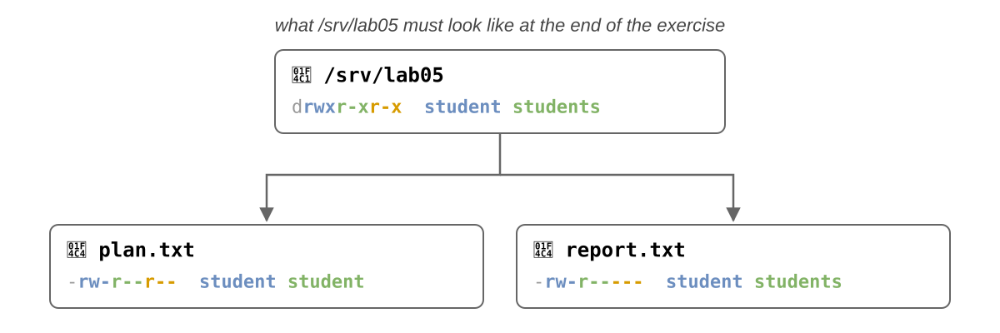

    💡 `man chown`: search for `OWNER:GROUP`. You are not a member of `students`, so giving a file this group needs
    `root` too. `man sudo`: search for `-u user`; to write as `bob`, use the trick from
    [The Redirect Trap](#the-redirect-trap).

    **Check:** `/srv/lab05` is `drwxr-xr-x student students`; `report.txt` is `-rw-r----- student students` and
    `plan.txt` is `-rw-r--r--` (Ubuntu: `-rw-rw-r--`) with your own group. `bob` reads both files: for `report.txt` he
    gets the `g` set, `r--`, so he cannot write it (`Permission denied`). `carol` reads `plan.txt`, but not
    `report.txt`: she is one of the **others**, who have nothing. <small>→ [Which Permissions Apply?](#which-permissions-apply) · [`chown` and `chgrp`](#chown-and-chgrp)</small>

**Special permissions**

12. **The special bits**: See the special bits of the system, a directory where nobody can delete the files of the
    others, and a directory that gives its group to every new file.

    1. print the permissions of `/usr/bin/passwd` and of `/tmp`, as letters and as numbers;
    2. create `/tmp/student.txt`, give **everybody** `w` on it, and try to delete it as `bob`;
    3. create the directory `/srv/lab05/team`, give it the group `students` and the permissions `rwxrwsr-x`; create
       `team/bob.txt` as `bob`, and list it.

    💡 [Special Permissions](#special-permissions) has the numbers of the bits. You are not a member of `students`, so
    change the group **and** the permissions of `team` as `root` (see
    [`setgid` on a Directory](#setgid-on-a-directory)).

    **Check:** `/usr/bin/passwd` is `-rwsr-xr-x` (`4755`): the `s` makes it run as `root`, whoever starts it; `/tmp` is
    `drwxrwxrwt` (`1777`). `bob` cannot delete `/tmp/student.txt` (`Operation not permitted`), although he has `w` on
    it: the `t` of `/tmp`. `team` is `drwxrwsr-x student students`, and `bob.txt` is `-rw-r--r-- bob students`: it got
    the group of the directory. <small>→ [`setuid`](#setuid) · [`setgid` on a Directory](#setgid-on-a-directory) · [The Sticky Bit](#the-sticky-bit)</small>

**The prompt**

13. **The prompt**: Change what the prompt of `bash` shows, and see that it is only text, which the kernel does not
    look at.

    1. print the value of `PS1`; change the prompt to `student in ~/lab05 $`, with the user, the **whole** path and the
       `$` of the user;
    2. change the prompt so that it looks like the prompt of `root`; print your user and try to print `/etc/shadow`;
    3. go back to the original prompt.

    💡 `man bash`: search for `PROMPTING`.

    **Check:** the original is `[\u@\h \W]\$ ` on Fedora (`\u@\h:\w\$ ` with colors on Ubuntu). With the fake prompt
    of `root`, the user is still `student`, and `/etc/shadow` is still denied: `whoami` asks the kernel, and the
    prompt is only text. <small>→ [The Prompt](#the-prompt) · [Changing the Prompt](#changing-the-prompt)</small>

**Changing a password**

14. **`bob` changes his password**: See what changes in `/etc/shadow` when a user changes his own password, and how
    he can do it although he cannot read the file.

    1. print the line of `bob` from `/etc/shadow`, as `root`;
    2. become `bob` with a login shell, and try to print his line from `/etc/shadow`;
    3. still as `bob`, change his password to `bob123`; if `passwd` refuses it and ends, run it again with
       `Lab05-k7Qx-2026`; leave the shell of `bob`;
    4. print his line again, as `root`, and compare the salt and the hash with the ones of step 1;
    5. set the password of `bob` back to `uso2026`, as `root`: the exercises at home need it.

    💡 [Changing a Password](#changing-a-password-passwd); look at the permissions of `/usr/bin/passwd`.

    **Check:** as `bob`, `getent shadow bob` prints nothing. `passwd` asks for his current password, `uso2026`, and
    refuses `bob123`, saying why (on Fedora, `BAD PASSWORD: ...`). After the change, the salt and the hash are
    different. `bob` changed a file he cannot read because `/usr/bin/passwd` has the `s` of the owner: it runs as
    `root`. <small>→ [Changing a Password](#changing-a-password-passwd) · [Hashes and Salt](#hashes-and-salt) · [`setuid`](#setuid)</small>

### 🏠 Going Further {/* #going-further */}

Each exercise starts with its **goal**; you choose the commands. At the end, check the goal itself, not only that each
command worked. The exercises use `bob`, `carol`, `students` and `/srv/lab05` from the First Steps.

**The label of a process**

15. **The credentials of your shell and of `passwd`**: See all the credentials that the kernel keeps for your shell,
    and find out which of them the `setuid` bit of `passwd` changes.

    1. print the PID of your shell; print its real, effective and saved user, and its supplementary groups, with
       **one** `ps` command;
    2. print the `Uid:`, `Gid:` and `Groups:` lines of its `status` file in `/proc`, and find out in the manual what
       each of the 4 numbers of `Uid:` is;
    3. in the second terminal, start `passwd`, and do **not** type anything; in the first terminal, print the same
       columns and the same lines for `passwd`;
    4. end `passwd` with <kbd>Ctrl</kbd>+<kbd>C</kbd>.

    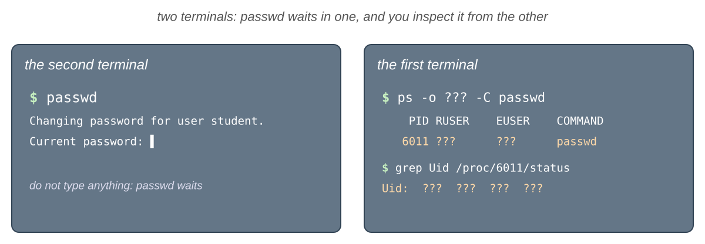

    💡 `$$` is the PID of the shell (lab 04); `man ps`, section `STANDARD FORMAT SPECIFIERS`: search for `real user`,
    `effective user`, `saved user` and `supplementary`; `man ps`: search for `command name`; `man 5 proc`: search for
    `Uid`.

    **Check:** for your shell, the three users are `student`, `Uid:` is 4 times `1000` (real, effective, saved and file
    system UID), and `Groups:` has `10` and `1000`, the GIDs of `wheel` and `student` (Ubuntu: `27` for `sudo`, and a
    few more). For `passwd`, the real user is `student` and the effective and saved users are `root`: `Uid:` is
    `1000 0 0 0`. The `s` of `/usr/bin/passwd` changed the effective and the saved UID, but not the real one: `passwd`
    still knows who started it. <small>→ [The Credentials of a Process](#the-credentials-of-a-process) · [`setuid`](#setuid)</small>

16. **Who may end a process**: Find out how `sudo` changes the credentials of the command it starts, and who may then
    end the command with `kill`.

    For steps 3 - 6, **first** write down your guess, then check it:

    1. in the second terminal, print the PID of the shell, then run `sleep 300` as `root`; in the first terminal, show
       the tree of processes of the second shell, with the PIDs, and list these processes with their PID, PPID,
       terminal, real and effective user;
    2. print the `Uid:` line of the first `sudo` (the one whose parent is the second shell) and of `sleep`; which one
       has the same line as `passwd` in exercise 15, and why?
    3. can you end `sleep` with `kill` and its PID?
    4. send the signal to the first `sudo` instead; what happens to `sleep`?
    5. in the second terminal, run `sleep 300` as `bob`; print its `Uid:` and `Groups:` lines; can you end it? Can
       `bob` end it (run `kill` as `bob`, with `sudo`)?
    6. in the second terminal, start `passwd`; can you end it from the first terminal? Can `bob`?

    💡 `man pstree`: search for `pid`; `ps -p` takes several PIDs, separated by `,`; `man pgrep` finds the PID of a
    process from its name. `sudo` runs its command on a new pseudo terminal (see [`sudo`](#sudo)), so `ps -t` with
    the terminal of the second shell does not find `sleep`. For `kill`, use the rule from
    [Which Credentials Are Checked](#which-credentials-are-checked).

    **Check:** the tree is `bash───sudo───sudo───sleep`. The first `sudo` is `1000 0 0 0`, like `passwd`: it is a setuid
    program; `sleep` is `0 0 0 0`: `sudo`, as `root`, set **all** the UIDs of its child. So you cannot end `sleep`
    (`Operation not permitted`), but you **can** end the first `sudo`, whose real UID is yours, and `sudo` passes the
    signal on to `sleep`. The `sleep` of `bob` has 4 times the UID of `bob` and the GIDs of `bob` and `students`: `bob`
    can end it, you cannot. You can end your `passwd`; `bob` cannot. <small>→ [Which Credentials Are Checked](#which-credentials-are-checked) · [`sudo`](#sudo)</small>

17. **Play a setuid program**: See how the saved UID lets a setuid program put `root` aside and take it back, by acting
    as one, as in [The Saved UID](#the-saved-uid).

    After each step, print the `Uid:` line of the `python3` process from the second terminal, and try to read the first
    line of `/etc/shadow` from `python3`:

    1. in the first terminal, start `python3` as `root`; print its real, effective and saved UID;
    2. become `student` in the real and the effective UID, but keep `root` in the saved UID;
    3. take `root` back, in the effective UID only;
    4. set all three UIDs to `1000`, and try to take `root` back once more.

    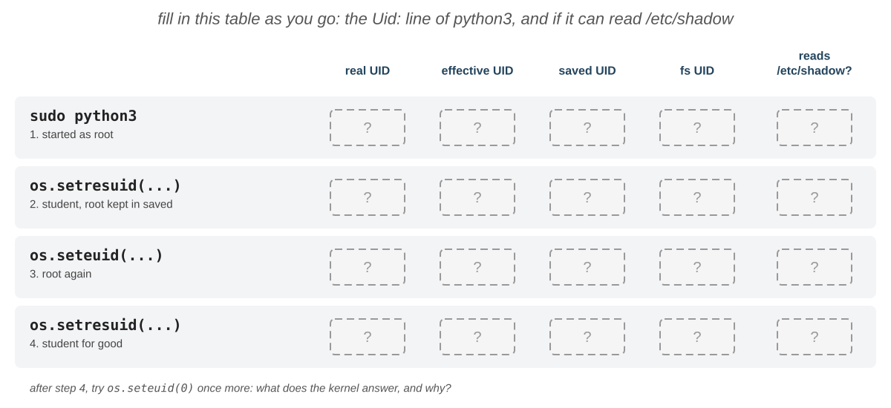

    💡 In `python3`, `import os` first, then `help(os.getresuid)`, `help(os.setresuid)` and `help(os.seteuid)`;
    `open('/etc/shadow').readline()` reads the first line of a file; `exit()` leaves `python3`.

    **Check:** `Uid:` is `0 0 0 0`, then `1000 1000 0 1000` and `/etc/shadow` is denied, then `1000 0 0 0` and it can
    be read again, because `0` was the saved UID; after the last step, `Uid:` is `1000 1000 1000 1000` and
    `seteuid(0)` fails with `Operation not permitted`. The 4th number, the file system UID, always follows the 2nd. <small>→ [The Saved UID](#the-saved-uid) · [Which Credentials Are Checked](#which-credentials-are-checked)</small>

18. **A new colleague, from the first day to the last**: `erin` joins the team, becomes an administrator, and leaves
    after a while. Manage her account from the first day to the last, and find out why her old shell does not get the
    new rights.

    Check every step before you go to the next one:

    1. create her account, with **two** commands: a home directory, the shell `/bin/bash`, the full name `Erin Gray`,
       the supplementary group `students`, and a password;
    2. log in as `erin` on the third virtual terminal; check that she starts in `/home/erin`, is in `students`, and
       that `sudo` refuses her;
    3. she becomes an administrator: while she is still logged in on `tty3`, make her one. In **the same shell** of
       `erin`, print `id erin`, then `id`, then the `Groups:` line of `/proc/$$/status`, and try `sudo` again; then log
       out, log in again, and try once more;
    4. she changes her name: make her full name `Erin Black`;
    5. she leaves: log her out, and delete her account, her group and her home directory.

    💡 `man useradd`: search for `shell`, `comment` and `groups`; `man usermod`; `man userdel`; the group of the
    administrators is in the table of [`sudo`](#sudo).

    **Check:** after step 1, `id erin` shows `students`, and her line has `Erin Gray` and `/bin/bash`. At step 3,
    `id erin` shows `wheel` (Ubuntu: `sudo`), because it reads the database, but `id` and `Groups:` do not (no `10`;
    Ubuntu: `27`): the label of the old shell was set at login, so `sudo` still refuses her. After a new login, `sudo`
    works, with her password. Step 4 changes only the 5th field. At the end, `id erin`, `getent group erin` and
    `ls -d /home/erin` find nothing. <small>→ [Logging In](#logging-in) · [Managing Users and Groups](#managing-users-and-groups)</small>

**Users and passwords**

19. **Your password entry**: Read your own line from `/etc/shadow`, find the parts of its hash, and find out when you
    last changed your password.

    1. print the permissions of `/etc/shadow`, then try to print your line from it with `getent`, as yourself and as
       `root`;
    2. find the algorithm and the salt of your hash;
    3. print the password dates of your account; turn the 3rd field of your line into a date.

    💡 `man 5 shadow` explains the fields; `man 5 crypt`: search for `yescrypt`; `man chage`: search for `list`;
    `man date`: search for `--date` (the date can be `1970-01-01 + N days`).

    **Check:** `/etc/shadow` is `----------` (Ubuntu: `-rw-r----- root shadow`); as yourself, `getent shadow` prints
    nothing; as `root`, it prints a line whose hash starts with `$y$`, _yescrypt_; the salt is the part between the
    3rd and the 4th `$`. The two dates of step 3 are the same day. <small>→ [`/etc/shadow`](#etcshadow) · [Hashes and Salt](#hashes-and-salt)</small>

20. **Audit the users database**: An attacker who becomes `root` often adds a second user with the UID `0`: a hidden
    `root`, with an innocent name. Check that your system has no such user, and find out which users can log in
    with a shell.

    1. find all the users whose UID is `0`;
    2. find the users whose shell is `/bin/bash`;
    3. find the users whose home directory is in `/home`, and count them.

    💡 Read the users with `getent passwd`; the UID is the 3rd field, the home directory the 6th and the shell the 7th.
    Filter the lines with `grep` (lab 03): `[^:]*:` matches one field and its `:`, and `^` the start of the line. Print
    only the names with `cut` (`man cut`: search for `delimiter` and for `fields`). Why is `grep 0` not enough? Why is
    `grep ':0:'` not enough either?

    **Check:** only `root` has the UID `0`. `grep 0` also finds every line with a `0` anywhere, like the UID `1000`;
    `grep ':0:'` also finds the users whose **GID** is `0`. `/bin/bash` is the shell of `root`, `student`, `bob` and
    `carol`; the users in `/home` are `student`, `bob` and `carol`: `3`. <small>→ [`/etc/passwd`](#etcpasswd) · [`getent`](#getent)</small>

21. **Accounts on hold**: `bob` and `carol` have the same password. `bob` goes on holiday, and the internship of
    `carol` ended on 1 January 2020. Find out whether `/etc/shadow` shows that they have the same password, then stop
    both accounts without deleting anything and without changing their passwords, and let them back in: they must log
    in with their **old** passwords.

    1. print the lines of `bob` and `carol` from `/etc/shadow`, and compare their salts and their hashes;
    2. lock the password of `bob`, and print his line; try to become `bob` with `su`, with the right password; unlock
       it, and try again;
    3. make the account of `carol` expire on 1 January 2020, and print her password dates and her line; try to become
       `carol`; then remove the expiry date.

    💡 `man passwd`: search for `lock`; `man chage`: search for `expiredate`, and for `-1`.

    **Check:** the salts are different, so the hashes are different too: nobody can tell from `/etc/shadow` that the
    passwords are the same. The hash of `bob` gets `!!` in front (Ubuntu: `!`) and `su` fails with
    `Authentication failure`; after the unlock, the `!` disappear and `su` works. The 8th field of `carol` becomes
    `18262`, the day 1 January 2020, and `su` refuses her with a message that the account has expired; at the end the
    field is empty again. <small>→ [`/etc/shadow`](#etcshadow) · [Hashes and Salt](#hashes-and-salt) · [Changing a Password](#changing-a-password-passwd)</small>

22. **Is it the permissions?**: Learn to tell, from the error, when `sudo` helps and when it does not.

    Run each command without `sudo`, decide if the error is about **permissions** (then `sudo` fixes it) or something
    else (then `sudo` does not help), and check with `sudo`:

    1. `cat /var/log/kill/them/all.log`;
    2. `userdel hariseldon`;
    3. `chown $USER /home/search/and/destroy`;
    4. `cat /root/missing.txt`;
    5. `dnf install sports-illustrated` (on Ubuntu, `apt install sports-illustrated`).

    **Check:** when the error was about permissions (2, 4 and 5), `sudo` makes it go away, and the command then fails
    with the **real** error: the user, the file or the package does not exist. When the error was about something else
    (1 and 3, `No such file or directory`), `sudo` gives the same error. <small>→ [`sudo`](#sudo) · [`r`, `w` and `x`](#r-w-and-x)</small>

**Permissions**

23. **`x` on every directory**: `bob` needs to read your `notes.txt`. Find the **smallest** change that lets him,
    without letting him see the names of your other files.

    1. as `bob`, print `notes.txt` from your `~/lab05`, with its absolute path;
    2. find out why it fails, by looking at the permissions of every directory of the path;
    3. give the others **only** `x` on your home directory, and try again; then try to list your home directory as
       `bob`;
    4. take the `x` back.

    **Check:** `/home/student` is `drwx------` (Ubuntu: `drwxr-x---`), and `bob` is one of the others, so he cannot
    pass through it; with `x` for the others, `bob` reads `notes.txt` (it is `rw-r--r--`), but cannot list your home
    directory: he has no `r` on it. <small>→ [`r`, `w` and `x`](#r-w-and-x)</small>

24. **The owner is checked first**: Show that the kernel uses only **one** set of permissions, even when another set
    would allow more.

    1. copy `notes.txt` to `/srv/lab05/first.txt`, and give it the group `students` (you are not a member: use
       `root`);
    2. give it `----rw-r--`;
    3. try to read it yourself, as `bob` and as `carol`; then try to add a line to it as `bob`.

    **Check:** you, the owner, cannot read it (`Permission denied`); `bob` can read it and write it (the `g` set), and
    `carol` can read it (the `o` set). <small>→ [Which Permissions Apply?](#which-permissions-apply)</small>

25. **Octal by hand**: Learn to switch between the letters and the numbers of the permissions without help.

    Without the computer:

    1. write as numbers: `rwxr-x---`, `rw-rw-r--`, `r--------`, `rwx--x--x`, `rw-r--r--`;
    2. write as letters: `751`, `664`, `400`, `700`, `555`;
    3. check your answers on a file `test.txt`.

    **Check:** set each value on `test.txt` in the form you started from, and print the other form with `stat`: it must
    be the one you wrote. <small>→ [`chmod`](#chmod)</small>

26. **A private `umask`**: Make every new file of your shell private, and find out for which processes, and for how
    long, this lasts.

    In a new terminal:

    1. set the `umask` so that the new files and directories are private, then create `private2.txt` and `privdir`;
    2. print the `umask` of a child `bash`;
    3. print the `Umask:` line of the `status` file of your shell;
    4. close the terminal, open a new one, and print the `umask`.

    💡 `man 5 proc`: search for `Umask`.

    **Check:** `private2.txt` is `rw-------` and `privdir` is `rwx------`; the child prints `0077`, like its parent, and
    the `Umask:` line is `0077`: the kernel keeps a `umask` for every process, and a child inherits it, like the label;
    the new terminal has the old `umask` again. <small>→ [`umask`](#umask)</small>

**Permission puzzles**: In each exercise, set the permissions (and the group, if you need it) so that **exactly** the
given users can do the given things, and nothing more. You are not a member of `students`, so giving a file this group
needs `root`. Then test every user (`student`, `bob` and `carol`) by reading, listing, writing or running the files.

27. **A public directory**: Publish files that everybody may read, but only you may change.

    `/srv/lab05/public`, with two files, `a.txt` and `b.txt`:

    - everybody can list the directory and read the files;
    - only `student` can create, delete or change files in it;
    - use **one** `chmod` with letters for the directory and all the files.

    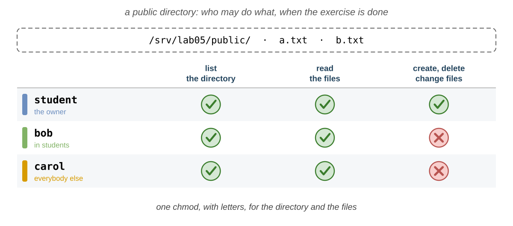

    Start by closing `public` and everything inside it to the group and the others, with **one** command, and check
    that `carol` cannot read `a.txt`; then open it as asked.

    💡 `man chmod`: search for `recursive`, and for the capital `X`.

    **Check:** while it is closed, `public` is `drwx------` and `a.txt` is `-rw-------`; at the end, `carol` lists
    `public` and reads `a.txt`, but cannot create `public/c.txt` or change `a.txt`; the files did not get an `x`. <small>→ [`chmod`](#chmod)</small>

28. **A script for the group**: Let the group run a script, without letting it change the script.

    `/srv/lab05/tool.sh`, a copy of `myid.sh`:

    - the members of `students` can run it, but not change it;
    - nobody else can read or run it.

    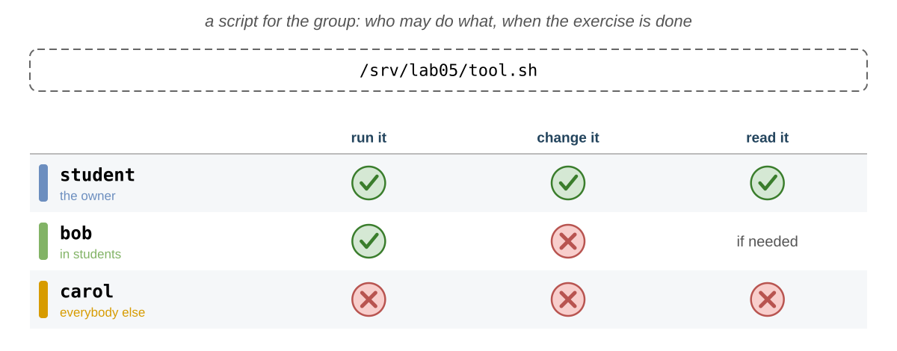

    First try to give the group only `x` and run it as `bob`; then find the right permissions.

    **Check:** with only `x` for the group, `bob` gets `Permission denied`: think about what `bash` must do with the
    file to run the commands inside it. With the right permissions, `bob` runs it and it prints `bob`; `carol` can
    neither read it nor run it. <small>→ [`r`, `w` and `x`](#r-w-and-x)</small>

29. **Known names only**: Hide a file in a directory, so that only those who know its name can read it.

    `/srv/lab05/hidden`, with the file `key.txt`:

    - the members of `students` can read `key.txt` if they know its name, but cannot list the directory;
    - nobody else can do anything.

    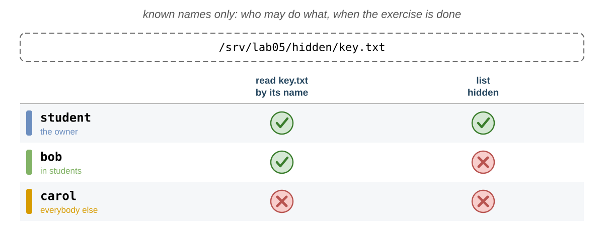

    **Check:** `bob` can print `hidden/key.txt`, but `ls hidden` is denied; `carol` cannot reach `key.txt`, even with
    its name. <small>→ [`r`, `w` and `x`](#r-w-and-x)</small>

30. **A private list**: Help `bob` share a file from his home directory with his group, and with nobody else.

    As `bob`:

    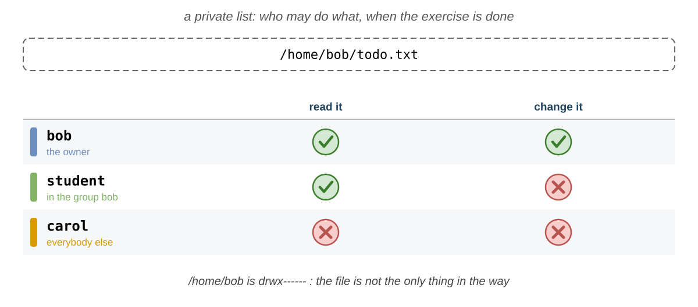

    1. close `/home/bob` to everybody except `bob` (it is already like this on Fedora, not on Ubuntu); create
       `/home/bob/todo.txt` with the text `Bob's TODO list`, readable and writable **only** by `bob`; check that
       `carol` cannot read it;
    2. change it so that the members of the group `bob` can also read it, and nobody else can do anything;
    3. leave, add yourself (`student`) to the group `bob`, and try to read the file from a **new login shell**;
    4. find out why it still fails, and let `bob` change the right directory so that it works, without letting `carol`
       in;
    5. remove yourself from the group `bob`.

    **Check:** at step 3 it is still denied, although you are in the group `bob` and the file gives its group `r`: look
    at **every** directory of the path. After the fix you can read the file, but you cannot list `/home/bob`, and
    `carol` still gets nothing. <small>→ [Which Permissions Apply?](#which-permissions-apply) · [`r`, `w` and `x`](#r-w-and-x)</small>

**The prompt**

31. **A prompt that tells the truth, and stays**: Unlike the fake `root` of the First Steps, make a prompt that shows
    the UID of the shell, so that it changes by itself, and keep it for every new terminal.

    1. make a prompt that shows your UID, from a variable of `bash`, and the `$` or `#`;
    2. start a login shell of `root`, set the **same** `PS1` in it, and look at the prompt; leave it;
    3. add your `PS1` at the end of `~/.bashrc`, open a new terminal, and check the prompt;
    4. start a login shell of `root`, and look at its prompt.

    💡 `man bash`: search for `EUID`; write `PS1` between **single** quotes, so that the variable is replaced every
    time the prompt is shown, not once when you set it.

    **Check:** your prompt shows `1000` and `$`; the shell of `root` shows `0` and `#`: `\$` and `$EUID` come from the
    label of the shell, not from a text you typed. The new terminal has your prompt; the shell of `root` does not: it
    reads `/root/.bashrc`, not yours. <small>→ [Changing the Prompt](#changing-the-prompt)</small>

**Clean up**

32. **Clean up**: Leave the system as it was before the lab.

    1. delete the users `bob` and `carol`, with their home directories, and the group `students`;
    2. delete `/srv/lab05` and `/tmp/student.txt`;
    3. delete `~/lab05` (if it fails, find out which directory has no `w` or `x` for you);
    4. remove your `PS1` from `~/.bashrc`.

    **Check:** `id bob`, `id carol` and `getent group students` find nothing; `/srv` does not have `lab05`. <small>→ [Managing Users and Groups](#managing-users-and-groups)</small>

### 📝 Challenges {/* #challenges */}

These exercises are like the ones at the exam. Each one gives you a **result** to reach and the **rules** you must
follow, but not the steps: you decide the commands. Each one ends with the **Check** that will be used to grade it.
Many of them need [The Credentials of a Process](#the-credentials-of-a-process).

All the challenges start from the same setup, the one you will find at the exam: the users `bob`, `carol` and `dave`,
the group `students`, with `bob` and `dave` as members, and the empty directory `/srv/exam`, owned by `root`. Copy and
run these commands once, before the first challenge (they do not change the users and the groups that exist already):

```bash
sudo groupadd -f students
for u in bob carol dave; do id "$u" &> /dev/null || sudo useradd -m -s /bin/bash "$u"; done
sudo usermod -aG students bob
sudo usermod -aG students dave
sudo mkdir -p /srv/exam
```

The users have no passwords: run commands as them with `sudo -u <USER>`. When you are done with all the challenges,
remove everything with:

```bash
sudo rm -rf /srv/exam
for u in bob carol dave grace; do id "$u" &> /dev/null && sudo userdel -r "$u"; done
sudo groupdel students
```

33. **An offline attack**: See how a hash depends on the password and on the salt, then find a password from its hash,
    the way an attacker with a copy of `/etc/shadow` would.

    1. hash the password `pass123` with _SHA-512_ and the salt `abc`, twice; then with the salt `xyz`; then hash
       `pass124` with the salt `abc`;
    2. a user has this line in a stolen copy of `/etc/shadow`:

       ```text
       mallory:$6$uso2026$YT5ail.RilPFhAJ4Zo6bXZ6qayzFgl959rpxQZDutFYsI3F/Yq4zt5BFc04bFuFJN7PE9Scof6J8VZUPjp7Y20:20737:0:99999:7:::
       ```

       you know that the password is one of `123456`, `password`, `qwerty`, `dragon` and `letmein`; find which one,
       with **one** command line;
    3. explain why `/etc/shadow` must not be readable by everybody.

    💡 `man openssl-passwd`: search for `SHA512` and for `salt`; one command can hash several passwords. Find the
    algorithm and the salt in the hash of `mallory`; `man grep`: search for `line-number`.

    **Check:** in step 1, the first two hashes are the same; another salt, or one different letter, gives a completely
    different hash. In step 2, your command line prints exactly one hash, the one of `mallory`, with its line number;
    the line number tells you the password. Anybody who can read a hash can try passwords on it, offline and unseen:
    this is why only `root` may read `/etc/shadow`. <small>→ [Hashes and Salt](#hashes-and-salt)</small>

34. **Predict the credentials**: Predict all the UIDs and GIDs of three processes, check them with a single command,
    and find every process that has the power of `root` and was started from a terminal.

    The three processes: your shell, a `sleep 300` started as `bob` with `sudo`, and a `passwd` waiting for a password.

    1. **first** fill in the table below on paper, from [How the Credentials Change](#how-the-credentials-change);
    2. start the two processes in other terminals; print, in **one** `ps` command, a column for each of: the real,
       effective, saved and file system UID, and the real and effective GID, for the three processes; compare;
    3. find all the processes that run with the effective user `root` but have a terminal, and show for each its
       terminal, its real and effective user, and its command.

    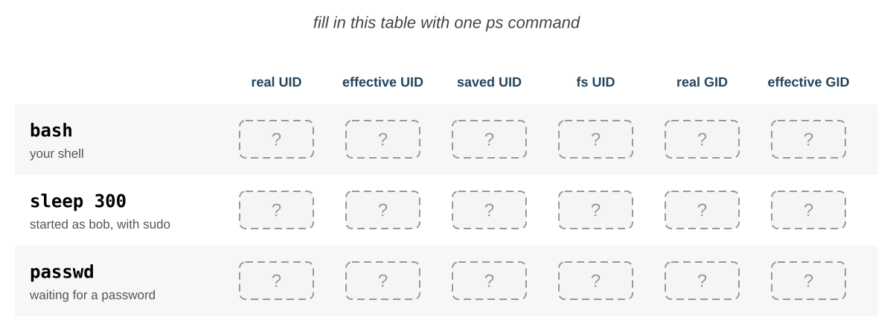

    💡 `man ps`, `STANDARD FORMAT SPECIFIERS`: search for `saved` and for `filesystem`; `-p` takes several PIDs,
    separated by `,`; the processes without a terminal have `?` in the `TTY` column.

    **Check:** the shell has `1000` everywhere; `sleep` has the UID of `bob` everywhere, and the GID of `bob`;
    `passwd` has the real UID `1000` and the other three `0`, and the GIDs `1000`: it has only the setuid bit, not the
    setgid one. In step 3 you see the `agetty` of the virtual terminals that you opened, but where nobody is logged
    in, the `login` of every one where somebody is, the `sudo`, `su` and `passwd` that are still running, and the
    shells of `root`; the real user tells you who started each of them. <small>→ [The Credentials of a Process](#the-credentials-of-a-process)</small>

35. **Who can do what**: Predict which users may open which files, and who may end which process, then prove each
    answer with one command.

    Create two files with these commands:

    ```bash
    printf 'file a\n' | sudo tee /srv/exam/a.txt > /dev/null
    printf 'file b\n' | sudo tee /srv/exam/b.txt > /dev/null
    sudo chown root:students /srv/exam/a.txt
    sudo chmod 640 /srv/exam/a.txt
    sudo chown bob:students /srv/exam/b.txt
    sudo chmod 064 /srv/exam/b.txt
    ```

    Then start these processes; run `passwd` in a second terminal, and do not type anything:

    ```bash
    sudo -b -u bob sleep 601
    sudo -b sleep 602
    ```

    1. **first**, on paper: for `student`, `bob`, `carol` and `dave`, can they read `a.txt`? Read `b.txt`? Write
       `b.txt`?
    2. **first**, on paper: for `student`, `bob` and `carol`, can they end `sleep 601`? `sleep 602`? `passwd`?
    3. prove every answer of the two tables with **one** command each, as the right user;
    4. end the three processes.

    💡 `man sudo`: search for `background`; `man pgrep`: search for `full`, to find a process by its whole command
    line; `man 2 kill`: search for `If sig is 0`, to test if you may send a signal without sending one.

    **Check:** the files:

    |           | read `a.txt` | read `b.txt` | write `b.txt` |
    | --------- | ------------ | ------------ | ------------- |
    | `student` | no           | yes          | no            |
    | `bob`     | yes          | **no**       | **no**        |
    | `carol`   | no           | yes          | no            |
    | `dave`    | yes          | yes          | yes           |

    `bob` owns `b.txt`, so he gets the `u` set, `---`, even if his group may write it. The processes: `student` may end
    only `passwd`, whose real UID is his; `bob` may end only `sleep 601`, which runs with all his UIDs; `carol` may end
    none; nobody but `root` may end `sleep 602`. Each answer must come from a command that prints the content or an
    error (`Permission denied`, `Operation not permitted`). <small>→ [Which Permissions Apply?](#which-permissions-apply) · [Which Credentials Are Checked](#which-credentials-are-checked)</small>

36. **A project for the group**: Build a project directory for a group, where the files belong to the group and nobody
    can delete the work of the others.

    Make `/srv/exam/project` so that:

    - `root` owns it, and only the members of `students` can enter it, list it and create files in it;
    - every new file in it belongs to the group `students`, whoever creates it;
    - a member cannot delete or rename the files of another member.

    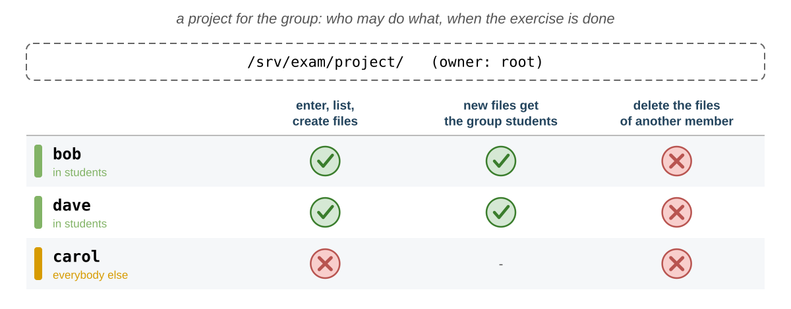

    **Check:** `stat -c '%A %U %G' /srv/exam/project` prints `drwxrws--T root students`: you needed **two** special
    bits. A file created by `bob` and one created by `dave` both have the group `students`, although their primary
    groups are `bob` and `dave`; `bob` gets `Operation not permitted` when he deletes the file of `dave`; `carol` gets
    `Permission denied` when she lists the directory. <small>→ [`setgid` on a Directory](#setgid-on-a-directory) · [The Sticky Bit](#the-sticky-bit)</small>

37. **A homework box**: Build a box where the students hand in their homework, without seeing the names of the files
    of the others or changing them, while the teacher may still clean it.

    Make `/srv/exam/homework` so that:

    - `student`, the teacher, owns it and can do everything in it;
    - the members of `students` can hand in files (create them), but cannot list the directory, so they cannot see
      the names of the others;
    - they cannot delete or replace the files of the others, even if they guess the names;
    - `carol` can do nothing.

    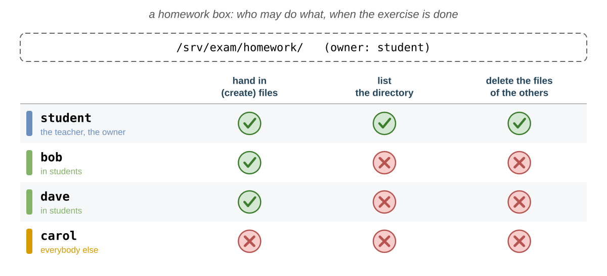

    Hand in `bob.txt` as `bob`, and `dave.txt` as `dave`; as `bob`, try to list the directory, to delete `dave.txt`,
    and to print it; then, as the teacher, delete `dave.txt`.

    **Check:** `stat -c '%A %U %G' /srv/exam/homework` prints `drwx-wx--T student students`. `bob` can create files,
    but cannot list the directory or delete `dave.txt` (`Operation not permitted`); he **can** print `dave.txt`,
    because he guessed its name: it is `rw-r--r--`, and he has `x` on the directory. Hiding the names does not protect
    the content; only the permissions of the file do. The teacher **can** delete `dave.txt`: the **owner of the
    directory** may delete any file in it, even with the sticky bit; `carol` gets `Permission denied` for everything. <small>→ [`r`, `w` and `x`](#r-w-and-x) · [The Sticky Bit](#the-sticky-bit)</small>

38. **Setuid programs and scripts**: Find the programs of the system that run as their owner, and show why the setuid
    bit works for programs but not for scripts.

    1. list all the setuid files in `/usr`, in the format of `ls -l`, without the errors, and count them;
    2. as `root`, copy `/usr/bin/id` to `/srv/exam/rootid`, and give it the setuid bit and `rwxr-xr-x`; run it as
       yourself and as `bob`;
    3. as `root`, create the script `/srv/exam/rootid.sh`, with the two lines `#!/bin/bash` and `id`, with the same
       permissions; run it as yourself;
    4. create `/tmp/cap.txt`, and give it the setuid bit **without** `x` for the owner; create the directory
       `/tmp/capdir` with `rwxrwx---` and the sticky bit, with **one** number; print the permissions of both, as letters
       and as numbers;
    5. explain why `/usr/bin/sudo` is `---s--x--x` on Fedora, and what `-rwsr-xr-x` on Ubuntu allows in addition;
    6. delete `rootid`, `rootid.sh`, `cap.txt` and `capdir`.

    💡 `man find`: search for `-perm` and for `-ls`.

    **Check:** there are a few dozen setuid programs, all owned by `root`. `rootid` prints
    `uid=1000(student) gid=1000(student) euid=0(root) ...` (and `uid=` of `bob` for `bob`): `id` shows `euid` when the
    effective UID is not the real one. The script prints only `uid=1000(student) ...`, without `euid`: the kernel
    ignores the setuid bit on scripts. `cap.txt` is `-rwSr--r--` (`4644`) and `capdir` is `drwxrwx--T` (`1770`): a
    capital letter means that the bit is set, but the `x` under it is not. On Fedora, everybody may run `sudo`, as
    `root`, but nobody may read the file; on Ubuntu, everybody may also read it, and so copy it. <small>→ [`setuid`](#setuid) · [Special Permissions](#special-permissions)</small>

39. **The UID is what matters**: Show that a file belongs to a UID, not to a name, and what happens when a UID is used
    again.

    1. find the UID of `carol`, then delete her **without** her home directory;
    2. list `/home` with names, then with numbers;
    3. create the user `grace`, without a home directory, with the UID that `carol` had;
    4. list `/home` again, then delete `grace` and `/home/carol`.

    💡 `man ls`: search for `numeric`; `man useradd`: search for `uid` and for `no-create-home`.

    **Check:** after `carol` is deleted, `/home/carol` shows numbers instead of an owner and a group: the files keep
    only the UID and the GID. When `grace` gets this UID, `ls -l` shows her as the owner of all the files of `carol`,
    and she may read and change them. Before a UID is used again, the files of the old user must be deleted or given to
    somebody else. <small>→ [Users](#users) · [`chown` and `chgrp`](#chown-and-chgrp)</small>

## Wrap-up Questions

Use the **last 5 minutes** of the lab to answer these questions together with your colleagues and the teaching
assistant. There are no wrong answers for the last two.

1. What is a **user** for the kernel? And a **group**?
2. Where are the local users, groups and passwords kept? Which command do you use to look up a user?
3. Why can everyone read `/etc/passwd`, but only `root` can read `/etc/shadow`? How does `login` check a password if
   the password is not stored anywhere?
4. Which **one** set of permissions does the kernel use for you, when you open a file? Why can the owner of a file
   with `----rw----` not read it?
5. What is the difference between `sudo` and `su`? Why does `sudo` work for `student`, but not for a new user?
6. Why does `sudo echo text > /etc/hosts` fail?
7. What do `r`, `w` and `x` mean for a directory? Why can you delete a file that you cannot write?
8. Why can you not trust the prompt to tell you who you are?
9. What surprised you most about the permissions today?
10. Which permissions will you give to your own files from now on?
