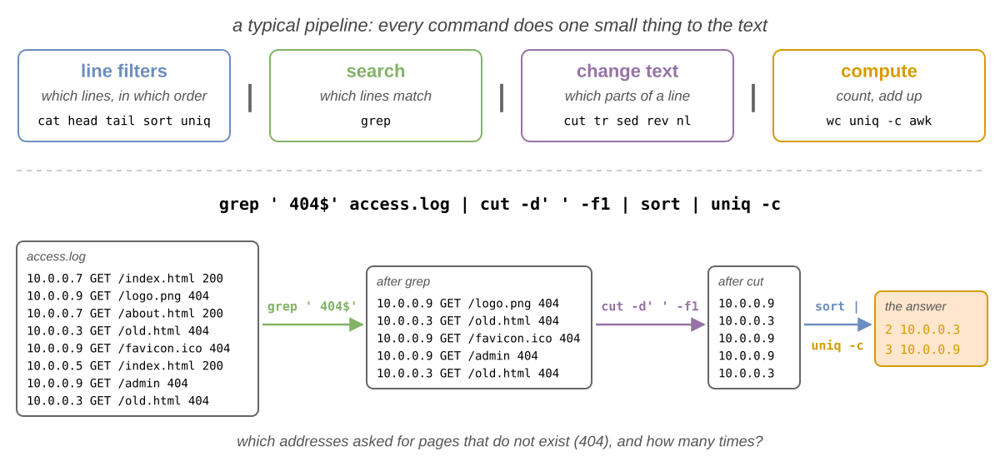
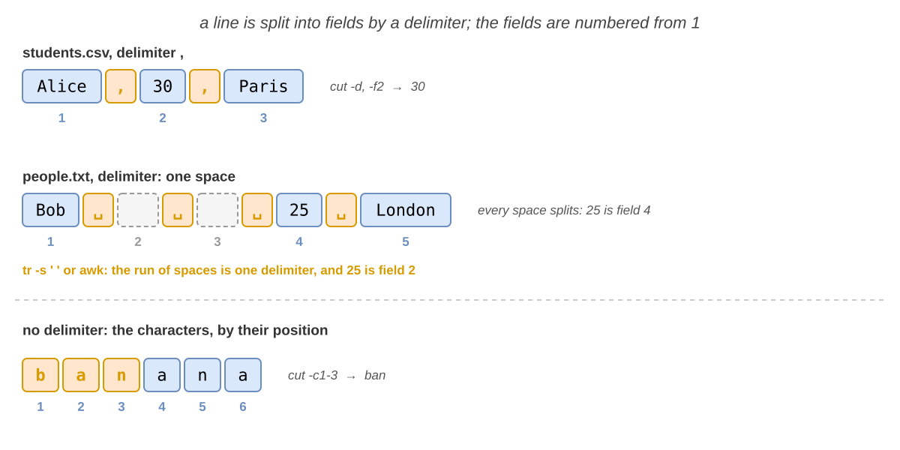
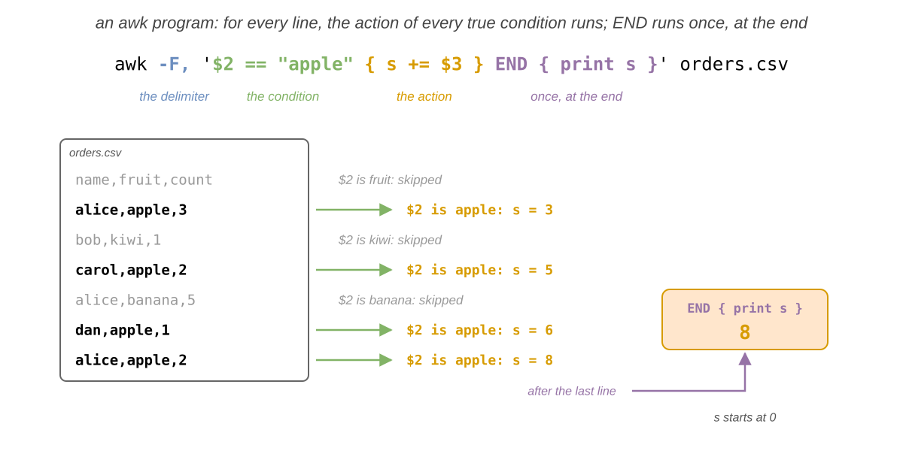
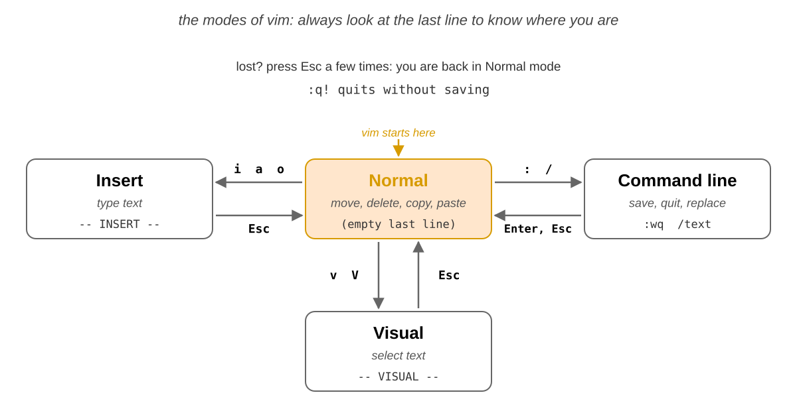
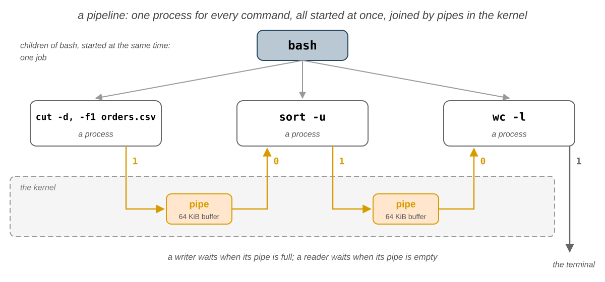

# 06. Text Processing

In the fifth lab you learned which user runs every program, and who may read and write every file. In this lab you
will work with what is **inside** most of these files: **text**. You will meet the **filters**, small commands that
read lines and write lines: `cat`, `head`, `tail` and `sort` work with whole lines, `grep` finds the lines that match a
**regular expression**, `cut`, `tr` and `sed` change the inside of every line, and `wc` and `awk` count and compute.
You will join them into **pipelines** that answer a question in one line, find out if a command worked from its
**exit code**, and chain commands with `&&` and `||`. At the end you will edit text files in the terminal, with `nano`
and `vim`.

The most important idea of this lab is that text is the **common language** of the commands. Every filter reads lines
of text, does **one** small thing with them, and writes lines of text, so the output of any filter can be the input of
any other one. A pipe joins them into a **pipeline**, where each command changes the text a little, until the last one
prints the answer. Every command also ends with a number, its **exit code**, that tells the shell if it worked.

## Objectives

- Understand what a **filter** is, and build a **pipeline** of filters that answers a question
- Show, reverse and cut out lines with `cat`, `tac`, `head` and `tail`
- Sort lines with `sort`, as text, as numbers and by a field, and count the repeated lines with `uniq`
- Write **regular expressions**, basic and extended, and search with them with `grep`
- Cut **fields** and characters out of every line with `cut`, and reverse or number the lines with `rev` and `nl`
- Change, delete and squeeze characters with `tr`, and replace text with `sed`
- Count lines, words and characters with `wc`, and compute sums and averages with `awk`
- Find out if a command worked from its **exit code**, and chain commands with `&&` and `||`
- Edit a text file in the terminal with `nano` and with `vim`

## Resources

1. _[Razvan Deaconescu, Razvan Rughinis, Mihai Carabas, Alexandru Radovici, Utilizarea Sistemelor de
   Operare, Printech 2021](https://github.com/systems-cs-pub-ro/carte-uso/releases/download/uso-ed1-2021/uso.pdf)_
   - Chapter 4 - _Procese_, sections 4.5.3 and 4.5.4
   - Chapter 6 - _Dezvoltarea aplicațiilor_, sections 6.6.1 and 6.6.2
   - Chapter 7 - _Interfața în linia de comandă_, sections 7.4 and 7.5
   - Chapter 13 - _Automatizarea sarcinilor_, section 13.3.2
2. _Brian Ward, How LINUX Works, 3rd Edition, No Starch Press, 2021_
   - Chapter 2 - _Basic Commands and Directory Hierarchy_, sections 2.2.2, 2.5 and 2.14
   - Chapter 11 - _Introduction to Shell Scripts_, sections 11.4 and 11.5
3. _[The GNU Awk User's Guide](https://www.gnu.org/software/gawk/manual/gawk.html)_ and `vimtutor`, the 30 minutes
   tutorial of `vim`
4. The lecture slides: [06. Text Processing](/docs/lectures/06)
5. The manual pages: `man cat`, `man tac`, `man head`, `man tail`, `man sort`, `man uniq`, `man grep`, `man 7 regex`,
   `man cut`, `man tr`, `man sed`, `man rev`, `man nl`, `man wc`, `man awk`, `man nano`, `man vim` and `man bash`
   (search for `Pipelines` and `Lists`)

## Fedora and Ubuntu

The lab computers run **Fedora** with **Sway**, and the examples come from them. At home you may also use **Ubuntu**:
the commands of this lab are the same, with a few differences:

|                          | Fedora                                      | Ubuntu                                                 |
| ------------------------ | ------------------------------------------- | ------------------------------------------------------ |
| the prompt               | `[student@fedora ~]$`                       | `student@ubuntu:~$`, in color                          |
| the program behind `awk` | GNU `awk` (`gawk`)                          | `mawk`, a smaller `awk`: this lab works the same on it |
| `vim` and `vimtutor`     | if missing: `sudo dnf install vim-enhanced` | if missing: `sudo apt install vim`                     |

## Filters

A **filter** is a command that reads text, from the files that it gets as parameters or from its standard input when
it gets none, changes the text, and writes the result to its standard output. In
[Pipes](/docs/labs/03#pipes-) in lab 03 you joined a few of them with `|`: `sort fruits.txt | uniq -c`. A chain of
commands joined by pipes is a **pipeline**.

Think of an assembly line in a factory: every worker does **one** small job on the piece, and passes it on. A filter
does not know what is before it or after it: only its input and its output.

The filters of this lab do four kinds of jobs, and a typical pipeline uses them in this order:

| Kind               | It decides                      | Commands                                     |
| ------------------ | ------------------------------- | -------------------------------------------- |
| **line filters**   | which lines, and in which order | `cat`, `tac`, `head`, `tail`, `sort`, `uniq` |
| **search**         | which lines match a pattern     | `grep`                                       |
| **column filters** | which parts of every line       | `cut`, `tr`, `sed`, `rev`, `nl`              |
| **compute**        | a count, a sum, an average      | `wc`, `uniq -c`, `awk`                       |



```shell-session
[student@fedora lab06]$ grep ' 404$' access.log | cut -d' ' -f1 | sort | uniq -c
      2 10.0.0.3
      3 10.0.0.9
```

- `grep` kept the lines that end with `404`, the requests for pages that do not exist; `cut` kept only the first
  field, the address; `sort | uniq -c` counted every address. Each command is explained in the sections below.

:::tip

**Build a pipeline one command at a time**

Run the first command and look at its output; then press <kbd>↑</kbd>, add `|` and the next command, and look again.
When the output is long, add `| head` at the end while you work.

:::

:::info

_"Write programs that do one thing and do it well. Write programs to work together. Write programs to handle text
streams, because that is a universal interface."_ (Doug McIlroy, the inventor of the Unix pipe)

:::

All the commands of a pipeline run **at the same time**, each one in its own process, and the text flows between them
while they run. The exercises at home and the challenges need the details: they are in
[How a Pipeline Runs](#how-a-pipeline-runs).

## Line Filters

The line filters work with **whole lines**: they choose which lines to keep and in which order, but do not change
them. The examples use the files that [exercise 1](#first-steps) creates in `~/lab06`; `fruits.txt` has 7 lines:
`banana`, `apple`, `cherry`, `apple`, `kiwi`, `banana` and `apple`.

### Showing a File: `cat` and `tac`

You met `cat` in [lab 02](/docs/labs/02#cat). Its options show what you cannot see in the text:

| Command         | What it does                                                                             |
| --------------- | ---------------------------------------------------------------------------------------- |
| `cat <FILE>...` | prints the files, one after another (_concatenate_)                                      |
| `cat`           | with no file, prints what it reads from the keyboard, until <kbd>Ctrl</kbd>+<kbd>D</kbd> |
| `cat -n <FILE>` | numbers every line                                                                       |
| `cat -A <FILE>` | shows the invisible characters: a tab as `^I`, the end of every line as `$`              |
| `tac <FILE>`    | prints the lines in the **reverse** order, the last one first                            |

```shell-session
[student@fedora lab06]$ tac fruits.txt
apple
banana
kiwi
apple
cherry
apple
banana
[student@fedora lab06]$ printf 'a\tb \n' | cat -A
a^Ib $
```

- `tac` printed the same 7 lines, from the last one to the first one.
- `cat -A` showed the tab between `a` and `b`, and the space at the end of the line, before the `$`.

### The First and the Last Lines: `head` and `tail`

| Command               | What it prints                                                                                         |
| --------------------- | ------------------------------------------------------------------------------------------------------ |
| `head -n <N> <FILE>`  | the first `N` lines; without `-n`, the first 10                                                        |
| `tail -n <N> <FILE>`  | the last `N` lines; without `-n`, the last 10                                                          |
| `tail -n +<N> <FILE>` | everything **from** line `N` to the end                                                                |
| `tail -f <FILE>`      | the last lines, then every new line written to the file, until <kbd>Ctrl</kbd>+<kbd>C</kbd> (_follow_) |

```shell-session
[student@fedora lab06]$ head -n 3 fruits.txt
banana
apple
cherry
[student@fedora lab06]$ head -n 5 fruits.txt | tail -n 1
kiwi
[student@fedora lab06]$ tail -n +2 students.csv
Alice,30,Paris
Bob,25,London
Carol,22,Bucharest
```

- `head -n 5 | tail -n 1` kept the first 5 lines, then the last of them: the 5th line.
- `tail -n +2` skipped the first line of `students.csv`, the **header** with the names of the columns.

:::tip

`tail -f` is how administrators watch a **log**, a file where a program adds a line for everything it does. Leave it
running in a terminal, and you see every new line the moment it is written.

:::

### Sorting: `sort`

`sort` prints the lines in alphabetical order. The options change what it compares:

| Option       | What it does                                                        |
| ------------ | ------------------------------------------------------------------- |
| `-r`         | in the **reverse** order                                            |
| `-n`         | compares the lines as **numbers**: `9` before `10`                  |
| `-u`         | prints every line only **once** (_unique_)                          |
| `-t <C>`     | the fields are separated by the character `C` (the default: spaces) |
| `-k <N>,<N>` | sorts by field `N` only; `-k 2,2n` sorts by field `2`, as a number  |

```shell-session
[student@fedora lab06]$ sort numbers.txt
10
100
2
9
[student@fedora lab06]$ sort -n numbers.txt
2
9
10
100
[student@fedora lab06]$ sort -t, -k 2,2n students.csv
name,age,city
Carol,22,Bucharest
Bob,25,London
Alice,30,Paris
```

- Without `-n`, `sort` compared the numbers as text, character by character: `100` came before `2`, because `1` is
  before `2`.
- `-t, -k 2,2n` sorted the lines of `students.csv` by the second field, the age, as a number. The header has no
  number in that field, so it counts as `0` and stays first.

:::caution

Without `-n`, numbers are sorted as **text**: `100` before `2`. Use `-n` whenever the lines start with a number, or
`-k` with `n` when the number is in another field.

:::

### Counting Repeated Lines: `uniq`

You met `uniq` in [Repeated Lines](/docs/labs/03#repeated-lines-uniq) in lab 03: it compares a line only with the
line **right above it**, so it comes after `sort`. Together with `sort -nr` and `head`, it finds the most frequent
lines:

```shell-session
[student@fedora lab06]$ sort fruits.txt | uniq -c | sort -nr | head -n 2
      3 apple
      2 banana
```

- `sort | uniq -c` counted every fruit, `sort -nr` put the largest count first, and `head -n 2` kept the top two.

| Option    | What it prints                                  |
| --------- | ----------------------------------------------- |
| `uniq -c` | every line once, with how many times it appears |
| `uniq -d` | only the lines that appear more than once       |
| `uniq -u` | only the lines that appear exactly once         |

## Regular Expressions

A **regular expression** (_regex_) is a pattern that describes some text: "a `c`, then any character, then an `l`"
is `c.l`. Most programs that search text understand them: `grep`, `sed`, `awk`, the search with <kbd>/</kbd> in
`less`, `man` and `vim`, and every programming language.

Think of a description of a person that you give to a friend at the station: you do not know the name, but "tall,
with a red hat" finds the right person in the crowd. A regex finds the lines that match the description.

`grep '<REGEX>' <FILE>` prints the lines that contain a match of the regex. The examples use `words.txt`:

```text
color
colour
cat
category
concatenate
dog
banana
bat
orange
gal
goal
gooooal
notes.txt
2026-10-04
call 0722 123 456
```

:::caution

**A regex is not a glob**

The `*` of a glob (see [Globbing](/docs/labs/04#globbing) in lab 04) means "any characters"; in a regex, `*` means
"the previous item, any number of times", and "any characters" is `.*`. Always put the regex between **single
quotes**: without them, the shell may expand it as a glob, before `grep` starts. If the current directory has a file
`banana.txt`, `grep ba* fruits.txt` becomes `grep banana.txt fruits.txt`.

:::

### Basic Regular Expressions

| Regex    | Matches                                              | Example  | Matches in `words.txt`                  |
| -------- | ---------------------------------------------------- | -------- | --------------------------------------- |
| `abc`    | the text `abc`, anywhere in the line                 | `cat`    | `cat`, `category`, `concatenate`        |
| `.`      | **any** single character                             | `c.l`    | `color`, `colour`, `call ...`           |
| `^`      | the **start** of the line                            | `^ca`    | `cat`, `category`, `call ...`           |
| `$`      | the **end** of the line                              | `r$`     | `color`, `colour`                       |
| `[abc]`  | **one** of the characters inside (a **class**)       | `[0-9]`  | `2026-10-04`, `call ...`                |
| `[^abc]` | one character that is **not** inside                 | `^[^c]`  | every line that does not start with `c` |
| `*`      | the **previous** item, **0 or more** times           | `go*al`  | `gal`, `goal`, `gooooal`                |
| `.*`     | any characters, or none                              | `^c.*e$` | `concatenate`                           |
| `\`      | the next character is plain text: `\.` is a real dot | `\.`     | `notes.txt`                             |

```shell-session
[student@fedora lab06]$ grep 'go*al' words.txt
gal
goal
gooooal
[student@fedora lab06]$ grep '^[a-z]*$' words.txt | wc -l
12
[student@fedora lab06]$ grep '.' words.txt | wc -l
15
[student@fedora lab06]$ grep '\.' words.txt
notes.txt
```

- `go*al` matched a `g`, any number of `o`, even none, then `al`.
- `^[a-z]*$` matched the lines that have only lowercase letters, from the start to the end: 12 of them.
- `.` alone matched **every** line that is not empty; `\.` matched only the line with a real dot.

### Extended Regular Expressions

With `grep -E`, five more characters are special, and they make the regex shorter:

| Regex | Matches                                                   | Example    | Matches in `words.txt`                  |
| ----- | --------------------------------------------------------- | ---------- | --------------------------------------- |
| `+`   | the previous item, **1 or more** times                    | `[0-9]+`   | `2026-10-04`, `call ...`                |
| `?`   | the previous item, **0 or 1** time: it is optional        | `colou?r`  | `color`, `colour`                       |
| `{n}` | the previous item, exactly `n` times; `{n,m}`: `n` to `m` | `[0-9]{4}` | `2026-10-04`, `call 0722 ...`           |
| `( )` | a **group**, repeated as one item                         | `b(an)*a`  | `banana`, `bat`                         |
| `\|`  | one of the alternatives (_or_)                            | `cat\|dog` | `cat`, `category`, `concatenate`, `dog` |
| `\b`  | a **word edge**: the start or the end of a word           | `\bcat\b`  | only `cat`                              |

```shell-session
[student@fedora lab06]$ grep -E 'colou?r' words.txt
color
colour
[student@fedora lab06]$ grep -E '^[0-9]{4}-[0-9]{2}-[0-9]{2}$' words.txt
2026-10-04
[student@fedora lab06]$ grep -E '\b[0-9]{3}\b' words.txt
call 0722 123 456
```

- `^[0-9]{4}-[0-9]{2}-[0-9]{2}$` matched a line that is **only** a date: 4 digits, `-`, 2 digits, `-`, 2 digits.
- `\b[0-9]{3}\b` matched a number of exactly 3 digits, `123`; without the `\b`, it would match inside `0722` and
  `2026` too.

:::info

Without `-E`, `grep` uses the **basic** regular expressions, where `+`, `?`, `{`, `(` and `|` are plain characters
(`\+`, `\?`, ... are special instead). Use `-E` whenever you need one of them. The whole list is in `man 7 regex`.

:::

### `grep` Options

| Option | What it does                                                                             |
| ------ | ---------------------------------------------------------------------------------------- |
| `-E`   | uses the **extended** regular expressions                                                |
| `-i`   | ignores upper and lower case                                                             |
| `-v`   | prints the lines that do **not** match                                                   |
| `-n`   | prints the number of every line in front of it                                           |
| `-c`   | prints only how many lines match                                                         |
| `-o`   | prints only the **matching part**, every match on its own line                           |
| `-w`   | matches only whole **words**, like `\b...\b`                                             |
| `-q`   | prints nothing (_quiet_): the answer is in its exit code (see [Exit Codes](#exit-codes)) |
| `-r`   | searches all the files of a directory, and of its subdirectories                         |

```shell-session
[student@fedora lab06]$ grep -n 'an' fruits.txt
1:banana
6:banana
[student@fedora lab06]$ grep -o -E '[0-9]+' words.txt
2026
10
04
0722
123
456
[student@fedora lab06]$ grep -v -c 'apple' fruits.txt
4
```

- `-n` showed that `banana` is on the lines `1` and `6`.
- `-o` printed every number of `words.txt` on its own line, without the rest of the line.
- `-v -c` counted the lines that do **not** contain `apple`.

## Column Filters

### Fields and Delimiters

Many text files are **tables**: every line is a row, and a character, the **delimiter**, splits it into
**fields**, the columns. The fields are numbered from `1`.

| File                                      | A line                                                | The delimiter |
| ----------------------------------------- | ----------------------------------------------------- | ------------- |
| a **CSV** file (_comma-separated values_) | `Alice,30,Paris`                                      | `,`           |
| `/etc/passwd` (lab 05)                    | `student:x:1000:1000:Student:/home/student:/bin/bash` | `:`           |
| a log file, `access.log`                  | `10.0.0.9 GET /logo.png 404`                          | a space       |
| many programs                             | the fields are aligned in columns                     | a **tab**     |



:::caution

**Every** delimiter splits. In `Bob   25 London`, with three spaces after `Bob`, there are two **empty** fields
between the spaces, and `25` is field `4`, not `2`.

:::

### Cutting Columns: `cut`

| Command                   | What it prints                                                         |
| ------------------------- | ---------------------------------------------------------------------- |
| `cut -d<C> -f<N> <FILE>`  | field `N` of every line; the fields are separated by the character `C` |
| `cut -d<C> -f1,3`         | fields 1 and 3, separated by the same `C`                              |
| `cut -d<C> -f2-4`, `-f2-` | fields 2 to 4; from field 2 to the end                                 |
| `cut -f<N>`               | without `-d`, the delimiter is the **tab**                             |
| `cut -c<N>-<M> <FILE>`    | the characters `N` to `M` of every line, counted from `1`              |

```shell-session
[student@fedora lab06]$ cut -d, -f1 students.csv
name
Alice
Bob
Carol
[student@fedora lab06]$ cut -d, -f2- students.csv
age,city
30,Paris
25,London
22,Bucharest
[student@fedora lab06]$ cut -d' ' -f2 people.txt
30

```

- `-d, -f1` printed the first field, the names; `-f2-` printed everything from the second field on.
- `people.txt` has `Alice 30 Paris` and `Bob   25 London`: for `Bob`, field `2` is the empty field between the first
  two spaces, so `cut` printed an empty line. `tr`, in the next section, fixes it.

### Changing Characters: `tr`

`tr` (_translate_) changes single **characters**, not words. It reads **only** its standard input: give it a file
with `<` or with a pipe.

| Command            | What it does                                                                            |
| ------------------ | --------------------------------------------------------------------------------------- |
| `tr <SET1> <SET2>` | changes every character of `SET1` into the character at the **same position** in `SET2` |
| `tr -d <SET>`      | **deletes** the characters of `SET`                                                     |
| `tr -s <SET>`      | **squeezes** a run of the same character of `SET` into one                              |

A set is a list of characters, `aeiou`, or a range, `a-z`, `0-9`; `'\n'` is the end of a line and `'\t'` a tab.

```shell-session
[student@fedora lab06]$ tr a-z A-Z < fruits.txt | head -n 2
BANANA
APPLE
[student@fedora lab06]$ echo 'call 0722 123 456' | tr -d 0-9
call
[student@fedora lab06]$ tr -s ' ' < people.txt | cut -d' ' -f2
30
25
[student@fedora lab06]$ echo "$PATH" | tr : '\n'
/home/student/.local/bin
/home/student/bin
/usr/local/bin
/usr/bin
...
```

- `a-z` and `A-Z` have the same length: `a` became `A`, `b` became `B`, and so on.
- `-d 0-9` deleted the digits; the spaces stayed.
- `tr -s ' '` left one space between the fields of `people.txt`, so `cut` found the age of `Bob` in field `2`.
- `tr : '\n'` put every directory of `PATH` (lab 04) on its own line.

### Replacing Text: `sed`

`sed` (_stream editor_) changes the text of every line. Its most used command is `s` (_substitute_):

```text
sed 's/<REGEX>/<NEW TEXT>/<FLAGS>' <FILE>
```

| Written as         | What it does                                                       |
| ------------------ | ------------------------------------------------------------------ |
| `s/apple/pear/`    | replaces the **first** match of every line                         |
| `s/apple/pear/g`   | replaces **every** match of the line (_global_)                    |
| `s/apple/pear/gi`  | the same, ignoring upper and lower case                            |
| `sed -E 's/...//'` | the regex is an **extended** one, as for `grep -E`                 |
| `s/apple//g`       | the new text is empty: deletes the matches                         |
| `s\|/usr\|/opt\|`  | any character can separate the parts: useful when the text has `/` |

```shell-session
[student@fedora lab06]$ echo 'apple and apple pie' | sed 's/apple/pear/'
pear and apple pie
[student@fedora lab06]$ echo 'apple and apple pie' | sed 's/apple/pear/g'
pear and pear pie
[student@fedora lab06]$ echo 'call 0722 123 456' | sed -E 's/[0-9]+/N/g'
call N N N
[student@fedora lab06]$ sed 's/,/ /g' students.csv
name age city
Alice 30 Paris
Bob 25 London
Carol 22 Bucharest
```

- Without `g`, only the first `apple` changed.
- `[0-9]+` matched each number, and every match became `N`.
- `sed` printed the changed text; `students.csv` itself did **not** change.

:::danger

`sed -i` writes the result **back into the file**, instead of printing it. There is no undo: run the command without
`-i` first, and look at the output.

:::

### Reversing and Numbering: `rev` and `nl`

| Command      | What it does                                                                            |
| ------------ | --------------------------------------------------------------------------------------- |
| `rev <FILE>` | reverses the **characters** of every line; the order of the lines stays (that is `tac`) |
| `nl <FILE>`  | adds a first column with the number of the line, and a tab; empty lines get no number   |

```shell-session
[student@fedora lab06]$ rev fruits.txt | head -n 2
ananab
elppa
[student@fedora lab06]$ echo /usr/share/doc/bash | rev | cut -d/ -f1 | rev
bash
```

- `cut` cannot count fields from the end. `rev` put the last field first, `cut -f1` took it, and the second `rev`
  turned it back.

## Counting and Computing

### Counting: `wc`

`wc` (_word count_) counts the lines, the words and the bytes:

| Option | What it counts                                                             |
| ------ | -------------------------------------------------------------------------- |
| `-l`   | the **lines**                                                              |
| `-w`   | the **words**: the groups of characters separated by spaces                |
| `-c`   | the **bytes**                                                              |
| `-m`   | the **characters**: a letter like `ș` takes 2 bytes, but it is 1 character |

```shell-session
[student@fedora lab06]$ wc fruits.txt
 7  7 44 fruits.txt
[student@fedora lab06]$ wc -l < fruits.txt
7
[student@fedora lab06]$ echo 'mașină' | wc -c -m
      7       9
```

- Without options, `wc` printed the lines, the words and the bytes, then the name of the file.
- With `<`, `wc` did not know the name of the file (see [Input](/docs/labs/03#input-) in lab 03): it printed only the
  number.
- `mașină` and the end of the line are 7 characters, but 9 bytes: `ș` and `ă` take two bytes each.

### Computing: `awk`

`awk` is a small programming language for tables. An `awk` program is a list of **conditions**, each with an
**action** between `{ }`: for every line, `awk` splits it into fields and runs the action of every condition that is
true for the line. A condition is optional; `END` is a condition that is true once, after the last line.



| Written as                 | What it is                                                                  |
| -------------------------- | --------------------------------------------------------------------------- |
| `-F,`                      | the delimiter is `,`; without `-F`, any run of spaces and tabs              |
| `$1`, `$2`, ..., `$NF`     | the fields; `$NF` is the last one; `$0` is the whole line                   |
| `NF`, `NR`                 | the number of fields of the line; the number of the line                    |
| `==`, `!=`, `<`, `>=`, ... | compare two values: numbers as numbers, text as text                        |
| `~ /regex/`, `!~ /regex/`  | matches, does not match a regex                                             |
| `&&`, `\|\|`, `!`          | and, or, not                                                                |
| `{ print $1, $3 }`         | prints fields 1 and 3, separated by a space                                 |
| `{ s += $3; n++ }`         | adds field 3 to the variable `s`, and adds 1 to `n`; variables start at `0` |

The examples use `orders.csv`, a header and 6 orders:

```text
name,fruit,count
alice,apple,3
bob,kiwi,1
carol,apple,2
alice,banana,5
dan,apple,1
alice,apple,2
```

```shell-session
[student@fedora lab06]$ awk -F, '{ s += $3 } END { print s }' orders.csv
14
[student@fedora lab06]$ awk -F, 'NR > 1 { s += $3; n++ } END { print s / n }' orders.csv
2.33333
[student@fedora lab06]$ awk -F, '$2 == "apple" { s += $3 } END { print s }' orders.csv
8
[student@fedora lab06]$ awk -F, '$2 ~ /an/ { print $1, $2 }' orders.csv
alice banana
[student@fedora lab06]$ awk '{ print NF, $NF }' people.txt
3 Paris
3 London
```

- The first program added field 3 of every line, and printed the sum at the end; the header `count` is not a number,
  so it added `0`.
- `NR > 1` skipped the header, and `n` counted the orders: 14 / 6 = 2.33333.
- `$2 == "apple"` added only the apples; `$2 ~ /an/` printed the orders whose fruit contains `an`.
- Without `-F`, `awk` split `Bob   25 London` at the **run** of spaces: 3 fields, no empty ones.

:::tip

Put the `awk` program between **single quotes**: `$1` and `$3` are for `awk`, not for the shell.

:::

## A Pipeline, Step by Step

How many customers ordered apples? Build the pipeline one command at a time, and look at the text after every step:

```shell-session
[student@fedora lab06]$ tail -n +2 orders.csv | grep ',apple,'
alice,apple,3
carol,apple,2
dan,apple,1
alice,apple,2
[student@fedora lab06]$ tail -n +2 orders.csv | grep ',apple,' | cut -d, -f1
alice
carol
dan
alice
[student@fedora lab06]$ tail -n +2 orders.csv | grep ',apple,' | cut -d, -f1 | sort -u
alice
carol
dan
[student@fedora lab06]$ tail -n +2 orders.csv | grep ',apple,' | cut -d, -f1 | sort -u | wc -l
3
```

- `tail -n +2` skipped the header, and `grep ',apple,'` kept the orders of apples; the commas around `apple` skip a
  fruit like `pineapple`.
- `cut` kept the names; `alice` ordered apples twice, so `sort -u` kept every name once; `wc -l` counted them.

## Exit Codes

Every command ends with a number between `0` and `255`, its **exit code**: `0` means **success**, any other number an
error. The shell keeps the exit code of the last command in `$?` (see
[Special Parameters](/docs/labs/04#special-parameters---and-) in lab 04). The manual page of a command says what its
numbers mean, in the section `EXIT STATUS`:

| `grep` ends with | When                                           |
| ---------------- | ---------------------------------------------- |
| `0`              | it found at least one line                     |
| `1`              | it found nothing                               |
| `2`              | an error: for example, the file does not exist |

```shell-session
[student@fedora lab06]$ grep -q kiwi fruits.txt
[student@fedora lab06]$ echo $?
0
[student@fedora lab06]$ grep -q mango fruits.txt
[student@fedora lab06]$ echo $?
1
[student@fedora lab06]$ grep kiwi nope.txt
grep: nope.txt: No such file or directory
[student@fedora lab06]$ echo $?
2
```

- `grep -q` printed nothing; its exit code said if it found `kiwi`, `0`, or not, `1`.

| Command    | What it does                                        |
| ---------- | --------------------------------------------------- |
| `true`     | nothing; it ends with `0`                           |
| `false`    | nothing; it ends with `1`                           |
| `exit <N>` | ends the shell, or a script, with the exit code `N` |

A command killed by a signal (lab 04) ends with `128` plus the number of the signal: <kbd>Ctrl</kbd>+<kbd>C</kbd>
(`SIGINT`, `2`) gives `130`.

### Chaining Commands: `&&` and `||`

| Written as | What it does                                                          |
| ---------- | --------------------------------------------------------------------- |
| `a ; b`    | runs `a`, then `b`, whatever happened                                 |
| `a && b`   | runs `b` only if `a` ended with `0`: "`a`, **and then** `b`"          |
| `a \|\| b` | runs `b` only if `a` did **not** end with `0`: "`a`, **or else** `b`" |

```shell-session
[student@fedora lab06]$ grep -q kiwi fruits.txt && echo 'kiwi found'
kiwi found
[student@fedora lab06]$ grep -q mango fruits.txt && echo 'mango found'
[student@fedora lab06]$ grep -q mango fruits.txt || echo 'no mango'
no mango
[student@fedora lab06]$ mkdir -p backup && cp fruits.txt backup/ && echo 'saved'
saved
```

- `&&` skipped `echo 'mango found'`, because `grep` ended with `1`; `||` ran `echo 'no mango'` for the same reason.
- `cp` ran only after `mkdir` worked, and `echo` only after `cp` worked.

:::caution

`a && b || c` is **not** "if `a`, then `b`, else `c`": the shell reads it from left to right, so `c` also runs when
`a` works but `b` fails. It is safe when `b` cannot fail, like `echo`.

:::

### The Exit Code of a Pipeline

The exit code of a pipeline is the exit code of its **last** command:

```shell-session
[student@fedora lab06]$ cut -d, -f2 orders.csv | grep -q kiwi && echo 'kiwi ordered' || echo 'no kiwi'
kiwi ordered
[student@fedora lab06]$ cut -d, -f2 nope.csv | sort
cut: nope.csv: No such file or directory
[student@fedora lab06]$ echo $?
0
```

- In the first line, `grep -q` found `kiwi` in the column of the fruits: the pipeline ended with `0`.
- In the second, `cut` failed, but `sort`, the last command, worked: the pipeline ended with `0`, and the error was
  hidden. [How a Pipeline Runs](#how-a-pipeline-runs) shows how to see it.

## Text Editors

You edit text files all the time: settings in `/etc` and in `~/.config`, programs, notes. On a server, over the
network, or on a virtual terminal (lab 04), there is no window: you need an editor that runs **inside the terminal**.

| Editor              | What it is like                                                                                                 |
| ------------------- | --------------------------------------------------------------------------------------------------------------- |
| `nano`              | simple: you type, and the keys are written at the bottom of the screen; the default editor of Fedora and Ubuntu |
| `vi`, `vim`, `nvim` | **modal**: the keys are commands until you start typing; installed on every Unix system                         |
| `emacs`             | every command is a <kbd>Ctrl</kbd> or <kbd>Alt</kbd> combination; it can be extended without end                |
| `helix` (`hx`)      | modal like `vim`, newer, and it understands programming languages without settings                              |

### `nano`

You met `nano` in [lab 02](/docs/labs/02#nano). The bottom of the screen lists its keys: `^` means
<kbd>Ctrl</kbd> and `M-` means <kbd>Alt</kbd>.

| Key                           | Action                                    |
| ----------------------------- | ----------------------------------------- |
| <kbd>Ctrl</kbd>+<kbd>O</kbd>  | save (_write out_), then <kbd>Enter</kbd> |
| <kbd>Ctrl</kbd>+<kbd>X</kbd>  | exit                                      |
| <kbd>Ctrl</kbd>+<kbd>K</kbd>  | cut the line                              |
| <kbd>Ctrl</kbd>+<kbd>U</kbd>  | paste the lines that you cut              |
| <kbd>Alt</kbd>+<kbd>U</kbd>   | undo                                      |
| <kbd>Ctrl</kbd>+<kbd>W</kbd>  | search (_where is_)                       |
| <kbd>Ctrl</kbd>+<kbd>\\</kbd> | search and replace                        |
| <kbd>Ctrl</kbd>+<kbd>\_</kbd> | go to a line, by its number               |

### `vim`

`vim` (_Vi IMproved_) is **modal**: the same key does different things in different **modes**. It starts in the
**Normal** mode, where the keys are **commands**: <kbd>d</kbd> does not type a `d`, it deletes. You type text only in
the **Insert** mode.



| Mode         | What the keys do                   | Enter it with                                   | The last line shows |
| ------------ | ---------------------------------- | ----------------------------------------------- | ------------------- |
| Normal       | move, delete, copy, paste          | <kbd>Esc</kbd>, from any other mode             | nothing             |
| Insert       | type text                          | <kbd>i</kbd>, <kbd>a</kbd>, <kbd>o</kbd>        | `-- INSERT --`      |
| Command line | run a command: save, quit, replace | <kbd>:</kbd> (or <kbd>/</kbd> to search)        | `:` and the command |
| Visual       | select text                        | <kbd>v</kbd> (characters), <kbd>V</kbd> (lines) | `-- VISUAL --`      |

| In Normal mode                                                     | Action                                                      |
| ------------------------------------------------------------------ | ----------------------------------------------------------- |
| <kbd>h</kbd> <kbd>j</kbd> <kbd>k</kbd> <kbd>l</kbd>, or the arrows | left, down, up, right                                       |
| <kbd>w</kbd>, <kbd>b</kbd>                                         | the next word, the previous word                            |
| <kbd>0</kbd>, <kbd>$</kbd>                                         | the start, the end of the line                              |
| <kbd>g</kbd><kbd>g</kbd>, <kbd>G</kbd>                             | the first line, the last line                               |
| <kbd>i</kbd>, <kbd>a</kbd>                                         | Insert mode, before, after the cursor                       |
| <kbd>o</kbd>, <kbd>O</kbd>                                         | a new line below, above, in Insert mode                     |
| <kbd>x</kbd>, <kbd>d</kbd><kbd>d</kbd>                             | delete a character, delete the line                         |
| <kbd>y</kbd><kbd>y</kbd>, <kbd>p</kbd>                             | copy (_yank_) the line, paste it below                      |
| <kbd>u</kbd>, <kbd>Ctrl</kbd>+<kbd>R</kbd>                         | undo, redo                                                  |
| <kbd>/</kbd>`text`, <kbd>n</kbd>                                   | search forward, go to the next match                        |
| `:w`, `:q`, `:wq`, `:q!`                                           | save, quit, save and quit, quit **without** saving          |
| `:%s/old/new/g`                                                    | replace in every line, like `sed` (`%` means all the lines) |

A number in front of a command repeats it: <kbd>5</kbd><kbd>j</kbd> goes 5 lines down,
<kbd>3</kbd><kbd>d</kbd><kbd>d</kbd> deletes 3 lines. The keys <kbd>h</kbd> <kbd>j</kbd> <kbd>k</kbd> <kbd>l</kbd>
are the ones of Sway, from [lab 01](/docs/labs/01).

:::tip

**Lost in `vim`?**

Look at the last line to know the mode. Press <kbd>Esc</kbd> a few times to get back to the Normal mode, then type
`:q!` and <kbd>Enter</kbd> to quit without saving. `vimtutor` teaches the rest in 30 minutes.

:::

## How a Pipeline Runs

:::note

**Going deeper**

You do not need this section for the exercises of the lab, the 🧪 First Steps. Read it at home: the 🏠 Going Further
exercises and the 📝 Challenges use it.

:::

For a pipeline, the shell starts **every** command at the same time, each as a child process, and joins them with
**pipes**. A pipe is a small buffer in the kernel: the output (`1`) of a command writes into it, and the input (`0`)
of the next command reads from it. Think of a tube between two workers: the first one drops pieces in at one end, the
second takes them out at the other.



| What happens                                               | The result                                                               |
| ---------------------------------------------------------- | ------------------------------------------------------------------------ |
| the pipe is **empty**, and the next command wants to read  | it waits until there is text                                             |
| the pipe is **full** (64 KiB)                              | the writer waits until the reader takes some text out                    |
| the writer **ends**                                        | the reader gets the _end of file_, and can finish                        |
| the reader **ends** before the writer                      | at its next write, the writer gets the signal `SIGPIPE` (`13`), and ends |
| <kbd>Ctrl</kbd>+<kbd>C</kbd>, <kbd>Ctrl</kbd>+<kbd>Z</kbd> | they go to **all** the commands: the pipeline is **one** job (lab 04)    |

```shell-session
[student@fedora lab06]$ yes | head -n 3
y
y
y
[student@fedora lab06]$ echo "${PIPESTATUS[@]}"
141 0
```

- `yes` prints `y` without end; `head` ended after 3 lines, and `yes` got `SIGPIPE` at its next write:
  `128 + 13 = 141`.
- `PIPESTATUS` is a variable of `bash` with the exit codes of **every** command of the last pipeline; `$?` has only
  the last one.

The pipes of a process are in its directory in `/proc` (see
[The `/proc` File System](/docs/labs/03#the-proc-file-system) in lab 03): `readlink /proc/<PID>/fd/1` prints
`pipe:[48211]` when output `1` goes to a pipe; both ends of the same pipe have the same number.

| Setting                | What it does                                                                                                       |
| ---------------------- | ------------------------------------------------------------------------------------------------------------------ |
| `set -o pipefail`      | the exit code of a pipeline is the one of the **last command that failed**, or `0`; `set +o pipefail` turns it off |
| `grep --line-buffered` | `grep` writes every line at once; without it, when its output is a pipe, it waits until it has 4 KiB of text       |

```shell-session
[student@fedora lab06]$ set -o pipefail
[student@fedora lab06]$ cut -d, -f2 nope.csv | sort
cut: nope.csv: No such file or directory
[student@fedora lab06]$ echo $?
1
[student@fedora lab06]$ set +o pipefail
```

- With `pipefail`, the failure of `cut` was not hidden any more: the pipeline ended with `1`.

## Troubleshooting

| Problem                                                   | Solution                                                                                                                   |
| --------------------------------------------------------- | -------------------------------------------------------------------------------------------------------------------------- |
| A command waits, and the prompt does not come back        | It reads the keyboard: you forgot the file, or the `<`. Press <kbd>Ctrl</kbd>+<kbd>D</kbd> or <kbd>Ctrl</kbd>+<kbd>C</kbd> |
| `tr: extra operand ‘fruits.txt’`                          | `tr` reads only its input: `tr a-z A-Z < fruits.txt`                                                                       |
| `sort` puts `100` before `2`                              | It sorts as text: add `-n`, or `n` after `-k`                                                                              |
| `uniq` leaves repeated lines                              | They are not next to each other: `sort` first                                                                              |
| `cut` prints empty lines, or the wrong field              | There are several delimiters in a row: squeeze them with `tr -s`, or use `awk`                                             |
| `cut -f2` prints the whole line                           | Without `-d`, the delimiter is the tab, and the line has none: give the delimiter with `-d`                                |
| `cut: the delimiter must be a single character`           | `-d` takes one character: `-d,`, `-d' '`, `-d:`                                                                            |
| `grep` finds lines that you did not expect                | `.` and `*` are special in a regex: write `\.` for a real dot, `\*` for a real star                                        |
| `grep: warning: stray \ before d`                         | `\d` is not a digit in `grep`: use `[0-9]`                                                                                 |
| `grep -E 'a+'` works but `grep 'a+'` finds nothing        | In basic regexes, `+` is a plain character: use `-E`                                                                       |
| `grep` with `*` finds strange results, or the wrong files | The regex is not between single quotes, and the shell expanded it as a glob                                                |
| ``sed: -e expression #1, char 8: unknown option to `s'``  | The text has a `/`: use another separator, `s\|/usr\|/opt\|`                                                               |
| `awk -F, '{ print $2 }'` prints empty lines               | The delimiter is wrong: look at a line with `cat -A`, and give the right one with `-F`                                     |
| `awk "{ print $1 }"` prints whole lines                   | Between double quotes, the shell replaced `$1` with nothing: use single quotes                                             |
| `vim` writes letters in strange places, or does not type  | You are in the wrong mode: press <kbd>Esc</kbd>, then <kbd>i</kbd> to type                                                 |
| `E37: No write since last change (add ! to override)`     | `vim` does not quit without saving: `:wq` saves, `:q!` throws the changes away                                             |
| `vim: command not found`                                  | Use `vi`, or install `vim-enhanced` (Ubuntu: `vim`)                                                                        |

## Exercises

- 🧪 [First Steps](#first-steps) (exercises 1 - 15): one idea at a time, in the order of the lab, to do in the lab;
- 🏠 [Going Further](#going-further) (exercises 16 - 33): longer exercises, to do at home; some of them look at how
  the commands of a pipeline run together, explained in [How a Pipeline Runs](#how-a-pipeline-runs);
- 📝 [Challenges](#challenges) (exercises 34 - 39): the hardest ones, like the ones at the exam.

:::danger

The filters only print: the files change only with `>`, `sed -i` or an editor. Before you write the result over a
file, look at it on the screen, and never redirect the output of a command into its own input file
(`sort f.txt > f.txt` leaves `f.txt` empty).

:::

### 🧪 First Steps {/* #first-steps */}

Do these exercises in order, during the lab. Each one starts with what it wants you to achieve, and tries **one** idea
from the lab: read the section linked at the end of the exercise if you get stuck. Run the commands in `~/lab06`,
unless the exercise says otherwise.

1. **The practice tree**: Create the files that the other exercises use, in `~/lab06`.

    1. run these commands (copy them from the browser with <kbd>Ctrl</kbd>+<kbd>C</kbd> and paste them in the terminal
       with <kbd>Ctrl</kbd>+<kbd>Shift</kbd>+<kbd>V</kbd>):

       ```bash
       mkdir -p ~/lab06
       cd ~/lab06
       printf '%s\n' banana apple cherry apple kiwi banana apple > fruits.txt
       printf '%s\n' 10 9 100 2 > numbers.txt
       printf '%s\n' color colour cat category concatenate dog banana bat orange \
           gal goal gooooal notes.txt 2026-10-04 'call 0722 123 456' > words.txt
       printf '%s\n' name,age,city Alice,30,Paris Bob,25,London Carol,22,Bucharest > students.csv
       printf '%s\n' 'Alice 30 Paris' 'Bob   25 London' > people.txt
       printf '%s\n' name,fruit,count alice,apple,3 bob,kiwi,1 carol,apple,2 \
           alice,banana,5 dan,apple,1 alice,apple,2 > orders.csv
       cat > access.log << 'END'
       10.0.0.7 GET /index.html 200
       10.0.0.9 GET /logo.png 404
       10.0.0.7 GET /about.html 200
       10.0.0.3 GET /old.html 404
       10.0.0.9 GET /favicon.ico 404
       10.0.0.5 GET /index.html 200
       10.0.0.9 GET /admin 404
       10.0.0.3 GET /old.html 404
       END
       ```

    2. list the files of `~/lab06`, and count the lines of each of them with **one** command.

    **Check:** `~/lab06` has 7 files: `access.log` (8 lines), `fruits.txt` (7), `numbers.txt` (4), `orders.csv` (7),
    `people.txt` (2), `students.csv` (4) and `words.txt` (15). <small>→ [Counting: `wc`](#counting-wc)</small>

**Line filters**

2. **Both ends of a file**: Look at parts of a file, without printing all of it.

    1. print `fruits.txt` with the number of every line; then print it from the last line to the first;
    2. print the first 3 lines of `/etc/passwd`, then only its last line;
    3. print only the 5th line of `fruits.txt`;
    4. print `students.csv` without its header;
    5. create the empty file `live.log`; in a second terminal, follow it; in the first terminal, add the lines
       `first` and `second` to it, one at a time; stop following it.

    💡 `man cat`: search for `number`; `man tail`: search for `+NUM` and for `follow`; add a line with `echo` and `>>`
    (lab 03).

    **Check:** the lines are numbered `1` to `7`, and `tac` starts with `apple`; the first line of `/etc/passwd` is
    the line of `root`; the 5th fruit is `kiwi`; without the header, `students.csv` starts with `Alice,30,Paris`. Each
    line appears in the second terminal the moment you add it. <small>→ [Showing a File](#showing-a-file-cat-and-tac) · [The First and the Last Lines](#the-first-and-the-last-lines-head-and-tail)</small>

3. **Sort and count**: Put lines in the right order, and find the lines that repeat.

    1. sort `numbers.txt` as text, then as numbers, then as numbers from the largest;
    2. print the students of `students.csv`, without the header, from the oldest to the youngest; then sort them by
       their city;
    3. print every fruit of `fruits.txt` once, then only the fruits that appear exactly once;
    4. print the most frequent fruit, with how many times it appears, with **one** pipeline.

    💡 `man sort`: search for `field-separator` and for `KEYDEF`; `man uniq`: search for `unique`.

    **Check:** `10 100 2 9`, then `2 9 10 100`, then `100 10 9 2`. By age: `Alice`, `Bob`, `Carol`; by city: `Carol`
    (`Bucharest`), `Bob` (`London`), `Alice` (`Paris`). The fruits are `apple`, `banana`, `cherry` and `kiwi`; only
    `cherry` and `kiwi` appear once. The most frequent is `3 apple`. <small>→ [Sorting: `sort`](#sorting-sort) · [Counting Repeated Lines](#counting-repeated-lines-uniq)</small>

**Regular expressions**

4. **Basic regular expressions**: Describe lines with a pattern, and find them in `words.txt` with `grep`.

    For each, **first** write the regex on paper, then check it. Find the lines that:

    1. end with `l`;
    2. start with a digit;
    3. have an `o`, and later in the line an `e`;
    4. have exactly three characters, all of them lowercase letters;
    5. have at least one character that is neither a lowercase letter nor a digit.

    💡 The table of [Basic Regular Expressions](#basic-regular-expressions). For step 4, think of `^` and `$`.

    **Check:** `gal`, `goal`, `gooooal`; `2026-10-04`; `concatenate`, `orange`, `notes.txt`; `cat`, `dog`, `bat`,
    `gal`; `notes.txt` (the `.`), `2026-10-04` (the `-`) and `call 0722 123 456` (the spaces). <small>→ [Basic Regular Expressions](#basic-regular-expressions)</small>

5. **Extended regular expressions**: Write shorter patterns with `grep -E`, and see why a regex needs quotes.

    1. find the lines that have a `g`, **one** or more `o`, then `al`;
    2. find the lines that are exactly `cat` or exactly `dog`;
    3. find the lines with a phone number: 4 digits, a space, 3 digits, a space, 3 digits;
    4. create the empty file `banana.txt`; **first** guess what `grep ba* words.txt` and `grep 'ba*' words.txt` print,
       then run them; delete `banana.txt`.

    💡 The table of [Extended Regular Expressions](#extended-regular-expressions); for step 4, print the words that
    `grep` receives with `echo grep ba* words.txt`.

    **Check:** `goal` and `gooooal`, but not `gal`; `cat` and `dog`, but not `category`; `call 0722 123 456`. Without
    quotes, the shell turned `ba*` into `banana.txt`, and `grep` searched for the text `banana.txt`: nothing. With
    quotes, `grep` got `ba*`, a `b` and any number of `a`: `banana` and `bat`. <small>→ [Extended Regular Expressions](#extended-regular-expressions) · [Regular Expressions](#regular-expressions)</small>

6. **`grep` options**: Make `grep` print exactly what you need: other lines, only a part of them, or only a number.

    1. print the settings of `/etc/login.defs` (lab 05), without the comments (the lines that start with `#`) and
       without the empty lines; then count them;
    2. print the line of the `UMASK` setting, with its line number;
    3. print only the shell of every user (the text after the last `:`), from the users database; count how many
       users have each shell;
    4. count the lines of `words.txt` that contain `cat`, then print only those where `cat` is a whole word.

    💡 `man grep`: search for `invert`, `line-number`, `only-matching` and `word-regexp`; an empty line is `^$`. Look
    up the users with `getent passwd` (lab 05).

    **Check:** the settings are lines like `UID_MIN 1000`, a few dozen of them; `UMASK` is `022`. Most users have
    `/usr/sbin/nologin`, and only a few have `/bin/bash`. `cat` is in 3 lines, but it is a whole word only in `cat`.
    <small>→ [`grep` Options](#grep-options)</small>

**Column filters**

7. **Cut columns**: Keep only some fields, or some characters, of every line.

    1. print the names and the cities of `students.csv`, without the header;
    2. print the name and the shell of every user, from the users database;
    3. print the first 3 characters of every fruit;
    4. print only the name of the current directory, with `pwd`, `rev` and `cut`.

    💡 `man cut`: search for `delimiter`, `fields` and `characters`; `/etc/passwd` has 7 fields, separated by `:`.

    **Check:** `Alice,Paris`, `Bob,London`, `Carol,Bucharest`; lines like `student:/bin/bash`; `ban`, `app`, `che`,
    ...; `lab06`. <small>→ [Cutting Columns: `cut`](#cutting-columns-cut) · [Reversing and Numbering](#reversing-and-numbering-rev-and-nl)</small>

8. **Change characters**: Change, delete and squeeze characters with `tr`.

    1. print `fruits.txt` in capital letters;
    2. print the fruits without their vowels;
    3. print the words of `the quick brown fox` one per line;
    4. print the age of every person in `people.txt`, with `tr` and `cut`;
    5. print the directories of your `PATH` one per line, and count them.

    💡 `man tr`: search for `delete` and `squeeze`; `tr` reads only its input.

    **Check:** `BANANA`, ...; `bnn`, `ppl`, `chrry`, `ppl`, `kw`, `bnn`, `ppl`; 4 lines; `30` and `25`; one directory
    per line, among them `/usr/bin`. <small>→ [Changing Characters: `tr`](#changing-characters-tr)</small>

9. **Replace text**: Change words and parts of lines with `sed`, without changing the files.

    1. replace `apple` with `pear` in `fruits.txt`; then check that `fruits.txt` did not change;
    2. print the phone line of `words.txt` with every digit replaced by `#`;
    3. print `students.csv` with tabs instead of commas, then cut its second column **without** `-d`;
    4. print the line `notes.txt` of `words.txt` without its extension;
    5. print your home directory with `/home` replaced by `/users`.

    💡 [Replacing Text: `sed`](#replacing-text-sed); `\t` is a tab; for step 5, use another separator than `/`.

    **Check:** `pear` three times, and `fruits.txt` still has `apple`; `call #### ### ###`; `age`, `30`, `25`, `22`;
    `notes`; `/users/student`. <small>→ [Replacing Text: `sed`](#replacing-text-sed)</small>

**Counting and computing**

10. **Count**: Count the lines, the words and the characters of a text.

    1. count the lines, the words and the bytes of `words.txt`; then only its lines, without the name of the file;
    2. count the users of the system;
    3. count the characters and the bytes of `Iași`.

    💡 `man wc`: search for `chars`.

    **Check:** `15 18 116 words.txt`, then `15`; a few dozen users; `Iași` and the end of the line are 5 characters,
    but 6 bytes: `ș` takes 2 bytes. <small>→ [Counting: `wc`](#counting-wc)</small>

11. **Compute with `awk`**: Answer questions about the orders of `orders.csv` with `awk`.

    1. print the name and the count of every order, without the header;
    2. compute how many fruits `alice` ordered in total;
    3. compute the average count of the orders of apples;
    4. print the orders of at least 2 fruits, then count them;
    5. print the name and the UID of the users whose UID is at least `1000`, from the users database.

    💡 [Computing: `awk`](#computing-awk) has all you need; the UID is field 3 of the users database.

    **Check:** `alice 3`, `bob 1`, ...; `10`; `2`; 4 orders; `student 1000`, and also `nobody 65534`. <small>→ [Computing: `awk`](#computing-awk)</small>

**A pipeline**

12. **Read a log**: Answer questions about the requests of `access.log`, with pipelines that you build one command at
    a time.

    1. print the page of every request (the third field);
    2. print how many times each page was asked for, the most requested first;
    3. print the addresses that asked for a page that does not exist (status `404`), each once;
    4. count the requests that ended with `404`.

    💡 [A Pipeline, Step by Step](#a-pipeline-step-by-step); look at the output after every command.

    **Check:** 8 pages; `/index.html` and `/old.html` were asked for twice, the others once; `10.0.0.3` and
    `10.0.0.9`; `5`. <small>→ [A Pipeline, Step by Step](#a-pipeline-step-by-step) · [Filters](#filters)</small>

**Exit codes**

13. **Did it work?**: Read the exit code of a command, and run a command only if another one worked, or failed.

    1. **first** guess the exit code of each command, then check it: `grep -q apple fruits.txt`,
       `grep -q mango fruits.txt`, `grep apple nope.txt`, `ls /nope`, `true` and `false`;
    2. start `sleep 100`, stop it with <kbd>Ctrl</kbd>+<kbd>C</kbd>, and print its exit code;
    3. print `found` only if `cherry` is in `fruits.txt`; then print `missing` only if `mango` is **not** in it;
    4. create the directory `save` and, only if that worked, copy `orders.csv` into it, with **one** line; run the
       same line again.

    💡 [Exit Codes](#exit-codes) and [Chaining Commands](#chaining-commands--and-); `man ls`: search for
    `Exit status`.

    **Check:** `0`, `1`, `2`, `2`, `0`, `1`; `sleep` ends with `130`: `128 + 2`, for `SIGINT`. `found`, then `missing`.
    The second time, `mkdir` fails with `File exists`, and `cp` does not run. <small>→ [Exit Codes](#exit-codes) · [Chaining Commands](#chaining-commands--and-)</small>

**Text editors**

14. **Two editors**: Write a file with `nano`, then change it with `vim`.

    1. with `nano`, create `todo.txt` with three lines: `buy milk`, `learn vim` and `call bob`; cut the last line and
       paste it above the first one; save and exit;
    2. open `todo.txt` with `vim`; delete the line `learn vim`, then undo; add the line `practice awk` at the end;
       replace `milk` with `bread`, with a command; save and quit;
    3. open it again, delete a line, and quit **without** saving;
    4. print `todo.txt`.

    💡 The tables of [`nano`](#nano) and [`vim`](#vim); in `vim`, always look at the last line to know the mode.

    **Check:** `todo.txt` has 4 lines: `call bob`, `buy bread`, `learn vim` and `practice awk`. <small>→ [`nano`](#nano) · [`vim`](#vim)</small>

15. **Your editor**: Choose `vim`, `nvim` (Neovim) or `hx` (Helix), and learn it with its own tutorial, for 30
    minutes.

    1. choose one of the three editors, and install it if it is missing:

       | Editor | On Fedora                       | On Ubuntu                           | The tutorial  |
       | ------ | ------------------------------- | ----------------------------------- | ------------- |
       | `vim`  | `sudo dnf install vim-enhanced` | `sudo apt install vim`              | `vimtutor`    |
       | `nvim` | `sudo dnf install neovim`       | `sudo apt install neovim`           | `nvim +Tutor` |
       | `hx`   | `sudo dnf install helix`        | `sudo snap install --classic helix` | `hx --tutor`  |

    2. start its tutorial, and follow it for 30 minutes: it is a text file that you change while you read it;
    3. quit the tutorial without saving;
    4. open `todo.txt` from exercise 14 with your editor, add the line `use vim` (or `use nvim`, `use hx`) at the end,
       save and quit; print `todo.txt`.

    💡 Every tutorial starts with how to move and how to quit. Helix selects first, then acts: <kbd>x</kbd> selects a
    line, <kbd>d</kbd> deletes it.

    **Check:** the tutorial opens inside the editor, at its first lesson; after 30 minutes you can move, insert,
    delete, undo, save and quit without looking at it. `todo.txt` ends with the line of your editor, after
    `practice awk`. <small>→ [Text Editors](#text-editors) · [`vim`](#vim)</small>

### 🏠 Going Further {/* #going-further */}

Each exercise starts with its **goal**; you choose the commands. At the end, check the goal itself, not only that each
command worked. The exercises use the files of `~/lab06` from the First Steps.

**Line filters and search**

16. **Your favorite commands**: You have used the terminal for six weeks. Find out which 5 commands you run most
    often.

    1. print the history of your shell, and find the field that holds the name of the command;
    2. print the 5 most used commands, each with how many times you ran it, the most used first.

    💡 `help history`; every line of `history` starts with a number.

    **Check:** 5 lines like `   42 ls`, with the counts going down; `ls` and `cd` are usually near the top. Each
    terminal adds its commands to `~/.bash_history` when it is closed, so a new terminal does not know the commands of
    the ones still open. <small>→ [Counting Repeated Lines](#counting-repeated-lines-uniq) · [Computing: `awk`](#computing-awk)</small>

17. **The largest programs**: The disk of your computer is almost full. Find the 5 largest files in `/usr/bin`, with
    sizes that are easy to read.

    1. list `/usr/bin` in the long format, and sort the lines by the size, the 5th field, as a number; keep the 5
       largest;
    2. print only their size and their name;
    3. do it again with the sizes written as `2.1M`, and sort them correctly.

    💡 `man sort`: search for `KEYDEF` and for `human`; `man ls`: search for `human`.

    **Check:** the same 5 files in steps 1 and 3, in the same order; in step 3, `sort -n` alone would put `900K` after
    `2.1M`, because it reads only the number. <small>→ [Sorting: `sort`](#sorting-sort) · [Computing: `awk`](#computing-awk)</small>

18. **A sign-up form**: A form saved everything people typed, without checking it. Keep only the valid phone numbers
    and e-mail addresses.

    Create `contacts.txt`:

    ```bash
    cat > ~/lab06/contacts.txt << 'END'
    0722123456
    0722 123 456
    +40722123456
    072212345
    07221234567
    0312345678
    ana.pop@upb.ro
    bob@gmail
    carol@@yahoo.com
    dave_99@stud.upb.ro
    erin@example.com
    END
    ```

    1. print the mobile phone numbers: `07` and 8 more digits, nothing else on the line;
    2. accept also the numbers written with `+4` in front;
    3. print the e-mail addresses: lowercase letters, digits, `.` or `_`, then **one** `@`, then a domain of lowercase
       letters and dots, which ends with a `.` and some letters;
    4. count the lines that are neither a phone number nor an e-mail address, with **one** `grep`.

    💡 [Extended Regular Expressions](#extended-regular-expressions); a `+` that is a plain character is written `\+`.

    **Check:** `0722123456`; then also `+40722123456`; `ana.pop@upb.ro`, `dave_99@stud.upb.ro` and
    `erin@example.com`; `6` lines are neither. <small>→ [Extended Regular Expressions](#extended-regular-expressions) · [`grep` Options](#grep-options)</small>

**Columns and computing**

19. **Names from the secretary**: The secretary exported the names as `Popescu, Ana`, but the new system wants
    `Ana Popescu`, and an address for every student.

    Create `names.txt` with `printf '%s\n' 'Popescu, Ana' 'Ionescu, Mihai' 'Georgescu, Ioana' > names.txt`:

    1. print every name as `Ana Popescu`, with **one** `sed`;
    2. sort the result by the first name;
    3. print an e-mail address for every student, like `ana.popescu@upb.ro`, all in lowercase.

    💡 `man sed`: search for `\1`; in an extended regex, `( )` keeps what it matched, and `\1`, `\2` put it back in
    the new text.

    **Check:** `Ana Popescu`, `Mihai Ionescu`, `Ioana Georgescu`; sorted: `Ana`, `Ioana`, `Mihai`;
    `ana.popescu@upb.ro`, `mihai.ionescu@upb.ro`, `ioana.georgescu@upb.ro`. <small>→ [Replacing Text: `sed`](#replacing-text-sed) · [Changing Characters: `tr`](#changing-characters-tr)</small>

20. **The words of the manual**: Which words does the manual of `bash` use most, and how many different words does it
    have?

    1. print the text of `man bash`, one word per line: every run of characters that are not letters becomes one end
       of line;
    2. make all the words lowercase, and print the 10 most frequent ones, with their counts;
    3. count the different words.

    💡 `man tr`: search for `complement`; the manual page, sent into a pipe, is plain text.

    **Check:** `the` is the first, by far; small words like `a`, `is`, `to` and `of` follow. There are a few thousand
    different words. <small>→ [Changing Characters: `tr`](#changing-characters-tr) · [Counting Repeated Lines](#counting-repeated-lines-uniq)</small>

21. **The memory of the browser**: Your computer is slow, and you suspect Firefox. Find out how much memory all its
    processes use together.

    Open Firefox with a few tabs, then:

    1. list the memory (`RSS`) and the whole command line of every process, and keep only the ones of Firefox; count
       them;
    2. add up their memory, and print it in MiB;
    3. print the 3 processes of the system that use the most memory.

    💡 `man ps`: search for `rss` (the unit is KiB) and for `args`; a tab of Firefox is a process too, whose name is
    not `firefox`, but whose command line has it.

    **Check:** Firefox has several processes, one for every few tabs; together they use a few hundred MiB. Firefox is
    usually among the 3 largest processes. <small>→ [Computing: `awk`](#computing-awk) · [Listing Processes](/docs/labs/03#listing-processes-ps)</small>

22. **The exam grades**: The teaching assistant needs a report of the exam, from a file of grades.

    Create `grades.csv` with
    `printf '%s\n' name,grade ana,9 bob,4 carol,7 dave,10 erin,3 grace,5 mallory,6 > grades.csv`, then compute, with
    `awk`:

    1. how many students passed (a grade of at least `5`);
    2. the average of all the grades, and the average of the students who passed;
    3. the largest grade, and the student who got it;
    4. the names of the students who did not pass, in alphabetical order.

    💡 A variable can remember the largest value so far: `$2 > max { max = $2 }`.

    **Check:** `5`; `6.28571` and `7.4`; `dave 10`; `bob` and `erin`. <small>→ [Computing: `awk`](#computing-awk)</small>

23. **An audit of the users**: Write the report of the users of the system, as an administrator would do it each
    month.

    From the users database:

    1. print every shell and how many users have it, the most used first;
    2. count the system users (a UID from `1` to `999`);
    3. print the name and the home directory of the regular users (a UID from `1000` to `60000`).

    💡 `man login.defs`: search for `UID_MAX`; `awk` conditions can use `&&`.

    **Check:** `/usr/sbin/nologin` is the most used shell; there are a few dozen system users; the regular users are
    `student` and every user from lab 05 that is still there, with a home directory in `/home`. `nobody` (`65534`) is
    not a regular user. <small>→ [Computing: `awk`](#computing-awk) · [Cutting Columns: `cut`](#cutting-columns-cut)</small>

**Exit codes**

24. **Predict the chain**: Learn to read `&&` and `||` without running the commands.

    **First** write down, on paper, what each line prints, then check:

    1. `true && echo A || echo B`
    2. `false && echo A || echo B`
    3. `true || echo A && echo B`
    4. `false || false && echo C; echo $?`
    5. `true && false || echo D`

    **Check:** `A`; `B`; `B`; nothing, then `1`; `D`. The shell reads from left to right, and each `&&` or `||` looks
    only at the exit code of what is before it: in line 5, `D` is printed although the first command worked.
    <small>→ [Chaining Commands](#chaining-commands--and-)</small>

25. **What the numbers mean**: Find out what the exit codes say, besides "success" and "error".

    1. find in the manual what `ls` means by `1` and by `2`, and produce each of them;
    2. start `sleep 100`, end it with `kill` from another terminal, and print its exit code; do it again with
       `kill -9`;
    3. run `bash -c 'exit 42'` and print its exit code; then `bash -c 'exit 300'`.

    💡 `man ls`: search for `Exit status`; `kill -l 15` prints the name of signal `15`; an exit code is one byte.

    **Check:** `ls /nope` ends with `2`; `ls -R /etc` ends with `1`, because some directories inside it cannot be
    read. `kill` gives `143` (`128 + 15`, `SIGTERM`), `kill -9` gives `137` (`128 + 9`, `SIGKILL`). `42`, then `44`:
    `300` does not fit in one byte, and only `300 - 256` is kept. <small>→ [Exit Codes](#exit-codes) · [Signals](/docs/labs/04#signals)</small>

26. **A careful change**: You must change `kiwi` into `mango` in `orders.csv`, directly in the file. Do it so that you
    can always go back.

    1. with **one** line: copy `orders.csv` to `orders.bak`; only if the copy worked, change the file with `sed -i`;
       print `changed` if both worked, or `not changed` otherwise;
    2. check the content of both files;
    3. run the same line again, but copy into `/nope/orders.bak`;
    4. put the original `orders.csv` back, from `orders.bak`.

    💡 [Replacing Text: `sed`](#replacing-text-sed) and [Chaining Commands](#chaining-commands--and-).

    **Check:** after step 1, `orders.csv` has `bob,mango,1` and `orders.bak` has `bob,kiwi,1`. In step 3, `cp` fails,
    `sed` does not run, and `not changed` is printed. At the end, `grep -c kiwi orders.csv` prints `1`.
    <small>→ [Chaining Commands](#chaining-commands--and-) · [Replacing Text: `sed`](#replacing-text-sed)</small>

**How a pipeline runs**

27. **The processes of a pipeline**: See that the commands of a pipeline run together, as one job.

    1. in the second terminal, print the PID of the shell, then run `sleep 300 | sleep 301 | cat`;
    2. in the first terminal, show the tree of processes of the second shell, with the PIDs; list these processes with
       their PID, PPID, process group, state and name;
    3. stop the pipeline with <kbd>Ctrl</kbd>+<kbd>Z</kbd>, and list them again; continue it with `fg`, and end it
       with <kbd>Ctrl</kbd>+<kbd>C</kbd>.

    💡 `man pstree`: search for `pid`; `man ps`: search for `pgid` and for `state`.

    **Check:** the three commands are children of the same `bash`, started at the same time, and they have the same
    process group: the PID of the first `sleep`. They are all `S` (waiting); after <kbd>Ctrl</kbd>+<kbd>Z</kbd>, all
    `T` (stopped); <kbd>Ctrl</kbd>+<kbd>C</kbd> ends all three. <small>→ [How a Pipeline Runs](#how-a-pipeline-runs) · [Foreground and Background](/docs/labs/04#foreground-and-background)</small>

28. **Follow the pipe**: Find the pipe between two commands in `/proc`.

    1. in the second terminal, run `sleep 300 | cat`;
    2. in the first terminal, find the PIDs of `sleep` and `cat`, and print where the inputs (`0`) and the outputs
       (`1`) of both lead;
    3. end the pipeline.

    💡 `man pgrep`; `man readlink`; the file descriptors of a process are in `/proc/<PID>/fd` (lab 03).

    **Check:** the output of `sleep` and the input of `cat` are the same `pipe:[...]`, with the same number; the
    input of `sleep` and the output of `cat` are the terminal, `/dev/pts/...`. <small>→ [How a Pipeline Runs](#how-a-pipeline-runs) · [The `/proc` File System](/docs/labs/03#the-proc-file-system)</small>

29. **Who ends first**: Find out what happens to a command whose reader stopped reading.

    For each line, **first** guess the exit codes of the two commands, then print them with `PIPESTATUS`:

    1. `yes | head -n 3`;
    2. `seq 5 | sleep 2`;
    3. `seq 100000 | sleep 2`.

    💡 `kill -l 13`; `seq 100000 | wc -c` tells how much text `seq` writes; the pipe holds 64 KiB.

    **Check:** `141 0`: `yes` got `SIGPIPE`. `0 0`: the 5 short lines fit in the pipe, and `seq` ended before `sleep`.
    `141 0`: about 575 KiB do not fit, so `seq` waited for a reader; when `sleep` ended without reading, `seq` got
    `SIGPIPE`. <small>→ [How a Pipeline Runs](#how-a-pipeline-runs)</small>

30. **A failure in the middle**: Every night, a pipeline counts the customers of the shop. One night the file was
    missing, and the report said `0`, with no error. Make the pipeline tell the truth.

    1. run `cut -d, -f1 nope.csv | sort -u | wc -l`, then print its exit code, and the exit codes of every command;
    2. add `&& echo ok || echo failed` after the pipeline;
    3. turn on `pipefail`, and run step 2 again; then turn it off.

    💡 [How a Pipeline Runs](#how-a-pipeline-runs).

    **Check:** the pipeline prints `0` and ends with `0`, but `PIPESTATUS` is `1 0 0`; without `pipefail` it says `ok`,
    with `pipefail` it says `failed`. <small>→ [How a Pipeline Runs](#how-a-pipeline-runs) · [The Exit Code of a Pipeline](#the-exit-code-of-a-pipeline)</small>

31. **Watch a live log**: Watch the requests that end with `404` while they arrive, and only their addresses.

    1. in the second terminal, follow `live.log` and keep only the lines that contain `404`;
    2. in the first terminal, add the line `10.0.0.9 GET /x 404` to `live.log`, then the line `10.0.0.7 GET / 200`;
    3. in the second terminal, add `cut` at the end, to keep only the address; add another `404` line;
    4. fix the pipeline of step 3, so that the address appears right away.

    💡 [How a Pipeline Runs](#how-a-pipeline-runs); `man grep`: search for `line-buffered`.

    **Check:** in step 2 only the `404` line appears, right away. In step 3 nothing appears: the output of `grep` goes
    into a pipe now, and `grep` waits until it has 4 KiB of text. With `grep --line-buffered`, the address appears at
    once. <small>→ [How a Pipeline Runs](#how-a-pipeline-runs) · [The First and the Last Lines](#the-first-and-the-last-lines-head-and-tail)</small>

**Text editors**

32. **Learn `vim`**: Spend half an hour with the tutorial of `vim`, then use it on a real file.

    1. run `vimtutor`, and do its lessons 1 and 2;
    2. copy `students.csv` to `class.csv`, and open it with `vim`;
    3. add the line `Dave,27,Cluj` at the end; copy the line of `Bob` and paste the copy under it; change the copy into
       `Erin,24,Iasi`;
    4. replace every `,` with `;`, in **one** command; save, quit, and print the file.

    💡 The table of [`vim`](#vim); <kbd>y</kbd><kbd>y</kbd> copies a line, <kbd>p</kbd> pastes it below the cursor;
    `:s` without `%` changes only the current line.

    **Check:** `class.csv` has 6 lines: `name;age;city`, `Alice;30;Paris`, `Bob;25;London`, `Erin;24;Iasi`,
    `Carol;22;Bucharest` and `Dave;27;Cluj`. <small>→ [`vim`](#vim)</small>

**Clean up**

33. **Clean up**: Leave your home directory as it was before the lab.

    1. delete `~/lab06`;
    2. if `set -o pipefail` is still on in a shell, close that terminal.

    **Check:** `ls ~` does not show `lab06`; `set -o | grep pipefail` prints `pipefail off` in a new terminal.
    <small>→ [How a Pipeline Runs](#how-a-pipeline-runs)</small>

### 📝 Challenges {/* #challenges */}

These exercises are like the ones at the exam. Each one gives you a **result** to reach, but not the steps: you decide
the commands. Each one ends with the **Check** that will be used to grade it. Some of them need
[How a Pipeline Runs](#how-a-pipeline-runs).

All the challenges start from the same setup, the one you will find at the exam: the directory `~/exam` with four
files. `web.log` has one request per line, with 7 fields separated by a space: the address, the date, the time, the
method, the page, the status and the number of bytes sent. Copy and run these commands before the first challenge; run
them again to get the original files back:

```bash
mkdir -p ~/exam
cd ~/exam
cat > web.log << 'END'
10.0.0.7 2026-11-02 10:15:01 GET /index.html 200 5120
10.0.0.9 2026-11-02 10:15:04 GET /logo.png 404 0
10.0.0.7 2026-11-02 10:15:09 GET /about.html 200 2048
10.0.0.3 2026-11-02 10:16:12 GET /old.html 404 0
10.0.0.9 2026-11-02 10:16:30 GET /favicon.ico 404 0
10.0.0.5 2026-11-02 10:17:45 POST /login 200 512
10.0.0.9 2026-11-02 10:18:02 GET /admin 403 0
10.0.0.3 2026-11-02 10:18:40 GET /old.html 404 0
10.0.0.12 2026-11-02 11:02:11 GET /index.html 200 5120
10.0.0.5 2026-11-02 11:03:27 GET /exam.pdf 200 734003
10.0.0.9 2026-11-02 11:04:51 POST /login 401 0
10.0.0.9 2026-11-02 11:04:53 POST /login 401 0
10.0.0.9 2026-11-02 11:04:55 POST /login 401 0
10.0.0.7 2026-11-02 11:20:00 GET /index.html 200 5120
10.0.0.12 2026-11-02 12:01:10 GET /exam.pdf 200 734003
10.0.0.7 2026-11-02 12:30:44 GET /contact.html 200 1024
10.0.0.5 2026-11-02 12:31:02 POST /login 401 0
END
printf '%s\n' 'B 123 ABC' 'B 12 XYZ' 'IF 07 UPB' 'CJ 123 ABC' 'IS 99 ab' 'b 100 USO' \
    'TM 05 LNX' 'B1 23 ABC' 'AG 7 OOO' > plates.txt
printf '%s\n' name,lab,exam ana,4.5,3.5 bob,2,1.5 carol,3,4 dave,5,4.5 erin,1.5,2 \
    grace,3.5,1 mallory,4,2.5 > grades.csv
printf '%s\n' '# the settings of the exam server' port=8080 '# host=localhost' \
    host=0.0.0.0 debug=true users=ana,bob,carol > settings.conf
```

When you are done with all the challenges, remove everything with `rm -rf ~/exam`.

34. **The busiest addresses**: Find who uses the server most, and how much it sends.

    With **one** pipeline for each:

    1. print the 3 addresses with the most requests, each with its number of requests, the busiest first;
    2. print the total number of bytes that the server sent;
    3. print the number of bytes sent to `10.0.0.12`.

    **Check:** the three outputs are exactly:

    ```text
          6 10.0.0.9
          4 10.0.0.7
          3 10.0.0.5
    ```

    then `1486950`, then `739123`. <small>→ [Filters](#filters) · [Computing: `awk`](#computing-awk)</small>

35. **Who guesses passwords**: A failed login is a `POST` request for `/login` that ends with `401`. Find the addresses
    that failed to log in at least 3 times, and how busy the server was in every hour.

    1. print every address with at least 3 failed logins, with its number of failures;
    2. print the number of requests of every hour, in the order of the hours.

    **Check:** step 1 prints exactly `      3 10.0.0.9` (`10.0.0.5` failed only once); step 2 prints exactly:

    ```text
          8 10
          6 11
          3 12
    ```

    <small>→ [Computing: `awk`](#computing-awk) · [Cutting Columns: `cut`](#cutting-columns-cut)</small>

36. **Car plates**: Keep only the valid car plates of `plates.txt`, with **one** `grep` and **one** regular expression.

    A valid plate has, separated by single spaces:

    - the county: `B` (Bucharest), or two capital letters;
    - a number: 2 or 3 digits for `B`, exactly 2 digits for the other counties;
    - three capital letters.

    Nothing else may be on the line.

    **Check:** the command prints exactly `B 123 ABC`, `B 12 XYZ`, `IF 07 UPB` and `TM 05 LNX`, and the same command
    with `-c` prints `4`. <small>→ [Extended Regular Expressions](#extended-regular-expressions)</small>

37. **The final grades**: `grades.csv` has, for every student, the grade of the lab and the grade of the exam. The
    final grade is their sum. A student passes with a final grade of at least `5` **and** an exam grade of at least
    `2.5`.

    With **one** pipeline, print the name and the final grade of every student who passed, the largest grade first.

    **Check:** the output is exactly `dave 9.5`, `ana 8`, `carol 7` and `mallory 6.5`; `grace` has `4.5` and `bob`,
    `erin` have less, so they are not printed. <small>→ [Computing: `awk`](#computing-awk) · [Sorting: `sort`](#sorting-sort)</small>

38. **Predict the exit codes**: Predict what each line prints and its exit codes, then prove each answer.

    In `~/exam`, **first** fill in the table on paper; then run each line, followed by `echo $?`, or by
    `echo "${PIPESTATUS[@]}"` for lines 4 and 6:

    | Line                                                                       | Prints | Exit code(s) |
    | -------------------------------------------------------------------------- | ------ | ------------ |
    | 1. `grep -c ' 404 ' web.log`                                               |        |              |
    | 2. `grep -c ' 500 ' web.log`                                               |        |              |
    | 3. `grep -q ' 500 ' web.log && echo yes \|\| echo no`                      |        |              |
    | 4. `cut -d' ' -f1 web.log nope.log \| sort -u \| wc -l`                    |        |              |
    | 5. the same line, after `set -o pipefail`                                  |        |              |
    | 6. `yes \| head -n 1 > /dev/null`                                          |        |              |
    | 7. `mkdir -p backup && cp nope.log backup/ && echo saved \|\| echo failed` |        |              |

    Turn `pipefail` off after line 5.

    **Check:**

    |     | Prints                          | Exit code(s)                                           |
    | --- | ------------------------------- | ------------------------------------------------------ |
    | 1.  | `4`                             | `0`                                                    |
    | 2.  | `0`                             | `1`: `grep` found nothing, even if it printed a number |
    | 3.  | `no`                            | `0`, the exit code of `echo no`                        |
    | 4.  | an error of `cut`, then `5`     | `1 0 0`: `cut` failed, but read `web.log`              |
    | 5.  | an error of `cut`, then `5`     | `1`                                                    |
    | 6.  | nothing                         | `141 0`: `yes` got `SIGPIPE`                           |
    | 7.  | an error of `cp`, then `failed` | `0`, the exit code of `echo failed`                    |

    <small>→ [Exit Codes](#exit-codes) · [Chaining Commands](#chaining-commands--and-) · [How a Pipeline Runs](#how-a-pipeline-runs)</small>

39. **Configure with `vim`**: Change `settings.conf` with `vim` only, without retyping the lines that stay.

    At the end, the file must have exactly these lines, in this order:

    ```text
    port=80
    host=0.0.0.0
    debug=false
    users=ana,bob,carol,dave
    timeout=30
    ```

    💡 In `vim`, `:help :g` explains how to run a command, like `d`, on every line that matches a regex; `:help A`
    explains how to add text at the end of a line.

    **Check:** `cat -A settings.conf` prints the 5 lines, each ending with `$`, with no spaces before the `$` and no
    empty lines. <small>→ [`vim`](#vim)</small>

## Wrap-up Questions

Use the **last 5 minutes** of the lab to answer these questions together with your colleagues and the teaching
assistant. There are no wrong answers for the last two.

1. What is a **filter**? Why can the output of any filter be the input of any other one?
2. Why does `uniq` need `sort` before it? Why does `sort` put `100` before `2`, and how do you fix it?
3. What is the difference between `*` in a **glob** and `*` in a **regular expression**? Why do you put a regex
   between single quotes?
4. When do you use `cut`, and when `awk`? What happens to `cut` when the fields are separated by several spaces?
5. What is the difference between `tr` and `sed`?
6. What does the **exit code** `0` mean? What do `&&` and `||` do with it?
7. Which exit code does a pipeline have? What can it hide?
8. How do you quit `vim` without saving?
9. Which filter surprised you most today?
10. Which editor will you use from now on, and why?

## Extra

1. **`column`**: `column -t -s, students.csv` aligns a CSV file as a table, for reading.
   <small>→ `man column`</small>
2. **`jq`**: many programs and web services write **JSON** instead of lines; `jq` is the filter for it, with its own
   small language. Install it with `sudo dnf install jq` (Ubuntu: `sudo apt install jq`). <small>→ `man jq`</small>
3. **Other editors**: `helix` (`hx --tutor`) and `emacs` (<kbd>Ctrl</kbd>+<kbd>H</kbd> then <kbd>T</kbd>) have
   their own tutorials, like `vimtutor`; Visual Studio Code and Zed can use the keys of `vim`.
