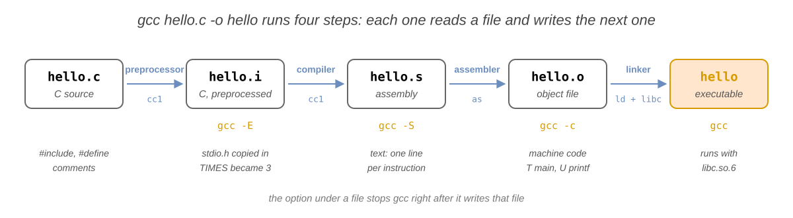
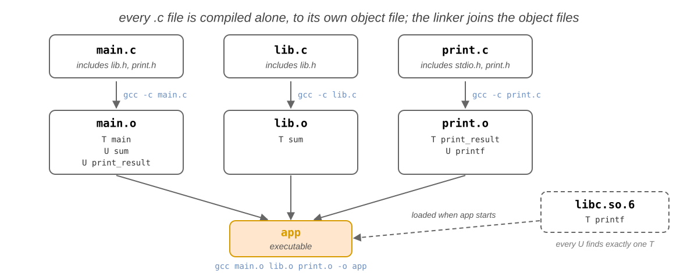
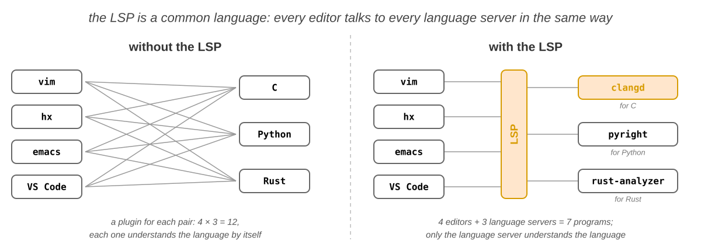
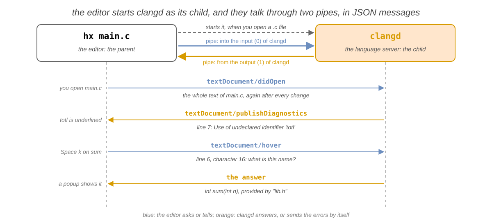
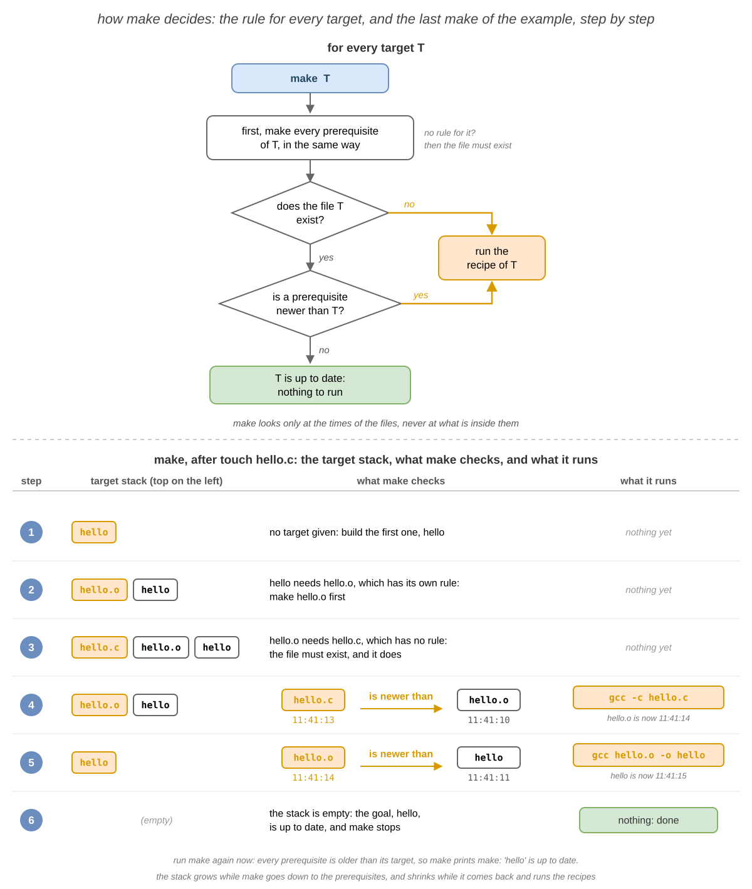
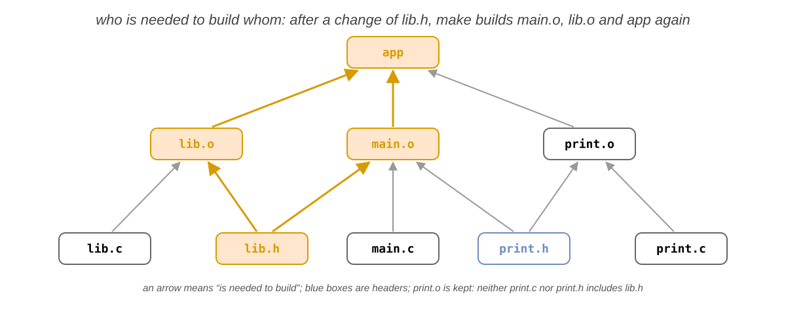
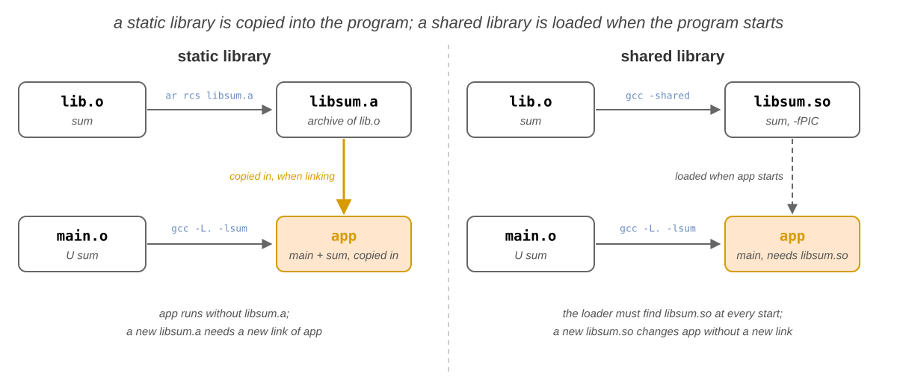

import Tabs from '@theme/Tabs';
import TabItem from '@theme/TabItem';

# 07. Software Development

In the sixth lab you processed text with filters and edited text files with `vim` and `nano`. In the programming course
you write programs in **C**, and the IDE builds and runs them when you press a button. In this lab you will build them
yourself, in the terminal, and see what happens behind that button. You will see how a **compiled** language differs
from an **interpreted** one, compile with `gcc`, and follow the four steps of the **compilation pipeline**: the
**preprocessor**, the **compiler**, the **assembler** and the **linker**. You will split a program into **modules**,
read the **build errors** of each step, and set up an editor that shows these errors while you type, through the
**language server** `clangd`. Then you will let `make` build the program for you, from a **`Makefile`**: rules,
automatic variables, pattern rules, **phony targets** and **header dependencies**. At the end, you will stop a running
program with the debugger `gdb`, and save the versions of your project with `git`.

The most important idea of this lab is that building a program is a **chain of files**: every file that you build (an
object file, the executable) is made from other files (the sources, the headers, other object files) by **one**
command. A `Makefile` writes this chain down as **rules**, and `make` compares the **modification times** of the files:
it runs a command only when its result is missing, or older than one of the files it is made from.

## Objectives

- Understand the difference between a **compiled**, an **interpreted** and a **bytecode** language
- Compile and run a C program in the terminal with `gcc`, without an IDE, and turn on the warnings with `-Wall`
- Follow the four steps of the **compilation pipeline**, and stop after each of them with `gcc -E`, `-S` and `-c`
- Look inside the files of each step with `file`, `nm` and `ldd`
- Split a program into **modules** (a `.h` and a `.c` file), compile every `.c` file to an **object file**, and link
  the object files into an executable
- Read a **build error**, find out which step reported it, and fix it
- Understand what a **language server** is and how an editor talks to it, and use `clangd` from an editor: errors,
  information, completion and go to definition
- Write a `Makefile` with **rules**, and understand how `make` decides what to build from the modification times
- Shorten a `Makefile` with **automatic variables** (`$@`, `$<`, `$^`), **pattern rules** and variables (`CC`,
  `CFLAGS`)
- Add the **phony targets** `all`, `run` and `clean`, and declare them with `.PHONY`
- Write the **header dependencies** on the right rules
- Build a program with debug information (`-g`), stop it with `gdb` and look at its variables
- Save the versions of a project with `git init`, `git add`, `git commit`, `git status`, `git diff` and `git log`

## Resources

1. _[Razvan Deaconescu, Razvan Rughinis, Mihai Carabas, Alexandru Radovici, Utilizarea Sistemelor de
   Operare, Printech 2021](https://github.com/systems-cs-pub-ro/carte-uso/releases/download/uso-ed1-2021/uso.pdf)_
   - Chapter 6 - _Dezvoltarea aplicațiilor_, sections 6.2 - 6.5, 6.6.7, 6.7.1 and 6.8
2. _Brian Ward, How LINUX Works, 3rd Edition, No Starch Press, 2021_
   - Chapter 15 - _Development Tools_, sections 15.1 and 15.2
3. _[GNU Make Manual](https://www.gnu.org/software/make/manual/make.html)_, chapter 2 - _An Introduction to
   Makefiles_, section 4.6 - _Phony Targets_ and section 10.5 - _Defining and Redefining Pattern Rules_;
   _[Pro Git](https://git-scm.com/book/en/v2)_, chapters 1 - 3 and chapter 6 - _GitHub_;
   _[clangd](https://clangd.llvm.org)_, _Getting started_; the
   _[Language Server Protocol](https://microsoft.github.io/language-server-protocol/)_, _Overview_
4. The lecture slides: [07. Software Development](/docs/lectures/07)
5. The manual pages: `man gcc`, `man make`, `man file`, `man nm`, `man objdump`, `man ldd`, `man ar`, `man strip`,
   `man ld.so`, `man gdb`, `man git`, `man git-commit`, `man git-diff`, `man git-log`, `man git-restore`,
   `man gitignore`, `man git-push`, `man git-pull`, `man git-clone`, `man ssh-keygen`, `man bear` and `clangd --help`

## Fedora and Ubuntu

The lab computers run **Fedora** with **Sway**, and the examples come from them. At home you may also use **Ubuntu**:
the commands are the same, with a few differences:

|                                                | Fedora                                                | Ubuntu                                            |
| ---------------------------------------------- | ----------------------------------------------------- | ------------------------------------------------- |
| install the tools of this lab                  | `sudo dnf install gcc make gdb git clang-tools-extra` | `sudo apt install build-essential gdb git clangd` |
| a function called without a declaration        | an **error** (GCC 14 and newer)                       | Ubuntu 24.04 has GCC 13: only a **warning**       |
| the C library, in the output of `ldd`          | `/lib64/libc.so.6`                                    | `/lib/x86_64-linux-gnu/libc.so.6`                 |
| the folder of `cc1`, a program that `gcc` runs | `/usr/libexec/gcc/x86_64-redhat-linux/<VERSION>/`     | `/usr/lib/gcc/x86_64-linux-gnu/<VERSION>/`        |
| `gcc -static` (in [Libraries](#libraries))     | needs `sudo dnf install glibc-static`                 | works                                             |

`gcc --version` prints the version of `gcc`. The examples are for a PC (x86-64); on a computer with an ARM processor,
such as a Mac with Apple silicon, the assembly code and the addresses look different.

## Compiling

### Compiled and Interpreted Languages

The processor runs only **machine code**: instructions written as bytes, different for every family of processors
(x86-64, ARM64, RISC-V). People write **source code**: text, in a programming language. Someone has to translate the
source code into machine code, and the languages differ in **who** does it and **when**:

| Kind            | Who translates the source code                                                                         | When                                                                       | Examples                     |
| --------------- | ------------------------------------------------------------------------------------------------------ | -------------------------------------------------------------------------- | ---------------------------- |
| **compiled**    | a **compiler**, into machine code: the result is an executable                                         | once, before the program runs                                              | C, C++, Rust, Go             |
| **interpreted** | an **interpreter**, a program that reads the source and does what it says                              | every time the program runs                                                | shell scripts (`bash`, `sh`) |
| **bytecode**    | a compiler, into **bytecode** (machine code for an imaginary processor); a **virtual machine** runs it | before the program runs (Java, C#), or when it starts (Python, JavaScript) | Java, C#, Python, JavaScript |

Think of a book in a foreign language: a compiled program is a printed translation, made once and read many times; an
interpreted program is read with a translator next to you, who translates every sentence while you read.

```shell-session
[student@fedora lab07]$ ./hello.sh
Hello from bash!
[student@fedora lab07]$ file hello.sh /usr/bin/bash
hello.sh:      Bourne-Again shell script, ASCII text executable
/usr/bin/bash: ELF 64-bit LSB pie executable, x86-64, ...
```

- `hello.sh` is text: the interpreter, `bash`, reads it line by line. `bash` itself is machine code, an **ELF** file
  (_Executable and Linkable Format_, the format of the programs on Linux), written in C and compiled.

|                    | Compiled                                                    | Interpreted                                                |
| ------------------ | ----------------------------------------------------------- | ---------------------------------------------------------- |
| **speed**          | fast: the processor runs the machine code directly          | slower: the interpreter translates the source at every run |
| **errors**         | the compiler finds many of them **before** the program runs | an error shows up only when its line runs                  |
| **after a change** | compile again, then run                                     | just run it again                                          |
| **portability**    | one executable for each processor and system                | the same file runs wherever the interpreter is installed   |

:::info

A language is not compiled or interpreted: the **program that runs it** is. `python3` compiles a script to bytecode
every time it starts, then its virtual machine runs the bytecode; only the modules that a script imports are kept
compiled, in `__pycache__`. The virtual machines of Java and JavaScript also compile the code that runs often to
machine code, while it runs: _just in time_ (JIT).

:::

### Compiling a C Program: `gcc`

`gcc` (the _GNU Compiler Collection_) is the C compiler of Linux, and often the one that runs behind the **Build**
button of your IDE. The examples use `hello.c`, which
[exercise 1](#first-steps) creates in `~/lab07`:

```c title="~/lab07/hello.c"
#include <stdio.h>

#define TIMES 3

int main(void)
{
    // say hello a few times
    for (int i = 0; i < TIMES; i++) {
        printf("Hello, %d!\n", i);
    }
    return 0;
}
```

```shell-session
[student@fedora lab07]$ gcc hello.c -o hello
[student@fedora lab07]$ ./hello
Hello, 0!
Hello, 1!
Hello, 2!
```

- `gcc hello.c -o hello` compiled `hello.c` into the executable `hello`; it printed nothing, because nothing went
  wrong. The program starts with `./`: the current directory is not in `PATH` (see
  [The `PATH` Search](/docs/labs/04#the-path-search) in lab 04).

| Option           | What it does                                                                                  |
| ---------------- | --------------------------------------------------------------------------------------------- |
| `-o <FILE>`      | the name of the output file; without it, the executable is `a.out`                            |
| `-Wall`          | turns on the **warnings** about code that is legal, but probably wrong                        |
| `-g`             | adds the **debug information**, for `gdb` (see [Debugging](#debugging-gdb))                   |
| `-c`, `-S`, `-E` | stop after a step of the pipeline (see [The Compilation Pipeline](#the-compilation-pipeline)) |
| `-l<NAME>`       | links the library `<NAME>`: `-lm` for the math functions, like `sqrt`                         |
| `-I <DIR>`       | also looks for the header files in `<DIR>`                                                    |

:::info

**Behind the button of the IDE**

The **Build** button of an IDE (Code::Blocks, Visual Studio Code, CLion) runs `gcc` with options like these, and
**Run** starts the executable; the build log of the IDE shows the exact commands. In the terminal, no button builds
the program before it runs: after you edit a `.c` file, you run `gcc` (or `make`) yourself.

:::

You write the C files with a text editor from [Text Editors](/docs/labs/06#text-editors) in lab 06; after
[Build Errors](#build-errors), you will set up one that understands C.

### The Compilation Pipeline

`gcc hello.c -o hello` looks like one step, but it is **four**. Each step reads the file of the step before, and
writes a new file. An option stops `gcc` after a step, so you can look at that file:



| Step             | What it does                                                                  | Stop after it               | Writes                 |
| ---------------- | ----------------------------------------------------------------------------- | --------------------------- | ---------------------- |
| **preprocessor** | copies the `#include` files in, replaces the `#define`s, removes the comments | `gcc -E hello.c -o hello.i` | `hello.i`, preprocessed C           |
| **compiler**     | translates C into **assembly**, the text form of the machine code             | `gcc -S hello.c`            | `hello.s`, assembly    |
| **assembler**    | translates assembly into machine code                     | `gcc -c hello.c`            | `hello.o`, object file |
| **linker**       | joins the object files and the libraries into an executable                   | `gcc hello.o -o hello`      | `hello`, executable    |

Think of a car factory: the first station brings the parts together (the preprocessor), the next ones shape them
(the compiler and the assembler), and the last one assembles the car (the linker).

#### The Preprocessor: `gcc -E`

The lines that start with `#` are for the **preprocessor**. It changes the text before the compiler sees it, a bit
like `sed`, and does not check that the result is correct C.

```shell-session
[student@fedora lab07]$ gcc -E hello.c -o hello.i
[student@fedora lab07]$ wc -l hello.c hello.i
   12 hello.c
  825 hello.i
  837 total
[student@fedora lab07]$ grep 'int printf' hello.i
extern int printf (const char *__restrict __format, ...);
[student@fedora lab07]$ tail -n 8 hello.i
int main(void)
{

    for (int i = 0; i < 3; i++) {
        printf("Hello, %d!\n", i);
    }
    return 0;
}
```

- `#include <stdio.h>` copied the whole file `/usr/include/stdio.h` (and the files that it includes) into `hello.i`:
  hundreds of lines, among them the **declaration** of `printf`. The number of lines depends on the version of the C
  library.
- `#define TIMES 3` replaced `TIMES` with `3`, and the comment is gone.

`#include <stdio.h>`, with angle brackets, looks only in the folders of the system, like `/usr/include`;
`#include "lib.h"`, with quotes, looks first in the folder of the `.c` file.

#### The Compiler: `gcc -S`

The **compiler** translates C into **assembly**: one line for every instruction of the processor, still a text file.

```shell-session
[student@fedora lab07]$ gcc -S hello.c
[student@fedora lab07]$ grep -E 'call|cmpl|jle' hello.s
	call	printf@PLT
	cmpl	$2, -4(%rbp)
	jle	.L3
```

- The loop became a compare (`cmpl`, is `i` at most `2`?) and a jump back (`jle`, _jump if less or equal_).
- `printf` is only **called**: its code is not in `hello.s`.

#### The Assembler: `gcc -c`

The **assembler** translates the assembly into machine code. The result is an **object file**: machine code that
cannot run yet, because it has **holes**. To call `printf`, the code needs its address, but `printf` is not defined in
`hello.c`, so the assembler does not know where it is: it leaves an empty place, and a note with the name `printf`.
The [linker](#the-linker) fills these holes later.

```shell-session
[student@fedora lab07]$ gcc -c hello.c
[student@fedora lab07]$ file hello.o
hello.o: ELF 64-bit LSB relocatable, x86-64, version 1 (SYSV), not stripped
[student@fedora lab07]$ nm hello.o
0000000000000000 T main
                 U printf
```

- `nm` listed the names (the **symbols**) of `hello.o`: `T` means **defined** here (in the _text_, the code), `U`
  means **used** here but **undefined**.
- `objdump -d hello.o` shows the machine code, as bytes, next to the assembly.

#### The Linker

The **linker** (`ld`, which `gcc` runs for you) joins the object files into an executable, and fills in their holes.
For every name that an object file uses but does not define (a `U` in `nm`), the linker looks for **the one place**
that defines it (a `T`), in another object file or in a library. If it finds none, it stops with
``undefined reference``; if it finds two, with ``multiple definition`` (see [Build Errors](#build-errors)).

`printf` is defined in the **C library**, the file `libc.so.6`, which the linker searches for every program, without
being asked. It is a shared library, so the linker does not copy `printf` into `hello`: it only writes down that
`hello` needs `libc.so.6`.

```shell-session
[student@fedora lab07]$ gcc hello.o -o hello
[student@fedora lab07]$ file hello
hello: ELF 64-bit LSB pie executable, x86-64, ..., dynamically linked, ...
[student@fedora lab07]$ ldd hello
	linux-vdso.so.1 (0x00007ffc8d5f2000)
	libc.so.6 => /lib64/libc.so.6 (0x00007f2b6a200000)
	/lib64/ld-linux-x86-64.so.2 (0x00007f2b6a4b1000)
```

- `gcc` saw an object file, not a `.c` file, so it ran only the linker.
- `ldd` listed the libraries that `hello` needs when it starts: `printf` is **not** copied into `hello`, it stays in
  `libc.so.6`, which the system loads every time `hello` starts. The numbers in parentheses change at every run.

With `gcc -static`, the linker **copies** `printf`, and everything that it needs, from the C library into the
executable: the program does not need `libc.so.6` any more, but it is much larger. On Fedora, `-static` needs the
package `glibc-static`. The exercises at home and the challenges build their own libraries: the details are in
[Libraries](#libraries).

:::tip

`gcc -save-temps hello.c -o hello` runs the four steps and **keeps** the files of each step: `hello.i`, `hello.s` and
`hello.o`.

:::

### Several Source Files

A real program has many source files. Each part of the program, a **module**, is a pair of files:

| File                 | What it has                                                                                   | Who uses it                                            | Example: `lib`                    |
| -------------------- | --------------------------------------------------------------------------------------------- | ------------------------------------------------------ | --------------------------------- |
| `.h`, the **header** | the **declarations**: what the module offers, without the code; also its `#define`s and types | every `.c` file that calls the module, with `#include` | `lib.h`: `int sum(int n);`        |
| `.c`, the **source** | the **definitions**: the code of the functions                                                | the compiler, which turns it into an object file       | `lib.c`: `int sum(int n) { ... }` |

Every `.c` file that uses a module includes its header, so the compiler knows the name and the types of the functions
it calls. The examples use the files of `~/lab07/project`, a program that adds the numbers from 1 to `MAX`:

```
project/
├── main.c      # includes lib.h and print.h; main() calls sum() and print_result()
├── lib.h       # #define MAX 10, declares sum()
├── lib.c       # includes lib.h, defines sum()
├── print.h     # declares print_result()
└── print.c     # includes <stdio.h> and print.h, defines print_result() with printf()
```

```c title="~/lab07/project/lib.h"
#ifndef LIB_H
#define LIB_H
#define MAX 10
int sum(int n);
#endif
```

- `#ifndef`, `#define` and `#endif` are the **include guard**: if a `.c` file includes `lib.h` twice, the second copy
  is skipped.

Every `.c` file is compiled **alone**, to its own object file, and the linker joins the object files:



```shell-session
[student@fedora project]$ gcc -c main.c
[student@fedora project]$ gcc -c lib.c
[student@fedora project]$ gcc -c print.c
[student@fedora project]$ gcc main.o lib.o print.o -o app
[student@fedora project]$ ./app
sum = 55
```

- In `main.o`, `sum` and `print_result` are `U`; the linker found them in `lib.o` and `print.o`.

This is why every `.c` file is compiled to its own object file. After a change to `print.c`, only `print.o` is out of
date, so two commands are enough: `gcc -c print.c` compiles it again, and `gcc main.o lib.o print.o -o app` links the
program.

`gcc main.c lib.c print.c -o app` gives the same program in one command, but it compiles **all** the files every
time. With three files, this does not matter. The Linux kernel has more than 30 000 `.c` files: compiling only the ones
that changed saves minutes at every build.

### Build Errors

These are the messages that the build log of the IDE shows. **Who** reports the error tells you what is wrong:

| The message                                     | Reported by  | The cause                                                      | The fix                             |
| ----------------------------------------------- | ------------ | -------------------------------------------------------------- | ----------------------------------- |
| `fatal error: lib.h: No such file or directory` | preprocessor | a wrong name in `#include`, or the header is in another folder | fix the name, or add `-I <DIR>`     |
| `error: implicit declaration of function ‘sum’` | compiler     | `sum` is called, but nothing above the call declares it        | include the header that declares it |
| `error: expected ‘;’ before ‘}’ token`          | compiler     | a syntax error, on the line it names or on the line before     | add the missing `;`                 |
| ``undefined reference to `sum'``                | linker       | no object file defines `sum`                                   | add the `.o` file that defines it   |
| ``undefined reference to `sqrt'``               | linker       | the function is in a library that is not linked                | add `-lm` at the end of the command |
| ``multiple definition of `sum'``                | linker       | two object files define `sum`                                  | keep only one of them               |

```shell-session
[student@fedora lab07]$ gcc roots.c -o roots
/usr/bin/ld: /tmp/ccx5idIu.o: in function `main':
roots.c:(.text+0x1c): undefined reference to `sqrt'
collect2: error: ld returned 1 exit status
[student@fedora lab07]$ gcc roots.c -o roots -lm
[student@fedora lab07]$ ./roots
sqrt(1) = 1.000
sqrt(2) = 1.414
sqrt(3) = 1.732
sqrt(4) = 2.000
```

- `/usr/bin/ld` and `collect2` mean that the **linker** failed: compiling worked, but nobody defines `sqrt`. It is in
  the math library, `libm`, which `-lm` adds.
- The errors of the preprocessor and of the compiler start with `<FILE>:<LINE>:<COLUMN>:`, the place of the problem.

A **warning** does not stop the build, but it often shows a bug. Always compile with `-Wall`, and fix every warning.

## An Editor with a Language Server

In the IDE of the programming course, the code is colored, names are completed and errors are marked while you type.
In the terminal, two programs do this together: an **editor**, and a **language server**, a program that understands
**one** language. For C, the language server is **`clangd`**.

The **LSP** (_Language Server Protocol_) is the common language between them: any editor that speaks LSP can use any
language server. Without it, every editor needs its own plugin for every language.



Think of a colleague who reads over your shoulder while you write: the editor is your notebook, and the language
server is the colleague, who reads every line and answers your questions about it.

### How a Language Server Works

When you open a C file, the editor starts `clangd` as a **child process** (lab 03) and talks to it through two
**pipes** (lab 06), in short JSON messages. The editor sends the text after every change and asks questions; `clangd`
answers them, and sends the errors by itself.



`clangd` checks the code **while you type**, like the compiler, but it does not build anything.

### Choosing an Editor

Install `clangd` (Fedora: `sudo dnf install clang-tools-extra`; Ubuntu: `sudo apt install clangd`) and **one** of
these editors:

| Editor               | Where it runs | What it needs to use `clangd`                      |
| -------------------- | ------------- | -------------------------------------------------- |
| `vim`                | terminal      | a plugin, `vim-lsp`, and about 20 lines in `~/.vimrc` |
| `nvim` 0.11 or newer | terminal      | a few lines in `~/.config/nvim/init.lua`           |
| `hx` (Helix)         | terminal      | nothing                                            |
| `emacs` 29 or newer  | both          | one line in `~/.emacs.d/init.el`                   |
| `code` (VS Code)     | window        | the extension `clangd`                             |
| `zed` (Zed)          | window        | nothing                                            |

:::tip

**`nvim`, not `vim`**

If you like the keys of `vim` (see [Text Editors](/docs/labs/06#text-editors) in lab 06), use `nvim`: it has the same
keys and a language client built in, so its setup is a few lines. `vim` needs a plugin and about 20 lines of
Vimscript. The other editors need almost no setup.

:::

Install, configure and check your editor:

<Tabs groupId="editor">
<TabItem value="vim" label="vim">

:::caution

**This is the hardest setup**

`vim` has no language client of its own, and every new feature needs more Vimscript: use `nvim` instead, with the
same editing keys (see the tip above).

:::

Install `vim` (Fedora: `sudo dnf install vim-enhanced`; Ubuntu: `sudo apt install vim`) and the plugin `vim-lsp`, in
the folder where `vim` loads its plugins by itself:

```bash
git clone https://github.com/prabirshrestha/vim-lsp ~/.vim/pack/lsp/start/vim-lsp
```

Then add these lines to `~/.vimrc`: they start `clangd` for the C files, and give the keys of the table below.

```vim title="~/.vimrc"
let g:lsp_diagnostics_virtual_text_enabled = 1
if executable('clangd')
  au User lsp_setup call lsp#register_server({
        \ 'name': 'clangd',
        \ 'cmd': {server_info->['clangd']},
        \ 'allowlist': ['c', 'cpp'],
        \ })
endif
function! s:on_lsp_buffer_enabled() abort
  setlocal omnifunc=lsp#complete
  nmap <buffer> gd <plug>(lsp-definition)
  nmap <buffer> gr <plug>(lsp-references)
  nmap <buffer> K <plug>(lsp-hover)
  nmap <buffer> <leader>rn <plug>(lsp-rename)
  nmap <buffer> <leader>ca <plug>(lsp-code-action)
  nmap <buffer> ]d <plug>(lsp-next-diagnostic)
endfunction
augroup lsp_install
  au!
  autocmd User lsp_buffer_enabled call s:on_lsp_buffer_enabled()
augroup END
```

Check: open a `.c` file, and run `:LspStatus`; it shows `clangd: running`.
In the table, <kbd>{'\\'}</kbd> is the _leader_ key of `vim`, `<leader>` in `~/.vimrc`.

| What you want                   | Keys                                                                      |
| ------------------------------- | ------------------------------------------------------------------------- |
| see the errors                  | at the end of the line; <kbd>]</kbd> <kbd>d</kbd> goes to the next one    |
| see what the name under the cursor is | <kbd>K</kbd>                                                              |
| complete a name                 | in Insert mode, <kbd>Ctrl</kbd>+<kbd>X</kbd> <kbd>Ctrl</kbd>+<kbd>O</kbd> |
| go to the definition, come back | <kbd>g</kbd> <kbd>d</kbd>, <kbd>Ctrl</kbd>+<kbd>O</kbd>                   |
| list the uses of a name         | <kbd>g</kbd> <kbd>r</kbd>                                                 |
| rename a name, in every file    | <kbd>{'\\'}</kbd> <kbd>r</kbd> <kbd>n</kbd>                                  |
| apply the fix that it suggests  | <kbd>{'\\'}</kbd> <kbd>c</kbd> <kbd>a</kbd>                                  |

</TabItem>
<TabItem value="nvim" label="nvim">

Install Neovim (Fedora: `sudo dnf install neovim`). It needs version 0.11 or newer (`nvim --version`); Ubuntu 24.04
has an older one: use Helix or Zed there. Then add these lines to `~/.config/nvim/init.lua`:

```lua title="~/.config/nvim/init.lua"
vim.lsp.config('clangd', {
  cmd = { 'clangd' },
  filetypes = { 'c', 'cpp' },
  root_markers = { 'compile_commands.json', 'compile_flags.txt', 'Makefile', '.git' },
})
vim.lsp.enable('clangd')
vim.diagnostic.config({ virtual_text = true })
```

Check: open a `.c` file, and run `:checkhealth vim.lsp`; it lists `clangd` among the active clients.

**Ready-made setups**: instead of writing `init.lua` yourself, you can start from a configuration that already has
`clangd`, completion and a file explorer. They need a recent Neovim and `git`. Move your `~/.config/nvim` and
`~/.local/share/nvim` aside first, where the setups install their plugins:

- [kickstart.nvim](https://github.com/nvim-lua/kickstart.nvim): one file, explained by its comments; the best start if
  you want to understand your configuration;
- [LazyVim](https://www.lazyvim.org), [NvChad](https://nvchad.com) and [AstroNvim](https://astronvim.com): complete
  setups, ready to use.

**Documentation**: `:help lsp` in Neovim ([online](https://neovim.io/doc/user/lsp/)), and
[nvim-lspconfig](https://github.com/neovim/nvim-lspconfig), the settings of many language servers, ready to use.

| What you want                   | Keys                                                                      |
| ------------------------------- | ------------------------------------------------------------------------- |
| see the errors                  | at the end of the line; <kbd>]</kbd> <kbd>d</kbd> goes to the next one    |
| see what the name under the cursor is | <kbd>K</kbd>                                                              |
| complete a name                 | in Insert mode, <kbd>Ctrl</kbd>+<kbd>X</kbd> <kbd>Ctrl</kbd>+<kbd>O</kbd> |
| go to the definition, come back | <kbd>Ctrl</kbd>+<kbd>]</kbd>, <kbd>Ctrl</kbd>+<kbd>T</kbd>                |
| list the uses of a name         | <kbd>g</kbd> <kbd>r</kbd> <kbd>r</kbd>                                    |
| rename a name, in every file    | <kbd>g</kbd> <kbd>r</kbd> <kbd>n</kbd>                                    |
| apply the fix that it suggests  | <kbd>g</kbd> <kbd>r</kbd> <kbd>a</kbd>                                    |

</TabItem>
<TabItem value="hx" label="hx">

Install Helix (Fedora: `sudo dnf install helix`; Ubuntu: `sudo snap install --classic helix`); its command is `hx`. It
needs no settings: it starts `clangd` by itself for every `.c` file.

```shell-session
[student@fedora project]$ hx --health c
...
Configured language servers:
  ✓ clangd: /usr/bin/clangd
...
```

- Helix found `clangd` in `PATH`. A `✘` there means that `clangd` is not installed.

| What you want                   | Keys                                                             |
| ------------------------------- | ---------------------------------------------------------------- |
| see the errors                  | marked at the left; <kbd>Space</kbd> <kbd>d</kbd> lists them     |
| see what the name under the cursor is | <kbd>Space</kbd> <kbd>k</kbd>                                    |
| complete a name                 | appears while you type                                           |
| go to the definition, come back | <kbd>g</kbd> <kbd>d</kbd>, <kbd>Ctrl</kbd>+<kbd>O</kbd>          |
| list the uses of a name         | <kbd>g</kbd> <kbd>r</kbd>                                        |
| rename a name, in every file    | <kbd>Space</kbd> <kbd>r</kbd>                                    |
| apply the fix that it suggests  | <kbd>Space</kbd> <kbd>a</kbd>                                    |

</TabItem>
<TabItem value="emacs" label="emacs">

Install Emacs (Fedora: `sudo dnf install emacs`; Ubuntu: `sudo apt install emacs`). From version 29 it has a
language client built in, **Eglot**, which already knows `clangd`. This line in `~/.emacs.d/init.el` starts it for
every C file; if you already have a file `~/.emacs`, put the line there instead, because Emacs reads only one of them:

```lisp title="~/.emacs.d/init.el"
(add-hook 'c-mode-hook 'eglot-ensure)
```

Check: open a `.c` file (`emacs -nw main.c` stays in the terminal); the mode line, at the bottom, shows `eglot`.

| What you want                   | Keys                                                                                 |
| ------------------------------- | ------------------------------------------------------------------------------------ |
| see the errors                  | underlined; <kbd>Alt</kbd>+<kbd>X</kbd> `flymake-show-buffer-diagnostics` lists them |
| see what the name under the cursor is | shown at the bottom, by itself                                                       |
| complete a name                 | <kbd>Ctrl</kbd>+<kbd>Alt</kbd>+<kbd>I</kbd>                                          |
| go to the definition, come back | <kbd>Alt</kbd>+<kbd>.</kbd>, <kbd>Alt</kbd>+<kbd>,</kbd>                             |
| list the uses of a name         | <kbd>Alt</kbd>+<kbd>?</kbd>                                                          |
| rename a name, in every file    | <kbd>Alt</kbd>+<kbd>X</kbd> `eglot-rename`                                           |
| apply the fix that it suggests  | <kbd>Alt</kbd>+<kbd>X</kbd> `eglot-code-actions`                                     |

</TabItem>
<TabItem value="vscode" label="VS Code">

Download the `.rpm` (Fedora) or the `.deb` (Ubuntu) package from [code.visualstudio.com](https://code.visualstudio.com),
install it with `sudo dnf install ./code-*.rpm` (Ubuntu: `sudo apt install ./code_*.deb`), and add the extension
`clangd`, from the LLVM project, from the **Extensions** bar:

1. press <kbd>Ctrl</kbd>+<kbd>Shift</kbd>+<kbd>X</kbd>, or click the icon with four squares, on the bar at the left;
2. type `clangd` in the search box at the top;
3. choose **clangd**, published by **LLVM**, and press **Install**.

The same, from the terminal:

```bash
code --install-extension llvm-vs-code-extensions.vscode-clangd
```

If the extension `C/C++` of Microsoft is also installed, the extension `clangd` asks to turn off its IntelliSense:
accept, so that only `clangd` checks the code. If `clangd` is not installed, the extension offers to download it:
install the package instead, so that every editor uses the same `clangd`. VSCodium, the same editor without the
Microsoft parts, works the same way; its command is `codium`, not `code`.

Check: open the folder of the project (`code ~/lab07/project`), then a `.c` file; the status bar, at the bottom,
shows `clangd`.

| What you want                   | Keys                                                                                 |
| ------------------------------- | ------------------------------------------------------------------------------------ |
| see the errors                  | red underline; <kbd>Ctrl</kbd>+<kbd>Shift</kbd>+<kbd>M</kbd> lists them              |
| see what the name under the cursor i | keep the mouse over it, or <kbd>Ctrl</kbd>+<kbd>K</kbd> <kbd>Ctrl</kbd>+<kbd>I</kbd> |
| complete a name                 | appears while you type; <kbd>Ctrl</kbd>+<kbd>Space</kbd>                             |
| go to the definition, come back | <kbd>F12</kbd>, <kbd>Ctrl</kbd>+<kbd>Alt</kbd>+<kbd>-</kbd>                          |
| list the uses of a name         | <kbd>Shift</kbd>+<kbd>F12</kbd>                                                      |
| rename a name, in every file    | <kbd>F2</kbd>                                                                        |
| apply the fix that it suggests  | <kbd>Ctrl</kbd>+<kbd>.</kbd>                                                         |

</TabItem>
<TabItem value="zed" label="Zed">

Install Zed with its script, the same on Fedora and on Ubuntu:

```bash
curl -f https://zed.dev/install.sh | sh
```
The script installs the command `zed` in `~/.local/bin`; if the shell does not find it, log out and log in again.

Zed works **out of the box**: it needs no settings and no extension, and starts `clangd` by itself for every `.c`
file. Check: open the folder of the project (`zed ~/lab07/project`), then a `.c` file, and make an error: it is
underlined at once.

| What you want                   | Keys                                                                    |
| ------------------------------- | ----------------------------------------------------------------------- |
| see the errors                  | red underline; <kbd>Ctrl</kbd>+<kbd>Shift</kbd>+<kbd>M</kbd> lists them |
| see what the name under the cursor is | keep the mouse over it                                                  |
| complete a name                 | appears while you type                                                  |
| go to the definition, come back | <kbd>F12</kbd>, <kbd>Ctrl</kbd>+<kbd>Alt</kbd>+<kbd>-</kbd>             |
| list the uses of a name         | right click, _Find All References_                                      |
| rename a name, in every file    | <kbd>F2</kbd>                                                           |
| apply the fix that it suggests  | <kbd>Ctrl</kbd>+<kbd>.</kbd>                                            |

</TabItem>
</Tabs>

When the project has headers in other folders, `clangd` needs the options of `gcc`: they are in
[What `clangd` Needs to Know](#what-clangd-needs-to-know), after the `Makefile`.

## The `Makefile`

After every change you must remember which commands to run again, and in which order. `make` does it for you. It reads
a file named `Makefile`, from the current directory, that says, for every file to build, what it is made from and
which commands make it. Then `make` runs **only** the commands that are needed.

Think of a recipe book in which each recipe lists its ingredients: to make a cake, you first make the cream it needs,
but only if you do not already have fresh cream in the fridge.

### A Rule

A `Makefile` is a list of **rules**:

```makefile
target: prerequisites
	command 1
	command 2
```

| Part              | What it is                                                                  |
| ----------------- | --------------------------------------------------------------------------- |
| **target**        | the file to build                                                           |
| **prerequisites** | the files it is made from, separated by spaces                              |
| **recipe**        | the commands that build it, one per line, each line starting with a **TAB** |

The `Makefile` of `hello` has two rules:

```makefile title="~/lab07/Makefile"
hello: hello.o
	gcc hello.o -o hello

hello.o: hello.c
	gcc -c hello.c
```

- `hello` is **linked** from `hello.o`; `hello.o` is **compiled** from `hello.c`. `make` alone builds the **first**
  target, `hello`; `make hello.o` builds only `hello.o`.

:::caution

**A TAB, not spaces**

Every line of a recipe starts with a TAB character. With spaces, `make` stops with
`Makefile:2: *** missing separator.  Stop.` Most editors keep the TABs in a file named `Makefile`; in `vim`,
`:set list` shows a TAB as `^I`.

:::

### How `make` Decides

To build a target, `make`:

1. builds its prerequisites first, each with its own rule, in the same way;
2. runs the recipe if the target does **not exist**, or if a prerequisite is **newer** than the target;
3. otherwise, does nothing: the target is **up to date**.

A prerequisite without a rule, like `hello.c`, must exist. `make` compares only the **modification times** of the
files (`ls -l --full-time` shows them, to the fraction of a second); it never reads the code.

```shell-session
[student@fedora lab07]$ make
gcc -c hello.c
gcc hello.o -o hello
[student@fedora lab07]$ make
make: 'hello' is up to date.
[student@fedora lab07]$ touch hello.c
[student@fedora lab07]$ make
gcc -c hello.c
gcc hello.o -o hello
```

- The first `make` built both files: they did not exist. `make` prints every command before it runs it.
- The second `make` did nothing: `hello.c` is older than `hello.o`, and `hello.o` is older than `hello`.
- `touch` (see [`touch`](/docs/labs/02#touch) in lab 02) set the time of `hello.c` to now, as if you had edited it:
  `hello.c` became newer than `hello.o`, so `make` compiled it again, and then `hello.o` was newer than `hello`.

The picture shows the rule that `make` follows for every target, then the last `make`, step by step: `make` keeps a
**stack** of the targets it is working on. It goes down to the prerequisites, then comes back up and runs the
recipes that are needed.



| Command              | What it does                                                       |
| -------------------- | ------------------------------------------------------------------ |
| `make`               | builds the **first** target of the `Makefile`, and only what is out of date                          |
| `make <TARGET>`      | builds `<TARGET>`                                                  |
| `make -n`            | only **shows** the commands that it would run (_dry run_)          |
| `make -B`            | builds every target again, even the ones that are up to date                   |
| `make <VAR>=<VALUE>` | changes a variable for this run only; the `Makefile` stays the same (see [Variables](#variables))|
| `make -C <DIR>`      | goes to `<DIR>` first, and works there, as if you ran `make` in `<DIR>`                                     |
| `make --debug=v`     | explains why it builds, or skips, every target                                             |
| `make -j<N>`         | runs up to `<N>` commands at the same time                                                        |

### A `Makefile` for a Project

For the project, every object file has a rule, and `app` is linked from the three object files:

```makefile title="~/lab07/project/Makefile"
app: main.o lib.o print.o
	gcc main.o lib.o print.o -o app

main.o: main.c
	gcc -c main.c

lib.o: lib.c
	gcc -c lib.c

print.o: print.c
	gcc -c print.c
```

```shell-session
[student@fedora project]$ make
gcc -c main.c
gcc -c lib.c
gcc -c print.c
gcc main.o lib.o print.o -o app
[student@fedora project]$ touch print.c
[student@fedora project]$ make
gcc -c print.c
gcc main.o lib.o print.o -o app
```

- After `touch print.c`, `main.o` and `lib.o` were still up to date: `make` compiled only `print.c`, then linked.

The three rules of the object files are almost the same. The next three sections make the `Makefile` shorter.

### Automatic Variables

Inside a recipe, `make` replaces the **automatic variables** with the names of the rule:

| Variable | What it means              | In the rule `app: main.o lib.o print.o` |
| -------- | -------------------------- | --------------------------------------- |
| `$@`     | the **target**             | `app`                                   |
| `$<`     | the **first** prerequisite | `main.o`                                |
| `$^`     | **all** the prerequisites  | `main.o lib.o print.o`                  |

With them, the recipe of `app` is `gcc $^ -o $@`, and the recipes of the three object files become the **same**:
`gcc -c $< -o $@`.

### Pattern Rules

A **pattern rule** is one rule for many files: `%` matches any name, the same one in the target and in the
prerequisite. `%.o: %.c` means `main.o: main.c`, `lib.o: lib.c`, `print.o: print.c`, and any other object file.

```makefile
app: main.o lib.o print.o
	gcc $^ -o $@

%.o: %.c
	gcc -c $< -o $@
```

- 11 lines became 5. A new module needs only its object file in the list of `app`.

`make` also has **built-in** rules: without any rule for `main.o`, it still compiles `main.c`, with `cc -c`. Write
your own rules, so that you choose the commands.

### Variables

A **variable** keeps a value in one place: write it as `NAME = value`, and use it as `$(NAME)`. Two names are a
convention, and every C programmer expects them:

| Variable | What it holds               | Usual value |
| -------- | --------------------------- | ----------- |
| `CC`     | the C compiler              | `gcc`       |
| `CFLAGS` | the options of the compiler | `-Wall -g`  |

```makefile
CC = gcc
CFLAGS = -Wall -g

app: main.o lib.o print.o
	$(CC) $^ -o $@

%.o: %.c
	$(CC) $(CFLAGS) -c $< -o $@
```

```shell-session
[student@fedora project]$ make -B
gcc -Wall -g -c main.c -o main.o
gcc -Wall -g -c lib.c -o lib.o
gcc -Wall -g -c print.c -o print.o
gcc main.o lib.o print.o -o app
[student@fedora project]$ make -n -B CFLAGS=-O2
gcc -O2 -c main.c -o main.o
...
```

- `make` printed every command **after** replacing the variables.
- `CFLAGS=-O2` on the command line replaced the value of the `Makefile`, without changing the file; `-n` only showed
  the commands.

### Phony Targets

Some targets are not files: they are names for something that you ask `make` to do. `clean` deletes what `make` built:

```makefile
clean:
	rm -f *.o app
```

`make clean` runs `rm` every time, because there is never a file named `clean`. But if one appears, `clean` has no
prerequisites and the file exists, so it is up to date, and `rm` does **not** run:

```shell-session
[student@fedora project]$ touch clean
[student@fedora project]$ make clean
make: 'clean' is up to date.
```

The special target `.PHONY` lists the targets that are not files: `make` does not look for a file with their name,
and always runs their recipes. The usual phony targets are:

| Target    | What it does                                                              |
| --------- | ------------------------------------------------------------------------- |
| `all`     | builds everything; it is the **first** target, so `make` means `make all` |
| `run`     | builds the program, if it is out of date, then runs it                                         |
| `clean`   | deletes the files that `make` built                                       |
| `install` | copies the program into the system                                        |

```makefile title="~/lab07/project/Makefile"
CC = gcc
CFLAGS = -Wall -g

.PHONY: all run clean

all: app

run: app
	./app

app: main.o lib.o print.o
	$(CC) $^ -o $@

%.o: %.c
	$(CC) $(CFLAGS) -c $< -o $@

clean:
	rm -f *.o app
```

```shell-session
[student@fedora project]$ make run
./app
sum = 55
[student@fedora project]$ make
make: Nothing to be done for 'all'.
```

- `make run` checked `app` first: it was up to date, so `make` only ran `./app`.
- `all` has no recipe, and `app` was up to date: nothing to do.

:::info

These names are a convention, not part of `make`: every C programmer expects them, but `make` treats them like any
other target. Only the order matters: `make` alone builds the first target of the `Makefile`.

:::
### Header Dependencies

A header is also a prerequisite: an object file must be compiled again when a header that its `.c` file includes
changes. With the `Makefile` above, `make` does not know that:

```shell-session
[student@fedora project]$ sed -i 's/MAX 10/MAX 100/' lib.h
[student@fedora project]$ make
make: Nothing to be done for 'all'.
[student@fedora project]$ ./app
sum = 55
```

- The sum of the numbers from 1 to 100 is `5050`, but `main.o` was not compiled again: `lib.h` is not in any rule.

The dependencies follow the `#include` lines. Look at the `#include` lines of every `.c` file, and add each header
to the rule of **its object file**:



```makefile
main.o: lib.h print.h
lib.o: lib.h
print.o: print.h
```

- These rules have no recipe: they only **add** prerequisites, and the recipe still comes from `%.o: %.c`. Put them
  at the end of the `Makefile`, so that `all` stays the first target.

```shell-session
[student@fedora project]$ make
gcc -Wall -g -c main.c -o main.o
gcc -Wall -g -c lib.c -o lib.o
gcc main.o lib.o print.o -o app
[student@fedora project]$ ./app
sum = 5050
```

- `main.c` and `lib.c` include `lib.h`: their object files were compiled again; `print.o` was kept.

:::caution

A header goes on the rule of an **object file**, never on the rule of the executable: with
`app: main.o lib.o print.o lib.h`, `make` only links again the old `main.o`, which still has `MAX` equal to `10`.

:::

### What `clangd` Needs to Know

`clangd` checks each file as `gcc` would compile it, so it needs the same options, like `-I <DIR>`. Without them, a
header from another folder gives `'<HEADER>' file not found` in the editor, even if `make` works. Give it the options
in a file in the folder of the project:

| File                    | What it has                                                 | How you make it                                               | Use it when                                                         |
| ----------------------- | ----------------------------------------------------------- | ------------------------------------------------------------- | ------------------------------------------------------------------- |
| `compile_flags.txt`     | the options of `gcc`, one per line, the same for every file | by hand, in the editor: for example, the line `-Iinclude`     | all the files use the same options                                  |
| `compile_commands.json` | the exact `gcc` command of every file, as `make` ran it     | `make clean`, then `bear -- make`; again after you add a file | the files use different options, or a rename must change every file |

`bear` (Fedora: `sudo dnf install bear`; Ubuntu: `sudo apt install bear`) writes down every command that `make` runs,
so start from a clean build. With `compile_commands.json`, `clangd` also knows the files that you did not open: a
rename changes all of them. It keeps what it learns, the **index** of the project, in the folder `.cache`, which
does not go in the repository (see [Saving Versions](#saving-versions-git)).

`clangd --check=<FILE>` checks a file in the terminal; its last line ends with `All checks completed, 0 errors` when
the file has no error.

## Debugging: `gdb`

A **debugger** runs another program under its control: it stops it at a line, runs it one line at a time, and shows
its variables, while it runs. It is faster than adding `printf` lines and compiling again. `gdb` is the debugger of
GNU. It needs the program built with `-g`, which adds the **debug information**: which machine code comes from which
line, and where every variable is. The `Makefile` of the project already has `-g` in `CFLAGS`.

| Command                                   | Short | What it does                                                                           |
| ----------------------------------------- | ----- | -------------------------------------------------------------------------------------- |
| `gdb ./app`                               |       | starts `gdb` with the program; the program does not run yet                            |
| `break <FUNCTION>`, `break <FILE>:<LINE>` | `b`   | sets a **breakpoint**: the program will stop there, **before** that line runs          |
| `break <PLACE> if <CONDITION>`            |       | stops there only when the C condition is true: `break sum if n > 5`                    |
| `watch <VARIABLE>`                        |       | stops every time the variable changes, and prints its old and its new value            |
| `delete <N>`                              | `d`   | deletes breakpoint number `<N>`; without `<N>`, deletes them all                       |
| `run`                                     | `r`   | starts the program; it runs until a breakpoint, or until it ends                       |
| `next`                                    | `n`   | runs the line that `gdb` showed; a function that it calls runs whole, without stopping |
| `step`                                    | `s`   | runs the line that `gdb` showed, but stops inside the function that it calls           |
| `finish`                                  | `fin` | runs until the current function returns, and prints the value it returns               |
| `continue`                                | `c`   | runs until the next breakpoint, or until the program ends                              |
| `print <EXPRESSION>`                      | `p`   | prints a variable, or any C expression: `print n * 2`                                  |
| `backtrace`                               | `bt`  | prints the **call stack**: the current function, the one that called it, and so on     |
| `up`, `down`                              |       | moves to the function that called this one, or back, to print its variables            |
| `quit`                                    | `q`   | quits `gdb`, and stops the program if it still runs                                    |

```shell-session
[student@fedora project]$ gdb -q ./app
Reading symbols from ./app...
(gdb) break sum
Breakpoint 1 at 0x1171: file lib.c, line 5.
(gdb) run
Starting program: /home/student/lab07/project/app
...
Breakpoint 1, sum (n=10) at lib.c:5
5	    int s = 0;
(gdb) print n
$1 = 10
(gdb) backtrace
#0  sum (n=10) at lib.c:5
#1  0x0000555555555150 in main () at main.c:6
(gdb) continue
Continuing.
sum = 55
[Inferior 1 (process 4211) exited normally]
(gdb) quit
```

- `-q` (_quiet_) skipped the text about the license. `break sum` set a breakpoint on the first line of the body of
  `sum`, line 5 of `lib.c`; the addresses and the number of the process change from one computer to another.
- The program stopped **before** line 5 ran; `backtrace` showed that `main`, at line 6 of `main.c`, called `sum`.
- `continue` let the program run to its end.

:::note

On Fedora and Ubuntu, `gdb` may ask `Enable debuginfod for this session? (y or [n])`: answer <kbd>n</kbd>. It offers
to download the debug information of the system libraries, which this lab does not need; skip the lines about
`Missing ... debuginfo` in the same way. `gdb -tui` shows the source code above the commands.

:::

## Saving Versions: `git`

**Git** is a **version control system**: it keeps the history of the files of a project. You can go back to any
version, see what changed and why, and work on the same code together with other people. The folder with the files
and their history (in the hidden folder `.git`) is a **repository**. A **commit** is a snapshot of all the files, with
an author, a date and a message; its name is a **hash**, like `ed6ba3b`.

Think of the save points of a game: you save when things work, and you can always come back to a save point.

A change goes through three places on your computer: you **edit** the files, `git add` puts them in the **staging
area** (what the next commit will have), and `git commit` saves the commit in the repository.

| Command                                                          | What it does                                                           |
| ---------------------------------------------------------------- | ---------------------------------------------------------------------- |
| `git config --global user.name "<NAME>"`      | your name, written in every commit; once per computer                                          |
| `git config --global user.email "<EMAIL>"`    | your email, written in every commit; once per computer                                         |
| `git init`                                                       | turns the current folder into a repository                             |
| `git status`                                                     | shows the changed files, and what is in the staging area               |
| `git add <FILE>`                                                 | adds the changes of `<FILE>` to the staging area; `git add .` adds all |
| `git commit -m "<MESSAGE>"`                                      | saves the staging area as a commit                                     |
| `git diff`                                                       | shows the changes that are not in the staging area yet                 |
| `git log --oneline`                                              | shows the commits, one per line, the newest first                      |
| `git restore <FILE>`                                             | throws away the changes of `<FILE>` that are not in the staging area; you cannot get them back           |
| `git switch -c <BRANCH>`, `git switch <BRANCH>`                  | creates a **branch** and goes to it; goes to a branch                  |
| `git merge <BRANCH>`                                             | brings the commits of `<BRANCH>` into the current branch               |

The files that `make` builds can always be built again: they do not go in the repository, and neither does the
folder `.cache`, where `clangd` keeps its index. The file `.gitignore` lists, one per line, the names (or the globs)
that `git` ignores:

```shell-session
[student@fedora project]$ git init
Initialized empty Git repository in /home/student/lab07/project/.git/
[student@fedora project]$ printf '*.o\napp\n.cache/\n' > .gitignore
[student@fedora project]$ git add .
[student@fedora project]$ git status --short
A  .gitignore
A  Makefile
A  lib.c
A  lib.h
A  main.c
A  print.c
A  print.h
[student@fedora project]$ git commit -m "Add the sum program"
[main (root-commit) ed6ba3b] Add the sum program
 7 files changed, 60 insertions(+)
...
```

- `git status --short` showed `A` (_added_) for the files in the staging area; the object files and `app` are not
  there, because of `.gitignore`.
- The hash of your commit is different: it depends on the content, the author and the time.

### Working with GitHub

The First Steps use only your computer; the exercises at home and the challenges also use GitHub.

A commit stays on your computer. A **remote** is a copy of the repository on a server, such as GitHub, GitLab or
Codeberg: you **push** your commits to it, and **pull** from it the commits of your colleagues. A colleague starts by
**cloning** the repository: a copy of the files and of the whole history, connected to the same remote, `origin`.

Think of a shared folder in the cloud that keeps every save point, with its author.

| Command                                 | What it does                                                                          |
| --------------------------------------- | ------------------------------------------------------------------------------------- |
| `git remote add origin <URL>`           | connects the repository to the remote `<URL>`, under the name `origin`                |
| `git remote -v`                         | lists the remotes                                                                     |
| `git push -u origin main`               | sends `main` to `origin` the first time; `-u` remembers it, then `git push` is enough |
| `git push origin <BRANCH>`              | sends another branch                                                                  |
| `git pull`                              | brings the new commits of `origin`, and merges them into the current branch           |
| `git clone <URL> <DIR>`                 | copies the repository into `<DIR>`, with `origin` already set                         |
| `git branch -d <BRANCH>`                | deletes a local branch that is merged                                                 |
| `git push origin --delete <BRANCH>`     | deletes a branch on the remote                                                        |
| `git config --global pull.rebase false` | `git pull` merges when both sides have new commits; once per computer                 |

GitHub does not accept your password in the terminal. Use an **SSH key**: a pair of files, a **private key** that
never leaves your computer, and a **public key** that you give to GitHub. With a key, the URL of a repository is
`git@github.com:<USER>/<REPO>.git`. Create the key once per computer:

```bash
ssh-keygen -t ed25519 -C "<EMAIL>"    # press Enter at every question
cat ~/.ssh/id_ed25519.pub             # paste it in GitHub: Settings, SSH and GPG keys, New SSH key
ssh -T git@github.com                 # answer yes the first time
```

- When GitHub knows your key, `ssh -T git@github.com` prints
  `Hi <USER>! You've successfully authenticated, but GitHub does not provide shell access.`

A **pull request** (PR) is a request, made on GitHub, to merge a branch into `main`. Your colleagues read the changes
in the tab _Files changed_, comment on them, and press _Merge pull request_; then everybody runs `git pull`. The rule
of most teams: do not commit on `main` directly; create a branch, push it, and open a pull request.

When two people change the **same lines**, `git pull` cannot choose between them, and stops with a **conflict**:

```shell-session
[student@fedora bob]$ git pull
...
CONFLICT (content): Merge conflict in motto.txt
Automatic merge failed; fix conflicts and then commit the result.
[student@fedora bob]$ cat motto.txt
<<<<<<< HEAD
keep it clear
=======
keep it short
>>>>>>> 6c37dc458b34401722a29eace880dec81e97dffb
```

- Between `<<<<<<<` and `=======` is your version, between `=======` and `>>>>>>>` the version that came from
  `origin`. Edit the file until it has the right text and no marker line, then `git add` it and run `git commit`: the
  result is a **merge commit**, with two parents.

## Libraries

:::note

**Going deeper**

You do not need this section for the exercises of the lab, the 🧪 First Steps. Read it at home: the 🏠 Going Further
exercises and the 📝 Challenges use it.

:::

A **library** is a file with compiled functions, ready to be used by other programs: `printf` is in the C library,
`sqrt` in the math library. There are two kinds:



|                              | **Static library**                           | **Shared library**                                                  |
| ---------------------------- | -------------------------------------------- | ------------------------------------------------------------------- |
| the file                     | `lib<NAME>.a`, an archive of object files    | `lib<NAME>.so`, a _shared object_, ready to be loaded                                                      |
| the linker                   | **copies** the functions into the executable | only writes down that the executable needs the library              |
| when the program starts      | nothing more to load: the code is already in the executable                              | the **loader** (`ld-linux-x86-64.so.2`) finds the library, and loads it |
| a new version of the library | link every program again                     | every program uses it at its next start                             |
| the size                     | large executables: every program has its own copy               | small executables: one copy, on the disk and in memory, for all programs               |
| **if the library is missing**    | the program still runs                                             | the program does not start: `error while loading shared libraries`       |

By default, `gcc` links the C library as a shared library. `-static` copies it in:

```shell-session
[student@fedora lab07]$ gcc hello.c -o hello-dynamic
[student@fedora lab07]$ gcc -static hello.c -o hello-static
[student@fedora lab07]$ stat -c '%s %n' hello-dynamic hello-static
8880 hello-dynamic
650832 hello-static
[student@fedora lab07]$ ldd hello-static
	not a dynamic executable
```

- The two programs come from the same source, with the same command; only `-static` differs. `hello-static` is
  about 70 times larger: it carries its own copy of `printf`, and of everything that `printf` needs. The sizes change
  from one system to another, and from one processor to another.
- `hello-static` is still smaller than the C library (`stat -L -c '%s' /lib64/libc.so.6` prints more than 1 MiB):
  the linker copied only the parts of the library that the program uses.

You can build your own libraries. `-l<NAME>` links `lib<NAME>.so` or, if there is none, `lib<NAME>.a`; it looks for
them in the folders given with `-L <DIR>`, then in the folders of the system (`/usr/lib64` on Fedora):

| Command                               | What it does                                                                                     |
| ------------------------------------- | ------------------------------------------------------------------------------------------------ |
| `ar rcs libsum.a lib.o`               | creates the static library `libsum.a` from `lib.o`                                               |
| `ar t libsum.a`                       | lists the object files of the archive                                                            |
| `gcc -fPIC -c lib.c`                  | compiles code that works at any address (_Position Independent Code_), as a shared library needs |
| `gcc -shared lib.o -o libsum.so`      | creates the shared library `libsum.so`                                                           |
| `gcc main.o print.o -L. -lsum -o app` | links `app` with `libsum` from the current folder (`.`)                                          |
| `LD_LIBRARY_PATH=. ./app`             | runs `app`, and lets the loader also look for libraries in `.`                                   |

```shell-session
[student@fedora project]$ gcc -fPIC -c lib.c
[student@fedora project]$ gcc -shared lib.o -o libsum.so
[student@fedora project]$ gcc main.o print.o -L. -lsum -o app
[student@fedora project]$ ./app
./app: error while loading shared libraries: libsum.so: cannot open shared object file: No such file or directory
[student@fedora project]$ LD_LIBRARY_PATH=. ./app
sum = 55
```

- `-L.` told the **linker** where `libsum.so` is, but not the **loader**: when `app` starts, the loader looks only in
  the folders of the system. `LD_LIBRARY_PATH` (see `man ld.so`) adds folders for one command; installing the library
  in `/usr/lib64` is the other way.

## Troubleshooting

| Problem                                                           | Solution                                                                                                                     |
| ----------------------------------------------------------------- | ---------------------------------------------------------------------------------------------------------------------------- |
| `bash: gcc: command not found` (or `make`, `gdb`)                 | The tool is not installed: see [Fedora and Ubuntu](#fedora-and-ubuntu)                                                       |
| `bash: hello: command not found`, but the file is there           | The current directory is not in `PATH`: run `./hello`                                                                        |
| The program does not change after you edit the source             | Unlike the IDE, the terminal does not build the program before it runs it: run `gcc` or `make` again                         |
| `fatal error: lib.h: No such file or directory`                   | The preprocessor did not find the header: check the name, or add `-I <DIR>`                                                  |
| `implicit declaration of function ‘sum’`                          | The function is not declared: include its header                                                                             |
| ``undefined reference to `sum'``                                  | The linker did not find `sum`: add the object file that defines it to the command                                            |
| ``undefined reference to `sqrt'``                                 | `sqrt` is in the math library: add `-lm` at the end of the command                                                           |
| ``undefined reference to `main'``                                 | You linked modules without `main`: link them together with the object file that has `main`                                   |
| ``multiple definition of `sum'``                                  | Two object files define `sum`: keep only one; define the functions in `.c` files, not in headers                             |
| The editor shows no errors and no completions                     | `clangd` is missing, or the editor does not use it: `clangd --version`, `hx --health c`; for `nvim`, the lines of `init.lua` |
| `'<HEADER>' file not found` in the editor, but `make` works       | `clangd` does not know the option `-I`: write it in `compile_flags.txt`, or run `bear -- make`                               |
| A rename changes only the open file                               | `clangd` knows the other files only from `compile_commands.json`: `make clean`, then `bear -- make`                          |
| `Makefile:2: *** missing separator.  Stop.`                       | The recipe starts with spaces: replace them with a TAB                                                                       |
| `make: *** No rule to make target 'x.c', needed by 'x.o'.  Stop.` | A prerequisite is missing, or its name is wrong                                                                              |
| `make: *** [Makefile:5: app] Error 1`                             | A command of the recipe failed: read the error **above** this line                                                           |
| `make` says `up to date`, but the program is wrong                | A header is missing from the rules (see [Header Dependencies](#header-dependencies)); `make -B` builds everything again      |
| `make: 'clean' is up to date.`                                    | A file named `clean` exists: add `clean` to `.PHONY`                                                                         |
| `No symbol table is loaded.` in `gdb`                             | The program was built without `-g`: add it to `CFLAGS` and run `make -B`                                                     |
| `Author identity unknown` from `git commit`                       | Tell `git` your name and email, with `git config --global`                                                                   |
| `fatal: not a git repository`                                     | You are not in the folder of the repository: `cd` into it                                                                    |
| `error while loading shared libraries: libsum.so`                 | The loader does not find the library: `LD_LIBRARY_PATH=.` (see [Libraries](#libraries))                                      |
| `Permission denied (publickey).`                                  | GitHub does not know your SSH key: add `~/.ssh/id_ed25519.pub` to GitHub, and check with `ssh -T git@github.com`             |
| `Support for password authentication was removed`                 | The remote has an `https://` URL: `git remote set-url origin git@github.com:<USER>/<REPO>.git`                               |
| `! [rejected] main -> main (fetch first)`                         | `origin` has commits that you do not have: `git pull` first, then `git push`                                                 |
| `fatal: Need to specify how to reconcile divergent branches.`     | Run `git config --global pull.rebase false` once, then `git pull` again                                                      |
| `CONFLICT (content): Merge conflict in <FILE>`                    | Edit `<FILE>`, keep the right text, delete the marker lines, then `git add <FILE>` and `git commit`                          |
| `/usr/bin/ld: cannot find -lc` with `-static`                     | On Fedora, install `glibc-static`                                                                                            |

## Exercises

- 🧪 [First Steps](#first-steps) (exercises 1 - 14): one idea at a time, in the order of the lab, to do in the lab;
- 🏠 [Going Further](#going-further) (exercises 15 - 37): longer exercises, to do at home; some of them build their
  own **libraries**, explained in [Libraries](#libraries);
- 📝 [Challenges](#challenges) (exercises 38 - 45): the hardest ones, like the ones at the exam.

:::danger

`make clean` and `rm -f *.o` delete files without asking. Write in a `clean` rule only the files that `make` builds,
never `*` or `*.c`: a typo there deletes your sources. Commit your work with `git` often: a commit is a copy that you
can always get back.

:::

### 🧪 First Steps {/* #first-steps */}

Do these exercises in order, during the lab. Each one starts with what it wants you to achieve, and tries **one** idea
from the lab: read the section linked under its goal if you get stuck. Run the commands in `~/lab07`,
unless the exercise says otherwise.

1. **The practice tree**: Check that the tools are installed, and create the files that the other exercises use, in
    `~/lab07`. <small>→ [Fedora and Ubuntu](#fedora-and-ubuntu)</small>

    1. print the version of `gcc`, `make`, `gdb`, `git` and `clangd`; install the ones that are missing;
    2. run these commands (copy them from the browser with <kbd>Ctrl</kbd>+<kbd>C</kbd> and paste them in the terminal
       with <kbd>Ctrl</kbd>+<kbd>Shift</kbd>+<kbd>V</kbd>):

       ```bash
       mkdir -p ~/lab07/project
       cd ~/lab07
       cat > hello.c << 'END'
       #include <stdio.h>

       #define TIMES 3

       int main(void)
       {
           // say hello a few times
           for (int i = 0; i < TIMES; i++) {
               printf("Hello, %d!\n", i);
           }
           return 0;
       }
       END
       printf '#!/bin/bash\necho "Hello from bash!"\n' > hello.sh
       chmod +x hello.sh
       cat > roots.c << 'END'
       #include <stdio.h>
       #include <math.h>

       int main(void)
       {
           for (int i = 1; i <= 4; i++) {
               printf("sqrt(%d) = %.3f\n", i, sqrt(i));
           }
           return 0;
       }
       END
       cd project
       cat > main.c << 'END'
       #include "lib.h"
       #include "print.h"

       int main(void)
       {
           int total = sum(MAX);
           print_result("sum", total);
           return 0;
       }
       END
       printf '%s\n' '#ifndef LIB_H' '#define LIB_H' '#define MAX 10' 'int sum(int n);' '#endif' > lib.h
       cat > lib.c << 'END'
       #include "lib.h"

       int sum(int n)
       {
           int s = 0;
           for (int i = 1; i <= n; i++) {
               s = s + i;
           }
           return s;
       }
       END
       printf '%s\n' '#ifndef PRINT_H' '#define PRINT_H' \
           'void print_result(const char *label, int value);' '#endif' > print.h
       cat > print.c << 'END'
       #include <stdio.h>
       #include "print.h"

       void print_result(const char *label, int value)
       {
           printf("%s = %d\n", label, value);
       }
       END
       cd ~/lab07
       ```

    3. list the files of `~/lab07` and of `~/lab07/project`.

    <details className="reveal">
    <summary>Hint</summary>

    Most commands print their version with `--version`. The packages are in
    [Fedora and Ubuntu](#fedora-and-ubuntu).

    </details>

    <details className="reveal">
    <summary>Check</summary>

    1. `gcc`, `make`, `gdb`, `git` and `clangd` each print a version with `--version`.
    2. The commands print nothing.
    3. `~/lab07` has `hello.c`, `hello.sh`, `roots.c` and the folder `project`; `project` has `lib.c`, `lib.h`,
       `main.c`, `print.c` and `print.h`.

    </details>

**Compiling**

2. **Without the IDE**: Build `hello.c` and run it in the terminal, compare it with a script, and find out why the
    program starts with `./`.
    <small>→ [Compiled and Interpreted Languages](#compiled-and-interpreted-languages) · [Compiling a C Program](#compiling-a-c-program-gcc)</small>

    1. run `hello.sh`; compile `hello.c` into the executable `hello`, and run it;
    2. with **one** command, print the type of `hello.sh`, of `hello` and of `/usr/bin/bash`, the program that runs
       the script;
    3. compile `hello.c` again **without** choosing the name of the output; run the file that `gcc` made, then delete
       it;
    4. run `hello` only by its name, without `./`; then go to your home directory, and run `hello` from there,
       **without** going back to `~/lab07`.

    <details className="reveal">
    <summary>Hint</summary>

    `man file`; [Compiling a C Program](#compiling-a-c-program-gcc): the option `-o`;
    [The `PATH` Search](/docs/labs/04#the-path-search) in lab 04.

    </details>

    <details className="reveal">
    <summary>Check</summary>

    1. `./hello.sh` prints `Hello from bash!`; `./hello` prints `Hello, 0!`, `Hello, 1!` and `Hello, 2!`.
    2. `hello.sh` is a `Bourne-Again shell script, ASCII text executable`; `hello` and `/usr/bin/bash` are each an
       `ELF 64-bit LSB pie executable, ...`.
    3. Without `-o`, the executable is `a.out`.
    4. `bash: hello: command not found` (Fedora may offer to install the package `hello`: answer <kbd>N</kbd>); from
       `~`, `lab07/hello` prints the same 3 lines.

    **Why:** `hello` and `bash` are machine code, run by the processor; the script is text, read by `bash`. The shell
    looks for a command name only in the folders of `PATH`, and `~/lab07` is not one of them; a path with a `/` runs
    directly.

    </details>

3. **Inside the pipeline**: Look at the files that the first three steps of the pipeline write for `hello.c`.
    <small>→ [The Preprocessor](#the-preprocessor-gcc--e) · [The Compiler](#the-compiler-gcc--s) · [The Assembler](#the-assembler-gcc--c)</small>

    1. stop `gcc` after the preprocessor, and write the result to `hello.i`; count the lines of `hello.c` and of
       `hello.i`, and find the declaration of `printf` in `hello.i`;
    2. look at the last lines of `hello.i`: find what `TIMES` and the comment became;
    3. stop `gcc` after the compiler; in `hello.s`, find the line that calls `printf`, and the line that compares `i`
       with `2`;
    4. stop `gcc` after the assembler; print the type of `hello.o`, and list its symbols: find the one that is defined
       in it, and the one that it only uses.

    <details className="reveal">
    <summary>Hint</summary>

    The table of [The Compilation Pipeline](#the-compilation-pipeline); `grep`, `tail` and `wc` from lab 06;
    `man nm`: search for `"U"`.

    </details>

    <details className="reveal">
    <summary>Check</summary>

    1. `hello.c` has 12 lines; `hello.i` has several hundred (the number depends on the C library); the declaration is
       `extern int printf (const char *__restrict __format, ...);`.
    2. The loop has `i < 3`, and the comment is gone.
    3. `call printf@PLT` and `cmpl $2, -4(%rbp)` (on ARM: `bl printf` and `cmp w0, 2`).
    4. `hello.o: ELF 64-bit LSB relocatable, ...`; `T main` is defined in `hello.o`, `U printf` is only used.

    **Why:** the preprocessor only changes the text; the compiler and the assembler translate it, but leave a hole
    for `printf`, which the linker fills.

    </details>

4. **The linker**: Turn the object file into a program, find out which library it needs, and compare it with a
    static build of the same program.
    <small>→ [The Linker](#the-linker)</small>

    1. link `hello.o` into `hello`, run it, and print its type;
    2. list the libraries that `hello` loads when it starts;
    3. compile `hello.c` into `hello` with **one** command that also keeps the files of every step; list them, then
       delete `hello.i`, `hello.s` and `hello.o`;
    4. build `hello-static` from `hello.c`, with the C library copied in, and run it; compare its size with the size
       of `hello`, in bytes, and list its libraries.

    <details className="reveal">
    <summary>Hint</summary>

    [The Linker](#the-linker); `man ldd`; `man gcc`: search for `-static` (on Fedora, install `glibc-static` first);
    `stat -c '%s %n'` prints the size of a file, in bytes (lab 05).

    </details>

    <details className="reveal">
    <summary>Check</summary>

    1. `hello` prints the 3 lines; `file` says `ELF 64-bit LSB pie executable`, `dynamically linked`.
    2. `libc.so.6 => /lib64/libc.so.6` (Ubuntu: `/lib/x86_64-linux-gnu/libc.so.6`): the library with `printf`.
    3. `gcc -save-temps hello.c -o hello` keeps `hello.i`, `hello.s` and `hello.o`.
    4. `gcc -static hello.c -o hello-static`; it prints the same 3 lines. `hello` has less than 20 KiB,
       `hello-static` several hundred KiB, tens of times more (the numbers depend on the system);
       `ldd hello-static` prints `not a dynamic executable`.

    **Why:** `hello-static` carries its own copy of `printf`; `hello` loads it from `libc.so.6` every time it starts.

    </details>

5. **Several source files**: In `~/lab07/project`, build `app` from three source files, then rebuild it after a
    change, with as few commands as possible. <small>→ [Several Source Files](#several-source-files)</small>

    1. compile each `.c` file into its object file, then link the three object files into `app`; run it;
    2. with your editor, change `print.c` so that the program prints `sum: 55` instead of `sum = 55`;
    3. rebuild `app` with **only** the commands that are needed, and run it;
    4. change `print.c` back, and rebuild `app` in the same way.

    <details className="reveal">
    <summary>Hint</summary>

    [Several Source Files](#several-source-files): which object file depends on `print.c`?

    </details>

    <details className="reveal">
    <summary>Check</summary>

    1. `app` prints `sum = 55`.
    2. `print.c` has the line `printf("%s: %d\n", label, value);`.
    3. Two commands are enough: `gcc -c print.c`, then `gcc main.o lib.o print.o -o app`; `app` prints `sum: 55`.
    4. The same two commands; `app` prints `sum = 55` again.

    **Why:** only `print.o` is made from `print.c`; the other object files are still up to date.

    </details>

6. **Build errors**: Cause three errors, one at a time, and find out which step of the pipeline reports each of
    them. <small>→ [Build Errors](#build-errors)</small>

    1. compile `roots.c` into `roots`; read the error, fix the command, and run `roots`;
    2. in `project`, link `app` from `main.o` and `print.o` only;
    3. in `project`, rename `lib.h` to `lib.h.bak` and compile `main.c`; then rename it back;
    4. for each error, write down the step that reported it.

    <details className="reveal">
    <summary>Hint</summary>

    The table of [Build Errors](#build-errors); `ld` and `collect2` are the linker.

    </details>

    <details className="reveal">
    <summary>Check</summary>

    1. ``undefined reference to `sqrt'``; with `-lm` at the end, `roots` prints `sqrt(1) = 1.000` up to
       `sqrt(4) = 2.000`.
    2. ``undefined reference to `sum'``.
    3. `fatal error: lib.h: No such file or directory`.
    4. Steps 1 and 2: the linker (`ld`, `collect2`); step 3: the preprocessor.

    </details>

**The language server**

7. **Your editor and `clangd`**: Install an editor that uses `clangd`, and use the language server on the project,
    without compiling anything. <small>→ [An Editor with a Language Server](#an-editor-with-a-language-server)</small>

    1. install `clangd` and **one** editor; check that the editor finds `clangd`;
    2. open `~/lab07/project/main.c`; show the information about `sum`, then go to its definition, and come back;
    3. on the line of `print_result`, change `total` to `totl`, and read the error, without compiling; apply the fix
       that `clangd` suggests;
    4. on a new line in `main`, type `pri`, choose `print_result` from the completions, and read its parameters;
       undo all your changes, and save the file.

    <details className="reveal">
    <summary>Hint</summary>

    The tables of [Choosing an Editor](#choosing-an-editor); if you like the keys of `vim`, use `nvim`, not `vim`.

    </details>

    <details className="reveal">
    <summary>Check</summary>

    1. `hx --health c` shows `✓ clangd: /usr/bin/clangd`; in `nvim`, `:checkhealth vim.lsp` lists `clangd`.
    2. The information about `sum` is `int sum(int n)`, provided by `"lib.h"`; its definition opens `lib.c` (or its
       declaration, in `lib.h`).
    3. The error is `Use of undeclared identifier 'totl'; did you mean 'total'?`; the fix writes `total` back.
    4. The completion shows `print_result(const char *label, int value)`; at the end, `main.c` is as before.

    **Why:** all of it came from `clangd`, while you typed: nothing was compiled.

    </details>

**The `Makefile`**

8. **A first `Makefile`**: Let `make` build `hello`, and find out when it runs the commands.
    <small>→ [The `Makefile`](#the-makefile)</small>

    1. in `~/lab07`, write a `Makefile` with two rules: `hello` from `hello.o`, and `hello.o` from `hello.c`;
    2. delete `hello` and `hello.o`; run `make`, then run it again;
    3. with your editor, change `Hello` to `Hi` in `hello.c`; show the commands that `make` would run, **without**
       running them; then run `make`, and run `hello`;
    4. change `Hi` back to `Hello`, and run `make` again.

    <details className="reveal">
    <summary>Hint</summary>

    [A Rule](#a-rule) and [How `make` Decides](#how-make-decides); `man make`: search for `dry-run`.

    </details>

    <details className="reveal">
    <summary>Check</summary>

    1. `cat -A Makefile` shows `^I`, a TAB, at the start of the two recipes.
    2. The first `make` runs `gcc -c hello.c` and `gcc hello.o -o hello`; the second prints
       `make: 'hello' is up to date.`
    3. `make -n` and `make` print the same two commands; `./hello` prints `Hi, 0!` up to `Hi, 2!`.
    4. `make` runs both commands again, although `hello.c` is as it was at the start.

    **Why:** `make` compares only the modification times, not what changed: a target that is missing, or older than a
    prerequisite, is built again.

    </details>

9. **A `Makefile` for the project**: In `~/lab07/project`, write a `Makefile` with one rule for every file that
    you build. <small>→ [A `Makefile` for a Project](#a-makefile-for-a-project)</small>

    1. write the four rules: `app` from the three object files, and every object file from its `.c` file;
    2. delete the object files and `app`; run `make`, then run `app`;
    3. run `touch print.c`, then `make`;
    4. delete `lib.o`, and build **only** `lib.o`.

    <details className="reveal">
    <summary>Hint</summary>

    [A `Makefile` for a Project](#a-makefile-for-a-project).

    </details>

    <details className="reveal">
    <summary>Check</summary>

    1. `cat -A Makefile` shows `^I` at the start of every recipe.
    2. `make` runs 4 commands, 3 compilations and the link; `app` prints `sum = 55`.
    3. Only `gcc -c print.c` and the link.
    4. `make lib.o` runs only `gcc -c lib.c`.

    </details>

10. **A shorter `Makefile`**: Make the `Makefile` of the project shorter, without changing what it builds.
    <small>→ [Variables](#variables)</small>

    1. write the recipe of `app` with automatic variables; replace the three rules of the object files with **one**
       pattern rule;
    2. add the variables `CC`, with `gcc`, and `CFLAGS`, with `-Wall -g`, and use them in the recipes;
    3. build everything again, even if it is up to date.

    <details className="reveal">
    <summary>Hint</summary>

    [Automatic Variables](#automatic-variables), [Pattern Rules](#pattern-rules) and [Variables](#variables).

    </details>

    <details className="reveal">
    <summary>Check</summary>

    1. The recipe of `app` is `gcc $^ -o $@`; one rule, `%.o: %.c`, with `gcc -c $< -o $@`, builds every object file.
    2. The `Makefile` has 8 lines, with the empty ones.
    3. `make -B` runs:
       ```text
       gcc -Wall -g -c main.c -o main.o
       gcc -Wall -g -c lib.c -o lib.o
       gcc -Wall -g -c print.c -o print.o
       gcc main.o lib.o print.o -o app
       ```

    </details>

11. **Phony targets**: Add the targets `clean`, `all` and `run` to the `Makefile` of the project.
    <small>→ [Phony Targets](#phony-targets)</small>

    1. add a rule `clean` that deletes the object files and `app`; run `make clean`;
    2. run `make`, then create an empty file named `clean`, and run `make clean` again; list the files;
    3. fix the `Makefile` with `.PHONY`, and run `make clean`; delete the file `clean`;
    4. add the targets `all`, first, and `run`; run `make`, `make run`, then `make` again.

    <details className="reveal">
    <summary>Hint</summary>

    [Phony Targets](#phony-targets): the `Makefile` at the end of the section.

    </details>

    <details className="reveal">
    <summary>Check</summary>

    1. `make clean` runs `rm -f *.o app`.
    2. `make: 'clean' is up to date.`; the object files and `app` are still there.
    3. `make clean` runs `rm -f *.o app` again.
    4. `make` builds `app`; `make run` prints `./app` and `sum = 55`; the last `make` prints
       `make: Nothing to be done for 'all'.`

    **Why:** for `make`, a target is a file; `.PHONY` says that `clean`, `all` and `run` are not files.

    </details>

12. **Header dependencies**: Find the bug of a `Makefile` without headers, and fix it.
    <small>→ [Header Dependencies](#header-dependencies)</small>

    1. in `lib.h`, change `MAX` to `100`; run `make`, then `./app`;
    2. add a rule for every object file, with the headers that its `.c` file includes; run `make`, then `./app`;
    3. in `print.h`, add the line `// prints a label and a value` before the declaration; **first** write down the
       commands that `make` will run, then run it;
    4. change `MAX` back to `10`, and run `make run`.

    <details className="reveal">
    <summary>Hint</summary>

    [Header Dependencies](#header-dependencies); `grep '#include' *.c` lists every `#include` line.

    </details>

    <details className="reveal">
    <summary>Check</summary>

    1. `make: Nothing to be done for 'all'.`, and `app` still prints `sum = 55`: wrong, the sum up to 100 is `5050`.
    2. The rules are `main.o: lib.h print.h`, `lib.o: lib.h` and `print.o: print.h`; `make` compiles `main.c` and
       `lib.c`, links, and `app` prints `sum = 5050`.
    3. `make` compiles `main.c` and `print.c`, then links.
    4. `app` prints `sum = 55`.

    **Why:** an object file depends on the headers that its `.c` file includes.

    </details>

**Debugging and versions**

13. **Stop the program**: Run `app` under `gdb`, stop it inside `sum`, and look at its variables.
    <small>→ [Debugging](#debugging-gdb)</small>

    1. check that `make` compiles with `-g`; start `gdb` with `app`;
    2. stop the program at the start of `sum`; print `n` and `n * 2`;
    3. print the call stack;
    4. run the next two lines one at a time;
    5. let `sum` run to its end, and read the value that it returns; let the program end; quit.

    <details className="reveal">
    <summary>Hint</summary>

    The table of [Debugging](#debugging-gdb). If `gdb` asks about `debuginfod`, answer <kbd>n</kbd>.

    </details>

    <details className="reveal">
    <summary>Check</summary>

    1. `CFLAGS` has `-g`; `gdb` prints `Reading symbols from ./app...`.
    2. It stops at `sum (n=10) at lib.c:5`, before `int s = 0;`; `print n` gives `$1 = 10`, and `print n * 2` gives
       `$2 = 20`.
    3. `#0  sum (n=10) at lib.c:5`, then `#1 ... in main () at main.c:6`.
    4. `next` shows line 6, the `for`, then line 7, `s = s + i;`.
    5. `finish` prints `Value returned is $3 = 55`; `continue` prints `sum = 55` and
       `[Inferior 1 (process ...) exited normally]`.

    </details>

14. **Save the project**: Make `~/lab07/project` a `git` repository, and commit two versions of it.
    <small>→ [Saving Versions](#saving-versions-git)</small>

    1. tell `git` your name and email, and that the first branch is named `main`:
       `git config --global init.defaultBranch main`;
    2. in `project`, create the repository; write a `.gitignore` that ignores the object files, `app` and the folder
       `.cache` of `clangd`; print the status;
    3. add all the files, and commit them with the message `Add the sum program`;
    4. add the comment `// adds the numbers from 1 to n` on the line before `int sum(int n)` in `lib.c`; show the
       change, then commit it with the message `Explain sum`;
    5. print the history, one commit per line.

    <details className="reveal">
    <summary>Hint</summary>

    The table of [Saving Versions](#saving-versions-git); `git commit -a` also adds the changed files.

    </details>

    <details className="reveal">
    <summary>Check</summary>

    1. `git config --global --list` shows your `user.name`, your `user.email` and `init.defaultbranch=main`.
    2. `git status` lists `.gitignore`, `Makefile`, `lib.c`, `lib.h`, `main.c`, `print.c` and `print.h`, but no object
       file and no `app`.
    3. The commit prints `7 files changed`.
    4. `git diff` shows the comment on a line that starts with `+`.
    5. 2 lines, `Explain sum` first; your hashes are different.

    </details>

### 🏠 Going Further {/* #going-further */}

Each exercise starts with its **goal**; you choose the commands. At the end, check the goal itself, not only that each
command worked. The exercises use the files of `~/lab07` and the `Makefile` and the repository of `~/lab07/project`
from the First Steps.

**Compiling**

15. **Behind `gcc`**: A colleague says that `gcc` is the compiler. Find out which programs `gcc` really runs to build
    `hello`. <small>→ [The Compilation Pipeline](#the-compilation-pipeline)</small>

    1. in `~/lab07`, compile `hello.c` into `hello`, and make `gcc` print every program that it runs;
    2. from that output, keep only the lines that run `cc1`, `as` and `collect2`;
    3. find the folder of `cc1`.

    <details className="reveal">
    <summary>Hint</summary>

    `man gcc`: search for `-v` (the text is long: look for `Print (on standard error output)`); `gcc` writes this
    text to the error output, `2>&1` sends it to the pipe (lab 03).

    </details>

    <details className="reveal">
    <summary>Check</summary>

    1. `gcc -v` prints many lines: the version, the folders, and every program that it runs.
    2. Three lines:
       - `cc1 ... hello.c ...`, which writes `/tmp/cc....s`;
       - `as ... -o /tmp/cc....o /tmp/cc....s`;
       - `collect2 ... -o hello ...`, which runs `ld`.
        3. The `cc1` line of step 2 starts with its full path, and `gcc -print-prog-name=cc1` prints it too: on Fedora,
       `/usr/libexec/gcc/x86_64-redhat-linux/<VERSION>/cc1`; on Ubuntu, a similar folder with `x86_64-linux-gnu`.

    **Why:** `gcc` is a **driver**: it runs the preprocessor and the compiler (both in `cc1`), the assembler (`as`) and
    the linker (`collect2`, then `ld`).

    </details>

16. **Macros are text**: A colleague wrote a macro that squares a number, and the program says that 3 squared is 5.
    Find out why, and fix the macro. <small>→ [The Preprocessor](#the-preprocessor-gcc--e)</small>

    1. create `square.c` in `~/lab07`:

       ```bash
       cat > ~/lab07/square.c << 'END'
       #include <stdio.h>

       #define SQUARE(x) x * x

       int main(void)
       {
           printf("%d\n", SQUARE(1 + 2));
           return 0;
       }
       END
       ```

    2. compile it and run it;
    3. look at the line of `printf` after the preprocessor;
    4. fix the macro, so that the program prints `9`.

    <details className="reveal">
    <summary>Hint</summary>

    The preprocessor replaces text, like `sed`; it does not compute anything. Which operation does C do first, `+`
    or `*`?

    </details>

    <details className="reveal">
    <summary>Check</summary>

    2. The program prints `5`.
    3. `printf("%d\n", 1 + 2 * 1 + 2);`
    4. With `#define SQUARE(x) ((x) * (x))`, it prints `9`.

    **Why:** the preprocessor only replaces text; then C computes `*` before `+`, so the macro needs the parentheses.

    </details>

17. **Warnings show bugs**: A program compiles without a word, but its function `is_zero` is wrong. Let the
    compiler find the bugs. <small>→ [Build Errors](#build-errors)</small>

    1. create `warn.c` in `~/lab07`:

       ```bash
       cat > ~/lab07/warn.c << 'END'
       #include <stdio.h>

       int is_zero(int n)
       {
           if (n = 0) {
               return 1;
           }
       }

       int main(void)
       {
           int unused;
           printf("is_zero(5) = %d\n", is_zero(5));
           return 0;
       }
       END
       ```

    2. compile it without options, then with `-Wall`;
    3. fix every warning, and compile again with `-Wall`, until there is none;
    4. find the option that turns every warning into an error, so that the build stops.

    <details className="reveal">
    <summary>Hint</summary>

    Read each warning: the file, the line, and the name in square brackets at its end. `man gcc`: search for
    `-Werror`.

    </details>

    <details className="reveal">
    <summary>Check</summary>

    2. Without options, `gcc` prints nothing. With `-Wall`, 3 warnings:
       - line 5, `suggest parentheses around assignment used as truth value`: `=` instead of `==`;
       - line 12, `unused variable ‘unused’`;
       - line 8, `control reaches end of non-void function`: no `return` when `n` is not `0`.
    3. No warning is left; the program prints `is_zero(5) = 0`.
    4. With `-Werror`, a warning stops the build: `all warnings being treated as errors`.

    </details>

18. **One name, two definitions**: A colleague wrote a faster `sum`, with the formula `n * (n + 1) / 2`, and links
    it next to `lib.o`. Find out what the linker says, and build `app` with the faster `sum`.
    <small>→ [The Linker](#the-linker) · [Build Errors](#build-errors)</small>

    1. in `~/lab07/project`, create `fast.c`:

       ```bash
       printf '%s\n' 'int sum(int n)' '{' '    return n * (n + 1) / 2;' '}' > ~/lab07/project/fast.c
       ```

    2. compile `fast.c` into its object file; link `app` from `main.o`, `lib.o`, `fast.o` and `print.o`;
    3. link `app` with `fast.o` **instead of** `lib.o`, and run it;
    4. try to make a program from `lib.o` alone;
    5. delete `fast.c` and `fast.o`, and run `make -B`.

    <details className="reveal">
    <summary>Hint</summary>

    For every `U` symbol, the linker needs **exactly one** `T`.

    </details>

    <details className="reveal">
    <summary>Check</summary>

    2. ``fast.c:(.text+0x0): multiple definition of `sum'``, then the place of the first definition, in `lib.o`, and
       `collect2: error: ld returned 1 exit status`.
    3. `app` prints `sum = 55`.
    4. ``undefined reference to `main'``.
    5. `git status --short` prints nothing.

    **Why:** the linker needs exactly one definition of every name, and every program needs exactly one `main`.

    </details>

**Libraries**

19. **Which libraries?**: Before you copy `app` to the computer of a friend, find out which libraries it needs, and
    compare with other programs. <small>→ [Libraries](#libraries)</small>

    1. list the libraries of `app`, of `/usr/bin/ls` and of `/usr/bin/python3`;
    2. find the libraries that all three need;
    3. run `ldd app` twice, and compare the numbers in parentheses.

    <details className="reveal">
    <summary>Hint</summary>

    [Libraries](#libraries); `man ldd`.

    </details>

    <details className="reveal">
    <summary>Check</summary>

    1. The libraries:
       - `app`: `linux-vdso.so.1`, `libc.so.6` and `/lib64/ld-linux-x86-64.so.2`, the loader;
       - `ls`: a few more, among them `libselinux.so.1`;
       - `python3`: `libm.so.6`, and on Fedora also `libpython3...so`.
    2. `libc.so.6` and the loader.
    3. The addresses change at every run.

    **Why:** the system loads the libraries at random addresses, to make attacks harder.

    </details>

20. **Inside the static executable**: Before you send `hello-static` to a friend with an old system, find out what
    `-static` put inside it, and where its size comes from. <small>→ [Libraries](#libraries)</small>

    1. in `~/lab07`, build two programs from `hello.c`: `hello-dynamic`, with the default options, and
       `hello-static`, with the C library copied in; run both;
    2. print the type of both; count the symbols of each, and find `printf` among them;
    3. compare the size of `hello-static` with the size of the C library, `/lib64/libc.so.6` (Ubuntu:
       `/lib/x86_64-linux-gnu/libc.so.6`);
    4. make a copy of both programs without their symbols, and compare the sizes of the copies.

    <details className="reveal">
    <summary>Hint</summary>

    [Libraries](#libraries) (on Fedora, install `glibc-static` first); `nm ... | wc -l`; `stat -L -c '%s'` follows a
    symbolic link; `man strip`: search for `-o`.

    </details>

    <details className="reveal">
    <summary>Check</summary>

    1. Both programs print the same 3 lines.
    2. `file` says `dynamically linked` and `statically linked`; `hello-dynamic` has a few dozen symbols, with
       `U printf@GLIBC_...`; `hello-static` has more than a thousand, with `T printf`.
    3. The C library has more than 1 MiB, more than `hello-static`.
    4. Both copies are smaller, but `hello-static` still has several hundred KiB.

    **Why:** the linker copied into `hello-static` only the parts of the C library that the program uses; most of its
    size is that code, not the names.

    </details>

21. **Your own static library**: Pack `sum` into a static library, `libsum.a`, link a program with it, and find
    out what happens when the library changes.
    <small>→ [Libraries](#libraries) · [Saving Versions](#saving-versions-git)</small>

    1. in `~/lab07/project`, create `libsum.a` from `lib.o`, and list its content;
    2. link `app2` from `main.o`, `print.o` and the library; run it; find `sum` in the symbols of `app2`;
    3. in `lib.c`, change `s = s + i;` to `s = s + 2 * i;`; rebuild `lib.o` and `libsum.a`, and run `app2`;
       link `app2` again, and run it;
    4. get the last committed version of `lib.c` back.

    <details className="reveal">
    <summary>Hint</summary>

    The table in [Libraries](#libraries); `nm app2 | grep sum`.

    </details>

    <details className="reveal">
    <summary>Check</summary>

    1. `ar t libsum.a` prints `lib.o`.
    2. `app2` prints `sum = 55`; `nm app2` shows `T sum`.
    3. `app2` still prints `sum = 55`; after a new link, `sum = 110`.
    4. `lib.c` has `s = s + i;` again.

    **Why:** the code of `sum` was copied into `app2` when you linked it.

    </details>

22. **Your own shared library**: Do the same with a shared library, `libsum.so`, and compare.
    <small>→ [Libraries](#libraries)</small>

    1. compile `lib.c` into `lib.o` for a shared library, and create `libsum.so`;
    2. link `app3` from `main.o`, `print.o` and the library; list its libraries; run it;
    3. run it again, so that the loader finds `libsum.so` in the current folder;
        4. change `lib.c` as in exercise 21; rebuild `lib.o` (with `-fPIC`, as in step 1) and `libsum.so`, but **not**
       `app3`; run `app3`;
    5. get `lib.c` back; delete `libsum.a`, `libsum.so`, `app2` and `app3`, and run `make -B`.

    <details className="reveal">
    <summary>Hint</summary>

    The table in [Libraries](#libraries); `-lsum` takes `libsum.so` before `libsum.a`.

    </details>

    <details className="reveal">
    <summary>Check</summary>

    1. `file libsum.so` says `ELF 64-bit LSB shared object`.
    2. `ldd app3` shows `libsum.so => not found`; `app3` fails with
       `error while loading shared libraries: libsum.so: cannot open shared object file: No such file or directory`.
    3. With `LD_LIBRARY_PATH=.`, `app3` prints `sum = 55`.
    4. `app3` prints `sum = 110`, without a new link; `nm app3` shows `U sum`.
    5. `git status --short` prints nothing.

    **Why:** `app3` only says that it needs `libsum.so`; the loader finds it, in its newest version, at every start.

    </details>

**The `Makefile`**

23. **The decisions of `make`**: Read how `make` decides, step by step, after a header changes.
    <small>→ [How `make` Decides](#how-make-decides)</small>

    1. in `~/lab07/project`, add the line `// the last number` before the line `#define MAX 10` of `lib.h`; run
       `make` so that it explains every decision;
    2. find the first target that `make` considers, and the line that says why it compiles `main.o` again;
    3. find the line that says why it does **not** compile `print.o` again.

    <details className="reveal">
    <summary>Hint</summary>

    [How `make` Decides](#how-make-decides); `make --debug=v | less`. The indentation shows which target `make` is
    working on.

    </details>

    <details className="reveal">
    <summary>Check</summary>

    1. `make --debug=v` prints one line for every decision.
    2. The first target is `all` (`Considering target file 'all'.`), then `app`, then `main.o`; then
       `Prerequisite 'lib.h' is newer than target 'main.o'.` and `Must remake target 'main.o'.`
    3. `No need to remake target 'print.o'.`

    </details>

24. **Only the times**: You want an optimized build, but `make CFLAGS=-O2` does nothing. Find out why, and build it.
    <small>→ [Variables](#variables) · [How `make` Decides](#how-make-decides)</small>

    1. in `~/lab07/project`, run `make CFLAGS=-O2`;
    2. build everything again with `-O2`;
    3. build everything again with the options of the `Makefile`, running up to 4 commands at the same time.

    <details className="reveal">
    <summary>Hint</summary>

    What does `make` compare? `man make`: search for `always-make` and for `jobs`.

    </details>

    <details className="reveal">
    <summary>Check</summary>

    1. `make: Nothing to be done for 'all'.`
    2. `make -B CFLAGS=-O2` compiles every file with `gcc -O2`.
    3. `make -B -j4`: the three compilations may come in another order, but the link is always last.

    **Why:** `make` compares only the modification times, and does not remember the options it used.

    </details>

25. **A new module**: The program must also print the average of the numbers from 1 to `MAX`. Add a module `avg`,
    and update the `Makefile`.
    <small>→ [Header Dependencies](#header-dependencies) · [Pattern Rules](#pattern-rules)</small>

    1. in `~/lab07/project`, create the module:

       ```bash
       printf '%s\n' '#ifndef AVG_H' '#define AVG_H' 'double average(int n);' '#endif' > avg.h
       printf '%s\n' '#include "avg.h"' '#include "lib.h"' '' 'double average(int n)' '{' \
           '    return (double) sum(n) / n;' '}' > avg.c
       ```

    2. in `main.c`, include `<stdio.h>` and `avg.h`, and add the line `printf("average = %.1f\n", average(MAX));`
       after the call of `print_result`;
    3. add `avg.o` to the `Makefile`, and its headers to the header rules; run `make run`;
    4. add a comment to `avg.h`: **first** write down what `make` will compile, then run it; do the same with
       `lib.h`;
    5. add the new files, and commit everything with the message `Add the average`.

    <details className="reveal">
    <summary>Hint</summary>

    [Header Dependencies](#header-dependencies): `avg.c` includes two headers, and `main.c` now includes three.

    </details>

    <details className="reveal">
    <summary>Check</summary>

    3. `make run` prints `sum = 55` and `average = 5.5`.
    4. After the change of `avg.h`: `main.c` and `avg.c`, then the link; after the change of `lib.h`: `main.c`, `lib.c`
       and `avg.c`, then the link.
    5. `git log --oneline` has 3 commits.

    </details>

26. **Automatic dependencies**: In a project with 100 files, the header rules written by hand are always out of
    date. Let `gcc` write them. <small>→ [Header Dependencies](#header-dependencies)</small>

    1. add `-MMD` to `CFLAGS`: while it compiles `X.c`, `gcc` also writes `X.d`, with the rule of `X.o` and every
       header that it read;
    2. add the variable `OBJS = main.o lib.o print.o avg.o`, and use it in the rule of `app`;
    3. replace the header rules with the line `-include $(OBJS:.o=.d)`, at the **end** of the `Makefile`; make `clean`
       also delete the `.d` files, and add `*.d` to `.gitignore`;
    4. run `make clean`, then `make`; print the four `.d` files;
    5. add another comment to `lib.h`, and run `make`; commit the change with the message `Automatic dependencies`.

    <details className="reveal">
    <summary>Hint</summary>

    `$(OBJS:.o=.d)` is `main.d lib.d print.d avg.d`; the `-` before `include` ignores the files that do not exist
    yet. Why at the end? Think of which target `make` builds when you give it none.

    </details>

    <details className="reveal">
    <summary>Check</summary>

    4. The four files:
       - `main.d`: `main.o: main.c lib.h print.h avg.h`
       - `lib.d`: `lib.o: lib.c lib.h`
       - `print.d`: `print.o: print.c print.h`
       - `avg.d`: `avg.o: avg.c avg.h lib.h`
    5. `main.c`, `lib.c` and `avg.c`, then the link, as in exercise 25.

    **Why:** `gcc` writes down every header that it read, except the system ones, like `stdio.h`.

    </details>

27. **Not only for C**: `make` builds any file that is made from other files by commands. Build a report from a list
    of grades, with the filters of lab 06.
    <small>→ [The `Makefile`](#the-makefile) · [Phony Targets](#phony-targets)</small>

    1. create `~/lab07/report/grades.csv` with the lines `erin,9`, `bob,6`, `carol,8` and `dave,7`;
    2. in `~/lab07/report`, write a `Makefile` in which `report.txt` is `grades.csv` sorted by grade, the highest
       first; `best.txt` is the first line of `report.txt`; `all` builds `best.txt`; and `clean` deletes both;
    3. run `make` twice; print `best.txt`;
    4. change the grade of `bob` to `10`, and run `make`; print `best.txt`; run `make clean`.

    <details className="reveal">
    <summary>Hint</summary>

    [Sorting: `sort`](/docs/labs/06#sorting-sort) in lab 06; a recipe can use any command, with `>`.

    </details>

    <details className="reveal">
    <summary>Check</summary>

    3. The first `make` runs the `sort` command, then the `head` command; the second prints
       `make: Nothing to be done for 'all'.`; `best.txt` is `erin,9`.
    4. Both commands run again, and `best.txt` is `bob,10`.

    </details>

28. **Install the program**: Add the targets `install` and `uninstall`, so that you can run `app` from any folder.
    <small>→ [Variables](#variables) · [Phony Targets](#phony-targets)</small>

    1. in the `Makefile` of `project`, add the variable `PREFIX = $(HOME)/.local`;
    2. add the phony target `install`: it needs `app`, creates the folder `$(PREFIX)/bin` and copies `app` into it;
       add `uninstall`, which deletes `$(PREFIX)/bin/app`;
    3. run `make install`; from your home directory, run `app` by its name, and find where it is;
    4. install it in `/tmp/try` instead, **without** changing the `Makefile`; then run `make uninstall`;
    5. commit the change with the message `Add install`.

    <details className="reveal">
    <summary>Hint</summary>

    `mkdir -p`; `which app`. On Ubuntu, `~/.local/bin` is in `PATH` only if it existed when you logged in.

    </details>

    <details className="reveal">
    <summary>Check</summary>

        3. `app` prints `sum = 55` and `average = 5.5` from any folder; `which app` prints the copy in `~/.local/bin`
       (Fedora writes it `~/.local/bin/app`, Ubuntu `/home/student/.local/bin/app`).
    4. `make install PREFIX=/tmp/try` copies it to `/tmp/try/bin/app`; after `make uninstall`, `which app` finds
       nothing.
    5. `git log --oneline` has 5 commits.

    </details>

**The language server**

29. **Watch the conversation**: Find out where `clangd` runs, how the editor talks to it, and check a file the way
    the editor does. <small>→ [How a Language Server Works](#how-a-language-server-works)</small>

    1. open `~/lab07/project/main.c` in your editor; in a second terminal, find the process of `clangd`, and its
       parent;
    2. find where the input (`0`) and the output (`1`) of `clangd` go;
    3. in `~/lab07/project`, check `main.c` with `clangd --check`, and read its last line;
    4. quit the editor, and look for the process of `clangd` again.

    <details className="reveal">
    <summary>Hint</summary>

    `pgrep`, `ps -o pid,ppid,comm` and `pstree -p` from lab 03; `readlink /proc/<PID>/fd/0`, as in
    [How a Pipeline Runs](/docs/labs/06#how-a-pipeline-runs) in lab 06.

    </details>

    <details className="reveal">
    <summary>Check</summary>

    1. `pstree -p` shows a line like `hx(4120)───clangd(4131)` (or `nvim`, `zed`): the editor is the parent.
    2. `/proc/<PID>/fd/0` and `/proc/<PID>/fd/1` are both `pipe:[...]`; some editors, like `nvim` and VS Code, use
       `socket:[...]`, a pipe that works in both directions.
    3. The last line ends with `All checks completed, 0 errors`.
    4. `clangd` is gone.

    **Why:** the editor starts `clangd`, writes the messages into its input, reads the answers from its output, and
    stops it when it quits.

    </details>

30. **Tell `clangd` how you compile**: `clangd` knows only the files that you open. Give it the commands of the
    project, then rename a function in every file with a single command of the editor.
    <small>→ [What `clangd` Needs to Know](#what-clangd-needs-to-know)</small>

    1. install `bear`; in `~/lab07/project`, build everything from the start with `bear`, and look at
       `compile_commands.json`;
    2. open `main.c`, and list every use of `print_result`, in all the files;
    3. rename `print_result` to `show_result`, with the language server; save all the files;
    4. find every `show_result` with `grep`, and build and run the program;
    5. get the files back from the last commit with `git`, delete `compile_commands.json`, and run `make`.

    <details className="reveal">
    <summary>Hint</summary>

    The table of [What `clangd` Needs to Know](#what-clangd-needs-to-know); `grep -n show_result *.c *.h`;
    `git restore .` brings back every changed file.

    </details>

    <details className="reveal">
    <summary>Check</summary>

    1. `compile_commands.json` has one entry for each of `main.c`, `lib.c`, `print.c` and `avg.c`, with its folder and
       its `gcc` command.
    2. `print_result` is used in `print.h`, `print.c` and `main.c`.
    3. The three files now say `show_result`.
    4. `grep` finds `show_result` in the same three files; `make run` prints `sum = 55` and `average = 5.5`.
    5. `git status --short` prints nothing.

    **Why:** with `compile_commands.json`, `clangd` knows every file of the project, not only the open ones.

    </details>

**Debugging**

31. **A crash**: A program counts the vowels of a few words, and crashes. Find the line and the cause with `gdb`.
    <small>→ [Debugging](#debugging-gdb)</small>

    1. create `crash.c` in `~/lab07`:

       ```bash
       cat > ~/lab07/crash.c << 'END'
       #include <stdio.h>

       int count_vowels(const char *word)
       {
           int count = 0;
           for (int i = 0; word[i] != '\0'; i++) {
               if (word[i] == 'a' || word[i] == 'e' || word[i] == 'i' || word[i] == 'o' || word[i] == 'u') {
                   count++;
               }
           }
           return count;
       }

       int main(void)
       {
           const char *words[] = { "banana", "kiwi", NULL, "apple" };
           for (int i = 0; i < 4; i++) {
               printf("%d\n", count_vowels(words[i]));
           }
           return 0;
       }
       END
       ```

    2. compile it with debug information and the warnings; run it, and print its exit code;
    3. run it in `gdb`, until it crashes; print the call stack, and the value of `word`;
    4. go to `main`, and print `i`;
    5. fix `main`, so that it skips the `NULL` words.

    <details className="reveal">
    <summary>Hint</summary>

    The table of [Debugging](#debugging-gdb); `128 +` the number of a signal: [Exit Codes](/docs/labs/06#exit-codes)
    in lab 06.

    </details>

    <details className="reveal">
    <summary>Check</summary>

    2. `3` and `2`, then `Segmentation fault`; the exit code is `139`, `128 + 11`, for the signal `SIGSEGV`.
    3. `Program received signal SIGSEGV, Segmentation fault.`, in `count_vowels (word=0x0) at crash.c:6`; `word` is
       `0x0`, the `NULL` pointer.
    4. In `main`, `i` is `2`: the third word.
    5. The program prints `3`, `2` and `2`.

    </details>

32. **Watch a variable**: Find the value of `s` in `sum` when `i` is `7`, then watch how `s` changes, without adding
    any `printf`. <small>→ [Debugging](#debugging-gdb)</small>

    1. start `gdb` with `app` in `~/lab07/project`; stop at the line `s = s + i;` of `lib.c` (line 8, after the
       comment of exercise 14), but only when `i` is `7`; run; print `s`;
    2. delete the breakpoint, and stop every time `s` changes; continue three times, and read the old and the new
       value of `s` every time;
    3. quit.

    <details className="reveal">
    <summary>Hint</summary>

    The table of [Debugging](#debugging-gdb); `help delete` in `gdb`.

    </details>

    <details className="reveal">
    <summary>Check</summary>

    1. The program stops with `i` equal to `7`; `s` is `21`, the sum `1 + 2 + ... + 6`.
    2. `Old value = 21` and `New value = 28`; then `28` and `36`; then `36` and `45`.

    </details>

**Versions**

33. **Undo a mistake**: You deleted a line of `lib.c` by mistake, saved, and also deleted `print.h`. Get both back
    with `git`. <small>→ [Saving Versions](#saving-versions-git)</small>

    1. in `~/lab07/project`, delete the line `return s;` from `lib.c` with your editor, and save; run `make`;
    2. delete `print.h`; print the status of the repository, and the change of `lib.c`;
    3. get `lib.c` and `print.h` back from the last commit; run `make run`.

    <details className="reveal">
    <summary>Hint</summary>

    The table of [Saving Versions](#saving-versions-git).

    </details>

    <details className="reveal">
    <summary>Check</summary>

    1. `make` prints the warning `control reaches end of non-void function`.
    2. `git status --short` shows ` M lib.c` (_modified_) and ` D print.h` (_deleted_); `git diff` shows
       `-    return s;`.
    3. After `git restore lib.c print.h`, the status is empty; `make run` prints `sum = 55` and `average = 5.5`.

    </details>

34. **A branch**: You want to try another message, `sum: 55`, without touching the version that works. Try it on a
    **branch**, then bring it into `main`. <small>→ [Saving Versions](#saving-versions-git)</small>

    1. create the branch `colon`, and go to it;
    2. change `print.c` to print `sum: 55`; commit; run `make run`;
    3. go back to `main`, and run `make run`;
    4. merge `colon` into `main`; run `make run`; print the history.

    <details className="reveal">
    <summary>Hint</summary>

    The table of [Saving Versions](#saving-versions-git); `git branch` lists the branches.

    </details>

    <details className="reveal">
    <summary>Check</summary>

    1. `git branch` shows `* colon` and `main`.
    2. `make run` prints `sum: 55`.
    3. `make run` compiles `print.c` again, and prints `sum = 55`.
    4. `git merge colon` prints `Fast-forward`; `make run` prints `sum: 55`; the history has 6 commits.

    **Why:** `git switch` changed `print.c` on the disk, so `make` saw a newer file.

    </details>

35. **Your project on GitHub**: You want `project` on a server, to work on it from the lab and from home. Put it on
    GitHub, and get it back on a "second computer". <small>→ [Working with GitHub](#working-with-github)</small>

    1. create a GitHub account, if you do not have one; create an SSH key and give it to GitHub; tell `git` to merge
       on `git pull`;
    2. on GitHub, create an **empty**, private repository named `uso-lab07`: no README, no `.gitignore`, no license;
    3. connect `~/lab07/project` to it, and push `main`;
    4. on the web page of the repository, look at the files and the commits;
    5. clone the repository into `~/lab07/clone`, your "laptop"; build it there, and run it.

    <details className="reveal">
    <summary>Hint</summary>

    The commands of [Working with GitHub](#working-with-github); the page of the empty repository also lists them.

    </details>

    <details className="reveal">
    <summary>Check</summary>

    1. `ssh -T git@github.com` greets you by your user name.
    2. The page of the empty repository shows the commands to push an existing repository.
        3. `git remote -v` shows `origin` twice, `(fetch)` and `(push)`, with `git@github.com:<USER>/uso-lab07.git`;
       `git push -u origin main` shows `* [new branch]      main -> main`, and ends with
       `branch 'main' set up to track 'origin/main'.`
    4. GitHub shows 6 commits and the sources, but no object file and no `app`.
    5. In `clone`, `make run` compiles every file, and prints `sum: 55` and `average = 5.5`.

    **Why:** the object files are not in the repository: every computer builds its own.

    </details>

36. **Two computers, one repository**: You work on `project` from two places: `~/lab07/project` is the lab computer,
    `~/lab07/clone` your laptop. Send changes between them through GitHub, the second one through a pull request.
    <small>→ [Working with GitHub](#working-with-github)</small>

    1. in `clone`, create `README.md` with two lines, `# The sum program` and
       `Build it with make, run it with make run.`; commit it with the message `Add the README`, and push;
    2. in `project`, bring the new commit;
    3. in `project`, create the branch `max-20`; change `MAX` to `20`, commit with the message `Sum up to 20`, and
       push the branch; on GitHub, open a pull request from `max-20` into `main`, look at its _Files changed_, and
       merge it;
    4. in `clone`, bring the merge and run `make run`; in `project`, go back to `main` and bring it too;
    5. delete the branch `max-20`, in `project` and on GitHub.

    <details className="reveal">
    <summary>Hint</summary>

    The table of [Working with GitHub](#working-with-github); a branch that is not merged locally needs `git branch -D`.

    </details>

    <details className="reveal">
    <summary>Check</summary>

    1. `git push` sends the commit `Add the README`.
    2. In `project`, `README.md` is there, and `Add the README` is the first line of `git log --oneline`.
    3. _Files changed_ shows one line of `lib.h`: `-#define MAX 10` and `+#define MAX 20`.
    4. In `clone`, `make run` compiles `main.c`, `lib.c` and `avg.c` again, and prints `sum: 210` and `average = 10.5`.
    5. `git branch` shows only `main`; `git ls-remote --heads origin` shows only `refs/heads/main`.

    </details>

**Clean up**

37. **Clean up**: Leave your home directory as it was before the lab. <small>→ [Phony Targets](#phony-targets)</small>

    1. delete `~/lab07`;
    2. delete `~/.local/bin/app` and `/tmp/try`, if they are still there;
    3. keep the repository `uso-lab07` on GitHub, or delete it: _Settings_, at the bottom of the page.

    <details className="reveal">
    <summary>Check</summary>

    1. `ls ~` does not show `lab07`.
    2. `which app` finds nothing, and `ls /tmp/try` says `No such file or directory`.
    3. Your `git` settings and your SSH key stay: the next labs use them.

    </details>

### 📝 Challenges {/* #challenges */}

These exercises are like the ones at the exam. Each one gives you a **result** to reach, but not the steps: you decide
the commands. Each one ends with the **Check** that will be used to grade it. Some of them need
[Libraries](#libraries).

All the challenges start from the same setup, the one you will find at the exam: the folder `~/exam`, with one folder
for every challenge. `shapes` is a program with two modules, `area` and `perimeter`; both headers include `shapes.h`.
Copy and run these commands before the first challenge; run them again to get the original files back:

```bash
mkdir -p ~/exam/shapes ~/exam/predict ~/exam/broken/include ~/exam/steps ~/exam/debug
cd ~/exam/shapes
printf '%s\n' '#ifndef SHAPES_H' '#define SHAPES_H' 'struct rect {' '    int width;' '    int height;' '};' \
    '#endif' > shapes.h
printf '%s\n' '#ifndef AREA_H' '#define AREA_H' '#include "shapes.h"' 'int area(struct rect r);' '#endif' > area.h
printf '%s\n' '#include "area.h"' '' 'int area(struct rect r)' '{' '    return r.width * r.height;' '}' > area.c
printf '%s\n' '#ifndef PERIMETER_H' '#define PERIMETER_H' '#include "shapes.h"' 'int perimeter(struct rect r);' \
    '#endif' > perimeter.h
printf '%s\n' '#include "perimeter.h"' '' 'int perimeter(struct rect r)' '{' \
    '    return 2 * (r.width + r.height);' '}' > perimeter.c
cat > main.c << 'END'
#include <stdio.h>
#include "area.h"
#include "perimeter.h"

int main(void)
{
    struct rect r = { 3, 4 };
    printf("area = %d\n", area(r));
    printf("perimeter = %d\n", perimeter(r));
    return 0;
}
END
cd ~/exam/predict
touch main.c util.c util.h
printf 'prog: main.o util.o\n\ttouch prog\n\nmain.o: main.c util.h\n\ttouch main.o\n\n' > Makefile
printf 'util.o: util.c util.h\n\ttouch util.o\n' >> Makefile
cd ~/exam/broken
printf '%s\n' '#ifndef STATS_H' '#define STATS_H' 'double mean(const double *values, int n);' \
    'double stddev(const double *values, int n);' '#endif' > include/stats.h
cat > stats.c << 'END'
#include <math.h>
#include "stats.h"

double mean(const double *values, int n)
{
    double s = 0;
    for (int i = 0; i < n; i++) {
        s = s + values[i];
    }
    return s / n;
}

double stddev(const double *values, int n)
{
    double m = mean(values, n);
    double s = 0;
    for (int i = 0; i < n; i++) {
        s = s + (values[i] - m) * (values[i] - m);
    }
    return sqrt(s / n);
}
END
cat > main.c << 'END'
#include <stdio.h>
#include "stats.h"

int main(void)
{
    double grades[] = { 4, 8, 6, 10, 7 };
    printf("mean = %.2f\n", mean(grades, 5));
    printf("stddev = %.2f\n", stddev(grades, 5));
    return 0;
}
END
printf 'CC = gcc\nCFLAGS = -Wall -g\n\nstats: main.o\n\t$(CC) $^ -o $@\n\n%%.o: %%.c\n\t$(CC) $(CFLAGS) -c $< -o $@\n' \
    > Makefile
cd ~/exam/steps
cat > power.c << 'END'
#include <stdio.h>
#include <math.h>

int square(int x)
{
    return x * x;
}

int main(void)
{
    for (int i = 1; i <= 3; i++) {
        printf("%d %d %.0f\n", i, square(i), pow(2, i));
    }
    return 0;
}
END
cd ~/exam/debug
cat > collatz.c << 'END'
#include <stdio.h>

int collatz(int n)
{
    int steps = 0;
    while (n != 1) {
        if (n % 2 == 0) {
            n = n / 2;
        } else {
            n = 3 * n + 1;
        }
        steps++;
    }
    return steps;
}

int main(void)
{
    int total = 0;
    for (int i = 1; i <= 10; i++) {
        total = total + collatz(i);
    }
    printf("total = %d\n", total);
    return 0;
}
END
cd ~/exam
```

Challenges 44 and 45 also need a GitHub account and an SSH key, as in [exercise 35](#going-further). When you are
done with all the challenges, remove everything with `rm -rf ~/exam`, and delete the repositories `uso-exam-shapes`
and `uso-exam-conflict` on GitHub.

38. **The `Makefile` of `shapes`**: Write `~/exam/shapes/Makefile`, so that `make` builds the program `shapes`, and
    rebuilds exactly what is needed after any change.
    <small>→ [A `Makefile` for a Project](#a-makefile-for-a-project) · [Phony Targets](#phony-targets) · [Header Dependencies](#header-dependencies)</small>

    The `Makefile` must:

    - use the variables `CC = gcc` and `CFLAGS = -Wall -g`, and **one** pattern rule for all the object files;
    - link `shapes` from `main.o area.o perimeter.o`, in this order, with automatic variables;
    - have the phony targets `all` (the first one), `run` and `clean` (which deletes only the object files and
      `shapes`);
    - have the right header dependencies: follow every `#include`, also the ones inside the headers.

    <details className="reveal">
    <summary>Check</summary>

    in `~/exam/shapes`, each of these lines prints what follows it:

    | Command                   | Prints                                                                                                                  |
    | ------------------------- | ----------------------------------------------------------------------------------------------------------------------- |
    | `make`                    | `gcc -Wall -g -c main.c -o main.o`, the same for `area` and `perimeter`, then `gcc main.o area.o perimeter.o -o shapes` |
    | `make run`                | `./shapes`, `area = 12`, `perimeter = 14`                                                                               |
    | `touch shapes.h; make`    | the 3 compile commands, then the link                                                                                   |
    | `touch perimeter.h; make` | the compile commands of `main.c` and `perimeter.c`, then the link                                                       |
    | `touch area.c; make`      | the compile command of `area.c`, then the link                                                                          |
    | `touch clean; make clean` | one `rm -f` that deletes the object files and `shapes`, like `rm -f *.o shapes`; then `rm clean`                        |

    </details>

39. **Predict `make`**: `~/exam/predict` has a `Makefile` whose recipes only `touch` their targets, so that the
    output shows what `make` builds. Predict the output of every line, then prove it.
    <small>→ [How `make` Decides](#how-make-decides)</small>

    **First** fill in the table on paper; then run the lines, in this order, in `~/exam/predict`:

    | Line                    | Prints |
    | ----------------------- | ------ |
    | 1. `make`               |        |
    | 2. `make`               |        |
    | 3. `touch util.h; make` |        |
    | 4. `touch main.c; make` |        |
    | 5. `rm util.o; make`    |        |
    | 6. `make util.o`        |        |
    | 7. `touch main.o; make` |        |
    | 8. `rm main.c; make`    |        |

    <details className="reveal">
    <summary>Check</summary>

    |     | Prints                                                                  |
    | --- | ----------------------------------------------------------------------- |
    | 1.  | `touch main.o`, `touch util.o`, `touch prog`                            |
    | 2.  | `make: 'prog' is up to date.`                                           |
    | 3.  | `touch main.o`, `touch util.o`, `touch prog`: both depend on `util.h`   |
    | 4.  | `touch main.o`, `touch prog`                                            |
    | 5.  | `touch util.o`, `touch prog`                                            |
    | 6.  | `make: 'util.o' is up to date.`                                         |
    | 7.  | `touch prog`: `main.o` is newer than `prog`                             |
    | 8.  | `make: *** No rule to make target 'main.c', needed by 'main.o'.  Stop.` |

    </details>

40. **Fix the build**: `make` fails in `~/exam/broken`. Fix it **without** changing the `.c` and `.h` files, and make
    the editor find the headers too.
    <small>→ [Build Errors](#build-errors) · [Header Dependencies](#header-dependencies) · [What `clangd` Needs to Know](#what-clangd-needs-to-know)</small>

    The `Makefile` must build `stats` from `main.c` and `stats.c`; `stats.h` is in the folder `include`, and `stats.c`
    uses `sqrt`. Changing `include/stats.h` must compile both object files again. The editor must also find
    `stats.h`: add a `compile_flags.txt` for `clangd`.

    <details className="reveal">
    <summary>Check</summary>

    - `make` builds `stats` with no error and no warning, and `./stats` prints exactly:

      ```text
      mean = 7.00
      stddev = 2.00
      ```

    - after `touch include/stats.h`, `make` compiles `main.c` and `stats.c`, then links;
    - `clangd --check=main.c` ends with `All checks completed, 0 errors` (without `compile_flags.txt`, it reports
      `'stats.h' file not found`);
    - the `.c` and `.h` files did not change.

    </details>

41. **Stop after each step**: In `~/exam/steps`, build `power` from `power.c` one step at a time, and look inside the
    files of each step.
    <small>→ [The Compilation Pipeline](#the-compilation-pipeline) · [Build Errors](#build-errors)</small>

    1. write `power.i`, `power.s` and `power.o`, each with its own `gcc` command, then link `power`;
    2. list the symbols of `power.o`, and the libraries of `power`.

    <details className="reveal">
    <summary>Check</summary>

    - `ls` shows `power`, `power.c`, `power.i`, `power.o` and `power.s`;
    - `nm power.o` prints exactly these four symbols (the addresses may differ):

      ```text
      0000000000000018 T main
                       U pow
                       U printf
      0000000000000000 T square
      ```

    - `ldd power` lists `libm.so.6` and `libc.so.6`;
    - `./power` prints `1 1 2`, `2 4 4` and `3 9 8`.

    </details>

42. **The library of `shapes`**: Build the modules `area` and `perimeter` of `shapes` as a static library and as a
    shared library, in a new folder, `~/exam/lib`, and link a program with each of them.
    <small>→ [Libraries](#libraries)</small>

    1. copy the `.c` and `.h` files of `~/exam/shapes` into `~/exam/lib`;
    2. build `libshapes.a` and link `shapes-static` with it;
    3. build `libshapes.so` and link `shapes-shared` with it.

    <details className="reveal">
    <summary>Check</summary>

    in `~/exam/lib`:

    | Command                             | Prints                        |
    | ----------------------------------- | ----------------------------- |
    | `ar t libshapes.a`                  | `area.o` and `perimeter.o`    |
    | `nm shapes-static \| grep ' area$'` | a line with `T area`          |
    | `nm shapes-shared \| grep ' area$'` | `U area`                      |
    | `ldd shapes-shared \| grep shapes`  | `libshapes.so => not found`   |
    | `LD_LIBRARY_PATH=. ./shapes-shared` | `area = 12`, `perimeter = 14` |
    | `./shapes-static`                   | `area = 12`, `perimeter = 14` |

    </details>

43. **Debug with `gdb`**: `~/exam/debug/collatz.c` adds the number of steps that each number from 1 to 10 needs to
    reach 1 (if it is even, halve it; if it is odd, triple it and add 1). Find these values with `gdb` only, without
    changing the code. <small>→ [Debugging](#debugging-gdb)</small>

    1. the value of `total` in `main` when `collatz` is called with `n` equal to `7`;
    2. the value that `collatz` returns for `n` equal to `9`;
    3. the call stack when `collatz` is called with `n` equal to `7`.

    <details className="reveal">
    <summary>Check</summary>

    1. `total` is `23`.
    2. `finish` prints `Value returned is ... = 19`.
    3. Two lines: `#0  collatz (n=7) at collatz.c:5`, then `#1 ... in main () at collatz.c:21`.

    `./collatz` prints `total = 67`.

    </details>

44. **`shapes` on GitHub**: Make `~/exam/shapes` a `git` repository, publish it on GitHub, and add a README through a
    pull request. <small>→ [Saving Versions](#saving-versions-git) · [Working with GitHub](#working-with-github)</small>

    - the first commit, `Add the sources`, has every file of `~/exam/shapes`, except the files that `make` builds;
    - the second commit, `Ignore the build files`, adds a `.gitignore` that ignores the object files and `shapes`;
    - `main` is on GitHub, in a new private repository, `uso-exam-shapes`;
    - the commit `Add the README`, with a `README.md` that has the single line `# Shapes`, reaches `main` through a
      pull request from the branch `readme`, merged on GitHub with a merge commit; then the branch `readme` is gone,
      on GitHub and locally, and the local `main` is up to date.

    <details className="reveal">
    <summary>Check</summary>

    In `~/exam/shapes`:

    | Command                        | Prints                                                                                                                                      |
    | ------------------------------ | ------------------------------------------------------------------------------------------------------------------------------------------- |
    | `git log --oneline`            | 4 lines: `Merge pull request #1 from <USER>/readme`, `Add the README`, `Ignore the build files`, `Add the sources`                          |
    | `git ls-files`                 | `.gitignore`, `README.md`, `area.c`, `area.h`, `main.c`, `perimeter.c`, `perimeter.h`, `shapes.h` (and `Makefile`, if you did challenge 38) |
    | `git branch`                   | `* main`                                                                                                                                    |
    | `git ls-remote --heads origin` | one line, ending with `refs/heads/main`                                                                                                     |
    | `git status`                   | `Your branch is up to date with 'origin/main'.`; after `make`, still nothing to commit                                                      |

    </details>

45. **A conflict**: Two people, `carol` and `bob`, change the same line of the same file at the same time. Play both,
    with two clones of one GitHub repository, and merge their work. <small>→ [Working with GitHub](#working-with-github)</small>

    - on GitHub, a new, empty, private repository, `uso-exam-conflict`, cloned twice: `~/exam/carol` and `~/exam/bob`;
    - `carol` commits `greeting.txt`, with the single line `hello`, as `Add the greeting`, and pushes; `bob` gets it;
    - then `carol` changes the line to `hello, world`, commits it as `Greet the world`, and pushes; `bob`, **without**
      pulling first, changes the same line to `hi`, and commits it as `Say hi`;
    - `bob` brings the commit of `carol`, solves the conflict so that the line is `hi, world`, and pushes; `carol`
      brings everything.

    <details className="reveal">
    <summary>Check</summary>

    In both `~/exam/carol` and `~/exam/bob`:

    | Command                               | Prints                                                  |
    | ------------------------------------- | ------------------------------------------------------- |
    | `cat greeting.txt`                    | `hi, world`, and nothing else                           |
    | `git log --oneline \| wc -l`          | `4`: the three commits and the merge commit, the newest |
    | `git log --merges --oneline \| wc -l` | `1`                                                     |
    | `grep -c '^<<<<<<<' greeting.txt`     | `0`                                                     |
    | `git status`                          | `Your branch is up to date with 'origin/main'.`         |

    </details>

## Wrap-up Questions

Use the **last 5 minutes** of the lab to answer these questions together with your colleagues and the teaching
assistant. There are no wrong answers for the last two.

1. What is the difference between a **compiled** and an **interpreted** program? Which one is `hello`, and which one
   is `hello.sh`?
2. What are the four steps of `gcc`, and which file comes out of each of them?
3. Why is `printf` a `U` symbol in `hello.o`? Who finds it, and where?
4. What goes in a `.h` file, and what in a `.c` file? Why do you compile every `.c` file to its own object file?
5. How do you know, from a build error, which step reported it?
6. What does a **language server** do, and how does the editor talk to it?
7. How does `make` decide if it runs a recipe? Why does `clean` need `.PHONY`, and on which rule does a header go?
8. What is the difference between `git add` and `git commit`? Why are the object files not in the repository?
9. Which build error surprised you most today?
10. Which tool of this lab will you use for your next C homework?

## Extra

1. **A debugger in the editor**: as the LSP brings `clangd` into the editor, the **DAP** (_Debug Adapter Protocol_)
   brings the debugger: breakpoints and variables next to the code. Zed and VS Code have it built in; `nvim` uses the
   plugin `nvim-dap`. With both, any editor becomes an **IDE** (_Integrated Development Environment_). <small>→ [07. Software Development](/docs/lectures/07)</small>
2. **`clang`**: another C compiler, from the LLVM project, with its own messages. Install it with
   `sudo dnf install clang` (Ubuntu: `sudo apt install clang`), and build the project with `make -B CC=clang`.
   <small>→ `man clang`</small>
3. **Compiler Explorer**: [godbolt.org](https://godbolt.org) shows the assembly code of a C function while you type
   it, for many compilers and processors. Try `-O2` on `sum`. <small>→ [The Compiler](#the-compiler-gcc--s)</small>
4. **CMake and Meson**: large projects do not write the `Makefile` by hand; a tool generates it from a shorter
   description of the project. <small>→ [cmake.org](https://cmake.org), [mesonbuild.com](https://mesonbuild.com)</small>
