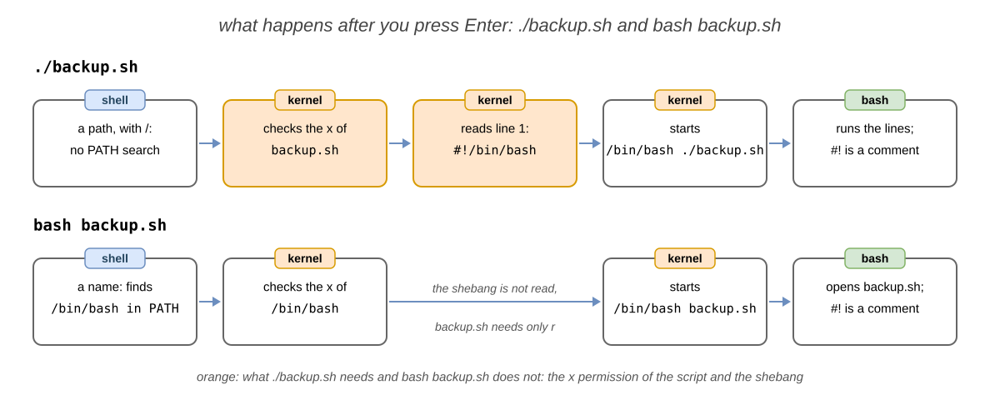
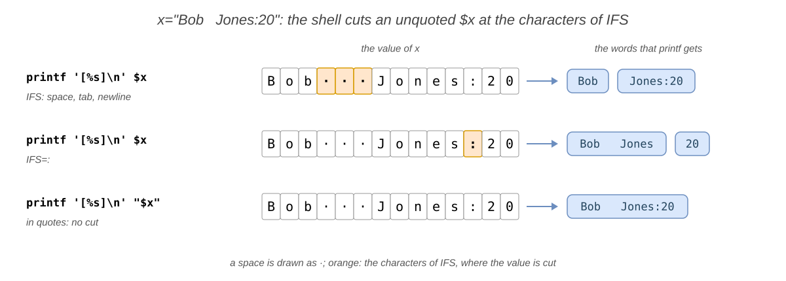

# 08. Shell Scripting

In the seventh lab you built C programs in the terminal, and saw that a shell script is not compiled: `bash` reads it
and runs it, line by line. In this lab you will write your own **shell scripts**. You will run them with the
**shebang** `#!/bin/bash` or with `bash`, and find their bugs with **ShellCheck**, in the terminal and, through a
**language server**, in your editor. You will keep text in **variables**, and see how the shell cuts them into words
at the characters of **`IFS`**. You will **read input** with `read`, capture the output of a command with **command
substitution**, and compute with **arithmetic expansion** and `bc`. Then you will make decisions with `if`, `test` and
`case`, repeat commands with the loops `while` and `for`, group commands into **functions**, and give a script
**parameters**.

The most important idea of this lab is that a script is a list of **command lines**, and the shell treats each one as
it treats the line you type: it replaces the variables, cuts the result into **words**, and runs a **command**. Even the
condition of `if` and `while` is a command, and only its **exit code** decides: `0` is true, anything else is false.

## Objectives

- Write a script with a **shebang** and comments, and run it with `./script.sh` and with `bash script.sh`
- Follow a script, command by command, with `bash -x`
- Find the usual bugs of a script before it runs with `shellcheck`, and see them in the editor through the language
  server `bash-language-server`
- Keep text in **variables**, and understand why an unquoted `$NAME` is cut into words at the characters of `IFS`
- Read a line typed by the user, or a line of a file, with `read` (`-p`, `-r`, several variables, `IFS=: read`)
- Put the output of a command in a variable with **command substitution**, `$(...)`
- Compute with integers with `$((...))` and `((...))`, and with decimals with `bc`
- Make decisions with `if`, `elif` and `else`, from the exit code of a command, `test`, `[ ]`, `[[ ]]` or `(( ))`
- Compare a text with **patterns** with `case`
- Repeat commands with `while`, `until` and `while read`, and leave a loop with `break`
- Go over a list of words, the files of a glob or of `find`, or a range of numbers, with `for`, `while read`, `seq`
  and `{1..5}`
- Write **functions** with `local` variables, give back a result with `echo` and success or failure with `return`
- Read the **parameters** of a script, `$0`, `$1`, `$#` and `"$@"`, and end it with `exit`

## Resources

1. _[Razvan Deaconescu, Razvan Rughinis, Mihai Carabas, Alexandru Radovici, Utilizarea Sistemelor de
   Operare, Printech 2021](https://github.com/systems-cs-pub-ro/carte-uso/releases/download/uso-ed1-2021/uso.pdf)_
   - Chapter 7 - _Interfața în linia de comandă_, sections 7.2.2 - 7.2.5
   - Chapter 13 - _Automatizarea sarcinilor_, sections 13.1 - 13.3, 13.4.1 and 13.4.2
2. _Brian Ward, How LINUX Works, 3rd Edition, No Starch Press, 2021_
   - Chapter 2 - _Basic Commands and Directory Hierarchy_, section 2.8
   - Chapter 11 - _Introduction to Shell Scripts_, sections 11.1 - 11.7, 11.10, 11.11, 11.13 and 11.14
3. _[Bash Reference Manual](https://www.gnu.org/software/bash/manual/bash.html)_, section 3.2.5 - _Compound
   Commands_, section 3.3 - _Shell Functions_ and section 3.5 - _Shell Expansions_;
   _[ShellCheck](https://www.shellcheck.net)_, and the page of every warning in its
   _[wiki](https://www.shellcheck.net/wiki/)_;
   _[bash-language-server](https://github.com/bash-lsp/bash-language-server)_
4. The lecture slides: [08. Shell Scripting](/docs/lectures/08)
5. The manual pages: `man bash` (search for `Compound Commands`, `Word Splitting` and `ARITHMETIC EVALUATION`),
   `man test`, `man seq`, `man bc`, `man expr`, `man basename`, `man dirname`, `man env`, `man find`,
   `man shellcheck`, and `help read`,
   `help test`, `help for` for the built-in commands

## Fedora and Ubuntu

The lab computers run **Fedora** with **Sway**, and the examples come from them. At home you may also use **Ubuntu**:
the scripts are the same, with a few differences:

|                                            | Fedora                                                    | Ubuntu                                                                             |
| ------------------------------------------ | --------------------------------------------------------- | ---------------------------------------------------------------------------------- |
| `/bin/sh`                                  | `bash`                                                    | `dash`, a smaller shell: no `[[ ]]`, `((...))`, `{1..5}`                           |
| install `bc`, if it is missing             | `sudo dnf install bc`                                     | `sudo apt install bc`                                                              |
| install ShellCheck and the language server | `sudo dnf install ShellCheck nodejs-bash-language-server` | `sudo apt install shellcheck npm`, then `sudo npm install -g bash-language-server` |

## Shell Scripts

A **shell script** is a text file with command lines. Instead of typing the commands one by one, you write them in the
file, and `bash` runs them for you, one after another. Scripts are good at gluing commands together (copy, check,
rename, report); for heavy computation, use a language like Python or C.

### Writing a Script

The examples of this lab run in `~/lab08`, which [exercise 1](#first-steps) creates. `backup.sh` copies `fruits.txt`
into a folder:

```bash title="~/lab08/backup.sh"
#!/bin/bash
# copy the fruits into a backup folder
mkdir -p backup
cp fruits.txt \
   backup/
echo "backup done"; ls backup
```

| Written as               | What it means                                                                       |
| ------------------------ | ----------------------------------------------------------------------------------- |
| `#!/bin/bash`            | the **shebang**, always the first line: the program that runs the script            |
| `# ...`                  | a **comment**: `bash` ignores the rest of the line                                  |
| the end of a line        | the end of a command: `bash` runs it, waits for it to end, then reads the next line |
| `command1; command2`                   | two commands on one line: `command1`, then `command2`                                             |
| `\` at the end of a line | the command goes on, on the next line: `cp` gets both `fruits.txt` and `backup/`    |

Write the scripts with an editor from [Text Editors](/docs/labs/06#text-editors) in lab 06. The `.sh` at the end of
the name is only a convention: Linux looks at the content of a file, not at its name.

### Running a Script

```shell-session
[student@fedora lab08]$ ./backup.sh
bash: ./backup.sh: Permission denied
[student@fedora lab08]$ bash backup.sh
backup done
fruits.txt
[student@fedora lab08]$ chmod +x backup.sh
[student@fedora lab08]$ ./backup.sh
backup done
fruits.txt
```

- `./backup.sh` failed: a new file does not have the `x` permission (see [`chmod`](/docs/labs/05#chmod) in lab 05).
- `bash backup.sh` worked anyway: the program is `bash`, and the script is only a file that it reads.
- After `chmod +x`, the kernel read the shebang of `./backup.sh` and ran `/bin/bash ./backup.sh`.



| Command          | What it needs                                                                                  |
| ---------------- | ---------------------------------------------------------------------------------------------- |
| `./backup.sh`    | the `x` permission and the shebang; `./`, because the current folder is not in `PATH` (lab 04) |
| `bash backup.sh` | only the `r` permission; for `bash`, the shebang is a comment                                  |

The shebang works for any language: a file that starts with `#!/usr/bin/python3` is run by Python.

The script runs in a **new** `bash` process, a child of your shell. A `cd` or a variable of the script changes only
that process, and the process ends with the script: your shell stays where it was. The exercises at home and the
challenges need the details: they are in [Subshells](#subshells).

:::caution

Run your scripts with `./script.sh` or with `bash script.sh`, not with `sh script.sh`: `sh` skips the shebang, and on
Ubuntu it is `dash`, which does not know many features of `bash` (see [Fedora and Ubuntu](#fedora-and-ubuntu)).

:::

### Following a Script: `bash -x`

`bash -x` prints every command, with a `+` in front, after the shell replaced the variables and before the command
runs. It is the first thing to try when a script does something you did not expect:

```shell-session
[student@fedora lab08]$ bash -x backup.sh
+ mkdir -p backup
+ cp fruits.txt backup/
+ echo 'backup done'
backup done
+ ls backup
fruits.txt
```

:::tip

`set -x` on a line of the script turns the tracing on from there, and `set +x` turns it off: trace only the part you
suspect.

:::

## Checking Scripts

`bash -x` shows what a script does **while** it runs. **ShellCheck** finds the usual bugs **before** it runs, by
reading the text of the script, like the warnings of `gcc -Wall` in lab 07. Install it, and the language server that
shows its warnings in the editor, as [Fedora and Ubuntu](#fedora-and-ubuntu) says.

### Finding Bugs: `shellcheck`

```bash title="~/lab08/notes.sh"
#!/bin/bash
# count the lines of a file
file="my notes.txt"
wc -l $file
```

```shell-session
[student@fedora lab08]$ bash notes.sh
wc: my: No such file or directory
wc: notes.txt: No such file or directory
0 total
[student@fedora lab08]$ shellcheck notes.sh

In notes.sh line 4:
wc -l $file
      ^---^ SC2086 (info): Double quote to prevent globbing and word splitting.

Did you mean:
wc -l "$file"
...
```

- `wc` got two words, `my` and `notes.txt`: the unquoted `$file` was cut at the space (see
  [Quoting and Escaping](/docs/labs/04#quoting-and-escaping) in lab 04).
- `shellcheck` found the bug without running the script: the line, a `^---^` under the word, a **code**, `SC2086`, and
  the fix. `https://www.shellcheck.net/wiki/SC2086` explains every code, with examples.

The warnings that you will meet in this lab:

| Code     | What it means                                                                     |
| -------- | --------------------------------------------------------------------------------- |
| `SC2086` | a variable without quotes: it is cut into words, and its globs are expanded       |
| `SC2162` | `read` without `-r`: it removes the `\` characters                                |
| `SC2045` | `for f in $(ls ...)`: a file name with spaces breaks; use a glob                  |
| `SC2044` | `for f in $(find ...)`: the same problem; use `find ... \| while read` or `-exec` |
| `SC2034` | a variable that is set, but never used: often a typo in its name                  |
| `SC1009` | a syntax error, for example a `fi` or a `done` that is missing                    |

:::tip

When you **want** the cut, write the comment `# shellcheck disable=SC2086` on the line before: it tells the reader
that you chose it.

:::

### In the Editor: `bash-language-server`

In [An Editor with a Language Server](/docs/labs/07#an-editor-with-a-language-server) in lab 07, your editor used
`clangd` for C. For shell scripts, the language server is **`bash-language-server`**: it runs `shellcheck` after every
change and marks the warnings in the text, completes the names of the commands and of the variables, and shows the
help of the command under the cursor. The keys are those of lab 07.

| Editor               | What it needs to use `bash-language-server`                                                                                                                               |
| -------------------- | ------------------------------------------------------------------------------------------------------------------------------------------------------------------------- |
| `vim`                | the `~/.vimrc` lines below, next to the ones of `clangd` |
| `nvim` 0.11 or newer | the lines below, in `~/.config/nvim/init.lua`                                                                                                                             |
| `hx` (Helix)         | nothing: `hx --health bash` shows `✓ bash-language-server`                                                                                                                |
| `emacs` 29 or newer  | `(add-hook 'sh-mode-hook 'eglot-ensure)` in `~/.emacs.d/init.el`                                                                                                          |
| `code` (VS Code)     | the extension **Bash IDE** (`code --install-extension mads-hartmann.bash-ide-vscode`), which brings its own server                                                        |
| `zed` (Zed)          | nothing: it downloads the server by itself                                                                                                                                |

```vim title="~/.vimrc (add)"
au User lsp_setup call lsp#register_server({
    \ 'name': 'bash-language-server',
    \ 'cmd': {server_info->['bash-language-server', 'start']},
    \ 'allowlist': ['sh', 'bash'],
    \ })
```lua title="~/.config/nvim/init.lua (add)"
vim.lsp.config('bashls', {
  cmd = { 'bash-language-server', 'start' },
  filetypes = { 'sh', 'bash' },
})
vim.lsp.enable('bashls')
```

Every editor needs `shellcheck` installed: without it, the language server completes names, but shows no warnings.

## Variables

You met the variables in [Shell Variables and `export`](/docs/labs/04#shell-variables-and-export) in lab 04:
`NAME=value` with **no spaces** around `=`, `$NAME` or `${NAME}` to use it, `unset` to delete it. In a script, two rules
matter most:

- A variable holds **text**. `msg="I like $fruit"` keeps the value that `fruit` had **then**, not a formula, and
  `$a+$b` is just the text `2+3` (to compute, see [Arithmetic](#arithmetic)).
- A line starts with a **command**: in `fruit= kiwi`, the space ends the assignment, and `kiwi` is the command.

```shell-session
[student@fedora lab08]$ fruit=kiwi
[student@fedora lab08]$ echo "I like $fruit, ${fruit}s are green"
I like kiwi, kiwis are green
[student@fedora lab08]$ msg="I like $fruit"
[student@fedora lab08]$ fruit=plum
[student@fedora lab08]$ echo "$msg"
I like kiwi
[student@fedora lab08]$ a=2; b=3; echo $a+$b
2+3
[student@fedora lab08]$ fruit= kiwi
bash: kiwi: command not found
```

- `${fruit}s` needed the braces: `$fruits` is another variable, which does not exist.
- `msg` did not change with `fruit`: the shell replaced `$fruit` when it ran the line `msg=...`.
- `fruit= kiwi` ran the command `kiwi`, with an empty `fruit` only for it (see
  [A Variable for One Command](/docs/labs/04#a-variable-for-one-command) in lab 04).

### Splitting Words: `IFS`

After it replaces an **unquoted** `$NAME`, the shell cuts the value into words at the characters of the variable
**`IFS`** (_Internal Field Separator_). By default, `IFS` holds a space, a tab and a newline. Inside double quotes,
`"$NAME"` stays **one** word (see [Quoting and Escaping](/docs/labs/04#quoting-and-escaping) in lab 04). Think of the
characters of `IFS` as the places where the scissors cut.

```shell-session
[student@fedora lab08]$ printf '%q\n' "$IFS"
$' \t\n'
[student@fedora lab08]$ x="Bob   Jones:20"
[student@fedora lab08]$ printf '[%s]\n' $x
[Bob]
[Jones:20]
[student@fedora lab08]$ printf '[%s]\n' "$x"
[Bob   Jones:20]
[student@fedora lab08]$ IFS=:
[student@fedora lab08]$ printf '[%s]\n' $x
[Bob   Jones]
[20]
[student@fedora lab08]$ unset IFS
```

- `printf '%q\n'` showed the invisible characters of `IFS`: a space, `\t` (tab) and `\n` (newline).
- `printf '[%s]\n'` prints every word it gets between brackets (lab 04): unquoted, `$x` became two words; quoted, one.
- After `IFS=:`, only `:` cut the value, and the spaces were normal characters. `unset IFS` went back to the default.



| The character of `IFS` | How it cuts                                                                                   |
| ---------------------- | --------------------------------------------------------------------------------------------- |
| space, tab, newline    | several in a row make **one** cut; at the start and at the end of the value, they are dropped |
| any other (`:`, `,`)   | **every** one cuts: `a::c` gives three words, `a`, an empty word and `c`                      |

:::caution

Put every variable in double quotes, `"$NAME"`, unless you **want** it cut. After you change `IFS`, run `unset IFS`:
until then, every unquoted variable is cut at the new characters.

:::

## Reading Input: `read`

`read` is a built-in command of the shell (its manual is `help read`). It waits for a line, until <kbd>Enter</kbd>, and
puts it in variables:

| Command                 | What it does                                                                             |
| ----------------------- | ---------------------------------------------------------------------------------------- |
| `read NAME`             | reads a single line from the standard input and assign it to `NAME`                                                                 |
| `read -p "<TEXT>" NAME` | writes the string `<TEXT>` (a _prompt_) first                                          |
| `read A B C`            | cuts the line at `IFS`: one word for every variable, and the **last** one takes the rest |
| `IFS=: read A B C`      | cuts the line at `:`, only for this `read`                                               |
| `read -r NAME`          | _raw_: keeps the `\` characters; without `-r`, `read` removes them                       |
| `IFS= read -r NAME`     | reads the line **exactly**, with the spaces at its start and at its end                  |
| `read NAME < <FILE>`    | reads the first line of `<FILE>`                                                         |

```shell-session
[student@fedora lab08]$ read -p "Full name: " first last
Full name: Carol Ann Smith
[student@fedora lab08]$ echo "$last, $first"
Ann Smith, Carol
[student@fedora lab08]$ head -n 1 /etc/passwd
root:x:0:0:Super User:/root:/bin/bash
[student@fedora lab08]$ IFS=: read user x uid rest < /etc/passwd
[student@fedora lab08]$ echo "$user has the UID $uid"
root has the UID 0
```

- `first` got `Carol`, and `last`, the last variable, got the rest of the line.
- `IFS=:` before `read` is a variable only for that command: the line was cut at `:`, and `IFS` stayed the default.


:::note

`read` ends with `0` when it read a line, and with `1` at the end of the input (<kbd>Ctrl</kbd>+<kbd>D</kbd> on the
keyboard, or the end of a file): [`while read`](#reading-a-file-while-read) stops on it.

:::


## Command Substitution: `$(...)`

`$(command)` runs the command and puts its **output** in its place, as text; then the shell runs the line. Use it to
keep the output of a command in a variable, or to put it in the middle of a text. The newlines at the end of the output
are dropped.

```shell-session
[student@fedora lab08]$ count=$(wc -l < fruits.txt)
[student@fedora lab08]$ echo "$count fruits on $(date +%A)"
7 fruits on Monday
[student@fedora lab08]$ echo "$(sort -u fruits.txt | wc -l) kinds"
5 kinds
```

- `count` holds the text `7`, the output of `wc -l < fruits.txt`; `wc` does not run again when you use `$count`.
- `$(...)` works inside `"..."`, and can hold a whole pipeline.

The command runs in a **copy** of the shell: a variable that it changes is changed only in the copy (see
[Subshells](#subshells)). `` `command` `` is the old way to write `$(command)`.

## Arithmetic

For the shell, `2` and `3` are text: `echo $a+$b` prints `2+3`. To compute, you must ask for it.

### Integers: `$((...))` and `((...))`

| Written as       | What it does                                                                                    |
| ---------------- | ----------------------------------------------------------------------------------------------- |
| `$((<EXPR>))`    | the shell computes `<EXPR>` and puts the **result** in its place, as text                       |
| `((<EXPR>))`     | a command that computes `<EXPR>`: to change a variable, `((n++))`, or as a condition            |
| `expr <A> + <B>` | an old **program** that prints the result; each number and operator is a parameter, `*` is `\*` |

Inside `((...))`, the variables need no `$`, and the operators are those of C:

| Operator          | What it does                                   | Example                                       |
| ----------------- | ---------------------------------------------- | --------------------------------------------- |
| `+ - * /`         | add, subtract, multiply, divide: integers only | `$((7 / 2))` is `3`                           |
| `% **`            | remainder, power                               | `$((7 % 2))` is `1`, `$((2 ** 10))` is `1024` |
| `< <= > >= == !=` | compare: `1` is true, `0` is false             | `$((3 > 2))` is `1`                           |
| `&& \|\| !`       | and, or, not                                   | `$((1 && 0))` is `0`                          |
| `= += -= ++ --`   | change a variable                              | `((n += 2))`                                  |
| `( )`             | group                                          | `$(( (2 + 3) * 4 ))` is `20`                  |

:::info

Some of these operators, such as `**`, `++` and `--`, are not available in every shell, and specifically not in `sh`. Always check which shell you're using with the `echo $SHELL` command.

:::
```shell-session
[student@fedora lab08]$ a=7; b=2
[student@fedora lab08]$ echo "$a + $b = $((a + b))"
7 + 2 = 9
[student@fedora lab08]$ echo $((a / b)) $((a % b)) $((a ** b))
3 1 49
[student@fedora lab08]$ ((a++)); echo $a
8
[student@fedora lab08]$ echo $(a+b)
bash: a+b: command not found

```

- `$((a / b))` dropped the decimals: `7 / 2` is `3`, with the remainder `1`.
- `$(a+b)`, with **one** pair of parentheses, is command substitution: the shell looked for a command named `a+b`.

### Decimals: `bc`

`bash` computes only with integers. For decimals, write the expression as text and send it to `bc`, a calculator that
reads expressions from its input and prints the results:

```shell-session
[student@fedora lab08]$ echo $((3.5 * 2))
bash: 3.5 * 2: syntax error: invalid arithmetic operator (error token is ".5 * 2")
[student@fedora lab08]$ echo "3.5 * 2" | bc
7.0
[student@fedora lab08]$ echo "10 / 3" | bc
3
[student@fedora lab08]$ echo "scale=2; 10 / 3" | bc
3.33
```

- `bc` divides with no decimals, unless `scale` says how many to keep.
- To keep the result, combine it with command substitution: `total=$(echo "$price * $count" | bc)`.

## Conditions

### `if`

`if` runs a **command** and looks at its exit code (see [Exit Codes](/docs/labs/06#exit-codes) in lab 06): when it is
`0`, the commands after `then` run; otherwise, `if` tries the next `elif`, or runs the commands after `else`. `fi`
(`if` backwards) ends it; `elif` and `else` are optional.

```bash title="~/lab08/kiwi.sh"
#!/bin/bash
if grep -q kiwi fruits.txt; then
    echo "we have kiwi"
elif grep -q plum fruits.txt; then
    echo "no kiwi, but we have plums"
else
    echo "no kiwi, no plums"
fi
```

`grep -q` prints nothing: it only ends with `0` when it finds the text. The `;` ends the command before `then`.

:::caution

The condition is a **command line**, not a formula. `if $a > $b` runs the command `7` (with `a=7`), and sends its output
to a new file named `3`: `7: command not found`, so `if` takes the `else` branch. To compare, use `test`.

:::

### `test` and `[`

`test` is a command that checks a condition, prints nothing, and ends with `0` (true) or `1` (false). `[` is the same
command, with one more rule: its last parameter must be `]`.

| Test                                             | True when                                                  |
| ------------------------------------------------ | ---------------------------------------------------------- |
| `<A> -eq <B>`, `-ne`, `-lt`, `-le`, `-gt`, `-ge` | the **numbers** are equal, not equal, `<`, `<=`, `>`, `>=` |
| `"<S>" = "<T>"`, `"<S>" != "<T>"`                | the **texts** are equal, different                         |
| `-z "<S>"`, `-n "<S>"`                           | the text is empty, not empty                               |
| `-e <FILE>`, `-f <FILE>`, `-d <FILE>`            | it exists; it is a regular file; it is a directory         |
| `-r <FILE>`, `-w <FILE>`, `-x <FILE>`            | you may read, write, run it                                |
| `! <TEST>`                                       | the test is false                                          |

```shell-session
[student@fedora lab08]$ a=2; b=3
[student@fedora lab08]$ [ $a -lt $b ]; echo $?
0
[student@fedora lab08]$ [ -d fruits.txt ]; echo $?
1
[student@fedora lab08]$ type -a [
[ is a shell builtin
[ is /usr/bin/[
[student@fedora lab08]$ [$a -lt $b]
bash: [2: command not found
```

- `type -a` showed that `[` is a built-in command, and also a program in `/usr/bin`.
- `[$a -lt $b]` became the word `[2`, and there is no command with that name.

:::caution

**`[` is a command**: the shell cuts the line into words before `[` starts. Put spaces around `[`, `]` and every
operator, and quote the variables: with an empty `x`, `[ $x = abc ]` becomes `[ = abc ]`, and `[` says
`=: unary operator expected`; `[ "$x" = abc ]` works. Compare numbers with `-lt`, not `<`: inside `[ ]`, `<` and `>`
are redirects.

:::

### `[[ ]]` and `(( ))`

`bash` has two easier forms. They are part of the language of `bash` (keywords), not commands, so they work only in
`bash`, not in `sh`:

| Form           | What it adds                                                                                          |
| -------------- | ----------------------------------------------------------------------------------------------------- |
| `[[ <TEST> ]]` | like `[`, but an unquoted variable is **not** cut, `&&` and `\|\|` work inside, and `==` takes a glob |
| `(( <EXPR> ))` | the arithmetic of `$((...))` as a condition: true when the result is **not** `0`                      |

```shell-session
[student@fedora lab08]$ if (( a < b )); then echo "smaller"; fi
smaller
[student@fedora lab08]$ f="my notes.txt"; [[ $f == *.txt ]] && echo "a text file"
a text file
```

### Choosing by Pattern: `case`

`case` compares a text with **patterns**, from top to bottom, and runs the branch of the **first** one that matches.
The patterns are globs (see [Globbing](/docs/labs/04#globbing) in lab 04), and `|` between them means _or_:

```bash title="~/lab08/color.sh"
#!/bin/bash
read -p "Fruit: " fruit
case $fruit in
    banana | lemon)
        echo "yellow" ;;
    kiwi | lime)
        echo "green" ;;
    *berry)
        echo "a berry" ;;
    *)
        echo "I do not know $fruit" ;;
esac
```

- `;;` ends a branch: `case` jumps after `esac` (`case` backwards), and does not try the other patterns.
- `*)` matches anything: the default branch, always the last one. Without it, when nothing matches, nothing runs.

## Loops

### `while` and `until`

`while` runs a command before every round: while it ends with `0`, `while` runs the **body**, the commands between
`do` and `done`. `until` is the opposite: it repeats while the command does **not** end with `0`.

```bash title="~/lab08/countdown.sh"
#!/bin/bash
n=3
while [ $n -gt 0 ]; do
    echo "$n..."
    n=$((n - 1))
done
echo "go!"
```

```shell-session
[student@fedora lab08]$ bash countdown.sh
3...
2...
1...
go!
```

| Written as                      | What it does                                           |
| ------------------------------- | ------------------------------------------------------ |
| `while <COMMAND>; do ...; done` | repeats while `<COMMAND>` ends with `0`                |
| `until <COMMAND>; do ...; done` | repeats until `<COMMAND>` ends with `0`                |
| `while true; do ...; done`      | repeats forever, until a `break`                       |
| `break`                         | leaves the loop                                        |
| `continue`                      | skips the rest of the body, and goes to the next round |

:::caution

The body must change what the condition tests (in the examples, `n`), or the loop never ends: stop it with
<kbd>Ctrl</kbd>+<kbd>C</kbd>.

:::

### Reading a File: `while read`

`< <FILE>` after `done` is the input of the **whole loop**: every `read` takes the next line, and at the end of the file
`read` ends with `1`, which stops the loop.

```shell-session
[student@fedora lab08]$ while read fruit; do echo "buy $fruit"; done < shopping.txt
buy apple
buy kiwi
buy cherry
[student@fedora lab08]$ while IFS=, read user name; do echo "$user is $name"; done < people.csv
bob is Bob Jones
carol is Carol Smith
dave is Dave Brown
```

- `IFS=, read` cut every line only at `,`: the space of `Bob Jones` stayed in `name`.

:::caution

Write `done < <FILE>`, not `cat <FILE> | while read ...`: after a pipe, the loop runs in a copy of the shell, and the
variables that it changes are lost when it ends (see [Subshells](#subshells)).

:::

### `for`

`for` gives a variable every word of a list, one by one, and runs the body once for each word:

| Written as              | The words                                                                     |
| ----------------------- | ----------------------------------------------------------------------------- |
| `for f in apple kiwi`   | the words written after `in`                                                  |
| `for f in *.txt`        | the names of the files that match the glob, each one a word, even with spaces |
| `for w in $(<COMMAND>)` | the output of the command, cut at `IFS`                                       |
| `for p in "$@"`         | the parameters of the script (see [Script Parameters](#script-parameters))    |

```shell-session
[student@fedora lab08]$ for f in *.txt; do echo "$f: $(wc -l < "$f") lines"; done
fruits.txt: 7 lines
my notes.txt: 2 lines
shopping.txt: 3 lines
[student@fedora lab08]$ for f in $(ls *.txt); do echo "[$f]"; done
[fruits.txt]
[my]
[notes.txt]
[shopping.txt]
```

- The glob gave `my notes.txt` as **one** word, and `"$f"` kept it whole for `wc`.
- The output of `ls` was cut at `IFS`: `my notes.txt` became two words. Go over files with a glob, never with `$(ls)`.

To cut a value at another character, set `IFS` **before** the loop, and `unset` it after: `IFS=: for ...` is a syntax
error, because `for` is a keyword, not a command.

```shell-session
[student@fedora lab08]$ line="apple:kiwi:cherry"
[student@fedora lab08]$ IFS=:
[student@fedora lab08]$ for f in $line; do echo "[$f]"; done
[apple]
[kiwi]
[cherry]
[student@fedora lab08]$ unset IFS
```

### Files in Subfolders: `find`

A glob sees only one folder. `find` (see [Finding Files](/docs/labs/02#finding-files-find) in lab 02) also looks in
every subfolder, and prints one path per line:

| Written as                                                        | What it does                                                                                  |
| ----------------------------------------------------------------- | --------------------------------------------------------------------------------------------- |
| `find <DIR> -name '<GLOB>' \| while IFS= read -r f; do ...; done` | one round for every path, even with spaces; the variables of the loop are lost after the pipe |
| `find <DIR> -name '<GLOB>' -exec <COMMAND> {} +`                  | `find` runs `<COMMAND>` itself, with the paths in place of `{}`: no loop, and no cut          |
| `for f in $(find ...)`                                            | the output is cut at `IFS`: a name with spaces breaks, as with `$(ls)`                        |

```shell-session
[student@fedora lab08]$ find . -name '*.jpeg' | sort | while IFS= read -r f; do echo "[$f]"; done
[./photos/cat.jpeg]
[./photos/dog.jpeg]
[./photos/summer beach.jpeg]
[student@fedora lab08]$ for f in $(find . -name '*.jpeg' | sort); do echo "[$f]"; done
[./photos/cat.jpeg]
[./photos/dog.jpeg]
[./photos/summer]
[beach.jpeg]
[student@fedora lab08]$ find photos -name '*.jpeg' -exec ls -s {} +
0 photos/cat.jpeg  0 photos/dog.jpeg  0 'photos/summer beach.jpeg'
```

- `find` prints the paths in no order: `sort` put them in order. `IFS= read -r` read every line exactly, with its space.
- `-exec ls -s {} +` ran **one** `ls`, with the three paths as its parameters.

### Counting: `seq`, `{1..5}` and `for ((...))`

| Written as                       | The numbers                                                                       |
| -------------------------------- | --------------------------------------------------------------------------------- |
| `$(seq <FIRST> <STEP> <LAST>)`   | `seq` is a program that prints them; it works with variables: `$(seq 1 $n)`       |
| `{<FIRST>..<LAST>..<STEP>}`      | written by `bash` (_brace expansion_), only with numbers: with `n=5`, `{1..$n}` is not `1 2 3 4 5`, but one word, `{1..5}` |
| `for ((i = 1; i <= 10; i += 3))` | the C-like `for` of `bash`                                                        |

```shell-session
[student@fedora lab08]$ for i in $(seq 1 3 10); do echo -n "$i "; done; echo
1 4 7 10
[student@fedora lab08]$ for i in {1..10..3}; do echo -n "$i "; done; echo
1 4 7 10
[student@fedora lab08]$ for ((i = 1; i <= 10; i += 3)); do echo -n "$i "; done; echo
1 4 7 10
```

- `echo -n` does not end the line; the last `echo` does.

## Functions

A **function** is a group of commands with a name. You call it like any command, and the words after its name are its
parameters: `$1`, `$2`, ... and `$#`, how many. Define a function before the line that calls it.

```bash title="~/lab08/funcs.sh"
#!/bin/bash
greet() {
    if [ $# -eq 0 ]; then
        return 1
    fi
    echo "Hello, $1!"
}

add() {
    local sum=$(($1 + $2))
    echo "$sum"
}

greet bob && echo "ok"
greet || echo "nobody to greet"
total=$(add 2 3)
echo "total: $total, sum: [$sum]"
```

```shell-session
[student@fedora lab08]$ bash funcs.sh
Hello, bob!
ok
nobody to greet
total: 5, sum: []
```

| Written as                   | What it does                                                                                     |
| ---------------------------- | ------------------------------------------------------------------------------------------------ |
| `<NAME>() { ... }`           | defines the function; the `()` are always empty                                                  |
| `$1`, `$2`, `$#`             | inside the function: the parameters of the call, and how many                                    |
| `local <VAR>=<VALUE>`        | a variable that exists only while the function runs; the other variables are those of the script |
| `return <N>`                 | leaves the function with the exit code `<N>`; without it, the exit code of the last command      |
| `echo`, then `$(<NAME> ...)` | gives back a **result**: the function prints it, the caller captures it                          |

- `greet bob` ended with `0`, so `&&` ran `echo "ok"`; `greet` with no parameters returned `1`, so `||` ran.
- `$(add 2 3)` captured `5`; `sum` was `local`, so it is empty outside `add`.

:::caution

`return` says success or failure, it does not give back data: an exit code is between `0` and `255`, and `return 300`
gives `44`. To give back a number or a text, `echo` it.

:::

## Script Parameters

The words after the name of a script are its **parameters**, as for a function:

| Parameter              | Value                                                          |
| ---------------------- | -------------------------------------------------------------- |
| `$0`                   | the name of the script, as you typed it                        |
| `$1` ... `$9`, `${10}` | the parameters                                                 |
| `$#`                   | how many parameters there are                                  |
| `"$@"`                 | all the parameters, each one a separate word, even with spaces |

```bash title="~/lab08/args.sh"
#!/bin/bash
echo "script: $0"
echo "first:  $1"
echo "count:  $#"
for p in "$@"; do
    echo "[$p]"
done
```

```shell-session
[student@fedora lab08]$ ./args.sh "Carol Smith" bob
script: ./args.sh
first:  Carol Smith
count:  2
[Carol Smith]
[bob]
```

- `"$@"` kept `Carol Smith` as one word; an unquoted `$@` is cut at `IFS`, like any variable.

A script ends with the exit code of its last command, or with `exit <N>` (see [Exit Codes](/docs/labs/06#exit-codes)
in lab 06). A script that needs parameters checks `$#` first:

```bash
if [ $# -ne 1 ]; then
    echo "usage: $0 <FILE>" >&2
    exit 1
fi
```

`>&2` sends the message to the error output, `2`, as an error should be (see
[Errors](/docs/labs/03#errors-2-and-2) in lab 03).

## Subshells

:::note

**Going deeper**

You do not need this section for the exercises of the lab, the 🧪 First Steps. Read it at home: the 🏠 Going Further
exercises and the 📝 Challenges use it.

:::

Some commands run in a new process, and nothing they change comes back to your shell, except their output and their
exit code:

| Where                                         | What runs it                        | What it starts with                           |
| --------------------------------------------- | ----------------------------------- | --------------------------------------------- |
| `./script.sh`, `bash script.sh`               | a new `bash` program                | only the **exported** variables (lab 04)      |
| `( ... )`, `$(...)`, each command of `a \| b` | a **subshell**: a copy of the shell | a copy of **all** the variables and functions |

Think of a photocopy of your notebook: you can write on the copy, but the original does not change.

```shell-session
[student@fedora lab08]$ echo "$$ $BASHPID"
4210 4210
[student@fedora lab08]$ (echo "$$ $BASHPID")
4210 4268
[student@fedora lab08]$ (cd /tmp; pwd); pwd
/tmp
/home/student/lab08
[student@fedora lab08]$ x=1; y=$(x=2; echo "inside: $x"); echo "$y, outside: $x"
inside: 2, outside: 1
[student@fedora lab08]$ c=0; cat fruits.txt | while read f; do ((c++)); done; echo "$c"
0
[student@fedora lab08]$ c=0; while read f; do ((c++)); done < fruits.txt; echo "$c"
7
```

- `$$` is the PID of your shell, even inside a subshell; `$BASHPID` is the PID of the process that really runs the
  command, so the subshell has another one.
- The `cd` and the `x=2` changed only the copy.
- After `|`, the `while` counted in a subshell, and its `c` was lost; with `< fruits.txt`, the loop ran in your shell.

To run a script **in your shell**, so that its `cd` and its variables stay, use `source script.sh` (or
`. script.sh`): this is how `bash` reads `~/.bashrc`. A function called inside `$(...)` also runs in a subshell: it can
give back only its output.

## Troubleshooting

| Problem                                                          | Solution                                                                                                                             |     |
| ---------------------------------------------------------------- | ------------------------------------------------------------------------------------------------------------------------------------ |     |
| `bash: ./x.sh: Permission denied`                                | The script has no `x` permission: `chmod +x x.sh`, or run `bash x.sh`                                                                |     |
| `bash: x.sh: command not found`, but the file is there           | The current directory is not in `PATH`: run `./x.sh`                                                                                 |     |
| `/bin/bash^M: bad interpreter: No such file or directory`        | The file has Windows line endings: `sed -i 's/\r$//' x.sh`                                                                           |     |
| The editor shows no warnings in a script                         | `shellcheck` or the server is missing: `shellcheck --version`, `bash-language-server --version`; for `nvim`, the lines of `init.lua` |     |
| `bash: name: command not found` after `name = value`             | No spaces around `=`: `name=value`                                                                                                   |     |
| A file name with spaces is cut in two                            | Quote the variable, `"$f"`; go over files with a glob or `find ... \| while IFS= read -r f`, not with `$(ls)` or `$(find)`           |     |
| `syntax error: invalid arithmetic operator`                      | `bash` has no decimals: use `bc`                                                                                                     |     |
| `bash: a+b: command not found`                                   | One pair of parentheses is command substitution: write `$((a + b))`                                                                  |     |
| `[2: command not found`                                          | `[` is a command: put a space after it, `[ $a -lt $b ]`                                                                              |     |
| ``[: missing `]'``                                               | Put a space before `]`                                                                                                               |     |
| `[: =: unary operator expected` or `[: too many arguments`       | A variable is empty or has spaces: quote it, `[ "$x" = abc ]`                                                                        |     |
| `syntax error near unexpected token` `` `fi' `` (or `done`, `)`) | A `;` or a new line is missing before `then` or `do`, or a `;;` after a branch of `case`                                             |     |
| `syntax error: unexpected end of file`                           | A `fi`, `done`, `esac` or `}` is missing                                                                                             |     |
| `[[: not found` or `Syntax error: Bad for loop variable`         | The script ran with `sh`, which is `dash` on Ubuntu: run it with `bash` or `./x.sh`                                                  |     |
| The script never ends                                            | The condition of `while` never changes: <kbd>Ctrl</kbd>+<kbd>C</kbd>, then change the variable in the body                           |     |
| A counter is `0` after `cat <FILE> \| while read`                | The loop ran in a subshell: write `done < <FILE>`                                                                                    |     |
| A `cd` in a script does not change your directory                | The script runs in a new process: `source x.sh`                                                                                      |     |

## Exercises

- 🧪 [First Steps](#first-steps) (exercises 1 - 12): one idea at a time, in the order of the lab, to do in the lab;
- 🏠 [Going Further](#going-further) (exercises 13 - 29): longer scripts, to do at home; some of them look at what
  runs in a **copy** of the shell, explained in [Subshells](#subshells);
- 📝 [Challenges](#challenges) (exercises 30 - 35): the hardest ones, like the ones at the exam.

:::danger

A script runs its commands without asking. Before a loop that moves or deletes files, put `echo` in front of the
command and read what it would do. Quote every variable, and check that it is not empty before you use it in a path:
with an empty `dir`, `rm -r "$dir"/*` is `rm -r /*`, even with the quotes. `shellcheck` warns about it (`SC2115`).

:::

### 🧪 First Steps {/* #first-steps */}

Do these exercises in order, during the lab. Each one starts with what it wants you to achieve, and tries **one** idea
from the lab: read the section linked under its goal if you get stuck. Run the commands in `~/lab08`, unless the
exercise says otherwise.

1. **The practice tree**: Check that the tools are installed, and create the files that the other exercises use, in
    `~/lab08`. <small>→ [Fedora and Ubuntu](#fedora-and-ubuntu)</small>

    1. print the version of `shellcheck` and of `bash-language-server`; install the ones that are missing;
    2. run these commands (copy them from the browser with <kbd>Ctrl</kbd>+<kbd>C</kbd> and paste them in the terminal
       with <kbd>Ctrl</kbd>+<kbd>Shift</kbd>+<kbd>V</kbd>):

       ```bash
       mkdir -p ~/lab08/photos
       cd ~/lab08
       printf '%s\n' banana apple kiwi cherry apple plum kiwi > fruits.txt
       printf '%s\n' apple kiwi cherry > shopping.txt
       printf '%s\n' 'bob,Bob Jones' 'carol,Carol Smith' 'dave,Dave Brown' > people.csv
       printf '%s\n' 'buy milk' 'call grace' > 'my notes.txt'
       touch photos/cat.jpeg photos/dog.jpeg 'photos/summer beach.jpeg'
       ```

    3. list the files of `~/lab08` and of `~/lab08/photos`.

    <details className="reveal">
    <summary>Hint</summary>

    Most commands print their version with `--version`. The packages are in [Fedora and Ubuntu](#fedora-and-ubuntu).

    </details>

    <details className="reveal">
    <summary>Check</summary>

    1. `shellcheck --version` and `bash-language-server --version` each print a version.
    3. `~/lab08` has `fruits.txt`, `my notes.txt`, `people.csv`, `shopping.txt` and the folder `photos`; `photos` has
       `cat.jpeg`, `dog.jpeg` and `summer beach.jpeg`.

    </details>

**Shell scripts**

2. **The first script**: Write a script that greets you and moves to another folder, run it in two ways, and find out
    where your shell is after it ends. <small>→ [Writing a Script](#writing-a-script) · [Running a Script](#running-a-script) · [Following a Script](#following-a-script-bash--x)</small>

    1. write `hello.sh`: a shebang, a comment on its own line, then commands that print `Hello, ` followed by your user
       name, go to `/tmp`, and print the current directory;
    2. run it with `bash`; then run it by its path, read the error, fix it, and run it again;
    3. print the current directory of your shell;
    4. run the script once more, so that every command is printed before it runs.

    <details className="reveal">
    <summary>Hint</summary>

    The variable `USER` ([lab 04](/docs/labs/04#variables-defined-by-the-system)); `man chmod`; `man bash`: search for
    `-x`, or read [Following a Script](#following-a-script-bash--x).

    </details>

    <details className="reveal">
    <summary>Check</summary>

    1. Line 1 is `#!/bin/bash`; the commands are, for example, `echo "Hello, $USER"`, `cd /tmp` and `pwd`.
    2. `bash hello.sh` prints `Hello, student` and `/tmp`; `./hello.sh` says `Permission denied` until
       `chmod +x hello.sh`.
    3. `/home/student/lab08`.
    4. `bash -x hello.sh` prints `+ echo 'Hello, student'`, `+ cd /tmp` and `+ pwd`, each before its output.

    **Why:** the script runs in a new `bash` process: its `cd` changes only that process, which ends with the script.

    </details>

**Variables**

3. **Text, not formulas**: In the terminal, find out what a variable really holds, and where the shell cuts it into
    words. <small>→ [Variables](#variables) · [Splitting Words](#splitting-words-ifs)</small>

    1. set `fruit` to `kiwi`, and `msg` to `I like ` followed by the value of `fruit`; change `fruit` to `plum`, and
       print `msg`;
    2. print the value of `fruit` followed by `_salad`, with **no** space between them;
    3. set `x` to `Bob   Jones:20` (with three spaces); print the words that the shell makes from `$x`, one per line
       and between brackets, without quotes, then with quotes;
    4. make the shell cut `$x` only at `:`, print its words again, then go back to the default.

    <details className="reveal">
    <summary>Hint</summary>

    [Splitting Words](#splitting-words-ifs) prints the words of a variable with `printf '[%s]\n'`. Why is
    `$fruit_salad` empty?

    </details>

    <details className="reveal">
    <summary>Check</summary>

    1. `I like kiwi`.
    2. `echo "${fruit}_salad"` prints `plum_salad`; `$fruit_salad` is a variable that does not exist.
    3. Without quotes: `[Bob]` and `[Jones:20]`; with quotes: `[Bob   Jones:20]`.
    4. After `IFS=:`: `[Bob   Jones]` and `[20]`; then `unset IFS`.

    **Why:** a variable holds text, which the shell puts in its place when the line runs; without quotes, the text is
    cut at the characters of `IFS`.

    </details>

**Reading input**

4. **Ask the user**: Write `ask.sh`, which asks for a full name and writes it as `<LAST>, <FIRST>`, then reads the
    fields of the first line of `/etc/passwd`. <small>→ [Reading Input](#reading-input-read)</small>

    1. write `ask.sh`: it asks `Full name: ` on the same line, puts the first word of the answer in `first` and the
       rest in `last`, and prints `<LAST>, <FIRST>`;
    2. run it and answer `Carol Ann Smith`; run it again and answer only `bob`;
    3. add lines that read the first line of `/etc/passwd`, cut at `:`, and print
       `<USER> has the UID <UID> and the shell <SHELL>`.

    <details className="reveal">
    <summary>Hint</summary>

    `help read`: search for `-p`; a line of `/etc/passwd` has 7 fields (lab 05).

    </details>

    <details className="reveal">
    <summary>Check</summary>

    2. `Ann Smith, Carol`; then `, bob`: `last` is empty.
    3. `IFS=: read user x uid gid info home shell < /etc/passwd`; it prints
       `root has the UID 0 and the shell /bin/bash`.

    </details>

**Command substitution**

5. **A report**: Write `report.sh`, which prints `<N> fruits, <K> kinds, on <DAY>` from `fruits.txt`.
    <small>→ [Command Substitution](#command-substitution-)</small>

    1. keep the number of lines of `fruits.txt` in `count`, and the number of different fruits in `kinds`;
    2. print the line, with the name of today from `date`;
    3. run it with `bash -x`, and find the commands that ran inside `$(...)`.

    <details className="reveal">
    <summary>Hint</summary>

    `sort -u` and `wc -l` from lab 06; `man date`: search for `%A`.

    </details>

    <details className="reveal">
    <summary>Check</summary>

    2. `7 fruits, 5 kinds, on Monday` (with the name of today).
    3. They start with `++`: `++ wc -l`, `++ sort -u fruits.txt`, `++ wc -l` and `++ date +%A`.

    **Why:** every `$(...)` runs in a copy of the shell, one level deeper, so `bash -x` gives it one more `+`.

    </details>

**Arithmetic**

6. **The price of a floor**: Compute with integers in the terminal, then write `area.sh`, which computes the area of a
    room and the price of its floor. <small>→ [Integers](#integers--and-) · [Decimals](#decimals-bc)</small>

    1. set `a` to `7` and `b` to `2`; print `$a+$b`, then the sum, the quotient and the remainder of `a` and `b`;
    2. write `area.sh`: with **one** `read`, it reads the width and the height of a room, in meters, and prints
       `area: <AREA> m2`;
    3. add a line that prints `price: <PRICE> lei`, the price of the floor, at `12.5` lei per square meter;
    4. run it, with the width `4` and the height `3`.

    <details className="reveal">
    <summary>Hint</summary>

    [Arithmetic](#arithmetic); why does `$((w * h * 12.5))` fail?

    </details>

    <details className="reveal">
    <summary>Check</summary>

    1. `7+2`; then `9`, `3` and `1`.
    4. `area: 12 m2` and `price: 150.0 lei` (for example, `echo "$w * $h * 12.5" | bc`).

    </details>

**Conditions**

7. **What is it?**: Write `what.sh`, which reads a name and says if it is a folder, a file, or nothing.
    <small>→ [`if`](#if) · [`test` and `[`](#test-and-)</small>

    1. write `what.sh`: it reads a name and prints `<NAME> is a directory`, `<NAME> is a file` or
       `<NAME> does not exist`;
    2. run it three times, with `photos`, `my notes.txt` and `nope`;
    3. remove the quotes around the variable in the tests, run it again with `my notes.txt`, and read the error; check
       the script with `shellcheck`, then put the quotes back;
    4. add at the end: if `fruits.txt` contains `plum`, print `plums: <N>`, the number of lines with `plum`;
       otherwise, print `no plums`; the condition is `grep` itself, not `[`.

    <details className="reveal">
    <summary>Hint</summary>

    The table of [`test` and `[`](#test-and-); the table of [Finding Bugs](#finding-bugs-shellcheck); `man grep`: search
    for `--quiet` and `--count`.

    </details>

    <details className="reveal">
    <summary>Check</summary>

    2. `photos is a directory`, `my notes.txt is a file`, `nope does not exist`.
    3. `./what.sh: line 3: [: my: binary operator expected` (and the same for the second test), then
       `my notes.txt does not exist`; `shellcheck` marks `$name` on lines 3 and 5 with `SC2086`, and the `read` of
       line 2 with `SC2162`.
    4. `if grep -q plum fruits.txt; then`; it prints `plums: 1`.

    **Why:** `[` is a command: the shell cut `my notes.txt` into two words before `[` started.

    </details>

8. **What kind of file?**: Write `kind.sh`, which reads a file name and prints its kind, from the end of the name.
    <small>→ [Choosing by Pattern](#choosing-by-pattern-case)</small>

    1. write `kind.sh` with a `case`: `.txt` and `.md` files are `text`; `.jpg`, `.jpeg` and `.png` files are
       `picture`; `.sh` files are `script`; anything else is `unknown`;
    2. run it with `my notes.txt`, `photos/summer beach.jpeg`, `hello.sh` and `Makefile`;
    3. add a branch for the names that start with `cat.`, which prints `a cat`, **after** the branch of the pictures;
       run it with `cat.jpeg`; then move the new branch **before** the pictures, and run it again.

    <details className="reveal">
    <summary>Hint</summary>

    The patterns are globs ([Globbing](/docs/labs/04#globbing) in lab 04); `|` separates the patterns of a branch.

    </details>

    <details className="reveal">
    <summary>Check</summary>

    2. `text`, `picture`, `script`, `unknown`.
    3. After the pictures: `picture`; before them: `a cat`.

    **Why:** `case` runs only the first branch that matches.

    </details>

**Loops**

9. **Count down, line by line**: Repeat a command while a condition holds, and once for every line of a file.
    <small>→ [`while` and `until`](#while-and-until) · [Reading a File](#reading-a-file-while-read)</small>

    1. write `countdown.sh`: it reads a number and counts down to `1`, one number per line, then prints `go!`; run it
       with `3`;
    2. change the loop from `while` to `until`, with the same output;
    3. in the terminal, with **one** loop, print `<NAME> (<USER>)` for every line of `people.csv`, then the number of
       lines it read, `<N> people`.

    <details className="reveal">
    <summary>Hint</summary>

    `until` repeats while its condition is **false**: change the test, not the body. Count with `n=0` before the
    loop, and `n=$((n + 1))` in its body.

    </details>

    <details className="reveal">
    <summary>Check</summary>

    1. `3...` (or `3`), `2...`, `1...`, `go!`.
    2. For example, `until [ $n -eq 0 ]; do`.
    3. `Bob Jones (bob)`, `Carol Smith (carol)`, `Dave Brown (dave)`, `3 people`; the loop is
       `while IFS=, read user name; do ...; done < people.csv`.

    </details>

10. **Every file, every number**: Go over the files of a glob, the files of `find`, and a range of numbers.
    <small>→ [`for`](#for) · [Files in Subfolders](#files-in-subfolders-find) · [Counting](#counting-seq-15-and-for-)</small>

    1. with a `for` loop, print `<FILE>: <N> lines` for every `.txt` file;
    2. with `find` and a `while read` loop, print between brackets every `.jpeg` file of `~/lab08` and of its
       subfolders, in order; then do the same with `for` and `$(find ...)`, and find the name that breaks;
    3. print `0 20 40 60 80 100` on one line in two ways, with `seq` and with braces; then set `n` to `100`, and try
       the braces with `$n` instead of `100`.

    <details className="reveal">
    <summary>Hint</summary>

    `"$f"`, in quotes, in the body; `man find`: search for `-name`; `man seq`: the step is in the middle.

    </details>

    <details className="reveal">
    <summary>Check</summary>

    1. `fruits.txt: 7 lines`, `my notes.txt: 2 lines`, `shopping.txt: 3 lines`.
    2. `find . -name '*.jpeg' | sort | while IFS= read -r f; do echo "[$f]"; done` prints `[./photos/cat.jpeg]`,
       `[./photos/dog.jpeg]` and `[./photos/summer beach.jpeg]`; with `for`, the last one becomes `[./photos/summer]`
       and `[beach.jpeg]`.
    3. `echo $(seq 0 20 100)` and `echo {0..100..20}`; with `$n`, `echo {0..$n..20}` prints `{0..100..20}`.

    **Why:** the glob and `IFS= read -r` keep a name with spaces as one word, but `$(...)` is cut at `IFS`; the braces
    are expanded before the variables: `{0..$n..20}` is not a range yet, so the braces stay, and only `$n` is replaced.

    </details>

**Functions**

11. **Two functions**: Write `max.sh`, with a function that gives back a number and one that answers yes or no.
    <small>→ [Functions](#functions)</small>

    1. write the function `max`, which keeps the larger of its two parameters in the `local` variable `result`, and
       prints it;
    2. call it as `m=$(max 7 12)`, then print `max: <M>, result: [<RESULT>]`;
    3. write the function `is_even`, which prints **nothing**: it ends with `0` when its parameter is even, and with
       `1` otherwise;
    4. for every number from `1` to `4`, print `<N> is even` or `<N> is odd`, with `is_even` as the condition of an
       `if`.

    <details className="reveal">
    <summary>Hint</summary>

    A function ends with the exit code of its last command: `[ ... ]` can be that command.

    </details>

    <details className="reveal">
    <summary>Check</summary>

    2. `max: 12, result: []`.
    4. `1 is odd`, `2 is even`, `3 is odd`, `4 is even`.

    **Why:** a function gives back data by printing it, and success or failure through its exit code; `result` exists
    only inside `max`.

    </details>

**Script parameters**

12. **Recap: the sum**: Write `sum.sh`, which adds the numbers given as its parameters, and refuses to run without
    them. <small>→ [Script Parameters](#script-parameters)</small>

    1. when it gets no parameters, it prints `usage: <SCRIPT> <NUMBER>...` to the error output, and ends with the
       exit code `1`;
    2. otherwise, it adds all the parameters, and prints `<N> numbers, sum <SUM>`;
    3. run `./sum.sh 4 8 15` and print the exit code; then run `./sum.sh > out.txt`, print the exit code and the size
       of `out.txt`; delete `out.txt`.

    <details className="reveal">
    <summary>Hint</summary>

    `$#`, `"$@"` and `exit` in [Script Parameters](#script-parameters); `$((sum + n))`.

    </details>

    <details className="reveal">
    <summary>Check</summary>

    3. `3 numbers, sum 27`, then `0`; `usage: ./sum.sh <NUMBER>...` on the screen, then `1`; `out.txt` has `0`
       bytes.

    **Why:** the message went to the error output, so `>` did not catch it; the exit code tells the caller that the
    script failed.

    </details>

### 🏠 Going Further {/* #going-further */}

Each exercise starts with its **goal**; you choose the commands. At the end, check the goal itself, not only that each
command worked. The exercises use the files and the scripts of `~/lab08` from the First Steps.

**Scripts**

13. **Any language**: `bob` writes his tools in Python, and wants to run them like any program. Make a Python script
    run with `./`, and find out what the kernel does with a wrong shebang. <small>→ [Running a Script](#running-a-script)</small>

    1. write `hello.py`, with the shebang `#!/usr/bin/python3` and the line `print("Hello from Python!")`; run it with
       `./hello.py`, and print its type;
    2. change the shebang to `#!/usr/bin/env python3`, and run it again;
    3. change the shebang to `#!/usr/bin/nope`, and run it with `./`, then with `bash`; delete `hello.py`.

    <details className="reveal">
    <summary>Hint</summary>

        `man file`; `man env`; for `bash`, the shebang is only a comment, and the rest of the file is Python.

    </details>

    <details className="reveal">
    <summary>Check</summary>

    1. `Hello from Python!`; `file` says `Python script, ASCII text executable`.
    2. The same output: `env` found `python3` in `PATH`.
    3. `bash: ./hello.py: /usr/bin/nope: bad interpreter: No such file or directory`; `bash hello.py` says
       ``syntax error near unexpected token `"Hello from Python!"'``.

    **Why:** with `./`, the kernel runs the program named in the shebang; `bash` reads the file as a shell script.

    </details>

14. **An editor that checks scripts**: `dave` wants to see the bugs of his scripts while he types, as he saw the
    errors of C in lab 07. Set up `bash-language-server` in your editor, and use it on a script with bugs.
    <small>→ [In the Editor](#in-the-editor-bash-language-server) · [Finding Bugs](#finding-bugs-shellcheck)</small>

    1. set up the editor that you used in lab 07 for `bash-language-server`, and check that it runs;
    2. create a script with `printf '%s\n' '#!/bin/bash' 'for f in $(ls *.txt); do' '    wc -l $f' 'done' > count.sh`,
       open it in the editor, and find the warnings that it marks;
    3. fix both warnings in the editor, using the fix that it suggests where it has one; run `shellcheck count.sh`;
    4. put the cursor on `wc`, and ask the editor what it is.

    <details className="reveal">
    <summary>Hint</summary>

    The table of [In the Editor](#in-the-editor-bash-language-server); the keys "apply the fix that it suggests" and
    "see what the name under the cursor is" of [lab 07](/docs/labs/07#choosing-an-editor).

    </details>

    <details className="reveal">
    <summary>Check</summary>

    1. `vim`: `:LspStatus` shows `bash-language-server: running`; `nvim`: `:checkhealth vim.lsp` lists `bashls`;
       `hx --health bash` shows `✓ bash-language-server`; Emacs, VS Code and Zed mark the warnings of step 2.
    2. `SC2045` under `$(ls *.txt)`, and `SC2086` under `$f`.
    3. `for f in *.txt; do` and `wc -l "$f"`; `shellcheck count.sh` prints nothing.
    4. A short help about `wc`, taken from its manual page.

    **Why:** the editor sends the text to `bash-language-server`, which runs `shellcheck` on it after every change.

    </details>

15. **Find the bug**: `carol` wrote a script that should print the average of her grades, but it prints only an
    error. Find the two bugs with `bash -x`, and fix them. <small>→ [Following a Script](#following-a-script-bash--x) · [Subshells](#subshells)</small>

    1. create the grades and the script:

       ```bash
       printf '%s\n' 9 7 10 8 > grades.txt
       cat > avg.sh << 'END'
       #!/bin/bash
       # print the average of the grades in grades.txt
       sum=0
       count=0
       cat grades.txt | while read g; do
           sum=$sum+$g
           count=$((count + 1))
       done
       echo "average: $(echo "scale=2; $sum / $count" | bc)"
       END
       ```

    2. run it with `bash`, then with `bash -x`: find the value of `sum` inside the loop, and the values of `sum` and
       `count` that reach `bc`;
    3. fix the two bugs, changing as few lines as possible.

    <details className="reveal">
    <summary>Hint</summary>

    [Arithmetic](#arithmetic); after `|`, where does the loop run?

    </details>

    <details className="reveal">
    <summary>Check</summary>

    2. `bc` says `Divide by zero`; inside the loop, `bash -x` shows `sum=0+9+7+10+8` and `count=4`, but `bc` gets
       `scale=2; 0 / 0`.
    3. `sum=$((sum + g))`, and `done < grades.txt` instead of `cat grades.txt |`; it prints `average: 8.50`.

    **Why:** `$sum+$g` is text; and after `|` the loop runs in a subshell, whose variables are lost when it ends.

    </details>

**Variables and input**

16. **Predict the words**: Before you trust a script with file names, you must know what the shell does with an
    unquoted variable. For each line, **first** write down what it prints, then run it.
    <small>→ [Splitting Words](#splitting-words-ifs) · [Globbing](/docs/labs/04#globbing)</small>

    | Line                                                   |
    | ------------------------------------------------------ |
    | `v="  one  two  "; printf '[%s]' $v; echo`             |
    | `printf '[%s]' "$v"; echo`                             |
    | `v="a,b,,c"; IFS=,; printf '[%s]' $v; echo; unset IFS` |
    | `v="a, b"; IFS=,; printf '[%s]' $v; echo; unset IFS`   |
    | `v="*.txt"; printf '[%s]' $v; echo`                    |
    | `printf '[%s]' "$v"; echo`                             |

    <details className="reveal">
    <summary>Hint</summary>

    The table of [Splitting Words](#splitting-words-ifs); step 5 of [The Command Line](/docs/labs/04#the-command-line)
    in lab 04: the globs are expanded **after** the cut.

    </details>

    <details className="reveal">
    <summary>Check</summary>

    | Line | Prints                                                 |
    | ---- | ------------------------------------------------------ |
    | 1    | `[one][two]`                                           |
    | 2    | `[  one  two  ]`                                       |
    | 3    | `[a][b][][c]`                                          |
    | 4    | `[a][ b]`                                              |
    | 5    | `[fruits.txt][grades.txt][my notes.txt][shopping.txt]` |
    | 6    | `[*.txt]`                                              |

    **Why:** an unquoted variable is cut at `IFS`, then every word that is a glob becomes the names of the files; a
    file name is never cut again.

    </details>

17. **Exact lines**: `grace` keeps Windows paths in a file, with spaces around them. Read the line back exactly as it
    is. <small>→ [Reading Input](#reading-input-read)</small>

    1. create the file with `printf '%s\n' '  C:\Users\grace  ' > path.txt`;
    2. read its line into `p` with `read`, with `read -r`, and with `IFS= read -r`; after each, print `[$p]`.

    <details className="reveal">
    <summary>Check</summary>

    2. `[C:Usersgrace]`, then `[C:\Users\grace]`, then `[  C:\Users\grace  ]`.

    **Why:** without `-r`, `read` removes the `\`; with the default `IFS`, it drops the spaces at the ends.

    </details>

**Subshells**

18. **Lost in a copy**: Find out which changes come back from a copy of the shell. For each line, **first** write down
    what it prints, then run it. <small>→ [Subshells](#subshells)</small>

    | Line                                         |
    | -------------------------------------------- |
    | `n=1; set_n() { n=2; }; set_n; echo $n`      |
    | `n=1; x=$(set_n; echo $n); echo "$n $x"`     |
    | `echo hello \| read w; echo "[$w]"`          |
    | `unset v; (cd /tmp; v=in); echo "$PWD [$v]"` |
    | `bash -c 'cd /tmp'; pwd`                     |

    <details className="reveal">
    <summary>Check</summary>

    | Line | Prints                   |
    | ---- | ------------------------ |
    | 1    | `2`                      |
    | 2    | `1 2`                    |
    | 3    | `[]`                     |
    | 4    | `/home/student/lab08 []` |
    | 5    | `/home/student/lab08`    |

    **Why:** a function called directly runs in your shell; `$(...)`, the commands of a pipe, `( ... )` and a new
    `bash` run in other processes, and their changes are lost.

    </details>

19. **Run it here**: `dave` wants a script that takes him to his photos, and one that shows a setting. Find out when a
    script sees the variables of your shell, and when it changes your shell. <small>→ [Subshells](#subshells)</small>

    1. write `show.sh`, which prints `color: [<COLOR>]` with the value of `color`, and make it executable;
    2. in your shell, set `color` to `red`; run `show.sh` with `./`, then with `source`; export `color`, and run it
       with `./` again;
    3. write `goto.sh`, which goes to `~/lab08/photos`; run it with `bash`, then with `source`, and each time print
       the current directory; go back with `cd -`.

    <details className="reveal">
    <summary>Check</summary>

    2. `color: []`, then `color: [red]`, then `color: [red]`.
    3. With `bash`: `/home/student/lab08`; with `source`: `/home/student/lab08/photos`.

    **Why:** a script run with `./` is a new `bash`, which gets only the exported variables; `source` runs it in your
    shell.

    </details>

**Conditions and loops**

20. **Guess the number**: `grace` wants a game for her little brother: the script picks a number from `1` to `100`,
    and says `too small` or `too big` after every guess, until it is found. <small>→ [`while` and `until`](#while-and-until) · [`[[ ]]` and `(( ))`](#--and--)</small>

    1. write `guess.sh`: it picks `secret` with `$RANDOM`, then repeats: it reads a guess with the prompt
       `Your guess: `, and prints `too small`, `too big`, or `found in <N> tries` and stops;
    2. to test it, add a line that sets `secret` to `42` after the random one, and guess `50`, `25`, `42`; then delete
       that line.

    <details className="reveal">
    <summary>Hint</summary>

    `man bash`: search for `RANDOM`; `$((RANDOM % 100 + 1))`; `while true` and `break`.

    </details>

    <details className="reveal">
    <summary>Check</summary>

    2. `too big`, `too small`, `found in 3 tries`.

    </details>

21. **Rename the photos**: The camera of `erin` writes `.jpeg`, but her album wants `.jpg`. Rename every `.jpeg` file
    of `photos` and of its subfolders, also the one with a space in its name, with **one** loop.
    <small>→ [Files in Subfolders](#files-in-subfolders-find) · [Splitting Words](#splitting-words-ifs)</small>

    1. create an older photo in a subfolder, with `mkdir -p photos/2025 && touch photos/2025/old.jpeg`;
    2. **first**, print the `mv` commands instead of running them: put `echo` in front of `mv`; check every line;
    3. remove the `echo`, run the loop again, and list every file of `photos`, in order.

    <details className="reveal">
    <summary>Hint</summary>

    `find ... | while IFS= read -r f`; `man basename`: `basename photos/cat.jpeg .jpeg` prints `cat`; `man dirname`:
    `dirname photos/2025/old.jpeg` prints `photos/2025`.

    </details>

    <details className="reveal">
    <summary>Check</summary>

    2. Four lines, in any order, among them `mv photos/2025/old.jpeg photos/2025/old.jpg` and
       `mv photos/summer beach.jpeg photos/summer beach.jpg`.
    3. `find photos -type f | sort` prints `photos/2025/old.jpg`, `photos/cat.jpg`, `photos/dog.jpg` and
       `photos/summer beach.jpg`.

    **Why:** a glob would see only `photos`; `find` also goes into `photos/2025`, and `IFS= read -r` keeps the space.

    </details>

22. **The grades report**: `carol` has the grades of her group in a CSV file. Write `grades.sh`, which prints the
    average of every student, with two decimals, and the best one. <small>→ [Reading a File](#reading-a-file-while-read) · [Decimals](#decimals-bc)</small>

    1. create the file with `printf '%s\n' name,math,physics bob,9,7 carol,10,8 dave,6,9 > grades.csv`;
    2. go over its lines, skip the first one (the names of the columns) with `continue`, and print
       `<NAME>: <AVERAGE>`;
    3. at the end, print `best: <NAME>`, the student with the largest sum.

    <details className="reveal">
    <summary>Check</summary>

    3. `bob: 8.00`, `carol: 9.00`, `dave: 7.50`, `best: carol`.

    </details>

23. **A to-do list**: Write `todo.sh`, a small program that reads commands until `quit`, and keeps the tasks of
    `grace` in `todo.txt`. <small>→ [`while` and `until`](#while-and-until) · [Choosing by Pattern](#choosing-by-pattern-case)</small>

    1. it repeats: it shows the prompt `> `, reads a command and the rest of the line, and:
       - `add <TEXT>` adds `<TEXT>` as a line at the end of `todo.txt`;
       - `list` prints the lines of `todo.txt`, with their numbers;
       - `clear` deletes `todo.txt`;
       - `quit` ends the program;
       - any other word prints `unknown command: <WORD>`;
    2. run it, and type `add buy milk`, `add call grace`, `list`, `fly`, `quit`.

    <details className="reveal">
    <summary>Hint</summary>

    `read cmd text`: the last variable takes the rest of the line; `nl` (lab 06) numbers the lines.

    </details>

    <details className="reveal">
    <summary>Check</summary>

    2. `list` prints `1` and `buy milk`, `2` and `call grace`; `fly` prints `unknown command: fly`; `quit` gives you
       the prompt of the shell back.

    </details>

24. **A multiplication table**: Write `table.sh`, which reads `n` and prints the multiplication table from `1` to `n`,
    in columns of 4 characters. <small>→ [Counting](#counting-seq-15-and-for-)</small>

    1. write it with two `for ((...))` loops, one inside the other;
    2. run it with `3`, then with `10`.

    <details className="reveal">
    <summary>Hint</summary>

    `printf '%4d' <N>` prints a number on 4 characters, without a newline; an `echo` alone ends the line.

    </details>

    <details className="reveal">
    <summary>Check</summary>

    2. For `3`: `   1   2   3`, `   2   4   6`, `   3   6   9`; for `10`, the last line ends with `100`.

    </details>

**Functions and parameters**

25. **Exit codes of functions**: For each line, **first** write down what it prints, then run it.
    <small>→ [Functions](#functions)</small>

    | Line                                              |
    | ------------------------------------------------- |
    | `f() { return 300; }; f; echo $?`                 |
    | `g() { false; }; g; echo $?`                      |
    | `h() { echo 5; return 3; }; x=$(h); echo "$x $?"` |
    | `bash -c 'exit 256'; echo $?`                     |

    <details className="reveal">
    <summary>Check</summary>

    | Line | Prints |
    | ---- | ------ |
    | 1    | `44`   |
    | 2    | `1`    |
    | 3    | `5 3`  |
    | 4    | `0`    |

    **Why:** an exit code is kept in one byte, so it is the remainder of the division by `256`; `x=$(h)` ends with the
    exit code of `h`.

    </details>

26. **A library of functions**: `bob` wants to use `max` and `is_even` in several scripts, without copying them. Put
    them in a file of their own. <small>→ [Functions](#functions) · [Subshells](#subshells)</small>

    1. move the two functions of `max.sh` into `lib.sh`, which only defines them;
    2. write `use.sh`, which loads `lib.sh` with `source`, and prints `max: <MAX>` for its two parameters, and
       whether the first one is even;
    3. run `./use.sh 7 12`, then `bash lib.sh`.

    <details className="reveal">
    <summary>Check</summary>

    2. `use.sh` has the line `source ./lib.sh` (or `. ./lib.sh`).
    3. `max: 12` and `7 is odd`; `bash lib.sh` prints nothing: it only defines the functions, in a `bash` that ends.

    </details>

27. **Every parameter**: Find out what `"$@"` keeps that `$@` loses. <small>→ [Script Parameters](#script-parameters)</small>

    1. write `words.sh`, which prints every word of `"$@"` between brackets, on one line, then every word of `$@`,
       without quotes, on a second line;
    2. run `./words.sh "Carol Smith" '*.txt'`.

    <details className="reveal">
    <summary>Check</summary>

    2. The first line is `[Carol Smith][*.txt]`; the second starts with `[Carol][Smith][fruits.txt]` and has a word
       for every `.txt` file of `~/lab08`, with `[my notes.txt]` as one word.

    **Why:** an unquoted `$@` is cut at `IFS`, then its globs are expanded, like any unquoted variable.

    </details>

28. **A safe backup**: `erin` wants to back up several folders with one command, and to know if something failed.
    Write `save.sh`, which copies every folder given as a parameter into `~/lab08/backups/<NAME>-<DATE>`.
    <small>→ [Script Parameters](#script-parameters)</small>

    1. without parameters, it prints a usage message to the error output, and ends with `1`;
    2. for every parameter that is a folder, it copies it and prints `saved <NAME>`; for any other parameter, it
       prints `<NAME> is not a directory` to the error output, and goes on with the next one;
    3. it ends with `1` if at least one parameter was not a folder, and with `0` otherwise;
    4. run `./save.sh photos nope`, print the exit code, and list `backups`.

    <details className="reveal">
    <summary>Hint</summary>

    `date +%F` prints `2026-11-16`; `mkdir -p` creates `backups` if it is missing; `cp -r` copies a folder; keep the
    exit code in a variable, and `exit` with it at the end.

    </details>

    <details className="reveal">
    <summary>Check</summary>

    4. `saved photos`, `nope is not a directory`, then `1`; `backups` has `photos-<DATE>`, for example
       `photos-2026-11-16`, with the four photos, also `2025/old.jpg`.

    </details>

**Clean up**

29. **Clean up**: Delete everything that this lab created.

    1. leave `~/lab08` with `cd ~`, then delete it;
    2. close the terminal, or `unset` the variables and the functions that you set in it (`fruit`, `msg`, `x`, `a`,
       `b`, `n`, `v`, `p`, `color`, `set_n`).

    <details className="reveal">
    <summary>Check</summary>

    1. `ls ~/lab08` says `No such file or directory`.

    </details>

### 📝 Challenges {/* #challenges */}

These exercises are like the ones at the exam. Each one gives you a **result** to reach, but not the steps: you decide
the commands. Each one ends with the **Check** that will be used to grade it. Some of them need
[Subshells](#subshells).

All the challenges start from the same setup, the one you will find at the exam: the folder `~/exam`, with a copy of a
password file, two folders of files, and two scripts. Copy and run these commands before the first challenge; run them
again to get the original files back:

```bash
mkdir -p ~/exam
cd ~/exam
printf '%s\n' 'root:x:0:0:Super User:/root:/bin/bash' 'daemon:x:2:2:daemon:/sbin:/usr/sbin/nologin' \
    'bob:x:1001:1001:Bob Jones:/home/bob:/bin/bash' 'carol:x:1002:1002:Carol Smith:/home/carol:/bin/zsh' \
    'dave:x:1003:1003:Dave Brown:/home/dave:/bin/bash' \
    'nobody:x:65534:65534:Kernel Overflow User:/:/usr/sbin/nologin' > passwd
rm -rf mess organize
mkdir mess organize
touch mess/a.txt mess/b.TXT 'mess/my notes.txt' 'mess/c d.jpg' mess/e.png mess/notes
touch organize/report.txt organize/README.md 'organize/summer beach.JPG' organize/cat.png organize/run.sh \
    organize/Makefile
cat > predict.sh << 'END'
#!/bin/bash
v="a  b:c"
printf '[%s]' $v; echo
IFS=:
printf '[%s]' $v; echo
unset IFS
n=1
inc() { local n=5; n=$((n + 1)); m=$n; }
inc
echo "$n $m"
x=$(n=9; echo $((n * 2)))
echo "$n $x"
case photo.jpeg in
    *.jp*) echo "A" ;;
    *.jpeg) echo "B" ;;
    *) echo "C" ;;
esac
f() { return 257; }
f; echo $?
for w in "1 2" 3; do echo -n "<$w>"; done; echo
c=0; printf '%s\n' a b c | while read l; do c=$((c + 1)); done; echo $c
END
cat > broken.sh << 'END'
#!/bin/bash
# print the text files of mess (.txt, in any case), then how many there are
count = 0
for f in $(ls mess); do
    case $f in
        *.txt)
            echo "text: $f"
            count=$count+1 ;;
    esac
done
if [$count -eq 0]; then
    echo "no text files"
else
    echo "$count text files"
fi
END
chmod +x broken.sh
```

When you are done, delete everything with `rm -rf ~/exam`. Write every script in `~/exam`, make it executable, and run
it from `~/exam`.

30. **FizzBuzz**: Write `fizzbuzz.sh <N>`, which prints the numbers from `1` to `<N>`, one per line, but writes `Fizz`
    instead of the multiples of `3`, `Buzz` instead of the multiples of `5`, and `FizzBuzz` instead of the multiples
    of both. Without exactly one parameter, it prints `usage: <SCRIPT> <N>` to the error output, and ends with `1`.

    <details className="reveal">
    <summary>Check</summary>

    | Command                               | Prints                     |
    | ------------------------------------- | -------------------------- |
    | `./fizzbuzz.sh 15 \| tail -n 3`       | `13`, `14`, `FizzBuzz`     |
    | `./fizzbuzz.sh 15 \| grep -c Fizz`    | `5`                        |
    | `./fizzbuzz.sh 15 \| wc -l`           | `15`                       |
    | `./fizzbuzz.sh 2> /dev/null; echo $?` | `1`                        |
    | `./fizzbuzz.sh 1 2`                   | `usage: ./fizzbuzz.sh <N>` |

    </details>

31. **The real users**: Write `users.sh <FILE>`, which reads a file in the format of `/etc/passwd` and prints, for
    every user with a UID from `1000` to `65533`, a line `<USER> (<UID>): <SHELL>`, then `<N> users`. Use only the
    commands of the shell: no `awk`, `cut` or `grep`.

    <details className="reveal">
    <summary>Check</summary>

    `./users.sh passwd` prints:

    ```text
    bob (1001): /bin/bash
    carol (1002): /bin/zsh
    dave (1003): /bin/bash
    3 users
    ```

        `grep -cwE 'awk|cut|grep' users.sh` prints `0`.

    </details>

32. **Predict the output**: On paper, write down the 8 lines that `predict.sh` prints, **without** running it. Then
    run `bash predict.sh`, and explain every line that you got wrong.

    <details className="reveal">
    <summary>Check</summary>

    | Line | Prints      | Why                                             |
    | ---- | ----------- | ----------------------------------------------- |
    | 1    | `[a][b:c]`  | cut at the spaces, two in a row make one cut    |
    | 2    | `[a  b][c]` | cut only at `:`, the spaces are kept            |
    | 3    | `1 6`       | `n` was `local` in `inc`; `m` was not           |
    | 4    | `1 18`      | `n=9` changed only the subshell of `$(...)`     |
    | 5    | `A`         | `photo.jpeg` matches `*.jp*`, the first pattern |
    | 6    | `1`         | `257` is kept in one byte: `257 % 256`          |
    | 7    | `<1 2><3>`  | `"1 2"` is one word                             |
    | 8    | `0`         | the `while` after `\|` counted in a subshell    |

    </details>

33. **Fix the script**: `broken.sh` should print the text files of `mess` (the names that end in `.txt`, in any case),
    then how many there are. It has five bugs. Fix them, changing only the lines that are wrong.

    <details className="reveal">
    <summary>Check</summary>

    `./broken.sh` prints exactly 4 lines: the names `a.txt`, `b.TXT` and `my notes.txt` (with or without `mess/` in
    front), each after `text: `, then `3 text files`; it prints no errors (`./broken.sh 2>&1 > /dev/null` prints
    nothing).

    </details>

34. **A calculator**: Write `calc.sh <A> <OP> <B>`, which computes with two integers. `<OP>` is `+`, `-`, `x` (not
    `*`: the shell would expand it as a glob) or `/`, which gives a result with two decimals. Every error goes to the
    error output, with an exit code: `1` when the number of parameters is not `3`, `2` for another operator, `3` for a
    division by zero.

    <details className="reveal">
    <summary>Check</summary>

    | Command                        | Output  | `$?` |
    | ------------------------------ | ------- | ---- |
    | `./calc.sh 7 + 5`              | `12`    | `0`  |
    | `./calc.sh 7 - 10`             | `-3`    | `0`  |
    | `./calc.sh 7 x 6`              | `42`    | `0`  |
    | `./calc.sh 10 / 4`             | `2.50`  | `0`  |
    | `./calc.sh 10 / 3`             | `3.33`  | `0`  |
    | `./calc.sh 1 / 0 2> /dev/null` | nothing | `3`  |
    | `./calc.sh 2 % 3 2> /dev/null` | nothing | `2`  |
    | `./calc.sh 1 + 2> /dev/null`   | nothing | `1`  |

    </details>

35. **Tidy up a folder**: Write `organize.sh <DIR>`, which moves every file of `<DIR>` into a folder inside `<DIR>`,
    from the end of its name, in any case: `.txt` and `.md` into `text`, `.jpg`, `.jpeg` and `.png` into `images`,
    `.sh` into `scripts`, and anything else into `other`. It moves only files, not folders, so a second run changes
    nothing. It must work with names that contain spaces.

    <details className="reveal">
    <summary>Check</summary>

    After `./organize.sh organize` (run it twice, with no errors), `find organize -type f | sort` prints:

    ```text
    organize/images/cat.png
    organize/images/summer beach.JPG
    organize/other/Makefile
    organize/scripts/run.sh
    organize/text/README.md
    organize/text/report.txt
    ```

    </details>

## Wrap-up Questions

Use the **last 5 minutes** of the lab to answer these questions together with your colleagues and the teaching
assistant. There are no wrong answers for the last two.

1. What is the difference between `./script.sh` and `bash script.sh`? What does the **shebang** do?
2. What does `shellcheck` find that `bash -x` cannot find, and the other way around?
3. Why does `msg="I like $fruit"` not change when `fruit` changes? Why is `$a+$b` not a sum?
4. When does the shell cut a variable into words, and where? How do you stop it?
5. What is the difference between `$(...)` and `$((...))`?
6. What does `if` really check? Why must there be spaces inside `[ ... ]`?
7. How do you go over the lines of a file, and how over the files of a folder? Why not `for f in $(ls)`?
8. How does a function give back a number, and how does it say that it failed? What are `$1`, `$#` and `"$@"`?
9. Which error of the shell surprised you most today?
10. Which task of yours, done by hand until now, will you turn into a script?

## Extra

1. **`shfmt`**: a program that formats a script, with the same indentation everywhere, as `clang-format` does for C.
   Install it (`sudo dnf install shfmt`; Ubuntu: `sudo apt install shfmt`), then `shfmt -d what.sh` shows what it
   would change; `bash-language-server` uses it to format the file from the editor.
   <small>→ [github.com/mvdan/sh](https://github.com/mvdan/sh)</small>
2. **Safer scripts**: `set -euo pipefail` at the start of a script stops it at the first failed command (`-e`), at an
   unset variable (`-u`), and when any command of a pipe fails. <small>→ `help set`</small>
3. **Parameter expansion**: `bash` can change the value of a variable without other programs: `${f%.jpeg}` drops the
   end `.jpeg`, `${f##*/}` keeps what follows the last `/`, `${name:-guest}` gives `guest` when `name` is empty.
   <small>→ `man bash`, search for `Parameter Expansion`</small>
4. **Arrays**: `fruits=(apple kiwi "star fruit")` keeps several values in one variable; `"${fruits[@]}"` gives them
   back, one word each, like `"$@"`. <small>→ `man bash`, search for `Arrays`</small>
