# 09. Network Infrastructure

In the eighth lab you wrote shell scripts. In this lab you will look at how your computer talks to other computers. You
will first see what a **network** is and its **layers**, then the **network cards** and their **MAC addresses**, the
**IP address** and the **mask**, the **neighbors**, the **routing table** and the **default gateway**, the names of
**DNS** and the settings that **DHCP** gives. You will test the network with `ping` and `traceroute`, build a small
network of **containers** with **Podman**, find the **ports** of its programs, get an address with **`dhclient`**, and
watch the packets with **`tcpdump`**.

The most important idea of this lab is that a packet carries an address for each layer: the **MAC address** finds the
card in the local network, the **IP address** finds the computer across the networks, and the **port** finds the
program. A computer needs only an **IP address with its mask**, a **default gateway** and a **DNS server**, and DHCP
gives it all three.

## Objectives

- Understand what a network, a packet, a switch and a router are, and the address that each layer uses
- List the network cards and their MAC addresses with `ip link` and `nmcli`
- Print only one value of the output of a command (a MAC address, an IP address) with `awk` and `cut`
- Find the IP addresses and the masks of a computer with `ip address`, compute the network of an address, and tell
  private, public and special addresses apart
- Test if a computer answers with `ping`, and understand why it fails
- Find the MAC addresses of the neighbors with `ip neigh`
- Read the routing table with `ip route` and `ip route get`, find the default gateway, and the routers on the way with
  `traceroute`
- Turn a name into an IP address with `host`, and find the DNS server of a computer with `resolvectl`
- Find what a computer received from DHCP with `nmcli`, and ask a DHCP server for an address with `dhclient`
- Run containers with `podman`, and inspect their network from inside and from outside
- List the TCP and UDP ports that wait for connections, and their programs, with `ss`
- Capture packets with `tcpdump`, choosing them with filters
- Find why a computer has no Internet, checking the layers from the bottom up

## Resources

1. _[Razvan Deaconescu, Razvan Rughinis, Mihai Carabas, Alexandru Radovici, Utilizarea Sistemelor de
   Operare, Printech 2021](https://github.com/systems-cs-pub-ro/carte-uso/releases/download/uso-ed1-2021/uso.pdf)_
   - Chapter 11 - _Rețelistică și Internet_, sections 11.1 - 11.6
2. _Brian Ward, How LINUX Works, 3rd Edition, No Starch Press, 2021_
   - Chapter 9 - _Understanding Your Network and Its Configuration_, sections 9.1 - 9.9, 9.13, 9.14, 9.16, 9.18,
     9.21 and 9.22
   - Chapter 10 - _Network Applications and Services_
3. _Andrew S. Tanenbaum, Nick Feamster, David Wetherall, Computer Networks, 6th Edition, Pearson, 2021_
   - Chapter 4 - _The Medium Access Control Sublayer_, sections 4.3 and 4.8
   - Chapter 5 - _The Network Layer_, section 5.6
   - Chapter 6 - _The Transport Layer_, sections 6.4 and 6.5
   - Chapter 7 - _The Application Layer_, section 7.1
4. _[Podman documentation](https://docs.podman.io/)_; _[tcpdump and pcap-filter](https://www.tcpdump.org/manpages/)_
5. The lecture slides: [09. Network Infrastructure](/docs/lectures/09)
6. The manual pages: `man ip-link`, `man ip-address`, `man ip-neighbour`, `man ip-route`, `man ping`,
   `man traceroute`, `man ss`, `man curl`, `man host`, `man resolvectl`, `man nmcli`, `man tcpdump`, `man pcap-filter`,
   `man podman-run`, `man podman-exec`, `man podman-logs`, and, online (the containers have no manual pages),
   _[`man dhclient`](https://manpages.debian.org/trixie/isc-dhcp-client/dhclient.8.en.html)_,
   _[`man dhclient.leases`](https://manpages.debian.org/trixie/isc-dhcp-client/dhclient.leases.5.en.html)_ and
   _[`man dnsmasq`](https://manpages.debian.org/trixie/dnsmasq-base/dnsmasq.8.en.html)_

## Fedora and Ubuntu

The examples come from the Fedora computers of the lab. On Ubuntu, the commands are the same, with a few differences:

|                                     | Fedora                                                                | Ubuntu                                                                  |
| ----------------------------------- | --------------------------------------------------------------------- | ----------------------------------------------------------------------- |
| install the tools of the lab        | `sudo dnf install podman tcpdump traceroute bind-utils`               | `sudo apt install podman tcpdump traceroute bind9-host`                 |
| the service that sets up the cards  | NetworkManager (`nmcli`)                                              | NetworkManager on Ubuntu Desktop; `systemd-networkd` on Ubuntu Server   |
| `ipcalc` (an exercise at home)      | installed                                                             | `sudo apt install ipcalc`; it prints the same values, in another layout |
| the virtual switch of `sudo podman` | `podman0`                                                             | `podman0` (older versions of Podman: `cni-podman0`)                     |
| in a VirtualBox VM, with NAT        | the card `enp0s3`, the address `10.0.2.15/24`, the gateway `10.0.2.2` | the same                                                                |

The names and the addresses of your computer differ from the ones in the examples: compare your screen with the Checks.

## What Is a Network

A **network** is a group of computers connected so that they can send data to each other. The data travels in
**packets**: small blocks of bytes (at most about 1500), each with the address of the computer that sent it and of the
one that must receive it. Think of a long story sent by post as many letters, each in its own envelope.

| Device           | What it does                                                                      |
| ---------------- | --------------------------------------------------------------------------------- |
| **network card** | connects a computer to a network, with a cable or with radio waves (Wi-Fi)        |
| **switch**       | connects the computers of **one** local network (the lab room) with cables        |
| **router**       | connects **two or more** networks, and forwards the packets from one to the other |
| a home router    | a switch, a Wi-Fi access point and a router in one box                            |

:::note

The **Internet** is a network of networks, joined by routers.

:::

A **server** is a program that waits for requests (a web server); a **client** is a program that sends them (the
browser).

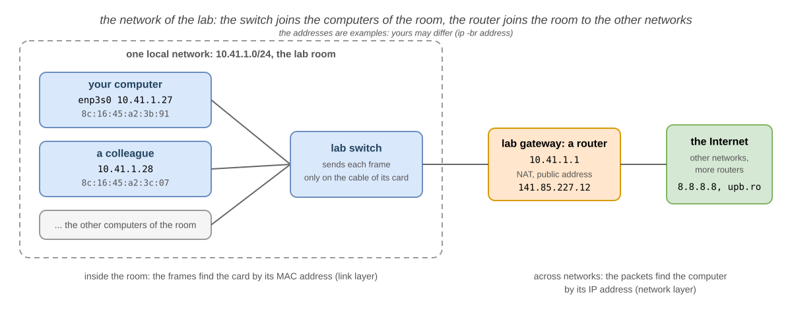

### The Layers

Sending data is split into **layers**. Each layer solves one problem, has its own kind of address, and uses the layer
below it:

| Layer          | The question it answers              | Address                      | Example             |
| -------------- | ------------------------------------ | ---------------------------- | ------------------- |
| 5. application | what does the program want?          | a name                       | `upb.ro`            |
| 4. transport   | which program, on that computer?     | a **port**                   | `443`               |
| 3. network     | which computer, across all networks? | an **IP address**            | `10.41.1.27`        |
| 2. link        | which card, in the local network?    | a **MAC address**            | `8c:16:45:a2:3b:91` |
| 1. physical    | how do the bits travel?              | none: a cable or radio waves |                     |

The card does not send the packet alone: it puts it inside a **frame**, which adds the MAC addresses of the card that
sends it and of the card that must receive it. A frame travels only inside one local network. Think of a letter put
in a second envelope, addressed only to the next stop.

This lab goes through the layers from the bottom up: the network cards and their MAC addresses (link), the IP
addresses and the routes (network), the ports (transport), and DNS (application).

## Network Cards

An **Ethernet** card uses a cable, a **Wi-Fi** card radio waves. Each frame has the MAC address of the card that sent it
and of the card that must receive it.

A **MAC address** has 48 bits, written as 6 bytes in hexadecimal: `8c:16:45:a2:3b:91`. The first 3 bytes name the
manufacturer. It makes sense only **in the local network**: the switch uses it to send each frame only on the cable of
its card. A frame sent to `ff:ff:ff:ff:ff:ff`, the **broadcast** address, reaches every card of the network.

### Network Interfaces: `ip link`

Linux names each card a **network interface**:

```shell-session
[student@fedora ~]$ ip -br link
lo               UNKNOWN        00:00:00:00:00:00 <LOOPBACK,UP,LOWER_UP>
enp3s0           UP             8c:16:45:a2:3b:91 <BROADCAST,MULTICAST,UP,LOWER_UP>
[student@fedora ~]$ cat /sys/class/net/enp3s0/address
8c:16:45:a2:3b:91
```

- `-br` (_brief_) printed one line for each interface: its name, its state, its MAC address and its flags; `/sys`
  has the same details, in files.

| Part of the line | What it means                                                      |
| ---------------- | ------------------------------------------------------------------ |
| `lo`             | the **loopback**: a virtual card, the computer talks to itself     |
| `en...`, `wl...` | an Ethernet card, a Wi-Fi card; `p3s0` is its place on the PCI bus |
| `UP`, `DOWN`     | the card can send data now, or it cannot                           |
| `LOWER_UP`       | the cable (or the radio) is connected; `NO-CARRIER`: no cable      |
| `BROADCAST`, `MULTICAST`        | the card can send to every card of the network, or to a group of them                 |

### Printing One Value

A script, or a Check, often needs only one value: a MAC address, an IP address. `ip -br` prints one line for each card,
with the values separated by spaces; `show <IF>` keeps only one card, and `-4` only the IPv4 addresses. Cut the value
out with the tools of lab 06: [`awk`](/docs/labs/06#computing-awk) and [`cut`](/docs/labs/06#cutting-columns-cut).

```shell-session
[student@fedora ~]$ ip -br link show enp3s0
enp3s0           UP             8c:16:45:a2:3b:91 <BROADCAST,MULTICAST,UP,LOWER_UP>
[student@fedora ~]$ ip -br link show enp3s0 | awk '{print $2}'
UP
```

| Command            | What it prints                                                                     |
| ------------------ | ---------------------------------------------------------------------------------- |
| `awk '{print $3}'` | the third word of each line; `$NF` is the last word                                |
| `cut -d/ -f1`      | what is before the first `/` (`-d` is the separator, `-f` the number of the field) |
| `grep <WORD>`      | only the lines that contain `<WORD>`                                               |

### NetworkManager: `nmcli`

On Fedora, the service **NetworkManager** sets up the cards; `nmcli` is its command. The settings of a card are a
**connection**, with a name:

```shell-session
[student@fedora ~]$ nmcli device status
DEVICE  TYPE      STATE                   CONNECTION
enp3s0  ethernet  connected               Wired connection 1
lo      loopback  connected (externally)  lo
```

| Command                  | What it does                                                  |
| ------------------------ | ------------------------------------------------------------- |
| `nmcli device status`    | the cards, their state and their connection                   |
| `nmcli device show <IF>` | every detail of a card: MAC address, IP address, gateway, DNS |
| `nmcli device wifi list` | the Wi-Fi networks around (on a computer with a Wi-Fi card)   |

:::danger

In this lab you only **look** at the network settings. Do not run `nmcli` commands that change them (`modify`, `up`,
`down`, `connect`, `disconnect`): your computer and your colleagues need the network.

:::

## IP Addresses

To reach a computer in **another** network, each computer also has an **IP address**: 32 bits, written as 4 numbers
from `0` to `255`, such as `10.41.1.27`. Think of a postal address: the street is the **network**, the number is the
**computer** on that street.

### Addresses and Masks: `ip address`

The **mask**, written after a `/`, says how many bits from the left name the network: in `10.41.1.27/24`, the network
is `10.41.1.0/24`, and the last 8 bits (`27`) name the computer. Computers of the same network talk directly; for any
other network, they need a router.

```shell-session
[student@fedora ~]$ ip -br address
lo               UNKNOWN        127.0.0.1/8 ::1/128
enp3s0           UP             10.41.1.27/24 fe80::6a1c:3e0f:7d24:9b11/64
[student@fedora ~]$ ip address show enp3s0
2: enp3s0: <BROADCAST,MULTICAST,UP,LOWER_UP> mtu 1500 qdisc fq_codel state UP group default qlen 1000
    link/ether 8c:16:45:a2:3b:91 brd ff:ff:ff:ff:ff:ff
    inet 10.41.1.27/24 brd 10.41.1.255 scope global dynamic noprefixroute enp3s0
       valid_lft 85127sec preferred_lft 85127sec
    inet6 fe80::6a1c:3e0f:7d24:9b11/64 scope link noprefixroute
       valid_lft forever preferred_lft forever
```

- `inet` is the IPv4 address and `brd` the broadcast address of the network; `dynamic` and `valid_lft` say that the
  address came from DHCP, for a limited time (see [Automatic Configuration: DHCP](#automatic-configuration-dhcp)).
- `inet6` is an **IPv6** address: 128 bits, in hexadecimal. This lab uses IPv4, and only looks at the `fe80::...`
  address that every card gives itself.

### Computing the Network

The First Steps use only `/24`, `/16` and `/8`, where the mask ends at a byte. The exercises at home and the exam also
use masks that end inside a byte, such as `/26`: write that byte in binary, keep the bits of the network, and set the
other bits to `0` for the **network** and to `1` for the **broadcast**. The addresses in between are for the computers:
with `n` bits for the computer, there are 2ⁿ - 2 of them.

| `192.168.10.77/26`: 24 + **2** bits of network | The last byte, in binary | Address                     |
| ---------------------------------------------- | ------------------------ | --------------------------- |
| the address                                    | `01` `001101`            | `192.168.10.77`             |
| the network: the other bits `0`                | `01` `000000`            | `192.168.10.64`             |
| the broadcast: the other bits `1`              | `01` `111111`            | `192.168.10.127`            |
| the computers                                  |                          | `.65` - `.126`: 2⁶ - 2 = 62 |

### Special Addresses

| Address                                         | What it means                                                          |
| ----------------------------------------------- | ---------------------------------------------------------------------- |
| `127.0.0.0/8` (usually `127.0.0.1`), `::1`      | the **loopback** (`localhost`): this computer                          |
| `10.0.0.0/8`, `172.16.0.0/12`, `192.168.0.0/16` | **private** networks: free for anyone, **not routed** on the Internet  |
| `169.254.0.0/16`, `fe80::/10`                   | **link local**: only for the local network                             |
| `0.0.0.0`                                       | any address of this computer: a server that waits on all its addresses |
| the last address of a network (`10.41.1.255`)   | the **broadcast** of the network: every computer in it                 |

### Private Addresses and NAT

A home or a lab gets a single **public** address from its Internet provider. The computers inside use private
addresses, and the router replaces the source address of every packet that goes out with its public address, then
changes the replies back. This is **NAT** (_Network Address Translation_). Think of a company with one phone number:
the receptionist knows which desk each call is for.

```shell-session
[student@fedora ~]$ curl -s https://ifconfig.me; echo
141.85.227.12
```

- `ifconfig.me` answers with the address it sees: `141.85.227.12`, not `10.41.1.27`, because a router did NAT.

## Testing a Computer: `ping`

`ping` sends an ICMP _echo request_, and the other computer answers with an _echo reply_:

```shell-session
[student@fedora ~]$ ping -c 3 8.8.8.8
PING 8.8.8.8 (8.8.8.8) 56(84) bytes of data.
64 bytes from 8.8.8.8: icmp_seq=1 ttl=117 time=12.4 ms
64 bytes from 8.8.8.8: icmp_seq=2 ttl=117 time=12.1 ms
64 bytes from 8.8.8.8: icmp_seq=3 ttl=117 time=12.3 ms

--- 8.8.8.8 ping statistics ---
3 packets transmitted, 3 received, 0% packet loss, time 2003ms
rtt min/avg/max/mdev = 12.104/12.266/12.402/0.123 ms
```

- `-c 3` sent 3 packets; without it, `ping` runs until <kbd>Ctrl</kbd>+<kbd>C</kbd>. `time` is the **round trip time**,
  from the request to the reply; `ttl` is explained in [The Routers on the Way](#the-routers-on-the-way-traceroute).

| Message                           | What it means                                                                                   |
| --------------------------------- | ----------------------------------------------------------------------------------------------- |
| `Network is unreachable`          | no route to that network: usually no default gateway                                            |
| `Destination Host Unreachable`    | an address of your own network, but nobody has it: the computer is off, or the address is wrong |
| `100% packet loss`, no other line | no reply came: the computer is down, or a **firewall** drops `ping`, as many servers do         |

## Neighbors: `ip neigh`

To send a packet to `10.41.1.28`, in its own network, the computer needs the MAC address of that card. It asks the
whole network with a broadcast, "who has `10.41.1.28`?", and the card that has it answers. This is **ARP**. The answers
are kept in the **neighbor table**:

```shell-session
[student@fedora ~]$ ip neigh
10.41.1.1 dev enp3s0 lladdr 70:b5:e8:2d:91:4c REACHABLE
10.41.1.28 dev enp3s0 lladdr 8c:16:45:a2:3c:07 STALE
```

- Each line is an address of the local network and its MAC address (`lladdr`). `REACHABLE`: used just now; `STALE`: an
  older answer; `FAILED`: nobody answered. Ignore the IPv6 lines, with `fe80::` addresses.

For an address in **another** network, the frame goes to the MAC address of the **gateway** (see
[The Routing Table](#the-routing-table-ip-route)); the details are in [The Way of a Packet](#the-way-of-a-packet).

## Routing

A **router** is a computer with a card in each network that it joins (see [What Is a Network](#what-is-a-network)).

### The Routing Table: `ip route`

For every packet, the kernel looks in the **routing table**: one line for each network it can reach.

```shell-session
[student@fedora ~]$ ip route
default via 10.41.1.1 dev enp3s0 proto dhcp src 10.41.1.27 metric 100
10.41.1.0/24 dev enp3s0 proto kernel scope link src 10.41.1.27 metric 100
[student@fedora ~]$ ip route get 8.8.8.8
8.8.8.8 via 10.41.1.1 dev enp3s0 src 10.41.1.27 uid 1000
    cache
[student@fedora ~]$ ip route get 10.41.1.28
10.41.1.28 dev enp3s0 src 10.41.1.27 uid 1000
    cache
```

- `10.41.1.0/24 dev enp3s0`: the own network, reached **directly**.
- `default via 10.41.1.1`: every other address goes to the **default gateway**, the router `10.41.1.1`.
- `ip route get` printed the line chosen for one address: `8.8.8.8` goes `via` the gateway, `10.41.1.28` directly.

When several lines match, the kernel picks the **most specific** one, with the longest mask: for `10.41.1.28`, `/24`
beats `default` (`/0`). Think of the signs at a junction: "Bucharest center" beats "all directions".

### The Routers on the Way: `traceroute`

```shell-session
[student@fedora ~]$ traceroute -n 8.8.8.8
traceroute to 8.8.8.8 (8.8.8.8), 30 hops max, 60 byte packets
 1  10.41.1.1  0.512 ms  0.488 ms  0.471 ms
 2  141.85.241.1  1.203 ms  1.187 ms  1.164 ms
 3  * * *
 4  37.128.225.9  3.880 ms  3.871 ms  3.902 ms
 5  142.250.212.98  4.415 ms  4.402 ms  4.396 ms
 6  8.8.8.8  4.211 ms  4.198 ms  4.176 ms
```

- One line for each router, in order: line `1` is the default gateway, the last line the destination. `-n` printed
  addresses, not names; `* * *` is a router that did not answer, but still forwarded the packets.

Every IP packet has a **TTL** (_Time To Live_), which each router decreases by 1; a router that gets it to `0` drops the
packet and tells the sender (ICMP _time exceeded_). `traceroute` sends packets with TTL 1, 2, 3, ...: each one dies one
router further, and that router tells who it is. `tracepath -n` does almost the same, and is always installed. Some
firewalls drop the packets of `traceroute`: then every line after the last router that let them through is `* * *`.

## Names: DNS

**DNS** (_Domain Name System_) turns names, such as `upb.ro`, into IP addresses: the computer asks a **DNS server**,
which knows the answer or asks other DNS servers. Think of the contacts of your phone: you choose a name, the phone
dials the number.

```shell-session
[student@fedora ~]$ host upb.ro
upb.ro has address 141.85.220.33
upb.ro mail is handled by 0 ironport.upb.ro.
[student@fedora ~]$ resolvectl dns
Global:
Link 2 (enp3s0): 10.41.1.1
```

- A name has several **records**: here its IPv4 address (`A`) and its mail server (`MX`).
- `enp3s0` asks the DNS server `10.41.1.1`. `resolvectl` talks to `systemd-resolved`, the service that asks DNS for
  all the programs (the next lab sets it up).

| Command                 | What it does                                            |
| ----------------------- | ------------------------------------------------------- |
| `host <NAME>`           | the addresses and the mail server of a name             |
| `host -t <TYPE> <NAME>` | only one kind of record: `A`, `AAAA` (IPv6), `MX`, `NS` |
| `host <IP>`             | the name of an address                                  |
| `host <NAME> <SERVER>`  | asks another DNS server                                 |
| `resolvectl dns`        | the DNS servers of the computer                         |

:::caution

Without DNS, `ping 8.8.8.8` still works, but `ping google.com` says `Temporary failure in name resolution`: when "the
Internet does not work", test an address **and** a name.

:::

## Automatic Configuration: DHCP

The address, the mask, the gateway and the DNS server are written by hand (a **static** configuration, for servers), or
given by a **DHCP server**. The address is **leased** for a time, and the client renews it before it expires. At home,
the DHCP server is the home router. The client has no address yet, so it starts with a broadcast, over UDP (port `68` to
port `67`):

| Message    | From, to                  | What it says                                                          |
| ---------- | ------------------------- | --------------------------------------------------------------------- |
| `DISCOVER` | the client, to everybody  | is there a DHCP server?                                               |
| `OFFER`    | the server, to the client | I can give you `10.41.1.27/24`, the gateway, the DNS, for 24 hours    |
| `REQUEST`  | the client, to everybody  | I take `10.41.1.27`, from the server `10.41.1.1`                      |
| `ACK`      | the server, to the client | it is yours                                                           |

### What Your Computer Received

On the lab computers, NetworkManager is the DHCP client:

```shell-session
[student@fedora ~]$ nmcli device show enp3s0 | grep IP4
IP4.ADDRESS[1]:                         10.41.1.27/24
IP4.GATEWAY:                            10.41.1.1
IP4.ROUTE[1]:                           dst = 10.41.1.0/24, nh = 0.0.0.0, mt = 100
IP4.ROUTE[2]:                           dst = 0.0.0.0/0, nh = 10.41.1.1, mt = 100
IP4.DNS[1]:                             10.41.1.1
```

- The same values as `ip -br address`, `ip route` and `resolvectl dns`. `nmcli -f DHCP4 device show enp3s0` adds the
  lease time (`dhcp_lease_time`, in seconds) and the server (`dhcp_server_identifier`).

You will ask for an address yourself, in a container, in [Asking for an Address](#asking-for-an-address-dhclient).

## Containers

A **container** is a lightweight virtual machine that shares the kernel of your computer. It has its own files, its own
processes and its **own network**: cards, addresses, routing table and ports. It runs no kernel of its own, so it starts
in a second and needs little memory. Think of a flat in a block of flats: its own door and address, but the same
building (the kernel). **Podman** builds images and runs containers.

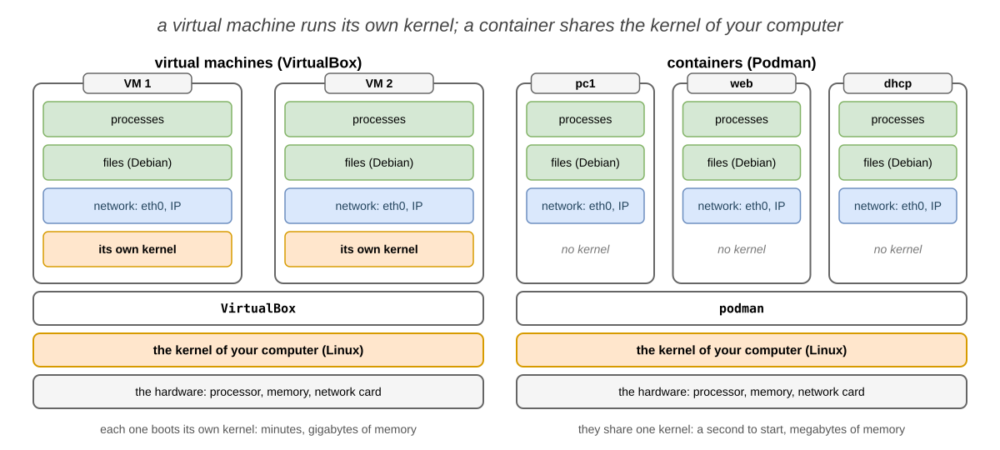

In this lab, a container is only a tool: a small computer, inside yours, to test the network on. For the exercises,
[Working in a Container](#working-in-a-container) is all you need; [Running Containers](#running-containers-podman)
explains how a container is made.

### Working in a Container

Each container has a **name** (`pc1`, `web`, `dhcp`, `client`, `lost`), chosen by the command that starts it. The
exercises give you that command: copy it as it is. Then, from a terminal of your computer:

| What you want                                  | Command                             | The prompt                         |
| ---------------------------------------------- | ----------------------------------- | ---------------------------------- |
| type several commands **inside** the container | `sudo podman exec -it <NAME> bash`  | `root@<NAME>:/#`; `exit` goes back |
| run **one** command inside the container       | `sudo podman exec <NAME> <COMMAND>` | stays `[student@fedora lab09]$`    |
| list the containers that run, with their names | `sudo podman ps`                    |                                    |
| stop a container and delete it                 | `sudo podman rm -f <NAME>`          |                                    |

```shell-session
[student@fedora lab09]$ sudo podman exec -it pc1 bash
root@pc1:/# ip -br address
lo               UNKNOWN        127.0.0.1/8 ::1/128
eth0@if4         UP             10.88.0.11/16 fe80::6c2b:91ff:fe5a:c7d/64
root@pc1:/# exit
exit
[student@fedora lab09]$ sudo podman exec pc1 ip -br address
lo               UNKNOWN        127.0.0.1/8 ::1/128
eth0@if4         UP             10.88.0.11/16 fe80::6c2b:91ff:fe5a:c7d/64
```

- `sudo podman exec -it pc1 bash` opened a shell in `pc1`: the prompt became `root@pc1:/#`, and `ip` showed the
  network of `pc1`, not the one of your computer. `exit` went back to your computer.
- `sudo podman exec pc1 ip -br address` ran only that command in `pc1`, and printed the same thing.

:::caution

Look at the prompt before each command: `[student@fedora lab09]$` runs it on your computer, `root@pc1:/#` in `pc1`. The
same command prints different things in the two places. Keep one terminal for each place you work in.

:::

### Running Containers: `podman`

The image `lab09` is built from this file. On the lab computers it is ready; at home, [exercise 1](#first-steps) builds
it:

```bash title="~/lab09/Containerfile"
FROM docker.io/library/debian:trixie-slim
RUN apt-get update && apt-get install -y --no-install-recommends iproute2 iputils-ping bind9-host traceroute \
        curl ca-certificates python3 isc-dhcp-client dnsmasq-base && rm -rf /var/lib/apt/lists/*
```

- `FROM` is the image to start from: a minimal Debian, 30 MB. `RUN` downloads the list of packages, installs only the
  tools of the lab, then deletes the list, to keep the image small.

The **image** is a template: files that never change, built once with `podman build`. A **container** is a running copy
of the image, started with `podman run`, with its own changes, its own program and its own network. `podman rm` deletes
a container, not its image. The image is like the file of a program, a container like a process (see
[Inspecting Processes](/docs/labs/03#inspecting-processes) in lab 03).

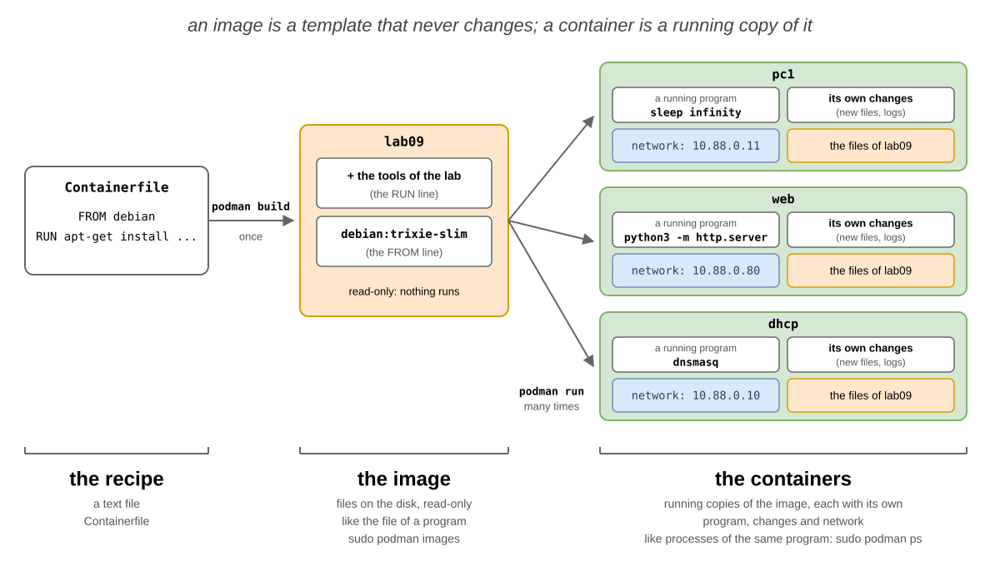

```shell-session
[student@fedora lab09]$ sudo podman run -d --name pc1 --hostname pc1 --ip 10.88.0.11 lab09 sleep infinity
3f9c2a7d1e5b8c04a6d2f1e9b7c3a5d8e0f2b4c6a8d1e3f5a7c9b2d4e6f8a0c1
[student@fedora lab09]$ sudo podman ps
CONTAINER ID  IMAGE                   COMMAND         CREATED        STATUS        PORTS       NAMES
3f9c2a7d1e5b  localhost/lab09:latest  sleep infinity  5 seconds ago  Up 5 seconds              pc1
```

- `podman run -d` started `pc1` in the background, with the address `10.88.0.11`. Its program, `sleep infinity`, does
  nothing, forever: a container lives as long as its program. In a shell in `pc1` you are `root`, but only inside the
  container.

| Command                                              | What it does                                                      |
| ---------------------------------------------------- | ----------------------------------------------------------------- |
| `sudo podman build -t <IMAGE> .`                     | builds an image from the `Containerfile` of the current directory |
| `sudo podman images`                                 | lists the images                                                  |
| `sudo podman run -d --name <NAME> <IMAGE> <PROGRAM>` | starts a container in the background, running `<PROGRAM>`         |
| `sudo podman ps -a`                                  | lists the containers, also the stopped ones                       |
| `sudo podman logs <NAME>`                            | prints the output of the program of the container                 |

| Option of `run`               | What it does                                                                 |
| ----------------------------- | ---------------------------------------------------------------------------- |
| `--hostname <NAME>`           | the name of the computer, inside the container                               |
| `--ip <IP>`                   | a fixed IP address                                                           |
| `--dns <IP>`                  | the DNS server of the container, instead of the one of your computer         |
| `--cap-add NET_ADMIN,NET_RAW` | lets the container change its **own** network settings (`dhclient` needs it) |

:::caution

Always write `sudo podman`: only then does each container get its own address. The images of `root` and of `student`
are separate, so an image built without `sudo` is not seen by `sudo podman run`.

:::

### The Network of the Containers

`sudo podman` builds a **virtual switch**, `podman0`, and plugs into it each container and **your computer** too:

| Plugged into the switch | With the card                                         | The address     |
| ----------------------- | ----------------------------------------------------- | --------------- |
| your computer           | `podman0` (the same name as the switch)               | `10.88.0.1/16`  |
| `pc1`                   | `eth0` in `pc1`, joined by a virtual cable to `veth0` | `10.88.0.11/16` |

So your computer talks to the containers like any computer of their network. It is also their **router** (their
gateway is `10.88.0.1`) and does **NAT** for them, like a home router.

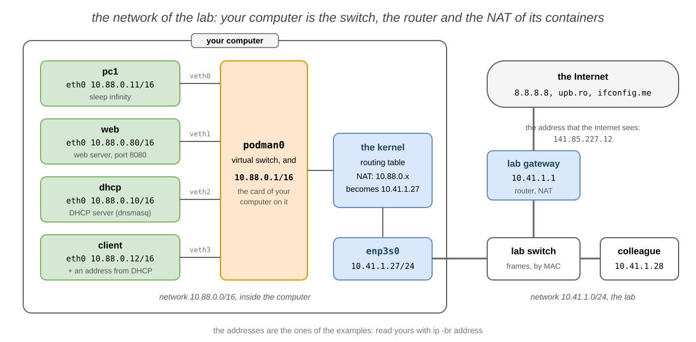

```shell-session
[student@fedora lab09]$ sudo podman exec pc1 ip -br address
lo               UNKNOWN        127.0.0.1/8 ::1/128
eth0@if4         UP             10.88.0.11/16 fe80::6c2b:91ff:fe5a:c7d/64
[student@fedora lab09]$ sudo podman exec pc1 ip route
default via 10.88.0.1 dev eth0 proto static metric 100
10.88.0.0/16 dev eth0 proto kernel scope link src 10.88.0.11
[student@fedora lab09]$ ip -br address
lo               UNKNOWN        127.0.0.1/8 ::1/128
enp3s0           UP             10.41.1.27/24 fe80::6a1c:3e0f:7d24:9b11/64
podman0          UP             10.88.0.1/16 fe80::cc5e:9aff:fe1b:2207/64
veth0@if2        UP             fe80::5812:6bff:fe40:9a1e/64
```

- `pc1` has its own card, address and routing table; its gateway, `10.88.0.1`, is your computer. `@if4` is the other
  end of the cable: interface number `4` of your computer, `veth0`.
- Your computer got `podman0`, its card on the switch, and `veth0`, the end of the cable of `pc1` (it has no IPv4
  address: it only carries frames). The new route `10.88.0.0/16 dev podman0` sends the packets for the containers
  through `podman0`.
- `pc1` asks the same DNS server as your computer: podman writes it in `/etc/resolv.conf` of the container (`--dns`
  chooses another one).

## Ports: TCP and UDP

A **port**, a number from `1` to `65535`, finds the program inside a computer. A server waits on a fixed port: `22` for
SSH, `53` for DNS, `80` and `443` for the Web; a client gets a random free port for each connection. Two protocols carry
the data:

|              | TCP (like a phone call)              | UDP (like a postcard)           |
| ------------ | ------------------------------------ | ------------------------------- |
| a connection | yes: opened first, closed at the end | no: each datagram travels alone |
| lost data    | noticed, and sent again                                         | lost: the program handles it, if it cares                    |
| used by      | the Web, SSH, e-mail                 | DNS, DHCP, video calls, games   |

### Listening Programs: `ss`

`ss` lists the **sockets**: what a program uses to send and receive on a port.

```shell-session
[student@fedora ~]$ ss -tuln
Netid State  Recv-Q Send-Q  Local Address:Port  Peer Address:Port Process
udp   UNCONN 0      0          127.0.0.54:53         0.0.0.0:*
udp   UNCONN 0      0       127.0.0.53%lo:53         0.0.0.0:*
udp   UNCONN 0      0           127.0.0.1:323        0.0.0.0:*
tcp   LISTEN 0      4096       127.0.0.54:53         0.0.0.0:*
tcp   LISTEN 0      4096    127.0.0.53%lo:53         0.0.0.0:*
tcp   LISTEN 0      4096        127.0.0.1:631        0.0.0.0:*
...
[student@fedora ~]$ sudo ss -tlnp
State  Recv-Q Send-Q  Local Address:Port  Peer Address:Port Process
LISTEN 0      4096       127.0.0.54:53         0.0.0.0:*     users:(("systemd-resolve",pid=812,fd=20))
LISTEN 0      4096    127.0.0.53%lo:53         0.0.0.0:*     users:(("systemd-resolve",pid=812,fd=18))
LISTEN 0      4096        127.0.0.1:631        0.0.0.0:*     users:(("cupsd",pid=1104,fd=7))
...
```

- `127.0.0.53%lo:53` is port `53` (DNS), only on the loopback: the DNS service of your computer. `0.0.0.0:22` would
  mean port `22` on **every** address.

| Option or column | What it means                                                            |
| ---------------- | ------------------------------------------------------------------------ |
| `-t`, `-u`       | TCP sockets, UDP sockets                                                 |
| `-l`             | only the sockets that wait for clients; without it, the open connections |
| `-n`             | numbers, not names: `53`, not `domain`                                   |
| `-p`             | the program of the socket (with `sudo`, for the programs of every user)  |
| `LISTEN`         | a TCP server waits for connections; `ESTAB`, an open connection          |
| `UNCONN`         | a UDP socket: UDP has no connections                                     |

A container has its own ports. [Exercise 10](#first-steps) starts a web server in the container `web`:

```bash
sudo podman run -d --name web --hostname web --ip 10.88.0.80 lab09 python3 -m http.server --bind 0.0.0.0 8080
```

```shell-session
[student@fedora lab09]$ sudo podman exec web ss -tln
State  Recv-Q Send-Q Local Address:Port  Peer Address:Port Process
LISTEN 0      5            0.0.0.0:8080       0.0.0.0:*
[student@fedora lab09]$ ss -tln | grep 8080
[student@fedora lab09]$ curl -I http://10.88.0.80:8080
HTTP/1.0 200 OK
...
```

- Port `8080` is in the network of `web`, not of your computer. `curl -I` asked only for the headers of the page.

## Asking for an Address: `dhclient`

`dhclient` is a DHCP client: it sends the messages of [DHCP](#automatic-configuration-dhcp) for a card, and sets up the
address it gets. You cannot try it
on your computer, where NetworkManager is already the client, so you try it in a container. The containers of `podman0`
have no DHCP server, so the lab gives you a **practice DHCP server**, ready-made: the container `dhcp` runs `dnsmasq`, a
small DHCP server, already set to lend the addresses `10.88.0.200` - `10.88.0.209`, for 10 minutes, with the gateway
`10.88.0.1`. You only start it, with the command below, and never change it; you play the **client**, in the container
`client`. [Exercise 11](#first-steps) starts both:

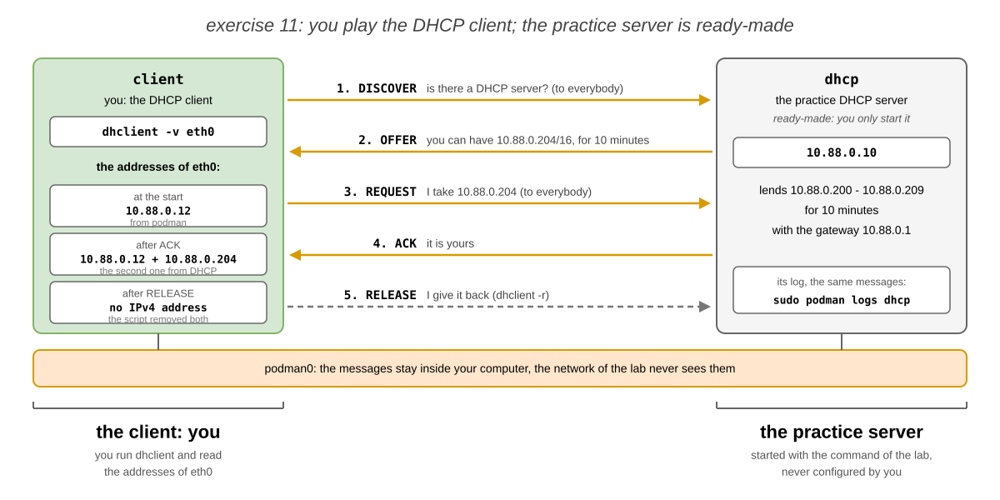

```bash
sudo podman run -d --name dhcp --hostname dhcp --ip 10.88.0.10 --cap-add NET_ADMIN,NET_RAW lab09 \
    dnsmasq -d --conf-file=/dev/null --user=root --no-ping --dhcp-range=10.88.0.200,10.88.0.209,10m \
    --dhcp-option=option:router,10.88.0.1
sudo podman run -d --name client --hostname client --ip 10.88.0.12 --cap-add NET_ADMIN,NET_RAW lab09 sleep infinity
```

- The first command starts the practice server, `dhcp`, at `10.88.0.10`; you do not need to understand its options.
- The second one starts `client`, at `10.88.0.12`. This first address comes from podman, not from DHCP; `--cap-add`
  lets `dhclient` add a second one.

```shell-session
[student@fedora lab09]$ sudo podman exec -it client bash
root@client:/# dhclient -v eth0
Internet Systems Consortium DHCP Client 4.4.3-P1
...
DHCPDISCOVER on eth0 to 255.255.255.255 port 67 interval 5 (xid=0x5e2a1c07)
DHCPOFFER of 10.88.0.204 from 10.88.0.10
DHCPREQUEST for 10.88.0.204 on eth0 to 255.255.255.255 port 67 (xid=0x5e2a1c07)
DHCPACK of 10.88.0.204 from 10.88.0.10 (xid=0x5e2a1c07)
bound to 10.88.0.204 -- renewal in 274 seconds.
root@client:/# ip -br address
lo               UNKNOWN        127.0.0.1/8 ::1/128
eth0@if7         UP             10.88.0.12/16 10.88.0.204/16 fe80::a05c:17ff:fee8:4430/64
```

- `dhclient -v eth0` printed the four messages: `client` asked everybody (`DISCOVER`), `dhcp` offered `10.88.0.204`
  (`OFFER`), `client` took it (`REQUEST`), and `dhcp` confirmed (`ACK`). Then `dhclient` stayed in the background, to
  renew the lease before its 10 minutes end. If it also prints `mv: cannot move ... /etc/resolv.conf`, ignore it: podman
  manages that file.
- `eth0` had two addresses: `10.88.0.12`, from podman, and `10.88.0.204`, from DHCP.

| Command or file                 | What it does                                                             |
| ------------------------------- | ------------------------------------------------------------------------ |
| `dhclient -v <IF>`              | asks for an address, and prints the messages                             |
| `dhclient -r -v <IF>`           | gives the address back (_release_), and stops the `dhclient` of the card |
| `/var/lib/dhcp/dhclient.leases` | the leases that the client received                                      |
| `sudo podman logs dhcp`         | the log of the server: every message, with the MAC address of the client |

After `dhclient -r`, the card has **no** IPv4 address left, not even the one from podman: the Debian `dhclient-script`,
which sets up the card for `dhclient`, expects DHCP to be the only source of addresses.

:::danger

Run `dhclient` only in `client`: on your computer, NetworkManager is already the DHCP client. Start the practice server
only with the command of the lab: it answers only inside your computer, on `podman0`. With other options (such as
`--network host`), it would answer the computers of the whole lab.

:::

## Capturing Packets: `tcpdump`

`tcpdump` prints the packets that go through a card, one per line: `sudo tcpdump <OPTIONS> <FILTER>`. The options say
where to listen and how to print; the filter, last, chooses the packets.

```shell-session
[student@fedora ~]$ sudo tcpdump -i enp3s0 -n -t icmp
tcpdump: verbose output suppressed, use -v[v]... for full protocol decode
listening on enp3s0, link-type EN10MB (Ethernet), snapshot length 262144 bytes
IP 10.41.1.27 > 8.8.8.8: ICMP echo request, id 7, seq 1, length 64
IP 8.8.8.8 > 10.41.1.27: ICMP echo reply, id 7, seq 1, length 64
^C
2 packets captured
2 packets received by filter
0 packets dropped by kernel
```

- Meanwhile, `ping -c 1 8.8.8.8` ran in another terminal; `a > b` is a packet from `a` to `b`.
  <kbd>Ctrl</kbd>+<kbd>C</kbd> stopped the capture.

| Option      | What it does                                             |
| ----------- | -------------------------------------------------------- |
| `-i <IF>`   | the card to listen on (`any`: all); `-D` lists the cards |
| `-n`        | numbers, not names                                       |
| `-t`        | no time on each line                                     |
| `-c <N>`    | stops after `<N>` packets                                |
| `-e`        | adds the MAC addresses                                   |
| `-v`        | more details (the type of a DHCP message)                |
| `-w <FILE>` | saves the packets, for `-r <FILE>` or Wireshark          |

| Filter                      | Which packets                                          |
| --------------------------- | ------------------------------------------------------ |
| `icmp`, `arp`, `udp`, `tcp` | of one protocol                                        |
| `host <IP>`                 | from or to an address                                  |
| `port <N>`                  | from or to a port                                      |
| `not`, `and`, `or`, `( )`   | combine filters: `'host 10.88.0.11 and (icmp or arp)'` |

On your card you see your own packets and the broadcasts, but not the packets of your colleagues: the switch sends each
frame only to its card. The packets of the containers go through `podman0`. Quote a filter that has `(`, `)` or `!`.
**Wireshark** shows the same packets in a window, and opens the files of `tcpdump -w`.

## No Internet?

Check the layers **from the bottom up**: each check needs the ones before it.

| Check                                               | Command                  | If the answer is no                         |
| --------------------------------------------------- | ------------------------ | ------------------------------------------- |
| 1. is the card connected? (physical, link)          | `ip -br link`            | plug in the cable, turn the Wi-Fi on        |
| 2. do I have an IP address? (network)               | `ip -br address`         | DHCP failed: ask for an address again       |
| 3. do I have a default gateway? (network)           | `ip route`               | the settings are wrong (the next lab)       |
| 4. does the Internet answer? (network)              | `ping -c 2 8.8.8.8`      | the router or the provider has a problem    |
| 5. do the names work? (application: DNS)            | `host upb.ro`            | the DNS server is wrong or down             |
| 6. does the server answer? (transport, application) | `curl -I https://upb.ro` | the problem is the server, not your network |

## The Way of a Packet

:::note

**Going deeper**

You do not need this section for the exercises of the lab, the 🧪 First Steps. Read it at home: the 🏠 Going Further
exercises and the 📝 Challenges use it.

:::

To send a packet, the kernel finds the **next hop** in the routing table (the destination, if it is in the network of
the card, or else the gateway), finds its MAC address with ARP, and sends the packet in a **frame** to that MAC address.
Each router takes the packet out of the frame, decreases its TTL, and sends it in a **new** frame to its own next hop.
So the MAC addresses change at every router, and the IP addresses stay the same, except through **NAT**, which changes
the source address. Think of a parcel that crosses the country: the address on it stays the same, but every van has
another driver and another next stop.

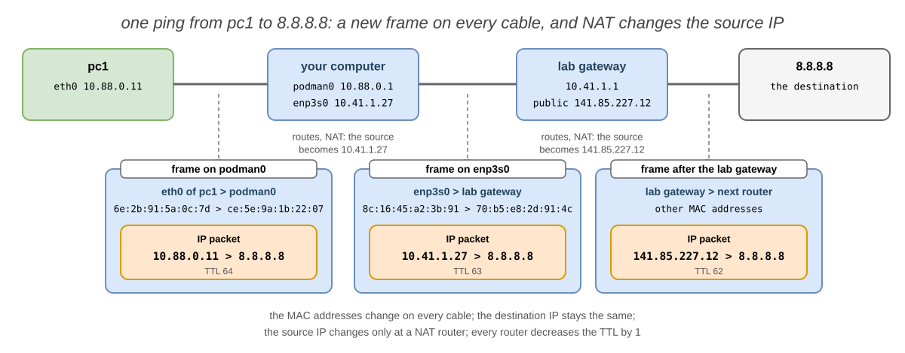

```shell-session
[student@fedora ~]$ sudo tcpdump -i podman0 -n -t -e -c 1 icmp
6e:2b:91:5a:0c:7d > ce:5e:9a:1b:22:07, ethertype IPv4 (0x0800), length 98: 10.88.0.11 > 8.8.8.8: ICMP echo request, id 3, seq 1, length 64
[student@fedora ~]$ sudo tcpdump -i enp3s0 -n -t -e -c 1 icmp
8c:16:45:a2:3b:91 > 70:b5:e8:2d:91:4c, ethertype IPv4 (0x0800), length 98: 10.41.1.27 > 8.8.8.8: ICMP echo request, id 3, seq 1, length 64
```

- Both captures ran while `pc1` pinged `8.8.8.8`. On `podman0`, the frame went from `pc1` to `podman0`, with the source
  IP `10.88.0.11`; on `enp3s0`, a new frame went from your card to the lab gateway (see `ip neigh`), with the source IP
  `10.41.1.27`: your computer did NAT.

## Troubleshooting

| Problem                                                                                           | Solution                                                                                                                                                                        |
| ------------------------------------------------------------------------------------------------- | ------------------------------------------------------------------------------------------------------------------------------------------------------------------------------- |
| `ping: connect: Network is unreachable`                                                           | `ip route` has no `default` line; a container started with `--network none` has no card at all                                                                                  |
| `Destination Host Unreachable`                                                                    | Nobody in your network has that address (`ip neigh` shows `FAILED`)                                                                                                             |
| `Temporary failure in name resolution`, `Could not resolve host` or `no servers could be reached` | DNS does not work: check the DNS server with `resolvectl dns` (in a container, `/etc/resolv.conf`)                                                                              |
| `sudo podman run` asks you to choose a registry, or does not find `lab09`                         | The image was not built, or was built without `sudo`: `sudo podman build -t lab09 .` in `~/lab09`                                                                               |
| `toomanyrequests: You have reached your pull rate limit`                                          | Docker Hub limits the downloads of each public address, and the whole lab (or your home) shares one: build the image later, or on the lab computers use the image that is ready |
| `the container name "pc1" is already in use` or `requested ip address ... is already allocated`   | An old container has that name or address: `sudo podman rm -f <NAME>`                                                                                                           |
| `ss` on your computer does not show the port of a container                                       | Each container has its own ports: `sudo podman exec <NAME> ss -tln`                                                                                                             |
| `curl: (7) Failed to connect to <IP> port <PORT>`                                                 | `curl -v` says why: `Connection refused`, nothing listens there (a server on `127.0.0.1` answers only its own computer); `No route to host`, nobody has that address            |
| `Open a socket for LPF: Operation not permitted`                                                  | Start the container again with `--cap-add NET_ADMIN,NET_RAW`                                                                                                                    |
| `dhclient` repeats `DHCPDISCOVER`, then says `No DHCPOFFERS received`                             | No DHCP server answers: is `dhcp` running (`sudo podman ps`)?                                                                                                                   |
| `dhclient` prints `mv: cannot move ... '/etc/resolv.conf': Device or resource busy`               | Harmless: podman manages `/etc/resolv.conf` of the container, so `dhclient` cannot replace it                                                                                   |
| `tcpdump` prints nothing                                                                          | The wrong card (`sudo tcpdump -D`) or filter; the packets of the containers go through `podman0`                                                                                |
| `tcpdump: <FILE>: Permission denied`, with `-w`                                                   | `tcpdump` drops `root` after it starts: write the file in `/tmp`                                                                                                                |

## Exercises

- 🧪 [First Steps](#first-steps) (exercises 1 - 13): one idea at a time, in the order of the lab, to do in the lab;
- 🏠 [Going Further](#going-further) (exercises 14 - 29): longer exercises, to do at home; many of them look at the
  **frames** of a packet, explained in [The Way of a Packet](#the-way-of-a-packet);
- 📝 [Challenges](#challenges) (exercises 30 - 36): the hardest ones, like the ones at the exam.

:::danger

Only **look** at the network settings of your computer: no `nmcli` command that changes them, no `ip address add` or
`ip route add`, no `dhclient` on your computer. Use `sudo` only for `podman`, `ss -p` and `tcpdump`, to install
packages, and to delete the files that `tcpdump` saved.

:::

### 🧪 First Steps {/* #first-steps */}

Do these exercises in order, during the lab. Each one starts with what it wants you to achieve, and tries **one** idea
from the lab: read the section linked under its goal if you get stuck. Run the commands in `~/lab09`, unless the
exercise says otherwise.

1. **Ready to start**: Check that the tools are installed and that the image of the containers of this lab is ready.
    <small>→ [Fedora and Ubuntu](#fedora-and-ubuntu) · [Running Containers](#running-containers-podman)</small>

    1. create `~/lab09`, and go into it;
    2. print the version of `podman`, `tcpdump` and `traceroute`, and check that `host` exists;
    3. list the images of `sudo podman`.

    On the lab computers, everything is ready. At home, install what is missing, then build the image with these
    commands (copy them with <kbd>Ctrl</kbd>+<kbd>C</kbd>, paste them in the terminal with
    <kbd>Ctrl</kbd>+<kbd>Shift</kbd>+<kbd>V</kbd>); the build takes a few minutes: meanwhile, do exercise 2 in another
    terminal.

    ```bash
    mkdir -p ~/lab09
    cd ~/lab09
    cat > Containerfile << 'END'
    FROM docker.io/library/debian:trixie-slim
    RUN apt-get update && apt-get install -y --no-install-recommends iproute2 iputils-ping bind9-host traceroute \
            curl ca-certificates python3 isc-dhcp-client dnsmasq-base && rm -rf /var/lib/apt/lists/*
    END
    sudo podman build -t lab09 .
    ```

    <details className="reveal">
    <summary>Hint</summary>

    Most commands print their version with `--version`; `host` alone prints how to use it.

    </details>

    <details className="reveal">
    <summary>Check</summary>

    2. Each one prints its version (`podman` 5, `tcpdump` 4.99, `traceroute` 2.1); `host` alone prints
       `Usage: host ...`.
    3. `localhost/lab09` (`latest`) and `docker.io/library/debian` (`trixie-slim`). At home, the build ends with
       `Successfully tagged localhost/lab09:latest`.

    </details>

**Network cards**

2. **Your network cards**: Find the cards of your computer, the one that connects it to the lab, and its MAC address.
    <small>→ [Network Interfaces](#network-interfaces-ip-link) · [NetworkManager](#networkmanager-nmcli)</small>

    1. list the cards, one per line, with their state;
    2. print the MAC address of the Ethernet card from `/sys`; which bytes name its manufacturer?
    3. find out, from NetworkManager, the connection that each card uses.

    <details className="reveal">
    <summary>Hint</summary>

    `man ip-link`: search for `-brief`; `ls /sys/class/net/`; `man nmcli`: search for `device status`.

    </details>

    <details className="reveal">
    <summary>Check</summary>

    1. `ip -br link`: `lo`, and a card that starts with `en` (`enp3s0`; VirtualBox: `enp0s3`), `UP`, with `LOWER_UP`.
    2. `cat /sys/class/net/enp3s0/address`: `8c:16:45:a2:3b:91`; the first 3 bytes name the manufacturer (VirtualBox:
       `08:00:27`).
    3. `nmcli device status`: the Ethernet card is `connected`, with a connection such as `Wired connection 1`.

    </details>

**IP addresses**

3. **Your address**: Find the IP address of your computer, its network, and the address that the Internet sees.
    <small>→ [Addresses and Masks](#addresses-and-masks-ip-address) · [Printing One Value](#printing-one-value) · [Special Addresses](#special-addresses) · [Private Addresses and NAT](#private-addresses-and-nat)</small>

    1. print the IPv4 address and the mask of your card; write down its network, and how many bits name the computer;
    2. print **only** the IPv4 address, without the mask, with one command line;
    3. is the address private or public?
    4. print the address that `ifconfig.me` sees, and compare.

    <details className="reveal">
    <summary>Hint</summary>

    [Printing One Value](#printing-one-value): `-4`, `awk` and `cut`.

    </details>

    <details className="reveal">
    <summary>Check</summary>

    1. For example `10.41.1.27/24`: the network `10.41.1.0/24`, 8 bits for the computer (VirtualBox: `10.0.2.15/24`).
    2. `ip -br -4 address show enp3s0 | awk '{print $3}' | cut -d/ -f1` prints `10.41.1.27`.
    3. Private (`10.0.0.0/8`, `172.16.0.0/12` or `192.168.0.0/16`).
    4. `curl -s https://ifconfig.me`: a public address, such as `141.85.227.12`: a router did NAT.

    </details>

**Ping and neighbors**

4. **Is anybody there?**: Test that other computers answer, and find their MAC addresses without asking them.
    <small>→ [Testing a Computer](#testing-a-computer-ping) · [Neighbors](#neighbors-ip-neigh)</small>

    1. ping the loopback twice, then `8.8.8.8` three times; compare the times;
    2. ping the computer of a colleague twice (ask them for its address; at home, in a VirtualBox VM, ping the gateway
       `10.0.2.2`);
    3. find the MAC address of that computer in the neighbor table, and compare it with the one that your colleague
       found in exercise 2;
    4. is `8.8.8.8` in the table?

    <details className="reveal">
    <summary>Hint</summary>

    `man ping`: search for `-c count`; `man ip-neighbour`.

    </details>

    <details className="reveal">
    <summary>Check</summary>

    1. Under `0.1 ms` for `127.0.0.1`, a few or tens of ms for `8.8.8.8`; `0% packet loss`.
    2. Two replies.
    3. `10.41.1.28 dev enp3s0 lladdr 8c:16:45:a2:3c:07 REACHABLE`: the same MAC address (VirtualBox:
       `10.0.2.2 dev enp0s3 lladdr 52:54:00:12:35:02`).
    4. No: only addresses of your network, such as the gateway `10.41.1.1`; frames for other networks go to it.

    </details>

**Routing**

5. **Which way?**: Find out where your computer sends the packets for each address.
    <small>→ [The Routing Table](#the-routing-table-ip-route)</small>

    1. print the routing table; find the default gateway;
    2. **first** guess which line each address uses, then ask the kernel: your colleague, `8.8.8.8`, `10.41.200.1`;
    3. ask the kernel about `127.0.0.1`: why is it not in the table?

    <details className="reveal">
    <summary>Hint</summary>

    `man ip-route`: search for `ip route get`.

    </details>

    <details className="reveal">
    <summary>Check</summary>

    1. `default via 10.41.1.1 dev enp3s0` (VirtualBox: `10.0.2.2`).
    2. `10.41.1.28 dev enp3s0`: directly; `8.8.8.8` and `10.41.200.1` go `via 10.41.1.1`: `10.41.200.1` is not in
       `10.41.1.0/24`.
    3. `local 127.0.0.1 dev lo`: the addresses of the computer itself are in another table, `local`.

    </details>

6. **The routers on the way**: Find the routers between your computer and `8.8.8.8`.
    <small>→ [The Routers on the Way](#the-routers-on-the-way-traceroute)</small>

    1. print the routers to `8.8.8.8`, by address;
    2. find your default gateway in the list, and the routers that did not answer.

    <details className="reveal">
    <summary>Check</summary>

    1. `traceroute -n 8.8.8.8`: one line for each router.
    2. Line `1` is `10.41.1.1` (VirtualBox: `10.0.2.2`); the `* * *` lines did not answer. If every line after the
       first ones is `* * *`, a firewall drops the packets of `traceroute`.

    </details>

**DNS**

7. **Names and addresses**: Turn names into addresses and back, and find the DNS server that your computer asks.
    <small>→ [Names: DNS](#names-dns)</small>

    1. find the IPv4 address and the mail server of `upb.ro`;
    2. find the DNS server of your computer;
    3. find the name of `8.8.8.8`.

    <details className="reveal">
    <summary>Check</summary>

    1. `upb.ro has address 141.85.220.33`, `mail is handled by 0 ironport.upb.ro.`
    2. `resolvectl dns`: `Link 2 (enp3s0): 10.41.1.1`.
    3. `host 8.8.8.8`: `dns.google.`

    </details>

**DHCP**

8. **What DHCP gave you**: Find the settings that your computer received from DHCP, and for how long.
    <small>→ [Automatic Configuration: DHCP](#automatic-configuration-dhcp) · [What Your Computer Received](#what-your-computer-received)</small>

    1. find the address, the gateway and the DNS server that NetworkManager has for your card;
    2. find the DHCP server, and the lease time;
    3. find how many seconds your address has left.

    <details className="reveal">
    <summary>Hint</summary>

    `man nmcli`: search for `--fields`; `ip address show <IF>`.

    </details>

    <details className="reveal">
    <summary>Check</summary>

    1. `nmcli device show enp3s0 | grep IP4`: `10.41.1.27/24`, gateway and DNS `10.41.1.1`: the same values as in
       exercises 3, 5 and 7.
    2. `nmcli -f DHCP4 device show enp3s0`: `dhcp_server_identifier = 10.41.1.1`, `dhcp_lease_time = 86400` (24 hours).
    3. `ip address show enp3s0`: `valid_lft 85127sec`, a little less than the lease time (a static address has no
       `DHCP4` lines and `valid_lft forever`).

    **Why:** the address is only lent; NetworkManager renews the lease before it expires.

    </details>

**Containers**

9. **A computer in your computer**: Start a container, and compare its network with the one of your computer.
    <small>→ [Working in a Container](#working-in-a-container) · [Running Containers](#running-containers-podman) · [The Network of the Containers](#the-network-of-the-containers)</small>

    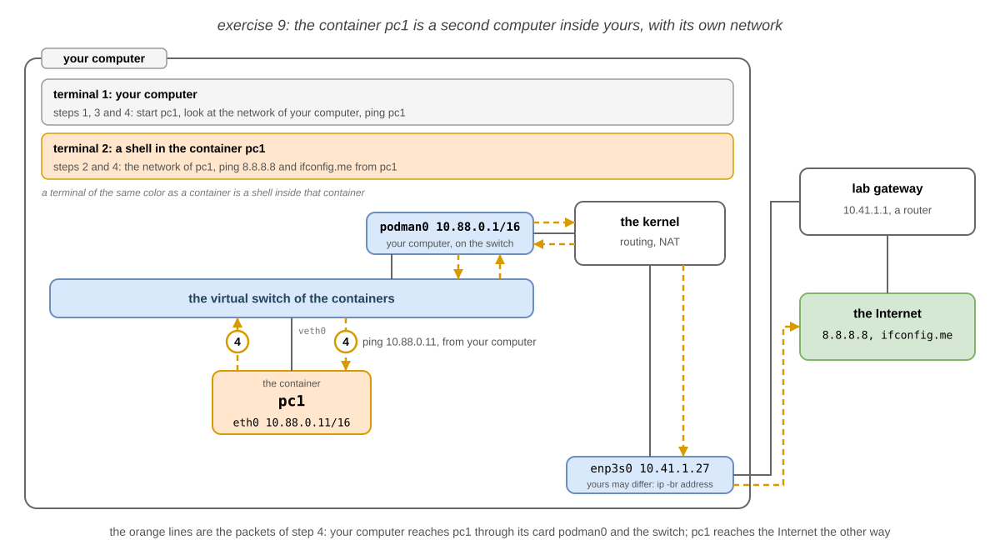

    ```shell-session title="terminal 1: your computer (steps 1, 3, 4)"
    [student@fedora lab09]$ <COMMAND>
    ```

    ```shell-session title="terminal 2: a shell in pc1 (steps 2, 4)"
    [student@fedora lab09]$ sudo podman exec -it pc1 bash
    root@pc1:/# <COMMAND>
    ```

    1. start the container `pc1`:

       ```bash
       sudo podman run -d --name pc1 --hostname pc1 --ip 10.88.0.11 lab09 sleep infinity
       ```

    2. open a shell in `pc1` (in a second terminal), and print the cards, the addresses and the routing table of `pc1`;
    3. print them on your computer too, in the first terminal: what is new?
        4. ping `pc1` twice from your computer; from `pc1`, ping `8.8.8.8` twice and print the address that `ifconfig.me`
       sees.

    <details className="reveal">
    <summary>Check</summary>

    2. `eth0` with `10.88.0.11/16`; `default via 10.88.0.1 dev eth0`.
    3. `podman0` (`10.88.0.1/16`) and `veth0`; the route `10.88.0.0/16 dev podman0`.
    4. Replies both times; the same public address as in exercise 3: your computer does NAT for `pc1`.

    </details>

**Ports**

10. **Who is listening?**: Find the programs that wait for clients, on your computer and in a container.
    <small>→ [Working in a Container](#working-in-a-container) · [Ports](#ports-tcp-and-udp) · [Listening Programs](#listening-programs-ss)</small>

    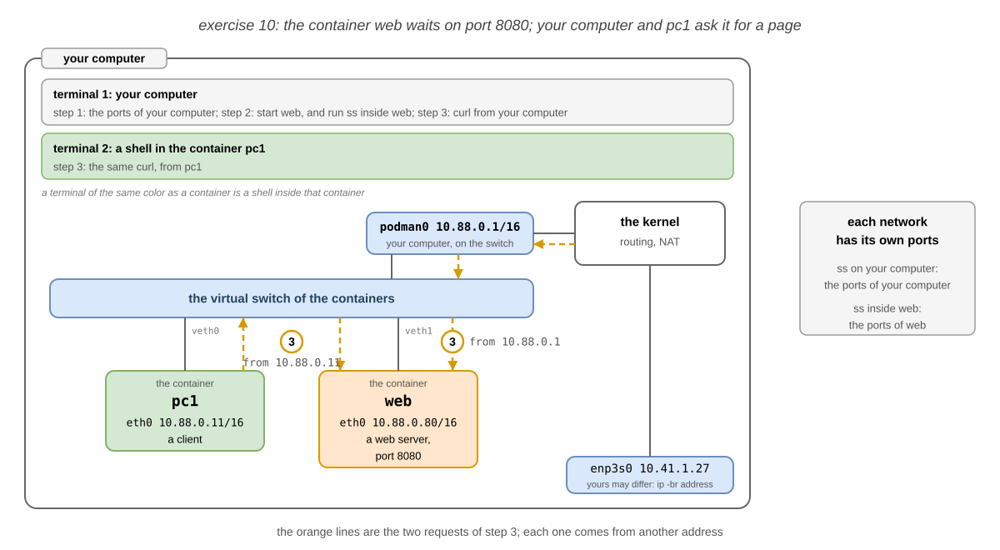

    ```shell-session title="terminal 1: your computer (steps 1, 2, 3)"
    [student@fedora lab09]$ <COMMAND>
    [student@fedora lab09]$ sudo podman exec web <COMMAND>
    ```

    ```shell-session title="terminal 2: a shell in pc1 (step 3)"
    [student@fedora lab09]$ sudo podman exec -it pc1 bash
    root@pc1:/# <COMMAND>
    ```

    1. list the TCP and UDP ports that wait on your computer, with their programs; find the port of DNS;
    2. start `web`, and list its ports (run `ss` in `web`); is `8080` on your computer?

       ```bash
       sudo podman run -d --name web --hostname web --ip 10.88.0.80 lab09 python3 -m http.server --bind 0.0.0.0 8080
       ```

    3. ask `web` for the headers of its page, from your computer, then from a shell in `pc1`.

    <details className="reveal">
    <summary>Hint</summary>

    `man curl`: search for `--head`.

    </details>

    <details className="reveal">
    <summary>Check</summary>

    1. `sudo ss -tulnp`: `systemd-resolve` on `127.0.0.53%lo:53`, UDP and TCP, and others (`chronyd`, `cupsd`).
    2. `sudo podman exec web ss -tlnp`: `0.0.0.0:8080`, `python3`; not on your computer: a container has its own ports.
    3. `HTTP/1.0 200 OK` twice.

    </details>

**Asking for an address**

11. **An address from DHCP**: Play a DHCP client: ask the practice server for an address, and see the server answer.
    <small>→ [Working in a Container](#working-in-a-container) · [Asking for an Address](#asking-for-an-address-dhclient)</small>

    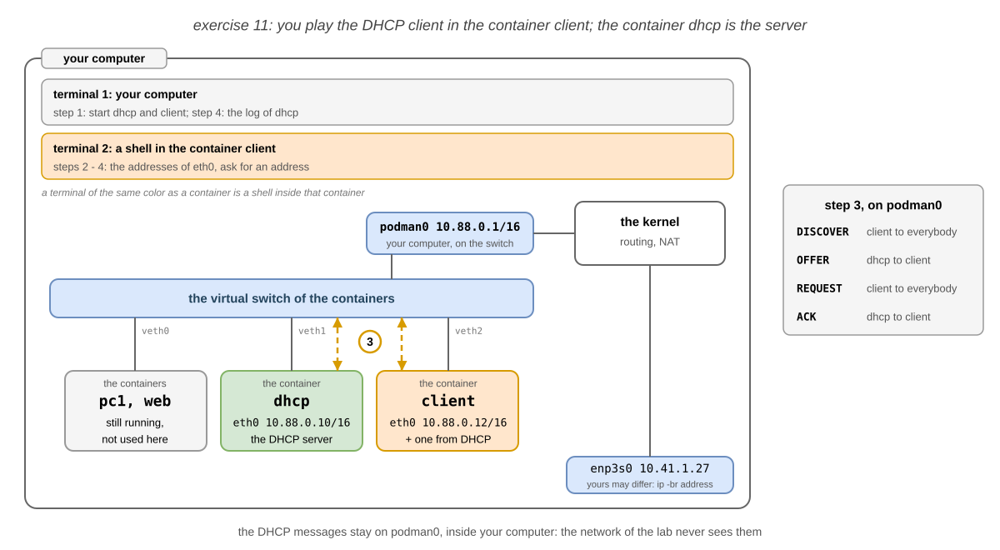

    ```shell-session title="terminal 1: your computer (steps 1, 4)"
    [student@fedora lab09]$ <COMMAND>
    ```

    ```shell-session title="terminal 2: a shell in client (steps 2, 3, 4)"
    [student@fedora lab09]$ sudo podman exec -it client bash
    root@client:/# <COMMAND>
    ```

    1. start the practice DHCP server, `dhcp`, and the container `client` (copy the commands as they are: you do not
       configure the server);

       ```bash
       sudo podman run -d --name dhcp --hostname dhcp --ip 10.88.0.10 --cap-add NET_ADMIN,NET_RAW lab09 \
           dnsmasq -d --conf-file=/dev/null --user=root --no-ping --dhcp-range=10.88.0.200,10.88.0.209,10m \
           --dhcp-option=option:router,10.88.0.1
       sudo podman run -d --name client --hostname client --ip 10.88.0.12 --cap-add NET_ADMIN,NET_RAW lab09 \
           sleep infinity
       ```

    2. open a shell in `client`, and print the addresses of `eth0`: where did this address come from?
    3. ask for an address for `eth0`, printing the four messages; which address did the server offer?
    4. print the addresses of `eth0` again, then, from another terminal, the log of `dhcp`.

    <details className="reveal">
    <summary>Hint</summary>

    `man dhclient` (see [Resources](#resources)): search for `-v`.

    </details>

    <details className="reveal">
    <summary>Check</summary>

    2. Only `10.88.0.12/16`: podman gave it when the container started.
    3. `dhclient -v eth0`: `DHCPDISCOVER`, `DHCPOFFER of 10.88.0.20x from 10.88.0.10` (`x` is a digit), `DHCPREQUEST`,
       `DHCPACK`, then `bound to 10.88.0.20x`.
    4. `10.88.0.12/16` and `10.88.0.20x/16`; `sudo podman logs dhcp` ends with `DHCPDISCOVER`, `DHCPOFFER`,
       `DHCPREQUEST` and `DHCPACK`, each with the MAC address of `client`.

    **Why:** DHCP added a second address, lent for 10 minutes; the one from podman stays.

    </details>

**Capturing packets**

12. **Watch the packets**: See the pings of `pc1` go through `podman0`, then through your card.
    <small>→ [Working in a Container](#working-in-a-container) · [Capturing Packets](#capturing-packets-tcpdump)</small>

    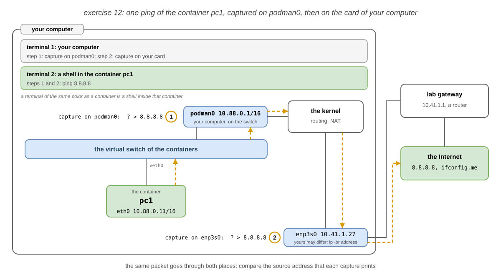

    ```shell-session title="terminal 1: your computer (steps 1, 2)"
    [student@fedora lab09]$ <COMMAND>
    ```

    ```shell-session title="terminal 2: a shell in pc1 (steps 1, 2)"
    [student@fedora lab09]$ sudo podman exec -it pc1 bash
    root@pc1:/# <COMMAND>
    ```

    1. capture the ICMP packets of `podman0` on your computer, while a shell in `pc1` pings `8.8.8.8` twice;
    2. capture the ICMP packets of your card while `pc1` pings again; compare the source addresses.

    <details className="reveal">
    <summary>Hint</summary>

    Start the capture first, then the `ping`; <kbd>Ctrl</kbd>+<kbd>C</kbd> stops the capture.

    </details>

    <details className="reveal">
    <summary>Check</summary>

    1. `sudo tcpdump -i podman0 -n -t icmp`: `IP 10.88.0.11 > 8.8.8.8: ICMP echo request`, then the reply, twice.
    2. `IP 10.41.1.27 > 8.8.8.8`: your computer replaced the address of `pc1` with its own (NAT).

    </details>

**Recap**

13. **Recap: no Internet?**: Find what is broken in the network of a container, checking the layers from the bottom up.
    <small>→ [Working in a Container](#working-in-a-container) · [No Internet?](#no-internet)</small>

    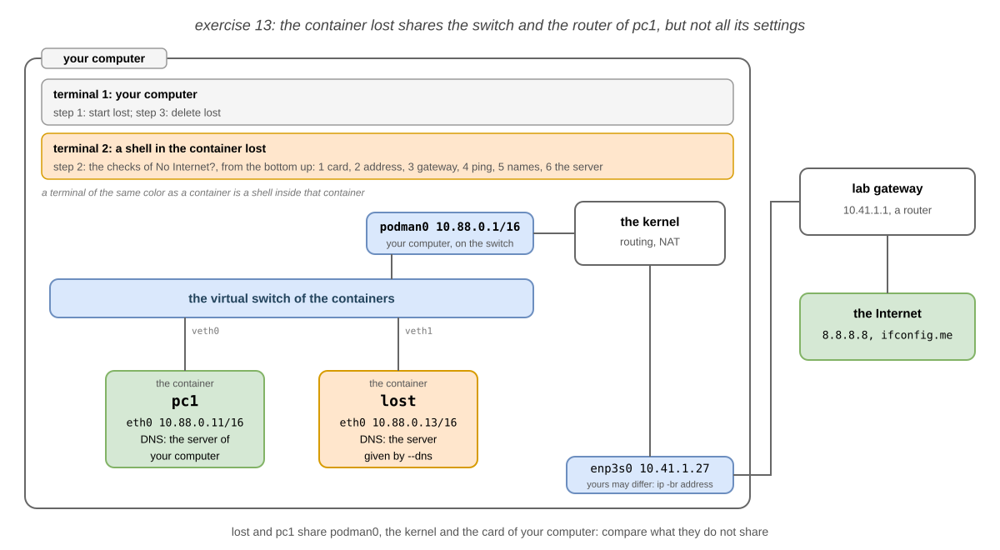

    ```shell-session title="terminal 1: your computer (steps 1, 3)"
    [student@fedora lab09]$ <COMMAND>
    ```

    ```shell-session title="terminal 2: a shell in lost (step 2)"
    [student@fedora lab09]$ sudo podman exec -it lost bash
    root@lost:/# <COMMAND>
    ```

    1. start `lost`:

       ```bash
       sudo podman run -d --name lost --hostname lost --ip 10.88.0.13 --dns 192.0.2.53 lab09 sleep infinity
       ```

    2. in a shell in `lost`, run the checks of [No Internet?](#no-internet), in order, until one fails;
    3. name the layer and the cause; then delete `lost`.

    <details className="reveal">
    <summary>Check</summary>

    2. Checks 1 - 4 work; `host upb.ro` says `no servers could be reached`.
    3. The application layer, DNS: the DNS server of `lost`, `192.0.2.53` (`/etc/resolv.conf`), does not answer.

    </details>

### 🏠 Going Further {/* #going-further */}

Each exercise starts with its **goal**; you choose the commands. At the end, check the goal itself, not only that each
command worked. The exercises use `pc1`, `web`, `dhcp` and `client` from the First Steps; if they are gone, start them
again with the commands of exercises 9, 10 and 11.

**Cards and addresses**

14. **One value at a time**: A script needs one value, not a table. Print each value below with one command line, and
    nothing else. <small>→ [Printing One Value](#printing-one-value)</small>

    1. the MAC address of your Ethernet card, from the output of `ip`;
    2. the mask of your IPv4 address, as a number (`24`);
    3. the name of the card of the default route;
    4. the address of the default gateway;
    5. the MAC address of the gateway;
    6. the DNS server of your card;
    7. the IPv4 address of `upb.ro`;
    8. the lease time of your address, in seconds;
    9. the TCP ports that wait for clients on your computer, as numbers, one per line, without repeats.

    <details className="reveal">
    <summary>Hint</summary>

    `awk '{print $N}'` and `$NF`; `awk -F:` cuts at `:`; `cut`, `grep` and `sort -un` (lab 06); `ss -H` prints no
    header.

    </details>

    <details className="reveal">
    <summary>Check</summary>

    Any command line that prints the same value is right, for example:

    1. `ip -br link show enp3s0 | awk '{print $3}'`: `8c:16:45:a2:3b:91`.
    2. `ip -br -4 address show enp3s0 | awk '{print $3}' | cut -d/ -f2`: `24`.
    3. `ip route show default | awk '{print $5}'`: `enp3s0`.
    4. `ip route show default | awk '{print $3}'`: `10.41.1.1`.
    5. `ip neigh show 10.41.1.1 | awk '{print $5}'`: `70:b5:e8:2d:91:4c`.
    6. `resolvectl dns enp3s0 | awk '{print $NF}'`: `10.41.1.1`.
    7. `host -t A upb.ro | awk '{print $NF}'`: `141.85.220.33`.
    8. `nmcli -f DHCP4 device show enp3s0 | grep dhcp_lease_time | awk '{print $NF}'`: `86400`.
    9. `ss -tlnH | awk '{print $4}' | awk -F: '{print $NF}' | sort -un`: `53`, `631`, ...

    </details>

15. **Real or invented?**: A virtual card gets an invented MAC address, whose second hexadecimal digit is `2`, `6`, `a`
    or `e`. Find out which cards have invented addresses, and who made your card.
    <small>→ [Network Cards](#network-cards) · [Addresses and Masks](#addresses-and-masks-ip-address) · [Special Addresses](#special-addresses)</small>

    1. print the MAC addresses of `eth0` in `pc1`, of `podman0` and of your card, and look at their second digit;
    2. find the manufacturer of your card from its first three bytes;
    3. print the IPv6 addresses of your card and of `eth0` in `pc1`: what kind of addresses are they?

    <details className="reveal">
    <summary>Hint</summary>

    `/usr/share/hwdata/oui.txt` (Ubuntu: `/usr/share/ieee-data/oui.txt`) writes the bytes in capitals, with `-`.

    </details>

    <details className="reveal">
    <summary>Check</summary>

    1. `pc1` and `podman0`: `2`, `6`, `a` or `e`; your card: another digit.
    2. `grep -i '^8C-16-45' /usr/share/hwdata/oui.txt` (with your bytes) prints the name of a company; VirtualBox:
       `PCS Systemtechnik GmbH`.
    3. `fe80::.../64` for both: **link local**, valid only in their own local network.

    </details>

16. **Masks on paper**: At the exam, you compute masks by hand. For each address, **first** write down the network, the
    broadcast, the first and last address of a computer, and how many computers fit; then check with `ipcalc`.
    <small>→ [Addresses and Masks](#addresses-and-masks-ip-address) · [Computing the Network](#computing-the-network)</small>

    1. `192.168.1.105/24` and `10.88.0.11/16`;
    2. `172.16.5.130/25`;
    3. `10.41.1.27/30`: can a computer have this address?
    4. are `172.16.5.100/25` and `172.16.5.130/25` in the same network?

    <details className="reveal">
    <summary>Hint</summary>

    Write the last byte in binary. The first address of a network names it; the last one is its broadcast.

    </details>

    <details className="reveal">
    <summary>Check</summary>

    1. `192.168.1.0`, `192.168.1.255`, `.1` - `.254`, 254; `10.88.0.0`, `10.88.255.255`, `10.88.0.1` -
       `10.88.255.254`, 65534.
    2. `172.16.5.128`, `172.16.5.255`, `.129` - `.254`, 126.
    3. `10.41.1.24`, `10.41.1.27`, `.25` - `.26`, 2: `10.41.1.27` is the broadcast, so no computer can have it.
    4. No: `172.16.5.0/25` and `172.16.5.128/25`.

    </details>

**The way of a packet**

17. **The next hop**: `bob` says that a ping to `8.8.8.8` goes to the MAC address of `8.8.8.8`. Prove him wrong, and
    follow one ping of `pc1` across your computer. <small>→ [The Way of a Packet](#the-way-of-a-packet)</small>

    1. capture one ICMP frame of your card, with its MAC addresses, while you ping `8.8.8.8`, then your colleague;
        2. capture one ICMP frame on `podman0` and one on your card, in two terminals, while `pc1` pings `8.8.8.8` from a
       third terminal;
    3. find whose each MAC address is.

    <details className="reveal">
    <summary>Hint</summary>

    `man tcpdump`: search for `-e`; `/sys/class/net/<IF>/address`; `ip neigh`.

    </details>

    <details className="reveal">
    <summary>Check</summary>

    1. To `8.8.8.8`, the destination MAC is the gateway's; to your colleague, it is your colleague's.
    2. On `podman0`: `pc1` > `podman0`, `10.88.0.11 > 8.8.8.8`; on your card: your card > the gateway,
       `10.41.1.27 > 8.8.8.8`.

    **Why:** each hop puts the packet in a new frame, to the MAC address of its next hop.

    </details>

18. **ARP on the wire**: Watch `pc1` ask for a MAC address, once with an answer and once without one.
    <small>→ [Neighbors](#neighbors-ip-neigh)</small>

    1. in a second terminal, capture the ARP frames of `podman0`, with their MAC addresses;
    2. from `pc1`, ping `dhcp` (`10.88.0.10`) once, then `10.88.0.99`, which nobody has; print the neighbor table of
       `pc1`.

    <details className="reveal">
    <summary>Check</summary>

    2. `Request who-has 10.88.0.10 tell 10.88.0.11` to `ff:ff:ff:ff:ff:ff`, and `Reply 10.88.0.10 is-at ...`; for
       `10.88.0.99`, three requests and no reply, `Destination Host Unreachable`; the table has
       `10.88.0.10 ... REACHABLE` and `10.88.0.99 dev eth0 FAILED`.

    </details>

19. **The routes of a container**: For `pc1`, the lab is "another network". **First** guess how `pc1` reaches each
    address, then check. <small>→ [The Routing Table](#the-routing-table-ip-route) · [The Routers on the Way](#the-routers-on-the-way-traceroute)</small>

    1. in `pc1`, ask the kernel about `10.88.0.80`, `10.41.1.27` (your computer) and `8.8.8.8`;
    2. print the routers between `pc1` and `8.8.8.8`, and compare them with exercise 6;
    3. from your computer, print the routers to `upb.ro`, and compare the first lines with exercise 6.

    <details className="reveal">
    <summary>Check</summary>

    1. `10.88.0.80 dev eth0`: directly; `10.41.1.27` and `8.8.8.8` go `via 10.88.0.1`, because they are not in
       `10.88.0.0/16`.
    2. One more line at the start: `1  10.88.0.1`, then `2  10.41.1.1`.
    3. The first lines are the same: every packet for another network leaves through the gateway.

    </details>

20. **`traceroute` by hand**: Find the first two routers with `ping` and a small TTL.
    <small>→ [The Routers on the Way](#the-routers-on-the-way-traceroute)</small>

    1. ping `8.8.8.8` once with a TTL of `1`, then of `2`, from your computer and from `pc1`.

    <details className="reveal">
    <summary>Hint</summary>

    `man ping`: search for `-t ttl`.

    </details>

    <details className="reveal">
    <summary>Check</summary>

    1. From your computer: `From 10.41.1.1 icmp_seq=1 Time to live exceeded`, then the second router of exercise 6;
       from `pc1`: `From 10.88.0.1 ...`, then `From 10.41.1.1 ...`.

    </details>

**DNS**

21. **More records**: Find the records that `host` does not print by default.
    <small>→ [Names: DNS](#names-dns)</small>

    1. find the IPv6 address of `google.com`, the mail servers of `gmail.com`, and the DNS servers of `upb.ro`;
    2. find the address of `upb.ro` from the server `8.8.8.8`.

    <details className="reveal">
    <summary>Check</summary>

    1. `host -t AAAA google.com`: `has IPv6 address 2a00:1450:...`; `host -t MX gmail.com`; `host -t NS upb.ro`.
    2. `host upb.ro 8.8.8.8`: `Using domain server: ... 8.8.8.8#53`, then `141.85.220.33` (or
       `no servers could be reached`, if the lab blocks other DNS servers).

    </details>

22. **The DNS service of your computer**: Programs on Fedora do not ask the DNS server of the network directly. Find
    out who they ask. <small>→ [Names: DNS](#names-dns)</small>

    1. find the program that listens on port `53`;
    2. print `/etc/resolv.conf`, and find out what kind of file it is;
    3. run `resolvectl query upb.ro` twice: where did each answer come from?
    4. print `/etc/resolv.conf` of `pc1`: which server does it ask, and why not `127.0.0.53`?

    <details className="reveal">
    <summary>Check</summary>

    1. `systemd-resolve`, on `127.0.0.53` and `127.0.0.54`.
    2. `nameserver 127.0.0.53`; a symbolic link to `../run/systemd/resolve/stub-resolv.conf`.
    3. `Data from: network`, then `Data from: cache`.
    4. `nameserver 10.41.1.1`: in `pc1`, `127.0.0.53` would be the loopback of `pc1`, where nobody answers DNS.

    </details>

**Ports and connections**

23. **Both ends of a connection**: Keep a connection open from `pc1` to `web`, and look at it from both ends.
    <small>→ [Listening Programs](#listening-programs-ss)</small>

    1. in a shell in `pc1`, open a connection with `exec 3<>/dev/tcp/10.88.0.80/8080`;
    2. list the open TCP connections of `pc1` and of `web`;
    3. find the range of the ports of the clients;
    4. close it with `exec 3>&-`, and list the connections of `pc1` again;
    5. print the log of `web`: which client addresses does it show?

    <details className="reveal">
    <summary>Hint</summary>

    `man bash`: search for `/dev/tcp`; `ss -tn`; `/proc/sys/net/ipv4/ip_local_port_range`; `man podman-logs`.

    </details>

    <details className="reveal">
    <summary>Check</summary>

    2. `ESTAB ... 10.88.0.11:45312 10.88.0.80:8080` (another random port), and the same in `web`, with the ends
       swapped.
    3. `32768 60999`.
    4. `TIME-WAIT` for about a minute, then nothing.
    5. `sudo podman logs web`: `10.88.0.1` (your computer, on `podman0`, in exercise 10) and `10.88.0.11` (`pc1`); the
       connection of step 1 sent no request, so it is not in the log.

    </details>

24. **Refused or silent?**: `carol` cannot open a page. Find out how a client sees a closed port, and an address that
    nobody has. <small>→ [Ports](#ports-tcp-and-udp) · [Capturing Packets](#capturing-packets-tcpdump)</small>

    1. capture the TCP packets of `podman0`;
    2. from `pc1`, run `curl -v` on port `9999` of `web`, then on port `8080` of `10.88.0.99`.

    <details className="reveal">
    <summary>Check</summary>

    2. `failed: Connection refused` at once, with `Flags [S]` from `pc1` and `Flags [R.]` (a _reset_) from `web`; then,
       after a few seconds, `failed: No route to host`, with no TCP packet: ARP found nobody.

    </details>

**DHCP**

25. **The lease**: `dave` wants to know what the DHCP server gave, and for how long. Read the lease of `client`, from
    both ends. <small>→ [Asking for an Address](#asking-for-an-address-dhclient)</small>

    1. in `client`, print the file of the leases (if `client` was started again, ask for an address first);
    2. print `/var/lib/misc/dnsmasq.leases` in `dhcp`, and turn its first number into a date;
    3. give the address back, and print the addresses of `eth0`: which ones are left?

    <details className="reveal">
    <summary>Hint</summary>

    `man dhclient.leases` (see [Resources](#resources)); `man date`: search for `@`.

    </details>

    <details className="reveal">
    <summary>Check</summary>

    1. The last `lease { ... }` has `fixed-address 10.88.0.20x`, `subnet-mask 255.255.0.0`, `routers 10.88.0.1`,
       `domain-name-servers 10.88.0.10`, `dhcp-lease-time 600` and `dhcp-server-identifier 10.88.0.10`.
    2. `1795430400 a2:5c:17:e8:44:30 10.88.0.204 ...`: the end of the lease, 10 minutes later (`date -d @1795430400`),
       the MAC address and the address.
    3. `dhclient -r -v eth0`: `DHCPRELEASE of 10.88.0.20x`; `eth0` has no IPv4 address left, not even `10.88.0.12`.

    **Why:** on release, the Debian script removes every IPv4 address of the card, also the one from podman.

    </details>

26. **DHCP on the wire**: Watch a whole DHCP conversation, then read its fields in Wireshark.
    <small>→ [Asking for an Address](#asking-for-an-address-dhclient) · [Capturing Packets](#capturing-packets-tcpdump)</small>

    1. in a second terminal, capture the DHCP packets of `podman0`, with details; in `client`, delete the file of the
       leases (or `dhclient` asks for its old address directly), ask for an address, and give it back;
    2. install Wireshark;
    3. save the DHCP packets of `podman0` in `/tmp/dhcp.pcap`, while `client` does the same again;
    4. open the file in Wireshark; in the `Offer`, find the mask, the gateway, the DNS server and the lease time.

    <details className="reveal">
    <summary>Hint</summary>

    DHCP uses the ports `67` and `68`; with `-v`, the type of a message follows `DHCP-Message`; the file of the leases
    is in the table of [Asking for an Address](#asking-for-an-address-dhclient).

    </details>

    <details className="reveal">
    <summary>Check</summary>

    1. `sudo tcpdump -i podman0 -n -v port 67 or port 68`: `Discover`, `Offer`, `Request`, `ACK`, `Release`.
    3. `sudo tcpdump -i podman0 -n -w /tmp/dhcp.pcap port 67 or port 68`.
    4. `(1) Subnet Mask (255.255.0.0)`, `(3) Router` (`10.88.0.1`), `(6) Domain Name Server` (`10.88.0.10`),
       `(51) IP Address Lease Time (10m)`.

    </details>

**Capturing**

27. **What the switch shows you**: Find out which frames reach your card.
    <small>→ [Capturing Packets](#capturing-packets-tcpdump)</small>

    1. capture 50 frames of your card with their MAC addresses, and count them by destination.

    <details className="reveal">
    <summary>Hint</summary>

    With `-t -e`, the destination is the third word; `awk`, `tr`, `sort` and `uniq -c` (lab 06).

    </details>

    <details className="reveal">
    <summary>Check</summary>

    1. `sudo tcpdump -i enp3s0 -n -t -e -c 50 | awk '{print $3}' | tr -d , | sort | uniq -c`: almost only your card,
       the gateway, `ff:ff:ff:ff:ff:ff` and multicast (`01:00:5e:...`, `33:33:...`): the switch does not send you the
       frames of the others. A frame for another card can appear now and then: a switch sends a frame to every card
       while it does not know yet where its destination is.

    </details>

**Troubleshooting**

28. **From the bottom up**: `erin` says that the Internet does not work in `pc1`. Prove that it works, one layer at a
    time. <small>→ [No Internet?](#no-internet)</small>

    1. in `pc1`, run the six checks of [No Internet?](#no-internet), in order, and write down the layer of each one;
    2. for each check, write down which earlier exercise used the same command.

    <details className="reveal">
    <summary>Check</summary>

    1. Every check works; `curl -I https://upb.ro` prints a line that starts with `HTTP`.
    2. For example: `ip -br link`, exercise 2; `ip -br address`, exercise 3; `ip route`, exercise 5;
       `ping`, exercise 4; `host`, exercise 7; `curl -I`, exercise 10.

    </details>

**Clean up**

29. **Clean up**: Delete everything that this lab created.

        1. delete the containers `pc1`, `web`, `dhcp` and `client`, then the images `lab09` and `debian` (keep them if you
       will do the Challenges, which use `lab09` too);
    2. delete `~/lab09`, and `/tmp/dhcp.pcap`, which belongs to the user `tcpdump`.

    <details className="reveal">
    <summary>Check</summary>

    1. `sudo podman ps -a` and `sudo podman images` print only their header; `podman0` is gone.
    2. `ls ~/lab09 /tmp/dhcp.pcap` says `No such file or directory` twice.

    </details>

### 📝 Challenges {/* #challenges */}

These exercises are like the ones at the exam: each one gives a **result** to reach, not the steps, and ends with the
**Check** that will grade it. Some need [The Way of a Packet](#the-way-of-a-packet). They all start from this setup;
run it again to start over:

```bash
mkdir -p ~/exam
cd ~/exam
sudo podman rm -f -t 0 pc1 web dhcp client lost exam-a exam-b exam-c exam-web exam-dhcp exam-nonet \
    exam-nodns exam-local &> /dev/null
cat > Containerfile << 'END'
FROM docker.io/library/debian:trixie-slim
RUN apt-get update && apt-get install -y --no-install-recommends iproute2 iputils-ping bind9-host traceroute \
        curl ca-certificates python3 isc-dhcp-client dnsmasq-base && rm -rf /var/lib/apt/lists/*
END
sudo podman image exists lab09 || sudo podman build -t lab09 .
run() { sudo podman run -d --name "$1" --hostname "$1" "${@:2}" > /dev/null; }
run exam-a --ip 10.88.0.21 lab09 sleep infinity
run exam-b --ip 10.88.0.22 lab09 sleep infinity
run exam-c --ip 10.88.0.23 --cap-add NET_ADMIN,NET_RAW lab09 sleep infinity
run exam-web --ip 10.88.0.24 lab09 python3 -m http.server --bind 0.0.0.0 $((RANDOM % 1000 + 5000))
run exam-dhcp --ip 10.88.0.25 --cap-add NET_ADMIN,NET_RAW lab09 dnsmasq -d --conf-file=/dev/null --user=root --no-ping \
    --dhcp-range=10.88.0.150,10.88.0.159,5m --dhcp-option=option:router,10.88.0.1
run exam-nonet --network none lab09 sleep infinity
run exam-nodns --ip 10.88.0.26 --dns 192.0.2.53 lab09 sleep infinity
run exam-local --ip 10.88.0.27 lab09 python3 -m http.server --bind 127.0.0.1 8080
sudo podman ps --format '{{.Names}}'
```

At the end, clean up:

```bash
sudo podman rm -f -t 0 exam-a exam-b exam-c exam-web exam-dhcp exam-nonet exam-nodns exam-local
sudo podman rmi lab09    # only at home: on the lab computers, keep the image
rm -rf ~/exam
sudo rm -f /tmp/exam-ping.pcap
```

30. **A network report**: Write `~/exam/netinfo.sh`, which prints the four values that your computer needs, one per
    line:

    ```
    card: enp3s0
    address: 10.41.1.27/24
    gateway: 10.41.1.1
    dns: 10.41.1.1
    ```

    The card is the one of the default route; several DNS servers go on one line, separated by spaces. The script reads
    every value from commands (no address written in it), runs without `sudo`, and `shellcheck` finds nothing.

    <details className="reveal">
    <summary>Check</summary>

    `bash netinfo.sh` prints the same values as `ip route show default` (`dev` and `via`),
    `ip -br address show <CARD>` (the first IPv4 address) and `resolvectl dns <CARD>`;
    `grep -E '[0-9]+\.[0-9]+\.' netinfo.sh` and `shellcheck netinfo.sh` print nothing.

    </details>

31. **Predict the route**: On paper, write how `exam-a` sends a packet to each address: **directly**, **via** a
    gateway, **local** (to itself), or **to all** (a broadcast). Prove each answer with one command in `exam-a`.

    `10.88.0.22`, `10.88.0.1`, `10.89.0.5`, the address of your computer on its card, `8.8.8.8`, `127.0.0.1`,
    `10.88.255.255`.

    <details className="reveal">
    <summary>Check</summary>

    | Address         | Answer           | `sudo podman exec exam-a ip route get <ADDRESS>` starts with |
    | --------------- | ---------------- | ------------------------------------------------------------ |
    | `10.88.0.22`    | directly         | `10.88.0.22 dev eth0 src 10.88.0.21`                         |
    | `10.88.0.1`     | directly         | `10.88.0.1 dev eth0 src 10.88.0.21`                          |
    | `10.89.0.5`     | via `10.88.0.1`  | `10.89.0.5 via 10.88.0.1 dev eth0`                           |
    | your computer   | via `10.88.0.1`  | `10.41.1.27 via 10.88.0.1 dev eth0`                          |
    | `8.8.8.8`       | via `10.88.0.1`  | `8.8.8.8 via 10.88.0.1 dev eth0`                             |
    | `127.0.0.1`     | local            | `local 127.0.0.1 dev lo`                                     |
    | `10.88.255.255` | directly, to all | `broadcast 10.88.255.255 dev eth0 src 10.88.0.21`            |

    </details>

32. **Three broken containers**: `exam-nonet` and `exam-nodns` cannot open `https://upb.ro`, and `exam-a` cannot open
    port `8080` of `exam-local`. For each, find the **first** check of [No Internet?](#no-internet) that fails, its
    layer, and the cause, with the command that proves it. Do not repair them.

    <details className="reveal">
    <summary>Check</summary>

    | Container    | First check that fails                                    | Layer                                     | Cause, and the proof                                                           |
    | ------------ | --------------------------------------------------------- | ----------------------------------------- | ------------------------------------------------------------------------------ |
    | `exam-nonet` | 1, the card                                               | physical, link                            | only `lo`, no network card (`--network none`): `ip -br link`                   |
    | `exam-nodns` | 5, the names                                              | application                               | the DNS server `192.0.2.53` does not answer: `/etc/resolv.conf`, `host upb.ro` |
    | `exam-local` | 6, the server: `ping 10.88.0.27` works, `curl` is refused | transport or application (both are right) | it listens only on `127.0.0.1:8080`: `sudo podman exec exam-local ss -tln`     |

    </details>

33. **Find the server**: `exam-web` runs a web server on a port between `5000` and `5999`. Find it **from `exam-a`**,
    without looking inside `exam-web` (no `podman ps`, `inspect`, `logs` or `exec exam-web`). Write it in
    `~/exam/port.txt`, and say why `ss` on your computer does not show it.

    <details className="reveal">
    <summary>Check</summary>

    - `cat ~/exam/port.txt` equals the port in `sudo podman exec exam-web ss -tlnH`, and
      `sudo podman exec exam-a curl -s "http://10.88.0.24:$(cat ~/exam/port.txt)/" | head -1` prints `<!DOCTYPE HTML>`.
    - It was found in `exam-a`, for example with a loop over `5000` - `5999` that opens `/dev/tcp/10.88.0.24/<PORT>`.
    - Why: the port is in the network of the container, not of your computer.

    </details>

34. **The DHCP lease**: Give `exam-c` an address from `exam-dhcp`, and keep it. Write in `~/exam/lease.txt`, from its
    lease, the lines `server: <IP>`, `lease: <SECONDS>`, `router: <IP>` and `dns: <IP>`.

    <details className="reveal">
    <summary>Check</summary>

    - `sudo podman exec exam-c ip -br address show eth0` shows `10.88.0.23/16` and an address from `10.88.0.150` to
      `10.88.0.159`, which `sudo podman logs exam-dhcp | grep DHCPACK` shows too.
    - `~/exam/lease.txt`: `server: 10.88.0.25`, `lease: 300`, `router: 10.88.0.1`, `dns: 10.88.0.25`.

    </details>

35. **Exactly four packets**: Save in `/tmp/exam-ping.pcap` only the 4 ICMP packets of `ping -c 2 10.88.0.22` run in
    `exam-a`. The capture stops by itself.

    <details className="reveal">
    <summary>Check</summary>

    `tcpdump -r /tmp/exam-ping.pcap -n -t` prints `reading from file ...`, then exactly 4 lines: the request
    `IP 10.88.0.21 > 10.88.0.22` and the reply, twice, for example with
    `sudo tcpdump -i podman0 -n -c 4 -w /tmp/exam-ping.pcap 'icmp and host 10.88.0.21'`.

    </details>

36. **The four addresses of a ping**: `exam-a` pings `8.8.8.8` once. On paper, write the source and destination MAC
    and IP addresses of the _echo request_ as it crosses `podman0`, and as it crosses your card: the value of each,
    and whose card or computer it belongs to. Prove each line with `tcpdump`.

    <details className="reveal">
    <summary>Check</summary>

    | Where     | Source MAC                                             | Destination MAC                              | Source IP    | Destination IP |
    | --------- | ------------------------------------------------------ | -------------------------------------------- | ------------ | -------------- |
    | `podman0` | `eth0` of `exam-a` (its `/sys/class/net/eth0/address`) | `podman0` (`/sys/class/net/podman0/address`) | `10.88.0.21` | `8.8.8.8`      |
    | your card | your card                                              | the lab gateway (`ip neigh`)                 | your address | `8.8.8.8`      |

    The proof: `sudo tcpdump -i <IF> -n -t -e -c 1 icmp` on each card, while `exam-a` pings.

    </details>

## Wrap-up Questions

Use the **last 5 minutes** of the lab to answer these questions together with your colleagues and the teaching
assistant. There are no wrong answers for the last two.

1. Which **address** does each **layer** use? Where does a **MAC address** make sense, and where an **IP address**?
2. What does the **mask** `/24` say? Are `10.41.1.27/24` and `10.41.2.5/24` in the same network?
3. Why is no reply to `ping` not a proof that a computer is down?
4. How does the kernel choose where to send a packet? What is the **default gateway** for?
5. How is a **container** different from a virtual machine, and from an **image**? Who is its router?
6. What is a **port**? What is the difference between **TCP** and **UDP**?
7. What does **DNS** do? What still works without it?
8. Which four values does **DHCP** give, and with which four messages?
9. Which command of today will you use first, the next time the Internet does not work?
10. What surprised you most about the network of your computer?

## Extra

1. **`ethtool`**: `ethtool enp3s0` shows the speed and the duplex that the card agreed with the switch
   (`Speed: 1000Mb/s`, `Duplex: Full`). <small>→ `man ethtool`</small>
2. **`mtr`**: `traceroute` and `ping` together, refreshed every second (`sudo dnf install mtr`, then `mtr -n 8.8.8.8`).
   <small>→ `man mtr`</small>
3. **Containers without `sudo`**: build the image without `sudo` too, and run `podman run --rm lab09 ip -br address`:
   the container gets a copy of the address of your computer. <small>→ `man podman-run`, search for `pasta`</small>
