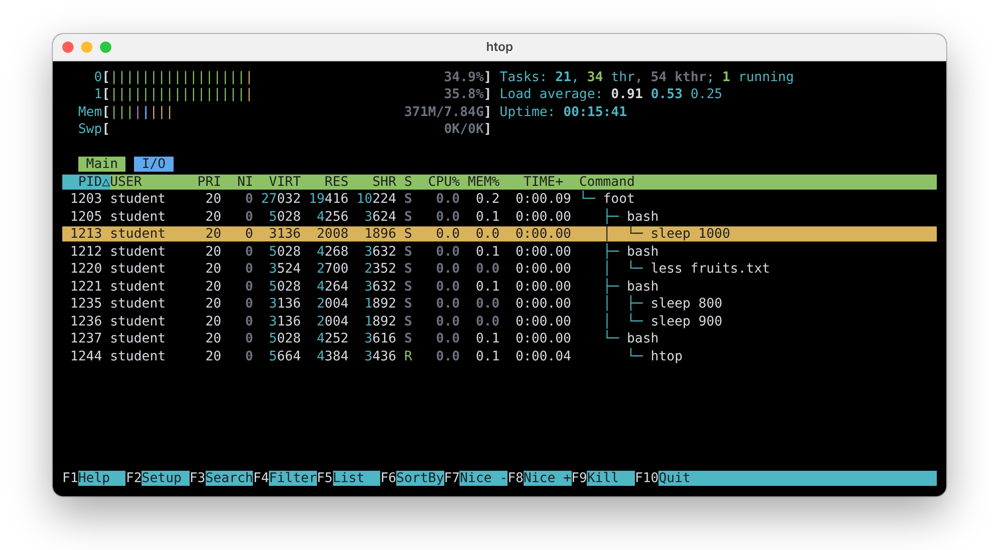

# 03. Procese și redirectări

În al doilea laborator ați învățat să vă orientați în arborele sistemului de fișiere și să lucrați cu fișiere și
directoare. În acest laborator învățați să **redirectați** ce citește și ce scrie o comandă: salvați rezultatul unei
comenzi într-un fișier, păstrați erorile separat și îi dați unei comenzi un fișier în locul tastaturii. Apoi strângeți
mai multe fișiere într-o **arhivă** și le micșorați **comprimându-le**, cu `tar`, `gzip`, `bzip2`, `xz` și `zip`. La
final **inspectați procesele**, adică programele care rulează: prin fișierele pe care kernelul le creează pentru ele în
`/proc`, apoi cu `top`, `htop` și `btop`.

Cea mai importantă idee a laboratorului este că o comandă citește de la **intrarea standard** și scrie la **ieșirea
standard** fără să știe ce se află în spatele lor: tastatura, ecranul, un fișier sau o altă comandă. Decide shell-ul,
iar printr-o redirectare îi spuneți ce să lege acolo.

## Obiective {/* #objectives */}

- Să înțelegeți ce sunt **intrarea standard**, **ieșirea standard** și **ieșirea de eroare standard** ale unei comenzi
- Să **redirectați** ieșirea, erorile și intrarea unei comenzi cu `>`, `>>`, `2>`, `2>>`, `&>` și `<`
- Să legați comenzile între ele prin **pipe** (`|`), să numărați liniile repetate cu `sort` și `uniq` și să folosiți
  fișierele speciale `/dev/null`, `/dev/zero` și `/dev/urandom`
- Să **comprimați** și să decomprimați fișiere cu `gzip`, `bzip2` și `xz`
- Să creați, să listați și să extrageți **arhive** cu `tar`, necomprimate sau comprimate (`.tar.gz`, `.tar.bz2`,
  `.tar.xz`), și cu `zip`
- Să aflați tipul unei arhive cu `file`
- Să listați procesele cu `ps` și să le aflați **PID-ul** și **PPID-ul**
- Să **inspectați** un proces prin directorul lui din `/proc`: starea, comanda, directorul curent și fișierele deschise
- Să urmăriți procesele în timp real cu `top`, `htop` și `btop`

## Resurse {/* #resources */}

1. _[Razvan Deaconescu, Razvan Rughinis, Mihai Carabas, Alexandru Radovici, Utilizarea Sistemelor de
   Operare, Printech 2021](https://github.com/systems-cs-pub-ro/carte-uso/releases/download/uso-ed1-2021/uso.pdf)_
   - Capitolul 2 - _Utilizarea sistemului de fișiere_, secțiunea 2.4
   - Capitolul 4 - _Procese_, secțiunile 4.2, 4.4, 4.7 și 4.8
2. _Brian Ward, How LINUX Works, 3rd Edition, No Starch Press, 2021_
   - Capitolul 2 - _Basic Commands and Directory Hierarchy_, secțiunile 2.14, 2.16 și 2.18
   - Capitolul 8 - _A Closer Look at Processes and Resource Utilization_, secțiunile 8.1 și 8.2
3. _[htop](https://htop.dev)_ și _[btop](https://github.com/aristocratos/btop)_
4. Slide-urile cursului: [03. Procese](/docs/lectures/03)
5. Paginile de manual: `man sort`, `man uniq`, `man tar`, `man gzip`, `man bzip2`, `man xz`, `man zip`, `man unzip`,
   `man ps`, `man proc`, `man top`, `man htop`, `man hier` (directoarele sistemului) și `man bash` (căutați `REDIRECTION`)

## Intrarea, ieșirea și ieșirea de eroare standard {/* #standard-input-output-and-error */}

Fiecare comandă care rulează are o listă cu fișierele pe care le ține deschise, numită **tabela de descriptori de
fișier** (*File Descriptor Table*). **Indexul** din această tabelă este **descriptorul de fișier** (*file descriptor*),
iar primii trei descriptori există întotdeauna:

| Descriptor de fișier | Nume                                    | Comanda îl folosește ca să    | Redirectare | Implicit, într-un terminal  |
| -------------------- | --------------------------------------- | ----------------------------- | ----------- | --------------------------- |
| `0`                  | `stdin`, intrarea standard              | își citească intrarea         | `<`         | vine de la **tastatură**    |
| `1`                  | `stdout`, ieșirea standard              | își scrie rezultatele         | `>`         | merge pe **ecran**          |
| `2`                  | `stderr`, ieșirea de eroare standard    | își scrie mesajele de eroare  | `2>`        | merge pe **ecran**          |

O comandă își citește intrarea din `0`, își scrie rezultatele în `1` și mesajele de eroare în `2`, fără să știe ce se
află în spatele lor. Înainte să pornească comanda, shell-ul poate lega oricare dintre ei la un **fișier**: lucrul
acesta se numește **redirectare**.

## Redirectări {/* #redirects */}

| Redirectare            | Ce face                                                                                     |
| ---------------------- | ------------------------------------------------------------------------------------------- |
| `command > file`       | Scrie ieșirea (`1`) în `file`. Fișierul este mai întâi **golit** sau, dacă nu există, creat |
| `command >> file`      | **Adaugă** ieșirea la sfârșitul lui `file`                                                  |
| `command 2> file`      | Scrie erorile (`2`) în `file`                                                               |
| `command 2>> file`     | Adaugă erorile la sfârșitul lui `file`                                                      |
| `command > out 2> err` | Ieșirea în `out`, erorile în `err`                                                          |
| `command &> file`      | Atât ieșirea, cât și erorile în `file`                                                      |
| `command > file 2>&1`  | Același lucru, scris în varianta mai veche: „`2` merge unde merge `1`”                      |
| `command < file`       | Citește intrarea (`0`) din `file`, în locul tastaturii                                      |

:::danger

`>` **golește** fișierul înainte să pornească comanda, chiar dacă apoi comanda eșuează. `ls > notes.txt` șterge tot ce
era în `notes.txt`. Folosiți `>>` când vreți să păstrați conținutul vechi.

:::

### Ieșirea: `>` și `>>` {/* #output--and- */}

```shell-session
[student@fedora lab03]$ ls Music > list.txt
[student@fedora lab03]$ cat list.txt
jazz.mp3
pop.mp3
rock.mp3
[student@fedora lab03]$ echo "--- end ---" >> list.txt
[student@fedora lab03]$ cat list.txt
jazz.mp3
pop.mp3
rock.mp3
--- end ---
[student@fedora lab03]$ echo "new" > list.txt
[student@fedora lab03]$ cat list.txt
new
```

- `ls Music > list.txt` nu a afișat nimic pe ecran: rezultatul a ajuns în `list.txt`, care s-a creat atunci.
- `>>` a adăugat o linie la sfârșitul fișierului.
- Ultimul `>` a golit fișierul și a scris în el doar `new`.

### Erorile: `2>` și `2>>` {/* #errors-2-and-2 */}

Mesajele de eroare se scriu în `2`, nu în `1`, așa că un `>` singur **nu** le redirectează:

```shell-session
[student@fedora lab03]$ ls Music /nope > list.txt
ls: cannot access '/nope': No such file or directory
[student@fedora lab03]$ ls Music /nope > list.txt 2> errors.txt
[student@fedora lab03]$ cat errors.txt
ls: cannot access '/nope': No such file or directory
[student@fedora lab03]$ ls /nada 2>> errors.txt
[student@fedora lab03]$ cat errors.txt
ls: cannot access '/nope': No such file or directory
ls: cannot access '/nada': No such file or directory
[student@fedora lab03]$ ls Music /nope &> all.txt
[student@fedora lab03]$ cat all.txt
ls: cannot access '/nope': No such file or directory
Music:
jazz.mp3
pop.mp3
rock.mp3
```

- Cu `> list.txt`, lista a ajuns în fișier, dar eroarea a apărut tot pe ecran.
- Cu `2> errors.txt`, eroarea a ajuns în propriul ei fișier, iar `2>>` a adăugat la sfârșitul lui o a doua eroare.
- Cu `&>`, atât lista, cât și eroarea au ajuns în același fișier.

### Intrarea: `<` {/* #input- */}

`<` îi dă unei comenzi un fișier **în locul tastaturii**. Comanda își citește intrarea din `0`, ca de obicei, și nu
știe că de fapt citește dintr-un fișier:

```shell-session
[student@fedora lab03]$ sort < fruits.txt
apple
apple
apple
banana
banana
cherry
kiwi
[student@fedora lab03]$ wc -l fruits.txt
7 fruits.txt
[student@fedora lab03]$ wc -l < fruits.txt
7
```

- `sort` a citit liniile din `fruits.txt` și le-a afișat în ordine alfabetică.
- `wc -l fruits.txt` a numărat liniile unui fișier pe care l-a **deschis singur**, deci îi știe numele și îl afișează.
- Cu `<`, shell-ul a deschis fișierul și i l-a dat lui `wc` ca intrare: `wc` nu știe niciun nume, așa că afișează doar
  numărul.

:::tip

Rulați `sort` fără niciun parametru: citește de la tastatură. Tastați câteva cuvinte, câte unul pe linie, apoi apăsați
<kbd>Ctrl</kbd>+<kbd>D</kbd> (_sfârșitul intrării_): `sort` le afișează în ordine. La fel, `cat > notes.txt` salvează
în `notes.txt` tot ce tastați, până când apăsați <kbd>Ctrl</kbd>+<kbd>D</kbd>.

:::

### Pipe-uri: `|` {/* #pipes- */}

Un **pipe** leagă **ieșirea** (`1`) unei comenzi de **intrarea** (`0`) comenzii următoare, fără niciun fișier între
ele:

```shell-session
[student@fedora lab03]$ ls /usr/bin | wc -l
1843
[student@fedora lab03]$ ls -l /usr/bin | less
```

- `ls /usr/bin | wc -l` a numărat programele din `/usr/bin`: `ls` a scris numele, câte unul pe linie, iar `wc -l` a
  numărat liniile.
- `ls -l /usr/bin | less` a afișat lista lungă câte un ecran pe rând, în loc să o lase să treacă în viteză pe lângă
  voi.

| Comandă       | Ce face cu intrarea                                                   |
| ------------- | --------------------------------------------------------------------- |
| `sort`        | Sortează liniile în ordine alfabetică                                 |
| `uniq`        | Elimină liniile identice cu linia de imediat deasupra lor             |
| `wc -l`       | Numără liniile                                                        |
| `head -n <N>` | Păstrează primele `N` linii                                           |
| `head -c <N>` | Păstrează primii `N` octeți                                           |
| `tail -n <N>` | Păstrează ultimele `N` linii                                          |
| `grep <text>` | Păstrează liniile care conțin `text`                                  |
| `less`        | O afișează câte un ecran pe rând, ca `man` (ieșiți cu <kbd>q</kbd>)   |

#### Căutarea unui text: `grep` {/* #searching-for-a-text-grep */}

`grep` afișează doar liniile care conțin un anumit text. Citește fișierele primite ca parametri sau, dacă nu primește
niciunul, intrarea standard, așa că merge și la capătul unui pipe:

```shell-session
[student@fedora lab03]$ grep apple fruits.txt
apple
apple
apple
[student@fedora lab03]$ grep -c apple fruits.txt
3
[student@fedora lab03]$ grep -i APPLE fruits.txt
apple
apple
apple
[student@fedora lab03]$ grep student /etc/group
wheel:x:10:student
student:x:1000:
[student@fedora lab03]$ ps | grep bash
   2817 pts/0    00:00:00 bash
```

- `grep apple fruits.txt` a afișat cele trei linii din `fruits.txt` care conțin `apple`; `-c` doar le-a numărat.
- `-i` nu ține cont de diferența dintre literele mari și cele mici.
- `grep student /etc/group` a afișat grupurile lui `student`: grupul lui propriu și `wheel`, grupul utilizatorilor
  care au voie să folosească `sudo`.
- `ps | grep bash` a păstrat din lista lui `ps` doar linia lui `bash`.

| Opțiune | Ce face                                                                |
| ------- | ---------------------------------------------------------------------- |
| `-i`    | Nu ține cont de majuscule și minuscule                                 |
| `-c`    | Afișează doar câte linii conțin textul                                 |
| `-v`    | Afișează liniile care **nu** conțin textul                             |
| `-n`    | Afișează numărul liniei în fața fiecărei linii găsite                  |
| `-r`    | Caută în toate fișierele unui director și ale subdirectoarelor lui     |

:::tip

Puneți textul între ghilimele când conține spații: `grep 'model name' /proc/cpuinfo`.

:::

#### Linii repetate: `uniq` {/* #repeated-lines-uniq */}

`uniq` elimină o linie atunci când este identică cu linia de **imediat deasupra ei**. Compară doar linii vecine, de
aceea se folosește aproape întotdeauna după `sort`, care aduce liniile identice una lângă alta:

```shell-session
[student@fedora lab03]$ uniq fruits.txt
banana
apple
cherry
apple
kiwi
banana
apple
[student@fedora lab03]$ sort fruits.txt | uniq
apple
banana
cherry
kiwi
[student@fedora lab03]$ sort fruits.txt | uniq -c
      3 apple
      2 banana
      1 cherry
      1 kiwi
[student@fedora lab03]$ sort fruits.txt | uniq -c | sort -nr
      3 apple
      2 banana
      1 kiwi
      1 cherry
[student@fedora lab03]$ sort fruits.txt | uniq -d
apple
banana
```

- `uniq fruits.txt` nu a schimbat nimic: în `fruits.txt`, nicio linie nu este identică cu cea de deasupra ei.
- După `sort`, cele trei linii `apple` au ajuns una după alta, iar `uniq` a păstrat doar una dintre ele.
- `-c` a scris în fața fiecărei linii de câte ori apare.
- `sort -nr` a sortat aceste linii după numărul din fața lor (`-n`), de la cel mai mare (`-r`): linia cea mai frecventă
  a ajuns prima.
- `-d` a afișat doar liniile care apar de mai multe ori.

| Opțiune   | Ce face                                                                                               |
| --------- | ----------------------------------------------------------------------------------------------------- |
| `uniq -c` | Afișează în fața fiecărei linii de câte ori apare (de la **c**ount)                                   |
| `uniq -d` | Afișează doar liniile care apar de mai multe ori (de la **d**uplicates)                               |
| `uniq -u` | Afișează doar liniile care apar exact o dată (de la **u**nique)                                       |
| `uniq -i` | Nu ține cont de majuscule și minuscule                                                                |
| `sort -n` | Sortează după **n**umărul de la începutul liniei, nu alfabetic (`10` după `9`, nu înainte)            |
| `sort -r` | Sortează în ordine inversă (de la **r**everse)                                                        |
| `sort -u` | Sortează și elimină liniile repetate, la fel ca `sort \| uniq`                                        |

:::caution

Fără `sort`, `uniq` elimină doar liniile repetate care sunt **una lângă alta**. După `uniq fruits.txt` rămân tot trei
linii `apple`.

:::

### Fișiere speciale {/* #special-files */}

Kernelul creează în `/dev` câteva **fișiere speciale**. Ele nu sunt stocate pe disc: când o comandă le citește sau le
scrie, îi răspunde un driver din kernel.

| Fișier         | La citire dă                               | La scriere                   | La ce folosește                                                                     |
| -------------- | ------------------------------------------ | ---------------------------- | ----------------------------------------------------------------------------------- |
| `/dev/null`    | nimic: _sfârșit de fișier_ imediat         | totul se **aruncă**          | aruncarea ieșirii de care nu aveți nevoie: `find /etc -name passwd 2> /dev/null`    |
| `/dev/zero`    | octeți cu valoarea `0`, **fără sfârșit**   | totul se aruncă              | crearea unui fișier de o anumită dimensiune: `head -c 1M /dev/zero > zeros.bin`     |
| `/dev/urandom` | octeți **aleatori**, **fără sfârșit**      | este permisă, dar nu e nevoie | date aleatoare, chei și parole: `head -c 16 /dev/urandom \| xxd`                   |

```shell-session
[student@fedora lab03]$ find /etc -name passwd 2> /dev/null
/etc/pam.d/passwd
/etc/passwd
[student@fedora lab03]$ head -c 8 /dev/zero | xxd
00000000: 0000 0000 0000 0000                      ........
[student@fedora lab03]$ head -c 8 /dev/urandom | xxd
00000000: 9f3a 51c2 07e8 b4d1                      .:Q.....
```

- `2> /dev/null` a aruncat mesajele `Permission denied` ale lui `find`.
- `head -c 8` a păstrat primii 8 octeți, iar `xxd` i-a afișat în hexazecimal: zerouri, apoi octeți aleatori (diferiți
  la fiecare rulare).

## Arhive și compresie {/* #archives-and-compression */}

O **arhivă** este un singur fișier care conține mai multe fișiere și directoare, împreună cu numele, datele și
permisiunile lor. **Compresia** micșorează un fișier, scriind aceeași informație cu mai puțini octeți. În Linux, cele
două operații sunt făcute de obicei de programe diferite: `tar` creează arhiva, iar `gzip`, `bzip2` sau `xz` o
comprimă. `zip` le face pe amândouă deodată.

### Compresia unui singur fișier: `gzip`, `bzip2` și `xz` {/* #compressing-one-file-gzip-bzip2-and-xz */}

Cele trei programe de compresie funcționează la fel: înlocuiesc fișierul cu unul comprimat, adăugând o extensie la
sfârșitul numelui, și îl readuc la forma inițială când îl decomprimați.

| Comprimare     | Decomprimare                         | Extensie |                                              |
| -------------- | ------------------------------------ | -------- | -------------------------------------------- |
| `gzip <file>`  | `gunzip <file>.gz` sau `gzip -d`     | `.gz`    | cel mai rapid, comprimă cel mai puțin        |
| `bzip2 <file>` | `bunzip2 <file>.bz2` sau `bzip2 -d`  | `.bz2`   | mai lent, comprimă mai mult                  |
| `xz <file>`    | `unxz <file>.xz` sau `xz -d`         | `.xz`    | cel mai lent, de obicei comprimă cel mai mult |

| Opțiune       | Înseamnă (la fel pentru toate trei)                                                        |
| ------------- | ------------------------------------------------------------------------------------------ |
| `-k`          | **păstrează** fișierul original (*keep*)                                                   |
| `-c`          | scrie rezultatul la ieșirea standard, ca să-l folosiți cu `>` sau `\|`: originalul rămâne  |
| `-v`          | **verbose**: afișează cu cât s-a micșorat fișierul                                         |
| `-1` ... `-9` | de la cea mai rapidă compresie (`-1`) la cea mai bună (`-9`)                               |

```shell-session
[student@fedora lab03]$ gzip -k numbers.txt
[student@fedora lab03]$ bzip2 -k numbers.txt
[student@fedora lab03]$ xz -k numbers.txt
[student@fedora lab03]$ ls -l numbers.txt*
-rw-r--r--. 1 student student 108894 Oct  6 10:12 numbers.txt
-rw-r--r--. 1 student student  25147 Oct  6 10:12 numbers.txt.bz2
-rw-r--r--. 1 student student  45016 Oct  6 10:12 numbers.txt.gz
-rw-r--r--. 1 student student   4948 Oct  6 10:12 numbers.txt.xz
[student@fedora lab03]$ rm numbers.txt
[student@fedora lab03]$ unxz -k numbers.txt.xz
[student@fedora lab03]$ wc -l numbers.txt
20000 numbers.txt
```

- Cu `-k`, fiecare program a păstrat `numbers.txt` și a creat o copie comprimată a lui.
- Același fișier a ajuns la 45 KB cu `gzip`, la 25 KB cu `bzip2` și sub 5 KB cu `xz`.
- După ce am șters `numbers.txt`, `unxz -k` l-a refăcut din `numbers.txt.xz`, cu toate cele 20000 de linii.

:::caution

Fără `-k`, `gzip numbers.txt` **șterge** `numbers.txt` și lasă doar `numbers.txt.gz`. Așa se comportă în mod normal
toate cele trei programe.

:::

Cu `-v`, cele trei programe afișează cât de bine au comprimat, dar **nu** în același fel:

```shell-session
[student@fedora lab03]$ gzip -v -k numbers.txt
numbers.txt:	 58.7% -- created numbers.txt.gz
[student@fedora lab03]$ bzip2 -v -k numbers.txt
  numbers.txt:  4.330:1,  1.847 bits/byte, 76.91% saved, 108894 in, 25147 out.
[student@fedora lab03]$ xz -v -k numbers.txt
numbers.txt (1/1)
  100 %         4,948 B / 106.3 KiB = 0.045
```

| Program    | Afișează                                                                                                                              | O compresie mai bună înseamnă |
| ---------- | ------------------------------------------------------------------------------------------------------------------------------------- | ----------------------------- |
| `gzip -v`  | cât a **economisit**, ca procent: `58.7%`                                                                                             | un procent **mai mare**       |
| `bzip2 -v` | cât a **economisit** (`76.91% saved`) și dimensiunile de dinainte (`in`) și de după (`out`)                                           | un procent **mai mare**       |
| `xz -v`    | noua dimensiune, vechea dimensiune și **raportul** dintre ele: `0.045` înseamnă că fișierul nou are 4,5% din cel vechi, deci s-a economisit 95,5% | un raport **mai mic**         |

Valoarea `100 %` afișată de `xz` **nu** este compresia: arată cât din fișier a citit până acum și se termină
întotdeauna la `100 %`.

:::info

Un program de compresie lucrează pe **un singur** fișier. Nu poate strânge laolaltă un director sau mai multe fișiere:
pentru asta există `tar`.

:::

### Arhive: `tar` {/* #archives-tar */}

`tar` (_tape archive_) strânge fișiere și directoare într-un singur fișier, numit de obicei
`.tar`. Opțiunile lui sunt litere scrise lipite una de alta, iar cele mai folosite sunt:

| Literă           | Forma lungă               | Înseamnă                                                                           |
| ---------------- | ------------------------- | ---------------------------------------------------------------------------------- |
| `c`              | `--create`                | **creează** o arhivă (**c**reate)                                                  |
| `t`              | `--list`                  | **listează** conținutul unei arhive (lis**t**)                                     |
| `x`              | `--extract`               | **extrage** o arhivă (e**x**tract)                                                 |
| `r`              | `--append`                | adaugă fișiere la sfârșitul unei arhive (nu și la arhivele comprimate)             |
| `v`              | `--verbose`               | **verbose**: afișează numele fiecărui fișier                                       |
| `f <archive>`    | `--file <archive>`        | numele **fișierului** arhivă (**f**ile)                                            |
| `-C <directory>` | `--directory <directory>` | trece mai întâi în `directory`: extrage arhiva acolo sau ia fișierele de acolo     |

:::tip

Orice comandă `tar` are **exact una** dintre literele `c`, `t`, `x` și `r`, care spune ce să facă. Celelalte litere
schimbă felul în care o face. Literele se scriu lipite, fără `-` (`tar cvf`, stilul vechi, sau
`tar -cvf`). Puneți `f` **ultima**: cuvântul de imediat după litere este numele arhivei. `-C` se scrie separat, cu
propriul `-`.

:::

| Comandă                              | Ce face                                                                                         |
| ------------------------------------ | ----------------------------------------------------------------------------------------------- |
| `tar cvf music.tar Music fruits.txt` | Creează `music.tar` cu directorul `Music`, tot ce se află în el și fișierul `fruits.txt`        |
| `tar tf music.tar`                   | Listează conținutul lui `music.tar`                                                             |
| `tar tvf music.tar`                  | Listează conținutul cu detalii: permisiuni, proprietar, dimensiune și dată                      |
| `tar xvf music.tar`                  | Extrage `music.tar` în directorul curent                                                        |
| `tar xvf music.tar -C /tmp/extract`  | O extrage în `/tmp/extract` (directorul trebuie să existe)                                      |
| `tar xvf music.tar Music/jazz.mp3`   | Extrage un singur fișier, cu numele pe care îl are în arhivă                                    |
| `tar rvf music.tar numbers.txt`      | Adaugă `numbers.txt` la sfârșitul arhivei                                                       |

:::caution

`tar x` **suprascrie** fișierele care există deja, fără să întrebe. Când nu sunteți siguri ce conține arhiva,
extrageți-o într-un director gol, cu `-C`.

:::

```shell-session
[student@fedora lab03]$ tar cvf music.tar Music fruits.txt
Music/
Music/jazz.mp3
Music/pop.mp3
Music/rock.mp3
fruits.txt
[student@fedora lab03]$ tar tf music.tar
Music/
Music/jazz.mp3
Music/pop.mp3
Music/rock.mp3
fruits.txt
[student@fedora lab03]$ mkdir /tmp/extract
[student@fedora lab03]$ tar xvf music.tar -C /tmp/extract
Music/
Music/jazz.mp3
Music/pop.mp3
Music/rock.mp3
fruits.txt
[student@fedora lab03]$ file music.tar
music.tar: POSIX tar archive (GNU)
```

- `tar cvf` a creat arhiva și a afișat fiecare fișier pus în ea: directorul `Music`, cu tot ce conține, și
  `fruits.txt`.
- `tar tf` a listat conținutul fără să extragă nimic.
- `tar xvf ... -C /tmp/extract` a recreat aceleași fișiere în `/tmp/extract`: `/tmp/extract/Music/jazz.mp3` și așa mai
  departe.
- `file` s-a uitat în interiorul arhivei și a aflat că este o arhivă `tar`.

:::caution

Nu uitați numele arhivei după `f`. `tar cvf Music` încearcă să creeze o arhivă numită `Music` și se oprește cu
`Cowardly refusing to create an empty archive`. Mai rău, `tar cvf fruits.txt Music` **suprascrie** `fruits.txt` cu o
arhivă.

:::

:::info

O arhivă `.tar` **nu** este comprimată. Are cam cât toate fișierele ei la un loc, plus puțin: pentru fiecare fișier și
director, `tar` adaugă 512 octeți cu numele, permisiunile, proprietarul și data, iar sfârșitul fiecărui fișier îl
completează până la un multiplu de 512 octeți.

:::

### Arhive comprimate: `.tar.gz`, `.tar.bz2` și `.tar.xz` {/* #compressed-archives-targz-tarbz2-and-tarxz */}

`tar` poate și să comprime arhiva, dacă îi dați încă o literă. Rulează el `gzip`, `bzip2` sau `xz` în locul vostru:

| Literă | Program de compresie | Extensie              | Exemplu                        |
| ------ | -------------------- | --------------------- | ------------------------------ |
| `z`    | `gzip`               | `.tar.gz` sau `.tgz`  | `tar czvf music.tar.gz Music`  |
| `j`    | `bzip2`              | `.tar.bz2` sau `.tbz2`| `tar cjvf music.tar.bz2 Music` |
| `J`    | `xz`                 | `.tar.xz` sau `.txz`  | `tar cJvf music.tar.xz Music`  |

Ca să **listați** sau să **extrageți** o arhivă comprimată, nu aveți nevoie de literă: `tar` își dă seama singur cum
este comprimată.

```shell-session
[student@fedora lab03]$ tar cf all.tar Music numbers.txt
[student@fedora lab03]$ tar czf all.tar.gz Music numbers.txt
[student@fedora lab03]$ tar cjf all.tar.bz2 Music numbers.txt
[student@fedora lab03]$ tar cJf all.tar.xz Music numbers.txt
[student@fedora lab03]$ ls -l all.*
-rw-r--r--. 1 student student 112640 Oct  6 10:20 all.tar
-rw-r--r--. 1 student student  25333 Oct  6 10:20 all.tar.bz2
-rw-r--r--. 1 student student  45234 Oct  6 10:20 all.tar.gz
-rw-r--r--. 1 student student   5692 Oct  6 10:20 all.tar.xz
[student@fedora lab03]$ file all.*
all.tar:     POSIX tar archive (GNU)
all.tar.bz2: bzip2 compressed data, block size = 900k
all.tar.gz:  gzip compressed data, from Unix, original size modulo 2^32 112640
all.tar.xz:  XZ compressed data, checksum CRC64
[student@fedora lab03]$ tar tvf all.tar.xz
drwxr-xr-x student/student   0 2026-10-06 10:12 Music/
-rw-r--r-- student/student   0 2026-10-06 10:12 Music/jazz.mp3
-rw-r--r-- student/student   0 2026-10-06 10:12 Music/pop.mp3
-rw-r--r-- student/student   0 2026-10-06 10:12 Music/rock.mp3
-rw-r--r-- student/student 108894 2026-10-06 10:12 numbers.txt
```

- Cele patru arhive conțin aceleași fișiere. Arhiva `.tar` este puțin mai mare decât fișierele în sine; cele
  comprimate sunt mult mai mici, iar cea cu `xz` este cea mai mică.
- `file` a recunoscut fiecare tip după conținut, nu după extensie.
- `tar tvf` a listat arhiva `.tar.xz` fără să i se spună că este comprimată cu `xz`.

:::tip

O arhivă comprimată este o arhivă `.tar` comprimată ca un singur fișier: `all.tar.gz` este exact ce obțineți cu
`tar cf all.tar ...` urmat de `gzip all.tar`. De aceea are două extensii.

:::

### Arhive zip: `zip` și `unzip` {/* #zip-archives-zip-and-unzip */}

`zip` arhivează și comprimă într-un singur pas, iar arhivele lui se deschid pe orice sistem de operare, inclusiv pe
Windows și macOS.

| Comandă                             | Ce face                                                                                    |
| ----------------------------------- | ------------------------------------------------------------------------------------------ |
| `zip music.zip Music/*`             | Creează `music.zip` cu fișierele din `Music`                                               |
| `zip -r music.zip Music fruits.txt` | Creează `music.zip` cu directorul `Music`, **tot** ce se află în el și `fruits.txt`        |
| `zip -u music.zip numbers.txt`      | Adaugă `numbers.txt` în arhivă sau îl actualizează dacă s-a modificat                      |
| `zip -sf music.zip`                 | Listează numele din arhivă                                                                 |
| `unzip -l music.zip`                | Listează conținutul, cu dimensiuni și date                                                 |
| `unzip music.zip`                   | Extrage arhiva în directorul curent                                                        |
| `unzip music.zip -d /tmp/unzipped`  | O extrage în `/tmp/unzipped` (directorul se creează)                                       |
| `unzip music.zip fruits.txt`        | Extrage un singur fișier                                                                   |

:::info

Când primește numele unei arhive, `zip` creează arhiva dacă nu există. Dacă arhiva există deja, `zip` o actualizează: fișierele care nu sunt încă în arhivă se adaugă, fișierele cu aceeași cale se înlocuiesc, iar toate celelalte intrări existente rămân neschimbate.

:::

```shell-session
[student@fedora lab03]$ zip -r music.zip Music fruits.txt
  adding: Music/ (stored 0%)
  adding: Music/jazz.mp3 (stored 0%)
  adding: Music/pop.mp3 (stored 0%)
  adding: Music/rock.mp3 (stored 0%)
  adding: fruits.txt (deflated 40%)
[student@fedora lab03]$ unzip -l music.zip
Archive:  music.zip
  Length      Date    Time    Name
---------  ---------- -----   ----
        0  10-06-2026 10:12   Music/
        0  10-06-2026 10:12   Music/jazz.mp3
        0  10-06-2026 10:12   Music/pop.mp3
        0  10-06-2026 10:12   Music/rock.mp3
       44  10-06-2026 10:12   fruits.txt
---------                     -------
       44                     5 files
```

`zip` a afișat cât a comprimat fiecare fișier: fișierele `.mp3` goale au fost stocate așa cum sunt, iar `fruits.txt` s-a
micșorat cu 40%.

:::caution

Fără `-r`, `zip music.zip Music` pune în arhivă doar directorul, **gol**, fără fișierele din el.

:::

:::info

`zip` creează `music.zip` doar dacă nu există deja. Dacă arhiva există, `zip` îi **adaugă** fișierele care lipsesc din
ea și le **înlocuiește** pe cele cu același nume (pentru ele afișează `updating:` în loc de `adding:`). Celelalte
fișiere aflate deja în arhivă rămân acolo. Ca să porniți de la o arhivă goală, ștergeți mai întâi arhiva veche.

:::

### Ce format alegeți {/* #which-one-to-use */}

| Format     | Arhivare și compresie cu  | Extragere cu | Folosiți-l pentru                                                       |
| ---------- | ------------------------- | ------------ | ----------------------------------------------------------------------- |
| `.tar`     | `tar cf`                  | `tar xf`     | a strânge fișiere laolaltă, fără să le comprimați                       |
| `.tar.gz`  | `tar czf`                 | `tar xf`     | cea mai răspândită arhivă în Linux, rapidă                              |
| `.tar.bz2` | `tar cjf`                 | `tar xf`     | arhive mai mici, programe mai vechi                                     |
| `.tar.xz`  | `tar cJf`                 | `tar xf`     | cele mai mici arhive, de exemplu codul sursă al kernelului Linux        |
| `.zip`     | `zip -r`                  | `unzip`      | fișiere pe care le trimiteți cuiva care folosește Windows sau macOS     |

:::tip

Nu sunteți siguri ce fel de arhivă aveți? Rulați `file` pe ea. Extensia este doar o parte din nume, pe când `file` se
uită la conținut.

:::

## Inspectarea proceselor {/* #inspecting-processes */}

Un **program** este un fișier de pe disc, de exemplu `/usr/bin/sleep`. Când îl rulați, sistemul de operare îl încarcă
în memorie și astfel ia naștere un **proces**. Fiecare proces are un număr, **PID**-ul (*Process ID*), și reține
PID-ul procesului care l-a pornit, adică al **părintelui** său: **PPID**-ul (*Parent Process ID*).

### Listarea proceselor: `ps` {/* #listing-processes-ps */}

| Comandă           | Ce afișează                                                                                          |
| ----------------- | ---------------------------------------------------------------------------------------------------- |
| `echo $$`         | PID-ul shell-ului curent                                                                             |
| `ps`              | Procesele terminalului curent                                                                        |
| `ps -f`           | Aceleași procese, cu mai multe coloane: `UID`, `PID`, `PPID`, ora pornirii și comanda completă       |
| `ps -e`           | **Toate** procesele din sistem (de la **e**very process)                                             |
| `ps -ef`          | **Toate** procesele din sistem, cu coloanele lui `-f`                                                |
| `ps -p <PID>`     | Doar procesul cu acest PID                                                                           |
| `ps -o <columns>` | Doar coloanele alese de voi, de exemplu `ps -o pid,ppid,stat,cmd`                                    |
| `ps --no-headers` | Fără prima linie, cea cu numele coloanelor                                                           |
| `pgrep <name>`    | Doar PID-urile proceselor al căror nume **conține** `name`                                           |

Coloanele afișate de `ps` și numele pe care i le dați lui `-o` ca să le alegeți:

| Coloană          | Nume pentru `-o` | Ce afișează                                                                                                                                                                                                                                              |
| ---------------- | ---------------- | -------------------------------------------------------------------------------------------------------------------------------------------------------------------------------------------------------------------------------------------------------- |
| `UID` sau `USER` | `user`           | Utilizatorul care deține procesul                                                                                                                                                                                                                        |
| `PID`            | `pid`            | Numărul procesului                                                                                                                                                                                                                                       |
| `PPID`           | `ppid`           | Numărul părintelui                                                                                                                                                                                                                                       |
| `C`              | `c`              | Cât din procesor folosește, ca procent                                                                                                                                                                                                                   |
| `STIME`          | `stime`          | Când a pornit                                                                                                                                                                                                                                            |
| `TTY`            | `tty`            | Terminalul în care rulează (`pts/0`, `pts/1`, ...); `?` pentru procesele care nu au terminal                                                                                                                                                             |
| `TIME`           | `time`           | Cât timp de procesor a folosit până acum, nu de cât timp rulează                                                                                                                                                                                         |
| `STAT`           | `stat`           | Starea: `S`, `R`, `T` sau `Z`, din [tabelul stărilor](#the-proc-file-system) de mai jos, urmată de câteva detalii (de exemplu `s` pentru primul proces dintr-o sesiune, cum este un shell, și `+` pentru un proces care rulează în prim-planul (*foreground*) terminalului său) |
| `CMD`            | `cmd`            | Linia de comandă completă, cu parametrii                                                                                                                                                                                                                 |
| `COMMAND`        | `comm`           | Doar numele programului, fără parametri                                                                                                                                                                                                                  |

```shell-session
[student@fedora ~]$ ps -o pid,ppid,stat,cmd
    PID    PPID STAT CMD
   2817    2790 Ss   bash
   3110    2817 R+   ps -o pid,ppid,stat,cmd
```

- Shell-ul, `bash`, așteaptă o comandă (`S`) și este primul proces din sesiunea lui (`s`).
- `ps` rulează (`R`) în prim-planul terminalului (`+`), iar părintele lui este `bash`.

```shell-session
[student@fedora ~]$ echo $$
2817
[student@fedora ~]$ ps -f
UID          PID    PPID  C STIME TTY          TIME CMD
student     2817    2790  0 10:02 pts/0    00:00:00 bash
student     3105    2817  0 10:15 pts/0    00:00:00 ps -f
```

- Shell-ul acestui terminal este `bash`, cu PID-ul `2817`, același număr ca `$$`.
- Și `ps` este un proces, pornit de `bash`: PPID-ul lui este `2817`. La fiecare rulare primește un PID nou.

Ca să aveți un proces de inspectat, deschideți un **al doilea terminal** și porniți în el o comandă care rulează mai
mult timp, de exemplu `sleep 1000` (așteaptă 1000 de secunde). Găsiți-o din primul terminal:

```shell-session
[student@fedora ~]$ pgrep sleep
3150
[student@fedora ~]$ ps -f -p 3150
UID          PID    PPID  C STIME TTY          TIME CMD
student     3150    2905  0 10:16 pts/1    00:00:00 sleep 1000
```

`sleep` rulează în celălalt terminal (`pts/1`), iar părintele lui, `2905`, este `bash`-ul acelui terminal. Când
terminați cu el, opriți-l cu <kbd>Ctrl</kbd>+<kbd>C</kbd> în terminalul lui.

### Sistemul de fișiere `/proc` {/* #the-proc-file-system */}

Kernelul prezintă fiecare proces ca pe un **director** în `/proc`, cu numele egal cu PID-ul lui: pentru `sleep`-ul de
mai sus, directorul este `/proc/3150`. La fel ca fișierele speciale, aceste fișiere nu se află pe disc: kernelul le
generează conținutul în momentul în care le citiți. `/proc/self` este întotdeauna directorul procesului care îl
citește, iar `/proc/$$` este directorul shell-ului vostru.

| Fișier                | Ce afișează                                                                         |
| --------------------- | ----------------------------------------------------------------------------------- |
| `/proc/<PID>/status`  | Numele, starea, PID-ul, PPID-ul, proprietarul și memoria procesului                 |
| `/proc/<PID>/cmdline` | Linia de comandă, cu cuvintele separate prin octeți `\0` în loc de spații           |
| `/proc/<PID>/cwd`     | O legătură către **directorul curent** al procesului                                |
| `/proc/<PID>/exe`     | O legătură către **programul** care rulează                                         |
| `/proc/<PID>/fd/`     | **Tabela de descriptori de fișier**: câte o legătură pentru fiecare fișier deschis  |
| `/proc/<PID>/environ` | Variabilele de mediu, separate prin octeți `\0`                                     |
| `/proc/<PID>/maps`    | Cum sunt așezate în memorie programul și bibliotecile lui                           |

```shell-session
[student@fedora ~]$ head -n 7 /proc/3150/status
Name:	sleep
Umask:	0022
State:	S (sleeping)
Tgid:	3150
Ngid:	0
Pid:	3150
PPid:	2905
[student@fedora ~]$ ls -l /proc/3150/exe /proc/3150/cwd
lrwxrwxrwx. 1 student student 0 Oct  6 10:17 /proc/3150/cwd -> /home/student
lrwxrwxrwx. 1 student student 0 Oct  6 10:17 /proc/3150/exe -> /usr/bin/sleep
[student@fedora ~]$ cat -v /proc/3150/cmdline
sleep^@1000^@
[student@fedora ~]$ ls -l /proc/3150/fd
total 0
lrwx------. 1 student student 64 Oct  6 10:17 0 -> /dev/pts/1
lrwx------. 1 student student 64 Oct  6 10:17 1 -> /dev/pts/1
lrwx------. 1 student student 64 Oct  6 10:17 2 -> /dev/pts/1
```

- `status` arată că `sleep` așteaptă (`S`) și că părintele lui este `2905`.
- `exe` indică programul, `/usr/bin/sleep`, iar `cwd` directorul din care a fost pornit.
- `cmdline` separă cuvintele prin octeți `\0`, care sunt invizibili: `cat -v` îi afișează ca `^@`.
- `0`, `1` și `2` indică `/dev/pts/1`, adică al doilea terminal, care îi ține procesului loc și de tastatură, și de
  ecran.

Litera din linia `State` (și din coloana `STAT` a lui `ps`) este **starea** procesului:

| Literă | Stare                                    | Înseamnă                                                    |
| ------ | ---------------------------------------- | ----------------------------------------------------------- |
| `R`    | În rulare sau gata de rulare (*Running*) | Rulează pe un procesor sau așteaptă să primească unul       |
| `S`    | În așteptare (*Sleeping*)                | Așteaptă ceva: o tastă, să treacă un timp, date dintr-un pipe |
| `T`    | Oprit (*Stopped*)                        | Pus pe pauză, de exemplu cu <kbd>Ctrl</kbd>+<kbd>Z</kbd>    |
| `Z`    | Zombie                                   | S-a terminat, dar părintele nu i-a citit încă codul de ieșire |

`/proc` conține și fișiere despre întregul sistem:

| Fișier          | Ce afișează                                                                                                                                                     |
| --------------- | --------------------------------------------------------------------------------------------------------------------------------------------------------------- |
| `/proc/cpuinfo` | Procesoarele, câte un bloc pentru fiecare                                                                                                                       |
| `/proc/meminfo` | Memoria, în kB: `MemTotal`, `MemFree`, `MemAvailable`, ...                                                                                                      |
| `/proc/uptime`  | Două numere: secundele trecute de la pornirea sistemului, apoi secundele în care procesoarele au stat nefolosite (adunate pentru toate)                          |
| `/proc/loadavg` | **Încărcarea sistemului** (*load*) în ultimele 1, 5 și 15 minute, apoi procesele aflate acum în starea Running / toate procesele și ultimul PID atribuit         |
| `/proc/version` | Versiunea kernelului și compilatorul cu care a fost compilat                                                                                                    |

:::info

PID-urile și căile de mai sus sunt altele pe calculatorul vostru: folosiți-le pe cele afișate de `pgrep` și `ps`.
Puteți citi fișierele propriilor procese; la procesele altor utilizatori, cele mai multe fișiere răspund cu
`Permission denied`.

:::

### `top` {/* #top */}

`top` afișează procesele **în timp real**, ca _Task Manager_ din Windows. Actualizează lista la câteva secunde și pune
sus procesele care folosesc cel mai mult procesorul.

```
top - 10:30:12 up  1:28,  1 user,  load average: 0.08, 0.12, 0.10
Tasks: 248 total,   1 running, 247 sleeping,   0 stopped,   0 zombie
%Cpu(s):  1.3 us,  0.7 sy,  0.0 ni, 97.9 id,  0.0 wa,  0.1 hi,  0.0 si,  0.0 st
MiB Mem :   3911.4 total,   1873.2 free,   1245.6 used,    1042.9 buff/cache
MiB Swap:   3911.0 total,   3911.0 free,      0.0 used.    2665.8 avail Mem

    PID USER      PR  NI    VIRT    RES    SHR S  %CPU  %MEM     TIME+ COMMAND
   1718 student   20   0 1186420  98340  61200 S   1.3   2.5   0:12.41 sway
   2790 student   20   0  318264  41212  30124 S   0.3   1.0   0:02.03 foot
      1 root      20   0   49736  38544  10208 S   0.0   1.0   0:02.31 systemd
```

- Primele linii sunt un rezumat al sistemului: cât timp a trecut de la pornire, încărcarea, câte procese se află în
  fiecare stare și cât sunt folosite procesoarele și memoria.
- Dedesubt apare fiecare proces cu PID-ul, proprietarul (`USER`), memoria (`RES`, în KB), starea (`S`), procentul din
  procesor și din memorie pe care îl folosește și comanda.

| Tastă        | Acțiune                                                                         |
| ------------ | ------------------------------------------------------------------------------- |
| <kbd>P</kbd> | Sortează după folosirea procesorului (implicit)                                 |
| <kbd>M</kbd> | Sortează după folosirea memoriei                                                |
| <kbd>T</kbd> | Sortează după timpul de procesor folosit până acum                              |
| <kbd>c</kbd> | Afișează linia de comandă completă                                              |
| <kbd>u</kbd> | Afișează doar procesele unui utilizator (tastați numele și apăsați <kbd>Enter</kbd>) |
| <kbd>1</kbd> | Afișează fiecare procesor pe linia lui                                          |
| <kbd>V</kbd> | Afișează procesele sub formă de arbore                                          |
| <kbd>h</kbd> | Ajutor                                                                          |
| <kbd>q</kbd> | Ieșire                                                                          |

:::tip

`top -b -n 1` afișează lista o **singură** dată, fără s-o actualizeze, așa că o puteți redirecta:
`top -b -n 1 > top.txt`.

:::

### `htop` {/* #htop */}

`htop` face același lucru ca `top`, dar cu culori, câte o bară pentru fiecare procesor și meniuri în partea de jos a
ecranului. Porniți-l cu `htop` și ieșiți cu <kbd>q</kbd> sau <kbd>F10</kbd>.



În partea de sus, `htop` afișează câte o bară pentru fiecare procesor (`0` și `1`), pentru memorie (`Mem`) și pentru
swap (`Swp`), apoi numărul de procese (*tasks*), încărcarea sistemului și timpul de funcționare (*uptime*). Dedesubt
se află lista proceselor, câte unul pe linie, iar jos de tot, meniul cu tastele funcționale. În imaginea de mai sus,
lista conține doar procesele lui `student` (<kbd>u</kbd>), sub formă de arbore (<kbd>F5</kbd>): terminalul (`foot`)
rulează patru shell-uri `bash`, iar fiecare dintre ele rulează câte o comandă (al treilea rulează înlănțuirea
`sleep 800 | sleep 900`). Procesul selectat este `sleep 1000`.

| Tastă                          | Acțiune                                                                                                      | Echivalent                                        |
| ------------------------------ | ------------------------------------------------------------------------------------------------------------ | ------------------------------------------------- |
| <kbd>↑</kbd> <kbd>↓</kbd>      | Selectează un proces                                                                                         |                                                   |
| <kbd>F3</kbd> sau <kbd>/</kbd> | **Căutare**: sare la următorul proces a cărui comandă conține un text (apăsați din nou pentru următorul)      | `pgrep`                                           |
| <kbd>F4</kbd> sau <kbd>\\</kbd> | **Filtrare**: afișează doar procesele a căror comandă conține un text (<kbd>Esc</kbd> le afișează din nou pe toate) |                                            |
| <kbd>F5</kbd> sau <kbd>t</kbd> | Afișează procesele sub formă de arbore                                                                       | <kbd>V</kbd> în `top`                             |
| <kbd>F6</kbd>                  | Alege coloana după care se sortează                                                                          |                                                   |
| <kbd>P</kbd> / <kbd>M</kbd>    | Sortează după folosirea procesorului / a memoriei / după timpul de procesor                                  | <kbd>P</kbd> / <kbd>M</kbd> în `top`              |
| <kbd>u</kbd>                   | Afișează doar procesele unui utilizator, ales dintr-o listă                                                  | <kbd>u</kbd> în `top`                             |
| <kbd>l</kbd>                   | Afișează fișierele deschise ale procesului selectat                                                          | `ls -l /proc/<PID>/fd`                            |
| <kbd>F2</kbd>                  | Setări: alegeți coloanele și culorile                                                                        |                                                   |
| <kbd>F1</kbd> sau <kbd>h</kbd> | Ajutor                                                                                                       |                                                   |
| <kbd>q</kbd> sau <kbd>F10</kbd> | Ieșire                                                                                                      |                                                   |

:::tip

`htop` afișează și **firele de execuție** (*threads*) ale proceselor, cu verde. Apăsați <kbd>H</kbd> ca să le
ascundeți, iar lista devine mult mai scurtă.

:::

### `btop` {/* #btop */}

`btop` este un program mai nou de același fel. Ecranul lui este împărțit în casete: procesoarele, cu un grafic al
folosirii lor, memoria și discurile, rețeaua și lista proceselor. Porniți-l cu `btop` și ieșiți cu <kbd>q</kbd>.

| Tastă                           | Acțiune                                                         |
| ------------------------------- | --------------------------------------------------------------- |
| <kbd>↑</kbd> <kbd>↓</kbd>       | Selectează un proces                                            |
| <kbd>Enter</kbd>                | Afișează detaliile procesului selectat                          |
| <kbd>f</kbd> sau <kbd>/</kbd>   | Afișează doar procesele care se potrivesc cu un text (filtrare) |
| <kbd>e</kbd>                    | Afișează procesele sub formă de arbore                          |
| <kbd>←</kbd> <kbd>→</kbd>       | Schimbă coloana după care se sortează                           |
| <kbd>r</kbd>                    | Inversează ordinea sortării                                     |
| <kbd>1</kbd> ... <kbd>4</kbd>   | Afișează sau ascunde casetele: procesoare, memorie, rețea, procese |
| <kbd>Esc</kbd> sau <kbd>m</kbd> | Meniu                                                           |
| <kbd>h</kbd> sau <kbd>F1</kbd>  | Ajutor                                                          |
| <kbd>q</kbd>                    | Ieșire                                                          |

## Depanare {/* #troubleshooting */}

| Problemă                                                    | Soluție                                                                                                                                                                                                  |
| ----------------------------------------------------------- | -------------------------------------------------------------------------------------------------------------------------------------------------------------------------------------------------------- |
| `bash: <command>: command not found`                        | Programul nu este instalat: instalați-l cu `sudo dnf install <package>` pe Fedora sau cu `sudo apt install <package>` pe Debian și Ubuntu; de obicei, pachetul are același nume ca și comanda            |
| După `>`, eroarea apare tot pe ecran                        | Erorile merg în `2`: folosiți `2>` sau `&>`                                                                                                                                                              |
| Un fișier e gol după o redirectare                          | `>` golește mai întâi fișierul: folosiți `>>` ca să adăugați la sfârșit                                                                                                                                  |
| O comandă așteaptă și nu face nimic                         | Citește de la tastatură: tastați intrarea și apăsați <kbd>Ctrl</kbd>+<kbd>D</kbd> sau opriți-o cu <kbd>Ctrl</kbd>+<kbd>C</kbd>                                                                           |
| `gzip: numbers.txt.gz already exists`                       | Fișierul comprimat există deja: ștergeți-l sau adăugați `-f` ca să-l suprascrieți                                                                                                                        |
| Fișierul original a dispărut după `gzip`                    | Este normal: folosiți `-k` ca să-l păstrați sau decomprimați-l cu `gunzip`                                                                                                                               |
| `tar: Cowardly refusing to create an empty archive`         | Lipsește numele arhivei de după `f`                                                                                                                                                                      |
| `tar: ...: Not found in archive`                            | Numele este greșit: listați arhiva cu `tar tf` și copiați numele exact                                                                                                                                   |
| `tar: /tmp/extract: Cannot open: No such file or directory` | Directorul dat lui `-C` trebuie să existe: creați-l cu `mkdir`                                                                                                                                           |
| O arhivă `zip` conține un director, dar nu și fișierele lui | Adăugați `-r`                                                                                                                                                                                            |
| `No such file or directory` în `/proc/<PID>`                | Procesul s-a terminat sau PID-ul e greșit: verificați-l cu `pgrep` sau `ps`                                                                                                                              |
| `Permission denied` în `/proc/<PID>`                        | Procesul aparține altui utilizator                                                                                                                                                                       |

## Exerciții {/* #exercises */}

Exercițiile devin tot mai grele pe parcurs:

- [Primii pași](#first-steps) (exercițiile 1 - 32) trece o dată prin **tot** ce conține laboratorul, cu exerciții
  ușoare;
- [Mai departe](#going-further) (exercițiile 33 - 47) are exerciții mai grele;
- [Provocări](#challenges) (exercițiile 48 - 54) le are pe cele mai grele.

Exercițiile sunt marcate și pentru cele două tipuri de laborator:

- 🌱 **de bază** (1 oră - **AC**): faceți doar exercițiile marcate cu 🌱 (exercițiile 1 - 32);
- 🌳 **complet** (2 ore - **CD**): faceți toate exercițiile, atât 🌱, cât și 🌳.

Faceți exercițiile **în ordine**: fiecare folosește fișierele rămase de la cele dinainte.

Unele exerciții cer lucruri pe care laboratorul nu vi le arată, de exemplu o opțiune care nu apare în tabelele de mai
sus. Căutați-o în **pagina de manual** a comenzii (`man <command>`), cum ați văzut în
[Căutarea într-o pagină de manual](/docs/labs/02#searching-in-a-manual-page) din laboratorul 02.

Multe exerciții folosesc **fișierele sistemului**, din `/etc`, `/usr`, `/var`, `/proc` și `/dev`, ca să aflați pe
parcurs și cum este organizat un sistem Linux. Ca să aflați la ce folosește un director, uitați-vă în `man hier`; ca
să aflați ce conține un fișier din `/etc`, uitați-vă în secțiunea 5 a manualului, de exemplu `man 5 passwd`,
`man 5 shells` sau `man 5 os-release`.

Țineți în Sway **două terminale unul lângă altul**: în primul rulați comenzile, iar în al doilea porniți comenzile pe
care le inspectați sau verificați rezultatele. Multe exerciții folosesc PID-ul unui proces: pe calculatorul vostru
este altul, așa că folosiți-l pe cel afișat de `pgrep` sau `ps`.

:::danger

Nu folosiți `sudo` ca să vă uitați la procese. Fișierele din `/proc` sunt create de kernel: citiți-le, dar nu încercați
să le modificați.

:::

### Primii pași {/* #first-steps */}

1. 🌱 **Arborele de exersare**:
   1. Rulați comenzile de mai jos ca să creați fișierele folosite în exerciții (copiați-le din browser cu
      <kbd>Ctrl</kbd>+<kbd>C</kbd> și lipiți-le în terminal cu <kbd>Ctrl</kbd>+<kbd>Shift</kbd>+<kbd>V</kbd>):

      ```bash
      mkdir -p ~/lab03/Music ~/lab03/Photos ~/lab03/Reports ~/lab03/Archives
      touch ~/lab03/Music/jazz.mp3 ~/lab03/Music/rock.mp3 ~/lab03/Music/pop.mp3
      touch ~/lab03/Photos/cat.jpg ~/lab03/Photos/dog.jpg
      printf 'banana\napple\ncherry\napple\nkiwi\nbanana\napple\n' > ~/lab03/fruits.txt
      seq 1 20000 > ~/lab03/numbers.txt
      ```

   2. Mergeți în `~/lab03` și rulați `tree`.

   **Verificare:** vedeți cele patru directoare, cele cinci fișiere goale, `fruits.txt` și `numbers.txt`; `wc -l fruits.txt
numbers.txt` afișează `7` și `20000`. <small>→ [Navigarea](/docs/labs/02#navigation)</small>

**Redirectări**

2. 🌱 **Rădăcina sistemului**: Din `~/lab03`, salvați în `Reports/system.txt` arborele lui `/`, cu un singur nivel de
   adâncime (căutați în `man tree` opțiunea care limitează cât de adânc coboară `tree`). Afișați fișierul.

   **Verificare:** `tree` nu a afișat nimic pe ecran, iar fișierul conține directoarele principale ale sistemului:
   `boot`, `dev`, `etc`, `home`, `proc`, `tmp`, `usr` și `var`; `bin` este o legătură către `usr/bin`. <small>→ [Ieșirea](#output--and-)</small>

3. 🌱 **Adăugare**: Adăugați la `Reports/system.txt` arborele lui `/usr`, cu un nivel de adâncime. Apoi **suprascrieți**
   fișierul cu arborele lui `/var`, tot cu un nivel.

   **Verificare:** după adăugare, fișierul conține ambii arbori (`/usr` are `bin`, `lib`, `share`); după ultima
   comandă, doar arborele lui `/var`, cu `cache`, `lib` și `log`. <small>→ [Ieșirea](#output--and-)</small>

4. 🌱 **Erorile separat**: Cu o **singură** comandă `ls -a`, listați `/etc/skel` (fișierele copiate în directorul
   fiecărui utilizator nou) și `/root` (directorul administratorului), astfel încât lista să ajungă în
   `Reports/list.txt`, iar eroarea în `Reports/errors.txt`.

   **Verificare:** pe ecran nu apare nimic; `Reports/list.txt` conține `.bashrc` și `.bash_profile`, iar
   `Reports/errors.txt` conține un `Permission denied` pentru `/root`. <small>→ [Erorile](#errors-2-and-2)</small>

5. 🌱 **Încă o eroare**: Afișați `/etc/shadow` (fișierul cu parolele utilizatorilor) și adăugați eroarea în
   `Reports/errors.txt`, fără să pierdeți prima eroare.

   **Verificare:** `Reports/errors.txt` are două linii, una pentru `/root` și una pentru `/etc/shadow`: doar `root` le
   poate citi. <small>→ [Erorile](#errors-2-and-2)</small>

6. 🌱 **Utilizatorii și grupurile**: Copiați `/etc/passwd` în `Reports/users.txt` și `/etc/group` în
   `Reports/groups.txt`, folosind `cat` și redirectări (nu `cp`).

   **Verificare:** `wc -l` afișează același număr de linii pentru fiecare copie și pentru originalul ei. <small>→ [Ieșirea](#output--and-)</small>

7. 🌱 **Totul într-un fișier**: Rulați `ls -a /etc/skel /root` astfel încât și lista, și eroarea să ajungă în
   `Reports/all.txt`. Faceți asta de două ori: o dată cu `&>` și o dată în varianta mai veche, `> ... 2>&1` (vedeți
   [tabelul redirectărilor](#redirects)).

   **Verificare:** de ambele dăți, `Reports/all.txt` conține eroarea pentru `/root` și fișierele din `/etc/skel`. <small>→ [Redirectări](#redirects)</small>

8. 🌱 **Liniște**: Căutați în `/etc` și `/usr` fișierele numite `os-release`, fără să vedeți niciun mesaj
   `Permission denied`. Afișați-l pe cel din `/etc`.

   **Verificare:** se afișează doar căi: `/etc/os-release` și `/usr/lib/os-release`; fișierul conține numele și
   versiunea distribuției voastre, `Fedora Linux`. <small>→ [Fișiere speciale](#special-files)</small>

9. 🌱 **Intrarea dintr-un fișier**: Sortați `/etc/shells` (lista shell-urilor instalate în sistem) folosind `<`.
   Numărați liniile din `/etc/passwd` cu `wc -l` de două ori: o dată cu numele fișierului ca parametru și o dată cu
   `<`.

   **Verificare:** shell-urile din `/bin` apar înaintea celor din `/usr/bin`; doar primul `wc` afișează numele
   fișierului. <small>→ [Intrarea](#input-)</small>

10. 🌱 **Un fișier scris de la tastatură**: Creați `Reports/todo.txt` cu `cat` și o redirectare, tastând trei linii.

    **Verificare:** `cat Reports/todo.txt` afișează cele trei linii pe care le-ați tastat. <small>→ [Intrarea](#input-)</small>

11. 🌱 **Pipe-uri**: Numărați programele din `/usr/bin` și intrările din `/etc` (configurația sistemului). Apoi
    afișați lista lungă a lui `/etc` câte un ecran pe rând.

    **Verificare:** sunt peste o mie de programe și câteva sute de intrări în `/etc`; lista lungă se oprește după
    fiecare ecran, iar din ea ieșiți cu <kbd>q</kbd>. <small>→ [Pipe-uri](#pipes-)</small>

12. 🌱 **Căutare cu grep**: Afișați linia voastră din `/etc/passwd` (lista utilizatorilor) și numărați utilizatorii
    care au shell-ul `nologin` (utilizatorii serviciilor, care nu se pot autentifica). Apoi listați programele din
    `/usr/bin` care au `zip` în nume.

    **Verificare:** linia voastră se termină cu `/home/student:/bin/bash`; cei mai mulți utilizatori au `nologin`; în
    lista de programe apar `gzip` și `gunzip`. <small>→ [Căutarea unui text](#searching-for-a-text-grep)</small>

13. 🌱 **Linii repetate**: Rulați `uniq` pe `fruits.txt` și vedeți de ce nu elimină nimic. Apoi afișați fiecare fruct
    din `fruits.txt` o singură dată, afișați fiecare fruct cu numărul lui de apariții, cel mai frecvent primul, și
    afișați doar fructele care apar exact o dată.

    **Verificare:** `uniq fruits.txt` afișează aceleași 7 linii, pentru că nicio linie nu este identică cu cea de
    deasupra ei; după `sort` obțineți 4 fructe, prima linie a numărătorii este `3 apple`, iar exact o dată apar doar
    `cherry` și `kiwi`. <small>→ [Linii repetate](#repeated-lines-uniq)</small>

14. 🌱 **Zerouri și octeți aleatori**: Afișați în hexazecimal primii 16 octeți din `/dev/zero` și din `/dev/urandom`.

    **Verificare:** prima linie are doar zerouri; a doua diferă la fiecare rulare a comenzii. <small>→ [Fișiere speciale](#special-files)</small>

**Arhive și compresie**

15. 🌱 **Trei programe de compresie**: Comprimați `numbers.txt` cu `gzip`, `bzip2` și `xz`, păstrând de fiecare dată
    fișierul original. Comparați dimensiunile cu `ls -l`.

    **Verificare:** aveți `numbers.txt`, `numbers.txt.gz`, `numbers.txt.bz2` și `numbers.txt.xz`, iar fișierul `.xz`
    este cel mai mic. <small>→ [Compresia unui singur fișier](#compressing-one-file-gzip-bzip2-and-xz)</small>

16. 🌱 **Cu cât mai mic**: Ștergeți cele trei fișiere comprimate și comprimați din nou `numbers.txt` cu fiecare
    program, de data aceasta astfel încât să afișeze **cu cât** s-a micșorat fișierul.

    **Verificare:** `gzip` și `bzip2` au afișat cât au **economisit**, ca procent, iar procentul lui `bzip2` este mai
    mare; `xz` a afișat în schimb un **raport** (aproximativ `0.045`, noua dimensiune împărțită la cea veche), deci a
    economisit în jur de 95%, cel mai mult dintre toate trei. <small>→ [Compresia unui singur fișier](#compressing-one-file-gzip-bzip2-and-xz)</small>

17. 🌱 **Decomprimare**: Ștergeți `numbers.txt` și refaceți-l din `numbers.txt.gz`. Ștergeți-l din nou și refaceți-l
    din `numbers.txt.bz2`, de data aceasta păstrând fișierul comprimat.

    **Verificare:** `wc -l numbers.txt` afișează `20000` de ambele dăți; `numbers.txt.gz` a dispărut (`gunzip` l-a
    șters, la fel cum `gzip` șterge originalul), dar `numbers.txt.bz2` există în continuare. <small>→ [Compresia unui singur fișier](#compressing-one-file-gzip-bzip2-and-xz)</small>

18. 🌱 **Ce fel de fișier**: Cu o **singură** comandă `file`, aflați tipul lui `numbers.txt` și al celor două fișiere
    comprimate rămase, `numbers.txt.bz2` și `numbers.txt.xz`. Apoi ștergeți fișierele comprimate. Aflați și tipul lui
    `/usr/share/man/man1/ls.1.gz`, pagina de manual a lui `ls`.

    **Verificare:** `file` afișează `ASCII text`, `bzip2 compressed data` și `XZ compressed data`, iar pentru
    `ls.1.gz`, `gzip compressed data`: paginile de manual sunt stocate comprimate cu `gzip`, iar `man` le decomprimă
    când le citiți. <small>→ [Ce format alegeți](#which-one-to-use)</small>

19. 🌱 **O arhivă tar**: În `~/lab03`, creați `Archives/music.tar` cu directoarele `Music` și `Photos` și fișierul
    `fruits.txt`. Listați-i conținutul, apoi verificați-i tipul cu `file`.

    **Verificare:** arhiva conține `Music/`, `Photos/`, cele cinci fișiere goale și `fruits.txt`, iar `file` afișează
    `POSIX tar archive`. <small>→ [Arhive](#archives-tar)</small>

20. 🌱 **Extragere**: Extrageți `Archives/music.tar` în `/tmp/extract`.

    **Verificare:** `tree /tmp/extract` afișează `Music`, `Photos` și `fruits.txt`, cu aceleași fișiere ca în
    `~/lab03`. <small>→ [Arhive](#archives-tar)</small>

21. 🌱 **Un singur fișier**: Creați `/tmp/single` și extrageți în el doar `Photos/dog.jpg` din `Archives/music.tar`.

    **Verificare:** `tree /tmp/single` afișează `Photos/dog.jpg` și nimic altceva. <small>→ [Arhive](#archives-tar)</small>

22. 🌱 **Încă un fișier în arhivă**: Adăugați `numbers.txt` în `Archives/music.tar`, apoi listați arhiva cu detaliile
    fiecărui fișier.

    **Verificare:** `numbers.txt` este ultimul fișier din listă, cu dimensiunea `108894`. <small>→ [Arhive](#archives-tar)</small>

23. 🌱 **Arhive comprimate**: Din `~/lab03`, creați `Archives/all.tar.gz`, `Archives/all.tar.bz2` și
    `Archives/all.tar.xz`, fiecare cu `Music`, `Photos` și `numbers.txt`. Comparați-le dimensiunile cu dimensiunea
    unei arhive `.tar` cu aceleași fișiere.

    **Verificare:** arhiva `.tar` este cea mai mare, iar `.tar.xz` cea mai mică. <small>→ [Arhive comprimate](#compressed-archives-targz-tarbz2-and-tarxz)</small>

24. 🌱 **Listarea arhivelor comprimate**: Listați conținutul celor trei arhive comprimate **fără** să-i spuneți lui
    `tar` cum sunt comprimate. Verificați-le tipul cu `file`.

    **Verificare:** toate trei listele sunt identice; `file` arată pentru fiecare altă compresie. <small>→ [Arhive comprimate](#compressed-archives-targz-tarbz2-and-tarxz)</small>

25. 🌱 **Extragerea arhivelor comprimate**: Extrageți fiecare dintre cele trei arhive comprimate în propriul director:
    `/tmp/gz`, `/tmp/bz2` și `/tmp/xz`.

    **Verificare:** arborii celor trei directoare sunt identici. <small>→ [Arhive comprimate](#compressed-archives-targz-tarbz2-and-tarxz)</small>

26. 🌱 **O arhivă zip**: Creați `Archives/all.zip` cu `Music`, `Photos` și `numbers.txt` (cu tot ce se află în
    directoare). Listați-o, apoi extrageți-o în `/tmp/unzipped`.

    **Verificare:** `unzip -l` listează 8 intrări, iar `tree /tmp/unzipped` afișează aceleași fișiere ca `/tmp/gz`. <small>→ [Arhive zip](#zip-archives-zip-and-unzip)</small>

27. 🌱 **Actualizarea unei arhive zip**: Adăugați `fruits.txt` în `Archives/all.zip` și extrageți doar acest fișier în
    `/tmp/single`.

    **Verificare:** `zip -sf Archives/all.zip` listează `fruits.txt`, iar `/tmp/single` conține `fruits.txt` și
    `Photos`. <small>→ [Arhive zip](#zip-archives-zip-and-unzip)</small>

**Procese**

28. 🌱 **Shell-ul meu**: Afișați PID-ul shell-ului vostru și listați procesele terminalului cu toate coloanele lui
    `-f`. Apoi afișați din fișierul `/proc/<PID>/status` al shell-ului liniile cu numele, starea, PID-ul și PPID-ul
    lui.

    **Verificare:** `ps` și `status` arată același PID și același PPID pentru `bash`, iar starea lui este `S`. <small>→ [Listarea proceselor](#listing-processes-ps) · [Sistemul de fișiere `/proc`](#the-proc-file-system)</small>

29. 🌱 **Inspectarea unui proces**: În al doilea terminal, rulați `sleep 1000`. Din primul terminal, aflați-i PID-ul,
    apoi afișați din `/proc` fișierul `status`, linia de comandă, programul (`exe`) și directorul curent (`cwd`) ale
    procesului.

    **Verificare:** starea este `S`, comanda este `sleep 1000`, programul este `/usr/bin/sleep`, iar directorul curent
    este cel al celui de-al doilea terminal. <small>→ [Sistemul de fișiere `/proc`](#the-proc-file-system)</small>

30. 🌱 **Fișiere deschise**: Listați tabela de descriptori de fișier a shell-ului vostru și pe cea a lui `sleep`. Apoi
    opriți `sleep` cu <kbd>Ctrl</kbd>+<kbd>C</kbd> și încercați să-i listați din nou tabela.

    **Verificare:** `0`, `1` și `2` indică un fișier `/dev/pts/...`, altul pentru fiecare terminal; după
    <kbd>Ctrl</kbd>+<kbd>C</kbd>, `/proc/<PID>` nu mai există. <small>→ [Sistemul de fișiere `/proc`](#the-proc-file-system)</small>

31. 🌱 **Sistemul**: Folosind fișierele din `/proc`, aflați modelul procesorului, câte procesoare aveți, memoria
    totală, de câte secunde rulează sistemul și versiunea kernelului (`/proc/version`). Folosiți `grep` ca să afișați
    din `/proc/cpuinfo` și `/proc/meminfo` doar liniile de care aveți nevoie.

    **Verificare:** numărul de linii `processor` din `/proc/cpuinfo` este același cu numărul afișat de `nproc`, timpul
    se potrivește cu partea `up` din `uptime`, iar versiunea kernelului este aceeași cu cea afișată de `uname -r`. <small>→ [Sistemul de fișiere `/proc`](#the-proc-file-system)</small>

32. 🌱 **top și htop**: Porniți `top`, sortați procesele după memorie, apoi după procesor, și ieșiți. Porniți `htop`,
    găsiți-vă `bash`-ul printr-o căutare și afișați procesele sub formă de arbore.

    **Verificare:** `top` afișează linia `Tasks`, cu numărul de procese din fiecare stare; în arborele din `htop`,
    `bash`-ul vostru se află sub terminal. <small>→ [top](#top) · [htop](#htop)</small>

### Mai departe {/* #going-further */}

33. 🌳 **Ordinea contează**: Rulați `ls /etc/skel /root > Reports/a.txt 2>&1`, apoi
    `ls /etc/skel /root 2>&1 > Reports/b.txt`. Aflați de ce eroarea ajunge în `a.txt`, dar nu și în `b.txt`.

    **Verificare:** a doua comandă a afișat eroarea pe ecran. Shell-ul citește redirectările de la stânga la dreapta,
    iar `2>&1` trimite `2` acolo unde merge `1` **în acel moment**. <small>→ [Redirectări](#redirects)</small>

34. 🌳 **Vedeți și salvați**: Salvați lista programelor din `/usr/bin` în `Reports/programs.txt` **și** numărați-le,
    într-o **singură** linie de comandă (uitați-vă în `man tee`).

    **Verificare:** numărul afișat este același cu cel dat de `wc -l < Reports/programs.txt`. <small>→ [Pipe-uri](#pipes-)</small>

35. 🌳 **Redirectările văzute din interior**: În al doilea terminal, rulați `sleep 900 < ~/lab03/fruits.txt > /tmp/out.txt 2>
/dev/null`. Din primul terminal, listați tabela de descriptori
    de fișier a acestui `sleep`. Opriți-l.

    **Verificare:** `0` indică `fruits.txt`, `1` indică `/tmp/out.txt`, iar `2` indică `/dev/null`: shell-ul a
    modificat tabela înainte să pornească `sleep`. <small>→ [Sistemul de fișiere `/proc`](#the-proc-file-system) · [Redirectări](#redirects)</small>

36. 🌳 **Un pipe văzut din interior**: În al doilea terminal, rulați `sleep 800 | sleep 900`. Din primul terminal,
    aflați cele două PID-uri și listați tabelele de descriptori de fișier ale ambelor procese. Opriți-le.

    **Verificare:** `1` al primului `sleep` și `0` al celui de-al doilea indică același `pipe:[...]`, cu același număr. <small>→ [Sistemul de fișiere `/proc`](#the-proc-file-system) · [Pipe-uri](#pipes-)</small>

37. 🌳 **Ce citește less**: În al doilea terminal, deschideți cu `less` fișierul `/etc/services` (lista serviciilor de
    rețea și a porturilor lor). Din primul terminal, aflați ce fișiere are deschise `less`, linia lui de comandă și
    directorul lui curent. Ieșiți din `less`.

    **Verificare:** pe lângă `0`, `1` și `2`, `less` are deschis `/etc/services`, la descriptorul de fișier `3` sau la
    unul mai mare. <small>→ [Sistemul de fișiere `/proc`](#the-proc-file-system)</small>

38. 🌳 **Unde e celălalt shell**: În al doilea terminal, mergeți în `~/lab03/Music` și afișați `$$`. Din primul
    terminal, aflați directorul curent al acelui shell și valoarea variabilei lui `HOME` din `environ` (deschideți
    fișierul cu `less`: octeții `\0` dintre variabile apar ca `^@`).

    **Verificare:** `cwd` indică `/home/student/lab03/Music`, iar `environ` conține linia `HOME=/home/student`. <small>→ [Sistemul de fișiere `/proc`](#the-proc-file-system)</small>

39. 🌳 **Fișiere mari**: Creați `Archives/zeros.bin` cu 10 MB din `/dev/zero` și `Archives/random.bin` cu 10 MB din
    `/dev/urandom` (căutați în `man head` opțiunea care afișează un număr de octeți în loc de linii). Comprimați-le pe
    amândouă cu `xz`, păstrând originalele, și comparați dimensiunile.

    **Verificare:** `zeros.bin.xz` are câțiva KB, iar `random.bin.xz` are tot în jur de 10 MB: datele aleatoare nu se
    pot comprima. <small>→ [Fișiere speciale](#special-files) · [Compresia unui singur fișier](#compressing-one-file-gzip-bzip2-and-xz)</small>

40. 🌳 **Compresie într-un alt fișier**: Comprimați `/etc/services` cu fiecare dintre `gzip`, `bzip2` și `xz` în
    `Archives/services.gz`, `Archives/services.bz2` și `Archives/services.xz`, **fără** să-l copiați mai întâi și fără
    să modificați `/etc` (folosiți `-c` și o redirectare). Puneți `time` în fața fiecărei comenzi și comparați.

    **Verificare:** cele trei fișiere există, `/etc/services` a rămas neschimbat, iar `xz` creează cel mai mic fișier
    și durează cel mai mult. <small>→ [Compresia unui singur fișier](#compressing-one-file-gzip-bzip2-and-xz)</small>

41. 🌳 **Citire fără extragere**: Afișați conținutul lui `Archives/services.gz` și numărați liniile lui
    `Archives/services.xz` fără să creați niciun fișier nou (căutați în `man gzip` și `man xz` comenzile care afișează
    conținutul unui fișier comprimat). Apoi afișați în același fel primele 20 de linii ale paginii de manual
    comprimate `/usr/share/man/man1/ls.1.gz`.

    **Verificare:** numărul de linii este același cu `wc -l < /etc/services`; pagina de manual este un fișier text cu
    comenzi de formatare, adică linii care încep cu `.`, ca `.TH` și `.SH`. <small>→ [Compresia unui singur fișier](#compressing-one-file-gzip-bzip2-and-xz)</small>

42. 🌳 **Compresia aleasă după nume**: Creați `Archives/photos.tar.bz2` cu `Photos`, lăsându-l pe `tar` să aleagă
    programul de compresie după extensie (căutați în `man tar` opțiunea care alege programul de compresie după numele
    arhivei).

    **Verificare:** `file Archives/photos.tar.bz2` afișează `bzip2 compressed data`. <small>→ [Arhive comprimate](#compressed-archives-targz-tarbz2-and-tarxz)</small>

43. 🌳 **Fără calea completă**: Creați `/tmp/doc.tar.gz` cu directorul `/usr/share/doc/bash`, astfel încât numele din
    arhivă să înceapă cu `bash/`, nu cu `usr/share/doc/` (căutați în `man tar` opțiunea care schimbă directorul
    înainte de adăugarea fișierelor).

    **Verificare:** `tar tf /tmp/doc.tar.gz` listează nume care încep cu `bash/`. <small>→ [Arhive](#archives-tar)</small>

44. 🌳 **Salvați top**: Salvați lista lui `top` în `Reports/top.txt`, o singură dată și doar primele ei 15 linii.

    **Verificare:** `Reports/top.txt` are 15 linii și începe cu rezumatul lui `top`. <small>→ [top](#top) · [Pipe-uri](#pipes-)</small>

45. 🌳 **htop în detaliu**: În `htop`, ascundeți firele de execuție, afișați doar procesele voastre, sortați-le după
    memorie și afișați fișierele deschise ale `bash`-ului vostru. Apoi adăugați coloana `PPID` cu <kbd>F2</kbd>.

    **Verificare:** fișierele deschise ale lui `bash` sunt aceleași ca în `ls -l /proc/$$/fd`, iar `PPID`-ul lui
    `bash` este PID-ul terminalului. <small>→ [htop](#htop)</small>

46. 🌳 **Ale cui sunt procesele**: Numărați procesele lui `root` și procesele voastre, cu `ps` și `wc -l` (căutați în
    `man ps` opțiunea care selectează procesele unui utilizator). Folosiți `--no-headers`, altfel `wc -l` numără și
    prima linie afișată de `ps`, cea cu numele coloanelor.

    **Verificare:** `root` are mult mai multe procese decât `student`: cea mai mare parte a sistemului rulează ca
    `root`. Fără `--no-headers`, fiecare număr este mai mare cu unu. <small>→ [Listarea proceselor](#listing-processes-ps) · [Pipe-uri](#pipes-)</small>

47. 🌳 **Cine rulează procesele**: Cu `ps`, `sort`, `uniq` și un pipe, afișați fiecare utilizator care rulează
    procese, cu numărul proceselor lui în față, primul fiind utilizatorul cu cele mai multe procese. Afișați doar
    coloana utilizatorului, fără linia de antet.

    **Verificare:** prima linie este `root`, cu același număr ca în exercițiul anterior, iar `student` se află printre
    primele linii; numerele adunate dau același rezultat ca `ps -e --no-headers | wc -l`. <small>→ [Listarea proceselor](#listing-processes-ps) · [Linii repetate](#repeated-lines-uniq)</small>

### Provocări {/* #challenges */}

48. 🌳 **Copie de rezervă a configurației**: Creați `/tmp/etc.tar.gz` cu întregul director `/etc` (configurația
    sistemului), **mai puțin** `/etc/pki` (certificatele), și salvați erorile lui `tar` în `Reports/etc-errors.txt`
    (căutați în `man tar` opțiunea care lasă fișiere în afara arhivei). Numărați fișierele din arhivă și erorile.

    **Verificare:** `tar tf /tmp/etc.tar.gz` listează `etc/passwd` și `etc/os-release`, dar nimic din `etc/pki`;
    `Reports/etc-errors.txt` conține câte un `Permission denied` pentru fiecare fișier pe care doar `root` îl poate
    citi, cum este `/etc/shadow`. Prima lui linie este ``tar: Removing leading `/' from member names``: nu este o
    eroare, `tar` doar vă anunță că salvează `/etc/passwd` ca `etc/passwd`, ca arhiva să poată fi extrasă oriunde, nu
    doar peste `/etc`. Nu o numărați printre erori. <small>→ [Arhive comprimate](#compressed-archives-targz-tarbz2-and-tarxz)</small>

49. 🌳 **Fără primul director**: Extrageți `Archives/all.tar.gz` în `/tmp/flat` astfel încât fișierele din `Music` și
    `Photos` să ajungă direct în `/tmp/flat`, fără directoarele lor (căutați în `man tar` opțiunea care elimină
    directoarele de la începutul numelor).

    **Verificare:** `tree /tmp/flat` afișează cele cinci fișiere goale direct sub `/tmp/flat`, dar **nu** și
    `numbers.txt`. `--strip-components=1` elimină prima parte a fiecărui nume: `Music/jazz.mp3` devine `jazz.mp3`,
    însă `numbers.txt` se află în directorul de sus al arhivei, așa că din numele lui nu mai rămâne nimic și
    `tar` nu îl extrage (la fel se întâmplă cu numele `Music/` și `Photos/`). <small>→ [Arhive](#archives-tar)</small>

50. 🌳 **Arhive printr-un pipe**: Creați `/tmp/music.tar.gz` printr-un pipe: `tar` scrie arhiva la ieșirea standard,
    iar `gzip` o comprimă (un fișier arhivă numit `-` înseamnă ieșirea standard). Apoi extrageți-o în `/tmp/piped` cu
    `gunzip -c` și `tar`, într-un alt pipe.

    **Verificare:** `file /tmp/music.tar.gz` afișează `gzip compressed data`, iar `tree /tmp/piped` afișează `Music`. <small>→ [Pipe-uri](#pipes-) · [Arhive comprimate](#compressed-archives-targz-tarbz2-and-tarxz)</small>

51. 🌳 **Numărare cu /proc**: Numărați directoarele din `/proc` al căror nume este un număr și comparați rezultatul cu
    numărul de procese afișate de `ps -e`.

    **Verificare:** cele două numere sunt aproape egale: fiecare proces este un director în `/proc`. <small>→ [Sistemul de fișiere `/proc`](#the-proc-file-system)</small>

52. 🌳 **Shell-urile utilizatorilor**: Fiecare linie din `/etc/passwd` se termină cu shell-ul unui utilizator, după
    ultimul `:`. Afișați fiecare shell folosit în `/etc/passwd`, cu numărul de utilizatori care îl au, cel mai folosit
    primul (căutați în `man cut` opțiunile care aleg separatorul și păstrează doar un câmp din fiecare linie). Apoi
    afișați doar shell-urile folosite de mai mult de un utilizator.

    **Verificare:** prima linie este `/usr/sbin/nologin`, cu cei mai mulți utilizatori; `/sbin/nologin` este același
    program (`/sbin` este o legătură către `usr/sbin`), dar `uniq` compară doar textul, așa că îl numără pe o linie
    separată; `/bin/bash` este folosit de `root` și `student`; numerele adunate dau același rezultat ca
    `wc -l < /etc/passwd`. <small>→ [Linii repetate](#repeated-lines-uniq) · [Pipe-uri](#pipes-)</small>

53. 🌳 **Cine ține fișierul deschis**: În al doilea terminal, deschideți cu `less` fișierul `/etc/hosts` (numele
    calculatoarelor pe care sistemul le cunoaște fără să întrebe rețeaua). Din primul terminal, aflați PID-ul
    procesului care are deschis `/etc/hosts`, **fără** să folosiți `pgrep` sau `ps`: căutați cu `find` printre
    descriptorii de fișier ai tuturor proceselor (căutați în `man find` testul care verifică încotro indică o legătură
    simbolică). Ieșiți din `less`.

    **Verificare:** `find` afișează o cale ca `/proc/3402/fd/4`, iar `3402` este PID-ul lui `less`. <small>→ [Sistemul de fișiere `/proc`](#the-proc-file-system)</small>

54. 🌳 **Curățenie**: Ștergeți, cu o **singură** comandă `rm`, toate directoarele și arhivele pe care le-ați creat în
    `/tmp` și fișierele mari din exercițiul 39.

    **Verificare:** `ls /tmp` nu le mai afișează, iar `ls -l ~/lab03/Archives` nu afișează niciun fișier `.bin`. <small>→ [Gestionarea fișierelor](/docs/labs/02#managing-files)</small>

## Întrebări de recapitulare {/* #wrap-up-questions */}

Folosiți **ultimele 5 minute** ale laboratorului ca să răspundeți la aceste întrebări împreună cu colegii și cu
asistentul. La ultimele două nu există răspunsuri greșite.

1. Ce sunt descriptorii de fișier `0`, `1` și `2` și ce indică ei într-un terminal?
2. Care este diferența dintre `>` și `>>`? Dar dintre `>` și `2>`?
3. De ce `wc -l < file` nu afișează numele fișierului?
4. Care este diferența dintre o **arhivă** și un fișier **comprimat**? De ce are un `.tar.gz` două extensii?
5. Când ați folosi `.tar.xz` și când `.zip`?
6. Care este diferența dintre un **program** și un **proces**? Ce sunt **PID**-ul și **PPID**-ul?
7. Unde sunt stocate fișierele din `/proc`?
8. Ce puteți afla despre un proces din `/proc`, dar nu vă arată `ps`?
9. Când ați folosi `top` și când `htop` sau `btop`?
10. Ce redirectare sau ce format de arhivă credeți că veți folosi cel mai des?

## Extra {/* #extra */}

1. **Memoria unui proces**: Afișați `/proc/$$/maps` cu `less`. Găsiți liniile lui `/usr/bin/bash` și ale lui
   `libc.so.6`: așa a așezat încărcătorul (*loader*) programul și bibliotecile lui în memorie. <small>→ [Sistemul de fișiere `/proc`](#the-proc-file-system)</small>
2. **Zstandard**: Fedora are și `zstd`, un program de compresie mai nou. Comprimați cu el `numbers.txt` și comparați
   dimensiunea și timpul cu cele obținute cu `gzip` și `xz`; apoi creați o arhivă `.tar.zst` (căutați în `man tar`
   opțiunea care comprimă arhiva cu `zstd`). <small>→ [Compresia unui singur fișier](#compressing-one-file-gzip-bzip2-and-xz)</small>
3. **Manageri de arhive**: Deschideți o arhivă cu `yazi` (laboratorul 02): vă arată conținutul arhivelor `.tar.gz` și
   `.zip` în panoul de previzualizare. <small>→ [Yazi](/docs/labs/02#yazi)</small>
4. **Setările htop**: Apăsați <kbd>F2</kbd> în `htop` și schimbați indicatoarele din partea de sus a ecranului. <small>→ [htop](#htop)</small>
