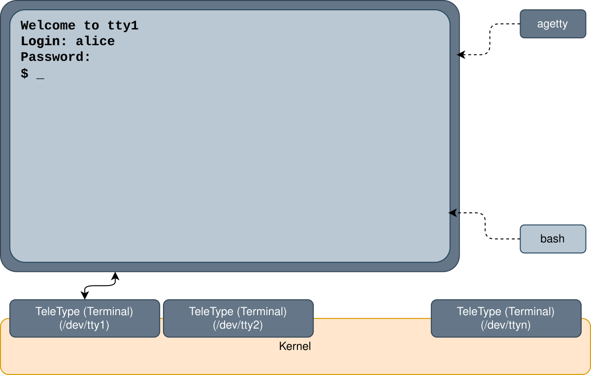
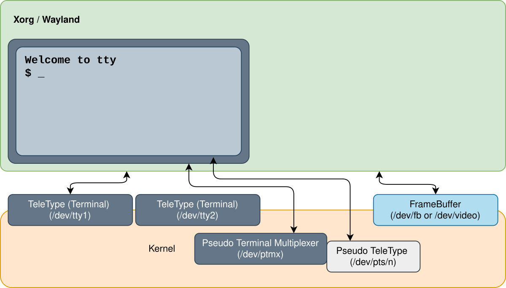

# 04. Linia de comandă

În al treilea laborator ați învățat să redirectați ce citește și ce scrie o comandă și să inspectați procesele din
sistem. Acum ne uităm mai atent la **shell** și la **terminalul** în care rulează. Porniți comenzi în
**background**, le opriți, le aduceți înapoi și le trimiteți **semnale**. Definiți **variabile** și vedeți care dintre
ele ajung la comenzile pe care le porniți. La final aflați exact ce face shell-ul cu o linie de text
înainte să pornească o comandă: cum o împarte în **cuvinte**, ce fac **ghilimelele** și **globurile** și cum găsește
**programul** de rulat.

Ideea cea mai importantă a laboratorului este că o comandă nu vede niciodată ce tastați. Shell-ul citește linia,
înlocuiește variabilele și globurile, elimină ghilimelele, pregătește redirectările, găsește programul și abia apoi îl
pornește, cu o listă de cuvinte drept parametri.

## Obiective {/* #objectives */}

- Să înțelegeți ce sunt un **terminal**, un **pseudoterminal** și un **shell** și să folosiți **terminalele virtuale**
- Să trimiteți **semnale** proceselor cu comanda `kill` și de la tastatură și să **tratați** un semnal cu `trap`
- Să rulați comenzi în **background** și să le gestionați ca **job-uri** cu `&`, `jobs`, `fg`, `bg` și `kill %N`
- Să vedeți cum sunt grupate procesele unui terminal în **grupuri de procese** și **sesiuni** și să lăsați o comandă să
  ruleze și după ce se închide terminalul, cu `nohup`
- Să folosiți **variabile de shell** și **variabile de mediu**, cu `export`, `unset`, `printenv` și `env`, precum și
  parametrii speciali `$?`, `$$` și `$!`
- Să împărțiți o linie de comandă în **părțile** ei: atribuirile, comanda, parametrii și redirectările
- Să folosiți **ghilimelele** și `\` ca să controlați cum împarte shell-ul cuvintele și cum înlocuiește variabilele
- Să selectați fișiere cu **globuri**: `*`, `?`, `[...]`, `[!...]`, `**` și `{...}`
- Să deosebiți comenzile **interne** de cele **externe** cu `type` și să înțelegeți cum caută shell-ul în `PATH`

## Resurse {/* #resources */}

1. _[Razvan Deaconescu, Razvan Rughinis, Mihai Carabas, Alexandru Radovici, Utilizarea Sistemelor de
   Operare, Printech 2021](https://github.com/systems-cs-pub-ro/carte-uso/releases/download/uso-ed1-2021/uso.pdf)_
   - Capitolul 4 - _Procese_, secțiunile 4.3.3, 4.5.2 și 4.6.1
   - Capitolul 7 - _Interfața în linia de comandă_, secțiunile 7.1 și 7.2.3 - 7.2.5
   - Capitolul 9 - _Pornirea sistemului_, secțiunea 9.6.1
2. _Brian Ward, How LINUX Works, 3rd Edition, No Starch Press, 2021_
   - Capitolul 2 - _Basic Commands and Directory Hierarchy_, secțiunile 2.1, 2.2, 2.4.2, 2.8 - 2.10 și 2.16
   - Capitolul 3 - _Devices_, secțiunea 3.4
   - Capitolul 11 - _Introduction to Shell Scripts_, secțiunea 11.2
3. Slide-urile cursului: [04. Interfața în linia de comandă](/docs/lectures/04)
4. Paginile de manual: `man bash` (căutați `QUOTING`, `EXPANSION`, `Pathname Expansion`, `JOB CONTROL`, `SIGNALS` și
   `Shell Variables`), `man 7 signal`, `man kill`, `man nohup`, `man env`, `man printenv`, `man tty` și `man ps`

## Terminale {/* #terminals */}

Pe vremuri, un calculator era folosit în comun de mulți utilizatori. Fiecare avea un **terminal**: o tastatură și un
ecran (sau o imprimantă), fără procesor, legate printr-un cablu de calculator. Aceste terminale erau _TeleTypes_
(teleimprimatoare), de aceea Linux încă numește un terminal **TTY**.


Terminalele doar trimiteau tastele către calculator și afișau ce primeau înapoi: toate programele rulau pe mainframe.

Astăzi, nucleul îi dă fiecărui program care rulează într-un terminal un **dispozitiv de terminal**, un fișier special
din `/dev`. Programul citește tastele din el și scrie textul în el, prin descriptorii de fișier `0`, `1` și `2`.

| Dispozitiv                              | Ce este                                                                                            |
| --------------------------------------- | -------------------------------------------------------------------------------------------------- |
| `/dev/tty1` ... `/dev/tty6`             | **terminalele virtuale** ale nucleului: fiecare folosește ecranul și tastatura calculatorului, pe rând |
| `/dev/pts/0`, `/dev/pts/1`, ...         | **pseudoterminalele**: câte unul pentru fiecare fereastră sau tab de terminal și pentru fiecare conexiune SSH |
| `/dev/tty`                              | întotdeauna terminalul procesului care îl deschide                                                 |

### Terminale virtuale {/* #virtual-terminals */}

Un calculator de azi are un singur ecran și o singură tastatură, dar nucleul le face să arate ca mai multe terminale:
**terminalele virtuale** (*virtual terminals*). Fiecare funcționează ca unul dintre terminalele de odinioară, cu propria
autentificare și propriile programe, însă pe ecran apare doar unul la un moment dat.



În imaginea de mai sus, pe `/dev/tty1`, `agetty` a afișat promptul de autentificare, iar după autentificare shell-ul
lui `alice`, `bash`, folosește același terminal. Și interfața grafică rulează într-unul dintre terminalele virtuale, de
obicei în primul sau în al doilea. Înainte să plecați din ea, aflați în care, ca să știți cum vă întoarceți. Rulați
într-un terminal din Sway:

```shell-session
[student@fedora ~]$ loginctl show-session $XDG_SESSION_ID -p VTNr
VTNr=2
```

`loginctl` îi cere lui `systemd` informații despre sesiunea voastră: în cazul de față, Sway rulează în al doilea
terminal virtual, `/dev/tty2`. <kbd>Ctrl</kbd>+<kbd>Alt</kbd>+<kbd>F&lt;n&gt;</kbd> comută pe terminalul virtual `n`:

| Combinație de taste                                            | Unde ajungeți                                                              |
| -------------------------------------------------------------- | -------------------------------------------------------------------------- |
| <kbd>Ctrl</kbd>+<kbd>Alt</kbd>+<kbd>F3</kbd> ... <kbd>F6</kbd> | un terminal în mod text, `/dev/tty3` ... `/dev/tty6`                       |
| <kbd>Ctrl</kbd>+<kbd>Alt</kbd>+<kbd>F2</kbd>                   | înapoi în Sway, dacă `VTNr` este `2` (<kbd>F1</kbd> dacă este `1`)         |

Într-un terminal în mod text, un program numit `agetty` așteaptă un utilizator. Autentificați-vă cu utilizatorul și
parola: `login` le verifică și pornește shell-ul, `bash`.

```shell-session
fedora login: student
Password:
[student@fedora ~]$ tty
/dev/tty3
[student@fedora ~]$ exit
```

- `tty` a afișat numele terminalului shell-ului: de data aceasta un terminal virtual, `/dev/tty3`.
- `exit` a închis shell-ul, iar `agetty` așteaptă o nouă autentificare.
- <kbd>Ctrl</kbd>+<kbd>Alt</kbd>+<kbd>F2</kbd> vă duce înapoi în Sway, cu toate ferestrele exact cum le-ați lăsat: Sway
  a rulat în continuare cât ați lipsit.

:::caution

Într-o mașină virtuală **VirtualBox**, <kbd>Ctrl</kbd>+<kbd>Alt</kbd>+<kbd>F3</kbd> este preluată de sistemul de
operare gazdă, nu de mașina virtuală. Folosiți în schimb <kbd>Host</kbd>+<kbd>F3</kbd> (tasta <kbd>Host</kbd> este de
obicei <kbd>Ctrl</kbd> din dreapta) și <kbd>Host</kbd>+<kbd>F2</kbd> ca să reveniți. Alte mașini virtuale au un meniu
din care trimiteți aceste taste.

:::

:::tip

Dacă nu știți unde este Sway, încercați <kbd>Ctrl</kbd>+<kbd>Alt</kbd>+<kbd>F1</kbd> și <kbd>F2</kbd>. Una dintre ele
vă duce în Sway; cealaltă afișează un ecran de autentificare sau un terminal text.

:::

### Emulatoare de terminal {/* #terminal-emulators */}

Interfața grafică, Xorg sau Wayland (Sway este un compozitor Wayland), preia unul dintre terminalele virtuale și
desenează pe ecran prin _framebuffer_-ul nucleului. Aici, terminalul este o **aplicație grafică**, un **emulator de
terminal** (*terminal emulator*): `foot`, `kitty`, `ptyxis`, `alacritty`, `ghostty`, ... Fiecare fereastră a unui
emulator de terminal îi cere nucleului un **pseudoterminal** (*pseudo terminal*): deschide `/dev/ptmx`, iar nucleul
creează un nou `/dev/pts/<n>`.



Un pseudoterminal are două capete. Emulatorul de terminal păstrează un capăt, **master**-ul, pe care îl citește și îl
scrie ca pe un fișier. Celălalt capăt, **slave**-ul, este fișierul `/dev/pts/<n>` și se comportă exact ca un terminal
adevărat. Când pornește shell-ul, emulatorul redirectează `/dev/pts/<n>` ca `0`, `1` și `2` ale shell-ului.


Emulatorul scrie în master tastele pe care le apăsați, iar shell-ul le citește din slave. Ce scrie shell-ul în slave
iese prin master, iar emulatorul desenează în fereastra lui. Shell-ul nu știe că există o fereastră: el vede doar un
terminal.

```shell-session
[student@fedora ~]$ tty
/dev/pts/0
[student@fedora ~]$ ps
    PID TTY          TIME CMD
   2817 pts/0    00:00:00 bash
   3104 pts/0    00:00:00 ps
[student@fedora ~]$ ls /dev/pts
0  1  ptmx
[student@fedora ~]$ ls -l /proc/$$/fd/0
lrwx------. 1 student student 64 Oct 20 10:02 /proc/2817/fd/0 -> /dev/pts/0
```

- Shell-ul rulează în prima fereastră de terminal, `/dev/pts/0`, iar `ps` a afișat doar procesele acestui terminal.
- Sunt deschise două ferestre, deci există două pseudoterminale, `0` și `1`.
- Intrarea standard a shell-ului este pseudoterminalul, cum ați văzut în laboratorul 03.

:::tip

Un pseudoterminal este un fișier: ce scrieți în el apare în fereastra terminalului respectiv. Cu două terminale
deschise, `echo hello > /dev/pts/1` rulat în primul scrie `hello` în al doilea.

:::

## Semnale {/* #signals */}

Un **semnal** (*signal*) este un mesaj scurt pe care sistemul de operare i-l trimite unui proces: un **număr**, cu un
nume care începe cu `SIG`. Când sosește un semnal, procesul se oprește din ce făcea și execută **acțiunea implicită** a
semnalului sau, dacă are una, propria **rutină de tratare a semnalului** (*signal handler*), apoi își continuă
treaba.

| Acțiune implicită | Ce se întâmplă cu procesul                                            |
| -------------- | ------------------------------------------------------------------------ |
| _Term_    | se încheie                                                               |
| _Core_    | se încheie și lasă o copie a memoriei sale (un _core dump_), pentru depanare |
| _Stop_         | este pus pe pauză, până primește `SIGCONT`                               |
| _Cont_     | își continuă execuția, dacă era oprit; altfel nu se întâmplă nimic       |
| _Ign_       | nimic, semnalul este ignorat                                             |

:::info

Pe Fedora, fișierele core dump nu apar în directorul curent: le păstrează `systemd-coredump`. `coredumpctl list` le
afișează, cel mai nou la final.

:::

Semnalele pe care le veți folosi cel mai des:

| Număr  | Semnal    | Acțiune implicită | Se trimite când                                                           | Poate fi tratat? |
| ------ | --------- | -------------- | ---------------------------------------------------------------------------- | --------------- |
| `1`    | `SIGHUP`  | Term      | s-a închis terminalul (_hang up_)                                            | da              |
| `2`    | `SIGINT`  | Term      | ați apăsat <kbd>Ctrl</kbd>+<kbd>C</kbd> (_interrupt_)                        | da              |
| `3`    | `SIGQUIT` | Core      | ați apăsat <kbd>Ctrl</kbd>+<kbd>\\</kbd>                                      | da              |
| `9`    | `SIGKILL` | Term      | cineva vrea ca procesul să se încheie **acum**                               | **nu**          |
| `15`   | `SIGTERM` | Term      | cineva îi cere procesului să se încheie; semnalul implicit al lui `kill`     | da              |
| `18`   | `SIGCONT` | Cont       | `fg` sau `bg` continuă un job oprit                                          | da, dar procesul continuă oricum |
| `19`   | `SIGSTOP` | Stop           | cineva vrea ca procesul să se oprească **acum**                              | **nu**          |
| `20`   | `SIGTSTP` | Stop           | ați apăsat <kbd>Ctrl</kbd>+<kbd>Z</kbd>                                       | da              |
| `21`   | `SIGTTIN` | Stop           | un proces din background a încercat să citească din terminal                 | da              |

Numerele de la `18` la `21` sunt valabile pe calculatoarele x86 și ARM; alte procesoare folosesc alte numere. În
comenzi folosiți **numele**, `kill -CONT`, nu `kill -18`: ele merg peste tot. Lista completă se găsește în
`man 7 signal`.

### Trimiterea unui semnal: `kill` {/* #sending-a-signal-kill */}

În ciuda numelui, `kill` **trimite un semnal**. Doar `SIGTERM`, semnalul implicit, îi cere procesului să se încheie.

| Comandă                         | Ce face                                                         |
| ------------------------------- | --------------------------------------------------------------- |
| `kill -l`                       | Listează toate semnalele, cu numerele lor                       |
| `kill -l <NUMBER>`         | Afișează numele unui semnal: `kill -l 15` afișează `TERM`       |
| `kill <PID>`                    | Îi trimite procesului `SIGTERM`, semnalul implicit              |
| `kill -KILL <PID>`              | Trimite `SIGKILL`; `kill -9 <PID>` și `kill -SIGKILL <PID>` fac același lucru |
| `kill -STOP <PID>`              | Oprește procesul                                                |
| `kill -CONT <PID>`              | Continuă procesul oprit                                         |
| `kill <PID1> <PID2> ...`        | Trimite semnalul (`SIGTERM` sau cel pe care îl dați) mai multor procese |
| `kill %<N>`                     | Trimite semnalul job-ului `N` al acestui shell (vedeți [job-urile](#foreground-and-background)) |

Pornim `sleep 1000` în al doilea terminal și îi trimitem semnale din primul:

```shell-session
[student@fedora ~]$ pgrep sleep
3150
[student@fedora ~]$ kill -STOP 3150
[student@fedora ~]$ ps -o pid,stat,cmd -p 3150
    PID STAT CMD
   3150 T+   sleep 1000
[student@fedora ~]$ kill -CONT 3150
[student@fedora ~]$ ps -o pid,stat,cmd -p 3150
    PID STAT CMD
   3150 S+   sleep 1000
[student@fedora ~]$ kill 3150
[student@fedora ~]$ ps -o pid,stat,cmd -p 3150
    PID STAT CMD
```

- `SIGSTOP` a pus `sleep` pe pauză: starea lui a devenit `T` (oprit).
- `SIGCONT` l-a făcut să continue: așteaptă din nou (`S`).
- `SIGTERM` l-a încheiat: `ps` nu mai găsește niciun proces cu acest PID, iar al doilea terminal afișează `Terminated`.

:::caution

Folosiți `kill -KILL` doar când `kill` simplu nu merge. `SIGTERM` îi lasă programului timp să facă ordine înainte să se
încheie (să-și salveze fișierele, să-și șteargă fișierele temporare), pe când `SIGKILL` nu-i dă nicio șansă.

:::

### Taste care trimit semnale {/* #keys-that-send-signals */}

Terminalul transformă unele taste în semnale pentru procesul care rulează în **foreground** (*în prim-plan*), adică
cel care citește tastatura:

| Combinație de taste           | Trimite   | Ce se întâmplă, implicit                                                     |
| ----------------------------- | --------- | ---------------------------------------------------------------------------- |
| <kbd>Ctrl</kbd>+<kbd>C</kbd>  | `SIGINT`  | job-ul din foreground se încheie                                             |
| <kbd>Ctrl</kbd>+<kbd>\\</kbd> | `SIGQUIT` | job-ul din foreground se încheie, iar sistemul salvează un core dump         |
| <kbd>Ctrl</kbd>+<kbd>Z</kbd>  | `SIGTSTP` | job-ul din foreground este oprit, iar shell-ul afișează promptul (vedeți [mai jos](#foreground-and-background)) |
| <kbd>Ctrl</kbd>+<kbd>D</kbd>  | niciun semnal | la începutul unei linii, _sfârșit de fișier_ (*end of file*): programul nu mai citește nimic |

```shell-session
[student@fedora ~]$ sleep 100
^C
[student@fedora ~]$ sleep 100
^\Quit (core dumped)
[student@fedora ~]$ sleep 100
^Z
[1]+  Stopped                 sleep 100
```

:::info

<kbd>Ctrl</kbd>+<kbd>D</kbd> la promptul shell-ului înseamnă sfârșitul intrării **lui**: shell-ul se încheie, iar
fereastra terminalului se închide.

:::

### Tratarea unui semnal: `trap` {/* #handling-a-signal-trap */}

Un program poate înlocui acțiunea implicită a unui semnal cu propria **rutină de tratare**: o bucată din codul lui care
rulează la sosirea semnalului, în locul acțiunii implicite. Un script `bash` definește o rutină de tratare cu `trap`,
care rulează o comandă sau o funcție. Creați fișierul `~/lab04/stubborn.sh` cu `nano`:

```bash
#!/bin/bash

# the signal handler
function no_interruptions_please () {
    echo "No interruptions please"
}

# register the signal handler
trap no_interruptions_please SIGINT

while true; do
    echo "working"
    sleep 1
done
```

```shell-session
[student@fedora lab04]$ bash stubborn.sh
working
working
^CNo interruptions please
working
^CNo interruptions please
working
^\Quit (core dumped)
```

- Scriptul a scris `working` în fiecare secundă, la nesfârșit.
- <kbd>Ctrl</kbd>+<kbd>C</kbd> a trimis `SIGINT`: scriptul și-a rulat rutina de tratare, a afișat mesajul și a
  continuat să lucreze.
- <kbd>Ctrl</kbd>+<kbd>\\</kbd> a trimis `SIGQUIT`, pentru care nu există o rutină de tratare: scriptul s-a încheiat.

| Comandă                         | Ce face                                                         |
| ------------------------------- | --------------------------------------------------------------- |
| `trap '<command>' <SIGNAL>`     | Rulează `command` când sosește `SIGNAL`; ghilimelele fac din ea **un singur** cuvânt |
| `trap '' <SIGNAL>`              | **Ignoră** semnalul                                             |
| `trap - <SIGNAL>`               | Revine la acțiunea implicită                                    |
| `trap -p`                       | Afișează rutinele de tratare                                    |

:::info

`trap` păstrează rutina de tratare ca **text**, iar shell-ul rulează acest text la sosirea semnalului, ca și cum l-ați
tasta atunci. Ghilimelele decid **când** se înlocuiește o variabilă din el: între ghilimele simple, abia la sosirea
semnalului; între ghilimele duble, imediat, când rulați `trap`.

:::

:::info

`SIGKILL` și `SIGSTOP` nu pot fi tratate sau ignorate: `trap` nu le poate schimba. De aceea `kill -KILL` încheie
întotdeauna un proces.

:::

## Foreground și background {/* #foreground-and-background */}

Un terminal are **un singur** job în **foreground**: acesta citește tastatura și primește semnalele tastelor, iar
shell-ul așteaptă să se încheie înainte să afișeze din nou promptul. Toate comenzile rulate până acum au rulat în
foreground.

Shell-ul poate porni comenzi și în **background** (*în fundal*). Acestea se numesc **job-uri**: shell-ul nu le
așteaptă și afișează imediat promptul, așa că ele rulează în același timp cu comenzile pe care le tastați. Un job este
fie _în rulare_ (*running*), fie _oprit_ (*stopped*).


O comandă pornește în foreground (`cmd`) sau în background (`cmd &`). <kbd>Ctrl</kbd>+<kbd>Z</kbd> oprește procesul
din foreground și îl mută în background, `bg` continuă în background un job oprit, iar `fg` aduce un job înapoi în
foreground. Restul secțiunii le arată pe rând.

### Pornirea unui job: `&` {/* #starting-a-job- */}

Puneți `&` la finalul unei comenzi ca s-o rulați în background:

```shell-session
[student@fedora ~]$ sleep 100 &
[1] 4242
[student@fedora ~]$ sleep 200 &
[2] 4250
[student@fedora ~]$ jobs
[1]-  Running                 sleep 100 &
[2]+  Running                 sleep 200 &
[student@fedora ~]$ echo $!
4250
[student@fedora ~]$ kill %1
[student@fedora ~]$
[1]-  Terminated              sleep 100
```

- `[1]` este **ID-ul job-ului** (*job ID*), care există doar în acest shell; `4242` este **PID-ul**, valabil în tot
  sistemul.
- `jobs` a listat job-urile acestui shell: `+` marchează job-ul curent (ultimul), iar `-` pe cel dinainte.
- `$!` este PID-ul ultimului job pornit cu `&`.
- `%1` înseamnă _job-ul 1_: `kill %1` i-a trimis `SIGTERM`, iar shell-ul a anunțat că s-a încheiat când a afișat
  următorul prompt.

| Comandă        | Ce face                                                              |
| -------------- | -------------------------------------------------------------------- |
| `command &`    | Rulează `command` în background, ca job                              |
| `jobs`         | Listează job-urile acestui shell                                     |
| `jobs -l`      | Le listează împreună cu PID-urile lor                                |
| `fg %<N>`      | Aduce job-ul `N` în **foreground** (și îl continuă, dacă este oprit) |
| `bg %<N>`      | Continuă în **background** job-ul **oprit** `N`                      |
| `kill %<N>`    | Trimite `SIGTERM` job-ului `N`                                       |
| `fg`, `bg`     | Fără `%<N>`, lucrează cu job-ul curent, cel marcat cu `+`            |

:::caution

Un job scrie tot în același terminal, așa că rezultatul lui se amestecă cu comenzile pe care le tastați. Redirectați-i
ieșirea, de exemplu `find / -name passwd > found.txt 2> /dev/null &`.

:::

### Oprire și continuare: `fg` și `bg` {/* #stopping-and-continuing-fg-and-bg */}

O comandă care rulează în foreground poate fi mutată ulterior în background:

1. apăsați <kbd>Ctrl</kbd>+<kbd>Z</kbd>: comanda se oprește (`SIGTSTP`), iar shell-ul îi afișează ID-ul de job, de
   exemplu `[1]+  Stopped`, și afișează promptul;
2. aflați ID-ul job-ului cu `jobs`;
3. rulați `bg %<N>`: job-ul își continuă execuția (`SIGCONT`) în background.

:::tip
`fg %<N>` îl aduce înapoi în foreground.
:::

```shell-session
[student@fedora ~]$ sleep 100 > /dev/null
^Z
[1]+  Stopped                 sleep 100 > /dev/null
[student@fedora ~]$ jobs
[1]+  Stopped                 sleep 100 > /dev/null
[student@fedora ~]$ bg %1
[1]+ sleep 100 > /dev/null &
[student@fedora ~]$ jobs
[1]+  Running                 sleep 100 > /dev/null &
[student@fedora ~]$ fg %1
sleep 100 > /dev/null
^C
```

- După <kbd>Ctrl</kbd>+<kbd>Z</kbd>, `sleep` s-a oprit, iar shell-ul a afișat promptul.
- `bg` l-a făcut să continue în background (shell-ul l-a afișat cu un `&` la final).
- `fg` l-a adus înapoi în foreground: shell-ul îl așteaptă din nou, iar <kbd>Ctrl</kbd>+<kbd>C</kbd> ajunge la el.

:::tip

<kbd>Ctrl</kbd>+<kbd>Z</kbd> vă ajută când ați uitat `&` sau când vreți să lăsați puțin deoparte un program, de exemplu
`nano` sau `less`, să rulați o comandă și apoi să vă întoarceți cu `fg`.

:::

### Job-uri care citesc tastatura {/* #jobs-that-read-the-keyboard */}

Doar procesul din foreground poate citi tastatura. Un job care încearcă s-o citească primește `SIGTTIN` și este
**oprit**:

```shell-session
[student@fedora ~]$ cat &
[1] 4321
[student@fedora ~]$
[1]+  Stopped                 cat
[student@fedora ~]$ fg
cat
hello
hello
^D
```

Fără parametri, `cat` citește tastatura, așa că s-a oprit imediat. `fg` l-a adus în foreground, unde poate citi: a
afișat înapoi fiecare linie, până la <kbd>Ctrl</kbd>+<kbd>D</kbd>.

:::info

Un shell care mai are job-uri oprite nu se închide din prima: `exit` afișează `There are stopped jobs.` și abia al
doilea `exit` îl închide (și încheie job-urile).

:::

## Sesiuni și grupuri de procese {/* #sessions-and-process-groups */}

Nucleul grupează procesele unui terminal pe două niveluri:

| Grup              | Ce este                                                                    | ID-ul lui: PID-ul **liderului**                  | Liderul                                        |
| ----------------- | -------------------------------------------------------------------------- | ------------------------------------------------ | ---------------------------------------------- |
| **grup de procese** (*process group*) | un **job**: toate procesele unei linii de comandă; `sleep 100 \| cat` este un grup de două procese | `PGID`: primul proces din linia de comandă | **liderul grupului**                           |
| **sesiune** (*session*) | toate grupurile de procese ale **unui terminal**                     | `SID`, PID-ul shell-ului                         | **liderul sesiunii**: shell-ul, `s` în `STAT`  |

Terminalul este **terminalul de control** (*controlling terminal*) al sesiunii. Intrarea lui și semnalele tastelor
(<kbd>Ctrl</kbd>+<kbd>C</kbd>, <kbd>Ctrl</kbd>+<kbd>Z</kbd>, ...) merg la **grupul de procese din foreground**, deci
ajung la **fiecare** proces al job-ului din foreground. În coloana `STAT` a lui `ps`, `+` marchează procesele din
grupul din foreground.

```shell-session
[student@fedora ~]$ echo $$
3000
[student@fedora ~]$ sleep 100 | cat &
[1] 4243
[student@fedora ~]$ ps -o pid,ppid,pgid,sid,tty,stat,comm
    PID    PPID    PGID     SID TT       STAT COMMAND
   3000    2990    3000    3000 pts/0    Ss   bash
   4242    3000    4242    3000 pts/0    S    sleep
   4243    3000    4242    3000 pts/0    S    cat
   4250    3000    4250    3000 pts/0    R+   ps
```

- `bash` este liderul sesiunii: PID-ul lui este `SID`-ul tuturor proceselor din terminal și are un `s` în `STAT`.
- `sleep` și `cat` formează un singur job, deci un singur grup: `4242`, PID-ul lui `sleep`, primul proces al job-ului.
- `ps` rulează în foreground (`+`), într-un grup separat.

### Închiderea terminalului: `SIGHUP` și `nohup` {/* #closing-the-terminal-sighup-and-nohup */}

Când se închide terminalul, nucleul îi trimite `SIGHUP` (_hang up_) liderului sesiunii, adică shell-ului. Shell-ul
trimite `SIGHUP` tuturor job-urilor sale, iar acestea se încheie. O comandă pornită cu **`nohup`** ignoră `SIGHUP`,
așa că rulează în continuare:

```shell-session
[student@fedora ~]$ sleep 1000 &
[1] 4300
[student@fedora ~]$ nohup sleep 2000 > /dev/null &
[2] 4301
nohup: ignoring input
```

Închidem fereastra acestui terminal și căutăm cele două job-uri dintr-un alt terminal:

```shell-session
[student@fedora ~]$ pgrep -a sleep
4301 sleep 2000
[student@fedora ~]$ ps -o pid,ppid,sid,tty,comm -p 4301
    PID    PPID     SID TT       COMMAND
   4301       1    3000 ?        sleep
```

- `sleep 1000` a primit `SIGHUP` și s-a încheiat.
- `sleep 2000` l-a ignorat și rulează în continuare, fără terminal (`?`); părintele lui s-a încheiat, așa că noul
  părinte este procesul cu PID-ul `1`.

:::info

Dacă nu-i redirectați ieșirea, `nohup` o scrie în fișierul `nohup.out`, pentru că terminalul nu va mai exista:
`nohup: ignoring input and appending output to 'nohup.out'`.

:::

:::caution

Dacă shell-ul este omorât cu `SIGKILL`, nu mai apucă să trimită `SIGHUP` job-urilor sale: acestea rulează în
continuare, fără terminal, chiar și fără `nohup`.

:::

## Variabile de mediu {/* #environment-variables */}

Fiecare proces are un **mediu** (*environment*): o listă de variabile, fiecare scrisă ca `NAME=value`. Programele îl
citesc ca să se configureze: `HOME` le spune care este directorul utilizatorului, `LANG` care este limba, iar `PATH`
unde să caute programe. Numele țin cont de majuscule și minuscule (`HOME` și `home` sunt variabile diferite) și, prin
convenție, se scriu cu **MAJUSCULE**.

Un proces își **primește** mediul de la părinte când pornește: de obicei o **copie** a mediului părintelui. De acolo
înainte, cele două sunt separate: o schimbare într-unul nu ajunge în celălalt.

| Comandă            | Ce face                                                             |
| ------------------ | ------------------------------------------------------------------- |
| `printenv`         | Afișează toate variabilele de mediu                                 |
| `printenv <NAME>`  | Afișează valoarea unei variabile                                    |
| `env`              | Afișează toate variabilele de mediu, ca `printenv`                  |
| `echo $NAME`       | **Shell-ul** înlocuiește `$NAME` cu valoarea ei, apoi `echo` o afișează |

```shell-session
[student@fedora ~]$ printenv HOME
/home/student
[student@fedora ~]$ echo "I am $USER, my shell is $SHELL"
I am student, my shell is /bin/bash
[student@fedora ~]$ env | wc -l
35
```

### Variabile de shell și `export` {/* #shell-variables-and-export */}

Shell-ul are două feluri de variabile:

- **variabile de shell**: există doar în interiorul acestui shell;
- **variabile de mediu**: fac parte din mediu, deci fiecare comandă pornită din acest shell primește o copie a lor.

| Sintaxă                 | Ce face                                                                      |
| ----------------------- | ---------------------------------------------------------------------------- |
| `NAME=value`            | Creează o **variabilă de shell** sau schimbă valoarea unei variabile existente |
| `export NAME`           | Face din variabilă o **variabilă de mediu**: o primește fiecare comandă pornită **de acum înainte** |
| `export NAME=value`     | Ambele deodată                                                               |
| `NAME=value command`    | O variabilă de mediu **doar pentru** `command`; shell-ul n-o păstrează       |
| `unset NAME`            | Șterge variabila, din shell și din mediu                                     |
| `$NAME`              | Shell-ul îl înlocuiește cu valoarea variabilei sau cu nimic, dacă variabila nu există |
| `${NAME}`            | La fel, dar cu limite clare: `"${NAME}_old"` este valoarea urmată de `_old`; `"$NAME_old"` este variabila `NAME_old` |

```shell-session
[student@fedora ~]$ GREETING=hello
[student@fedora ~]$ echo $GREETING
hello
[student@fedora ~]$ bash -c 'echo "child: $GREETING"'
child:
[student@fedora ~]$ export GREETING
[student@fedora ~]$ bash -c 'echo "child: $GREETING"'
child: hello
[student@fedora ~]$ unset GREETING
[student@fedora ~]$ echo "[$GREETING]"
[]
```

- `GREETING=hello` a creat o variabilă de shell, iar shell-ul a înlocuit `$GREETING` cu `hello`.
- `bash -c '...'` pornește un shell **nou**, un copil, care rulează textul dintre ghilimele. Copilul nu a primit
  `GREETING`, pentru că variabila nu făcea parte din mediu.
- După `export`, copilul a primit o copie a variabilei.
- După `unset`, variabila nu mai există, iar `$GREETING` a fost înlocuit cu nimic.

:::danger

**Fără spații** în jurul lui `=`. `GREETING = hello` rulează comanda `GREETING`, cu parametrii `=` și `hello`:
`bash: GREETING: command not found`. Puneți valoarea între ghilimele când conține spații: `GREETING="good morning"`.

:::

:::info

Un proces își poate schimba doar **propriul** mediu și mediul copiilor pe care îi pornește **după** aceea. Un copil nu
poate schimba niciodată o variabilă a părintelui: de aceea `export` și `unset` sunt comenzi ale shell-ului, nu
programe.

:::

### O variabilă pentru o singură comandă {/* #a-variable-for-one-command */}

Scris **înaintea** unei comenzi, `NAME=value` pune variabila doar în mediul acelei comenzi:

```shell-session
[student@fedora ~]$ date +%H:%M
11:47
[student@fedora ~]$ TZ=Asia/Tokyo date +%H:%M
18:47
[student@fedora ~]$ echo "[$TZ]"
[]
[student@fedora ~]$ ls /nope
ls: cannot access '/nope': No such file or directory
[student@fedora ~]$ LANG=ro_RO.UTF-8 ls /nope
ls: nu se poate accesa '/nope': Fișier sau director inexistent
```

- `TZ` (_time zone_, fusul orar) a schimbat fusul orar doar pentru acel `date`; shell-ul nu l-a păstrat.
- `LANG` a schimbat limba mesajelor lui `ls` (dacă limba română este instalată).

### Variabile definite de sistem {/* #variables-defined-by-the-system */}

Când apare promptul, shell-ul are deja multe variabile, definite la autentificare sau de fișierele lui de pornire:

| Variabilă         | Valoare                                                                |
| ----------------- | ---------------------------------------------------------------------- |
| `HOME`            | directorul utilizatorului, `~`                                         |
| `USER`            | numele de utilizator                                                   |
| `SHELL`           | shell-ul utilizatorului, din `/etc/passwd`                             |
| `PWD`, `OLDPWD`   | directorul curent și cel anterior (`cd -` merge în `OLDPWD`)           |
| `PATH`            | directoarele cu programe, separate prin `:` (vedeți [Căutarea în `PATH`](#the-path-search)) |
| `LANG`            | limba și codificarea caracterelor                                      |
| `PS1`             | promptul; o **variabilă de shell**, neexportată                        |

:::tip

`PS1` este textul promptului, cu câteva secvențe speciale: `\u` este utilizatorul, `\h` calculatorul, `\w` directorul
curent, iar `\$` este `$` (sau `#` pentru `root`). Încercați `PS1='\u in \w \$ '`. Schimbarea ține până închideți
terminalul.

:::

### Parametri speciali: `$?`, `$$` și `$!` {/* #special-parameters---and- */}

Shell-ul mai definește câteva valori, pe care le puteți doar citi:

| Parametru | Valoare                                                                     |
| --------- | --------------------------------------------------------------------------- |
| `$?`      | **codul de ieșire** al ultimei comenzi: `0` înseamnă _succes_, orice altceva o eroare |
| `$$`      | PID-ul shell-ului                                                           |
| `$!`      | PID-ul job-ului trimis cel mai recent în background, cu `&` sau `bg`        |

```shell-session
[student@fedora ~]$ ls /nope
ls: cannot access '/nope': No such file or directory
[student@fedora ~]$ echo $?
2
[student@fedora ~]$ echo $?
0
```

`ls` a eșuat, cu codul de ieșire `2`. Al doilea `echo $?` a afișat codul de ieșire al primului `echo`, care a reușit:
`$?` se schimbă după **fiecare** comandă.

## Linia de comandă {/* #the-command-line */}

Înainte să pornească o comandă, shell-ul citește toată linia și o împarte în părți:

```shell-session
[student@fedora lab04]$ LANG=C sort -r "$HOME/my notes.txt" my\ list.txt *.csv > sorted.txt 2> errors.txt
```

| Parte                 | În exemplu                                      | Ce este                                                               |
| --------------------- | ----------------------------------------------- | --------------------------------------------------------------------- |
| atribuiri             | `LANG=C`                                        | cuvinte `NAME=value` **de la început**: variabile doar pentru această comandă |
| comanda               | `sort`                                          | primul cuvânt care nu este o atribuire sau o redirectare              |
| parametrii            | `-r`, `"$HOME/my notes.txt"`, `my\ list.txt`, `*.csv` | tot restul: opțiuni, nume de fișiere, texte                     |
| redirectări           | `> sorted.txt`, `2> errors.txt`                 | o redirectare și cuvântul de după ea; sunt pentru shell, nu pentru comandă, și pot apărea **oriunde** |

Apoi, pas cu pas, shell-ul:

1. **împarte** linia în cuvinte la spații, cu excepția celor dintre ghilimele și a celor de după un `\`;
2. **pune deoparte** atribuirile și redirectările;
3. **înlocuiește** `$NAME` și `~` cu valorile lor;
4. **împarte** din nou valorile variabilelor care nu erau între ghilimele;
5. **expandează globurile** (`*.csv`) în numele fișierelor care se potrivesc;
6. **elimină** ghilimelele și `\`;
7. pregătește redirectările și **rulează** comanda, cu cuvintele rămase drept parametri.

`sort` primește 5 parametri: `-r`, `/home/student/my notes.txt`, `my list.txt`, `a.csv` și `b.csv`. Nu vede niciodată
ghilimelele, `$`, `*` sau redirectările.

:::tip

Ca să vedeți cuvintele pe care le primește o comandă, folosiți `printf '[%s]\n'` în locul comenzii: afișează fiecare
parametru între paranteze drepte, pe câte o linie.

```shell-session
[student@fedora lab04]$ printf '[%s]\n' -r "$HOME/my notes.txt" my\ list.txt *.csv
[-r]
[/home/student/my notes.txt]
[my list.txt]
[a.csv]
[b.csv]
```

:::

### Ordinea redirectărilor {/* #the-order-of-redirects */}

Redirectările pot fi scrise oriunde în linie, chiar și înaintea comenzii, iar shell-ul le aplică **de la stânga la
dreapta**:

```shell-session
[student@fedora lab04]$ 2> errors.txt ls > list.txt /nope .
[student@fedora lab04]$ ls /nope > all.txt 2>&1
[student@fedora lab04]$ ls /nope 2>&1 > all.txt
ls: cannot access '/nope': No such file or directory
```

- Prima linie este echivalentă cu `ls /nope . > list.txt 2> errors.txt`.
- `> all.txt 2>&1`: întâi `1` merge în `all.txt`, apoi `2` merge unde merge `1` **acum**, deci tot în `all.txt`.
- `2>&1 > all.txt`: întâi `2` merge unde merge `1` în acel moment, adică pe **ecran**, apoi doar `1` se schimbă în
  `all.txt`. Eroarea a rămas pe ecran.

## Ghilimele și caracterul `\` {/* #quoting-and-escaping */}

Unele caractere au o semnificație specială pentru shell: spațiul, `$`, `*`, `?`, `[`, `{`, `~`, `>`, `<`, `|`, `&`,
`;`, `#`, `'`, `"` și `\`. **Ghilimelele** și `\` le anulează semnificația specială:

| Scris ca      | Ce face                                                                         |
| ------------- | ------------------------------------------------------------------------------- |
| `'...'`       | **ghilimele simple**: tot ce e înăuntru este text simplu, nu se înlocuiește nimic |
| `"..."`       | **ghilimele duble**: `$NAME` se înlocuiește în continuare, dar rezultatul rămâne **un singur** cuvânt; globurile nu se expandează |
| `\`           | următorul caracter este text simplu: `\ ` este un spațiu care nu desparte cuvinte, iar `\$` este un `$` |

Cu `NAME="Alice   Smith"` (trei spații), iată ce primește `echo`:

| Tastați                        | `echo` primește                 | De ce                                                       |
| ------------------------------ | ------------------------------- | ----------------------------------------------------------- |
| `echo $NAME`                   | `Alice`, `Smith`                | fără ghilimele: înlocuit, apoi împărțit la spații           |
| `echo "$NAME"`                 | `Alice   Smith`                 | ghilimele duble: înlocuit, **un singur** cuvânt, spațiile se păstrează |
| `echo '$NAME'`                 | `$NAME`                         | ghilimele simple: nu se înlocuiește **nimic**               |
| `echo \$NAME`                  | `$NAME`                         | `\$`: `$` este doar un caracter                             |
| `echo my\ file.txt`            | `my file.txt`                   | `\ `: spațiul nu desparte cuvintele                         |
| `echo "\$NAME is $NAME"`       | `$NAME is Alice   Smith`        | în `"..."`, `\$` este un `$`, iar `$NAME` se înlocuiește    |
| `echo "it's" 'say "hi"'`       | `it's`, `say "hi"`              | fiecare fel de ghilimele îl protejează pe celălalt          |
| `echo 'a\b'`                   | `a\b`                           | în `'...'`, `\` este doar un caracter                       |

```shell-session
[student@fedora ~]$ NAME="Alice   Smith"
[student@fedora ~]$ echo $NAME
Alice Smith
[student@fedora ~]$ echo "$NAME"
Alice   Smith
[student@fedora ~]$ printf '[%s]\n' $NAME
[Alice]
[Smith]
```

Observăm că `echo $NAME` a primit două cuvinte și le-a afișat cu un singur spațiu între ele: cele trei spații s-au
pierdut.

:::tip

Puneți **fiecare** variabilă între ghilimele duble, `"$NAME"`, dacă nu vreți neapărat s-o împărțiți în cuvinte. Un nume
de fișier cu spațiu, ținut într-o variabilă, strică o comandă scrisă fără ghilimele: `rm $FILE` cu
`FILE="my notes.txt"` încearcă să șteargă `my` și `notes.txt`.

:::

## Globbing {/* #globbing */}

Un **glob** este un tipar pentru nume de fișiere. Shell-ul îl înlocuiește cu numele fișierelor care se potrivesc, în
ordine alfabetică, înainte să pornească comanda. Pentru exemple folosim acest director:

```shell-session
[student@fedora glob]$ ls
docs  notes.txt  photo1.png  photo2.png  photo3.png  photoA.png  report.md  todo.txt
```

| Glob              | Se potrivește cu                                | `echo` primește                                         |
| ----------------- | ----------------------------------------------- | ------------------------------------------------------- |
| `*.txt`           | `*`: oricâte caractere, sau niciunul (dar nu `/`) | `notes.txt`, `todo.txt`                               |
| `photo?.png`      | `?`: exact un caracter                          | `photo1.png`, `photo2.png`, `photo3.png`, `photoA.png`  |
| `photo[12].png`   | `[12]`: un caracter, `1` sau `2`                | `photo1.png`, `photo2.png`                              |
| `photo[0-9].png`  | `[0-9]`: un caracter din interval               | `photo1.png`, `photo2.png`, `photo3.png`                |
| `photo[!0-9].png` | `[!0-9]`: un caracter care **nu** este în interval (merge și `[^0-9]`) | `photoA.png`                     |
| `docs/**/*.txt`   | `**`: oricâte directoare, la orice adâncime (necesită `shopt -s globstar`) | `docs/2026/exam.txt`, `docs/plan.txt` |
| `{a,b,c}.pdf`     | `{...}`: câte un cuvânt pentru fiecare, **chiar dacă fișierul nu există** | `a.pdf`, `b.pdf`, `c.pdf`      |
| `*.pdf`           | niciun fișier nu se potrivește                  | `*.pdf`, globul ca atare                                |

:::caution

Când niciun fișier nu se potrivește, `bash` îi dă comenzii globul **ca atare**: `ls *.pdf` afișează
`ls: cannot access '*.pdf': No such file or directory`. Alte shell-uri, cum este `zsh`, afișează o eroare și nu mai
rulează deloc comanda.

:::

:::info

- `*` și `?` nu se potrivesc cu `.` de la începutul unui fișier ascuns: `*` nu include `.bashrc`, dar `.*` îl include.
- `{...}` nu este un glob: generează cuvintele chiar dacă fișierele nu există, ceea ce e util ca să le creați, de
  exemplu `mkdir -p 2026/{jan,feb,mar}` sau `touch photo{4..6}.png` (`{4..6}` înseamnă `4 5 6`).
- `**` funcționează doar după `shopt -s globstar`; fără această opțiune este același lucru cu `*`.
- Între ghilimele, un glob este text simplu: `echo "*.txt"` afișează `*.txt`. Așa îi dați un tipar unei comenzi care
  știe singură să-l interpreteze, cum este `find . -name "*.txt"`.

:::

## Rularea unei comenzi {/* #running-a-command */}

### Comenzi interne și externe {/* #built-in-and-external-commands */}

Nu orice comandă este un program:

| Tip                  | Ce este                                                            | Exemple                                          | Ajutor       |
| -------------------- | ------------------------------------------------------------------ | ------------------------------------------------ | ------------ |
| comandă **internă** (*built-in*) | parte din shell: rulează **în interiorul** lui, fără un proces nou | `cd`, `export`, `unset`, `exit`, `jobs`, `fg`, `bg`, `trap`, `type` | `help <name>` |
|                      | unele sunt interne doar ca să fie mai rapide și există și ca programe | `echo`, `printf`, `kill`, `pwd`               |              |
| comandă **externă**  | un fișier executabil de pe disc, găsit în `PATH`; shell-ul îl pornește ca **proces copil** | `ls`, `sort`, `grep`, `sleep`, `bash`  | `man <name>` |

`type` vă spune ce fel de comandă este:

```shell-session
[student@fedora ~]$ type cd
cd is a shell builtin
[student@fedora ~]$ type sort
sort is /usr/bin/sort
[student@fedora ~]$ type ls
ls is aliased to `ls --color=auto'
[student@fedora ~]$ type -a echo
echo is a shell builtin
echo is /usr/bin/echo
```

- `cd` este o comandă internă, iar `sort` este fișierul `/usr/bin/sort`.
- `ls` este un **alias**: un nume scurt pentru o altă linie de comandă, aici `ls --color=auto`.
- `-a` a afișat **toate** semnificațiile numelui: `echo` este o comandă internă și există și un program cu același
  nume. Shell-ul o folosește pe prima.

:::info

`cd`, `export`, `unset` și `exit` **trebuie** să fie interne: schimbă shell-ul însuși (directorul lui curent,
variabilele lui) sau îl opresc. Un program pornit de shell este un proces copil, iar un copil nu își poate schimba
părintele.

:::

### Căutarea în `PATH` {/* #the-path-search */}

Nucleul poate porni un program doar pornind de la **calea** lui. Când primul cuvânt este un nume, shell-ul trebuie să
găsească fișierul:

1. dacă cuvântul conține un `/`, este o cale: **absolută** (`/usr/bin/sort`) sau **relativă** la directorul curent
   (`./hello`, `bin/hello`, `../tools/hello`), folosită ca atare;
2. altfel, dacă este un alias sau o comandă internă, shell-ul o rulează singur;
3. altfel, shell-ul caută prin directoarele din variabila `PATH`, **de la stânga la dreapta**, și rulează **primul**
   fișier cu acel nume;
4. dacă niciun director nu îl conține: `command not found`.

```shell-session
[student@fedora ~]$ echo $PATH
/home/student/.local/bin:/home/student/bin:/usr/local/bin:/usr/bin
[student@fedora ~]$ cd ~/lab04
[student@fedora lab04]$ ls bin
hello
[student@fedora lab04]$ hello
bash: hello: command not found
[student@fedora lab04]$ bin/hello
Hello!
[student@fedora lab04]$ PATH="$PATH:$HOME/lab04/bin"
[student@fedora lab04]$ hello
Hello!
[student@fedora lab04]$ type hello
hello is /home/student/lab04/bin/hello
```

- Shell-ul **nu** caută în directorul curent, așa că `hello` simplu nu a fost găsit.
- `bin/hello` conține un `/`, deci este o cale, iar shell-ul l-a rulat.
- După ce am adăugat `~/lab04/bin` la finalul lui `PATH`, shell-ul a găsit `hello` acolo.

:::caution

Adăugați directoare în `PATH`, nu-l înlocuiți niciodată: `PATH=~/lab04/bin` singur lasă shell-ul fără `/usr/bin`, iar
`ls`, `cat` și aproape toate celelalte comenzi devin `command not found`. Închideți terminalul și deschideți altul ca
să recăpătați vechiul `PATH`.

:::

:::tip

Pe Fedora, `~/.local/bin` și `~/bin` sunt deja în `PATH`: copiați acolo un program de-al vostru și va merge din orice
director, în orice terminal nou.

:::

## Depanare {/* #troubleshooting */}

| Problemă                                                | Soluție                                                                                                        |
| ------------------------------------------------------- | -------------------------------------------------------------------------------------------------------------- |
| <kbd>Ctrl</kbd>+<kbd>C</kbd> nu oprește un program      | Programul tratează sau ignoră `SIGINT`: încercați <kbd>Ctrl</kbd>+<kbd>\\</kbd> sau <kbd>Ctrl</kbd>+<kbd>Z</kbd> urmat de `kill %1`; în ultimă instanță, `kill -KILL <PID>` din alt terminal |
| `kill` nu încheie un proces                             | Procesul tratează `SIGTERM`: folosiți `kill -KILL <PID>`                                                       |
| Un proces oprit nu reacționează la `kill`               | Primește semnalul abia când își continuă execuția: `kill -CONT <PID>` sau folosiți `kill -KILL <PID>`          |
| `bash: kill: (4242) - Operation not permitted`          | Procesul aparține altui utilizator                                                                             |
| `bash: kill: %1: no such job` sau `fg: current: no such job` | Job-ul aparține altui terminal (fiecare shell are job-urile lui) sau s-a încheiat deja; folosiți PID-ul   |
| `[1]+  Stopped` imediat după `command &`                | Job-ul încearcă să citească tastatura: aduceți-l în foreground cu `fg` sau redirectați-i intrarea             |
| `There are stopped jobs.` când închid shell-ul          | Continuați-le sau încheiați-le (`fg`, `kill %N`); un al doilea `exit` le încheie                              |
| Un job scrie peste comenzile pe care le tastez          | Redirectați-i ieșirea într-un fișier sau în `/dev/null`                                                        |
| `bash: NAME: command not found` după `NAME = value`     | Fără spații în jurul lui `=`                                                                                   |
| Un proces copil nu vede o variabilă                     | Este o variabilă de shell: exportați-o cu `export`                                                             |
| `bash: <command>: command not found`                    | Verificați numele, apoi `echo $PATH`: directorul programului nu este în `PATH` sau `PATH` a fost înlocuit; deschideți un terminal nou |
| Un fișier din directorul curent dă `command not found`  | Shell-ul nu caută în directorul curent: rulați-l ca `./name`                                                   |
| `cannot access '*.pdf'`                                 | Niciun fișier nu se potrivește cu globul, așa că comanda l-a primit ca atare                                  |
| Un nume cu spațiu devine două fișiere                   | Puneți-l între ghilimele duble, sau variabila care îl conține                                                  |
| Shell-ul afișează `>` și așteaptă                       | Ați lăsat ghilimelele deschise: închideți-le sau apăsați <kbd>Ctrl</kbd>+<kbd>C</kbd> și tastați din nou linia        |

## Exerciții {/* #exercises */}

Exercițiile devin tot mai grele pe parcurs:

- 🧪 [Primii pași](#first-steps) (exercițiile 1 - 23) trece o dată prin **tot** ce conține laboratorul, cu exerciții ușoare;
- 🏠 [Mai departe](#going-further) (exercițiile 24 - 51) are mai multe exerciții de făcut acasă, tot mai grele;
- 📝 [Provocări](#challenges) (exercițiile 52 - 62) le conține pe cele mai grele.

Exercițiul 1 creează fișierele și directoarele de la care pornesc toate celelalte exerciții. Rulați comenzile în
`~/lab04`, dacă exercițiul nu spune altfel. Dacă modificați sau ștergeți unul dintre fișierele din exercițiul 1,
rulați din nou comenzile lui ca să-l recăpătați.

Unele exerciții vă cer lucruri pe care laboratorul nu vi le arată, de exemplu o opțiune care nu apare în tabelele de
mai sus. Găsiți-o în **pagina de manual** a comenzii (`man <command>`), cum am explicat în
[Căutarea într-o pagină de manual](/docs/labs/02#searching-in-a-manual-page) din laboratorul 02. `jobs`, `fg`, `bg`,
`trap`, `export` și celelalte comenzi interne nu au o pagină de manual proprie: folosiți `help <command>`, de exemplu
`help trap`, sau căutați în `man bash`.

Țineți **două terminale unul lângă altul** în Sway: primul pentru a rula comenzile, iar al doilea pentru a rula
comenzile pe care le inspectați sau pentru a verifica rezultatele. Multe exerciții folosesc PID-ul unui proces: pe
calculatorul vostru este altul, deci folosiți-l pe cel afișat de `pgrep`, `ps` sau `$!`.

:::danger

Nu folosiți `sudo` ca să trimiteți semnale: `sudo kill` poate încheia procesele sistemului. Trimiteți semnale doar
proceselor voastre și verificați de două ori PID-ul înainte de `kill -KILL`.

:::

### 🧪 Primii pași {/* #first-steps */}

1. **Arborele de exerciții**:
   1. rulați comenzile de mai jos ca să creați fișierele folosite în exerciții (copiați-le din browser cu
      <kbd>Ctrl</kbd>+<kbd>C</kbd> și lipiți-le în terminal cu <kbd>Ctrl</kbd>+<kbd>Shift</kbd>+<kbd>V</kbd>):

      ```bash
      mkdir -p ~/lab04/bin ~/lab04/glob/docs/2026
      cd ~/lab04
      printf 'pear\nfig\n' > 'my notes.txt'
      printf 'cherry\nBanana\napple\n' > 'my list.txt'
      printf 'banana,3\napple,5\n' > a.csv
      printf 'cherry,1\nkiwi,7\n' > b.csv
      printf '#!/bin/bash\necho Hello!\n' > bin/hello
      chmod +x bin/hello
      cat > stubborn.sh << 'EOF'
      #!/bin/bash

      # the signal handler
      function no_interruptions_please () {
          echo "No interruptions please"
      }

      # register the signal handler
      trap no_interruptions_please SIGINT

      while true; do
          echo "working"
          sleep 1
      done
      EOF
      cd ~/lab04/glob
      touch notes.txt todo.txt report.md photo1.png photo2.png photo3.png photoA.png docs/plan.txt docs/2026/exam.txt
      cd ~/lab04
      ```

   2. rulați `tree` în `~/lab04`;
   3. afișați `stubborn.sh` cu `cat`.

   **Verificare:** vedeți `bin/hello`, cele două fișiere `.csv`, `my list.txt`, `my notes.txt`, `stubborn.sh` și
   directorul `glob` cu 9 fișiere; `stubborn.sh` este scriptul din [Tratarea unui semnal](#handling-a-signal-trap).
   `chmod +x` face din `hello` un program care poate fi rulat (veți afla mai multe în laboratorul despre permisiuni). <small>→ [Navigare](/docs/labs/02#navigation)</small>

**Terminale**

2. **Ce terminal**:
   1. afișați terminalul shell-ului, în ambele terminale;
   2. listați pseudoterminalele din `/dev/pts`;
   3. deschideți un al treilea terminal și listați-le din nou, apoi închideți-l.

   **Verificare:** fiecare shell are propriul `/dev/pts/<n>`; al treilea terminal adaugă încă un număr în listă, iar
   numărul lui dispare după ce îl închideți. <small>→ [Emulatoare de terminal](#terminal-emulators)</small>

3. **Scrieți în alt terminal**:
   1. aflați terminalul celui de-al doilea shell, cu `tty`;
   2. din primul terminal, scrieți `hello from the first terminal` în al doilea, cu `echo` și o redirectare.

   **Verificare:** textul apare în al doilea terminal, fără să fi tastat nimic acolo. <small>→ [Emulatoare de terminal](#terminal-emulators)</small>

4. **Un terminal virtual**:
   1. într-un terminal din Sway, aflați cu `loginctl` în ce terminal virtual rulează Sway;
   2. comutați pe al treilea terminal virtual cu <kbd>Ctrl</kbd>+<kbd>Alt</kbd>+<kbd>F3</kbd> (<kbd>Host</kbd>+<kbd>F3</kbd>
      în VirtualBox);
   3. autentificați-vă ca `student`, afișați numele terminalului și listați-i procesele cu `ps`;
   4. ieșiți din sesiune cu `exit`;
   5. reveniți în Sway, folosind numărul afișat de `loginctl`.

   **Verificare:** `VTNr` este `1` sau `2`; `tty` afișează `/dev/tty3`, iar `ps` arată un `bash` pe `tty3`; după
   `exit`, terminalul cere din nou autentificarea; înapoi în Sway, ferestrele sunt exact cum le-ați lăsat. <small>→ [Terminale virtuale](#virtual-terminals)</small>

**Semnale**

5. **Lista semnalelor**:
   1. listați toate semnalele cu `kill`;
   2. afișați cu `kill -l` numele semnalului `9` și numărul lui `SIGCONT`.

   **Verificare:** semnalul `9` este `KILL`, iar `CONT` este `18`. <small>→ [Trimiterea unui semnal](#sending-a-signal-kill)</small>

6. **Stop și continuare**:
   1. în al doilea terminal, rulați `sleep 1000`;
   2. în primul terminal, aflați-i PID-ul și opriți-l cu un semnal;
   3. afișați-i starea cu `ps -o pid,stat,cmd -p <PID>` și uitați-vă la al doilea terminal;
   4. faceți-l să continue, afișați-i din nou starea și rulați `jobs` în al doilea terminal;
   5. încheiați-l cu `kill %1` în al doilea terminal.

   **Verificare:** starea este `T` după `SIGSTOP` și `S` după `SIGCONT`, fără `+`. Imediat ce `sleep` s-a oprit, al
   doilea shell a afișat `[1]+  Stopped (signal)`, a preluat înapoi terminalul și a afișat promptul, așa că după
   `SIGCONT`, `jobs` arată `sleep` ca `Running` în background. <small>→ [Trimiterea unui semnal](#sending-a-signal-kill)</small>

7. **Taste și semnale**:
   1. rulați `sleep 100` și încheiați-l cu <kbd>Ctrl</kbd>+<kbd>C</kbd>;
   2. rulați-l din nou și încheiați-l cu <kbd>Ctrl</kbd>+<kbd>\\</kbd>;
   3. rulați-l din nou și opriți-l cu <kbd>Ctrl</kbd>+<kbd>Z</kbd>;
   4. listați job-urile.

   **Verificare:** terminalul afișează `^C` după <kbd>Ctrl</kbd>+<kbd>C</kbd>, `Quit (core dumped)` după
   <kbd>Ctrl</kbd>+<kbd>\\</kbd> (doar `Quit` dacă fișierele core dump sunt dezactivate) și `Stopped` după
   <kbd>Ctrl</kbd>+<kbd>Z</kbd>; `sleep` apare încă în lista de job-uri. Încheiați-l cu `kill %1`. <small>→ [Taste care trimit semnale](#keys-that-send-signals)</small>

8. **Un script încăpățânat**:
   1. rulați `bash stubborn.sh`;
   2. apăsați de câteva ori <kbd>Ctrl</kbd>+<kbd>C</kbd>;
   3. opriți-l cu <kbd>Ctrl</kbd>+<kbd>\\</kbd>.

   **Verificare:** <kbd>Ctrl</kbd>+<kbd>C</kbd> afișează `No interruptions please`, iar scriptul lucrează mai departe;
   <kbd>Ctrl</kbd>+<kbd>\\</kbd> îl încheie. <small>→ [Tratarea unui semnal](#handling-a-signal-trap)</small>

**Foreground și background**

9. **Două job-uri**:
   1. porniți `sleep 300` și `sleep 400` în background;
   2. listați job-urile, apoi job-urile împreună cu PID-urile lor;
   3. afișați cu `$!` PID-ul ultimului job;
   4. încheiați primul job folosind ID-ul lui de job;
   5. încheiați și al doilea job și listați din nou job-urile.

   **Verificare:** `jobs` arată `[1]` și `[2]`, cu `+` la `[2]`; `$!` este PID-ul lui `sleep 400`; după următoarea
   comandă, shell-ul afișează `[1]-  Terminated`; la final, `jobs` nu afișează nimic. <small>→ [Pornirea unui job](#starting-a-job-)</small>

10. **În background și înapoi**:
    1. rulați `sleep 200 > /dev/null` în foreground;
    2. opriți-l de la tastatură;
    3. faceți-l să continue în background și verificați cu `jobs` că rulează;
    4. aduceți-l înapoi în foreground și încheiați-l de la tastatură.

    **Verificare:** `jobs` arată `Stopped`, apoi `Running`; după `fg`, promptul nu apare până nu apăsați
    <kbd>Ctrl</kbd>+<kbd>C</kbd>. <small>→ [Oprire și continuare](#stopping-and-continuing-fg-and-bg)</small>

11. **Job-ul curent**:
    1. porniți `sleep 300`, `sleep 400` și `sleep 500` în background;
    2. listați job-urile și găsiți-l pe cel curent;
    3. rulați `fg` **fără** ID de job și încheiați job-ul cu <kbd>Ctrl</kbd>+<kbd>C</kbd>;
    4. listați din nou job-urile și încheiați-le pe celelalte cu `kill`.

    **Verificare:** job-ul curent (`+`) este `sleep 500`, ultimul pornit, iar `fg` l-a adus în foreground; după ce s-a
    încheiat, `sleep 400` a devenit job-ul curent. <small>→ [Pornirea unui job](#starting-a-job-)</small>

**Sesiuni**

12. **Sesiune și grupuri**:
    1. afișați PID-ul shell-ului;
    2. porniți `sleep 100 | cat` în background;
    3. listați procesele terminalului cu coloanele `pid`, `ppid`, `pgid`, `sid`, `tty`, `stat` și `comm`.

    **Verificare:** toate procesele au ca `SID` PID-ul shell-ului; `sleep` și `cat` au același `PGID`, PID-ul lui
    `sleep`; `bash` are `s`, iar `ps` are `+` în `STAT`. <small>→ [Sesiuni și grupuri de procese](#sessions-and-process-groups)</small>

13. **Închideți terminalul**:
    1. deschideți un terminal nou și porniți în el `sleep 1000 &` și `nohup sleep 2000 > /dev/null &`;
    2. închideți fereastra acestui terminal;
    3. într-un alt terminal, căutați cele două procese `sleep`;
    4. încheiați `sleep 2000` cu `kill`.

    **Verificare:** doar `sleep 2000` mai rulează, fără terminal (`?`). Părintele lui s-a încheiat, așa că a fost
    adoptat: noul părinte este procesul cu PID-ul `1` sau un proces care adoptă orfanii, cum este `systemd --user`
    (vedeți care cu `ps -o pid,comm -p <PPID>`). <small>→ [Închiderea terminalului](#closing-the-terminal-sighup-and-nohup)</small>

**Variabile**

14. **Citiți variabile**:
    1. afișați `HOME`, `USER` și `SHELL` cu `printenv`;
    2. afișați propoziția `I am student and I live in /home/student` cu `echo` și variabilele `USER` și `HOME`;
    3. numărați variabilele de mediu.

    **Verificare:** propoziția conține utilizatorul și directorul vostru; există câteva zeci de variabile. <small>→ [Variabile de mediu](#environment-variables)</small>

15. **Variabilă de shell sau variabilă de mediu**:
    1. dați variabilei de shell `COLOR` valoarea `blue` și afișați-o;
    2. verificați cu `printenv COLOR` și cu `bash -c 'echo "$COLOR"'` dacă este în mediu;
    3. exportați-o și verificați din nou;
    4. ștergeți-o și afișați-o din nou.

    **Verificare:** înainte de `export`, `printenv` nu afișează nimic, iar copilul afișează o linie goală; după
    `export`, ambele afișează `blue`; după `unset`, `echo` afișează o linie goală. <small>→ [Variabile de shell și `export`](#shell-variables-and-export)</small>

16. **Doar pentru o comandă**:
    1. afișați ora cu `date +%H:%M`;
    2. afișați ora din Tokyo și din New York (`America/New_York`), definind `TZ` doar pentru `date`;
    3. afișați `TZ`.

    **Verificare:** cele trei ore sunt diferite, iar `TZ` este gol în shell. <small>→ [O variabilă pentru o singură comandă](#a-variable-for-one-command)</small>

17. **Coduri de ieșire**:
    1. rulați `ls ~/lab04` și afișați-i codul de ieșire;
    2. rulați `ls /nope` și afișați-i codul de ieșire;
    3. rulați `grep apple a.csv` și `grep pear a.csv` și afișați codul de ieșire după fiecare;
    4. rulați de două ori la rând `echo $?`.

    **Verificare:** `ls` are codul de ieșire `0`, apoi `2`; `grep` are `0` când găsește textul și `1` când nu îl
    găsește; al doilea `echo $?` afișează întotdeauna `0`. <small>→ [Parametri speciali](#special-parameters---and-)</small>

**Linia de comandă**

18. **Cuvintele unei comenzi**: Folosiți `printf '[%s]\n'` ca să vedeți ce cuvinte îi dă shell-ul unei comenzi:
    1. `printf '[%s]\n' one two   three`;
    2. `printf '[%s]\n' "one two   three"`;
    3. `printf '[%s]\n' ~ "~" '$HOME' "$HOME"`.

    **Verificare:** prima linie dă 3 cuvinte, a doua doar unul, cu spațiile păstrate; `~` și `"$HOME"` devin
    `/home/student`, iar `"~"` și `'$HOME'` rămân neschimbate. <small>→ [Linia de comandă](#the-command-line) · [Ghilimele și caracterul `\`](#quoting-and-escaping)</small>

19. **Ghilimele și variabile**:
    1. definiți `NAME="Alice   Smith"`;
    2. afișați-o cu `echo`: fără ghilimele, între ghilimele duble și între ghilimele simple;
    3. afișați textul `$NAME is Alice   Smith` cu un singur `echo` și **o singură** pereche de ghilimele duble.

    **Verificare:** fără ghilimele, cele trei spații devin unul; între ghilimele duble se păstrează; între ghilimele
    simple, `echo` afișează `$NAME`; ultimul `echo` afișează `$NAME is Alice   Smith`, cu cele trei spații. <small>→ [Ghilimele și caracterul `\`](#quoting-and-escaping)</small>

20. **Semnul dolarului**: Afișați textul `The price is $5` cu `echo`:
    1. întâi doar cu ghilimele duble și observați ce nu merge;
    2. cu ghilimele simple;
    3. cu un `\` și fără ghilimele;
    4. cu ghilimele duble și un `\`.

    **Verificare:** pasul 1 afișează `The price is`: shell-ul a înlocuit `$5` cu nimic. `$5` este al cincilea
    **parametru pozițional**, un parametru primit de un script, și este gol în shell-ul vostru. Ghilimelele simple și
    `\` anulează semnificația lui `$`, așa că pașii 2, 3 și 4 afișează `The price is $5`. <small>→ [Ghilimele și caracterul `\`](#quoting-and-escaping)</small>

21. **Globuri**: Mergeți în `~/lab04/glob` și afișați cu `echo`:
    1. toate fișierele `.png`;
    2. pozele cu o singură cifră după `photo`;
    3. pozele al căror nume **nu** are o cifră după `photo`;
    4. toate fișierele al căror nume are exact 8 caractere (numărați și extensia);
    5. toate fișierele `.pdf`;
    6. numele `photo7.png` și `photo8.png`, cu `{...}`.

    **Verificare:** `photoA.png` apare în prima și în a treia listă, nu și în a doua; a patra listă este `todo.txt`;
    al cincilea `echo` afișează `*.pdf`, pentru că niciun fișier nu se potrivește; ultimul afișează ambele nume, chiar
    dacă fișierele nu există. <small>→ [Globbing](#globbing)</small>

22. **Internă sau externă**:
    1. aflați cu `type` ce sunt `cd`, `ls`, `sort`, `type` și `sleep`;
    2. afișați toate semnificațiile lui `kill` și ale lui `echo`;
    3. afișați `PATH` și găsiți în care dintre directoarele lui se află `sort`.

    **Verificare:** `cd` și `type` sunt interne, `ls` este un alias, `sort` și `sleep` sunt în `/usr/bin`; `kill` și
    `echo` sunt interne și există și ca programe în `/usr/bin`. Pentru un program pe care l-ați rulat deja, `type`
    spune `hashed`, de exemplu `sleep is hashed (/usr/bin/sleep)`: shell-ul ține minte unde l-a găsit. <small>→ [Comenzi interne și externe](#built-in-and-external-commands) · [Căutarea în `PATH`](#the-path-search)</small>

23. **Comandă negăsită**:
    1. rulați `sl` (o greșeală de tastare pentru `ls`) și afișați codul de ieșire;
    2. aflați cu `type` dacă `sl` există;
    3. rulați `/usr/bin/nope` și afișați codul de ieșire.

    **Verificare:** shell-ul a căutat prin toate directoarele din `PATH` și nu a găsit niciun `sl`: codul de ieșire
    este `127`, codul shell-ului pentru _command not found_; `/usr/bin/nope` este o cale care nu există, iar codul de
    ieșire este tot `127`. Dacă shell-ul se oferă să instaleze un pachet pentru `sl`, răspundeți `N`. <small>→ [Căutarea în `PATH`](#the-path-search) · [Parametri speciali](#special-parameters---and-)</small>

### 🏠 Mai departe {/* #going-further */}

24. **Terminalul în ps**:
    1. listați cu `ps` procesele terminalului;
    2. afișați din `/proc/$$/fd` descriptorii de fișier `0`, `1` și `2` ai shell-ului.

    **Verificare:** coloana `TTY` din `ps` și cele trei link-uri din `/proc/$$/fd` arată același pseudoterminal ca
    `tty`. <small>→ [Emulatoare de terminal](#terminal-emulators) · [Sistemul de fișiere `/proc`](/docs/labs/03#the-proc-file-system)</small>

25. **Nume și numere**:
    1. în al doilea terminal, rulați `sleep 1000`;
    2. în primul terminal, încheiați-l cu `kill`, dând semnalul `SIGTERM` prin **numărul** lui;
    3. rulați din nou `sleep 1000` și încheiați-l, dând `SIGTERM` prin **numele** lui, cu `SIG` în față.

    **Verificare:** de ambele dăți, al doilea terminal afișează `Terminated`: `kill -15`, `kill -TERM` și
    `kill -SIGTERM` trimit același semnal. <small>→ [Trimiterea unui semnal](#sending-a-signal-kill)</small>

26. **Încheiați un proces**:
    1. în al doilea terminal, rulați `sleep 1000`;
    2. în primul terminal, încheiați-l cu `kill` și semnalul lui implicit;
    3. rulați din nou `sleep 1000` și încheiați-l cu `SIGKILL`.

    **Verificare:** al doilea terminal afișează `Terminated` prima dată și `Killed` a doua oară. <small>→ [Trimiterea unui semnal](#sending-a-signal-kill)</small>

27. **SIGINT trimis cu kill**:
    1. în al doilea terminal, rulați `bash stubborn.sh`;
    2. în primul terminal, aflați PID-ul scriptului (căutați `stubborn` cu `pgrep -f`);
    3. trimiteți-i `SIGINT` cu `kill`;
    4. încheiați-l cu `SIGTERM`.

    **Verificare:** `SIGINT` trimis cu `kill` are același efect ca <kbd>Ctrl</kbd>+<kbd>C</kbd>: mesajul apare în al
    doilea terminal; `SIGTERM` încheie scriptul, pentru că nu are o rutină de tratare pentru el. <small>→ [Trimiterea unui semnal](#sending-a-signal-kill) · [Tratarea unui semnal](#handling-a-signal-trap)</small>

28. **O pauză de la editor**:
    1. deschideți `stubborn.sh` cu `nano`;
    2. opriți `nano` cu <kbd>Ctrl</kbd>+<kbd>Z</kbd> (dacă nu se oprește, apăsați <kbd>Ctrl</kbd>+<kbd>T</kbd>, apoi
       <kbd>Ctrl</kbd>+<kbd>Z</kbd>) și rulați `ls`;
    3. întoarceți-vă în `nano` și ieșiți din el;
    4. faceți la fel cu `less stubborn.sh`.

    **Verificare:** `nano` și `less` revin exact cum le-ați lăsat. <small>→ [Oprire și continuare](#stopping-and-continuing-fg-and-bg)</small>

29. **Un job care citește**:
    1. porniți `cat` în background;
    2. listați job-urile;
    3. aduceți-l în foreground, tastați două linii și încheiați-i intrarea.

    **Verificare:** `cat` este `Stopped` imediat; în foreground afișează înapoi fiecare linie pe care o tastați, iar
    <kbd>Ctrl</kbd>+<kbd>D</kbd> îl încheie. <small>→ [Job-uri care citesc tastatura](#jobs-that-read-the-keyboard)</small>

30. **Un job cu ieșirea lui**:
    1. căutați cu `find`, în background, fișierele numite `passwd` din tot sistemul de fișiere, cu rezultatul în
       `found.txt` și erorile aruncate;
    2. rulați `jobs` până când job-ul este `Done`;
    3. afișați `found.txt`.

    **Verificare:** nu apare nimic de la `find` în terminal, iar `found.txt` conține `/etc/passwd`. <small>→ [Pornirea unui job](#starting-a-job-) · [Fișiere speciale](/docs/labs/03#special-files)</small>

31. **Job-urile aparțin unui shell**:
    1. în al doilea terminal, porniți `sleep 600` în background;
    2. în primul terminal, listați job-urile;
    3. în primul terminal, aflați PID-ul lui `sleep 600` cu `pgrep -f 'sleep 600'` și încheiați-l.

    **Verificare:** în primul terminal, `jobs` nu afișează nimic: fiecare shell are doar job-urile lui. `kill %1` nu
    merge acolo, dar `kill <PID>` merge, iar al doilea terminal afișează `Terminated` după următoarea lui comandă. <small>→ [Pornirea unui job](#starting-a-job-)</small>

32. **O tastă, tot grupul**:
    1. rulați `sleep 100 | sleep 200` în al doilea terminal;
    2. în primul terminal, listați cele două procese cu `pgrep -a sleep`;
    3. apăsați <kbd>Ctrl</kbd>+<kbd>C</kbd> în al doilea terminal și listați-le din nou.

    **Verificare:** ambele procese `sleep` s-au încheiat în același timp: semnalul a ajuns la tot grupul din
    foreground. <small>→ [Sesiuni și grupuri de procese](#sessions-and-process-groups)</small>

33. **Spații în jurul lui `=`**:
    1. rulați `GREETING = hello`;
    2. rulați `GREETING=good morning`;
    3. dați corect variabilei `GREETING` valoarea `good morning` și afișați-o.

    **Verificare:** prima comandă dă `command not found` pentru `GREETING`, a doua pentru `morning`, pentru că shell-ul
    a rulat `morning` cu `GREETING=good` în mediul lui. <small>→ [Variabile de shell și `export`](#shell-variables-and-export)</small>

34. **Directorul anterior**:
    1. mergeți în `/etc`, apoi în `~/lab04`;
    2. afișați `PWD` și `OLDPWD`;
    3. rulați `cd -` și afișați-le din nou.

    **Verificare:** `cd -` vă duce înapoi în `/etc`, iar cele două variabile își schimbă valorile între ele. <small>→ [Variabile definite de sistem](#variables-defined-by-the-system)</small>

35. **Moștenite de copii**:
    1. exportați variabila `LEVEL` cu valoarea `1`;
    2. porniți un `bash` nou (tastați doar `bash`), afișați `LEVEL` și dați-i valoarea `2`;
    3. ieșiți din copil cu `exit` și afișați din nou `LEVEL`.

    **Verificare:** copilul a afișat `1`, primit de la părinte; după `exit`, părintele are tot `1`: copilul și-a
    schimbat doar propria copie. <small>→ [Variabile de shell și `export`](#shell-variables-and-export)</small>

36. **PID-ul shell-ului**:
    1. afișați PID-ul shell-ului cu `$$` și comparați-l cu linia lui `bash` afișată de `ps`;
    2. porniți un `bash` nou (tastați `bash`) și afișați din nou `$$` și `ps`;
    3. ieșiți din el cu `exit` și afișați încă o dată `$$`.

    **Verificare:** în noul `bash`, `$$` este un alt număr, iar `ps` arată două procese `bash`; după `exit`, `$$` este
    din nou primul număr. <small>→ [Parametri speciali](#special-parameters---and-)</small>

37. **Mediul din /proc**:
    1. în al doilea terminal, rulați `MESSAGE=secret sleep 1000`;
    2. în primul terminal, aflați PID-ul lui `sleep` și afișați-i mediul din `/proc/<PID>/environ`, cu octeții `\0`
       înlocuiți cu linii noi (căutați în `man tr` cum se înlocuiește un caracter), păstrând doar linia cu `MESSAGE`;
    3. căutați la fel `MESSAGE` în mediul celui de-al doilea shell.

    **Verificare:** `sleep` are `MESSAGE=secret`, shell-ul din al doilea terminal nu. `/proc/<PID>/environ` arată
    mediul pe care l-a primit un proces când a **pornit**: o variabilă pe care shell-ul o exportă mai târziu nu apare
    acolo. <small>→ [O variabilă pentru o singură comandă](#a-variable-for-one-command) · [Sistemul de fișiere `/proc`](/docs/labs/03#the-proc-file-system)</small>

38. **Limba mesajelor**:
    1. rulați `ls /nope` cu `LANG` setat la `ro_RO.UTF-8` doar pentru `ls`;
    2. sortați `my list.txt` cu `sort` (numele conține un spațiu), apoi cu `LANG=C` doar pentru `sort`.

    **Verificare:** eroarea este în română (dacă limba este instalată); `sort` afișează `apple`, `Banana`, `cherry`,
    dar cu `LANG=C` afișează întâi `Banana`: compară octeții, iar toate majusculele vin înaintea minusculelor. <small>→ [O variabilă pentru o singură comandă](#a-variable-for-one-command)</small>

39. **Un prompt nou**:
    1. setați `PS1` astfel încât promptul să arate utilizatorul, calea directorului curent (cu `~` pentru directorul
       utilizatorului) și `$` (vedeți sfatul din [Variabile definite de sistem](#variables-defined-by-the-system));
    2. mergeți în `~/lab04/glob`;
    3. verificați dacă `PS1` este o variabilă de mediu.

    **Verificare:** promptul se schimbă imediat și arată `~/lab04/glob`; `printenv PS1` nu afișează nimic: este o
    variabilă de shell. Închideți terminalul ca să recăpătați vechiul prompt. <small>→ [Variabile definite de sistem](#variables-defined-by-the-system)</small>

40. **Desfaceți o linie de comandă**: Fără s-o rulați, scrieți ce cuvinte primește `sort` și unde merg rezultatul și
    erorile lui, pentru:

    ```bash
    LANG=C sort -r "$HOME/my notes.txt" my\ list.txt *.csv > sorted.txt 2> errors.txt
    ```

    apoi înlocuiți `sort` cu `printf '[%s]\n'` și eliminați redirectarea `> sorted.txt`, ca să vă verificați
    răspunsul.

    **Verificare:** 5 cuvinte: `-r`, `/home/student/my notes.txt`, `my list.txt`, `a.csv` și `b.csv`. Ieșirea lui
    `sort` merge în `sorted.txt`, iar erorile în `errors.txt`; `LANG=C` există doar în mediul lui. <small>→ [Linia de comandă](#the-command-line)</small>

41. **Redirectări oriunde**:
    1. rulați `2> errors.txt ls > list.txt /nope .`;
    2. afișați cele două fișiere;
    3. scrieți aceeași comandă cu redirectările la final.

    **Verificare:** de ambele dăți, `list.txt` conține fișierele din `~/lab04`, iar `errors.txt` eroarea pentru
    `/nope`. <small>→ [Ordinea redirectărilor](#the-order-of-redirects)</small>

42. **Ordinea redirectărilor**:
    1. rulați `ls /nope . > all.txt 2>&1` și afișați `all.txt`;
    2. rulați `ls /nope . 2>&1 > all.txt` și afișați `all.txt`.

    **Verificare:** prima dată, atât lista, cât și eroarea sunt în fișier; a doua oară, eroarea apare pe ecran, pentru
    că `2` a fost copiat din `1` înainte ca `1` să se schimbe. <small>→ [Ordinea redirectărilor](#the-order-of-redirects)</small>

43. **Variabile cu spații**:
    1. definiți `FILE="my notes.txt"`;
    2. rulați `cat $FILE`, apoi `cat "$FILE"`;
    3. definiți `OPTS="-t, -k2 -n"` și sortați `a.csv` și `b.csv` cu `sort $OPTS`, apoi cu `sort "$OPTS"`.

    **Verificare:** `cat $FILE` caută `my` și `notes.txt`; `cat "$FILE"` merge. `sort $OPTS` primește trei opțiuni și
    sortează liniile după numărul de după virgulă: `cherry,1`, `banana,3`, `apple,5`, `kiwi,7`. `sort "$OPTS"` primește
    un singur cuvânt, așa că `-t` ia `, -k2 -n` drept separator: `sort: multi-character tab`. <small>→ [Ghilimele și caracterul `\`](#quoting-and-escaping)</small>

44. **Nume speciale**:
    1. creați fișierele `rock & roll.txt`, `it's mine.txt` și `$HOME.txt` cu **o singură** comandă `touch`;
    2. listați-le cu `ls`, apoi cu `ls -N`;
    3. ștergeți-le cu **o singură** comandă `rm`, de data aceasta folosind `\` în loc de ghilimele.

    **Verificare:** `ls` arată numele între ghilimele, doar la afișare; `ls -N` arată exact aceste trei nume, iar
    `$HOME.txt` nu este `/home/student.txt`. `rm` le șterge pe toate trei. <small>→ [Ghilimele și caracterul `\`](#quoting-and-escaping)</small>

45. **Nume din acolade**:
    1. în `~/lab04`, creați directoarele `trips/2025` și `trips/2026` cu o singură comandă `mkdir -p` și `{...}`;
    2. creați fișierele `jan.txt`, `feb.txt` și `mar.txt` în ambele directoare, cu o singură comandă `touch`;
    3. afișați rezultatul cu `tree trips`.

    **Verificare:** `tree` arată două directoare cu câte trei fișiere; verificați ce cuvinte a generat shell-ul cu
    `echo trips/{2025,2026}/{jan,feb,mar}.txt`. <small>→ [Globbing](#globbing)</small>

46. **Mai multe globuri**: În `~/lab04/glob`:
    1. afișați toate fișierele `.txt` din `glob`, la orice adâncime (activați întâi `globstar`);
    2. afișați doar `photo1.png` și `photo2.png`, cu un singur glob;
    3. creați `photo4.png`, `photo5.png` și `photo6.png` cu un singur `touch` și un interval `{...}`;
    4. afișați fișierele ascunse din directorul utilizatorului cu `echo ~/.*` și verificați dacă lista conține `.` și
       `..`; găsiți în `man bash` opțiunea `shopt` care decide acest lucru.

    **Verificare:** prima listă conține `docs/2026/exam.txt`, `docs/plan.txt`, `notes.txt` și `todo.txt`;
    `photo?.png` se potrivește acum cu 7 fișiere; `~/.*` conține `.bashrc` și celelalte fișiere ascunse, dar nu și
    `.` și `..`: opțiunea `globskipdots` este activată implicit începând cu `bash` 5.2. <small>→ [Globbing](#globbing)</small>

47. **Glob sau text**: În `~/lab04/glob`:
    1. rulați `find . -name *.txt`;
    2. rulați `find . -name "*.txt"`;
    3. aflați de ce eșuează prima, folosind `printf '[%s]\n'` în loc de `find`.

    **Verificare:** fără ghilimele, shell-ul a înlocuit `*.txt` cu `notes.txt todo.txt` înainte să pornească `find`,
    așa că `find` a primit parametri greșiți (`find: paths must precede expression`); cu ghilimele, `find` a primit
    tiparul și a găsit toate cele 4 fișiere. <small>→ [Globbing](#globbing)</small>

48. **Rulați un program dintr-un director**: În `~/lab04`:
    1. rulați `hello`;
    2. rulați-l cu o cale relativă, apoi cu o cale absolută;
    3. mergeți în `~/lab04/bin` și rulați-l de acolo;
    4. adăugați `~/lab04/bin` la **finalul** lui `PATH`, mergeți în directorul utilizatorului și rulați `hello`.

    **Verificare:** `hello` simplu dă `command not found`, dar `bin/hello`, `/home/student/lab04/bin/hello` și, în
    `bin`, `./hello` merg; după schimbarea lui `PATH`, `hello` merge din orice director, iar `type hello` îi arată
    calea (`hello is hashed (...)`, pentru că l-ați rulat deja). <small>→ [Căutarea în `PATH`](#the-path-search)</small>

49. **Un PATH stricat**: Deschideți un terminal nou:
    1. setați `PATH` la `/tmp` și rulați `ls`;
    2. rulați `/usr/bin/ls`;
    3. rulați `cd ~` și `echo $HOME`;
    4. închideți terminalul.

    **Verificare:** `ls` dă `command not found`, dar `/usr/bin/ls` merge, pentru că este o cale; `cd` și `echo` merg
    în continuare, pentru că sunt comenzi interne. <small>→ [Căutarea în `PATH`](#the-path-search)</small>

50. **Propriul bin**:
    1. creați `~/.local/bin`, dacă nu există, și copiați acolo `bin/hello`;
    2. deschideți un terminal **nou** și rulați `hello` din directorul utilizatorului;
    3. aflați de unde a fost pornit.

    **Verificare:** `type hello` afișează `hello is hashed (/home/student/.local/bin/hello)`: pe Fedora, acest
    director este deja în `PATH`. <small>→ [Căutarea în `PATH`](#the-path-search)</small>

51. **Cine câștigă**:
    1. creați directorul `~/lab04/first` cu două programe, `ls` și `echo`, care afișează `Not the real ls!` și
       `Not the real echo!` (procedați ca pentru `bin/hello` din exercițiul 1: `printf` cu ghilimele **simple**, apoi
       `chmod +x`);
    2. adăugați `~/lab04/first` la **începutul** lui `PATH`;
    3. rulați `ls`, `\ls`, `/usr/bin/ls` și `echo hi`;
    4. rulați `type -a ls` și `type -a echo`;
    5. închideți terminalul.

    **Verificare:** `ls` și `\ls` (care ocolește aliasul) afișează amândouă `Not the real ls!`: aliasul doar înlocuiește
    cuvântul `ls` cu `ls --color=auto`, iar acest `ls` este căutat tot în `PATH`, unde `~/lab04/first` vine primul.
    `/usr/bin/ls` este o cale, deci nu se mai caută nimic. `echo hi` afișează `hi`: o comandă internă are prioritate
    față de căutarea în `PATH`. `type -a` listează semnificațiile în ordinea în care le încearcă shell-ul. <small>→ [Căutarea în `PATH`](#the-path-search)</small>

### 📝 Provocări {/* #challenges */}

52. **Ignorați și restaurați**:
    1. modificați `stubborn.sh` astfel încât să **ignore** și `SIGTERM`;
    2. rulați-l în al doilea terminal și încercați să-l încheiați din primul terminal cu `kill`, apoi cu `kill -KILL`;
    3. în shell-ul vostru, faceți ca `SIGINT` să afișeze `Not now`, apăsați <kbd>Ctrl</kbd>+<kbd>C</kbd> la prompt,
       apoi reveniți la acțiunea implicită.

    **Verificare:** `kill` nu are niciun efect asupra scriptului, iar `kill -KILL` îl încheie; `trap -p` arată rutina
    de tratare a shell-ului înainte s-o eliminați. <small>→ [Tratarea unui semnal](#handling-a-signal-trap)</small>

53. **Omorâți shell-ul**:
    1. deschideți un terminal nou și porniți în el `sleep 1000 &` și `sleep 2000 &`;
    2. afișați PID-ul acestui shell;
    3. dintr-un alt terminal, încheiați acest shell cu `SIGKILL`;
    4. listați procesele din sesiunea shell-ului omorât (căutați în `man ps` opțiunea care selectează o sesiune), cu
       coloanele `pid`, `ppid`, `sid`, `tty` și `comm`;
    5. încheiați cele două procese `sleep`.

    **Verificare:** fereastra s-a închis, dar ambele procese `sleep` rulează în continuare, fără terminal; noul lor
    părinte este procesul cu PID-ul `1` sau un proces care adoptă orfanii, cum este `systemd --user`. Shell-ul nu a
    putut să le trimită `SIGHUP`. <small>→ [Închiderea terminalului](#closing-the-terminal-sighup-and-nohup)</small>

54. **O sesiune în mod text**:
    1. autentificați-vă pe `/dev/tty3` (<kbd>Ctrl</kbd>+<kbd>Alt</kbd>+<kbd>F3</kbd>) și porniți `sleep 1000 &`;
    2. reveniți în Sway și listați procesele acelui terminal cu `ps -t tty3 -o pid,ppid,sid,stat,comm`;
    3. găsiți liderul sesiunii de pe `tty3` și părintele lui;
    4. întoarceți-vă pe `tty3`, încheiați `sleep` și ieșiți din sesiune.

    **Verificare:** `bash` este liderul sesiunii: are `s` în `STAT`, iar PID-ul lui este `SID`-ul lui `sleep`; părintele
    lui este `login`, care v-a verificat parola și l-a pornit. <small>→ [Terminale virtuale](#virtual-terminals) · [Sesiuni și grupuri de procese](#sessions-and-process-groups)</small>

55. **De ce cd este intern**: Fedora are și un program numit `cd`, în `/usr/bin`.
    1. găsiți-l cu `type -a cd`;
    2. mergeți în directorul utilizatorului, rulați `/usr/bin/cd /tmp` și afișați directorul curent;
    3. explicați ce s-a întâmplat.

    **Verificare:** directorul curent este tot directorul utilizatorului: `/usr/bin/cd` a rulat ca proces copil, și-a
    schimbat doar propriul director curent, apoi s-a încheiat. <small>→ [Comenzi interne și externe](#built-in-and-external-commands)</small>

56. **Propriul alias**:
    1. adăugați cu `nano` linia `alias lt='ls -lt'` la finalul fișierului `~/.bashrc`;
    2. rulați `lt` în același terminal, apoi într-un terminal **nou**;
    3. în terminalul vechi, rulați `source ~/.bashrc` și încercați din nou `lt`;
    4. aflați cu `type` ce este `lt`.

    **Verificare:** în terminalul vechi, `lt` dă la început `command not found`: `bash` citește `~/.bashrc` doar când
    pornește sau când îi cereți asta cu `source`; în terminalul nou, și după `source`, `lt` listează fișierele, cele
    mai noi primele, iar `type` afișează ``lt is aliased to `ls -lt'``. <small>→ [Comenzi interne și externe](#built-in-and-external-commands)</small>

57. **Un mediu gol**: Căutați în `man env` opțiunea care pornește o comandă cu un mediu **gol**.
    1. rulați `env` cu această opțiune, urmat de `bash -c 'echo "[$HOME] [$PATH]"'`;
    2. rulați `env` cu această opțiune, urmat de `bash -c 'ls'`;
    3. rulați `env` cu această opțiune, urmat de `TZ=Asia/Tokyo /usr/bin/date`.

    **Verificare:** `HOME` este gol, iar `PATH` are o valoare implicită pe care `bash` o setează singur, așa că `ls`
    merge în continuare; `date` afișează ora din Tokyo: singura variabilă pe care a primit-o este `TZ`. <small>→ [Variabile de mediu](#environment-variables)</small>

58. **PID-uri în background**:
    1. porniți `sleep 300 | sleep 400` în background;
    2. afișați `$!` și listați job-urile cu PID-urile lor;
    3. încheiați tot job-ul cu un singur `kill`, folosind ID-ul de job.

    **Verificare:** `$!` este PID-ul lui `sleep 400`, ultimul proces din pipe; `jobs -l` arată ambele PID-uri; `kill %1`
    încheie ambele procese, pentru că trimite semnalul întregului grup de procese. <small>→ [Pornirea unui job](#starting-a-job-) · [Sesiuni și grupuri de procese](#sessions-and-process-groups)</small>

59. **Numărați cu globuri**: Mergeți în `/usr/bin` și, fără `ls` sau `find`, folosind doar un glob:
    1. afișați, câte unul pe linie, programele al căror nume începe cu `g` și are exact 4 caractere (folosiți
       `printf '%s\n'`);
    2. numărați-le, în aceeași linie de comandă;
    3. faceți la fel pentru programele al căror nume se termină cu o cifră;
    4. întoarceți-vă în `~/lab04`.

    **Verificare:** primul număr este același cu cel dat de `find /usr/bin -maxdepth 1 -name 'g???' | wc -l`; prima
    listă conține `gzip` și `grep`, iar a treia conține `python3`. <small>→ [Globbing](#globbing) · [Pipe-uri](/docs/labs/03#pipes-)</small>

60. **Un alt shell**:
    1. instalați `zsh` cu `sudo dnf install zsh` și porniți-l tastând `zsh` (dacă afișează un meniu de configurare,
       apăsați <kbd>q</kbd>);
    2. în `~/lab04/glob`, rulați `echo *.pdf` și `echo docs/**/*.txt`;
    3. definiți `NAME="Alice   Smith"` și rulați `printf '[%s]\n' $NAME`;
    4. ieșiți din `zsh` cu `exit`, deschideți un terminal **nou** (ca `globstar` să fie dezactivat), mergeți în
       `~/lab04/glob`, definiți din nou `NAME` și rulați aceleași trei comenzi în `bash`.

    **Verificare:** `zsh` afișează `zsh: no matches found: *.pdf` și nu rulează `echo`; înțelege `**` fără nicio
    opțiune și **nu** împarte `$NAME` în cuvinte. `bash` afișează `*.pdf`, doar `docs/2026/exam.txt` (fără
    `globstar`, `**` este `*`) și două cuvinte. <small>→ [Globbing](#globbing) · [Ghilimele și caracterul `\`](#quoting-and-escaping)</small>

61. **Codul de ieșire al unui semnal**:
    1. rulați `sleep 100`, opriți-l cu <kbd>Ctrl</kbd>+<kbd>C</kbd> și afișați codul de ieșire;
    2. faceți la fel cu <kbd>Ctrl</kbd>+<kbd>\\</kbd>;
    3. rulați `bash -c 'kill -KILL $$'` (un shell care își trimite singur `SIGKILL`) și afișați codul de ieșire.

    **Verificare:** codurile de ieșire sunt `130`, `131` și `137`: un proces încheiat de un semnal are codul de ieșire
    `128` + numărul semnalului (`2`, `3` și `9`). <small>→ [Parametri speciali](#special-parameters---and-) · [Semnale](#signals)</small>

62. **Curățenie**:
    1. încheiați toate procesele `sleep` cu **o singură** comandă (căutați în `man pkill` cum potriviți numele exact);
    2. ștergeți `~/.local/bin/hello`, `~/lab04/first`, `~/lab04/trips`, `glob/photo4.png`, `glob/photo5.png`,
       `glob/photo6.png`, `found.txt`, `list.txt`, `errors.txt`, `all.txt` și `sorted.txt` cu o singură comandă `rm`,
       fără erori pentru cele care nu există (folosiți `{...}` pentru poze);
    3. eliminați cu `nano` aliasul `lt` de la finalul fișierului `~/.bashrc`.

    **Verificare:** `pgrep sleep` nu afișează nimic, `ls ~/lab04` arată doar fișierele din exercițiul 1, iar
    `ls ~/lab04/glob` arată aceleași 8 nume ca înainte de exercițiul 46. <small>→ [Gestionarea fișierelor](/docs/labs/02#managing-files)</small>

## Întrebări de recapitulare {/* #wrap-up-questions */}

Folosiți **ultimele 5 minute** ale laboratorului ca să răspundeți la aceste întrebări împreună cu colegii și cu
asistentul. La ultima nu există răspunsuri greșite.

1. Care este diferența dintre un **terminal**, un **emulator de terminal** și un **shell**?
2. Care este diferența dintre `SIGTERM` și `SIGKILL`? De ce nu poate fi tratat `SIGKILL`?
3. Ce se întâmplă când apăsați <kbd>Ctrl</kbd>+<kbd>C</kbd>, <kbd>Ctrl</kbd>+<kbd>Z</kbd> și <kbd>Ctrl</kbd>+<kbd>D</kbd>?
4. Care este diferența dintre un **ID de job** și un **PID**?
5. De ce se încheie job-urile unui terminal când îl închideți? Cum puteți lăsa unul să ruleze în continuare?
6. Care este diferența dintre o **variabilă de shell** și o **variabilă de mediu**?
7. De ce nu poate un proces copil să schimbe o variabilă a părintelui?
8. Care este diferența dintre `"$NAME"` și `'$NAME'`?
9. De ce nu rulează shell-ul un program din directorul curent fără `./`?
10. Care dintre tastele, globurile sau scurtăturile din acest laborator credeți că le veți folosi cel mai des?
