# 05. Utilizatori și permisiuni

În laboratorul 4 ați aflat ce face shell-ul cu o linie de comandă și cum pornește programele și le trimite semnale. În
acest laborator aflați **sub ce utilizator** rulează aceste programe. Vă uitați la **utilizatorii** și la **grupurile**
sistemului, la fișierele în care sunt păstrați, `/etc/passwd`, `/etc/shadow` și `/etc/group`, și la felul în care
sistemul verifică o **parolă** fără să o păstreze vreodată. Rulați comenzi ca `root` cu `sudo`, creați utilizatori noi,
apoi decideți cine vă poate citi, modifica și rula fișierele, cu `chmod`, `chown` și `umask`. La final întâlniți
**permisiunile speciale**: bitul `setuid`, datorită căruia `passwd` vă poate schimba parola, bitul `setgid` pentru
directoarele partajate și **bitul sticky** al lui `/tmp`.

Ideea cea mai importantă a laboratorului este că kernelul nu cunoaște niciun nume, ci doar **numere**. Fiecare proces
poartă o **etichetă**: numărul utilizatorului său (**UID**-ul) și numerele grupurilor sale (**GID**-urile). Fiecare
fișier păstrează numărul **proprietarului**, numărul **grupului** și trei seturi de **permisiuni**: pentru proprietar,
pentru grup și pentru toți ceilalți. De fiecare dată când un proces deschide un fișier, kernelul compară eticheta
procesului cu proprietarul și cu grupul fișierului, alege **unul** dintre cele trei seturi și verifică dacă permite ce
cere procesul.

## Obiective {/* #objectives */}

- Să înțelegeți ce sunt un **utilizator** și un **grup** pentru kernel: un **UID** și un **GID**
- Să aflați cine sunteți (cu `whoami`, `id` și `groups`) și sub ce utilizator rulează fiecare proces (cu `ps`)
- Să înțelegeți **credențialele** unui proces, UID-ul său **real**, **efectiv** și **salvat**, pe care dintre ele le
  verifică kernelul și când se schimbă
- Să citiți baza de date a utilizatorilor, `/etc/passwd`, și pe cea a grupurilor, `/etc/group`, cu `getent`
- Să înțelegeți cum păstrează `/etc/shadow` parolele sub formă de **hash-uri** cu **salt** și cum se verifică o parolă
- Să înțelegeți ce se întâmplă când vă **autentificați**: `agetty`, `login` și shell-ul
- Să rulați comenzi ca `root` sau ca alt utilizator, cu `sudo` și `su`, și să evitați **capcana redirectării** cu `tee`
- Să creați, să modificați și să ștergeți utilizatori și grupuri cu `useradd`, `passwd`, `usermod`, `groupadd`, `gpasswd`
  și `userdel`
- Să citiți **permisiunile** unui fișier cu `ls -l` și `stat` și să înțelegeți ce înseamnă `r`, `w` și `x` pentru
  fișiere și pentru directoare
- Să schimbați permisiunile cu `chmod` (cu litere și cu numere), proprietarul cu `chown` și `chgrp`, iar permisiunile
  implicite cu `umask`
- Să folosiți **permisiunile speciale**: `setuid`, `setgid` și **bitul sticky**
- Să înțelegeți de ce nu vă puteți baza pe **prompt** ca să aflați cine sunteți

## Resurse {/* #resources */}

1. _[Razvan Deaconescu, Razvan Rughinis, Mihai Carabas, Alexandru Radovici, Utilizarea Sistemelor de
   Operare, Printech 2021](https://github.com/systems-cs-pub-ro/carte-uso/releases/download/uso-ed1-2021/uso.pdf)_
   - Capitolul 5 - _Utilizatori_
   - Capitolul 9 - _Pornirea sistemului_, secțiunea 9.6.1
2. _Brian Ward, How LINUX Works, 3rd Edition, No Starch Press, 2021_
   - Capitolul 2 - _Basic Commands and Directory Hierarchy_, secțiunile 2.17 și 2.20
   - Capitolul 7 - _System Configuration: Logging, System Time, Batch Jobs, and Users_, secțiunile 7.3, 7.4, 7.9 și 7.10
3. Slide-urile cursului: [05. Utilizatori](/docs/lectures/05)
4. Paginile de manual: `man 5 passwd`, `man 5 shadow`, `man 5 group`, `man id`, `man getent`, `man 5 nsswitch.conf`,
   `man sudo`, `man su`, `man useradd`, `man usermod`, `man userdel`, `man gpasswd`, `man chage`, `man chmod`,
   `man chown`, `man chgrp`, `man stat`, `man login.defs` și `man bash` (căutați `umask` și `PROMPTING`)

## Fedora și Ubuntu {/* #fedora-and-ubuntu */}

Calculatoarele din laborator rulează **Fedora**, cu managerul de ferestre **Sway**, și toate exemplele din acest
laborator provin de pe ele. Acasă puteți folosi Fedora sau **Ubuntu**: toate comenzile din laborator merg pe amândouă,
însă unele nume, valori implicite și rezultate diferă. Când un exemplu sau o verificare nu se potrivește cu ce vedeți
pe Ubuntu, căutați întâi în acest tabel:

|                                                      | Fedora                               | Ubuntu                                     |
| ---------------------------------------------------- | ------------------------------------ | ------------------------------------------ |
| promptul                                             | `[student@fedora ~]$`                | `student@ubuntu:~$`, colorat               |
| grupul **administratorilor**, cei care pot folosi `sudo` | `wheel`, GID `10`                | `sudo`, GID `27` (sunteți și în `adm`, `cdrom`, ...) |
| `.` de după permisiuni în `ls -l`, `context=` în `id` | afișate: etichetele **SELinux**     | nu apar                                    |
| shell-ul unui utilizator nou creat cu `useradd`      | `/bin/bash`                          | `/bin/sh`, dacă nu dați `-s /bin/bash`     |
| un director nou al utilizatorului                    | `drwx------` (`700`)                 | `drwxr-x---` (`750`)                       |
| `/etc/shadow`                                        | `---------- root root`               | `-rw-r----- root shadow`                   |
| `/usr/bin/sudo`                                      | `---s--x--x` (`4111`)                | `-rwsr-xr-x` (`4755`)                      |
| o parolă care nu a fost încă setată sau care a fost blocată cu `passwd -l` | `!!` în fața hash-ului sau singur | `!` în fața hash-ului sau singur |
| `umask`-ul unui utilizator obișnuit                  | `0022`                               | `0002`                                     |
| instalarea unui pachet                               | `sudo dnf install <PACKAGE>`         | `sudo apt install <PACKAGE>`               |

Utilizatorul vostru poate avea și alt nume decât `student`: folosiți numele vostru oriunde laboratorul scrie `student`.

## Utilizatori {/* #users */}

Pentru voi, un utilizator este un **nume**, de exemplu `student`. Pentru kernel, un utilizator este doar un **număr**,
**UID**-ul (_User ID_). Fiecare **proces** poartă UID-ul utilizatorului care l-a pornit, ca pe o **etichetă**, pe toată
durata vieții sale, iar un proces copil **moștenește** eticheta părintelui. Când un proces îi cere kernelului să facă
ceva, de exemplu să deschidă un fișier sau să trimită un semnal, kernelul se uită la această etichetă și decide dacă
procesul are **voie** să facă acel lucru.

Utilizatorii nu sunt doar oameni. Multe servicii ale sistemului rulează sub un utilizator propriu: dacă unul dintre ele
are un bug sau este atacat, poate atinge doar propriile fișiere, nu și pe ale celorlalte servicii sau ale oamenilor.


### Cine sunt eu: `whoami` și `id` {/* #who-am-i-whoami-and-id */}

| Comandă          | Ce afișează                                                                             |
| ---------------- | --------------------------------------------------------------------------------------- |
| `whoami`         | numele utilizatorului asociat UID-ului efectiv curent                                   |
| `id`             | toată eticheta procesului: UID-ul, grupul primar (GID-ul) și toate grupurile, cu numele lor |
| `id -u`, `id -g` | doar UID-ul, doar GID-ul grupului primar                                                |
| `id -un`         | doar numele utilizatorului, ca `whoami`                                                 |
| `id -nG`         | doar numele grupurilor                                                                  |
| `id <USER>`, `groups <USER>` | eticheta unui utilizator, citită din bazele de date ale utilizatorilor și grupurilor |
| `groups`         | numele grupurilor voastre, ca `id -nG`                                                  |

```shell-session
[student@fedora ~]$ whoami
student
[student@fedora ~]$ id
uid=1000(student) gid=1000(student) groups=1000(student),10(wheel) context=unconfined_u:unconfined_r:unconfined_t:s0-s0:c0.c1023
[student@fedora ~]$ id root
uid=0(root) gid=0(root) groups=0(root)
```

- `student` are UID-ul `1000` și grupul primar `student`, cu GID-ul `1000`.
- Este și membru al grupului `wheel`: pe Fedora, membrii lui `wheel` sunt **administratorii**, cei care pot folosi
  `sudo` (vedeți [`sudo`](#sudo)).
- `context=...` este eticheta **SELinux** a procesului, un al doilea sistem de securitate folosit de Fedora. Nu aveți
  nevoie de el în acest laborator, iar Ubuntu nu îl afișează.
- `root` este utilizatorul cu UID-ul `0`, administratorul.

### Intervale de UID-uri {/* #uid-ranges */}

| UID           | Tip                            | Folosit pentru                                                 | Exemple pe Fedora                   |
| ------------- | ------------------------------ | -------------------------------------------------------------- | ----------------------------------- |
| `0`           | `root`                         | administratorul, pentru care kernelul sare peste majoritatea verificărilor | `root`                  |
| `1` - `999`   | **utilizatori de sistem**      | servicii; nu se pot autentifica, pentru că au ca shell `nologin` | `bin`, `daemon`, `dbus`, `chrony` |
| `1000` - ...  | **utilizatori obișnuiți**      | oameni                                                         | `student`                           |
| `65534`       | `nobody`                       | fișierele al căror proprietar real nu se cunoaște și procesele care nu trebuie să aibă niciun privilegiu | `nobody` |

Aceste intervale sunt doar o **convenție**: pentru kernel, toate UID-urile în afară de `0` sunt la fel. Ele se
stabilesc în `/etc/login.defs`, fișierul de setări al lui `useradd` și al celorlalte comenzi care creează utilizatori,
iar aceste comenzi iau următorul UID liber din intervalul potrivit:

```shell-session
[student@fedora ~]$ grep -E '^(UID|SYS_UID)_(MIN|MAX)' /etc/login.defs
UID_MIN                  1000
UID_MAX                 60000
SYS_UID_MIN               201
SYS_UID_MAX               999
```

### Utilizatorul unui proces {/* #the-user-of-a-process */}

`ps` afișează utilizatorul fiecărui proces în coloana `USER` (sau `UID`, ca număr):

```shell-session
[student@fedora ~]$ ps -o user,uid,pid,ppid,comm
USER       UID     PID    PPID COMMAND
student   1000    2817    2805 bash
student   1000    3104    2817 ps
[student@fedora ~]$ ps -eo user | sort | uniq -c
      4 chrony
      2 dbus
      ...
    156 root
     51 student
```

- `bash` și `ps` rulează ca `student`: `ps` este copilul lui `bash` și i-a moștenit eticheta.
- `ps -eo user` afișează utilizatorul **fiecărui** proces, iar `sort | uniq -c` le numără (vedeți
  [Pipe-uri](/docs/labs/03#pipes-) în laboratorul 03). Majoritatea proceselor din sistem rulează ca `root`.

:::info

`ps` primește de la kernel doar UID-urile. Ca să afișeze un nume, caută fiecare UID în baza de date a utilizatorilor;
dacă UID-ul nu există acolo, de exemplu pentru că utilizatorul a fost șters, afișează numărul. `ls -l`, `id` și
promptul fac la fel.

:::

### Credențialele unui proces {/* #the-credentials-of-a-process */}

Eticheta unui proces înseamnă mai mult decât un UID și o listă de grupuri. Pentru fiecare proces, kernelul păstrează o
mică înregistrare, **credențialele** procesului (_credentials_): **patru** UID-uri, **patru** GID-uri și lista
**grupurilor suplimentare**. Gândiți-vă la ea ca la un buletin pe care **kernelul** îl ține pentru proces: se uită în el
de fiecare dată când procesul cere ceva, iar procesul nu îl poate modifica după bunul plac.


| Credențial                  | Ce este                                                                                             |
| --------------------------- | --------------------------------------------------------------------------------------------------- |
| UID-ul și GID-ul **real**   | utilizatorul care a **pornit** procesul și grupul său primar; programele le citesc ca să afle cine sunteți |
| UID-ul și GID-ul **efectiv** | cele pe care kernelul le **verifică** atunci când procesul deschide un fișier sau trimite un semnal |
| UID-ul și GID-ul **salvat** | o copie de rezervă a celor efective, făcută la pornirea programului, ca acesta să-și poată lăsa deoparte drepturile o vreme și apoi să le **ia înapoi** |
| UID-ul și GID-ul **sistemului de fișiere** | folosite doar pentru fișiere; pe Linux urmează mereu valorile efective, așa că le puteți ignora |
| **grupurile suplimentare**  | celelalte grupuri ale procesului, verificate împreună cu GID-ul efectiv; se copiază din baza de date a grupurilor la autentificare, precum și de `su` și `sudo` |

:::note

Pentru shell-ul vostru, cele patru UID-uri sunt toate `1000`, iar cele patru GID-uri sunt toate `1000`. De ce păstrează
kernelul patru copii ale aceluiași număr? Pentru că **nu sunt mereu** egale: un program cu bitul `setuid`, cum este
`passwd`, schimbă UID-ul efectiv și pe cel salvat, dar îl păstrează pe cel real. `login`, `su` și `sudo` fac altceva:
le schimbă pe **toate**, pentru shell-ul sau comanda pe care o pornesc.

:::

#### Ce credențiale se verifică {/* #which-credentials-are-checked */}

Kernelul nu se uită de fiecare dată la toate credențialele. Depinde de ce cere procesul:

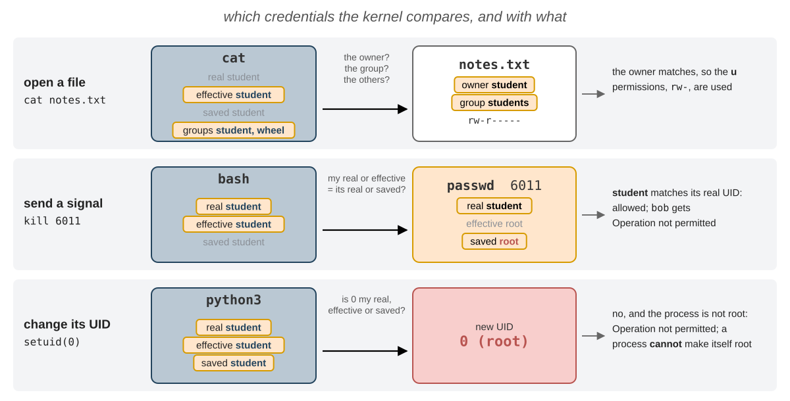

- **deschiderea unui fișier**: UID-ul efectiv se compară cu **proprietarul** fișierului, iar GID-ul efectiv și
  grupurile suplimentare cu **grupul** fișierului (vedeți [Ce permisiuni se aplică?](#which-permissions-apply));
- **trimiterea unui semnal**, cu `kill`: UID-ul real sau cel efectiv al expeditorului trebuie să fie UID-ul real sau cel
  salvat al țintei. Puteți opri un `passwd` pornit de **voi**, chiar dacă rulează ca `root`, pentru că UID-ul lui real
  este al vostru; `bob` nu poate;
- **schimbarea propriilor UID-uri**: un proces care nu este `root` poate lua doar un UID pe care îl are **deja**:
  UID-ul real, cel efectiv sau cel salvat. Un proces **nu** se poate face singur `root`. Doar un proces cu UID-ul
  efectiv `0` poate lua orice UID.

#### Cum se schimbă credențialele {/* #how-the-credentials-change */}

Un proces își primește credențialele de la părinte. Tabelul de mai jos arată ce se întâmplă cu ele la fiecare pas din
viața unui proces, inclusiv singurele două cazuri în care se schimbă:

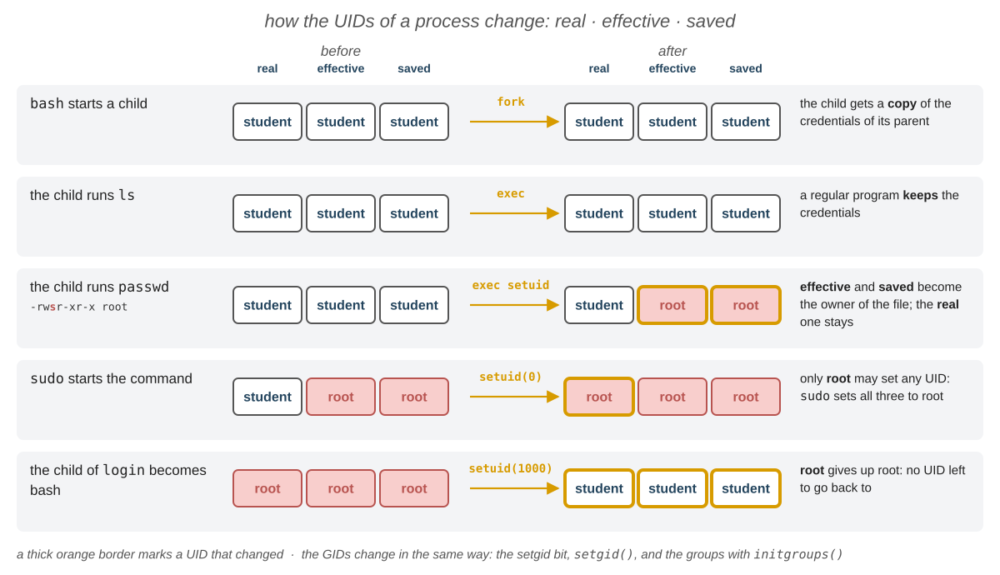

| Când                                           | Ce se întâmplă cu UID-urile                                                                       |
| ---------------------------------------------- | ------------------------------------------------------------------------------------------------- |
| `fork`, un copil nou                           | copilul primește o **copie** a credențialelor părintelui                                          |
| `exec` al unui program obișnuit                | **nu** se schimbă nimic                                                                           |
| `exec` al unui program cu bitul `setuid`       | UID-ul efectiv și cel salvat devin **proprietarul** fișierului executabil; UID-ul real se moștenește de la procesul părinte; bitul `setgid` face la fel pentru GID-uri, cu **grupul** fișierului (vedeți [`setuid`](#setuid)) |
| un proces cu UID-ul efectiv `0` apelează `setgid()`, `initgroups()` și `setuid()` | se schimbă **toate** GID-urile, grupurile suplimentare și **toate** UID-urile, în această ordine: așa îi dau `login`, `su` și `sudo` unui proces eticheta unui utilizator (vedeți [Autentificarea](#logging-in) și [`sudo`](#sudo)) |

#### Cum vedem credențialele {/* #seeing-the-credentials */}

Există două moduri de a vedea credențialele unui proces:

```shell-session
[student@fedora ~]$ ps -o pid,ruser,euser,suser,comm -p $$
    PID RUSER    EUSER    SUSER    COMMAND
   2817 student  student  student  bash
[student@fedora ~]$ grep -E '^(Uid|Gid|Groups):' /proc/$$/status
Uid:	1000	1000	1000	1000
Gid:	1000	1000	1000	1000
Groups:	10 1000
```

- `ps -o` primește numele coloanelor: `ruser` este utilizatorul real, `euser` cel efectiv, iar `suser` cel salvat.
  `man ps` le listează pe toate, pentru UID-uri, GID-uri și grupuri, în secțiunea `STANDARD FORMAT SPECIFIERS`.
- Liniile `Uid:` și `Gid:` din `/proc/<PID>/status` au câte 4 numere: real, efectiv, salvat și cel al sistemului de
  fișiere; linia `Groups:` conține grupurile suplimentare (`man 5 proc`). Oricine poate citi fișierul `status` al
  oricărui proces.

Să încercăm să facem un proces `root` fără niciun ajutor. `python3` îi poate cere kernelului UID-urile, cu
`os.getresuid()` (_get real, effective and saved UID_), și le poate schimba, cu `os.setuid()`:

```shell-session
[student@fedora ~]$ python3 -c 'import os; print(os.getresuid()); os.setuid(0)'
(1000, 1000, 1000)
Traceback (most recent call last):
  File "<string>", line 1, in <module>
    import os; print(os.getresuid()); os.setuid(0)
                                      ~~~~~~~~~^^^
PermissionError: [Errno 1] Operation not permitted
```

Kernelul refuză: `0` nu este niciunul dintre cele trei UID-uri ale procesului. Singurele moduri de a obține `root` sunt
să porniți un program care rulează **deja** ca `root`, cum este `sudo`, sau unul cu bitul `setuid`, cum este `passwd`.

## Baza de date a utilizatorilor {/* #the-users-database */}

### `/etc/passwd` {/* #etcpasswd */}

Utilizatorii locali se păstrează în `/etc/passwd`, un fișier text cu **câte un utilizator pe fiecare linie** și
câmpurile separate prin `:`. **Oricine** îl poate citi, pentru că are nevoie de el orice program care afișează un nume
de utilizator. Exemplele de mai jos citesc fișierul doar ca să-i arate formatul: ca să căutați utilizatori, folosiți
mereu [`getent`](#getent).

```shell-session
[student@fedora ~]$ ls -l /etc/passwd
-rw-r--r--. 1 root root 2245 Oct 20 09:12 /etc/passwd
[student@fedora ~]$ head -3 /etc/passwd
root:x:0:0:Super User:/root:/bin/bash
bin:x:1:1:bin:/bin:/usr/sbin/nologin
daemon:x:2:2:daemon:/sbin:/usr/sbin/nologin
[student@fedora ~]$ grep student /etc/passwd
student:x:1000:1000:Student:/home/student:/bin/bash
```


| Câmp  | În exemplu         | Ce este                                                                                       |
| ----- | ------------------ | --------------------------------------------------------------------------------------------- |
| 1     | `student`          | **numele de utilizator**, cel cu care vă autentificați                                         |
| 2     | `x`                | parola: `x` înseamnă că se păstrează în `/etc/shadow`                                          |
| 3     | `1000`             | **UID**-ul                                                                                     |
| 4     | `1000`             | **GID**-ul **grupului primar**                                                                 |
| 5     | `Student`          | câmpul **GECOS**: numele complet, uneori urmat de numărul camerei și de numerele de telefon, separate prin `,` |
| 6     | `/home/student`    | **directorul utilizatorului** (_home_): directorul curent după autentificare, `~` și `$HOME`   |
| 7     | `/bin/bash`        | **shell-ul**, programul pornit după autentificare; `/usr/sbin/nologin` refuză autentificarea   |

:::info

Punctul de după permisiuni, `-rw-r--r--.`, înseamnă că fișierul are o etichetă **SELinux**. O veți vedea la aproape
toate fișierele de pe Fedora: în acest laborator, ignorați-o. Ubuntu nu o afișează.

:::

### `getent` {/* #getent */}

`/etc/passwd` nu este singurul loc în care pot fi păstrați utilizatorii: într-o universitate sau într-o firmă, conturile
se află de obicei pe un **server** din rețea (LDAP, Active Directory, ...). De aceea, programele nu citesc direct
`/etc/passwd`: îi cer utilizatorul **bibliotecii C**, cu `getpwnam()` (de la un nume la un utilizator) și `getpwuid()`
(de la un UID la un utilizator). Biblioteca C citește `/etc/nsswitch.conf` ca să afle unde să caute utilizatorii,
parolele și grupurile și în ce ordine. Astfel, `ls`, `ps` și `id` funcționează la fel, fie că un utilizator se află în
`/etc/passwd`, fie pe un server.

```shell-session
[student@fedora ~]$ grep -E '^(passwd|shadow|group):' /etc/nsswitch.conf
passwd:     files systemd
shadow:     files
group:      files systemd
```

`files` înseamnă fișierele din `/etc`, iar `systemd` utilizatorii pe care îi creează singur `systemd` (sistemul vostru
poate avea și `sss`, un server din rețea). `getent` (_get entries_) întreabă biblioteca C, exact ca `ls` și `id`, așa că
găsește un utilizator oriunde ar fi păstrat:

| Comandă                           | Găsește                                                    |
| --------------------------------- | ---------------------------------------------------------- |
| `getent passwd <NAME>` sau `<UID>` | utilizatorul cu acest **nume** sau cu acest **UID**        |
| `getent passwd`                   | **toți** utilizatorii                                      |
| `getent group <NAME>` sau `<GID>` | grupul cu acest nume sau cu acest GID                      |
| `getent group`                    | **toate** grupurile                                        |
| `sudo getent shadow <NAME>`       | linia utilizatorului din `/etc/shadow`, doar pentru `root` |

:::tip

Când nu găsește nimic, `getent` nu afișează **nimic**, nici măcar o eroare.

:::

```shell-session
[student@fedora ~]$ getent passwd 0
root:x:0:0:Super User:/root:/bin/bash
[student@fedora ~]$ getent passwd student
student:x:1000:1000:Student:/home/student:/bin/bash
[student@fedora ~]$ getent passwd nobody
nobody:x:65534:65534:Kernel Overflow User:/:/usr/sbin/nologin
```

:::caution

**Citiți mereu utilizatorii și grupurile cu `getent`**

Ca să listați utilizatorii sau să căutați unul, folosiți `getent passwd`; pentru grupuri, folosiți `getent group`.
**Nu** citiți `/etc/passwd` și `/etc/group` cu `cat` sau `grep`: ele conțin doar conturile **locale**, așa că lipsesc
utilizatorii și grupurile care vin de la `systemd` sau de pe un server din rețea, deși `ls`, `ps`, `id` și `login` le
văd. `getent` arată exact ce vede sistemul, în același format ca fișierele. Căutarea în fișier are și o a doua capcană:
`grep root /etc/passwd` găsește orice linie care conține `root` undeva, de exemplu în directorul utilizatorului, în timp
ce `getent passwd root` îl găsește doar pe utilizatorul `root`.

În acest laborator, **baza de date a utilizatorilor** înseamnă `getent passwd`, iar **baza de date a grupurilor**
înseamnă `getent group`.

:::

## Parole {/* #passwords */}

### `/etc/shadow` {/* #etcshadow */}

`/etc/passwd` trebuie să poată fi citit de oricine, așa că parolele nu pot sta acolo. Ele se păstrează în `/etc/shadow`,
pe care doar `root` îl poate citi:

```shell-session
[student@fedora ~]$ ls -l /etc/shadow
----------. 1 root root 1207 Oct 20 09:12 /etc/shadow
[student@fedora ~]$ cat /etc/shadow
cat: /etc/shadow: Permission denied
[student@fedora ~]$ sudo grep student /etc/shadow
student:$y$j9T$Xr3aB7tPq2LkV9sD1fGh0J$9mQeT4bW1sZxH8cDr5Ny2kLpA7uVq3oEw6iFj0gHt1M:20737:0:99999:7:::
```

Pe Fedora, `/etc/shadow` nu are **nicio** permisiune, `----------`: doar `root` îl poate citi, pentru că pentru `root`
kernelul sare peste verificări. Pe Ubuntu este `-rw-r----- root shadow`: îl poate citi și grupul `shadow`, ca anumite
programe să poată verifica parole fără să fie `root`. Fiecare linie are 9 câmpuri, separate prin `:`:

| Câmp  | În exemplu         | Ce este                                                                                    |
| ----- | ------------------ | ------------------------------------------------------------------------------------------ |
| 1     | `student`          | numele de utilizator, același ca în `/etc/passwd`                                          |
| 2     | `$y$j9T$Xr3a...`   | **hash**-ul parolei; `!`, `!!` sau `*` la început înseamnă că acel cont este **blocat**: nu merge nicio parolă |
| 3     | `20737`            | ziua ultimei schimbări a parolei, numărată de la 1 ianuarie 1970                           |
| 4     | `0`                | numărul minim de zile între două schimbări de parolă                                       |
| 5     | `99999`            | numărul maxim de zile după care parola **trebuie** schimbată; `99999` înseamnă niciodată   |
| 6     | `7`                | cu câte zile înainte de expirare este avertizat utilizatorul                               |
| 7     | _gol_              | câte zile după expirare mai poate fi folosit contul                                        |
| 8     | _gol_              | ziua în care expiră contul; gol înseamnă niciodată                                         |
| 9     | _gol_              | rezervat                                                                                   |

`chage -l` (_change age_) afișează câmpurile 3 - 8 ca date calendaristice:

```shell-session
[student@fedora ~]$ sudo chage -l student
Last password change                                    : Oct 11, 2026
Password expires                                        : never
Password inactive                                       : never
Account expires                                         : never
Minimum number of days between password change          : 0
Maximum number of days between password change          : 99999
Number of days of warning before password expires       : 7
[student@fedora ~]$ date -d '1970-01-01 + 20737 days'
Sun Oct 11 12:00:00 AM EEST 2026
```

### Hash-uri și salt {/* #hashes-and-salt */}

Parola în sine **nu** se păstrează niciodată, ci doar **hash**-ul ei: rezultatul unei funcții **într-un singur sens**
(_one-way_). Hash-ul unei parole se calculează ușor, dar din hash nu există nicio cale de a calcula parola: singurul drum
înapoi este să **ghicim** o parolă, să-i calculăm hash-ul și să comparăm. Al doilea câmp din `/etc/shadow` este format
din părți separate prin `$`:

| Parte        | În exemplu                | Ce este                                                                          |
| ------------ | ------------------------- | -------------------------------------------------------------------------------- |
| algoritmul   | `y`                       | funcția de hash: `y` este _yescrypt_, `6` este _SHA-512_, `1` este vechiul _MD5_ |
| parametrii   | `j9T`                     | costul algoritmului: câtă muncă cere un hash                                     |
| **salt**-ul  | `Xr3aB7tPq2LkV9sD1fGh0J`  | un text aleator, diferit pentru fiecare utilizator, adăugat la parolă înainte de calculul hash-ului |
| hash-ul      | `9mQeT4bW1sZx...`         | hash-ul salt-ului și al parolei                                                  |

:::note

Ca să **verifice** o parolă, `login` (sau `sudo`, sau `passwd`) citește din `/etc/shadow` algoritmul, parametrii și
salt-ul, calculează cu ele hash-ul parolei tastate și compară rezultatul cu hash-ul păstrat. Dacă sunt egale, parola
este corectă. `openssl passwd` calculează un hash în același fel (`-6` înseamnă _SHA-512_):

:::


```shell-session
[student@fedora ~]$ openssl passwd -6 -salt Xr3aB7tP pass123
$6$Xr3aB7tP$Z1hKbIRkawX63bJfb3tDz.QpCpVlFdOHOBw1ZdK7Oe/6P0K3E0OUwMhyG7PXhsJPPu.ZobCXoTYNxvAQ3HExk0
[student@fedora ~]$ openssl passwd -6 -salt Xr3aB7tP pass123
$6$Xr3aB7tP$Z1hKbIRkawX63bJfb3tDz.QpCpVlFdOHOBw1ZdK7Oe/6P0K3E0OUwMhyG7PXhsJPPu.ZobCXoTYNxvAQ3HExk0
[student@fedora ~]$ openssl passwd -6 -salt Xr3aB7tP pass124
$6$Xr3aB7tP$msVqpr1xVM/DA2zRy9MVn8yIL5iisMXZpqd3XHD5Ix0aQ5QqD8D3Q91LXVy0w9hPqQLzRYsUVEH5g5oBfNp9//
[student@fedora ~]$ openssl passwd -6 -salt Lp0wQ2zM pass123
$6$Lp0wQ2zM$Uo9XUE/86KtNuRc.TcZpxeM0kWUejWZuFOaRQSujvsfACi8WRK55XpaV3Z3WE8TLEWQBF9Jgn4ByzOvO43Ukw0
```

- Aceeași parolă cu același salt dă întotdeauna **același** hash: așa se verifică parola.
- O singură literă diferită dă un hash complet diferit.
- Aceeași parolă cu alt salt dă alt hash: doi utilizatori cu aceeași parolă au linii diferite în `/etc/shadow`.

:::info

De ce nu stă hash-ul în `/etc/passwd`, pe care îl poate citi oricine? Pentru că verificarea merge și pentru un atacator:
cu o copie a hash-ului, poate calcula pe propriul calculator hash-ul unei parole după alta, până când una dintre ele dă
același hash. Nimeni nu vede aceste încercări și nimic nu le încetinește, spre deosebire de `login`, care așteaptă după
o parolă greșită și o scrie în jurnal. Un algoritm lent, cum este _yescrypt_, face ca fiecare încercare să coste mai
mult, iar salt-ul îl obligă pe atacator să o ia de la capăt pentru fiecare utilizator, dar o parolă simplă tot se
găsește repede. De aceea doar `root` poate citi `/etc/shadow`: programele care verifică parole, `login`, `sudo` și
`passwd`, rulează ca `root`, deci îl pot citi.

:::

### Schimbarea parolei: `passwd` {/* #changing-a-password-passwd */}

| Comandă                 | Ce face                                                         |
| ----------------------- | --------------------------------------------------------------- |
| `passwd`                | schimbă parola **voastră**; o cere întâi pe cea veche           |
| `sudo passwd <USER>`    | schimbă parola altui utilizator (doar `root` are voie)          |
| `sudo passwd -l <USER>` | **blochează** parola: adaugă `!!` (Ubuntu: `!`) în fața hash-ului, așa că nu mai merge nicio parolă |
| `sudo passwd -u <USER>` | o deblochează: elimină `!`, iar parola **veche** merge din nou  |
| `sudo passwd -S <USER>` | afișează starea parolei: setată, blocată sau goală              |

:::caution

Când tastați o parolă în terminal, pe ecran nu apare **nimic**. Tastați-o oricum și apăsați <kbd>Enter</kbd>. Fedora
refuză parolele prea scurte sau prea simple, dacă nu sunteți `root`.

:::

## Grupuri {/* #groups */}

Un **grup** este o mulțime de utilizatori. Un grup nu are niciun drept prin el însuși: un fișier poate da permisiuni
unui grup, iar `sudo` are încredere într-un anumit grup, și atunci fiecare membru primește aceste drepturi. La fel ca un
utilizator, un grup are un **nume** și un număr, **GID**-ul (_Group ID_), iar kernelul cunoaște doar numărul. Fiecare
utilizator are:

- **un singur grup primar**, GID-ul din `/etc/passwd`: fișierele noi ale utilizatorului primesc acest grup. Pe Fedora și
  Ubuntu, `useradd` creează un grup cu același nume ca utilizatorul, doar pentru el;
- oricâte **grupuri suplimentare**, listate în `/etc/group`, de exemplu `wheel`.

Grupurile locale se păstrează în `/etc/group`, câte un grup pe linie, cu 4 câmpuri. Ca și pe utilizatori, citiți-le
cu `getent group`, nu din fișier:

```shell-session
[student@fedora ~]$ getent group wheel
wheel:x:10:student
[student@fedora ~]$ getent group student
student:x:1000:
```

| Câmp  | În exemplu     | Ce este                                                                                   |
| ----- | -------------- | ----------------------------------------------------------------------------------------- |
| 1     | `wheel`        | numele grupului                                                                           |
| 2     | `x`            | parola grupului, aproape niciodată folosită                                               |
| 3     | `10`           | **GID**-ul                                                                                |
| 4     | `student`      | **membrii**, separați prin `,`: utilizatorii care au grupul ca grup **suplimentar**       |

:::caution

Utilizatorii care au un grup ca grup **primar** **nu** apar în ultimul lui câmp: `student` este singurul membru al
grupului `student`, dar lista este goală. Ca să vedeți toate grupurile unui utilizator, folosiți `id <USER>`.

:::

## Autentificarea {/* #logging-in */}

Când vă autentificați, un proces primește eticheta utilizatorului vostru. Pe un terminal text, de exemplu `/dev/tty3`:

1. `systemd` pornește `agetty` pe terminal, ca `root`; `agetty` afișează `login:` și citește numele de utilizator;
2. `agetty` **devine** `login` (rulează `exec`), tot ca `root`, și cere parola;
3. `login` găsește utilizatorul prin biblioteca C și verifică parola cu hash-ul din `/etc/shadow`;
4. un copil al lui `login` își setează **GID**-ul, **grupurile** și, la final, **UID**-ul la cele ale utilizatorului;
   după aceea nu mai poate reveni **niciodată** la `root`;
5. copilul intră în **directorul utilizatorului** și rulează (`exec`) **shell-ul** din `/etc/passwd`.


```shell-session
[student@fedora ~]$ ps -t tty3 -o user,pid,ppid,comm
USER         PID    PPID COMMAND
root        5120       1 login
student     5191    5120 bash
```

`login` rulează în continuare ca `root` și așteaptă să se termine shell-ul, iar shell-ul rulează ca `student`. Orice
program pe care îl porniți din el moștenește această etichetă. O autentificare grafică și `ssh` parcurg aceiași pași.

:::info

Grupurile se copiază din baza de date a grupurilor doar când un proces primește eticheta unui utilizator: la
autentificare și prin `su` și `sudo`. Dacă sunteți adăugați într-un grup nou, procesele care rulează deja nu îl au, și
nici copiii lor: o fereastră nouă de terminal este un copil al lui Sway, care și-a primit grupurile când v-ați
autentificat. Ca să primiți noul grup, **ieșiți din sesiune și autentificați-vă din nou** sau, doar pentru un shell,
porniți un shell de autentificare cu `su - student` ori rulați `newgrp <GROUP>`.

:::

## Utilizatorul `root` {/* #the-root-user */}

`root` este utilizatorul cu UID-ul `0`. Pentru un proces cu UID-ul efectiv `0`, kernelul **sare peste** majoritatea
verificărilor: procesul poate citi și scrie orice fișier, poate trimite semnale oricărui proces, poate monta discuri și
poate schimba setările rețelei. Instalarea de programe și adăugarea de utilizatori cer `root` din același motiv: scriu
fișiere care îi aparțin lui `root`, în `/usr` și în `/etc`. Directorul lui `root` este `/root`, nu `/home/root`, ca
`root` să se poată autentifica și atunci când `/home` se află pe un alt disc, care nu funcționează.

Kernelul se uită doar la **număr**: `root` este doar numele UID-ului `0`, aflat de obicei pe prima linie din
`/etc/passwd`. Două nume de utilizator cu același UID sunt, pentru kernel, **același utilizator**: așa își poate
ascunde un atacator un al doilea `root`.

:::danger

O greșeală făcută ca `root` poate distruge tot sistemul: pe `root` nu îl oprește niciun `Permission denied`. Lucrați ca
utilizator obișnuit și deveniți `root` doar pentru comenzile care au nevoie de asta.

:::

## Cum devenim `root`: `sudo` și `su` {/* #becoming-root-sudo-and-su */}

### `sudo` {/* #sudo */}

`sudo` rulează **o comandă** ca `root`. Cere parola **voastră**, nu pe cea a lui `root`, și vă lasă să rulați comanda
doar dacă sunteți **administrator**. Un utilizator este administrator dacă face parte dintr-un anumit grup, al cărui nume
depinde de distribuție:

| Distribuție                  | Grupul administratorilor        |
| ---------------------------- | ------------------------------- |
| Fedora, Red Hat, CentOS      | `wheel`                         |
| Ubuntu, Debian, Linux Mint   | `sudo`                          |

Ca să faceți dintr-un utilizator un administrator, adăugați-l în acest grup; ca să-i luați dreptul, scoateți-l din grup
(vedeți [Gestionarea utilizatorilor și a grupurilor](#managing-users-and-groups)). `student` este în `wheel`, deci poate
folosi `sudo`:

```shell-session
[student@fedora ~]$ cat /etc/shadow
cat: /etc/shadow: Permission denied
[student@fedora ~]$ sudo whoami
[sudo] password for student:
root
[student@fedora ~]$ sudo whoami
root
```

- `sudo` însuși rulează ca `root` și pornește comanda tot ca `root`: `whoami` afișează `root`.
- Ține minte parola **5 minute**, în acest terminal: al doilea `sudo` nu a mai cerut-o.
- Un utilizator care nu este administrator primește `bob is not in the sudoers file.`, iar comanda nu mai pornește.

`sudo` scrie **fiecare** comandă în jurnalul sistemului: cine a rulat ce, ca cine și din ce director.

```shell-session
[student@fedora ~]$ sudo journalctl -t sudo | tail -2
Oct 27 10:02:11 fedora sudo[3311]:  student : TTY=pts/0 ; PWD=/home/student ; USER=root ; COMMAND=/usr/bin/whoami
Oct 27 10:02:20 fedora sudo[3315]:  student : TTY=pts/0 ; PWD=/home/student ; USER=root ; COMMAND=/usr/bin/journalctl -t sudo
```

Cât timp rulează comanda, `sudo` nu dispare: așteaptă să se termine comanda și îi transmite semnalele pe care le
primește. Pe Fedora, `sudo` rulează comanda și într-un **pseudoterminal nou**, doar al lui (opțiunea `use_pty`, vedeți
[Emulatoare de terminal](/docs/labs/04#terminal-emulators) în laboratorul 04), așa că există **două** procese `sudo`:
primul rămâne pe terminalul vostru, iar al doilea deschide noul pseudoterminal și pornește comanda în el. Iată ce vedem
cu `sudo sleep 300` rulând într-un shell cu PID-ul `2817`:

```shell-session
[student@fedora ~]$ pstree -pu 2817
bash(2817)───sudo(3320,root)───sudo(3321)───sleep(3322)
[student@fedora ~]$ ps -o pid,ppid,tty,comm -p 3320,3321,3322
    PID    PPID TT       COMMAND
   3320    2817 pts/0    sudo
   3321    3320 pts/2    sudo
   3322    3321 pts/2    sleep
```

- `pstree -p` afișează PID-urile, iar `-u` utilizatorul, acolo unde se schimbă: `sudo` rulează ca `root`, la fel ca tot
  ce se află sub el.
- Al doilea `sudo` și `sleep` sunt pe `pts/2`, nu pe `pts/0`: `ps -t pts/0` **nu** afișează comanda pornită cu `sudo`.
  Găsiți-o în schimb cu `pstree`, cu `pgrep` sau după PPID.

:::info

Noul pseudoterminal vă protejează: un program pornit cu `sudo` nu mai poate scrie comenzi în terminalul vostru după ce se
termină. Unele distribuții nu îl folosesc (`sudo` 1.9.14 și versiunile mai noi îl folosesc implicit); acolo, `pstree`
afișează un singur `sudo`.

:::

| Comandă                 | Ce face                                                                        |
| ----------------------- | ------------------------------------------------------------------------------ |
| `sudo <command>`        | rulează `command` ca `root`                                                    |
| `sudo -u <USER> <command>` | rulează comanda ca alt utilizator; cere parola **voastră**, nu pe a lui     |
| `sudo -i`               | pornește un **shell de autentificare** al lui `root`, în `/root`, cu variabilele lui `root` |
| `sudo -s`               | pornește un shell ca `root`, în directorul curent                              |
| `sudo -E <command>`     | păstrează variabilele voastre de mediu, în afară de `PATH`; fără această opțiune, `sudo` le elimină pe majoritatea |
| `sudo -l`               | listează ce aveți voie să rulați                                               |
| `sudo -k`               | uită parola: următorul `sudo` o cere din nou                                   |
| `sudo !!`               | rulează din nou comanda **anterioară**, cu `sudo`: `bash` înlocuiește `!!` înainte să pornească `sudo` |

:::info

Grupul administratorilor se alege în setările lui `sudo`, în fișierul `/etc/sudoers`. În acest laborator nu trebuie
să-l modificați și nici să-l înțelegeți: doar adăugați utilizatori în grup sau îi scoateți din el. Dacă sunteți
curioși, linia `%wheel  ALL=(ALL)  ALL`, aflată spre sfârșitul fișierului, este cea care îi dă grupului `wheel` drepturile.

:::

### `su` {/* #su */}

`su` (_switch user_) pornește un **shell** ca alt utilizator și cere parola **acelui** utilizator:

| Comandă          | Ce face                                                                         |
| ---------------- | ------------------------------------------------------------------------------- |
| `su - <USER>`    | pornește un **shell de autentificare** al utilizatorului: cu directorul, variabilele și grupurile lui |
| `su -`           | același lucru, pentru `root`; cere parola lui `root`                            |
| `exit`           | iese din shell și revine în al vostru                                           |

```shell-session
[student@fedora ~]$ su -
Password:
su: Authentication failure
[student@fedora ~]$ sudo -i
[root@fedora ~]# whoami
root
[root@fedora ~]# exit
logout
[student@fedora ~]$
```

Pe Fedora și pe Ubuntu, `root` nu are de obicei **nicio parolă** (contul este blocat în `/etc/shadow`), dacă nu i-ați
setat una la instalarea sistemului: `su -` nu merge, iar `sudo -i` este calea prin care obțineți un shell de `root`. Cu
`su`, toți cei care devin `root` trebuie să știe aceeași parolă, iar din jurnal nu se poate afla cine a fost; cu `sudo`,
fiecare își folosește propria parolă.

:::tip

Într-un shell de `root`, promptul afișează `#` în loc de `$`. Ieșiți din el cu `exit` imediat ce ați terminat.

:::

### Capcana redirectării {/* #the-redirect-trap */}

`sudo` rulează **comanda**, nu toată linia. **Redirectările** le face shell-ul vostru, care rulează ca voi, **înainte**
să pornească `sudo`:

```shell-session
[student@fedora ~]$ sudo echo "192.168.1.20 printer" >> /etc/hosts
bash: /etc/hosts: Permission denied
[student@fedora ~]$ echo "192.168.1.20 printer" | sudo tee -a /etc/hosts
192.168.1.20 printer
```

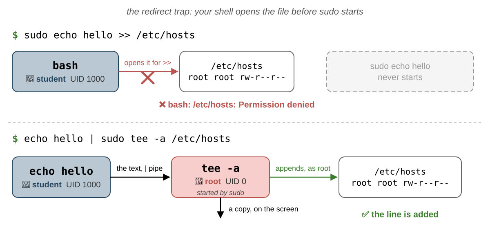

- Pe prima linie, `bash` încearcă să deschidă `/etc/hosts` pentru `>>`, ca `student`, și eșuează: `sudo echo` nu mai
  pornește deloc.
- Pe a doua linie, `tee` rulează ca `root`: citește textul din pipe și îl scrie în fișier **și** pe ecran. `-a`
  (_append_) îl adaugă la sfârșit, ca `>>`; fără această opțiune, `tee` înlocuiește conținutul fișierului, ca `>`.

:::tip

`tee` afișează textul și pe ecran. Ca să-l ascundeți, trimiteți-i ieșirea în `/dev/null`:

`echo "192.168.1.20 printer" | sudo tee -a /etc/hosts > /dev/null`. Și această redirectare o face shell-ul vostru, ca
voi, dar merge datorită permisiunilor lui `/dev/null`: sunt `rw-rw-rw-` (`666`), deci orice utilizator are voie să
scrie în el.


:::

## Gestionarea utilizatorilor și a grupurilor {/* #managing-users-and-groups */}

Comenzile de mai jos modifică în locul vostru `/etc/passwd`, `/etc/shadow` și `/etc/group`, așa că au nevoie de `sudo`:

| Comandă                             | Ce face                                                                       |
| ----------------------------------- | ----------------------------------------------------------------------------- |
| `sudo useradd -m <USER>`            | creează un utilizator, cu un grup cu același nume; `-m` creează directorul utilizatorului, `-c` setează numele complet, iar `-s` shell-ul |
| `sudo passwd <USER>`                | setează parola utilizatorului                                                 |
| `sudo groupadd <GROUP>`             | creează un grup                                                               |
| `sudo usermod -aG <GROUP> <USER>`   | **adaugă** utilizatorul într-un grup suplimentar                              |
| `sudo usermod <OPTIONS> <USER>`     | **modifică** un utilizator existent; acceptă majoritatea opțiunilor lui `useradd`: `-c` numele complet, `-s` shell-ul, ... |
| `sudo gpasswd -a <USER> <GROUP>`    | adaugă și el utilizatorul în grup                                             |
| `sudo gpasswd -d <USER> <GROUP>`    | scoate utilizatorul din grup                                                  |
| `sudo userdel -r <USER>`            | șterge utilizatorul; `-r` îi șterge și directorul                             |
| `sudo groupdel <GROUP>`             | șterge un grup; refuză dacă grupul este grupul primar al unui utilizator      |

```shell-session
[student@fedora ~]$ sudo useradd -m -c "Dave Brown" dave
[student@fedora ~]$ sudo passwd dave
New password:
Retype new password:
passwd: password updated successfully
[student@fedora ~]$ sudo usermod -aG students dave
[student@fedora ~]$ id dave
uid=1003(dave) gid=1004(dave) groups=1004(dave),1003(students)
[student@fedora ~]$ ls -ld /home/dave
drwx------. 3 dave dave 80 Oct 27 10:15 /home/dave
```

Numerele pot fi diferite pe calculatorul vostru: `useradd` ia următorul UID și următorul GID liber.

Un utilizator nou **nu** este administrator. `sudo` merge pentru `student` pentru că `student` este în `wheel`; `dave`
nu este, așa că `sudo` îl refuză, chiar dacă își dă parola corectă:

```shell-session
[student@fedora ~]$ su - dave
Password:
[dave@fedora ~]$ sudo whoami
[sudo] password for dave:
dave is not in the sudoers file.
[dave@fedora ~]$ exit
logout
[student@fedora ~]$ sudo usermod -aG wheel dave
[student@fedora ~]$ su - dave
Password:
[dave@fedora ~]$ sudo whoami
[sudo] password for dave:
root
[dave@fedora ~]$ exit
logout
[student@fedora ~]$ sudo gpasswd -d dave wheel
Removing user dave from group wheel
```

- Primul `sudo` eșuează: `dave` nu este în `wheel`, grupul administratorilor. Încercarea se scrie totuși în jurnal.
- După ce este adăugat în `wheel`, o **nouă autentificare** (`su - dave`) are noul grup, iar `sudo` merge, cu parola
  **lui**.
- `gpasswd -d` îi ia din nou dreptul.

:::danger

Nu uitați niciodată `-a` din `usermod -aG`. `usermod -G students dave` **înlocuiește** toate grupurile suplimentare ale
lui `dave` cu `students`. Dacă o rulați pe voi înșivă, pierdeți `wheel` și, odată cu el, `sudo`.

:::

`usermod` modifică în locul vostru câmpurile din `/etc/passwd`, iar `userdel` șterge utilizatorul, împreună cu grupul
lui și, cu `-r`, cu directorul lui:

```shell-session
[student@fedora ~]$ sudo usermod -c "David Brown" dave
[student@fedora ~]$ getent passwd dave
dave:x:1003:1004:David Brown:/home/dave:/bin/bash
[student@fedora ~]$ sudo userdel -r dave
[student@fedora ~]$ id dave
id: 'dave': no such user
[student@fedora ~]$ ls -d /home/dave
ls: cannot access '/home/dave': No such file or directory
```

`userdel` refuză să șteargă un utilizator care este încă autentificat sau care are procese în rulare și afișează
`userdel: user dave is currently used by process 4321`. Închideți mai întâi sesiunea utilizatorului.

## Permisiunile fișierelor {/* #file-permissions */}

### Proprietar, grup și permisiuni {/* #owner-group-and-permissions */}

Fiecare fișier și director are **un singur proprietar** (un utilizator), **un singur grup** și trei seturi de
**permisiuni**: pentru **proprietar** (`u`, _user_), pentru **grup** (`g`) și pentru toți **ceilalți** (`o`, _others_).
Proprietarul și grupul se păstrează ca numere, un UID și un GID, și sunt independente: proprietarul nu trebuie să fie
membru al grupului. `ls -l` le afișează:

```shell-session
[student@fedora lab05]$ ls -l notes.txt
-rw-r-----. 1 student students 9 Oct 27 10:20 notes.txt
```


| Parte         | În exemplu     | Ce este                                                                                 |
| ------------- | -------------- | --------------------------------------------------------------------------------------- |
| tipul         | `-`            | `-` fișier, `d` director, `l` legătură simbolică, `c` și `b` dispozitive                |
| `u`           | `rw-`          | proprietarul, `student`, poate **citi** și **scrie** fișierul                           |
| `g`           | `r--`          | membrii grupului `students` îl pot doar **citi**                                        |
| `o`           | `---`          | toți ceilalți nu pot face **nimic**                                                     |
| proprietarul  | `student`      | utilizatorul căruia îi aparține fișierul, de obicei cel care l-a creat                  |
| grupul        | `students`     | grupul fișierului, de obicei grupul primar al celui care l-a creat                      |

`stat` afișează aceleași informații, în formatul pe care îl cereți:

```shell-session
[student@fedora lab05]$ stat -c '%A %a %U %G %n' notes.txt /etc/passwd /etc/shadow
-rw-r----- 640 student students notes.txt
-rw-r--r-- 644 root root /etc/passwd
---------- 0 root root /etc/shadow
```

`%A` înseamnă permisiunile sub formă de litere, `%a` sub formă de număr (vedeți [`chmod`](#chmod)), `%U` proprietarul,
`%G` grupul, iar `%n` numele.

### `r`, `w` și `x` {/* #r-w-and-x */}

Aceleași litere au alt înțeles pentru fișiere și pentru directoare:

| Permisiune   | Valoare | Pentru un fișier                 | Pentru un director                                                       |
| ------------ | ------- | -------------------------------- | ------------------------------------------------------------------------ |
| `r` citire   | `4`     | citirea conținutului (`cat`, `less`) | **listarea** numelor fișierelor din el (`ls`); `ls -l` are nevoie și de `x`, pentru că citește detaliile fiecărui fișier, adică „intră” în director |
| `w` scriere  | `2`     | modificarea conținutului         | **crearea**, **ștergerea** și **redenumirea** fișierelor din el, doar împreună cu `x`, pentru că trebuie întâi să intre în director |
| `x` execuție | `1`     | rularea lui ca program           | **intrarea** în el (`cd`) și accesul la fișierele din el, dacă le știți numele |

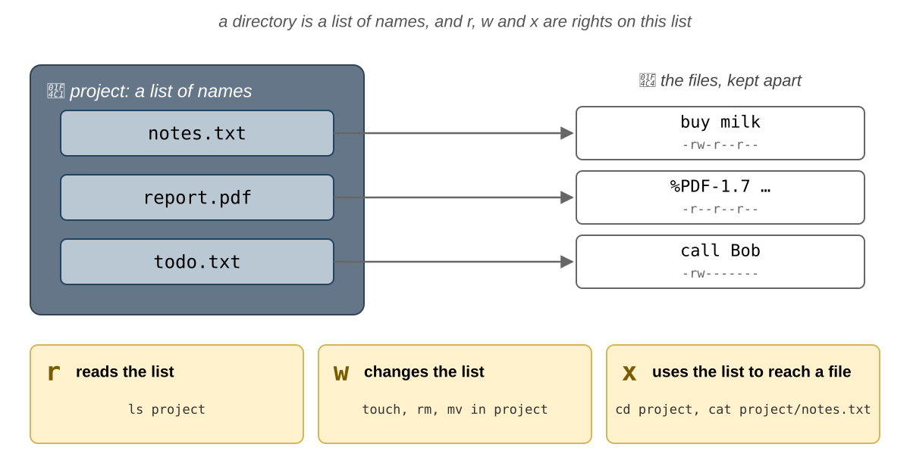

Un director este un fișier al cărui conținut este o **listă de nume**, fiecare indicând către un fișier. `r` citește
această listă, `w` o modifică, iar `x` o folosește ca să ajungă la un fișier. De aici rezultă două lucruri:

- crearea, redenumirea sau **ștergerea** unui fișier înseamnă modificarea **directorului**, nu a fișierului: cu `w` pe
  un director puteți șterge un fișier pe care nici măcar nu îl puteți citi;
- ca să ajungeți la un fișier, aveți nevoie de `x` pe **fiecare** director din calea lui:
  `cat /home/student/lab05/notes.txt` are nevoie de `x` pe `/`, `/home`, `/home/student` și `/home/student/lab05`.

Să vedem ce se întâmplă cu un director care are doar `x` și cu unul care are doar `r`:

```shell-session
[student@fedora lab05]$ ls -ld noread noenter
d--x------. 2 student student 60 Oct 27 10:20 noread
dr--------. 2 student student 60 Oct 27 10:20 noenter
[student@fedora lab05]$ ls noread
ls: cannot open directory 'noread': Permission denied
[student@fedora lab05]$ cat noread/secret.txt
top secret
[student@fedora lab05]$ ls noenter
ls: cannot access 'noenter/secret.txt': Permission denied
secret.txt
[student@fedora lab05]$ cd noenter
bash: cd: noenter: Permission denied
```

- `noread` are `x`, dar nu are `r`: numele din el nu pot fi listate, dar un fișier al cărui nume îl **știți** poate fi
  deschis.
- `noenter` are `r`, dar nu are `x`: `ls` poate citi numele, dar nu poate ajunge la fișiere ca să le afișeze, iar `cd`
  nu poate intra în el.

:::info

Pe Fedora, directoarele utilizatorilor sunt `drwx------`: ceilalți utilizatori nici măcar nu pot intra în al vostru,
deci nu pot ajunge la fișierele voastre, oricare ar fi permisiunile acestora. Pe Ubuntu sunt `drwxr-x---`: membrii
grupului vostru primar îl pot și lista și pot intra în el, dar de obicei acest grup nu are alți membri. Un Ubuntu mai
vechi, sau unul actualizat de la o versiune mai veche, poate avea încă `drwxr-xr-x`, deschis tuturor: verificați-l pe
al vostru cu `ls -ld ~`.

:::

### Ce permisiuni se aplică? {/* #which-permissions-apply */}

Kernelul verifică eticheta procesului în această **ordine**, iar prima potrivire decide:

1. dacă UID-ul procesului este `0`, adică `root`: totul este permis (în afară de rularea unui fișier care nu are niciun
   `x`);
2. dacă UID-ul este **proprietarul** fișierului: se folosesc permisiunile `u`;
3. dacă unul dintre grupurile procesului este **grupul** fișierului: se folosesc permisiunile `g`;
4. altfel: se folosesc permisiunile `o`.


Pentru `notes.txt` de mai sus, `-rw-r----- student students`:

| Proces rulat de | Grupurile lui            | Folosește | Citire | Scriere |
| --------------- | ------------------------ | --------- | ------ | ------- |
| `root`          | `root`                   | -         | da     | da      |
| `student`       | `student`, `wheel`       | `u`       | da     | da      |
| `bob`           | `bob`, `students`        | `g`       | da     | nu      |
| `carol`         | `carol`                  | `o`       | nu     | nu      |

:::caution

Se folosește **un singur** set. Cu `----rw----`, proprietarul nu poate face **nimic**, chiar dacă este în grup:
proprietarul s-a potrivit deja la pasul 2, așa că permisiunile `g` nici nu mai sunt verificate.

:::

### `chmod` {/* #chmod */}

`chmod` (_change mode_) schimbă permisiunile. Doar **proprietarul** fișierului (sau `root`) îl poate rula. Permisiunile
se pot scrie cu **litere**:

| Parte  | Litere                                                       |
| ------ | ------------------------------------------------------------ |
| cine   | `u` proprietarul, `g` grupul, `o` ceilalți (**nici** proprietarul, **nici** membrii grupului), `a` toate trei |
| cum    | `+` adaugă, `-` elimină, `=` setează exact acestea           |
| ce     | `r`, `w`, `x`                                                |

| Comandă                     | Ce face                                                                           |
| --------------------------- | --------------------------------------------------------------------------------- |
| `chmod u+x script.sh`       | adaugă `x` pentru proprietar                                                      |
| `chmod g+w,o-r notes.txt`   | adaugă `w` pentru grup și elimină `r` pentru ceilalți                             |
| `chmod go-rwx notes.txt`    | elimină tot pentru grup și pentru ceilalți                                        |
| `chmod a=r readme.txt`      | setează `r--` pentru toți                                                         |
| `chmod -R g+rX project`     | pentru grup, adaugă `r` lui `project` și tuturor celor din el, iar `x` doar directoarelor și fișierelor care sunt deja executabile pentru cineva |
| `chmod u=rw,go=r notes.txt` | setează exact `rw-` pentru proprietar și `r--` pentru grup și ceilalți (`rw-r--r--`); `=` înlocuiește permisiunile vechi în loc să le adauge la ele |

sau cu **numere**, în octal: `r` este `4`, `w` este `2`, iar `x` este `1`. Adunați-le pentru fiecare dintre `u`, `g` și
`o`:

| Litere      | `u`         | `g`       | `o`       | Număr  |
| ----------- | ----------- | --------- | --------- | ------ |
| `rw-r-----` | 4 + 2 = `6` | 4 = `4`   | `0`       | `640`  |
| `rwxr-xr-x` | 4 + 2 + 1 = `7` | 4 + 1 = `5` | 4 + 1 = `5` | `755` |
| `rw-r--r--` | `6`         | `4`       | `4`       | `644`  |
| `rw-------` | `6`         | `0`       | `0`       | `600`  |

```shell-session
[student@fedora lab05]$ ls -l myid.sh
-rw-r--r--. 1 student student 18 Oct 27 10:20 myid.sh
[student@fedora lab05]$ ./myid.sh
bash: ./myid.sh: Permission denied
[student@fedora lab05]$ chmod u+x myid.sh
[student@fedora lab05]$ ./myid.sh
student
[student@fedora lab05]$ chmod 600 myid.sh
[student@fedora lab05]$ ls -l myid.sh
-rw-------. 1 student student 18 Oct 27 10:20 myid.sh
```

:::tip

Folosiți literele ca să **schimbați** câteva permisiuni și să le păstrați pe celelalte (`chmod g+w`), iar numerele ca să
le **setați** pe toate deodată (`chmod 640`). Cu `-R`, folosiți literele: `chmod -R 644 box` elimină și `x`-ul
directoarelor, iar apoi nimeni nu mai poate intra în ele, nici măcar `chmod`; `chmod -R u=rwX,go=rX box` le dă
fișierelor `rw-r--r--`, iar directoarelor `rwxr-xr-x`.

:::

### `umask` {/* #umask */}

Fișierele noi nu primesc toate permisiunile: programul care le creează cere `rw-rw-rw-` (`666`) pentru un fișier și
`rwxrwxrwx` (`777`) pentru un director, iar kernelul **elimină** biții din **`umask`**-ul procesului. `umask` este o
comandă internă a shell-ului (`help umask`), iar fiecare proces își moștenește `umask`-ul de la părinte.

```shell-session
[student@fedora lab05]$ umask
0022
[student@fedora lab05]$ touch new.txt
[student@fedora lab05]$ mkdir newdir
[student@fedora lab05]$ ls -ld new.txt newdir
-rw-r--r--. 1 student student  0 Oct 27 10:25 new.txt
drwxr-xr-x. 2 student student 40 Oct 27 10:25 newdir
```

|                      | Fișier      | Director    |
| -------------------- | ----------- | ----------- |
| programul cere       | `666` `rw-rw-rw-` | `777` `rwxrwxrwx` |
| `umask 022` elimină  | `022` `----w--w-` | `022` `----w--w-` |
| rezultatul           | `644` `rw-r--r--` | `755` `rwxr-xr-x` |

- `022` elimină `w` pentru grup și pentru ceilalți.
- Un fișier nou nu este niciodată executabil: `umask` poate doar să **elimine** biți, iar programele nu cer `x` pentru
  fișiere.
- `umask 077` face privat orice fișier nou: `600` pentru fișiere și `700` pentru directoare. Setarea rămâne până la
  închiderea shell-ului.

:::info

Unele sisteme folosesc `umask 002` pentru utilizatorii obișnuiți: atunci fișierele noi sunt `rw-rw-r--`. Nu este
periculos, pentru că fiecare utilizator are un grup primar propriu, fără alți membri.

:::

### `chown` și `chgrp` {/* #chown-and-chgrp */}

| Comandă                              | Ce face                                                              |
| ------------------------------------ | -------------------------------------------------------------------- |
| `sudo chown bob notes.txt`           | proprietarul devine `bob`                                            |
| `sudo chown bob:students notes.txt`  | proprietarul devine `bob`, iar grupul `students`                     |
| `chown :students notes.txt`          | doar grupul, ca `chgrp`                                              |
| `chgrp students notes.txt`           | doar grupul                                                          |
| `chown -R`, `chgrp -R`               | directorul și tot ce se află în el                                   |
| `sudo chown 1005 notes.txt`          | proprietarul devine UID-ul `1005`, chiar dacă nu există niciun utilizator cu UID-ul 1005 |

- Doar `root` poate da un fișier altui utilizator: altfel, oricine ar putea umple discul altui utilizator sau și-ar
  putea ascunde urmele.
- Proprietarul poate schimba grupul unui fișier, dar doar într-unul dintre grupurile **procesului** său.

```shell-session
[student@fedora lab05]$ chown carol notes.txt
chown: changing ownership of 'notes.txt': Operation not permitted
[student@fedora lab05]$ sudo chown carol notes.txt
[student@fedora lab05]$ ls -l notes.txt
-rw-r-----. 1 carol students 9 Oct 27 10:20 notes.txt
```

## Permisiuni speciale {/* #special-permissions */}

Mai există trei biți, pe care `ls -l` îi afișează în locul unui `x`:

| Bit        | Număr  | `ls -l` afișează           | Pe un program                                      | Pe un director                                                                     |
| ---------- | ------ | -------------------------- | -------------------------------------------------- | ---------------------------------------------------------------------------------- |
| **setuid** | `4000` | `-rwsr-xr-x`               | rulează cu UID-ul efectiv al **proprietarului** fișierului | ignorat                                                                    |
| **setgid** | `2000` | `-rwxr-sr-x`, `drwxrwsr-x` | rulează cu GID-ul efectiv al **grupului** fișierului | fișierele noi primesc **grupul directorului**; directoarele noi primesc și ele bitul |
| **sticky** | `1000` | `drwxrwxrwt`               | ignorat                                            | un fișier poate fi șters sau redenumit doar de proprietarul lui, de proprietarul directorului și de `root` |

Cu litere, aceștia sunt `u+s`, `g+s` și `+t`; cu numere, a 4-a cifră, pusă în față: `chmod 2775 project` înseamnă
`rwxrwsr-x`. Un `S` sau un `T` **mare** înseamnă că bitul este setat, dar `x`-ul de sub el nu.

### `setuid` {/* #setuid */}

`passwd` trebuie să scrie noul hash în `/etc/shadow`, pe care doar `root` îl poate modifica. `/usr/bin/passwd` îi
aparține lui `root` și are bitul **setuid**: oricine l-ar porni, procesul rulează ca `root`.

```shell-session
[student@fedora ~]$ ls -l /usr/bin/passwd /usr/bin/sudo /usr/bin/su
-rwsr-xr-x. 1 root root  32648 Jul 24 03:00 /usr/bin/passwd
-rwsr-xr-x. 1 root root  56920 Jul 24 03:00 /usr/bin/su
---s--x--x. 1 root root 262536 Jul 24 03:00 /usr/bin/sudo
```

Când pornește un program cu bitul setuid, kernelul îi schimbă două dintre
[credențiale](#the-credentials-of-a-process): UID-ul **efectiv** și cel **salvat** devin proprietarul fișierului,
adică `root`. UID-ul **real** rămâne cel al utilizatorului care l-a pornit. Porniți `passwd` într-un terminal (nu
tastați nimic) și uitați-vă la el dintr-un alt terminal:

```shell-session
[student@fedora ~]$ ps -o pid,ruser,euser,suser,comm -C passwd
    PID RUSER    EUSER    SUSER    COMMAND
   6011 student  root     root     passwd
```


Kernelul verifică UID-ul efectiv, așa că `passwd` poate scrie în `/etc/shadow`. `passwd` citește UID-ul real ca să afle
cine l-a pornit, așa că schimbă doar parola **voastră**.

#### UID-ul salvat {/* #the-saved-uid */}

Un program setuid scris cu grijă nu lucrează tot timpul ca `root`: lucrează ca **voi** și folosește `root` doar pentru
puținii pași care au nevoie de el, astfel încât un bug în restul programului să poată face doar ce ați fi putut face
oricum. UID-ul **salvat** face acest lucru posibil. După `exec`, linia `Uid:` a programului este `1000 0 0 0`:

1. programul își setează UID-ul **efectiv** la cel real, `1000` (`Uid: 1000 1000 0 1000`): `root` rămâne doar în
   UID-ul salvat;
2. când are din nou nevoie de `root`, își setează UID-ul efectiv înapoi la `0` (`Uid: 1000 0 0 0`): are voie, pentru că
   `0` este UID-ul său salvat;
3. când nu mai are nevoie de `root`, își setează **toate trei** UID-urile la `1000` (`Uid: 1000 1000 1000 1000`): acum
   `0` nu mai este niciunul dintre UID-urile sale, deci nu mai poate reveni niciodată.

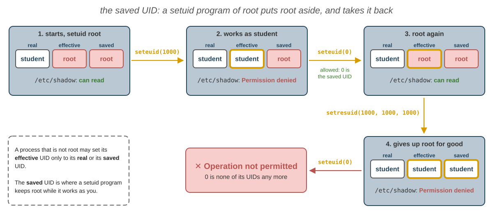

:::danger

Nu adăugați niciodată `+s` unui program care îi aparține lui `root`: va rula ca `root` pentru **oricine**, iar un singur
bug din el îl poate face `root` pe oricine. O copie setuid a lui `bash` le dă tuturor utilizatorilor un shell de
`root`. Lăsați bitul setuid programelor făcute pentru el: `passwd`, `su`, `sudo`.

:::

:::info

Kernelul ignoră biții setuid și setgid pe **scripturi**, cum este `myid.sh`. Un script nu rulează singur: kernelul
pornește programul de pe prima lui linie, `/bin/bash`, și îi dă scriptul să-l citească. Un `bash` cu eticheta lui
`root` ar fi periculos, pentru că utilizatorul care îl pornește îi poate schimba comportamentul, de exemplu prin
variabile de mediu. De aceea, biții funcționează doar pentru programe compilate, cum este `passwd`.

:::

### `setgid` pe un director {/* #setgid-on-a-directory */}

Când mai mulți utilizatori lucrează în același director, fișierele noi ar trebui să aparțină grupului proiectului, nu
grupului primar al fiecărui utilizator. Bitul **setgid** pus pe un director face exact acest lucru:

```shell-session
[student@fedora ~]$ sudo mkdir /srv/project
[student@fedora ~]$ sudo chgrp students /srv/project
[student@fedora ~]$ sudo chmod 2775 /srv/project
[student@fedora ~]$ ls -ld /srv/project
drwxrwsr-x. 2 root students 40 Oct 27 10:40 /srv/project
[student@fedora ~]$ sudo -u bob touch /srv/project/bob.txt
[student@fedora ~]$ ls -l /srv/project
total 0
-rw-r--r--. 1 bob students 0 Oct 27 10:41 bob.txt
```

`bob.txt` îi aparține lui `bob`, dar grupul lui este `students`, grupul directorului, nu `bob`.

### Bitul sticky {/* #the-sticky-bit */}

`/tmp` trebuie să poată fi scris de oricine, așa că toată lumea are `w` pe el. Fără nimic altceva, oricine ar putea
șterge fișierele celorlalți. Bitul **sticky**, `t`, permite ștergerea sau redenumirea unui fișier din director doar
**proprietarului fișierului**, proprietarului directorului și lui `root`:

```shell-session
[student@fedora ~]$ ls -ld /tmp
drwxrwxrwt. 21 root root 520 Oct 27 10:00 /tmp
```

:::tip

`find` poate căuta biții speciali: `find /usr -perm -4000` afișează fișierele care au **cel puțin** bitul setuid.

:::

## Promptul {/* #the-prompt */}

Promptul lui `bash` se construiește din variabila de shell `PS1` (vedeți laboratorul 04). Pe Fedora este
`[\u@\h \W]\$ ` (pe Ubuntu, `\u@\h:\w\$ `, cu culori):

| Secvență | Înseamnă                                                         | Pentru `student` | Pentru `root` |
| -------- | ---------------------------------------------------------------- | ---------------- | ------------- |
| `\u`     | **utilizatorul**                                                 | `student`        | `root`        |
| `\h`     | numele **calculatorului** (_host_)                               | `fedora`         | `fedora`      |
| `\W`     | numele directorului curent (`\w` este calea completă)            | `lab05`          | `~`           |
| `\$`     | `$` pentru utilizatori, `#` pentru UID-ul `0`                    | `$`              | `#`           |

Promptul este doar **text**, iar orice utilizator îl poate schimba:

```shell-session
[student@fedora ~]$ PS1='[root@fedora \W]# '
[root@fedora ~]# whoami
student
[root@fedora ~]# cat /etc/shadow
cat: /etc/shadow: Permission denied
```

:::caution

Nu vă bazați pe prompt ca să aflați cine sunteți. `whoami` și `id` îi cer **kernelului** eticheta procesului.

:::

### Schimbarea promptului {/* #changing-the-prompt */}

`PS1` poate conține orice text, plus aceste secvențe speciale (`man bash`, secțiunea `PROMPTING`):

| Secvență   | Se înlocuiește cu                                                                   |
| ---------- | ----------------------------------------------------------------------------------- |
| `\u`, `\h` | utilizatorul; numele calculatorului, până la primul `.`                             |
| `\w`, `\W` | calea completă a directorului curent, cu `~` pentru directorul vostru; doar ultimul nume din cale |
| `\$`       | `$` sau, dacă UID-ul efectiv este `0`, `#`                                          |
| `\t`, `\A` | ora, ca `HH:MM:SS` și ca `HH:MM`                                                    |
| `\d`       | data, de exemplu `Tue Oct 27`                                                       |
| `\j`       | numărul de job-uri ale shell-ului (laboratorul 04)                                  |
| `\n`       | o linie nouă                                                                        |
| `\e`       | caracterul escape, cu care începe un cod de culoare                                 |
| `\[`, `\]` | se pun în jurul unui cod de culoare: arată că acesta nu ocupă loc pe ecran          |

```shell-session
[student@fedora lab05]$ PS1='\A \u in \w \$ '
10:52 student in ~/lab05 $ PS1='[\u@\h \W]\$ '
[student@fedora lab05]$
```

Culorile se scriu ca `\e[<code>m`: `31` roșu, `32` verde, `33` galben, `34` albastru; `1;` pus în față le îngroașă, iar
`0` revine la normal. `\[` și `\]` din jurul lor îi spun lui `bash` că nu ocupă loc pe ecran; fără ele, comenzile lungi
se desenează peste prompt.

```bash
PS1='\[\e[1;32m\]\u@\h\[\e[0m\]:\[\e[1;34m\]\w\[\e[0m\]\$ '
```

:::tip

O schimbare a lui `PS1` durează până la închiderea shell-ului. Ca s-o păstrați, adăugați linia `PS1='...'` la sfârșitul
lui `~/.bashrc`; `bash` îl citește când pornește (`source ~/.bashrc` îl citește imediat). `root` are propriul
`/root/.bashrc`, așa că le puteți da shell-urilor lui `root` un prompt roșu, pe care nu aveți cum să-l ratați.

:::

## Depanare {/* #troubleshooting */}

| Problemă                                                      | Soluție                                                                                                   |
| ------------------------------------------------------------- | --------------------------------------------------------------------------------------------------------- |
| Un utilizator găsit de `id` nu este în `/etc/passwd`          | Nu este un utilizator local: căutați mereu utilizatorii cu `getent passwd` și grupurile cu `getent group` |
| `Permission denied` la un fișier                              | Rulați `ls -l` pe fișier și `id`: aflați ce set vi se aplică (proprietar, grup sau ceilalți) și ce permite |
| `Permission denied` la un fișier care are `r` pentru voi      | Unul dintre directoarele din cale nu are `x` pentru voi: rulați `ls -ld` pe fiecare                       |
| `./script.sh: Permission denied`                              | Fișierul nu are `x`: `chmod u+x script.sh`                                                                |
| `Operation not permitted` la `chmod` sau `chown`              | Doar proprietarul poate rula `chmod` și doar `root` poate schimba proprietarul: folosiți `sudo`           |
| `student is not in the sudoers file.`                         | Utilizatorul nu este administrator: nu este în `wheel` (Fedora) sau în `sudo` (Ubuntu); un administrator trebuie să ruleze `sudo usermod -aG wheel student`, apoi autentificați-vă din nou |
| `sudo echo ... > file`: `Permission denied`                   | Redirectarea o face shell-ul vostru, înainte de `sudo`: folosiți `echo ... \| sudo tee file`              |
| `su: Authentication failure` la `su -`                        | Pe Fedora și pe Ubuntu, `root` nu are parolă: folosiți `sudo -i`                                          |
| Un grup nou nu apare în `id`                                  | Grupurile se citesc la autentificare: autentificați-vă din nou sau porniți un shell de autentificare nou cu `su - <USER>` |
| `usermod -G` mi-a șters grupurile                             | Ați uitat `-a`; adăugați-le la loc cu `sudo usermod -aG <GROUP> <USER>`                                   |
| `passwd`: `BAD PASSWORD: The password is shorter than 8 characters` | Alegeți o parolă mai lungă și mai puțin simplă                                                      |
| `useradd: user 'bob' already exists`                          | Utilizatorul există deja: verificați cu `id bob`                                                          |
| `userdel: user bob is currently used by process 1234`         | `bob` are încă procese: opriți-le sau închideți mai întâi sesiunea lui `bob`                              |
| `rm: remove write-protected regular file?`                    | Nu aveți `w` pe fișier, dar îl aveți pe director: răspundeți `y` ca să-l ștergeți oricum                  |
| `rm: cannot remove ... Operation not permitted` în `/tmp`     | Bitul sticky: doar proprietarul fișierului îl poate șterge                                                |
| Un fișier afișează în `ls -l` un număr în loc de proprietar   | Utilizatorul a fost șters, dar fișierul are încă UID-ul lui                                               |

## Exerciții {/* #exercises */}

Exercițiile devin tot mai grele:

- 🧪 [Primii pași](#first-steps) (exercițiile 1 - 14) trece o dată prin **tot** laboratorul: fiecare exercițiu arată
  **o** comandă sau **o** idee, în câțiva pași scurți, de făcut în cele două ore ale laboratorului;
- 🏠 [Mai departe](#going-further) (exercițiile 15 - 47) conține exerciții mai lungi, de făcut acasă: fiecare începe cu
  un **obiectiv**, o situație de rezolvat sau o întrebare la care trebuie să răspundeți, și combină mai multe comenzi;
- 📝 [Provocări](#challenges) (exercițiile 48 - 56) conține cele mai grele exerciții.

Exercițiul 1 creează fișierele de la care pornesc toate celelalte exerciții, iar exercițiile 2 - 3 vă cer să creați
**voi** utilizatorii, grupul și directorul partajat folosite în restul laboratorului. Rulați comenzile în `~/lab05`,
dacă exercițiul nu spune altfel. Dacă modificați sau ștergeți unul dintre fișierele din exercițiul 1, rulați din nou
comenzile lui ca să-l refaceți.

În exercițiile 2 - 3 creați încă doi utilizatori, `bob` și `carol`, cu parola `uso2026`, și grupul `students`, al cărui
singur membru este `bob`. În exerciții, `student` joacă rolul **proprietarului** fișierelor, `bob` pe al unui membru al
**grupului**, iar `carol` pe al unuia dintre ceilalți. Directorul vostru este închis pentru ceilalți utilizatori, așa
că fișierele la care trebuie să ajungă ei se află în `/srv/lab05`.

Când un exercițiu spune **baza de date a utilizatorilor** sau **baza de date a grupurilor**, folosiți `getent passwd`
sau `getent group`: citiți mereu utilizatorii și grupurile cu `getent`, niciodată cu `cat` sau `grep` pe `/etc/passwd`
și `/etc/group` (vedeți [`getent`](#getent)).

Verificările dau valorile de pe calculatoarele din laborator, cu Fedora. Dacă lucrați acasă pe Ubuntu, unele dintre ele
diferă, așa cum arată [Fedora și Ubuntu](#fedora-and-ubuntu): de exemplu, grupul administratorilor este `sudo` în loc
de `wheel`.

### Cum găsiți comanda și opțiunile ei {/* #finding-the-command-and-its-options */}

Exercițiile nu vă dau comenzile și opțiunile exacte: vă spun **ce** să faceți, iar un indiciu 💡 vă spune **unde** să
căutați. De cele mai multe ori știți comanda din laborator și trebuie să găsiți **opțiunea** în pagina ei de manual, așa
cum ați văzut în [Căutarea într-o pagină de manual](/docs/labs/02#searching-in-a-manual-page) din laboratorul 02:
deschideți `man <command>`, tastați <kbd>/</kbd> și cuvântul din indiciu, apoi apăsați <kbd>n</kbd> până îl găsiți.

Când nu știți comanda, căutați în **descrierile scurte** ale tuturor paginilor de manual cu `man -k`:

```shell-session
[student@fedora ~]$ man -k 'group'
chgrp (1)            - change group ownership
gpasswd (1)          - administer /etc/group and /etc/gshadow
groupadd (8)         - create a new group
groupdel (8)         - delete a group
...
```

| Unde căutați                      | Pentru                                                                            |
| --------------------------------- | --------------------------------------------------------------------------------- |
| `man -k <word>`                   | o comandă a cărei descriere conține `<word>`                                      |
| `man <command>`, apoi `/<word>`   | o opțiune a comenzii                                                              |
| `help <command>`                  | comenzile interne ale lui `bash`, cum este `umask`                                |
| `man ps`, `/STANDARD FORMAT`      | numele coloanelor pentru `ps -o`, de exemplu utilizatorii și grupurile unui proces |
| `man 5 proc`, `/status`           | liniile din `/proc/<PID>/status`, de exemplu `Uid:` și `Groups:`                  |

Multe exerciții vă cer să **inspectați credențialele** unui proces: utilizatorul real și cel efectiv, grupurile.
Folosiți cele două metode din [Credențialele unui proces](#the-credentials-of-a-process): `ps -o` cu coloanele potrivite
și liniile `Uid:`, `Gid:` și `Groups:` din `/proc/<PID>/status`. Țineți **două terminale** unul lângă altul: unul în care
porniți procesul, altul din care îl inspectați.

:::danger

Folosiți `sudo` doar acolo unde vă cere exercițiul. Nu schimbați permisiunile sau proprietarul la nimic din afara lui
`~/lab05`, `/srv/lab05` și `/srv/project`: un `sudo chmod -R` sau un `sudo chown -R` pe un director al sistemului îl
poate strica definitiv. Nu vă scoateți niciodată pe voi (`student`) din grupul administratorilor, `wheel` pe Fedora și
`sudo` pe Ubuntu, altfel pierdeți `sudo`.

:::

### 🧪 Primii pași {/* #first-steps */}

Faceți aceste exerciții în ordine, în timpul laboratorului. Fiecare începe cu ce trebuie să obțineți și încearcă **o**
comandă sau **o** idee din laborator: dacă vă blocați, citiți secțiunea indicată la finalul exercițiului.

1. **Arborele de exerciții**: Creați fișierele și directoarele folosite de celelalte exerciții, în `~/lab05`.

    1. rulați aceste comenzi ca să creați fișierele folosite în exerciții (copiați-le din browser cu
       <kbd>Ctrl</kbd>+<kbd>C</kbd> și lipiți-le în terminal cu <kbd>Ctrl</kbd>+<kbd>Shift</kbd>+<kbd>V</kbd>):

       ```bash
       mkdir -p ~/lab05/box ~/lab05/noread ~/lab05/noenter
       cd ~/lab05
       printf 'buy milk\n' > notes.txt
       printf 'my first box\n' > box/item.txt
       printf 'top secret\n' > noread/secret.txt
       printf 'top secret\n' > noenter/secret.txt
       printf '#!/bin/bash\nid -un\n' > myid.sh
       ```

    2. afișați arborele lui `~/lab05`.

    **Verificare:** `~/lab05` conține directoarele `box`, `noread` și `noenter` și fișierele `myid.sh`, `notes.txt`,
    `box/item.txt` și cele două `secret.txt`. <small>→ [Navigare](/docs/labs/02#navigation)</small>

**Crearea utilizatorilor**

2. **Doi utilizatori noi și un grup**: Creați-i pe `bob` și pe `carol`, cei doi utilizatori care joacă în restul
    laboratorului rolul unui membru al grupului vostru și pe al unui străin, precum și grupul `students`, cu `bob` ca
    singur membru.

    1. verificați că `bob` și `carol` nu există încă;
    2. creați utilizatorul `bob`, cu director propriu, shell-ul `/bin/bash` și numele complet `Bob Jones`, și
       utilizatorul `carol`, cu director propriu, shell-ul `/bin/bash` și numele complet `Carol White`;
    3. setați-le amândurora parola `uso2026`;
    4. creați grupul `students` și adăugați-l pe `bob` în el, ca grup **suplimentar**, fără să-i eliminați celelalte
       grupuri;
    5. afișați etichetele lui `bob` și `carol`, linia lui `students` din baza de date a grupurilor și proprietarii
       directoarelor din `/home`.

    💡 `man useradd`: căutați `home`, `shell` și `comment` (numele complet este câmpul GECOS); Fedora îi dă oricum unui
    utilizator nou `/bin/bash`, dar Ubuntu îi dă `/bin/sh`. `man -k group` găsește comanda care creează un grup; în
    `man usermod`, căutați `-G`, apoi `append`.

    **Verificare:** înainte, `no such user`; după, `bob` și `carol` au următoarele UID-uri libere (`1001` și `1002`) și
    câte un grup propriu, iar `/home/bob` și `/home/carol` le aparțin; `students` îl listează doar pe `bob`. Setarea
    parolei poate afișa avertismentul `BAD PASSWORD: The password is shorter than 8 characters`, dar `root` o poate
    seta oricum. <small>→ [Gestionarea utilizatorilor și a grupurilor](#managing-users-and-groups) · [Grupuri](#groups)</small>

3. **Un director partajat**: Pregătiți `/srv/lab05`, directorul în care `bob` și `carol` vor încerca să ajungă la
    fișierele voastre, pentru că nu pot intra în directorul vostru, și vedeți ce poate face fiecare dintre ei acolo.

    1. creați `/srv/lab05` ca `root`;
    2. faceți-vă proprietarul lui și dați-i grupul `students`, cu **o singură** comandă;
    3. creați în el, ca voi înșivă, fișierul `plan.txt`, cu textul `the plan`, și `report.txt`, cu textul
       `the report`;
    4. dați-i lui `report.txt` grupul `students` și permisiunile `rw-r-----`;
    5. listați directorul însuși, apoi conținutul lui;
    6. deveniți `bob`, cu `su - bob` și parola `uso2026`; afișați `plan.txt` și `report.txt` și încercați să creați
       `/srv/lab05/bob.txt`;
    7. tot ca `bob`, creați `/tmp/bob.txt`, cu textul `hello from bob`, și listați-l; ieșiți din shell-ul lui `bob`
       cu `exit`;
    8. deveniți `carol` în același fel; afișați `plan.txt`, `report.txt` și `/tmp/bob.txt` și încercați să adăugați
       o linie în `/tmp/bob.txt`; ieșiți din shell-ul lui `carol`.

    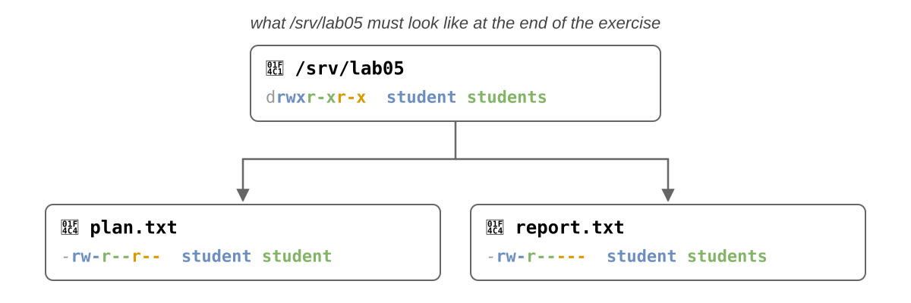

    💡 [`chown` și `chgrp`](#chown-and-chgrp): `man chown`, căutați `OWNER:GROUP`. Nu sunteți membri ai grupului
    `students`, așa că și schimbarea grupului are nevoie de `root`. `man ls`: căutați `directory` ca să listați
    directorul însuși. `su - bob` pornește un shell al lui `bob` și cere parola **lui** (vedeți [`su`](#su)); `exit`
    iese din el. Uitați-vă la prompt: vă arată cine sunteți.

    **Verificare:** `/srv/lab05` este `drwxr-xr-x student students`; `report.txt` este `-rw-r----- student students`,
    iar `plan.txt` este `-rw-r--r--` (`-rw-rw-r--` pe Ubuntu, din cauza `umask`-ului) și are grupul vostru. Ca `bob`,
    puteți citi ambele fișiere, dar nu puteți crea `bob.txt`: `Permission denied`, pentru că grupul lui `/srv/lab05` are
    doar `r-x`. În `/tmp` oricine poate crea fișiere, iar `/tmp/bob.txt` este `-rw-r--r-- bob bob` (`-rw-rw-r--` pe
    Ubuntu). `carol` citește `plan.txt` și `bob.txt`, dar `report.txt` și adăugarea unei linii în `bob.txt` dau
    `Permission denied`: ea este una dintre **ceilalți**, care au `r--` pe `bob.txt` și nimic pe `report.txt`. <small>→ [Proprietar, grup și permisiuni](#owner-group-and-permissions) · [Ce permisiuni se aplică?](#which-permissions-apply) · [`su`](#su)</small>

**Utilizatori**

4. **Cine sunt eu**: Aflați ce utilizator și ce grupuri vede kernelul pentru shell-ul vostru și pentru ceilalți
    utilizatori.

    1. afișați-vă numele de utilizator, cu două comenzi diferite;
    2. afișați-vă toată eticheta, apoi doar UID-ul, apoi doar **numele** grupurilor;
    3. afișați eticheta lui `root`, fără să vă autentificați ca `root`, și listați procesele terminalului vostru, cu
       utilizatorul și UID-ul lor;
    4. afișați liniile grupului administratorilor (`wheel` sau, pe Ubuntu, `sudo`), ale lui `students` și ale lui
       `student` din baza de date a grupurilor.

    💡 `man id`: căutați `name`, `user` și `groups`; `man ps`: căutați `user`; [`getent`](#getent) citește și baza de
    date a grupurilor.

    **Verificare:** numele este `student`, iar UID-ul `1000`; grupurile voastre sunt `student` și grupul
    administratorilor (pe Ubuntu, `sudo` și încă câteva); `root` are UID-ul `0`, iar `bob` este și în `students`;
    procesele terminalului vostru rulează ca `student`. Grupul administratorilor îl listează pe `student`, dar grupul
    `student` nu listează pe nimeni: un utilizator nu apare în lista grupului său primar. <small>→ [Cine sunt eu](#who-am-i-whoami-and-id) · [Grupuri](#groups) · [Utilizatorul unui proces](#the-user-of-a-process)</small>

**Utilizatori și parole**

5. **Utilizatori și parole**: Citiți-vă contul din baza de date a utilizatorilor și din cea a parolelor, vedeți cine
    le poate citi pe fiecare și aflați câți utilizatori există doar ca să ruleze servicii.

    1. afișați permisiunile lui `/etc/passwd` și ale lui `/etc/shadow`, apoi încercați să afișați `/etc/shadow`;
    2. afișați-vă linia, o dată din `/etc/passwd` și o dată din baza de date a utilizatorilor; găsiți în ea UID-ul,
       directorul și shell-ul vostru;
    3. ca `root`, afișați linia voastră și linia lui `bob` din `/etc/shadow` și aflați algoritmul hash-ului vostru;
    4. numărați toți utilizatorii din baza de date a utilizatorilor, apoi utilizatorii care au ca shell `nologin`;
    5. afișați limitele UID-urilor pentru utilizatorii obișnuiți și pentru cei de sistem.

    💡 `man getent`: bazele de date (`DATABASES`) sunt `passwd`, `group`, `shadow`, ...; `man 5 shadow` explică
    câmpurile lui `/etc/shadow`, iar `man 5 crypt` listează algoritmii (căutați `yescrypt`); `man grep`: căutați
    `count`; `man login.defs`: căutați `UID_MIN`.

    **Verificare:** oricine poate citi `/etc/passwd`, dar `/etc/shadow` este `----------` (Ubuntu:
    `-rw-r----- root shadow`) și nu îl puteți citi; linia voastră are 7 câmpuri,
    `student:x:1000:1000:...:/home/student:/bin/bash`, iar `x` arată că parola se află în `/etc/shadow`; cele două linii
    de la pasul 2 sunt identice, pentru că sunteți un utilizator local, dar doar `getent` îi găsește și pe utilizatorii
    păstrați în altă parte; hash-ul vostru începe cu `$y$`, adică _yescrypt_; există câteva zeci de utilizatori, iar
    majoritatea au `nologin`: sunt utilizatorii de sistem, cu un UID sub `1000`. <small>→ [`/etc/passwd`](#etcpasswd) · [`getent`](#getent) · [`/etc/shadow`](#etcshadow) · [Intervale de UID-uri](#uid-ranges)</small>

**Autentificarea**

6. **Autentificați-vă ca `bob`**: Urmăriți o autentificare reală pe un terminal text și vedeți ce proces rulează sub
    ce utilizator.

    1. treceți pe al treilea terminal virtual și autentificați-vă ca `bob`;
    2. afișați utilizatorul, directorul curent și eticheta shell-ului;
    3. încercați să vă afișați utilizatorul ca `root` cu `sudo`, cu parola lui `bob`;
    4. reveniți în Sway (acasă, în mediul vostru grafic) și listați procesele lui `tty3` cu utilizatorul,
       PID-ul, PPID-ul și numele lor;
    5. reveniți pe `tty3` și ieșiți din sesiune.

    💡 <kbd>Ctrl</kbd>+<kbd>Alt</kbd>+<kbd>F3</kbd> (<kbd>Host</kbd>+<kbd>F3</kbd> în VirtualBox), iar înapoi cu
    <kbd>Ctrl</kbd>+<kbd>Alt</kbd>+<kbd>F1</kbd> sau <kbd>F2</kbd>; `man ps`: căutați `Select by`, ca să vedeți toate
    modurile de a alege procesele, și găsiți-l pe cel pentru un terminal.

    **Verificare:** shell-ul rulează ca `bob`, în `/home/bob`, cu grupurile `bob` și `students`; `login` rulează ca
    `root` și este părintele `bash`-ului lui `bob`. `sudo` îl refuză pe `bob`: `bob is not in the sudoers file.`:
    autentificarea ca `bob` îi dă shell-ului eticheta **lui**, iar `bob` nu este în grupul administratorilor. <small>→ [Autentificarea](#logging-in) · [Terminale virtuale](/docs/labs/04#virtual-terminals)</small>

**Cum devenim `root`**

7. **`sudo`**: Rulați comenzi ca `root` cu `sudo`, vedeți cum ține minte parola și ce vă permite să faceți, scrieți
    într-un fișier al lui `root` și porniți un shell al lui `root`.

    1. afișați-vă utilizatorul și eticheta ca `root`; repetați și observați că parola nu mai este cerută;
    2. faceți-l pe `sudo` să uite parola și listați ce aveți voie să rulați cu `sudo`;
    3. încercați să afișați prima linie din `/etc/shadow` ca voi înșivă; apoi rulați **aceeași** comandă ca `root`,
       fără să o tastați din nou;
    4. creați ca `root` fișierul gol `/srv/lab05/root.txt` și adăugați linia `hello` la sfârșitul lui cu `sudo echo` și
       `>>`; apoi găsiți o metodă care merge, cu o comandă care scrie într-un fișier **și** pe ecran;
    5. porniți cu `sudo` un shell de autentificare al lui `root`, afișați utilizatorul și directorul curent și ieșiți
       din el.

    💡 `man sudo`: căutați `invalidate`, `list` și `login`; `man bash`: căutați `HISTORY EXPANSION`, apoi `!!`;
    `man tee`: căutați `append`.

    **Verificare:** utilizatorul este `root`, `uid=0(root)`; după ce parola a fost uitată, este cerută din nou; lista se
    termină cu `(ALL) ALL` (Ubuntu: `(ALL : ALL) ALL`): ca administrator, puteți rula orice comandă, ca orice
    utilizator. `bash` afișează comanda în care s-a transformat `!!`, apoi o rulează. `sudo echo` cu `>>` eșuează cu
    `Permission denied`, pentru că fișierul îl deschide shell-ul vostru, nu `sudo`; la final, fișierul conține `hello`.
    Shell-ul lui `root` pornește în `/root`, cu `#` în prompt. <small>→ [`sudo`](#sudo) · [Capcana redirectării](#the-redirect-trap)</small>

8. **O stivă de shell-uri**: Porniți cu `su` shell-urile altor utilizatori unul în altul, vedeți cine sunteți la
    fiecare nivel și observați că `exit` vă duce înapoi câte un nivel.

    1. afișați PID-ul shell-ului vostru; deveniți `bob` cu un shell de **autentificare** și afișați utilizatorul,
       directorul curent și PID-ul noului shell;
    2. din shell-ul lui `bob`, deveniți `carol` în același fel și afișați aceleași informații;
    3. ca `carol`, încercați să vă afișați utilizatorul ca `root` cu `sudo`;
    4. în al doilea terminal, afișați arborele de procese al primului vostru shell, cu PID-urile și utilizatorii;
    5. ieșiți pe rând din shell-uri cu `exit` și afișați utilizatorul după fiecare `exit`, până ajungeți înapoi în
       shell-ul vostru.

    💡 `man su`: căutați `login`; `man pstree`: căutați `uid` și `pid`. Uitați-vă la prompt după fiecare `su` și după
    fiecare `exit`.

    **Verificare:** `su` cere parola utilizatorului pe care îl deveniți, nu pe a voastră; fiecare shell pornește în
    directorul utilizatorului lui. Arborele este `bash───su───bash───su───bash`, iar `pstree` afișează utilizatorul
    acolo unde se schimbă: `su(...,root)`, `bash(...,bob)`, `su(...,root)` și `bash(...,carol)`: fiecare `su` rulează ca
    `root` și așteaptă să se termine shell-ul lui, la fel ca `login`. `sudo` o refuză pe `carol`:
    `carol is not in the sudoers file.`, pentru că shell-ul lui `carol` are **doar** eticheta lui `carol`, chiar dacă a
    fost pornit din shell-ul vostru. Fiecare `exit` termină ultimul shell și `su`-ul lui și vă duce înapoi la
    utilizatorul de dinainte: `carol`, apoi `bob`, apoi `student`. <small>→ [`su`](#su) · [Autentificarea](#logging-in) · [`sudo`](#sudo)</small>

**Permisiunile fișierelor**

9. **Citiți permisiunile**: Învățați să citiți cui îi aparține un fișier și ce poate face fiecare utilizator cu el,
    recunoașteți biții speciali și prevedeți permisiunile unui fișier nou.

    1. afișați permisiunile, proprietarul și grupul lui `notes.txt`, `/etc/passwd`, `/etc/shadow` și
       `/usr/bin/passwd`, precum și ale directoarelor `/tmp` și `~` (nu conținutul lor);
    2. afișați aceleași informații cu `stat`, sub formă de litere **și** de numere, cu proprietarul, grupul și numele;
    3. afișați-vă `umask`-ul, ca număr și sub formă de litere; ghiciți permisiunile unui fișier nou și ale unui
       director nou, apoi creați `new.txt` și `newdir` și verificați.

    💡 `man stat`: căutați `%a`, `%A`, `%U`, `%G` și `--format`; `help umask`: căutați `symbolic`.

    **Verificare:** pentru fiecare fișier, spuneți cine este proprietarul și ce pot face proprietarul, grupul și
    ceilalți; `~` este `drwx------` (`700`) pe Fedora și `drwxr-x---` (`750`) pe Ubuntu. `/usr/bin/passwd` are un `s`
    în locul `x`-ului proprietarului (`4755`), iar `/tmp` are un `t` (`1777`): aceștia sunt biți speciali. Cu
    `umask`-ul `0022` (`u=rwx,g=rx,o=rx`), `new.txt` este `rw-r--r--`, iar `newdir` este `rwxr-xr-x`; cu `0002`
    (Ubuntu), grupul primește și `w`: `rw-rw-r--` și `rwxrwxr-x`. <small>→ [Proprietar, grup și permisiuni](#owner-group-and-permissions) · [Permisiuni speciale](#special-permissions) · [`umask`](#umask)</small>

10. **`chmod`**: Schimbați permisiunile pe rând, cu litere, sau pe toate deodată, cu un număr, și vedeți că un program
    are nevoie de `x` ca să ruleze.

    1. pe `notes.txt`, eliminați `r` pentru grup și pentru ceilalți;
    2. eliminați `w` pentru voi și încercați să adăugați o linie în fișier; adăugați `w` la loc și adăugați linia;
    3. readuceți permisiunile lui `notes.txt` la `rw-r--r--` cu **o singură** comandă, cu litere;
    4. rulați `./myid.sh`; dați-i `rwxr-xr-x`, cu un număr, și rulați-l din nou;
    5. dați-i lui `myid.sh` permisiunile `rw-------`, cu un număr, și încercați să-l rulați.

    **Verificare:** după pasul 1, `notes.txt` este `-rw-------`; la pasul 2, chiar shell-ul vostru primește
    `Permission denied`; după pasul 3 este din nou `-rw-r--r--`. Fără `x`, `./myid.sh` dă `Permission denied`; cu
    `755`, afișează `student`; cu `600`, este refuzat din nou. <small>→ [`chmod`](#chmod)</small>

**Promptul**

11. **Promptul**: Schimbați ce afișează promptul lui `bash` și vedeți că este doar text, la care kernelul nu se uită.

    1. afișați valoarea lui `PS1`;
    2. schimbați promptul în `student in ~/lab05 $`, cu utilizatorul, calea **completă** și `$`-ul utilizatorului;
    3. adăugați în față ora, ca `HH:MM`;
    4. schimbați promptul astfel încât să arate ca promptul lui `root`; afișați-vă utilizatorul și UID-ul
       și încercați să afișați `/etc/shadow`;
    5. reveniți la promptul inițial.

    💡 `man bash`: căutați `PROMPTING`.

    **Verificare:** promptul inițial este `[\u@\h \W]\$ ` pe Fedora (`\u@\h:\w\$ ` cu culori pe Ubuntu); promptul se
    schimbă imediat, iar calea se schimbă când dați `cd`. Cu promptul fals de `root`, utilizatorul este tot `student`,
    UID-ul tot `1000`, iar `/etc/shadow` este refuzat în continuare: kernelul se uită la credențiale, nu la prompt. <small>→ [Promptul](#the-prompt) · [Schimbarea promptului](#changing-the-prompt)</small>

**Mai mult despre permisiuni**

12. **`r` și `x` pentru directoare**: Vedeți ce permit `r` și `x` pe un director, unul fără celălalt.

    1. dați-i lui `noread` doar `x` pentru voi (`--x------`), iar lui `noenter` doar `r` (`r--------`);
    2. încercați să le listați, să intrați în ele și să afișați fișierul `secret.txt` din fiecare;
    3. dați-le amândurora înapoi `rwxr-xr-x`.

    **Verificare:** `noread` nu poate fi listat, dar `noread/secret.txt` poate fi afișat; `noenter` își listează
    numele însoțit de o eroare, dar nu se poate intra în el, iar fișierul din el nu poate fi afișat. Eroarea vine de la
    culorile lui `ls`, care au nevoie de detaliile fișierului: `\ls noenter` listează numele fără ea. <small>→ [`r`, `w` și `x`](#r-w-and-x)</small>

13. **Cine poate citi raportul**: Vedeți care dintre cele trei seturi de permisiuni se aplică proprietarului, unui
    membru al grupului și celorlalți.

    `/srv/lab05/report.txt` este `rw-r----- student students`.

    1. afișați-l ca voi înșivă, ca `bob` și ca `carol`;
    2. încercați să adăugați o linie în el ca `bob`.

    💡 `man sudo`: căutați `-u user` ca să rulați o comandă ca alt utilizator (vă cere parola **voastră**); ca să
    scrieți ca `bob`, folosiți trucul din [Capcana redirectării](#the-redirect-trap).

    **Verificare:** voi și `bob` îl puteți citi, `carol` nu; `bob` nu poate scrie în el: primește permisiunile `g`,
    `r--`. <small>→ [Ce permisiuni se aplică?](#which-permissions-apply)</small>

**Credențialele unui proces**

14. **Cine rulează `passwd`**: Vedeți ce schimbă bitul `setuid` al lui `passwd` în credențialele procesului.

    1. în al doilea terminal, porniți `passwd` și **nu** tastați nimic;
    2. în primul terminal, găsiți-i PID-ul și afișați-i utilizatorul real, cel efectiv și cel salvat;
    3. afișați linia `Uid:` din fișierul lui `status` și comparați-o cu cea a shell-ului vostru: care dintre UID-uri
       s-au schimbat?
    4. opriți `passwd` cu <kbd>Ctrl</kbd>+<kbd>C</kbd>.

    

    💡 `man ps`: căutați `command name`, ca să selectați un proces după nume în loc de PID, iar în secțiunea
    `STANDARD FORMAT SPECIFIERS`, `real user`, `effective user` și `saved user`; `man 5 proc`: căutați `Uid`; `$$`
    este PID-ul shell-ului vostru (laboratorul 04).

    **Verificare:** utilizatorul real este `student`, iar cel efectiv și cel salvat sunt `root`; `Uid:` este
    `1000 0 0 0`, iar cea a shell-ului vostru este `1000 1000 1000 1000`. Bitul `s` al lui `/usr/bin/passwd` a schimbat
    UID-ul efectiv și pe cel salvat, dar nu și pe cel real: `passwd` știe în continuare cine l-a pornit. <small>→ [`setuid`](#setuid) · [Credențialele unui proces](#the-credentials-of-a-process)</small>

### 🏠 Mai departe {/* #going-further */}

Fiecare exercițiu începe cu **obiectivul** lui: ce trebuie să fie adevărat la final sau ce trebuie să aflați. Pașii vă
duc până acolo, dar comenzile le alegeți voi. La final, verificați obiectivul în sine, nu doar că fiecare comandă a
mers.

**Utilizatori și parole**

15. **Credențialele shell-ului**: Vedeți toate credențialele pe care le păstrează kernelul pentru shell-ul vostru și
    învățați cele două moduri de a le citi.

    1. afișați PID-ul shell-ului;
    2. afișați-i utilizatorul real, utilizatorul efectiv, utilizatorul salvat și grupurile suplimentare, cu **o
       singură** comandă `ps`;
    3. afișați liniile `Uid:`, `Gid:` și `Groups:` din fișierul lui `status` din `/proc`;
    4. aflați din manual ce înseamnă fiecare dintre cele 4 numere din `Uid:`.

    💡 `$$` este PID-ul shell-ului (laboratorul 04); `man ps`, secțiunea `STANDARD FORMAT SPECIFIERS`: căutați
    `real user`, `effective user`, `saved user` și `supplementary`; `man 5 proc`: căutați `Uid`.

    **Verificare:** utilizatorul real, cel efectiv și cel salvat sunt toți `student`; `Uid:` conține de 4 ori `1000`:
    UID-ul real, cel efectiv, cel salvat și cel al sistemului de fișiere; `Groups:` conține `10` și `1000`, GID-urile
    lui `wheel` și `student` (pe Ubuntu, `27` pentru `sudo` și GID-urile celorlalte grupuri). <small>→ [Credențialele unui proces](#the-credentials-of-a-process)</small>

16. **Utilizatorii proceselor**: Aflați ce utilizatori rulează procesele sistemului și câte procese are fiecare.

    1. numărați procesele **fiecărui** utilizator din sistem;
    2. găsiți cei doi utilizatori cu cele mai multe procese.

    💡 `man ps`: căutați `every process` și `user`; numărați-le cu `sort` și `uniq` (laboratorul 03).

    **Verificare:** `root` și `student` au cele mai multe procese. <small>→ [Utilizatorul unui proces](#the-user-of-a-process) · [Pipe-uri](/docs/labs/03#pipes-)</small>

17. **Auditați baza de date a utilizatorilor**: Un atacator care devine `root` adaugă adesea un al doilea utilizator cu
    UID-ul `0`: un `root` ascuns, cu un nume nevinovat. Verificați că sistemul vostru nu are un astfel de utilizator,
    listați oamenii care au un director în `/home` și aflați dacă toți utilizatorii se află în `/etc/passwd`.

    1. găsiți toți utilizatorii cu UID-ul `0` și utilizatorul cu UID-ul `65534`;
    2. găsiți utilizatorii al căror director se află în `/home` și numărați-i;
    3. aflați unde caută biblioteca C utilizatorii, parolele și grupurile;
    4. comparați numărul de utilizatori din baza de date cu numărul de linii din `/etc/passwd`.

    💡 citiți utilizatorii cu `getent passwd`, nu din fișier; UID-ul este câmpul 3, iar directorul utilizatorului câmpul
    6: `man cut`, căutați `delimiter` și `fields`, apoi filtrați liniile cu `grep` (laboratorul 03). De ce nu ajunge
    doar `grep 0`? `man 5 nsswitch.conf` vă spune unde se păstrează utilizatorii.

    **Verificare:** doar `root` are UID-ul `0`, iar `65534` este `nobody`; utilizatorii din `/home` sunt `student`,
    `bob` și `carol`; `files` este primul loc în care caută biblioteca C; dacă cele două numere diferă, utilizatorii în
    plus vin de la `systemd`: de aceea citiți mereu utilizatorii cu `getent`. <small>→ [`/etc/passwd`](#etcpasswd) · [`getent`](#getent)</small>

18. **Calculați un hash**: Vedeți cum depinde un hash de parolă și de salt.

    Cu `openssl`:

    1. calculați de două ori hash-ul parolei `pass123` cu _SHA-512_ și salt-ul `abc`;
    2. calculați-l din nou cu salt-ul `xyz`;
    3. calculați hash-ul lui `pass124` cu salt-ul `abc`.

    💡 `man openssl-passwd`: căutați `SHA512` și `salt`.

    **Verificare:** primele două hash-uri sunt identice; cu alt salt sau cu o singură literă diferită, hash-ul este
    complet diferit. <small>→ [Hash-uri și salt](#hashes-and-salt)</small>

19. **Ce spune `/etc/shadow`**: Aflați ce îi spune `/etc/shadow` unui administrator: ce conturi pot fi folosite cu o
    parolă și dacă doi utilizatori au aceeași parolă.

    1. afișați linia lui `root` din `/etc/shadow` și starea parolei lui;
    2. afișați liniile a 5 utilizatori de sistem;
    3. `bob` și `carol` au amândoi parola `uso2026`: afișați-le liniile și comparați-le salt-urile și hash-urile;
    4. afișați datele legate de parola contului vostru; apoi transformați al treilea câmp din linia voastră din
       `/etc/shadow` într-o dată calendaristică.

    💡 `man passwd`: căutați `status`; `man chage`: căutați `list`; `man date`: căutați `--date` (data poate fi
    `1970-01-01 + N days`).

    **Verificare:** câmpul parolei lui `root` și al utilizatorilor de sistem începe cu `!` sau `*`, ori este doar `!`
    sau `*`: nicio parolă nu permite autentificarea ca ei. Salt-urile lui `bob` și `carol` diferă, deci și hash-urile
    lor diferă: nimeni nu poate afla din `/etc/shadow` că au aceeași parolă. Cele două date de la pasul 4 sunt identice:
    ziua în care v-ați setat ultima oară parola (sau în care ați instalat sistemul). <small>→ [`/etc/shadow`](#etcshadow) · [Hash-uri și salt](#hashes-and-salt)</small>

20. **Conturi suspendate**: `bob` pleacă în concediu, iar stagiul de practică al lui `carol` s-a încheiat pe 1 ianuarie
    2020. Opriți ambele conturi fără să ștergeți nimic și fără să le atingeți parolele, apoi lăsați-i din nou să intre:
    trebuie să se autentifice cu parolele **vechi**.

    1. blocați contul lui `bob` și afișați-i linia din `/etc/shadow`;
    2. încercați să deveniți `bob` cu `su`, cu parola corectă; deblocați contul și încercați din nou;
    3. faceți contul lui `carol` să expire pe 1 ianuarie 2020 și afișați-i datele parolei și linia din `/etc/shadow`;
    4. încercați să deveniți `carol`; apoi eliminați data de expirare.

    💡 `man passwd`: căutați `lock`; `man chage`: căutați `expiredate` și `-1`.

    **Verificare:** hash-ul lui `bob` începe cu `!!` (Ubuntu: `!`), iar `su` eșuează cu `Authentication failure`; după
    deblocare, semnele `!` dispar și `su` merge. Câmpul 8 din linia lui `carol` este acum un număr de zile, iar `su`
    refuză contul expirat; după pasul 4, câmpul este din nou gol. <small>→ [Schimbarea parolei](#changing-a-password-passwd) · [`/etc/shadow`](#etcshadow)</small>

**Cum devenim `root`**

21. **Ce comenzi au nevoie de `root`**: Învățați să vă dați seama ce acțiuni au nevoie de `root`, înainte să le
    rulați.

    **Înainte** să le rulați, ghiciți care dintre aceste comenzi au nevoie de `root`. Apoi rulați-le **fără** `sudo`,
    verificați-vă presupunerile și rulați din nou cu `sudo` doar pe cele care au eșuat din cauza permisiunilor:

    1. `touch ~/a.txt` și `touch /tmp/my.data`;
    2. `cat /etc/passwd` și `cat /etc/shadow`;
    3. `touch /etc/test.conf`;
    4. `ip address show`;
    5. `ls /root`;
    6. `systemctl restart systemd-resolved`;
    7. la final, ștergeți cele trei fișiere create.

    **Verificare:** citirea lui `/etc/passwd`, afișarea rețelei și scrierea în directorul vostru sau în `/tmp` sunt
    permise tuturor; `/etc/shadow`, scrierea în `/etc`, `/root` și repornirea unui serviciu au nevoie de `root`.
    `systemctl` vă poate cere parola într-o fereastră, în loc să eșueze. <small>→ [Utilizatorul `root`](#the-root-user) · [`sudo`](#sudo)</small>

22. **Sunt de vină permisiunile?**: Învățați să vă dați seama din eroare când ajută `sudo` și când nu.

    Rulați fiecare comandă fără `sudo`, decideți dacă eroarea ține de **permisiuni** (atunci `sudo` o rezolvă) sau de
    altceva (atunci `sudo` nu ajută) și verificați cu `sudo`:

    1. `cat /var/log/kill/them/all.log`;
    2. `userdel hariseldon`;
    3. `chown $USER /home/search/and/destroy`;
    4. `cat /root/missing.txt`;
    5. `dnf install sports-illustrated` (pe Ubuntu, `apt install sports-illustrated`).

    **Verificare:** când eroarea ținea de permisiuni, `sudo` o face să dispară, iar comanda poate eșua apoi cu eroarea
    **reală**: utilizatorul, fișierul sau pachetul nu există. Când eroarea ținea de altceva, `sudo` dă aceeași eroare. <small>→ [`sudo`](#sudo)</small>

23. **`sudo` ca alt utilizator**: Rulați comenzi ca `bob`, fără să-i știți parola, verificați că primesc **toată**
    eticheta lui `bob` și aflați ce poate face `bob` în `/srv/lab05`.

    1. afișați utilizatorul și eticheta unui proces care rulează ca `bob`, pornit cu `sudo`;
    2. încercați să creați fișierul `/srv/lab05/bob.txt` ca `bob`;
    3. porniți cu `sudo` un shell de **autentificare** al lui `bob`, afișați directorul curent și ieșiți din el;
    4. în al doilea terminal, rulați `sleep 300` ca `bob`, cu `sudo`; în primul terminal, afișați utilizatorul real și
       cel efectiv, grupul real și cel efectiv și grupurile suplimentare ale lui `sleep`, precum și liniile `Uid:`,
       `Gid:` și `Groups:` din fișierul lui `status`.

    💡 `man sudo`: căutați `-u user` și `login`; `man ps`, secțiunea `STANDARD FORMAT SPECIFIERS`: căutați
    `real group`, `effective group` și `supplementary`.

    **Verificare:** procesul rulează ca `bob`, cu grupurile `bob` și `students`; `bob` nu poate crea fișierul: grupul
    lui `/srv/lab05` are doar `r-x`; shell-ul de autentificare pornește în `/home/bob`, iar `sudo` v-a cerut parola
    **voastră**, nu pe cea a lui `bob`. Pentru `sleep`, totul este `bob`: `Uid:` conține de 4 ori `1001`, iar `Groups:`
    conține GID-urile lui `bob` și `students`, ca după o autentificare. <small>→ [`sudo`](#sudo) · [Credențialele unui proces](#the-credentials-of-a-process)</small>

24. **Credențialele lui `sudo`**: Aflați cum schimbă `sudo` credențialele comenzii pe care o pornește și cine poate
    opri apoi comanda cu `kill`.

    Pentru pașii 3 - 5, notați-vă **întâi** presupunerea, apoi verificați-o:

    1. în al doilea terminal, afișați PID-ul shell-ului, apoi rulați `sleep 300` ca `root`; în primul terminal, afișați
       arborele de procese al celui de-al doilea shell, cu PID-urile, și listați aceste procese cu PID-ul, PPID-ul,
       terminalul, utilizatorul real și cel efectiv;
    2. afișați linia `Uid:` a lui `sudo` și a lui `sleep` și comparați-le cu `passwd`-ul din exercițiul 14: care
       program seamănă cu `passwd` și care este diferit?
    3. puteți opri `sleep` cu `kill` și PID-ul lui?
    4. trimiteți semnalul procesului `sudo` și uitați-vă ce s-a întâmplat cu `sleep`;
    5. în al doilea terminal, porniți `passwd` și nu tastați nimic; îl puteți opri cu `kill` din primul terminal? Dar
       `bob` poate (rulați `kill` ca `bob` cu `sudo`)?

    💡 `man pstree`: căutați `pid`; `ps -p` primește mai multe PID-uri, separate prin `,`; `man pgrep` găsește PID-ul
    unui proces după nume. Nu căutați `sleep` cu `ps -t` și terminalul celui de-al doilea shell: `sudo` îl rulează pe un
    pseudoterminal nou (vedeți [`sudo`](#sudo)). Pentru
    `kill`, folosiți regula din [Ce credențiale se verifică](#which-credentials-are-checked): afișați UID-ul real și pe
    cel salvat al țintei, precum și UID-ul real și pe cel efectiv al expeditorului.

    **Verificare:** arborele este `bash───sudo───sudo───sleep`: primul `sudo` se află pe terminalul celui de-al doilea
    shell, iar al doilea pe un pseudoterminal **nou**, împreună cu `sleep`, copilul lui. Primul
    `sudo` seamănă cu `passwd`: linia lui `Uid:` este `1000 0 0 0`, pentru că este un program setuid. Pentru `sleep`,
    `Uid:` este `0 0 0 0`: `sudo`, ca `root`, a setat **toate** UID-urile copilului său. Așadar nu puteți opri `sleep`,
    dar **puteți** opri `sudo`, al cărui UID real este al vostru, iar `sudo` îi transmite semnalul copilului. Puteți
    opri `passwd`-ul vostru, pentru că UID-ul lui real este al vostru; `bob` primește `Operation not permitted`. <small>→ [`sudo`](#sudo) · [Ce credențiale se verifică](#which-credentials-are-checked)</small>

25. **Jucați rolul unui program setuid**: Vedeți cum îi permite UID-ul salvat unui program setuid să lase `root`
    deoparte și să-l ia înapoi, comportându-vă chiar voi ca un astfel de program, ca în [UID-ul salvat](#the-saved-uid).

    După fiecare pas, afișați din al doilea terminal linia `Uid:` a procesului `python3` și încercați să citiți din
    `python3` prima linie din `/etc/shadow`:

    1. în primul terminal, porniți `python3` ca `root`; afișați-i UID-ul real, cel efectiv și cel salvat;
    2. deveniți `student` în UID-ul real și în cel efectiv, dar păstrați `root` în UID-ul salvat;
    3. luați înapoi `root`, doar în UID-ul efectiv;
    4. setați toate cele trei UID-uri la `1000` și încercați încă o dată să luați înapoi `root`.

    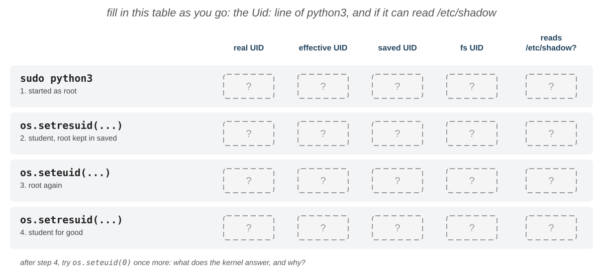

    💡 În `python3`, rulați întâi `import os`, apoi `help(os.getresuid)`, `help(os.setresuid)` și `help(os.seteuid)`;
    `open('/etc/shadow').readline()` citește prima linie a unui fișier; `exit()` iese din `python3`.

    **Verificare:** `Uid:` este `0 0 0 0`, apoi `1000 1000 0 1000` și `/etc/shadow` este refuzat, apoi `1000 0 0 0` și
    fișierul poate fi citit din nou, pentru că `0` era UID-ul salvat; după ultimul pas, `Uid:` este
    `1000 1000 1000 1000`, iar `seteuid(0)` eșuează cu `Operation not permitted`. Al 4-lea număr, UID-ul sistemului de
    fișiere, îl urmează mereu pe al 2-lea. <small>→ [UID-ul salvat](#the-saved-uid) · [Ce credențiale se verifică](#which-credentials-are-checked)</small>

26. **Shell-urile lui `root`**: Există două moduri de a obține un shell de `root` cu `sudo`. Aflați prin ce diferă,
    care dintre variabilele voastre ajung la o comandă pornită cu `sudo` și unde caută `sudo` programele.

    1. încercați să deveniți `root` cu `su`;
    2. în `~/lab05`, porniți un shell de `root` care rămâne în directorul curent și afișați directorul curent și
       `$HOME`; ieșiți din el;
    3. faceți la fel cu un shell de **autentificare** al lui `root`;
    4. exportați variabila `COURSE` cu valoarea `ISO`; afișați-o dintr-o comandă pornită cu `sudo`, apoi dintr-una
       pornită cu `sudo` care vă păstrează mediul;
    5. comparați `PATH`-ul vostru cu `PATH`-ul pe care `sudo` îl dă unei comenzi.

    💡 `man sudo`: căutați `shell` și `preserve-env`; `printenv` afișează valoarea unei variabile și îl puteți rula cu
    `sudo`.

    **Verificare:** `su` eșuează cu `Authentication failure` (dacă `root` nu are parolă); shell-ul de la pasul 2 rămâne
    în `~/lab05`, iar shell-ul de autentificare pornește în `/root`; amândouă au `HOME=/root`. Implicit, `sudo` a
    eliminat `COURSE`; `sudo` folosește și un `PATH` propriu, așa că un program din `~/.local/bin` nu este găsit de
    `sudo`. <small>→ [`su`](#su) · [`sudo`](#sudo) · [Variabile de mediu](/docs/labs/04#environment-variables)</small>

27. **Shell-uri în shell-uri**: Urmăriți utilizatorul fiecărui proces când porniți shell-uri în alte shell-uri și
    vedeți că nici măcar `root` nu se poate autentifica ca un utilizator de sistem.

    1. în primul terminal, afișați PID-ul shell-ului;
    2. porniți cu `sudo` un shell de autentificare al lui `root`; din el, încercați să deveniți `daemon` și `bin` cu
       `su` și afișați shell-ul lui `daemon` din baza de date a utilizatorilor;
    3. tot în shell-ul lui `root`, porniți cu `su` un shell de autentificare al lui `bob` (lui `root` nu i se cere
       parola);
    4. în al doilea terminal, afișați arborele de procese al primului shell, cu PID-urile și utilizatorii, și afișați cu
       `ps` utilizatorul real și cel efectiv al fiecărui proces din acest arbore;
    5. ieșiți din shell-uri unul câte unul și afișați arborele după fiecare pas.

    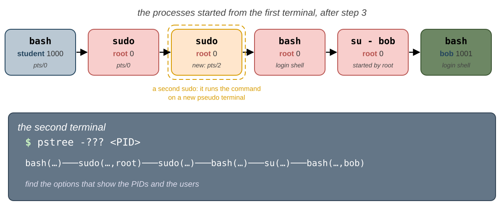

    💡 `man pstree`: căutați `uid` și `pid`; `ps -p` primește PID-urile afișate de `pstree`, separate prin `,`.
    `ps -t` cu primul terminal nu ajunge: `sudo` își pornește comanda pe un pseudoterminal nou.

    **Verificare:** chiar și `root` primește `This account is currently not available.`: shell-ul lui `daemon` este
    `/usr/sbin/nologin`, un program care afișează acest mesaj și se termină. Arborele este
    `bash───sudo───sudo───bash───su───bash`: doi `sudo`, pentru că `sudo` rulează shell-ul lui `root` pe un
    pseudoterminal nou; `pstree` arată utilizatorul acolo unde se schimbă: `sudo(...,root)` și ultimul
    `bash(...,bob)`; `su` rulează ca `root`, iar copilul lui ca `bob`. Fiecare `exit` elimină ultimul shell. <small>→ [`su`](#su) · [`/etc/passwd`](#etcpasswd) · [Listarea proceselor](/docs/labs/03#listing-processes-ps)</small>

**Gestionarea utilizatorilor și a grupurilor**

28. **Creați un utilizator**: Creați un cont nou, `dave`, vedeți când devine utilizabil și observați că un utilizator
    nou nu poate folosi `sudo`.

    1. creați utilizatorul `dave`, cu director propriu, shell-ul `/bin/bash` și numele complet `Dave Brown`;
    2. afișați-i linia din baza de date a utilizatorilor și linia din `/etc/shadow`;
    3. dați-i o parolă și afișați din nou linia lui din `/etc/shadow`;
    4. afișați-i eticheta și permisiunile directorului și încercați să listați ce conține directorul;
    5. deveniți `dave`, cu un shell de autentificare, și încercați să vă afișați utilizatorul ca `root`, cu parola lui
       `dave`; ieșiți și afișați ultimele 5 comenzi rulate cu `sudo`, din
       jurnalul sistemului: găsiți încercarea lui `dave`.

    💡 `man useradd`: căutați `home`, `shell` și `comment`; `man journalctl`: căutați `identifier`.

    **Verificare:** înainte de pasul 3, câmpul parolei din `/etc/shadow` este `!` sau `!!`: încă nimeni nu se poate
    autentifica ca `dave`; după acest pas, câmpul este un hash care începe cu `$y$`. `dave` are următorul UID liber și
    un grup propriu, `dave`; `/home/dave` este `drwx------` (Ubuntu: `drwxr-x---`), iar voi nu sunteți nici `dave`, nici
    în grupul lui, așa că nu îl puteți lista. `sudo` îl refuză pe `dave` cu `dave is not in the sudoers file.`, pentru
    că nu este în grupul administratorilor; jurnalul are o linie pentru `dave` cu `user NOT in sudoers`. <small>→ [Gestionarea utilizatorilor și a grupurilor](#managing-users-and-groups) · [`/etc/shadow`](#etcshadow) · [`sudo`](#sudo)</small>

29. **Modificați un utilizator**: Modificați un cont existent, numele complet și shell-ul, și vedeți ce câmpuri din
    `/etc/passwd` se schimbă.

    După fiecare pas, afișați linia lui `dave` din baza de date a utilizatorilor și găsiți câmpul care s-a schimbat:

    1. schimbați numele complet al lui `dave` în `David Brown`;
    2. schimbați-i shell-ul în `/usr/sbin/nologin` și încercați să deveniți `dave` cu `su`;
    3. dați-i înapoi shell-ul `/bin/bash` și deveniți din nou `dave`; ieșiți din shell-ul lui.

    💡 `man usermod`: căutați `comment` și `shell`.

    **Verificare:** câmpul 5 devine `David Brown`, iar al 7-lea `/usr/sbin/nologin`; cu acest shell, `su` eșuează cu
    `This account is currently not available.`, chiar cu parola corectă; cu `/bin/bash`, merge din nou. <small>→ [Gestionarea utilizatorilor și a grupurilor](#managing-users-and-groups) · [`/etc/passwd`](#etcpasswd)</small>

30. **Grupurile unui utilizator**: Adăugați un utilizator într-un grup și scoateți-l din el, cu cele două comenzi care
    pot face asta, apoi creați și ștergeți un grup.

    După fiecare pas, afișați grupurile lui `dave`:

    1. adăugați-l pe `dave` în `students`, fără să-i eliminați celelalte grupuri;
    2. creați grupul `tas` și adăugați-l pe `dave` în el, de data aceasta cu comanda care **administrează** un grup;
    3. scoateți-l pe `dave` din `students`, cu aceeași comandă;
    4. ștergeți grupul `tas`.

    💡 `man usermod`: căutați `append`; `man gpasswd`: căutați `add` și `delete`; `man -k group` găsește comanda care
    șterge un grup.

    **Verificare:** `dave` este în `dave` și `students`, apoi și în `tas`, apoi doar în `dave` și `tas`, iar la final
    doar în `dave`; `getent group tas` nu afișează nimic. <small>→ [Gestionarea utilizatorilor și a grupurilor](#managing-users-and-groups) · [Grupuri](#groups)</small>

31. **Ștergeți un utilizator**: Ștergeți complet un cont: utilizatorul, grupul și directorul lui.

    1. în al doilea terminal, deveniți `dave` cu un shell de autentificare; în primul terminal, încercați să-l ștergeți
       pe `dave`;
    2. ieșiți din shell-ul lui `dave` și ștergeți-l, împreună cu directorul lui;
    3. verificați că utilizatorul `dave`, grupul `dave` și `/home/dave` au dispărut.

    💡 `man userdel`: căutați `home`.

    **Verificare:** cât timp `dave` este autentificat, `userdel` refuză: `user dave is currently used by process ...`;
    la final, `id dave` afișează `no such user`, `getent group dave` nu afișează nimic, iar `/home/dave` nu există. <small>→ [Gestionarea utilizatorilor și a grupurilor](#managing-users-and-groups)</small>

32. **O colegă nouă, de la prima până la ultima zi**: `erin` intră în echipă, devine administrator și pleacă după o
    vreme. Gestionați-i contul de la prima până la ultima zi, fără să vă uitați în laborator, doar cu paginile de
    manual.

    Verificați fiecare pas înainte să treceți la următorul:

    1. creați-i contul: director propriu, shell-ul `/bin/bash`, numele complet `Erin Gray`, grupul suplimentar
       `students` și o parolă, cu cât mai puține comenzi;
    2. autentificați-vă ca `erin` pe al treilea terminal virtual și verificați că pornește în `/home/erin`, că este în
       `students` și că `sudo` o refuză;
    3. devine administrator: cât timp este încă autentificată pe `tty3`, faceți-o administrator; în **același shell**
       al lui `erin`, afișați grupurile shell-ului și încercați din nou `sudo`; apoi ieșiți din sesiune, autentificați-vă
       din nou și încercați încă o dată;
    4. își schimbă numele: setați-i numele complet `Erin Black`;
    5. pleacă: închideți-i sesiunea și ștergeți-i contul, grupul și directorul.

    💡 `man useradd`: căutați `shell` și `groups`; `man usermod`; `man userdel`; grupul administratorilor se află în
    tabelul din [`sudo`](#sudo).

    **Verificare:** după pasul 1, `id erin` arată `students`, iar linia ei conține `Erin Gray` și `/bin/bash`; la pasul
    3, vechiul shell al lui `erin` nu are grupul administratorilor, așa că `sudo` o refuză în continuare; după o nouă
    autentificare, `sudo` merge, cu parola lui `erin`; după pasul 4 s-a schimbat doar câmpul 5; la final, `id erin`,
    `getent group erin` și `ls -d /home/erin` nu găsesc nimic. <small>→ [Gestionarea utilizatorilor și a grupurilor](#managing-users-and-groups) · [Autentificarea](#logging-in)</small>

33. **Un grup nou cere o nouă autentificare**: Vă adăugați în `students`, dar nu toate procesele voastre primesc noul
    grup. Aflați care dintre ele îl au, de ce și ce verifică kernelul când folosiți grupul.

    1. adăugați-vă în `students`;
    2. afișați-vă grupurile din baza de date și grupurile shell-ului;
    3. afișați linia `Groups:` din `/proc/$$/status`;
    4. deschideți un terminal **nou** și afișați grupurile shell-ului din el;
    5. porniți cu `su` un **shell de autentificare** al vostru și afișați-i grupurile și linia `Groups:`;
    6. în acest shell de autentificare, apoi în terminalul **vechi**, încercați să schimbați grupul lui `notes.txt` în
       `students`; la final, dați-i lui `notes.txt` înapoi vechiul grup;
    7. scoateți-vă din `students`.

    **Verificare:** baza de date conține `students`; shell-ul care rulează deja și noua fereastră nu îl au (în
    `Groups:` nu apare GID-ul lui `students`), pentru că credențialele lor au fost setate la autentificare; noul shell
    de autentificare îl are. În shell-ul de autentificare, grupul lui `notes.txt` se schimbă; în terminalul vechi
    primiți `Operation not permitted`, deși `/etc/group` vă listează în `students`: kernelul verifică grupurile
    **procesului**. <small>→ [Autentificarea](#logging-in) · [Credențialele unui proces](#the-credentials-of-a-process) · [`chown` și `chgrp`](#chown-and-chgrp)</small>

**Permisiuni**

34. **`chown`**: Dați un fișier altui utilizator și aflați cine are voie să facă asta.

    1. dați-i lui `carol` fișierul `notes.txt`, ca voi înșivă;
    2. faceți-o ca `root` și listați fișierul;
    3. dați-l înapoi utilizatorului **și** grupului vostru, cu o singură comandă.

    💡 `man chown`: căutați `colon`, ca să schimbați grupul în grupul de autentificare al utilizatorului.

    **Verificare:** ca voi înșivă, `Operation not permitted`; ca `root`, proprietarul devine `carol`; la final,
    fișierul este din nou al vostru. <small>→ [`chown` și `chgrp`](#chown-and-chgrp)</small>

35. **Cine poate șterge un fișier**: Aflați cine poate șterge sau redenumi un fișier: cel care poate scrie în fișier sau
    cel care poate scrie în director.

    1. copiați `notes.txt` în `ro.txt` și faceți-l doar de citit pentru toată lumea; încercați să adăugați o linie în
       el; apoi redenumiți-l în `ro2.txt` și ștergeți-l;
    2. dați-i grupului lui `/srv/lab05` permisiunea de scriere;
    3. ca `bob`, creați `/srv/lab05/bob.txt`;
    4. ca `bob`, ștergeți `/srv/lab05/plan.txt`, un fișier care vă aparține **vouă** și în care `bob` nu poate scrie;
    5. creați din nou `plan.txt`, cu textul `the plan`;
    6. luați înapoi `w`-ul grupului de pe `/srv/lab05`.

    **Verificare:** nu puteți scrie în `ro.txt`, dar îl puteți redenumi și șterge (după `y`): aveți `w` pe `~/lab05`.
    `bob` poate crea acum fișiere în `/srv/lab05`; `rm` întreabă `remove write-protected regular file`, iar după `y`
    fișierul dispare: ștergerea unui fișier înseamnă scriere în **director**. <small>→ [`r`, `w` și `x`](#r-w-and-x)</small>

36. **`x` pe fiecare director**: `bob` trebuie să vă citească `notes.txt`. Găsiți schimbarea **minimă** care îi permite
    asta, fără să-l lăsați să vadă numele celorlalte fișiere ale voastre.

    1. ca `bob`, afișați `notes.txt` din `~/lab05`-ul vostru, cu calea lui absolută;
    2. aflați de ce eșuează, uitându-vă la permisiunile fiecărui director din cale;
    3. dați-le celorlalți **doar** `x` pe directorul vostru și încercați din nou; apoi încercați să vă listați
       directorul ca `bob`;
    4. luați `x`-ul înapoi.

    **Verificare:** `/home/student` este `drwx------` (Ubuntu: `drwxr-x---`), iar `bob` face parte dintre ceilalți, așa
    că nu poate trece prin el; cu `x` pentru ceilalți, `bob` citește `notes.txt` (care este `rw-r--r--`), dar nu vă
    poate lista directorul: nu are `r` pe el. <small>→ [`r`, `w` și `x`](#r-w-and-x)</small>

37. **Octal de mână**: Învățați să treceți de la literele permisiunilor la numere și invers, fără ajutor.

    Fără calculator:

    1. scrieți ca numere: `rwxr-x---`, `rw-rw-r--`, `r--------`, `rwx--x--x`, `rw-r--r--`;
    2. scrieți cu litere: `751`, `664`, `400`, `700`, `555`;
    3. verificați-vă răspunsurile pe un fișier `test.txt`.

    **Verificare:** setați fiecare valoare pe `test.txt` în forma de la care ați pornit și afișați cealaltă formă cu
    `stat`: trebuie să fie cea pe care ați scris-o. <small>→ [`chmod`](#chmod)</small>

38. **Proprietarul se verifică primul**: Arătați că kernelul folosește **un singur** set de permisiuni, chiar și atunci
    când alt set ar permite mai mult.

    1. copiați `notes.txt` în `first.txt` și dați-i grupul `students` (nu sunteți membri: folosiți `root`);
    2. dați-i `----rw-r--`;
    3. încercați să-l citiți voi înșivă, ca `bob` și ca `carol`; apoi încercați să scrieți în el ca `bob`.

    **Verificare:** voi, proprietarul, nu îl puteți citi; `bob` îl poate citi și scrie (setul `g`), iar `carol` îl poate
    citi (setul `o`). <small>→ [Ce permisiuni se aplică?](#which-permissions-apply)</small>

39. **Un `umask` privat**: Faceți private toate fișierele noi ale shell-ului și aflați pentru ce procese și cât timp
    rămâne setarea.

    Într-un terminal nou:

    1. setați `umask`-ul astfel încât fișierele și directoarele noi să fie private, apoi creați `private.txt` și
       `privdir`;
    2. afișați `umask`-ul unui `bash` copil;
    3. afișați linia `Umask:` din fișierul `status` al shell-ului;
    4. închideți terminalul, deschideți unul nou și afișați `umask`-ul.

    💡 `man 5 proc`: căutați `Umask`.

    **Verificare:** `private.txt` este `rw-------`, iar `privdir` este `rwx------`; copilul afișează același `umask` ca
    părintele: kernelul păstrează un `umask` pentru fiecare proces, iar un copil îl moștenește, la fel ca pe
    credențiale; noul terminal are din nou vechiul `umask`. <small>→ [`umask`](#umask)</small>

40. **Biții speciali la lucru**: Găsiți programele care rulează cu **grupul** fișierului lor și arătați că în `/tmp`
    fișierele voastre sunt la adăpost de ștergere, chiar dacă le dați tuturor drept de scriere.

    1. găsiți fișierele din `/usr` care au bitul `setgid`, fără erori; listați-le și uitați-vă la grupul lor;
    2. creați fișierul `/tmp/student.txt` și dați-le tuturor `w` pe el;
    3. ca `bob`, încercați să-l ștergeți, apoi să adăugați o linie în el;
    4. ștergeți-l voi înșivă.

    💡 `man find`: căutați `-perm` și `/mode`.

    **Verificare:** programele setgid au un `s` în locul `x`-ului grupului; fiecare rulează cu grupul fișierului său, de
    exemplu `tty` sau `utmp` pe Fedora, `shadow` sau `crontab` pe Ubuntu, și nu ca `root`. `bob` nu poate șterge
    `/tmp/student.txt`: `Operation not permitted`, din cauza `t`-ului de pe `/tmp`. Nu poate nici să adauge o linie în
    el, deși fișierul este `rw-rw-rw-`: într-un director sticky, kernelul împiedică și deschiderea cu `>>` a fișierelor
    altcuiva (`sysctl fs.protected_regular` nu este `0`), ca să le protejeze de trucurile cu nume din `/tmp`. <small>→ [Permisiuni speciale](#special-permissions) · [Bitul sticky](#the-sticky-bit)</small>

**Promptul**

41. **Un prompt mai bogat**: Faceți ca promptul să afișeze ora și numărul de job-uri, să vă lase să tastați comanda pe o
    linie nouă și să iasă în evidență, colorat, într-un rezultat lung.

    1. faceți promptul să arate ca mai jos, apoi porniți `sleep 100 &` și uitați-vă la prompt:

       ```text
       10:52 student@fedora ~/lab05 (jobs: 0)
       $
       ```

    2. colorați utilizatorul și numele calculatorului în **verde**, iar calea în **albastru**;
    3. scrieți o comandă lungă, care trece de capătul liniei; apoi eliminați `\[` și `\]` din `PS1` și încercați din
       nou.

    💡 `man bash`, secțiunea `PROMPTING`: căutați `jobs` și `newline`.

    **Verificare:** numărul de job-uri devine `1`, iar comanda se tastează pe a doua linie. Cu `\[...\]`, comanda lungă
    trece corect pe rândul următor; fără ele, `bash` numără codurile de culoare drept caractere, iar linia se desenează
    peste ea însăși. <small>→ [Schimbarea promptului](#changing-the-prompt)</small>

42. **Un prompt care spune adevărul și rămâne**: Spre deosebire de `root`-ul fals din Primii pași, faceți un prompt care
    afișează UID-ul shell-ului, astfel încât să se schimbe singur, și păstrați-l pentru orice terminal nou.

    1. faceți un prompt care vă afișează UID-ul, dintr-o variabilă a lui `bash`, și `$`-ul sau `#`-ul;
    2. porniți un shell de autentificare al lui `root`, setați în el **același** `PS1` și uitați-vă la prompt; ieșiți
       din el;
    3. adăugați `PS1`-ul vostru la sfârșitul lui `~/.bashrc`, deschideți un terminal nou și verificați promptul;
    4. porniți un shell de autentificare al lui `root` și uitați-vă la promptul lui.

    💡 `man bash`: căutați `EUID`; scrieți `PS1` între ghilimele **simple**, ca variabila să fie înlocuită de fiecare
    dată când se afișează promptul, nu o singură dată, când îl setați.

    **Verificare:** promptul vostru afișează `1000` și `$`; shell-ul lui `root` afișează `0` și `#`: `\$` și `$EUID`
    vin din credențialele shell-ului, nu dintr-un text tastat de voi. Noul terminal are promptul vostru; shell-ul lui
    `root` nu îl are: citește `/root/.bashrc`, nu fișierul vostru. <small>→ [Schimbarea promptului](#changing-the-prompt)</small>

**Puzzle-uri cu permisiuni**: În fiecare exercițiu, setați permisiunile (și grupul, dacă e nevoie) astfel încât
**exact** utilizatorii indicați să poată face lucrurile indicate și nimic în plus. Nu sunteți membri ai grupului
`students`, așa că pentru a da unui fișier acest grup aveți nevoie de `root`, ca în exercițiul 3. Apoi testați fiecare
utilizator (`student`, `bob` și `carol`), citind, listând, scriind sau rulând fișierele.

43. **Doar citire pentru grup**: Partajați un fișier cu grupul `students`, doar pentru citire.

    `/srv/lab05/grades.txt`, cu textul `bob: 10`:

    - `student` îl poate citi și modifica;
    - membrii grupului `students` îl pot doar citi;
    - nimeni altcineva nu poate face nimic.

    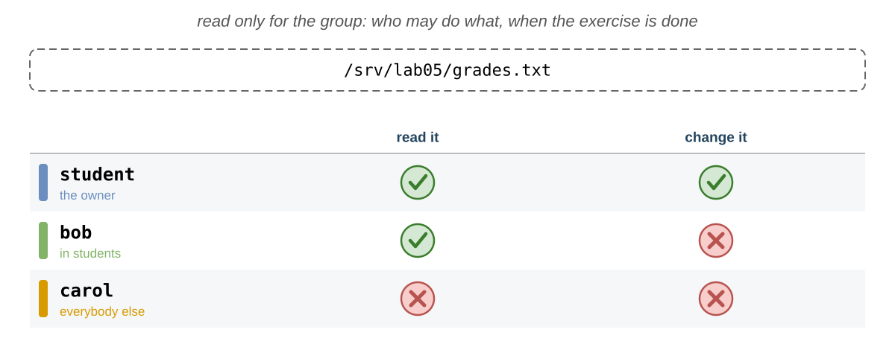

    **Verificare:** `bob` îl citește, dar nu poate scrie în el; `carol` primește `Permission denied`; `ls -l` afișează
    grupul `students`. <small>→ [`chmod`](#chmod) · [`chown` și `chgrp`](#chown-and-chgrp)</small>

44. **Un director public**: Publicați fișiere pe care le poate citi oricine, dar pe care doar voi le puteți modifica.

    `/srv/lab05/public`, cu două fișiere, `a.txt` și `b.txt`:

    - oricine poate lista directorul și citi fișierele;
    - doar `student` poate crea, șterge sau modifica fișiere în el;
    - folosiți **un singur** `chmod` cu litere pentru director și pentru toate fișierele.

    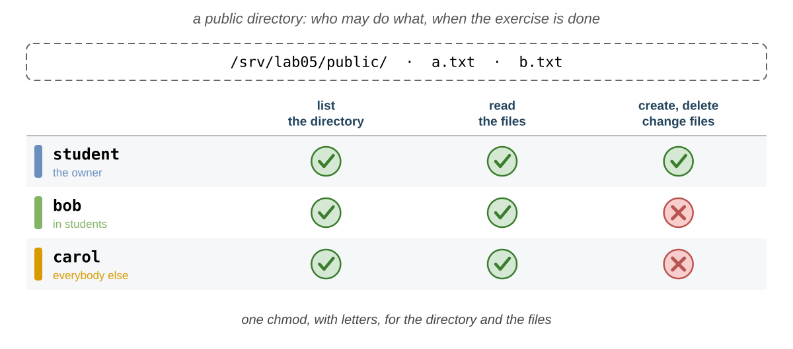

    Începeți prin a închide `public` și tot ce conține pentru grup și pentru ceilalți, cu **o singură** comandă, și
    verificați că `carol` nu poate citi `a.txt`; apoi deschideți-l așa cum se cere.

    💡 `man chmod`: căutați `recursive` și `X`-ul mare.

    **Verificare:** cât timp este închis, `public` este `drwx------`, iar `a.txt` este `-rw-------`; la final, `carol`
    listează `public` și citește `a.txt`, dar nu poate crea `public/c.txt` și nici modifica `a.txt`; fișierele nu au
    primit `x`. <small>→ [`chmod`](#chmod)</small>

45. **Un script pentru grup**: Lăsați grupul să ruleze un script, fără să-l lăsați să-l modifice.

    `/srv/lab05/tool.sh`, o copie a lui `myid.sh`:

    - membrii grupului `students` îl pot rula, dar nu îl pot modifica;
    - nimeni altcineva nu îl poate citi sau rula.

    

    Încercați întâi să-i dați grupului doar `x` și să-l rulați ca `bob`; apoi găsiți permisiunile corecte.

    **Verificare:** cu doar `x` pentru grup, `bob` primește `Permission denied`: gândiți-vă ce trebuie să facă `bash`
    cu fișierul ca să ruleze comenzile din el. Cu permisiunile corecte, `bob` îl rulează, iar scriptul afișează `bob`;
    `carol` nu îl poate nici citi, nici rula. <small>→ [`r`, `w` și `x`](#r-w-and-x)</small>

46. **Doar pentru cine știe numele**: Ascundeți un fișier într-un director, astfel încât să-l poată citi doar cei care
    îi știu numele.

    `/srv/lab05/hidden`, cu fișierul `key.txt`:

    - membrii grupului `students` pot citi `key.txt` dacă îi știu numele, dar nu pot lista directorul;
    - nimeni altcineva nu poate face nimic.

    

    **Verificare:** `bob` poate afișa `hidden/key.txt`, dar `ls hidden` este refuzat; `carol` nu poate ajunge la
    `key.txt`, nici măcar știindu-i numele. <small>→ [`r`, `w` și `x`](#r-w-and-x)</small>

47. **O listă privată**: Ajutați-l pe `bob` să partajeze un fișier din directorul lui cu grupul lui și cu nimeni
    altcineva.

    Ca `bob`:

    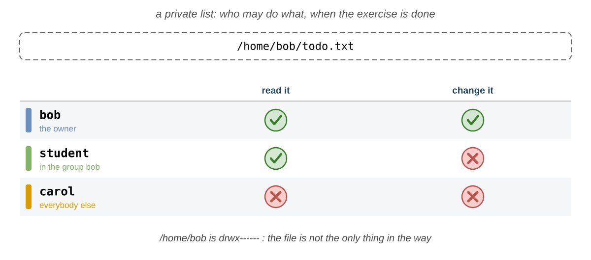

    1. închideți `/home/bob` pentru toată lumea în afară de `bob` (pe Fedora este deja așa, pe Ubuntu nu); creați
       `/home/bob/todo.txt` cu textul `Bob's TODO list`, pe care **doar** `bob` îl poate citi și scrie; verificați că
       `carol` nu îl poate citi;
    2. schimbați-l astfel încât să-l poată citi și membrii grupului `bob`, iar nimeni altcineva să nu poată face nimic;
    3. ieșiți, adăugați-vă (`student`) în grupul `bob` și încercați să citiți fișierul dintr-un **shell de
       autentificare nou**;
    4. aflați de ce tot eșuează și lăsați-l pe `bob` să modifice directorul potrivit ca să meargă, fără să o lase pe
       `carol` să intre;
    5. scoateți-vă din grupul `bob`.

    **Verificare:** la pasul 3 accesul este tot refuzat, deși sunteți în grupul `bob`, iar fișierul îi dă grupului său
    `r`: uitați-vă la **fiecare** director din cale. După corectură puteți citi fișierul, dar nu puteți lista
    `/home/bob`, iar `carol` tot nu are acces la nimic. <small>→ [Ce permisiuni se aplică?](#which-permissions-apply) · [`r`, `w` și `x`](#r-w-and-x)</small>

### 📝 Provocări {/* #challenges */}

48. **Un atac offline**: Găsiți o parolă pornind de la hash-ul ei, așa cum ar face un atacator care are o copie a lui
    `/etc/shadow`.

    Un utilizator are această linie într-o copie furată a lui `/etc/shadow`:

    ```text
    mallory:$6$uso2026$YT5ail.RilPFhAJ4Zo6bXZ6qayzFgl959rpxQZDutFYsI3F/Yq4zt5BFc04bFuFJN7PE9Scof6J8VZUPjp7Y20:20737:0:99999:7:::
    ```

    Știți că parola este una dintre `123456`, `password`, `qwerty`, `dragon` și `letmein`. Aflați care, cu **o
    singură** linie de comandă.

    💡 găsiți algoritmul și salt-ul în hash; `man openssl-passwd`: o singură comandă poate calcula hash-urile mai multor
    parole; `man grep`: căutați `line-number`.

    **Verificare:** exact unul dintre hash-urile calculate de voi este identic cu cel al lui `mallory`, iar numărul
    liniei lui vă spune ce parolă este. De aceea `/etc/shadow` nu trebuie să poată fi citit de oricine și de aceea
    parolele comune sunt periculoase. <small>→ [Hash-uri și salt](#hashes-and-salt)</small>

49. **Toate credențialele unui proces**: Prevedeți toate UID-urile și GID-urile a trei procese, verificați-le cu o
    singură comandă, apoi găsiți toate procesele care au puterea lui `root` și au fost pornite dintr-un terminal.

    Pentru shell-ul vostru, un `sleep` pornit cu `sudo` și un `passwd` care așteaptă o parolă:

    1. **întâi** completați tabelul pe hârtie, pornind de la [Cum se schimbă credențialele](#how-the-credentials-change);
    2. apoi afișați, cu **o singură** comandă `ps`, cu câte o coloană pentru fiecare: UID-ul real, cel efectiv, cel
       salvat și cel al sistemului de fișiere, precum și GID-ul real și cel efectiv, și comparați;
    3. găsiți toate procesele care rulează cu utilizatorul efectiv `root`, dar au un terminal, și afișați pentru fiecare
       terminalul, utilizatorul real și cel efectiv și comanda.

    

    💡 `man ps`, `STANDARD FORMAT SPECIFIERS`: căutați `saved` și `filesystem`; `-p` primește mai multe PID-uri,
    separate prin `,`; `man ps`: căutați `effective user`; procesele fără terminal au `?` în coloana `TTY`, eliminați-le
    cu `grep` (laboratorul 03).

    **Verificare:** shell-ul are `1000` peste tot; `sleep` are `0` peste tot; `passwd` are UID-ul real `1000`, iar
    celelalte trei `0`: acestea sunt cele 4 numere din linia `Uid:` din `/proc/<PID>/status`. La pasul 3 vedeți
    `login`-ul fiecărui terminal virtual pe care este autentificat cineva, procesele `sudo` și `su` care încă rulează și
    shell-urile lui `root`; utilizatorul real vă spune cine l-a pornit pe fiecare. <small>→ [Credențialele unui proces](#the-credentials-of-a-process)</small>

50. **Un proiect pentru grup**: Construiți un director de proiect pentru un grup, în care fișierele aparțin grupului și
    nimeni nu poate șterge munca celorlalți.

    Creați din nou utilizatorul `dave`, în grupul `students`. Dacă `/srv/project` există din laborator, ștergeți-l
    întâi. Apoi faceți `/srv/project` astfel încât:

    - doar `root` să fie proprietarul lui și doar membrii grupului `students` să poată intra în el, să-l poată lista și
      să poată crea fișiere în el;
    - orice fișier nou din el să aparțină grupului `students`, indiferent cine îl creează;
    - un membru să nu poată șterge sau redenumi fișierele altui membru.

    

    Creați un fișier în el ca `bob` și unul ca `dave`, apoi încercați să ștergeți fișierul lui `dave` ca `bob`;
    încercați să listați directorul ca `carol`.

    **Verificare:** ambele fișiere au grupul `students`, chiar dacă `bob` și `dave` au alte grupuri primare; `bob`
    primește `Operation not permitted` când șterge fișierul lui `dave`; `carol` primește `Permission denied`; ați avut
    nevoie de **doi** biți speciali. <small>→ [`setgid` pe un director](#setgid-on-a-directory) · [Bitul sticky](#the-sticky-bit)</small>

51. **O cutie pentru teme**: Construiți o cutie în care studenții își predau temele fără să le vadă sau să le atingă pe
    ale celorlalți, dar pe care profesorul o poate totuși curăța.

    Faceți `/srv/lab05/homework` astfel încât:

    - membrii grupului `students` să poată preda fișiere (să le creeze), dar să nu poată lista directorul, deci să nu
      poată vedea numele celorlalți;
    - să nu poată șterge sau înlocui fișierele celorlalți, chiar dacă le ghicesc numele;
    - `student`, profesorul, să poată face orice;
    - `carol` să nu poată face nimic.

    

    Predați `bob.txt` ca `bob` și `dave.txt` ca `dave`; ca `bob`, încercați să listați directorul și să ștergeți
    `dave.txt`; apoi, ca profesor, ștergeți `dave.txt`.

    **Verificare:** `bob` poate crea fișiere, dar nu poate lista directorul și nici șterge `dave.txt`
    (`Operation not permitted`); voi vedeți ambele fișiere și **puteți** șterge `dave.txt`: **proprietarul
    directorului** poate șterge orice fișier din el, chiar și cu bitul sticky; `carol` primește `Permission denied` la
    orice. <small>→ [`r`, `w` și `x`](#r-w-and-x) · [Bitul sticky](#the-sticky-bit)</small>

52. **Toți biții speciali**: Aflați ce înseamnă un `S` sau un `T` mare în `ls -l`, găsiți toate programele din sistem
    care rulează ca proprietarul lor și înțelegeți permisiunile lui `sudo`.

    1. copiați `notes.txt` în `cap.txt` și dați-i bitul setuid **fără** `x` pentru proprietar;
    2. creați directorul `capdir` cu `rwxrwx---` și bitul sticky, cu **un singur** număr; listați-le pe amândouă și
       afișați-le permisiunile ca numere;
    3. listați toate fișierele setuid din `/usr`, în formatul lui `ls -l`, fără erori, și numărați-le;
    4. explicați de ce `sudo` este `---s--x--x` pe Fedora (pe Ubuntu este `-rwsr-xr-x`: ce mai permite în plus?).

    💡 `man find`: căutați `-perm` și `-ls`.

    **Verificare:** `cap.txt` este `-rwSr--r--` (`4644`), iar `capdir` este `drwxrwx--T` (`1770`): o literă mare
    înseamnă că bitul este setat, dar `x`-ul de sub el nu. Există câteva zeci de programe setuid, toate ale lui `root`.
    Pentru `sudo`, spuneți pentru fiecare dintre `r`, `w`, `x` și `s` cine îl are și ce îi permite. <small>→ [Permisiuni speciale](#special-permissions) · [`setuid`](#setuid)</small>

53. **Scripturi și programe**: Vedeți de ce bitul setuid merge pentru programe, dar nu și pentru scripturi, și de ce un
    program setuid al lui `root` este periculos.

    1. ca `root`, copiați `myid.sh` în `/srv/lab05/rootid.sh` și dați-i `4755`; rulați-l;
    2. ca `root`, copiați `/usr/bin/sleep` în `/srv/lab05/rootsleep` și dați-i `4755`; rulați
       `/srv/lab05/rootsleep 300` în al doilea terminal și inspectați-i credențialele din primul;
    3. ștergeți **imediat** ambele copii.

    **Verificare:** scriptul afișează `student`: kernelul ignoră bitul setuid pe scripturi. `rootsleep` are UID-ul real
    `1000` și UID-ul efectiv `0`: un program setuid al lui `root` rulează ca `root` pentru oricine. De aceea nu trebuie
    să faceți niciodată asta cu un program care poate scrie fișiere sau porni alte programe. <small>→ [`setuid`](#setuid) · [Credențialele unui proces](#the-credentials-of-a-process)</small>

54. **Administrator pe dos**: Un coleg care folosește **cealaltă** distribuție vă spune să-l faceți pe `bob`
    administrator adăugându-l în grupul administratorilor de la **el**: `sudo` dacă voi sunteți pe Fedora, `wheel` dacă
    sunteți pe Ubuntu. Aflați dacă merge pe sistemul vostru și de ce.

    1. afișați ca `root` sfârșitul lui `/etc/sudoers` și găsiți linia care menționează grupul administratorilor
       (`%wheel` sau, pe Ubuntu, `%sudo`); nu trebuie să înțelegeți restul fișierului;
    2. verificați dacă grupul colegului există pe sistemul vostru;
    3. creați-l dacă nu există, adăugați-l pe `bob` în el și încercați să-i afișați utilizatorul ca `root`, dintr-un
       shell de autentificare nou al lui `bob`;
    4. scoateți-l pe `bob` din grup; ștergeți grupul dacă l-ați creat voi;
    5. faceți-l pe `bob` administrator în felul distribuției **voastre** și încercați din nou, dintr-un shell de
       autentificare nou; apoi luați-i dreptul.

    💡 [`sudo`](#sudo): tabelul cu grupurile administratorilor.

    **Verificare:** `/etc/sudoers` numește doar grupul distribuției voastre. În grupul colegului, `bob` este refuzat în
    continuare: `bob is not in the sudoers file.` **Numele** unui grup nu dă niciun drept prin el însuși; `sudo` are
    încredere doar în grupul pentru care a fost configurat, `wheel` pe Fedora și `sudo` pe Ubuntu. În acel grup, `bob`
    poate folosi `sudo`, cu propria parolă. <small>→ [`sudo`](#sudo) · [Gestionarea utilizatorilor și a grupurilor](#managing-users-and-groups)</small>

55. **Contează UID-ul**: Arătați că un fișier îi aparține unui UID, nu unui nume, și ce se întâmplă când un UID este
    refolosit.

    1. aflați UID-ul lui `carol`, apoi ștergeți-o **fără** directorul ei;
    2. listați `/home` cu nume, apoi cu numere;
    3. creați utilizatorul `grace`, fără director propriu, cu UID-ul pe care îl avea `carol`;
    4. listați din nou `/home`, apoi ștergeți-o pe `grace` și ștergeți `/home/carol`.

    💡 `man ls`: căutați `numeric`; `man useradd`: căutați `uid` și `no-create-home`.

    **Verificare:** după ce `carol` a fost ștearsă, `/home/carol` îi aparține unui număr (`1002`): fișierele păstrează
    doar UID-ul; când `grace` primește acest UID, devine proprietara tuturor fișierelor lui `carol`. Înainte ca un UID
    să fie refolosit, fișierele vechiului utilizator trebuie șterse. <small>→ [Utilizatori](#users)</small>

56. **Curățenie**: Lăsați sistemul așa cum era înainte de laborator.

    1. ștergeți utilizatorii `bob`, `carol` (dacă mai există) și `dave`, cu directoarele lor, precum și grupul
       `students`;
    2. ștergeți `/srv/lab05`, `/srv/project` și `/tmp/bob.txt`;
    3. ștergeți `~/lab05` (dacă eșuează, aflați ce director nu are `w` sau `x` pentru voi);
    4. eliminați `PS1`-ul vostru din `~/.bashrc`.

    **Verificare:** `bob`, `carol`, `dave` și `students` nu mai apar în bazele de date; `/srv` nu mai conține `lab05` și
    `project`. <small>→ [Gestionarea utilizatorilor și a grupurilor](#managing-users-and-groups)</small>

## Întrebări de recapitulare {/* #wrap-up-questions */}

Folosiți **ultimele 5 minute** ale laboratorului ca să răspundeți la aceste întrebări împreună cu colegii și cu
asistentul. La ultimele două nu există răspunsuri greșite.

1. Ce este un **utilizator** pentru kernel? Dar un **grup**?
2. De ce poate oricine să citească `/etc/passwd`, dar doar `root` poate citi `/etc/shadow`? De ce citiți utilizatorii cu
   `getent`, și nu din `/etc/passwd`?
3. Cum verifică `login` o parolă, dacă parola nu este păstrată nicăieri? La ce folosește **salt**-ul?
4. Care este diferența dintre UID-ul **real** și cel **efectiv** al unui proces? Când diferă? La ce folosește UID-ul
   **salvat**?
5. Care este diferența dintre `sudo` și `su`? De ce merge `sudo` pentru `student`, dar nu și pentru un utilizator nou?
6. De ce eșuează `sudo echo text > /etc/hosts`?
7. Ce înseamnă `r`, `w` și `x` pentru un director? De ce puteți șterge un fișier în care nu puteți scrie?
8. De ce nu funcționează un grup nou până nu vă autentificați din nou?
9. De ce nu vă puteți baza pe prompt ca să aflați cine sunteți?
10. Ce permisiuni le veți da de acum înainte propriilor fișiere?
