# 05. Utilizatori și permisiuni

În laboratorul 4 ați aflat ce face shell-ul cu o linie de comandă și cum pornește programele și le trimite semnale. În
acest laborator aflați **sub ce utilizator** rulează aceste programe. Vă întâlniți cu **utilizatorii** și cu
**grupurile** sistemului, aflați unde sunt păstrați, `/etc/passwd`, `/etc/group` și `/etc/shadow`, și cum îi căutați cu
`getent`. Rulați comenzi ca `root` cu `sudo`, vedeți cum verifică sistemul o **parolă** fără să o păstreze vreodată și
creați utilizatori noi. Apoi decideți cine vă poate citi, modifica și rula fișierele, cu `chmod`, `chown` și `umask`. La
final întâlniți **permisiunile speciale**: bitul `setuid`, datorită căruia `passwd` vă poate schimba parola, bitul
`setgid` pentru directoarele partajate și **bitul sticky** al lui `/tmp`.

Ideea cea mai importantă a laboratorului este că kernelul nu cunoaște niciun nume, ci doar **numere**. Fiecare proces
poartă numărul utilizatorului său (**UID**-ul) și numerele grupurilor sale (**GID**-urile): **eticheta procesului**.
Fiecare fișier păstrează numărul **proprietarului**, numărul **grupului** și trei seturi de **permisiuni**: pentru
proprietar, pentru grup și pentru toți ceilalți. De fiecare dată când un proces deschide un fișier, kernelul compară
eticheta procesului cu proprietarul și cu grupul fișierului, alege **unul** dintre cele trei seturi și verifică dacă
permite ce cere procesul.

## Obiective {/* #objectives */}

- Să înțelegeți ce sunt un **utilizator** și un **grup**, pentru oameni și pentru kernel: un **UID** și un **GID**
- Să aflați cine sunteți cu `whoami`, `id` și `groups` și sub ce utilizator rulează fiecare proces cu `ps`
- Să aflați unde se păstrează utilizatorii și grupurile: `/etc/passwd`, `/etc/group` și `/etc/shadow`
- Să căutați utilizatori și grupuri cu `getent`
- Să rulați comenzi ca `root` sau ca alt utilizator, cu `sudo` și `su`, și să evitați **capcana redirectării** cu `tee`
- Să înțelegeți cum păstrează `/etc/shadow` parolele sub formă de **hash-uri** cu **salt** și cum se verifică o parolă
- Să creați, să modificați și să ștergeți utilizatori și grupuri cu `useradd`, `passwd`, `usermod`, `groupadd`,
  `gpasswd` și `userdel`
- Să înțelegeți ce se întâmplă când vă **autentificați** și de ce un grup nou cere o nouă autentificare
- Să citiți **permisiunile** unui fișier cu `ls -l` și `stat` și să înțelegeți ce înseamnă `r`, `w` și `x` pentru
  fișiere și pentru directoare
- Să schimbați permisiunile cu `chmod` (cu litere și cu numere), proprietarul cu `chown` și `chgrp`, iar permisiunile
  implicite cu `umask`
- Să folosiți **permisiunile speciale**: `setuid`, `setgid` și **bitul sticky**
- Să înțelegeți de ce nu vă puteți baza pe **prompt** ca să aflați cine sunteți

## Resurse {/* #resources */}

1. _[Razvan Deaconescu, Razvan Rughinis, Mihai Carabas, Alexandru Radovici, Utilizarea Sistemelor de
   Operare, Printech 2021](https://github.com/systems-cs-pub-ro/carte-uso/releases/download/uso-ed1-2021/uso.pdf)_
   - Capitolul 5 - _Utilizatori_
   - Capitolul 9 - _Pornirea sistemului_, secțiunea 9.6.1
2. _Brian Ward, How LINUX Works, 3rd Edition, No Starch Press, 2021_
   - Capitolul 2 - _Basic Commands and Directory Hierarchy_, secțiunile 2.17 și 2.20
   - Capitolul 7 - _System Configuration: Logging, System Time, Batch Jobs, and Users_, secțiunile 7.3, 7.4, 7.9 și 7.10
3. Slide-urile cursului: [05. Utilizatori](/docs/lectures/05)
4. Paginile de manual: `man 5 passwd`, `man 5 shadow`, `man 5 group`, `man id`, `man getent`,
   `man sudo`, `man su`, `man useradd`, `man usermod`, `man userdel`, `man gpasswd`, `man chage`, `man chmod`,
   `man chown`, `man chgrp`, `man stat`, `man login.defs`, `man openssl-passwd`, `man 5 proc` și `man bash` (căutați
   `umask` și `PROMPTING`)

## Fedora și Ubuntu {/* #fedora-and-ubuntu */}

Calculatoarele din laborator rulează **Fedora** cu **Sway**, iar exemplele provin de pe ele. Acasă puteți folosi și
**Ubuntu**: comenzile sunt aceleași, dar unele nume și valori implicite diferă:

|                                                                 | Fedora                               | Ubuntu                                                 |
| --------------------------------------------------------------- | ------------------------------------ | ------------------------------------------------------ |
| promptul                                                        | `[student@fedora ~]$`                | `student@ubuntu:~$`, colorat                           |
| grupul **administratorilor**, cei care pot folosi `sudo`        | `wheel`, GID `10`                    | `sudo`, GID `27` (sunteți și în `adm`, `cdrom`, ...)   |
| `.` de după permisiuni în `ls -l`, `context=` în `id`           | afișate: ignorați-le în laborator    | nu apar                                                |
| shell-ul unui utilizator nou creat cu `useradd`                 | `/bin/bash`                          | `/bin/sh`, dacă nu dați `-s /bin/bash`                 |
| un director nou al utilizatorului                               | `drwx------` (`700`)                 | `drwxr-x---` (`750`)                                   |
| `/etc/shadow`                                                   | `---------- root root`               | `-rw-r----- root shadow`                               |
| `/usr/bin/sudo`                                                 | `---s--x--x` (`4111`)                | `-rwsr-xr-x` (`4755`)                                  |
| o parolă încă nesetată sau blocată cu `passwd -l`               | `!!` în fața hash-ului sau singur    | `!` în fața hash-ului sau singur                       |
| `umask`-ul unui utilizator obișnuit                             | `0022`                               | `0002`                                                 |
| instalarea unui pachet                                          | `sudo dnf install <PACKAGE>`         | `sudo apt install <PACKAGE>`                           |

Ubuntu 25.10 și versiunile mai noi folosesc `sudo-rs`, ale cărui mesaje diferă puțin. Dacă utilizatorul vostru nu este
`student`, folosiți numele vostru oriunde laboratorul scrie `student`.

## Utilizatori {/* #users */}

Un **utilizator** este un **cont**: un nume, de exemplu `student`, o parolă, un director propriu și programul care
pornește când se autentifică, de obicei un shell. Utilizatorii țin separată munca oamenilor: un program pornit de `bob`
nu poate atinge fișierele lui `carol`, decât dacă ea îi permite.

Și serviciile rulează ca utilizatori proprii: astfel, o eroare într-unul dintre ele poate atinge doar fișierele lui.

Pentru kernel, un utilizator este doar un **număr**, **UID**-ul (_User ID_); programele îl traduc pentru voi într-un
nume.

### Cine sunt eu: `whoami` și `id` {/* #who-am-i-whoami-and-id */}

| Comandă                      | Ce afișează                                                                                     |
| ---------------------------- | ----------------------------------------------------------------------------------------------- |
| `whoami`                     | numele utilizatorului care rulează comanda                                                      |
| `id`                         | eticheta procesului: UID-ul, grupul primar (GID-ul) și toate grupurile                          |
| `id -u`, `id -g`             | doar UID-ul, doar GID-ul grupului primar                                                        |
| `id -un`                     | doar numele utilizatorului, ca `whoami`                                                         |
| `id -nG`                     | doar numele grupurilor                                                                          |
| `groups`                     | numele grupurilor voastre, ca `id -nG`                                                          |
| `id <USER>`, `groups <USER>` | ce spun despre un utilizator bazele de date: eticheta pe care o primește când se autentifică    |

```shell-session
[student@fedora ~]$ whoami
student
[student@fedora ~]$ id
uid=1000(student) gid=1000(student) groups=1000(student),10(wheel) context=unconfined_u:unconfined_r:unconfined_t:s0-s0:c0.c1023
[student@fedora ~]$ id root
uid=0(root) gid=0(root) groups=0(root)
```

- `id` a afișat eticheta shell-ului vostru: UID-ul, grupul primar și toate grupurile. Membrii lui `wheel` sunt
  **administratorii**, care pot folosi [`sudo`](#sudo). Ignorați `context=...`: laboratorul nu are nevoie de el.
- `id root` a afișat ce știe sistemul despre `root`, administratorul: UID-ul `0`.

### Intervale de UID-uri {/* #uid-ranges */}

| UID          | Tip                           | Folosit pentru                                                                          | Exemple pe Fedora                 |
| ------------ | ----------------------------- | --------------------------------------------------------------------------------------- | --------------------------------- |
| `0`          | `root`                        | administratorul; kernelul sare pentru el peste majoritatea verificărilor                | `root`                            |
| `1` - `999`  | **utilizatori de sistem**     | servicii; majoritatea nu se pot autentifica, pentru că au ca shell `nologin`            | `bin`, `daemon`, `dbus`, `chrony` |
| `1000` - ... | **utilizatori obișnuiți**     | oameni                                                                                  | `student`                         |
| `65534`      | `nobody`                      | fișierele al căror proprietar real nu se cunoaște și procesele care nu trebuie să aibă niciun drept | `nobody`              |

Aceste intervale sunt doar o **convenție**, stabilită în `/etc/login.defs`: pentru kernel, toate UID-urile în afară de
`0` sunt la fel.

### Utilizatorul unui proces {/* #the-user-of-a-process */}

Fiecare **proces** poartă UID-ul utilizatorului care l-a pornit și GID-urile grupurilor sale: **eticheta procesului**.
Gândiți-vă la un ecuson: kernelul se uită la el de fiecare dată când procesul deschide un fișier sau trimite un semnal
și decide dacă are **voie**. Un copil **moștenește** eticheta părintelui: tot ce porniți din shell rulează ca voi.

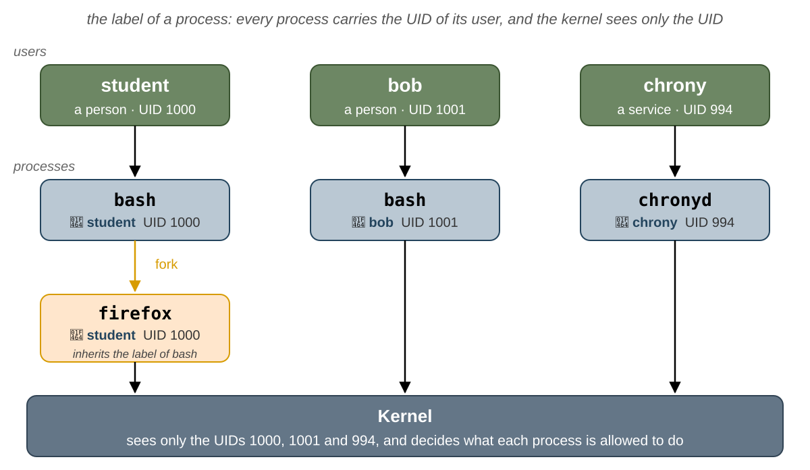

`ps` arată utilizatorul fiecărui proces în coloana `USER` (`UID` pentru număr):

```shell-session
[student@fedora ~]$ ps -o user,uid,pid,ppid,comm
USER       UID     PID    PPID COMMAND
student   1000    2817    2805 bash
student   1000    3104    2817 ps
[student@fedora ~]$ ps -eo user | sort | uniq -c
      4 chrony
      2 dbus
      ...
    156 root
     51 student
```

- `bash` și `ps` rulează ca `student`: `ps` este copilul lui `bash`.
- `ps -eo user | sort | uniq -c` a numărat procesele fiecărui utilizator (vedeți [Pipe-uri](/docs/labs/03#pipes-) din
  laboratorul 03): cele mai multe rulează ca `root`.

:::info

`ps`, `ls -l` și `id` primesc de la kernel doar numere și caută numele; un UID fără utilizator, de exemplu al unui
utilizator șters, este afișat ca număr.

:::

:::note

Un proces poate avea mai multe UID-uri în același timp (`passwd` are). Exercițiile de acasă și provocările au nevoie de
aceste detalii: sunt în [Credențialele unui proces](#the-credentials-of-a-process).

:::

## Grupuri {/* #groups */}

Un **grup** este o mulțime de utilizatori, cu un nume și un număr, **GID**-ul (_Group ID_). Un fișier poate da
permisiuni unui grup, de exemplu studenților unui proiect, fără să se deschidă pentru toată lumea: fiecare membru le
primește.

Fiecare utilizator are:

- **un grup primar**, pe care îl primesc fișierele noi ale utilizatorului; `useradd` creează unul cu același nume ca
  utilizatorul, deci `student` are grupul primar `student`;
- oricâte **grupuri suplimentare**, de exemplu `wheel`, grupul administratorilor.

## Bazele de date ale utilizatorilor și grupurilor {/* #the-users-and-groups-databases */}

### `/etc/passwd` {/* #etcpasswd */}

Utilizatorii locali sunt păstrați în `/etc/passwd`, **câte un utilizator pe linie**, cu câmpurile separate prin `:`.
**Oricine** îl poate citi: fiecare program care afișează un nume de utilizator are nevoie de el.

```shell-session
[student@fedora ~]$ ls -l /etc/passwd
-rw-r--r--. 1 root root 2245 Oct 20 09:12 /etc/passwd
[student@fedora ~]$ head -3 /etc/passwd
root:x:0:0:Super User:/root:/bin/bash
bin:x:1:1:bin:/bin:/usr/sbin/nologin
daemon:x:2:2:daemon:/sbin:/usr/sbin/nologin
```

- `ls -l` a arătat că doar `root` îl poate modifica, dar oricine îl poate citi (pe Fedora, ignorați `.` de după
  permisiuni).
- `head -3` a arătat formatul. Ca să **căutați** un utilizator, folosiți [`getent`](#getent):

```shell-session
[student@fedora ~]$ getent passwd student
student:x:1000:1000:Student:/home/student:/bin/bash
```

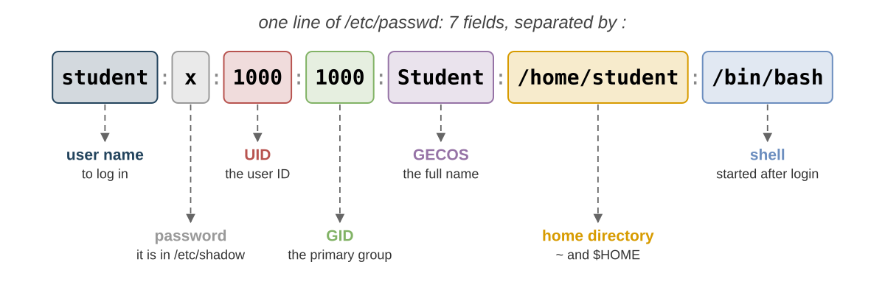

| Câmp | În exemplu      | Ce este                                                                                                        |
| ---- | --------------- | -------------------------------------------------------------------------------------------------------------- |
| 1    | `student`       | **numele de utilizator**, cel cu care vă autentificați                                                         |
| 2    | `x`             | parola: `x` înseamnă că se păstrează în `/etc/shadow` (vedeți [Parole](#passwords))                            |
| 3    | `1000`          | **UID**-ul                                                                                                     |
| 4    | `1000`          | **GID**-ul **grupului primar**                                                                                 |
| 5    | `Student`       | câmpul **GECOS**: numele complet, uneori urmat de numărul camerei și de numerele de telefon, separate prin `,` |
| 6    | `/home/student` | **directorul utilizatorului** (_home_): directorul curent după autentificare, `~` și `$HOME`                   |
| 7    | `/bin/bash`     | **shell-ul**, programul pornit după autentificare; `/usr/sbin/nologin` refuză autentificarea                   |

### `/etc/group` {/* #etcgroup */}

Grupurile locale se păstrează în `/etc/group`, câte un grup pe linie, cu 4 câmpuri. Și acesta poate fi citit de
oricine.

```shell-session
[student@fedora ~]$ getent group wheel
wheel:x:10:student
[student@fedora ~]$ getent group student
student:x:1000:
```

| Câmp | În exemplu | Ce este                                                                                  |
| ---- | ---------- | ---------------------------------------------------------------------------------------- |
| 1    | `wheel`    | numele grupului                                                                          |
| 2    | `x`        | nu este folosit în acest laborator                                                       |
| 3    | `10`       | **GID**-ul                                                                               |
| 4    | `student`  | **membrii**, separați prin `,`: utilizatorii care au grupul ca grup **suplimentar**      |

:::caution

Utilizatorii al căror grup **primar** este acesta **nu** apar în listă: grupul `student` are lista goală. Folosiți
`id <USER>` ca să vedeți toate grupurile unui utilizator.

:::

:::danger

Nu editați `/etc/passwd`, `/etc/group` sau `/etc/shadow` cu un editor de text: un singur `:` greșit poate împiedica
orice utilizator, inclusiv `root`, să se autentifice. Folosiți comenzile din
[Gestionarea utilizatorilor și a grupurilor](#managing-users-and-groups).

:::

### `getent` {/* #getent */}

Utilizatorii și grupurile pot veni și de pe un **server** din rețea (LDAP, Active Directory) sau de la `systemd`. De
aceea, programele nu citesc fișierele: întreabă **biblioteca C** (codul pe care orice program îl folosește ca să
vorbească cu sistemul), care caută în toate aceste locuri, enumerate în `/etc/nsswitch.conf`. Împreună, ele formează
**baza de date a utilizatorilor** și **baza de date a grupurilor**.

`getent` (_get entries_) întreabă biblioteca C în același fel și afișează rezultatul în formatul fișierelor:

| Comandă                            | Găsește                                                    |
| ---------------------------------- | ---------------------------------------------------------- |
| `getent passwd <NAME>` sau `<UID>` | utilizatorul cu acest **nume** sau cu acest **UID**        |
| `getent passwd`                    | toți utilizatorii                                          |
| `getent group <NAME>` sau `<GID>`  | grupul cu acest nume sau cu acest GID                      |
| `getent group`                     | toate grupurile                                            |
| `sudo getent shadow <NAME>`        | linia utilizatorului din `/etc/shadow`, doar pentru `root` |

```shell-session
[student@fedora ~]$ getent passwd 0
root:x:0:0:Super User:/root:/bin/bash
[student@fedora ~]$ getent passwd nobody
nobody:x:65534:65534:Kernel Overflow User:/:/usr/sbin/nologin
[student@fedora ~]$ getent passwd alice
[student@fedora ~]$
```

- `getent passwd 0` l-a găsit pe `root`, iar `getent passwd nobody` pe `nobody`.
- `getent passwd alice` nu a afișat **nimic**, fără nicio eroare: nu există un astfel de utilizator.

:::caution

**Căutați mereu utilizatorii și grupurile cu `getent`**

Folosiți `getent passwd` și `getent group`, nu `cat` sau `grep` pe fișiere: fișierele au doar conturile locale. În acest
laborator, **baza de date a utilizatorilor** înseamnă `getent passwd`, iar **baza de date a grupurilor** înseamnă
`getent group`.

:::

## Utilizatorul `root` {/* #the-root-user */}

`root` este administratorul, utilizatorul cu UID-ul `0`. Pentru `root`, kernelul **sare peste** cele mai multe
verificări: poate citi și scrie orice fișier, poate trimite semnale oricărui proces și poate modifica sistemul, de aceea
instalarea programelor și crearea utilizatorilor au nevoie de el. Directorul lui propriu este `/root`.

Kernelul se uită doar la **număr**: două nume de utilizator cu UID-ul `0` sunt amândouă `root`. Așa poate ascunde un
atacator un al doilea `root`.

:::danger

O greșeală făcută ca `root` poate distruge tot sistemul: pe `root` nu îl oprește niciun `Permission denied`. Lucrați ca
utilizator obișnuit și deveniți `root` doar pentru comenzile care au nevoie de asta.

:::

## Cum devenim `root`: `sudo` și `su` {/* #becoming-root-sudo-and-su */}

### `sudo` {/* #sudo */}

`sudo` rulează **o singură comandă** ca `root`. Vă cere **parola voastră** și funcționează doar pentru
**administratori**: membrii unui anumit grup, al cărui nume depinde de distribuție:

| Distribuție                | Grupul administratorilor |
| -------------------------- | ------------------------ |
| Fedora, Red Hat, CentOS    | `wheel`                  |
| Ubuntu, Debian, Linux Mint | `sudo`                   |

Ca să faceți un utilizator administrator, adăugați-l în acest grup (vedeți
[Gestionarea utilizatorilor și a grupurilor](#managing-users-and-groups)). `student` este în `wheel`:

```shell-session
[student@fedora ~]$ cat /etc/shadow
cat: /etc/shadow: Permission denied
[student@fedora ~]$ sudo whoami
[sudo] password for student:
root
[student@fedora ~]$ sudo whoami
root
```

- `cat /etc/shadow` a eșuat: doar `root` poate citi acest fișier.
- `sudo whoami` a cerut parola lui `student`, apoi a rulat `whoami` ca `root`.
- Al doilea `sudo` nu a mai cerut-o: `sudo` ține minte parola câteva minute (**5** pe Fedora), în acest terminal.
- Un utilizator care nu este administrator primește `bob is not in the sudoers file.`

`sudo` înregistrează în jurnal **fiecare** comandă: cine a rulat ce, ca cine și din ce director:

```shell-session
[student@fedora ~]$ sudo journalctl -t sudo | tail -2
Oct 27 10:02:11 fedora sudo[3311]:  student : TTY=pts/0 ; PWD=/home/student ; USER=root ; COMMAND=/usr/bin/whoami
Oct 27 10:02:20 fedora sudo[3315]:  student : TTY=pts/0 ; PWD=/home/student ; USER=root ; COMMAND=/usr/bin/journalctl -t sudo
```

| Comandă                    | Ce face                                                                                                    |
| -------------------------- | ---------------------------------------------------------------------------------------------------------- |
| `sudo <COMMAND>`           | rulează comanda ca `root`                                                                                  |
| `sudo -u <USER> <COMMAND>` | rulează comanda ca alt utilizator; cere parola **voastră**, nu pe a lui                                    |
| `sudo -i`                  | pornește un **shell de autentificare** al lui `root`, în `/root`, cu variabilele lui `root`                |
| `sudo -k`                  | uită parola: următorul `sudo` o cere din nou                                                               |
| `sudo !!`                  | rulează din nou comanda **anterioară**, cu `sudo`: `bash` înlocuiește `!!` înainte să pornească `sudo`     |

`sudo` așteaptă să se termine comanda și îi transmite semnalele pe care le primește. Pe Fedora, rulează comanda și
într-un **pseudo-terminal nou** (vedeți [Emulatoare de terminal](/docs/labs/04#terminal-emulators) din laboratorul 04),
deci există **două** procese `sudo`. Pentru `sudo sleep 300` pornit din shell-ul `2817`:

```shell-session
[student@fedora ~]$ pstree -pu 2817
bash(2817)───sudo(3320,root)───sudo(3321)───sleep(3322)
[student@fedora ~]$ ps -o pid,ppid,tty,comm -p 3320,3321,3322
    PID    PPID TT       COMMAND
   3320    2817 pts/0    sudo
   3321    3320 pts/2    sudo
   3322    3321 pts/2    sleep
```

- `pstree -pu` a arătat PID-urile și, acolo unde se schimbă, utilizatorul: tot ce este sub `sudo` rulează ca `root`.
- Al doilea `sudo` și `sleep` sunt pe `pts/2`, nu pe `pts/0`: `ps -t pts/0` **nu** le găsește; folosiți `pstree` sau
  `pgrep`.

:::info

Pseudo-terminalul nou împiedică un program pornit cu `sudo` să tasteze comenzi în terminalul vostru după ce se termină.
Înainte de `sudo` 1.9.14 nu era implicit, iar `pstree` arată un singur `sudo`.

:::

### `su` {/* #su */}

`su` (_switch user_) pornește un **shell** ca alt utilizator și cere parola **acelui** utilizator:

| Comandă       | Ce face                                                                                               |
| ------------- | ----------------------------------------------------------------------------------------------------- |
| `su - <USER>` | pornește un **shell de autentificare** al utilizatorului: cu directorul, variabilele și grupurile lui |
| `su -`        | același lucru, pentru `root`; cere parola lui `root`                                                  |
| `exit`        | iese din shell și revine în al vostru                                                                 |

```shell-session
[student@fedora ~]$ su -
Password:
su: Authentication failure
[student@fedora ~]$ sudo -i
[root@fedora ~]# whoami
root
[root@fedora ~]# exit
logout
[student@fedora ~]$
```

- `su -` a eșuat: de obicei, `root` **nu are parolă** pe Fedora și Ubuntu (este blocată, vedeți
  [`/etc/shadow`](#etcshadow)).
- `sudo -i` a pornit un shell al lui `root` cu parola **voastră**; `exit` l-a închis.

Cu `su`, toți cei care devin `root` folosesc aceeași parolă; cu `sudo`, fiecare o folosește pe a lui, iar fiecare
comandă este înregistrată. Folosiți `su` ca să deveniți **alt utilizator obișnuit**.

:::tip

Într-un shell de `root`, promptul afișează `#` în loc de `$`. Ieșiți din el cu `exit` imediat ce ați terminat.

:::

### Capcana redirectării {/* #the-redirect-trap */}

`sudo` rulează **comanda**, nu toată linia. **Redirectările** le face shell-ul vostru, care rulează ca voi, **înainte**
să pornească `sudo`:

```shell-session
[student@fedora ~]$ sudo echo "192.168.1.20 printer" >> /etc/hosts
bash: /etc/hosts: Permission denied
[student@fedora ~]$ echo "192.168.1.20 printer" | sudo tee -a /etc/hosts
192.168.1.20 printer
```

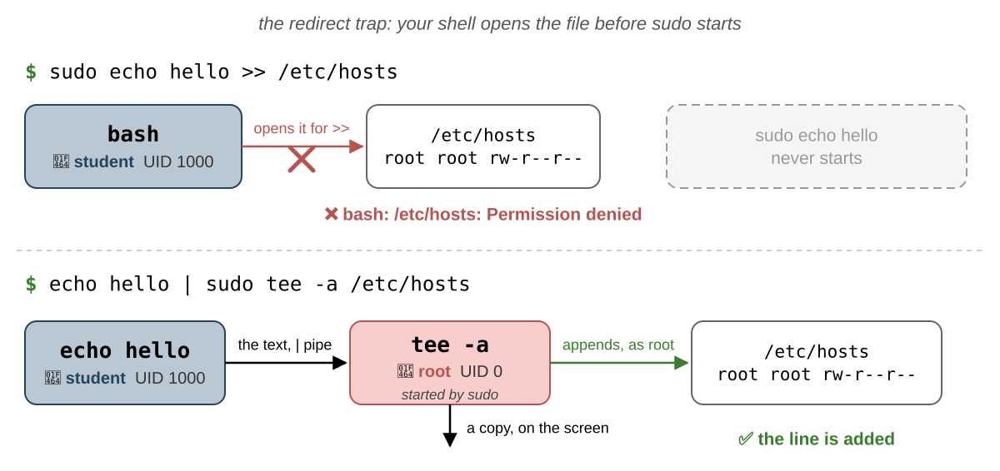

- `bash` a deschis `/etc/hosts` pentru `>>` ca `student`, înainte să pornească `sudo`, și a eșuat.
- `tee` a rulat ca `root`: a scris textul din pipe în fișier **și** pe ecran. `-a` (_append_) adaugă la sfârșit, ca
  `>>`; fără el, `tee` înlocuiește conținutul, ca `>`.

:::tip

Ca să ascundeți ieșirea lui `tee`, adăugați `> /dev/null`: oricine poate scrie în `/dev/null`, deci această redirectare
merge și ca voi.

:::

## Parole {/* #passwords */}

### `/etc/shadow` {/* #etcshadow */}

`/etc/passwd` trebuie să poată fi citit de oricine, așa că parolele nu pot sta acolo. Ele se păstrează în `/etc/shadow`,
pe care doar `root` îl poate citi:

```shell-session
[student@fedora ~]$ ls -l /etc/shadow
----------. 1 root root 1207 Oct 20 09:12 /etc/shadow
[student@fedora ~]$ getent shadow student
[student@fedora ~]$ sudo getent shadow student
student:$y$j9T$Xr3aB7tPq2LkV9sD1fGh0J$9mQeT4bW1sZxH8cDr5Ny2kLpA7uVq3oEw6iFj0gHt1M:20737:0:99999:7:::
```

- Pe Fedora, `/etc/shadow` **nu** are nicio permisiune: doar `root`, pentru care kernelul sare peste verificări, îl
  poate citi. Pe Ubuntu este `-rw-r----- root shadow`.
- Ca `student`, `getent shadow` nu a afișat nimic; cu `sudo`, a afișat linia.

Fiecare linie are 9 câmpuri, separate prin `:`:

| Câmp | În exemplu       | Ce este                                                                                                      |
| ---- | ---------------- | ------------------------------------------------------------------------------------------------------------ |
| 1    | `student`        | numele de utilizator, același ca în `/etc/passwd`                                                            |
| 2    | `$y$j9T$Xr3a...` | **hash**-ul parolei; `!`, `!!` sau `*` la început înseamnă că parola este **blocată**: nu merge nicio parolă |
| 3    | `20737`          | ziua ultimei schimbări a parolei, numărată de la 1 ianuarie 1970                                             |
| 4    | `0`              | numărul minim de zile între două schimbări de parolă                                                         |
| 5    | `99999`          | numărul maxim de zile după care parola **trebuie** schimbată; `99999` înseamnă niciodată                     |
| 6    | `7`              | cu câte zile înainte de expirare este avertizat utilizatorul                                                 |
| 7    | _gol_            | câte zile după expirare mai poate fi folosit contul                                                          |
| 8    | _gol_            | ziua în care expiră **contul**; gol înseamnă niciodată                                                       |
| 9    | _gol_            | rezervat                                                                                                     |

`chage -l` (_change age_) afișează câmpurile 3 - 8 ca date calendaristice:

```shell-session
[student@fedora ~]$ sudo chage -l student
Last password change                                    : Oct 11, 2026
Password expires                                        : never
Password inactive                                       : never
Account expires                                         : never
Minimum number of days between password change          : 0
Maximum number of days between password change          : 99999
Number of days of warning before password expires       : 7
[student@fedora ~]$ date -d '1970-01-01 + 20737 days'
Sun Oct 11 12:00:00 AM EEST 2026
```

:::note

O parolă blocată (câmpul 2) oprește doar autentificările **cu parolă**: un utilizator care se autentifică cu `ssh` și o
cheie tot intră. Ca să opriți **orice** autentificare, faceți contul să expire (câmpul 8, `chage -E`).

:::

### Hash-uri și salt {/* #hashes-and-salt */}

Parola nu este păstrată **niciodată**, ci doar **hash**-ul ei: rezultatul unei funcții **one-way**. Hash-ul unei parole
se calculează ușor; parola nu se poate afla din hash: singura cale este să **ghiciți** o parolă, să-i calculați hash-ul
și să comparați. Al doilea câmp din `/etc/shadow` are părți separate prin `$`:

| Parte       | În exemplu               | Ce este                                                                                             |
| ----------- | ------------------------ | --------------------------------------------------------------------------------------------------- |
| algoritmul  | `y`                      | funcția de hash: `y` este _yescrypt_, `6` este _SHA-512_, `1` este vechiul _MD5_                    |
| parametrii  | `j9T`                    | costul algoritmului: câtă muncă cere un hash                                                        |
| **salt**-ul | `Xr3aB7tPq2LkV9sD1fGh0J` | un text aleator, diferit pentru fiecare utilizator, adăugat la parolă înainte de calculul hash-ului |
| hash-ul     | `9mQeT4bW1sZx...`        | hash-ul salt-ului și al parolei                                                                     |

Ca să **verifice** o parolă, `login`, `sudo` sau `passwd` calculează hash-ul parolei tastate cu algoritmul, parametrii
și salt-ul din `/etc/shadow` și compară rezultatul cu hash-ul păstrat.

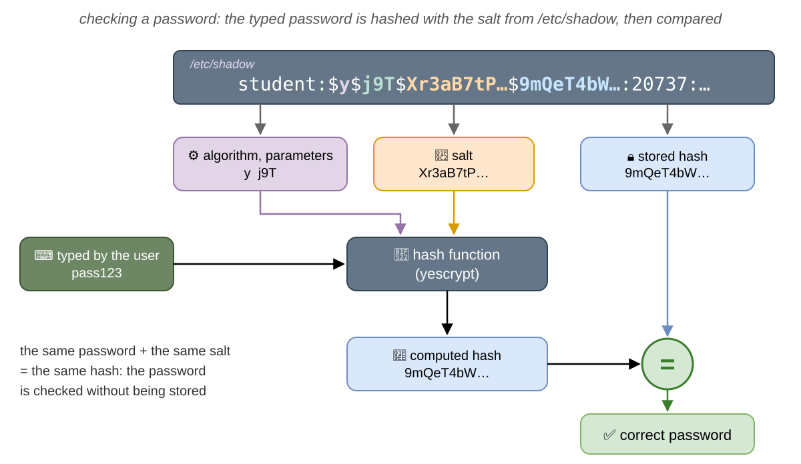

`openssl passwd` calculează un hash în același fel (`-6` înseamnă _SHA-512_):

```shell-session
[student@fedora ~]$ openssl passwd -6 -salt Xr3aB7tP pass123
$6$Xr3aB7tP$Z1hKbIRkawX63bJfb3tDz.QpCpVlFdOHOBw1ZdK7Oe/6P0K3E0OUwMhyG7PXhsJPPu.ZobCXoTYNxvAQ3HExk0
[student@fedora ~]$ openssl passwd -6 -salt Xr3aB7tP pass123
$6$Xr3aB7tP$Z1hKbIRkawX63bJfb3tDz.QpCpVlFdOHOBw1ZdK7Oe/6P0K3E0OUwMhyG7PXhsJPPu.ZobCXoTYNxvAQ3HExk0
[student@fedora ~]$ openssl passwd -6 -salt Xr3aB7tP pass124
$6$Xr3aB7tP$msVqpr1xVM/DA2zRy9MVn8yIL5iisMXZpqd3XHD5Ix0aQ5QqD8D3Q91LXVy0w9hPqQLzRYsUVEH5g5oBfNp9//
[student@fedora ~]$ openssl passwd -6 -salt Lp0wQ2zM pass123
$6$Lp0wQ2zM$Uo9XUE/86KtNuRc.TcZpxeM0kWUejWZuFOaRQSujvsfACi8WRK55XpaV3Z3WE8TLEWQBF9Jgn4ByzOvO43Ukw0
```

- Aceeași parolă și același salt au dat **același** hash: așa funcționează verificarea.
- O literă diferită sau alt salt au dat un hash complet diferit: doi utilizatori cu aceeași parolă au linii diferite în
  `/etc/shadow`.

:::info

De ce nu este hash-ul în `/etc/passwd`? Cu o copie a hash-ului, un atacator poate încerca parole pe propriul calculator,
cât de repede poate calcula hash-uri, fără ca cineva să vadă încercările. Un algoritm lent, ca _yescrypt_, și salt-ul îi
îngreunează munca, dar o parolă simplă este tot găsită repede. De aceea doar `root` poate citi `/etc/shadow`, iar
programele care verifică parolele rulează ca `root`.

:::

### Schimbarea parolei: `passwd` {/* #changing-a-password-passwd */}

| Comandă                 | Ce face                                                                                             |
| ----------------------- | --------------------------------------------------------------------------------------------------- |
| `passwd`                | schimbă parola **voastră**; o cere întâi pe cea veche                                               |
| `sudo passwd <USER>`    | schimbă parola altui utilizator (doar `root` are voie)                                              |
| `sudo passwd -l <USER>` | **blochează** parola: adaugă `!!` (Ubuntu: `!`) în fața hash-ului, așa că nu mai merge nicio parolă |
| `sudo passwd -u <USER>` | o deblochează: elimină `!`, iar parola **veche** merge din nou                                      |
| `sudo passwd -S <USER>` | afișează starea parolei: setată, blocată sau goală                                                  |

:::caution

Când tastați o parolă în terminal, pe ecran nu apare **nimic**. Tastați-o oricum și apăsați <kbd>Enter</kbd>. Fedora
refuză parolele prea scurte sau prea simple, dacă nu sunteți `root`.

:::

## Gestionarea utilizatorilor și a grupurilor {/* #managing-users-and-groups */}

Aceste comenzi modifică `/etc/passwd`, `/etc/shadow` și `/etc/group`, deci au nevoie de `sudo`:

| Comandă                           | Ce face                                                                                                                                   |
| --------------------------------- | ----------------------------------------------------------------------------------------------------------------------------------------- |
| `sudo useradd -m <USER>`          | creează un utilizator, cu un grup cu același nume; `-m` creează directorul utilizatorului, `-c` setează numele complet, iar `-s` shell-ul |
| `sudo passwd <USER>`              | setează parola utilizatorului                                                                                                             |
| `sudo groupadd <GROUP>`           | creează un grup                                                                                                                           |
| `sudo usermod -aG <GROUP> <USER>` | **adaugă** utilizatorul într-un grup suplimentar                                                                                          |
| `sudo usermod <OPTIONS> <USER>`   | **modifică** un utilizator existent; acceptă majoritatea opțiunilor lui `useradd`: `-c` numele complet, `-s` shell-ul, ...                |
| `sudo gpasswd -a <USER> <GROUP>`  | adaugă și el utilizatorul în grup                                                                                                         |
| `sudo gpasswd -d <USER> <GROUP>`  | scoate utilizatorul din grup                                                                                                              |
| `sudo userdel -r <USER>`          | șterge utilizatorul și grupul lui; `-r` îi șterge și directorul                                                                           |
| `sudo groupdel <GROUP>`           | șterge un grup; refuză dacă grupul este grupul primar al unui utilizator                                                                  |

```shell-session
[student@fedora ~]$ sudo useradd -m -c "Dave Brown" dave
[student@fedora ~]$ sudo passwd dave
New password:
Retype new password:
passwd: password updated successfully
[student@fedora ~]$ sudo usermod -aG students dave
[student@fedora ~]$ id dave
uid=1003(dave) gid=1004(dave) groups=1004(dave),1003(students)
[student@fedora ~]$ ls -ld /home/dave
drwx------. 3 dave dave 80 Oct 27 10:15 /home/dave
```

- `useradd` l-a creat pe `dave`, cu următorul UID liber, un grup `dave` și `/home/dave`.
- Până la `passwd dave`, nimeni nu se putea autentifica drept `dave`.
- `usermod -aG` l-a adăugat în `students`, un grup creat înainte cu `groupadd`. Numerele pot fi altele pe calculatorul
  vostru.

Un utilizator nou **nu** este administrator, deci `sudo` îl refuză pe `dave`, chiar cu parola lui corectă:

```shell-session
[student@fedora ~]$ su - dave
Password:
[dave@fedora ~]$ sudo whoami
[sudo] password for dave:
dave is not in the sudoers file.
[dave@fedora ~]$ exit
logout
[student@fedora ~]$ sudo usermod -aG wheel dave
[student@fedora ~]$ su - dave
Password:
[dave@fedora ~]$ sudo whoami
[sudo] password for dave:
root
[dave@fedora ~]$ exit
logout
[student@fedora ~]$ sudo gpasswd -d dave wheel
Removing user dave from group wheel
```

- Primul `sudo` a eșuat, iar încercarea a fost înregistrată.
- După `usermod -aG wheel`, o **autentificare nouă** a avut grupul nou, iar `sudo` a mers cu parola **lui**.
- `gpasswd -d` i-a luat dreptul înapoi.

:::danger

Nu uitați niciodată `-a` din `usermod -aG`: `usermod -G students dave` **înlocuiește** toate grupurile suplimentare ale
lui `dave`. Dacă o rulați pe voi înșivă, pierdeți `wheel` și, odată cu el, `sudo`.

:::

`usermod` modifică câmpurile unui utilizator; `userdel -r` șterge utilizatorul, grupul și directorul lui propriu:

```shell-session
[student@fedora ~]$ sudo usermod -c "David Brown" dave
[student@fedora ~]$ getent passwd dave
dave:x:1003:1004:David Brown:/home/dave:/bin/bash
[student@fedora ~]$ sudo userdel -r dave
[student@fedora ~]$ id dave
id: 'dave': no such user
[student@fedora ~]$ ls -d /home/dave
ls: cannot access '/home/dave': No such file or directory
```

`userdel` refuză un utilizator care încă are procese (`user dave is currently used by process 4321`): mai întâi
deconectați utilizatorul.

## Autentificarea {/* #logging-in */}

Când vă autentificați, un proces primește UID-ul și grupurile utilizatorului vostru. Pe un terminal text, de exemplu
`/dev/tty3`:

1. `systemd` pornește `agetty` pe terminal, ca `root`; `agetty` afișează `login:` și citește numele de utilizator;
2. `agetty` **devine** `login` (rulează `exec`), tot ca `root`, și cere parola;
3. `login` găsește utilizatorul în baza de date a utilizatorilor și verifică parola cu hash-ul din `/etc/shadow`;
4. un copil al lui `login` își setează grupurile și, la final, UID-ul la cele ale utilizatorului; după aceea nu mai
   poate reveni **niciodată** la `root`;
5. copilul intră în **directorul utilizatorului** și rulează (`exec`) **shell-ul** din `/etc/passwd`.

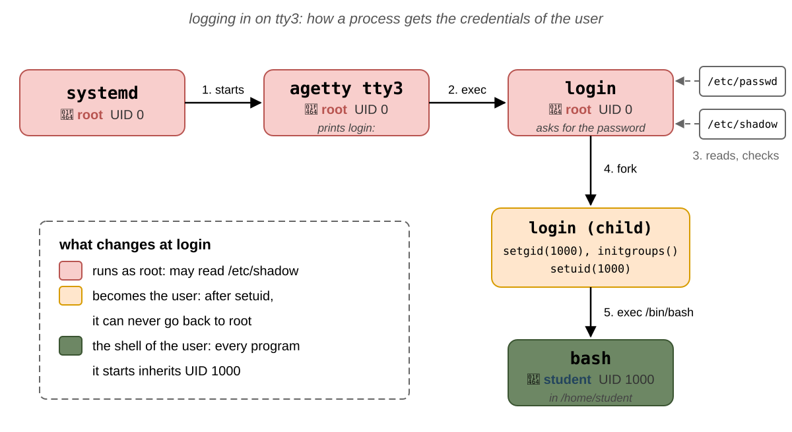

```shell-session
[student@fedora ~]$ ps -t tty3 -o user,pid,ppid,comm
USER         PID    PPID COMMAND
root        5120       1 login
student     5191    5120 bash
```

`login` rămâne `root` și așteaptă shell-ul, care rulează ca `student`. O autentificare grafică, `ssh` și `su` fac
aceiași pași.

:::info

**Un grup nou cere o nouă autentificare**

Grupurile intră în eticheta unui proces doar la autentificare și prin `su` și `sudo`. După ce sunteți adăugați într-un
grup, programele care rulează deja, și terminalele deschise de ele, nu îl au: **deconectați-vă și autentificați-vă din
nou** sau porniți un shell de autentificare cu `su - student`. `id student` citește baza de date și arată imediat grupul
nou; `id` arată eticheta shell-ului vostru.

:::

## Permisiunile fișierelor {/* #file-permissions */}

### Proprietar, grup și permisiuni {/* #owner-group-and-permissions */}

Fiecare fișier are **un proprietar** (un utilizator), **un grup** și trei seturi de **permisiuni**: pentru
**proprietar** (`u`, _user_), pentru **grup** (`g`) și pentru **ceilalți** (`o`). Proprietarul nu trebuie să fie în
grup. `ls -l` le arată:

```shell-session
[student@fedora lab05]$ ls -l notes.txt
-rw-r-----. 1 student students 9 Oct 27 10:20 notes.txt
```

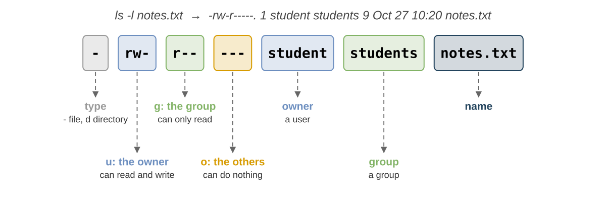

| Parte        | În exemplu | Ce este                                                                  |
| ------------ | ---------- | ------------------------------------------------------------------------ |
| tipul        | `-`        | `-` fișier, `d` director, `l` legătură simbolică, `c` și `b` dispozitive |
| `u`          | `rw-`      | proprietarul, `student`, poate **citi** și **scrie** fișierul            |
| `g`          | `r--`      | membrii grupului `students` îl pot doar **citi**                         |
| `o`          | `---`      | toți ceilalți nu pot face **nimic**                                      |
| proprietarul | `student`  | utilizatorul căruia îi aparține fișierul, de obicei cel care l-a creat   |
| grupul       | `students` | grupul fișierului, de obicei grupul primar al celui care l-a creat       |

`stat` le afișează în formatul cerut:

```shell-session
[student@fedora lab05]$ stat -c '%A %a %U %G %n' notes.txt /etc/passwd /etc/shadow
-rw-r----- 640 student students notes.txt
-rw-r--r-- 644 root root /etc/passwd
---------- 0 root root /etc/shadow
```

`%A` înseamnă permisiunile sub formă de litere, `%a` sub formă de număr (vedeți [`chmod`](#chmod)), `%U` proprietarul,
`%G` grupul, iar `%n` numele.

### `r`, `w` și `x` {/* #r-w-and-x */}

Aceleași litere au alt înțeles pentru fișiere și pentru directoare:

| Permisiune   | Valoare | Pentru un fișier                     | Pentru un director                                                                     |
| ------------ | ------- | ------------------------------------ | -------------------------------------------------------------------------------------- |
| `r` citire   | `4`     | citirea conținutului (`cat`, `less`) | **listarea** numelor fișierelor din el (`ls`)                                          |
| `w` scriere  | `2`     | modificarea conținutului             | **crearea**, **ștergerea** și **redenumirea** fișierelor din el; merge doar cu `x`     |
| `x` execuție | `1`     | rularea lui ca program               | **intrarea** în el (`cd`) și accesul la fișierele din el, dacă le știți numele         |

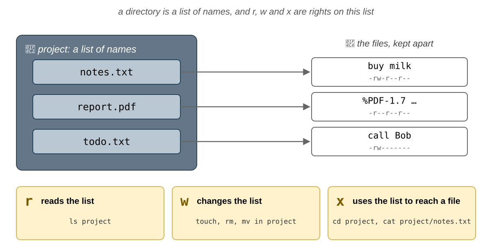

Un director este o **listă de nume**: `r` citește lista, `w` o modifică, iar `x` o folosește ca să ajungă la un fișier.
Deci:

- ștergerea sau redenumirea unui fișier modifică **directorul**, nu fișierul: cu `w` pe un director puteți șterge un
  fișier pe care nici nu îl puteți citi;
- ca să ajungeți la un fișier, aveți nevoie de `x` pe **fiecare** director din calea lui:
  `cat /home/student/lab05/notes.txt` are nevoie de `x` pe `/`, `/home`, `/home/student` și `/home/student/lab05`;
- și `ls -l` are nevoie de `x`: ajunge la fiecare fișier ca să-i citească detaliile.

```shell-session
[student@fedora lab05]$ ls -ld noread noenter
d--x------. 2 student student 60 Oct 27 10:20 noread
dr--------. 2 student student 60 Oct 27 10:20 noenter
[student@fedora lab05]$ ls noread
ls: cannot open directory 'noread': Permission denied
[student@fedora lab05]$ cat noread/secret.txt
top secret
[student@fedora lab05]$ ls noenter
ls: cannot access 'noenter/secret.txt': Permission denied
secret.txt
[student@fedora lab05]$ cd noenter
bash: cd: noenter: Permission denied
```

- `noread` (`x`, fără `r`): `ls` a eșuat, dar `cat` a deschis un fișier al cărui nume îl **știa**.
- `noenter` (`r`, fără `x`): `ls` a citit numele, dar nu a putut ajunge la fișier ca să-l coloreze, așa că a afișat și o
  eroare; `cd` a eșuat.

:::info

Directoarele proprii sunt `drwx------` pe Fedora: ceilalți utilizatori nu vă pot accesa deloc fișierele. Pe Ubuntu sunt
`drwxr-x---` (un Ubuntu mai vechi poate avea `drwxr-xr-x`): verificați-l pe al vostru cu `ls -ld ~`.

:::

### Ce permisiuni se aplică? {/* #which-permissions-apply */}

Kernelul verifică aceste reguli în **ordine**, iar prima potrivire decide:

1. dacă utilizatorul procesului este `root`, UID-ul `0`: totul este permis (în afară de rularea unui fișier care nu are
   niciun `x`);
2. dacă utilizatorul procesului este **proprietarul** fișierului: se folosesc permisiunile `u`;
3. dacă unul dintre grupurile procesului este **grupul** fișierului: se folosesc permisiunile `g`;
4. altfel: se folosesc permisiunile `o`.

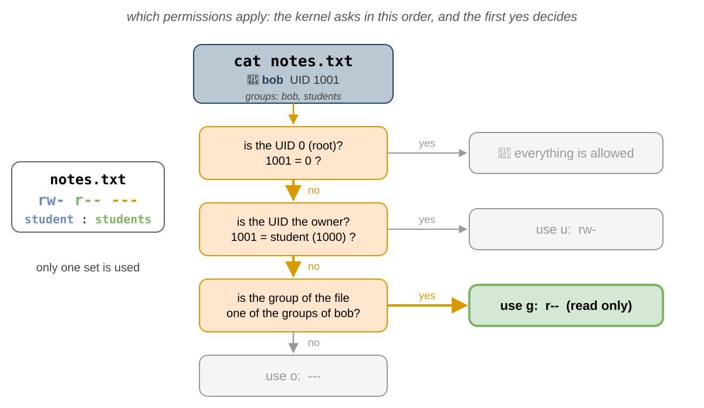

Pentru `notes.txt` de mai sus, `-rw-r----- student students`:

| Proces rulat de | Grupurile lui      | Folosește | Citire | Scriere |
| --------------- | ------------------ | --------- | ------ | ------- |
| `root`          | `root`             | -         | da     | da      |
| `student`       | `student`, `wheel` | `u`       | da     | da      |
| `bob`           | `bob`, `students`  | `g`       | da     | nu      |
| `carol`         | `carol`            | `o`       | nu     | nu      |

:::caution

Se folosește un **singur** set: cu `----rw----`, proprietarul nu poate face **nimic**, chiar dacă este în grup.

:::

### `chmod` {/* #chmod */}

`chmod` (_change mode_) schimbă permisiunile; doar **proprietarul** (sau `root`) îl poate rula. Cu **litere**:

| Parte | Litere                                                                                                        |
| ----- | ------------------------------------------------------------------------------------------------------------- |
| cine  | `u` proprietarul, `g` grupul, `o` ceilalți (**nici** proprietarul, **nici** membrii grupului), `a` toate trei |
| cum   | `+` adaugă, `-` elimină, `=` setează exact acestea                                                            |
| ce    | `r`, `w`, `x`                                                                                                 |

| Comandă                     | Ce face                                                                                                                              |
| --------------------------- | ------------------------------------------------------------------------------------------------------------------------------------ |
| `chmod u+x script.sh`       | adaugă `x` pentru proprietar                                                                                                         |
| `chmod g+w,o-r notes.txt`   | adaugă `w` pentru grup și elimină `r` pentru ceilalți                                                                                |
| `chmod go-rwx notes.txt`    | elimină tot pentru grup și pentru ceilalți                                                                                           |
| `chmod a=r readme.txt`      | setează `r--` pentru toți                                                                                                            |
| `chmod u=rw,go=r notes.txt` | setează exact `rw-r--r--`: `=` înlocuiește permisiunile vechi în loc să le adauge la ele                                             |
| `chmod -R g+rX project`     | pentru grup, adaugă `r` lui `project` și tuturor celor din el, iar `x` doar directoarelor și fișierelor care au deja un `x`          |

Cu **numere**, în octal: `r` este `4`, `w` este `2`, `x` este `1`, adunate pentru fiecare dintre `u`, `g` și `o`:

| Litere      | `u`             | `g`         | `o`         | Număr |
| ----------- | --------------- | ----------- | ----------- | ----- |
| `rw-r-----` | 4 + 2 = `6`     | 4 = `4`     | `0`         | `640` |
| `rwxr-xr-x` | 4 + 2 + 1 = `7` | 4 + 1 = `5` | 4 + 1 = `5` | `755` |
| `rw-r--r--` | `6`             | `4`         | `4`         | `644` |
| `rw-------` | `6`             | `0`         | `0`         | `600` |

```shell-session
[student@fedora lab05]$ ls -l myid.sh
-rw-r--r--. 1 student student 18 Oct 27 10:20 myid.sh
[student@fedora lab05]$ ./myid.sh
bash: ./myid.sh: Permission denied
[student@fedora lab05]$ chmod u+x myid.sh
[student@fedora lab05]$ ./myid.sh
student
[student@fedora lab05]$ chmod 600 myid.sh
[student@fedora lab05]$ ls -l myid.sh
-rw-------. 1 student student 18 Oct 27 10:20 myid.sh
```

- `./myid.sh` a eșuat fără `x`; după `chmod u+x`, a rulat.
- `chmod 600` a setat toate permisiunile deodată.

:::tip

Folosiți literele ca să **schimbați** unele permisiuni (`chmod g+w`) și numerele ca să le **setați** pe toate
(`chmod 640`). Cu `-R`, folosiți literele: `chmod -R 644 box` elimină și `x`-ul directoarelor, deci nimeni nu mai poate
intra în ele; `chmod -R u=rwX,go=rX box` le dă fișierelor `rw-r--r--` și directoarelor `rwxr-xr-x`.

:::

### `umask` {/* #umask */}

Un program cere `rw-rw-rw-` (`666`) pentru un fișier nou și `rwxrwxrwx` (`777`) pentru un director nou; apoi kernelul
**elimină** biții din **`umask`**-ul procesului. `umask` este o comandă internă a shell-ului (`help umask`), moștenită
de fiecare copil.

```shell-session
[student@fedora lab05]$ umask
0022
[student@fedora lab05]$ touch new.txt
[student@fedora lab05]$ mkdir newdir
[student@fedora lab05]$ ls -ld new.txt newdir
-rw-r--r--. 1 student student  0 Oct 27 10:25 new.txt
drwxr-xr-x. 2 student student 40 Oct 27 10:25 newdir
```

|                     | Fișier            | Director          |
| ------------------- | ----------------- | ----------------- |
| programul cere      | `666` `rw-rw-rw-` | `777` `rwxrwxrwx` |
| `umask 022` elimină | `022` `----w--w-` | `022` `----w--w-` |
| rezultatul          | `644` `rw-r--r--` | `755` `rwxr-xr-x` |

- Un fișier nou nu este niciodată executabil: `umask` doar **elimină** biți.
- `umask 077` face fișierele noi `600` și directoarele noi `700`, până se închide shell-ul.

### `chown` și `chgrp` {/* #chown-and-chgrp */}

| Comandă                             | Ce face                                                                         |
| ----------------------------------- | ------------------------------------------------------------------------------- |
| `sudo chown bob notes.txt`          | proprietarul devine `bob`                                                       |
| `sudo chown bob:students notes.txt` | proprietarul devine `bob`, iar grupul `students`                                |
| `chown :students notes.txt`         | doar grupul, ca `chgrp`                                                         |
| `chgrp students notes.txt`          | doar grupul                                                                     |
| `chown -R`, `chgrp -R`              | directorul și tot ce se află în el                                              |
| `sudo chown 1005 notes.txt`         | proprietarul devine UID-ul `1005`, chiar dacă nu există niciun utilizator cu el |

- Doar `root` poate da un fișier altui utilizator.
- Proprietarul poate schimba grupul unui fișier doar într-unul dintre grupurile **procesului** său.

```shell-session
[student@fedora lab05]$ chown carol notes.txt
chown: changing ownership of 'notes.txt': Operation not permitted
[student@fedora lab05]$ sudo chown carol notes.txt
[student@fedora lab05]$ ls -l notes.txt
-rw-r-----. 1 carol students 9 Oct 27 10:20 notes.txt
```

## Permisiuni speciale {/* #special-permissions */}

Mai există trei biți, pe care `ls -l` îi afișează în locul unui `x`:

| Bit        | Număr  | `ls -l` afișează           | Pe un program                                   | Pe un director                                                                                              |
| ---------- | ------ | -------------------------- | ----------------------------------------------- | ----------------------------------------------------------------------------------------------------------- |
| **setuid** | `4000` | `-rwsr-xr-x`               | rulează ca **proprietarul** fișierului          | ignorat                                                                                                     |
| **setgid** | `2000` | `-rwxr-sr-x`, `drwxrwsr-x` | rulează cu **grupul** fișierului                | fișierele noi primesc **grupul directorului**; directoarele noi primesc și ele bitul                        |
| **sticky** | `1000` | `drwxrwxrwt`               | ignorat                                         | un fișier poate fi șters sau redenumit doar de proprietarul lui, de proprietarul directorului și de `root`  |

Cu litere, aceștia sunt `u+s`, `g+s` și `+t`; cu numere, a 4-a cifră, pusă în față: `chmod 2775 project` înseamnă
`rwxrwsr-x`. Un `S` sau un `T` **mare** înseamnă că bitul este setat, dar `x`-ul de sub el nu.

### `setuid` {/* #setuid */}

`passwd` trebuie să scrie în `/etc/shadow`, pe care doar `root` îl poate modifica. `/usr/bin/passwd` este al lui `root`
și are bitul **setuid**: oricine l-ar porni, rulează ca `root`.

```shell-session
[student@fedora ~]$ ls -l /usr/bin/passwd /usr/bin/sudo /usr/bin/su
-rwsr-xr-x. 1 root root  32648 Jul 24 03:00 /usr/bin/passwd
-rwsr-xr-x. 1 root root  56920 Jul 24 03:00 /usr/bin/su
---s--x--x. 1 root root 262536 Jul 24 03:00 /usr/bin/sudo
```

Și `sudo` și `su` sunt programe setuid. Rulați `passwd` într-un terminal, fără să tastați nimic, și uitați-vă la el din
altul:

```shell-session
[student@fedora ~]$ ps -o pid,ruser,user,comm -C passwd
    PID RUSER    USER     COMMAND
   6011 student  root     passwd
```

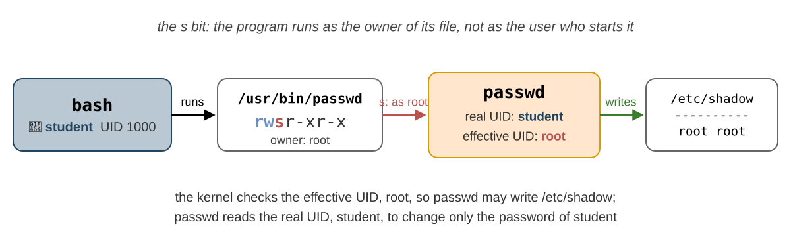

`passwd` rulează ca `root` (`USER`), deci poate scrie în `/etc/shadow`; kernelul păstrează și cine l-a **pornit**
(`RUSER`, _utilizatorul real_), deci `passwd` schimbă doar parola **voastră**. Vedeți
[Credențialele unui proces](#the-credentials-of-a-process).

:::danger

Nu adăugați niciodată `+s` unui program al lui `root`: rulează atunci ca `root` pentru **oricine**, iar o singură eroare
în el îl face pe oricine `root`.

:::

:::info

Kernelul ignoră biții setuid și setgid pe **scripturi**: pornește `/bin/bash`, care deschide apoi scriptul după nume,
iar între timp un utilizator ar putea înlocui fișierul.

:::

### `setgid` pe un director {/* #setgid-on-a-directory */}

Într-un director partajat, fișierele noi ar trebui să primească grupul proiectului, nu grupul primar al fiecărui
utilizator. Bitul **setgid** pe director face asta:

```shell-session
[student@fedora ~]$ sudo mkdir /srv/project
[student@fedora ~]$ sudo chgrp students /srv/project
[student@fedora ~]$ sudo chmod 2775 /srv/project
[student@fedora ~]$ ls -ld /srv/project
drwxrwsr-x. 2 root students 40 Oct 27 10:40 /srv/project
[student@fedora ~]$ sudo -u bob touch /srv/project/bob.txt
[student@fedora ~]$ ls -l /srv/project
total 0
-rw-r--r--. 1 bob students 0 Oct 27 10:41 bob.txt
```

`bob.txt` a primit grupul directorului, `students`, nu `bob`.

:::caution

Dacă nu sunteți în grupul directorului, setați bitul ca `root`: altfel kernelul îl elimină fără niciun mesaj.

:::

### Bitul sticky {/* #the-sticky-bit */}

Toată lumea are `w` pe `/tmp`, deci oricine ar putea șterge fișierele celorlalți. Bitul **sticky**, `t`, permite doar
**proprietarului fișierului**, proprietarului directorului și lui `root` să șteargă sau să redenumească un fișier:

```shell-session
[student@fedora ~]$ ls -ld /tmp
drwxrwxrwt. 21 root root 520 Oct 27 10:00 /tmp
```

:::tip

`find` poate căuta biții speciali: `find /usr -perm -4000` afișează fișierele care au **cel puțin** bitul setuid.

:::

## Promptul {/* #the-prompt */}

Promptul lui `bash` se construiește din variabila de shell `PS1` (vedeți
[Variabile de shell și `export`](/docs/labs/04#shell-variables-and-export) din laboratorul 04). Pe Fedora este
`[\u@\h \W]\$ ` (pe Ubuntu, `\u@\h:\w\$ `, cu culori):

| Secvență | Înseamnă                                              | Pentru `student` | Pentru `root` |
| -------- | ----------------------------------------------------- | ---------------- | ------------- |
| `\u`     | **utilizatorul**                                      | `student`        | `root`        |
| `\h`     | numele **calculatorului** (_host_)                    | `fedora`         | `fedora`      |
| `\W`     | numele directorului curent (`\w` este calea completă) | `lab05`          | `~`           |
| `\$`     | `$` pentru utilizatori, `#` pentru UID-ul `0`         | `$`              | `#`           |

Promptul este doar **text**, iar orice utilizator îl poate schimba:

```shell-session
[student@fedora ~]$ PS1='[root@fedora \W]# '
[root@fedora ~]# whoami
student
[root@fedora ~]# cat /etc/shadow
cat: /etc/shadow: Permission denied
```

:::caution

Nu vă bazați pe prompt ca să aflați cine sunteți. `whoami` și `id` îi cer **kernelului** eticheta procesului.

:::

### Schimbarea promptului {/* #changing-the-prompt */}

`PS1` poate conține orice text, plus aceste secvențe speciale (`man bash`, secțiunea `PROMPTING`):

| Secvență   | Se înlocuiește cu                                                                                 |
| ---------- | ------------------------------------------------------------------------------------------------- |
| `\u`, `\h` | utilizatorul; numele calculatorului, până la primul `.`                                           |
| `\w`, `\W` | calea completă a directorului curent, cu `~` pentru directorul vostru; doar ultimul nume din cale |
| `\$`       | `$` sau, dacă UID-ul este `0`, `#`                                                                |
| `\t`, `\A` | ora, ca `HH:MM:SS` și ca `HH:MM`                                                                  |
| `\d`       | data, de exemplu `Tue Oct 27`                                                                     |
| `\j`       | numărul de job-uri ale shell-ului (laboratorul 04)                                                |
| `\n`       | o linie nouă                                                                                      |

```shell-session
[student@fedora lab05]$ PS1='\A \u in \w \$ '
10:52 student in ~/lab05 $ PS1='[\u@\h \W]\$ '
[student@fedora lab05]$
```

:::tip

O schimbare a lui `PS1` durează până se închide shell-ul; ca s-o păstrați, adăugați `PS1='...'` la sfârșitul lui
`~/.bashrc`.

:::

## Credențialele unui proces {/* #the-credentials-of-a-process */}

:::note

**Pentru cine vrea să afle mai mult**

Nu aveți nevoie de această secțiune pentru exercițiile din laborator, 🧪 Primii pași. Citiți-o acasă: exercițiile
🏠 Mai departe și 📝 Provocări o folosesc.

:::

Pentru fiecare proces, kernelul păstrează **credențialele** lui: **patru** UID-uri, **patru** GID-uri și **grupurile
suplimentare**. Doar kernelul le schimbă, după reguli stricte.

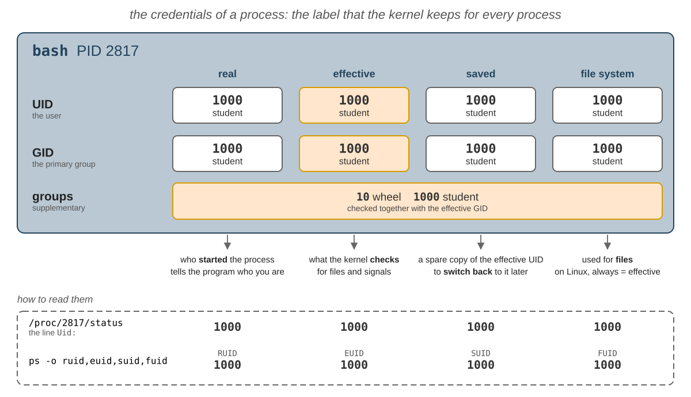

| Credențial                                 | Ce este                                                                                                                                                         |
| ------------------------------------------ | --------------------------------------------------------------------------------------------------------------------------------------------------------------- |
| UID-ul și GID-ul **real**                  | utilizatorul care a **pornit** procesul și grupul său primar; programele le citesc ca să afle cine sunteți                                                      |
| UID-ul și GID-ul **efectiv**               | cele pe care kernelul le **verifică** atunci când procesul deschide un fișier; `ps` arată utilizatorul efectiv în coloana `USER`                                |
| UID-ul și GID-ul **salvat**                | o copie de rezervă a celor efective, făcută la pornirea programului, ca acesta să-și poată lăsa deoparte drepturile o vreme și apoi să le **ia înapoi**         |
| UID-ul și GID-ul **sistemului de fișiere** | folosite doar pentru fișiere; pe Linux urmează mereu valorile efective, așa că le puteți ignora                                                                 |
| **grupurile suplimentare**                 | celelalte grupuri ale procesului, verificate împreună cu GID-ul efectiv; se copiază din baza de date a grupurilor la autentificare, precum și de `su` și `sudo` |

Pentru shell-ul vostru, toate UID-urile și GID-urile sunt `1000`. Diferă în două cazuri: un program `setuid` schimbă
UID-ul efectiv și pe cel salvat, dar nu pe cel real; `login`, `su` și `sudo` le schimbă pe **toate** pentru programul pe
care îl pornesc.

### Ce credențiale se verifică {/* #which-credentials-are-checked */}

Ce verifică kernelul depinde de ce cere procesul:

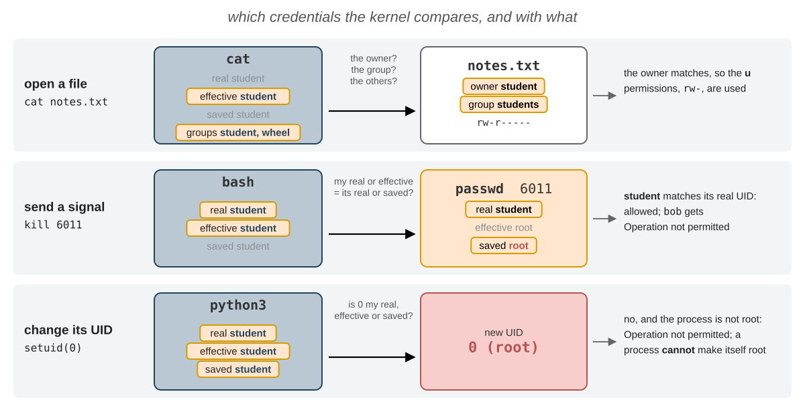

- **deschiderea unui fișier**: UID-ul efectiv se compară cu **proprietarul** fișierului, iar GID-ul efectiv și
  grupurile suplimentare cu **grupul** fișierului (vedeți [Ce permisiuni se aplică?](#which-permissions-apply));
- **trimiterea unui semnal**, cu `kill`: UID-ul real sau cel efectiv al expeditorului trebuie să fie UID-ul real sau cel
  salvat al țintei. Puteți opri un `passwd` pornit de **voi**, chiar dacă rulează ca `root`, pentru că UID-ul lui real
  este al vostru; `bob` nu poate;
- **schimbarea propriilor UID-uri**: un proces care nu este `root` poate lua doar un UID pe care îl are **deja**:
  UID-ul real, cel efectiv sau cel salvat. Un proces **nu** se poate face singur `root`. Doar un proces cu UID-ul
  efectiv `0` poate lua orice UID.

### Cum se schimbă credențialele {/* #how-the-credentials-change */}

Ce se întâmplă cu UID-urile la fiecare pas din viața unui proces:

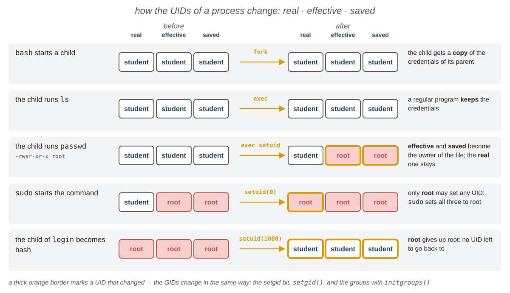

| Când                                                                              | Ce se întâmplă cu UID-urile                                                                                                                                                                                                         |
| --------------------------------------------------------------------------------- | ----------------------------------------------------------------------------------------------------------------------------------------------------------------------------------------------------------------------------------- |
| `fork`, un copil nou                                                              | copilul primește o **copie** a credențialelor părintelui                                                                                                                                                                            |
| `exec` al unui program obișnuit                                                   | **nu** se schimbă nimic                                                                                                                                                                                                             |
| `exec` al unui program cu bitul `setuid`                                          | UID-ul efectiv și cel salvat devin **proprietarul** fișierului; UID-ul real nu se schimbă; bitul `setgid` face la fel pentru GID-uri, cu **grupul** fișierului                                                                      |
| un proces cu UID-ul efectiv `0` apelează `setgid()`, `initgroups()` și `setuid()` | se schimbă **toate** GID-urile, grupurile suplimentare și **toate** UID-urile, în această ordine: așa îi dau `login`, `su` și `sudo` unui proces eticheta unui utilizator (vedeți [Autentificarea](#logging-in) și [`sudo`](#sudo)) |

### Cum vedem credențialele {/* #seeing-the-credentials */}

Există două moduri de a vedea credențialele unui proces:

```shell-session
[student@fedora ~]$ ps -o pid,ruser,euser,suser,comm -p $$
    PID RUSER    EUSER    SUSER    COMMAND
   2817 student  student  student  bash
[student@fedora ~]$ grep -E '^(Uid|Gid|Groups):' /proc/$$/status
Uid:	1000	1000	1000	1000
Gid:	1000	1000	1000	1000
Groups:	10 1000
```

- `ps -o` a primit numele coloanelor: `ruser` este utilizatorul real, `euser` cel efectiv, iar `suser` cel salvat.
  `man ps` le listează pe toate, pentru UID-uri, GID-uri și grupuri, în secțiunea `STANDARD FORMAT SPECIFIERS`.
- Liniile `Uid:` și `Gid:` din `/proc/<PID>/status` au câte 4 numere: real, efectiv, salvat și cel al sistemului de
  fișiere; linia `Groups:` conține grupurile suplimentare (`man 5 proc`). Oricine poate citi fișierul `status` al
  oricărui proces.

Un proces nu se poate face singur `root`. `python3` își poate citi UID-urile cu `os.getresuid()` și poate încerca să le
schimbe cu `os.setuid()`:

```shell-session
[student@fedora ~]$ python3 -c 'import os; print(os.getresuid()); os.setuid(0)'
(1000, 1000, 1000)
Traceback (most recent call last):
  File "<string>", line 1, in <module>
    import os; print(os.getresuid()); os.setuid(0)
                                      ~~~~~~~~~^^^
PermissionError: [Errno 1] Operation not permitted
```

Kernelul a refuzat: `0` nu este niciunul dintre UID-urile procesului. Ca să devină `root`, un proces trebuie să
pornească un program setuid al lui `root` (`sudo`, `su`, `passwd`) sau să fie pornit de un proces care rulează deja ca
`root` (`login`).

### UID-ul salvat {/* #the-saved-uid */}

Un program setuid atent lucrează ca **voi** și folosește `root` doar pentru pașii care au nevoie de el, ca o eroare în
rest să poată face doar ce ați putea face și voi. UID-ul **salvat** face asta posibil. După `exec`, linia lui `Uid:`
este `1000 0 0 0`:

1. programul își setează UID-ul **efectiv** la cel real, `1000` (`Uid: 1000 1000 0 1000`): `root` rămâne doar în
   UID-ul salvat;
2. când are din nou nevoie de `root`, își setează UID-ul efectiv înapoi la `0` (`Uid: 1000 0 0 0`): are voie, pentru că
   `0` este UID-ul său salvat;
3. când nu mai are nevoie de `root`, își setează **toate trei** UID-urile la `1000` (`Uid: 1000 1000 1000 1000`): acum
   `0` nu mai este niciunul dintre UID-urile sale, deci nu mai poate reveni niciodată.

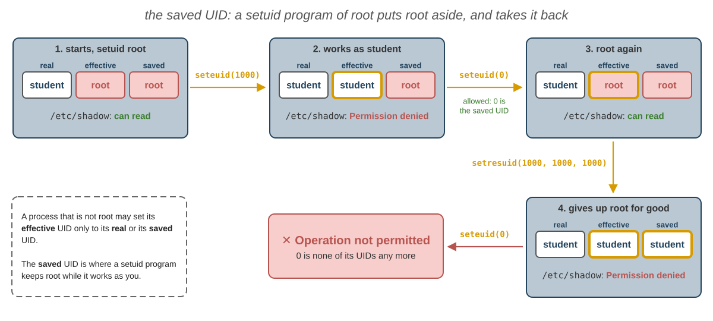

## Depanare {/* #troubleshooting */}

| Problemă                                                            | Soluție                                                                                                                                                                                               |
| ------------------------------------------------------------------- | ----------------------------------------------------------------------------------------------------------------------------------------------------------------------------------------------------- |
| Un utilizator afișat de `ps` sau `ls` nu este în `/etc/passwd`      | Nu este un utilizator local: căutați mereu utilizatorii cu `getent passwd` și grupurile cu `getent group`                                                                                             |
| `Permission denied` la un fișier                                    | Rulați `ls -l` pe fișier și `id`: aflați ce set vi se aplică (proprietar, grup sau ceilalți) și ce permite                                                                                            |
| `Permission denied` la un fișier care are `r` pentru voi            | Unul dintre directoarele din cale nu are `x` pentru voi: rulați `ls -ld` pe fiecare                                                                                                                   |
| `./script.sh: Permission denied`                                    | Fișierul nu are `x`: `chmod u+x script.sh`                                                                                                                                                            |
| `Operation not permitted` la `chmod` sau `chown`                    | Doar proprietarul poate rula `chmod` și doar `root` poate schimba proprietarul: folosiți `sudo`                                                                                                       |
| `student is not in the sudoers file.`                               | Utilizatorul nu este administrator: nu este în `wheel` (Fedora) sau în `sudo` (Ubuntu); un administrator trebuie să ruleze `sudo usermod -aG wheel student`, apoi utilizatorul se autentifică din nou |
| `sudo echo ... > file`: `Permission denied`                         | Redirectarea o face shell-ul vostru, înainte de `sudo`: folosiți `echo ... \| sudo tee file`                                                                                                          |
| `su: Authentication failure` la `su -`                              | Pe Fedora și pe Ubuntu, `root` nu are parolă: folosiți `sudo -i`                                                                                                                                      |
| Un grup nou nu apare în `id`                                        | Grupurile se citesc la autentificare: autentificați-vă din nou sau porniți un shell de autentificare nou cu `su - <USER>`                                                                             |
| `usermod -G` mi-a șters grupurile                                   | Ați uitat `-a`; adăugați-le la loc cu `sudo usermod -aG <GROUP> <USER>`                                                                                                                               |
| `passwd`: `BAD PASSWORD: The password is shorter than 8 characters` | Alegeți o parolă mai lungă și mai puțin simplă; ca `root`, o puteți seta oricum                                                                                                                       |
| `useradd: user 'bob' already exists`                                | Utilizatorul există deja: verificați cu `id bob`                                                                                                                                                      |
| `userdel: user bob is currently used by process 1234`               | `bob` are încă procese: opriți-le sau închideți mai întâi sesiunea lui `bob`                                                                                                                          |
| `rm: remove write-protected regular file?`                          | Nu aveți `w` pe fișier, dar îl aveți pe director: răspundeți `y` ca să-l ștergeți oricum                                                                                                              |
| `rm: cannot remove ... Operation not permitted` în `/tmp`           | Bitul sticky: doar proprietarul fișierului îl poate șterge                                                                                                                                            |
| Un fișier afișează în `ls -l` un număr în loc de proprietar         | Utilizatorul a fost șters, dar fișierul are încă UID-ul lui                                                                                                                                           |

## Exerciții {/* #exercises */}

- 🧪 [Primii pași](#first-steps) (exercițiile 1 - 14): câte o idee pe rând, în ordinea laboratorului, de făcut în
  laborator;
- 🏠 [Mai departe](#going-further) (exercițiile 15 - 32): exerciții mai lungi, de făcut acasă; multe dintre ele se uită
  la **eticheta** unui proces, explicată în [Credențialele unui proces](#the-credentials-of-a-process);
- 📝 [Provocări](#challenges) (exercițiile 33 - 39): cele mai grele, ca cele de la examen.

:::danger

Folosiți `sudo` doar acolo unde vă cere exercițiul și niciodată pe directoarele sistemului. Nu vă scoateți niciodată pe
voi (`student`) din grupul administratorilor, `wheel` pe Fedora și `sudo` pe Ubuntu, altfel pierdeți `sudo`.

:::

### 🧪 Primii pași {/* #first-steps */}

Faceți aceste exerciții în ordine, în timpul laboratorului. Fiecare începe cu ce trebuie să obțineți și încearcă **o**
idee din laborator: dacă vă blocați, citiți secțiunea indicată la finalul exercițiului. Rulați comenzile în `~/lab05`,
dacă exercițiul nu spune altfel.

**Utilizatori și grupuri**

1. **Arborele de exerciții**: Creați fișierele și directoarele folosite de celelalte exerciții, în `~/lab05`.

    1. rulați aceste comenzi (copiați-le din browser cu <kbd>Ctrl</kbd>+<kbd>C</kbd> și lipiți-le în terminal cu
       <kbd>Ctrl</kbd>+<kbd>Shift</kbd>+<kbd>V</kbd>):

       ```bash
       mkdir -p ~/lab05/noread ~/lab05/noenter
       cd ~/lab05
       printf 'buy milk\n' > notes.txt
       printf 'top secret\n' > noread/secret.txt
       printf 'top secret\n' > noenter/secret.txt
       printf '#!/bin/bash\nid -un\n' > myid.sh
       ```

    2. afișați arborele lui `~/lab05`.

    **Verificare:** `~/lab05` conține directoarele `noread` și `noenter`, fiecare cu un `secret.txt`, și fișierele
    `myid.sh` și `notes.txt`. <small>→ [Navigare](/docs/labs/02#navigation)</small>

2. **Cine sunt eu**: Aflați-vă numele de utilizator, UID-ul și grupurile, și ce utilizator rulează comenzile pe care le
    porniți.

    1. afișați-vă numele de utilizator, cu două comenzi diferite;
    2. afișați-vă UID-ul, grupul primar și toate grupurile cu **o singură** comandă; apoi doar UID-ul, apoi doar
       **numele** grupurilor;
    3. afișați ce știe sistemul despre utilizatorul `root`, fără să deveniți `root`;
    4. listați procesele terminalului vostru, cu utilizatorul care rulează fiecare dintre ele.

    💡 `man id`: căutați `name`, `user` și `groups`; `man ps`: căutați `-o` și `user`.

    **Verificare:** numele este `student`, iar UID-ul `1000`; grupul vostru primar este `student` (`1000`), iar
    grupurile voastre sunt `student` și `wheel` (Ubuntu: `sudo` și încă câteva); `root` are UID-ul `0` și doar grupul
    `root`. `bash` și `ps` rulează ca `student`: `ps` a fost pornit din shell-ul vostru și rulează ca același
    utilizator. <small>→ [Cine sunt eu](#who-am-i-whoami-and-id) · [Grupuri](#groups) · [Utilizatorul unui proces](#the-user-of-a-process)</small>

**Bazele de date ale utilizatorilor și ale grupurilor**

3. **Contul vostru în bazele de date**: Găsiți-vă contul în baza de date a utilizatorilor și în cea a grupurilor și
    citiți fiecare câmp al lui.

    1. afișați permisiunile lui `/etc/passwd` și ale lui `/etc/group`;
    2. afișați-vă linia din baza de date a utilizatorilor și spuneți ce este fiecare dintre cele 7 câmpuri ale ei;
    3. afișați liniile grupurilor `wheel` (Ubuntu: `sudo`) și `student` din baza de date a grupurilor; apoi afișați
       grupurile utilizatorului `student` cu `id`;
    4. găsiți utilizatorul cu UID-ul `0` și grupul cu GID-ul `10` (Ubuntu: `27`), după **numerele** lor;
    5. afișați utilizatorii al căror shell **nu** este `nologin`.

    💡 `man getent`: bazele de date (`DATABASES`) sunt `passwd`, `group`, `shadow`, ...; `man 5 passwd` și
    `man 5 group` explică câmpurile; `man grep`: căutați `invert`.

    **Verificare:** ambele fișiere sunt `-rw-r--r-- root root`. Linia voastră este
    `student:x:1000:1000:Student:/home/student:/bin/bash`: numele, parola (`x`: este în altă parte), UID-ul, GID-ul
    grupului primar, numele complet, directorul propriu și shell-ul. `wheel` este `wheel:x:10:student`, dar `student`
    este `student:x:1000:`: membrii unui grup **primar** nu sunt listați. UID-ul `0` este `root`, GID-ul `10` este
    `wheel` (Ubuntu: `27`, `sudo`). În afară de `root` și `student`, doar câțiva utilizatori de sistem au alt program
    decât `nologin`: `sync` (`/bin/sync`), iar pe Fedora și `shutdown` și `halt` (pe Ubuntu, unii au `/bin/false`);
    niciunul nu dă un shell. <small>→ [`/etc/passwd`](#etcpasswd) · [`/etc/group`](#etcgroup) · [`getent`](#getent)</small>

**Cum devenim `root`**

4. **`sudo`**: Rulați comenzi ca `root`, vedeți cum ține minte `sudo` parola, scrieți într-un fișier al lui `root` și
    porniți un shell al lui `root`.

    1. afișați-vă utilizatorul ca `root`; repetați și observați că parola nu mai este cerută;
    2. faceți-l pe `sudo` să uite parola și afișați-vă din nou utilizatorul ca `root`;
    3. încercați să afișați prima linie din `/etc/shadow` ca voi înșivă; apoi rulați **aceeași** comandă ca `root`,
       fără să o tastați din nou;
    4. creați ca `root` directorul `/srv/lab05` și fișierul gol `/srv/lab05/root.txt`; încercați să adăugați linia
       `hello` la sfârșitul fișierului cu `sudo echo` și `>>`; apoi faceți-o cu o comandă care scrie într-un fișier
       **și** pe ecran și afișați fișierul;
    5. porniți un shell de autentificare al lui `root`, afișați utilizatorul și directorul curent și ieșiți din el.

    💡 `man sudo`: căutați `invalidate` și `login`; `man bash`: căutați `HISTORY EXPANSION`, apoi `!!`; `man tee`:
    căutați `append`.

    **Verificare:** utilizatorul este `root`; după ce `sudo` uită parola, o cere din nou. Ca voi înșivă, `/etc/shadow`
    dă `Permission denied`; `!!` afișează comanda în care s-a transformat, o rulează și arată linia lui `root`.
    `sudo echo` cu `>>` eșuează cu `Permission denied`: fișierul îl deschide shell-ul vostru, nu `sudo`; la final,
    fișierul conține `hello`. Shell-ul lui `root` pornește în `/root`, cu `#` în prompt. <small>→ [`sudo`](#sudo) · [Capcana redirectării](#the-redirect-trap)</small>

**Gestionarea utilizatorilor și a grupurilor**

5. **Doi utilizatori noi și un grup**: Creați-i pe `bob` și pe `carol`, care joacă în restul laboratorului rolul unui
    membru al grupului vostru și pe al unui străin, precum și grupul `students`, cu `bob` ca singur membru.

    1. verificați că `bob` și `carol` nu există încă;
    2. creați utilizatorul `bob`, cu director propriu, shell-ul `/bin/bash` și numele complet `Bob Jones`, și
       utilizatorul `carol`, la fel, cu numele complet `Carol White`;
    3. setați-le amândurora parola `uso2026`;
    4. creați grupul `students` și adăugați-l pe `bob` în el, fără să-i eliminați celelalte grupuri;
    5. afișați grupurile lui `bob` și ale lui `carol`, linia lui `students` din baza de date a grupurilor și
       proprietarii directoarelor din `/home`.

    💡 `man useradd`: căutați `home`, `shell` și `comment` (numele complet); `man -k group` găsește comanda care creează
    un grup; `man usermod`: căutați `-G`, apoi `append`.

    **Verificare:** înainte, `id` spune `no such user`; după, `bob` și `carol` au UID-urile `1001` și `1002` și câte un
    grup propriu, iar `/home/bob` și `/home/carol` le aparțin; `students` este `students:x:1003:bob`. Setarea parolei
    poate afișa avertismentul `BAD PASSWORD: The password is shorter than 8 characters`, dar `root` o poate seta
    oricum. <small>→ [Gestionarea utilizatorilor și a grupurilor](#managing-users-and-groups)</small>

6. **Un utilizator temporar**: Creați contul `dave`, modificați-l, puneți-l într-un grup și scoateți-l din el, apoi
    ștergeți-l fără să lăsați nimic în urmă.

    1. creați-l pe `dave`, cu director propriu, shell-ul `/bin/bash` și numele complet `Dave Brown`, **fără** parolă;
       afișați-i linia din baza de date a utilizatorilor și din `/etc/shadow` (cu `getent`, ca `root`);
    2. schimbați-i numele complet în `David Brown` și afișați-i din nou linia;
    3. adăugați-l în `students` cu `gpasswd` și afișați-i grupurile; apoi scoateți-l din `students` și afișați-le din
       nou;
    4. ștergeți-l pe `dave` împreună cu directorul lui și verificați că utilizatorul, grupul lui și `/home/dave` au
       dispărut.

    💡 `man usermod`: căutați `comment`; `man gpasswd`: căutați `add` și `delete`; `man userdel`: căutați `home`.

    **Verificare:** câmpul parolei lui `dave` este `!!` (Ubuntu: `!`): nimeni nu se poate autentifica încă drept el.
    După pasul 2, s-a schimbat doar al 5-lea câmp. Grupurile lui sunt `dave students`, apoi doar `dave`. La final,
    `id dave` afișează `no such user`, `getent group dave` nu afișează nimic, iar `ls -d /home/dave` spune
    `No such file or directory`. <small>→ [Gestionarea utilizatorilor și a grupurilor](#managing-users-and-groups) · [`/etc/shadow`](#etcshadow)</small>

**Autentificarea**

7. **Deveniți alt utilizator**: Autentificați-vă ca `bob` pe un terminal text și deveniți `carol` cu `su`.

    1. treceți pe al treilea terminal virtual și autentificați-vă ca `bob`; afișați utilizatorul, directorul curent și
       grupurile; încercați să vă afișați utilizatorul ca `root` cu `sudo`; ieșiți din sesiune și reveniți în Sway
       (acasă, în mediul vostru grafic);
    2. într-un terminal, deveniți `carol` cu un shell de **autentificare**; afișați utilizatorul și directorul curent;
       ieșiți cu `exit` și afișați din nou utilizatorul.

    💡 <kbd>Ctrl</kbd>+<kbd>Alt</kbd>+<kbd>F3</kbd> (<kbd>Host</kbd>+<kbd>F3</kbd> în VirtualBox), iar înapoi cu
    <kbd>Ctrl</kbd>+<kbd>Alt</kbd>+<kbd>F1</kbd> sau <kbd>F2</kbd>; `man su`: căutați `login`.

    **Verificare:** shell-ul lui `bob` rulează în `/home/bob`, cu grupurile `bob` și `students`; `sudo` îl refuză:
    `bob is not in the sudoers file.`. `su` cere parola lui `carol`, nu pe a voastră; shell-ul ei pornește în
    `/home/carol`; după `exit` sunteți din nou `student`. <small>→ [Autentificarea](#logging-in) · [`su`](#su) · [Terminale virtuale](/docs/labs/04#virtual-terminals)</small>

**Permisiunile fișierelor**

8. **Citiți permisiunile**: Învățați să citiți cui îi aparține un fișier și ce poate face fiecare utilizator cu el și
    prevedeți permisiunile unui fișier nou.

    1. afișați permisiunile, proprietarul și grupul lui `notes.txt`, `/etc/passwd`, `/etc/shadow` și ale directorului
       `~` însuși (nu ale conținutului lui);
    2. afișați aceleași informații cu `stat`, sub formă de litere **și** de numere, cu proprietarul, grupul și numele;
    3. afișați-vă `umask`-ul; **ghiciți** permisiunile unui fișier nou și ale unui director nou, apoi creați `new.txt`
       și `newdir` și verificați;
    4. setați `umask`-ul la `077`, creați `private.txt` și afișați-i permisiunile; apoi readuceți `umask`-ul la
       valoarea de la pasul 3, pentru că exercițiile următoare au nevoie de ea.

    💡 `man ls`: căutați `directories themselves`; `man stat`: căutați `%a`, `%A`, `%U`, `%G` și `--format`.

    **Verificare:** `notes.txt` este `-rw-r--r-- student student` (`644`; Ubuntu: `-rw-rw-r--`, `664`); `/etc/passwd`
    este `-rw-r--r-- root root` (`644`); `/etc/shadow` este `---------- root root` (`0`; Ubuntu:
    `-rw-r----- root shadow`, `640`); `~` este `drwx------` (`700`) pe Fedora și `drwxr-x---` (`750`) pe Ubuntu. Cu
    `umask`-ul `0022`, `new.txt` este `rw-r--r--`, iar `newdir` este `rwxr-xr-x` (Ubuntu, `0002`: `rw-rw-r--` și
    `rwxrwxr-x`); cu `077`, `private.txt` este `rw-------`. <small>→ [Proprietar, grup și permisiuni](#owner-group-and-permissions) · [`umask`](#umask)</small>

9. **`chmod`**: Schimbați permisiunile pe rând, cu litere, sau pe toate deodată, cu un număr, și vedeți că un program
    are nevoie de `x` ca să ruleze.

    1. pe `notes.txt`, eliminați `r` pentru grup și pentru ceilalți;
    2. eliminați `w` pentru voi și încercați să adăugați o linie în fișier; adăugați `w` la loc și adăugați linia;
    3. readuceți permisiunile lui `notes.txt` la `rw-r--r--` cu **o singură** comandă, cu litere;
    4. rulați `./myid.sh`; dați-i `rwxr-xr-x`, cu un număr, și rulați-l din nou.

    **Verificare:** după pasul 1, `notes.txt` este `-rw-------`; la pasul 2 primiți `Permission denied`, chiar dacă
    fișierul este al vostru; după pasul 3 este din nou `-rw-r--r--`. Fără `x`, `./myid.sh` dă `Permission denied`; cu
    `755`, afișează `student`. <small>→ [`chmod`](#chmod)</small>

10. **`r`, `w` și `x` pentru directoare**: Vedeți ce permite fiecare permisiune pe un director și cine poate șterge un
    fișier.

    1. dați-i lui `noread` doar `x` pentru voi (`--x------`), iar lui `noenter` doar `r` (`r--------`);
    2. încercați să le listați, să intrați în ele și să afișați `secret.txt` din fiecare; apoi dați-le amândurora înapoi
       `rwxr-xr-x`;
    3. copiați `notes.txt` în `ro.txt` și faceți-l doar de citire pentru toată lumea; încercați să adăugați o linie în
       el, apoi ștergeți-l.

    **Verificare:** `noread` nu poate fi listat, dar `noread/secret.txt` poate fi afișat; `noenter` își listează numele
    (cu o eroare), dar nu se poate intra în el, iar fișierul din el nu poate fi afișat. Nu puteți scrie în `ro.txt`, dar
    `rm` întreabă `remove write-protected regular file 'ro.txt'?`, iar după `y` fișierul dispare: ștergerea unui fișier
    schimbă **directorul**, iar voi aveți `w` pe `~/lab05`. <small>→ [`r`, `w` și `x`](#r-w-and-x)</small>

11. **Un director partajat**: Partajați fișiere cu grupul `students` în `/srv/lab05` și vedeți care set de permisiuni
    se aplică proprietarului, unui membru al grupului și celorlalți.

    1. faceți-vă proprietarul lui `/srv/lab05` și dați-i grupul `students`, cu **o singură** comandă;
    2. creați în el, ca voi înșivă, `plan.txt`, cu textul `the plan`, și `report.txt`, cu textul `the report`;
    3. dați-i lui `report.txt` grupul `students` și permisiunile `rw-r-----`; listați directorul însuși, apoi
       conținutul lui;
    4. afișați ambele fișiere ca `bob` și ca `carol`; încercați să adăugați o linie în `report.txt` ca `bob`.

    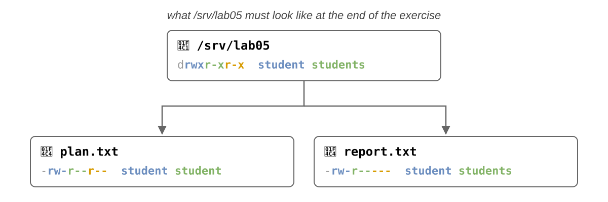

    💡 `man chown`: căutați `OWNER:GROUP`. Nu sunteți membri ai grupului `students`, așa că și ca să dați unui fișier
    acest grup aveți nevoie de `root`. `man sudo`: căutați `-u user`; ca să scrieți ca `bob`, folosiți trucul din
    [Capcana redirectării](#the-redirect-trap).

    **Verificare:** `/srv/lab05` este `drwxr-xr-x student students`; `report.txt` este `-rw-r----- student students`,
    iar `plan.txt` este `-rw-r--r--` (Ubuntu: `-rw-rw-r--`), cu grupul vostru. `bob` citește ambele fișiere: pentru
    `report.txt` primește setul `g`, `r--`, așa că nu poate scrie în el (`Permission denied`). `carol` citește
    `plan.txt`, dar nu și `report.txt`: ea este una dintre **ceilalți**, care nu au nimic. <small>→ [Ce permisiuni se aplică?](#which-permissions-apply) · [`chown` și `chgrp`](#chown-and-chgrp)</small>

**Permisiuni speciale**

12. **Biții speciali**: Vedeți biții speciali ai sistemului, un director în care nimeni nu poate șterge fișierele
    celorlalți și un director care își dă grupul fiecărui fișier nou.

    1. afișați permisiunile lui `/usr/bin/passwd` și ale lui `/tmp`, sub formă de litere și de numere;
    2. creați `/tmp/student.txt`, dați-i **tuturor** `w` pe el și încercați să-l ștergeți ca `bob`;
    3. creați directorul `/srv/lab05/team`, dați-i grupul `students` și permisiunile `rwxrwsr-x`; creați
       `team/bob.txt` ca `bob` și listați-l.

    💡 [Permisiuni speciale](#special-permissions) are numerele biților. Nu sunteți membri ai grupului `students`, așa
    că schimbați grupul **și** permisiunile lui `team` ca `root` (vedeți
    [`setgid` pe un director](#setgid-on-a-directory)).

    **Verificare:** `/usr/bin/passwd` este `-rwsr-xr-x` (`4755`): `s`-ul îl face să ruleze ca `root`, oricine l-ar
    porni; `/tmp` este `drwxrwxrwt` (`1777`). `bob` nu poate șterge `/tmp/student.txt` (`Operation not permitted`), deși
    are `w` pe el: `t`-ul lui `/tmp`. `team` este `drwxrwsr-x student students`, iar `bob.txt` este
    `-rw-r--r-- bob students`: a primit grupul directorului. <small>→ [`setuid`](#setuid) · [`setgid` pe un director](#setgid-on-a-directory) · [Bitul sticky](#the-sticky-bit)</small>

**Promptul**

13. **Promptul**: Schimbați ce afișează promptul lui `bash` și vedeți că este doar text, la care kernelul nu se uită.

    1. afișați valoarea lui `PS1`; schimbați promptul în `student in ~/lab05 $`, cu utilizatorul, calea **completă** și
       `$`-ul utilizatorului;
    2. schimbați promptul astfel încât să arate ca promptul lui `root`; afișați-vă utilizatorul și încercați să afișați
       `/etc/shadow`;
    3. reveniți la promptul inițial.

    💡 `man bash`: căutați `PROMPTING`.

    **Verificare:** promptul inițial este `[\u@\h \W]\$ ` pe Fedora (`\u@\h:\w\$ ` cu culori pe Ubuntu). Cu promptul
    fals de `root`, utilizatorul este tot `student`, iar `/etc/shadow` este refuzat în continuare: `whoami` întreabă
    kernelul, iar promptul este doar text. <small>→ [Promptul](#the-prompt) · [Schimbarea promptului](#changing-the-prompt)</small>

**Schimbarea unei parole**

14. **`bob` își schimbă parola**: Vedeți ce se schimbă în `/etc/shadow` când un utilizator își schimbă singur parola și
    cum poate face asta deși nu poate citi fișierul.

    1. afișați linia lui `bob` din `/etc/shadow`, ca `root`;
    2. deveniți `bob` cu un shell de autentificare și încercați să afișați linia lui din `/etc/shadow`;
    3. tot ca `bob`, schimbați-i parola în `bob123`; dacă `passwd` o refuză și se termină, rulați-l din nou cu
       `Lab05-k7Qx-2026`; ieșiți din shell-ul lui `bob`;
    4. afișați din nou linia lui, ca `root`, și comparați salt-ul și hash-ul cu cele de la pasul 1;
    5. readuceți parola lui `bob` la `uso2026`, ca `root`: exercițiile de acasă au nevoie de ea.

    💡 [Schimbarea parolei](#changing-a-password-passwd); uitați-vă la permisiunile lui `/usr/bin/passwd`.

    **Verificare:** ca `bob`, `getent shadow bob` nu afișează nimic. `passwd` îi cere parola curentă, `uso2026`, și
    refuză `bob123`, spunând de ce (pe Fedora, `BAD PASSWORD: ...`). După schimbare, salt-ul și hash-ul sunt altele.
    `bob` a modificat un fișier pe care nu îl poate citi pentru că `/usr/bin/passwd` are `s`-ul proprietarului: rulează
    ca `root`. <small>→ [Schimbarea parolei](#changing-a-password-passwd) · [Hash-uri și salt](#hashes-and-salt) · [`setuid`](#setuid)</small>

### 🏠 Mai departe {/* #going-further */}

Fiecare exercițiu începe cu **scopul** lui; comenzile le alegeți voi. La final, verificați scopul, nu doar că fiecare
comandă a mers. Exercițiile folosesc `bob`, `carol`, `students` și `/srv/lab05` din Primii pași.

**Eticheta unui proces**

15. **Credențialele shell-ului și ale lui `passwd`**: Vedeți toate credențialele pe care le păstrează kernelul pentru
    shell-ul vostru și aflați pe care dintre ele le schimbă bitul `setuid` al lui `passwd`.

    1. afișați PID-ul shell-ului; afișați-i utilizatorul real, utilizatorul efectiv, utilizatorul salvat și grupurile
       suplimentare, cu **o singură** comandă `ps`;
    2. afișați liniile `Uid:`, `Gid:` și `Groups:` din fișierul lui `status` din `/proc` și aflați din manual ce
       înseamnă fiecare dintre cele 4 numere din `Uid:`;
    3. în al doilea terminal, porniți `passwd` și **nu** tastați nimic; în primul terminal, afișați aceleași coloane și
       aceleași linii pentru `passwd`;
    4. opriți `passwd` cu <kbd>Ctrl</kbd>+<kbd>C</kbd>.

    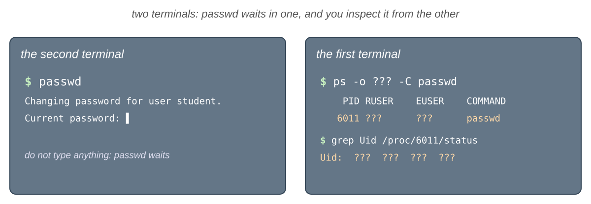

    💡 `$$` este PID-ul shell-ului (laboratorul 04); `man ps`, secțiunea `STANDARD FORMAT SPECIFIERS`: căutați
    `real user`, `effective user`, `saved user` și `supplementary`; `man ps`: căutați `command name`; `man 5 proc`:
    căutați `Uid`.

    **Verificare:** pentru shell-ul vostru, cei trei utilizatori sunt `student`, `Uid:` conține de 4 ori `1000` (UID-ul
    real, cel efectiv, cel salvat și cel al sistemului de fișiere), iar `Groups:` conține `10` și `1000`, GID-urile lui
    `wheel` și `student` (Ubuntu: `27` pentru `sudo` și încă câteva). Pentru `passwd`, utilizatorul real este `student`,
    iar cel efectiv și cel salvat sunt `root`: `Uid:` este `1000 0 0 0`. `s`-ul lui `/usr/bin/passwd` a schimbat UID-ul
    efectiv și pe cel salvat, dar nu și pe cel real: `passwd` știe în continuare cine l-a pornit. <small>→ [Credențialele unui proces](#the-credentials-of-a-process) · [`setuid`](#setuid)</small>

16. **Cine poate opri un proces**: Aflați cum schimbă `sudo` credențialele comenzii pe care o pornește și cine poate
    opri apoi comanda cu `kill`.

    Pentru pașii 3 - 6, notați-vă **întâi** presupunerea, apoi verificați-o:

    1. în al doilea terminal, afișați PID-ul shell-ului, apoi rulați `sleep 300` ca `root`; în primul terminal, afișați
       arborele de procese al celui de-al doilea shell, cu PID-urile, și listați aceste procese cu PID-ul, PPID-ul,
       terminalul, utilizatorul real și cel efectiv;
    2. afișați linia `Uid:` a primului `sudo` (cel al cărui părinte este al doilea shell) și a lui `sleep`; care dintre
       ele are aceeași linie ca `passwd` din exercițiul 15 și de ce?
    3. puteți opri `sleep` cu `kill` și PID-ul lui?
    4. trimiteți semnalul primului `sudo`; ce se întâmplă cu `sleep`?
    5. în al doilea terminal, rulați `sleep 300` ca `bob`; afișați-i liniile `Uid:` și `Groups:`; îl puteți opri? Îl
       poate opri `bob` (rulați `kill` ca `bob`, cu `sudo`)?
    6. în al doilea terminal, porniți `passwd`; îl puteți opri din primul terminal? Dar `bob`?

    💡 `man pstree`: căutați `pid`; `ps -p` primește mai multe PID-uri, separate prin `,`; `man pgrep` găsește PID-ul
    unui proces după nume. `sudo` își rulează comanda pe un pseudoterminal nou (vedeți [`sudo`](#sudo)), așa că
    `ps -t` cu terminalul celui de-al doilea shell nu îl găsește pe `sleep`. Pentru `kill`, folosiți regula din
    [Ce credențiale se verifică](#which-credentials-are-checked).

    **Verificare:** arborele este `bash───sudo───sudo───sleep`. Primul `sudo` este `1000 0 0 0`, ca `passwd`: este un
    program setuid; `sleep` este `0 0 0 0`: `sudo`, ca `root`, a setat **toate** UID-urile copilului său. Deci nu puteți
    opri `sleep` (`Operation not permitted`), dar **puteți** opri primul `sudo`, al cărui UID real este al vostru, iar
    `sudo` transmite semnalul lui `sleep`. `sleep`-ul lui `bob` are de 4 ori UID-ul lui `bob` și GID-urile lui `bob` și
    `students`: `bob` îl poate opri, voi nu. Vă puteți opri `passwd`-ul; `bob` nu. <small>→ [Ce credențiale se verifică](#which-credentials-are-checked) · [`sudo`](#sudo)</small>

17. **Jucați rolul unui program setuid**: Vedeți cum îi permite UID-ul salvat unui program setuid să lase `root`
    deoparte și să-l ia înapoi, comportându-vă chiar voi ca un astfel de program, ca în [UID-ul salvat](#the-saved-uid).

    După fiecare pas, afișați din al doilea terminal linia `Uid:` a procesului `python3` și încercați să citiți din
    `python3` prima linie din `/etc/shadow`:

    1. în primul terminal, porniți `python3` ca `root`; afișați-i UID-ul real, cel efectiv și cel salvat;
    2. deveniți `student` în UID-ul real și în cel efectiv, dar păstrați `root` în UID-ul salvat;
    3. luați înapoi `root`, doar în UID-ul efectiv;
    4. setați toate cele trei UID-uri la `1000` și încercați încă o dată să luați înapoi `root`.

    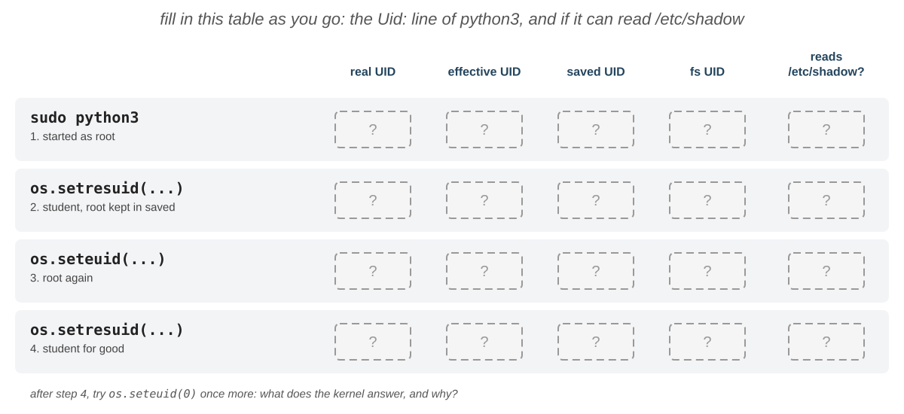

    💡 În `python3`, rulați întâi `import os`, apoi `help(os.getresuid)`, `help(os.setresuid)` și `help(os.seteuid)`;
    `open('/etc/shadow').readline()` citește prima linie a unui fișier; `exit()` iese din `python3`.

    **Verificare:** `Uid:` este `0 0 0 0`, apoi `1000 1000 0 1000` și `/etc/shadow` este refuzat, apoi `1000 0 0 0` și
    fișierul poate fi citit din nou, pentru că `0` era UID-ul salvat; după ultimul pas, `Uid:` este
    `1000 1000 1000 1000`, iar `seteuid(0)` eșuează cu `Operation not permitted`. Al 4-lea număr, UID-ul sistemului de
    fișiere, îl urmează mereu pe al 2-lea. <small>→ [UID-ul salvat](#the-saved-uid) · [Ce credențiale se verifică](#which-credentials-are-checked)</small>

18. **O colegă nouă, de la prima până la ultima zi**: `erin` intră în echipă, devine administrator și pleacă după o
    vreme. Gestionați-i contul de la prima până la ultima zi și aflați de ce vechiul ei shell nu primește noile
    drepturi.

    Verificați fiecare pas înainte să treceți la următorul:

    1. creați-i contul, cu **două** comenzi: director propriu, shell-ul `/bin/bash`, numele complet `Erin Gray`,
       grupul suplimentar `students` și o parolă;
    2. autentificați-vă ca `erin` pe al treilea terminal virtual; verificați că pornește în `/home/erin`, că este în
       `students` și că `sudo` o refuză;
    3. devine administrator: cât timp este încă autentificată pe `tty3`, faceți-o administrator. În **același shell**
       al lui `erin`, afișați `id erin`, apoi `id`, apoi linia `Groups:` din `/proc/$$/status` și încercați din nou
       `sudo`; apoi ieșiți din sesiune, autentificați-vă din nou și încercați încă o dată;
    4. își schimbă numele: setați-i numele complet `Erin Black`;
    5. pleacă: închideți-i sesiunea și ștergeți-i contul, grupul și directorul.

    💡 `man useradd`: căutați `shell`, `comment` și `groups`; `man usermod`; `man userdel`; grupul administratorilor
    se află în tabelul din [`sudo`](#sudo).

    **Verificare:** după pasul 1, `id erin` arată `students`, iar linia ei are `Erin Gray` și `/bin/bash`. La pasul 3,
    `id erin` arată `wheel` (Ubuntu: `sudo`), pentru că citește baza de date, dar `id` și `Groups:` nu (fără `10`;
    Ubuntu: `27`): eticheta shell-ului vechi a fost setată la autentificare, deci `sudo` tot o refuză. După o
    autentificare nouă, `sudo` merge, cu parola ei. Pasul 4 schimbă doar al 5-lea câmp. La final, `id erin`,
    `getent group erin` și `ls -d /home/erin` nu găsesc nimic. <small>→ [Autentificarea](#logging-in) · [Gestionarea utilizatorilor și a grupurilor](#managing-users-and-groups)</small>

**Utilizatori și parole**

19. **Intrarea parolei voastre**: Citiți-vă linia din `/etc/shadow`, găsiți părțile hash-ului ei și aflați când v-ați
    schimbat ultima dată parola.

    1. afișați permisiunile lui `/etc/shadow`, apoi încercați să vă afișați linia din el cu `getent`, ca voi înșivă și
       ca `root`;
    2. găsiți algoritmul și salt-ul hash-ului vostru;
    3. afișați datele parolei contului vostru; transformați al 3-lea câmp al liniei voastre într-o dată.

    💡 `man 5 shadow` explică câmpurile; `man 5 crypt`: căutați `yescrypt`; `man chage`: căutați `list`; `man date`:
    căutați `--date` (data poate fi `1970-01-01 + N days`).

    **Verificare:** `/etc/shadow` este `----------` (Ubuntu: `-rw-r----- root shadow`); ca voi înșivă, `getent shadow`
    nu afișează nimic; ca `root`, afișează o linie al cărei hash începe cu `$y$`, _yescrypt_; salt-ul este partea dintre
    al 3-lea și al 4-lea `$`. Cele două date de la pasul 3 sunt aceeași zi. <small>→ [`/etc/shadow`](#etcshadow) · [Hash-uri și salt](#hashes-and-salt)</small>

20. **Auditați baza de date a utilizatorilor**: Un atacator care devine `root` adaugă adesea un al doilea utilizator cu
    UID-ul `0`: un `root` ascuns, cu un nume nevinovat. Verificați că sistemul vostru nu are un astfel de utilizator
    și aflați ce utilizatori se pot autentifica cu un shell.

    1. găsiți toți utilizatorii cu UID-ul `0`;
    2. găsiți utilizatorii al căror shell este `/bin/bash`;
    3. găsiți utilizatorii al căror director se află în `/home` și numărați-i.

    💡 Citiți utilizatorii cu `getent passwd`; UID-ul este câmpul 3, directorul utilizatorului câmpul 6, iar shell-ul
    câmpul 7. Filtrați liniile cu `grep` (laboratorul 03): `[^:]*:` se potrivește cu un câmp și cu `:`-ul lui, iar `^`
    cu începutul liniei. Afișați doar numele cu `cut` (`man cut`: căutați `delimiter` și `fields`). De ce nu ajunge
    `grep 0`? De ce nu ajunge nici `grep ':0:'`?

    **Verificare:** doar `root` are UID-ul `0`. `grep 0` găsește și orice linie care conține un `0` oriunde, de exemplu
    UID-ul `1000`; `grep ':0:'` găsește și utilizatorii al căror **GID** este `0`. `/bin/bash` este shell-ul lui
    `root`, `student`, `bob` și `carol`; utilizatorii din `/home` sunt `student`, `bob` și `carol`: `3`. <small>→ [`/etc/passwd`](#etcpasswd) · [`getent`](#getent)</small>

21. **Conturi suspendate**: `bob` și `carol` au aceeași parolă. `bob` pleacă în concediu, iar stagiul de practică al
    lui `carol` s-a încheiat pe 1 ianuarie 2020. Aflați dacă `/etc/shadow` arată că au aceeași parolă, apoi opriți
    ambele conturi fără să ștergeți nimic și fără să le schimbați parolele, apoi lăsați-i din nou să intre: trebuie să
    se autentifice cu parolele **vechi**.

    1. afișați liniile lui `bob` și `carol` din `/etc/shadow` și comparați-le salt-urile și hash-urile;
    2. blocați parola lui `bob` și afișați-i linia; încercați să deveniți `bob` cu `su`, cu parola corectă; deblocați-o
       și încercați din nou;
    3. faceți contul lui `carol` să expire pe 1 ianuarie 2020 și afișați-i datele parolei și linia; încercați să
       deveniți `carol`; apoi eliminați data de expirare.

    💡 `man passwd`: căutați `lock`; `man chage`: căutați `expiredate` și `-1`.

    **Verificare:** salt-urile sunt diferite, deci și hash-urile sunt diferite: nimeni nu poate afla din `/etc/shadow`
    că parolele sunt aceleași. Hash-ul lui `bob` primește `!!` în față (Ubuntu: `!`), iar `su` eșuează cu
    `Authentication failure`; după deblocare, semnele `!` dispar și `su` merge. Câmpul 8 al lui `carol` devine `18262`,
    ziua de 1 ianuarie 2020, iar `su` o refuză cu un mesaj că contul a expirat; la final, câmpul este din nou gol. <small>→ [`/etc/shadow`](#etcshadow) · [Hash-uri și salt](#hashes-and-salt) · [Schimbarea parolei](#changing-a-password-passwd)</small>

22. **Sunt de vină permisiunile?**: Învățați să vă dați seama din eroare când ajută `sudo` și când nu.

    Rulați fiecare comandă fără `sudo`, decideți dacă eroarea ține de **permisiuni** (atunci `sudo` o rezolvă) sau de
    altceva (atunci `sudo` nu ajută) și verificați cu `sudo`:

    1. `cat /var/log/kill/them/all.log`;
    2. `userdel hariseldon`;
    3. `chown $USER /home/search/and/destroy`;
    4. `cat /root/missing.txt`;
    5. `dnf install sports-illustrated` (pe Ubuntu, `apt install sports-illustrated`).

    **Verificare:** când eroarea ținea de permisiuni (2, 4 și 5), `sudo` o face să dispară, iar comanda eșuează apoi cu
    eroarea **reală**: utilizatorul, fișierul sau pachetul nu există. Când eroarea ținea de altceva (1 și 3,
    `No such file or directory`), `sudo` dă aceeași eroare. <small>→ [`sudo`](#sudo) · [`r`, `w` și `x`](#r-w-and-x)</small>

**Permisiuni**

23. **`x` pe fiecare director**: `bob` trebuie să vă citească `notes.txt`. Găsiți schimbarea **minimă** care îi permite
    asta, fără să-l lăsați să vadă numele celorlalte fișiere ale voastre.

    1. ca `bob`, afișați `notes.txt` din `~/lab05`-ul vostru, cu calea lui absolută;
    2. aflați de ce eșuează, uitându-vă la permisiunile fiecărui director din cale;
    3. dați-le celorlalți **doar** `x` pe directorul vostru și încercați din nou; apoi încercați să vă listați
       directorul ca `bob`;
    4. luați `x`-ul înapoi.

    **Verificare:** `/home/student` este `drwx------` (Ubuntu: `drwxr-x---`), iar `bob` face parte dintre ceilalți, așa
    că nu poate trece prin el; cu `x` pentru ceilalți, `bob` citește `notes.txt` (care este `rw-r--r--`), dar nu vă
    poate lista directorul: nu are `r` pe el. <small>→ [`r`, `w` și `x`](#r-w-and-x)</small>

24. **Proprietarul se verifică primul**: Arătați că kernelul folosește **un singur** set de permisiuni, chiar și atunci
    când alt set ar permite mai mult.

    1. copiați `notes.txt` în `/srv/lab05/first.txt` și dați-i grupul `students` (nu sunteți membri: folosiți
       `root`);
    2. dați-i `----rw-r--`;
    3. încercați să-l citiți voi înșivă, ca `bob` și ca `carol`; apoi încercați să adăugați o linie în el ca `bob`.

    **Verificare:** voi, proprietarul, nu îl puteți citi (`Permission denied`); `bob` îl poate citi și scrie (setul
    `g`), iar `carol` îl poate citi (setul `o`). <small>→ [Ce permisiuni se aplică?](#which-permissions-apply)</small>

25. **Octal de mână**: Învățați să treceți de la literele permisiunilor la numere și invers, fără ajutor.

    Fără calculator:

    1. scrieți ca numere: `rwxr-x---`, `rw-rw-r--`, `r--------`, `rwx--x--x`, `rw-r--r--`;
    2. scrieți cu litere: `751`, `664`, `400`, `700`, `555`;
    3. verificați-vă răspunsurile pe un fișier `test.txt`.

    **Verificare:** setați fiecare valoare pe `test.txt` în forma de la care ați pornit și afișați cealaltă formă cu
    `stat`: trebuie să fie cea pe care ați scris-o. <small>→ [`chmod`](#chmod)</small>

26. **Un `umask` privat**: Faceți private toate fișierele noi ale shell-ului și aflați pentru ce procese și cât timp
    rămâne setarea.

    Într-un terminal nou:

    1. setați `umask`-ul astfel încât fișierele și directoarele noi să fie private, apoi creați `private2.txt` și
       `privdir`;
    2. afișați `umask`-ul unui `bash` copil;
    3. afișați linia `Umask:` din fișierul `status` al shell-ului;
    4. închideți terminalul, deschideți unul nou și afișați `umask`-ul.

    💡 `man 5 proc`: căutați `Umask`.

    **Verificare:** `private2.txt` este `rw-------`, iar `privdir` este `rwx------`; copilul afișează `0077`, ca
    părintele, iar linia `Umask:` este `0077`: kernelul păstrează un `umask` pentru fiecare proces, iar un copil îl
    moștenește, la fel ca pe etichetă; noul terminal are din nou vechiul `umask`. <small>→ [`umask`](#umask)</small>

**Puzzle-uri cu permisiuni**: În fiecare exercițiu, setați permisiunile (și grupul, dacă este nevoie) astfel încât
**exact** utilizatorii indicați să poată face lucrurile indicate și nimic în plus. Nu sunteți membri ai grupului
`students`, așa că pentru a da unui fișier acest grup aveți nevoie de `root`. Apoi testați fiecare utilizator
(`student`, `bob` și `carol`), citind, listând, scriind sau rulând fișierele.

27. **Un director public**: Publicați fișiere pe care le poate citi oricine, dar pe care doar voi le puteți modifica.

    `/srv/lab05/public`, cu două fișiere, `a.txt` și `b.txt`:

    - oricine poate lista directorul și citi fișierele;
    - doar `student` poate crea, șterge sau modifica fișiere în el;
    - folosiți **un singur** `chmod` cu litere pentru director și pentru toate fișierele.

    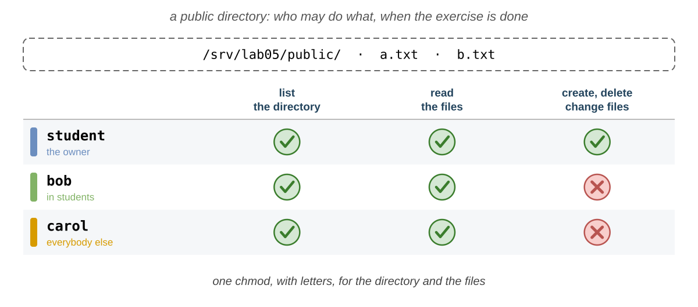

    Începeți prin a închide `public` și tot ce conține pentru grup și pentru ceilalți, cu **o singură** comandă, și
    verificați că `carol` nu poate citi `a.txt`; apoi deschideți-l așa cum se cere.

    💡 `man chmod`: căutați `recursive` și `X`-ul mare.

    **Verificare:** cât timp este închis, `public` este `drwx------`, iar `a.txt` este `-rw-------`; la final, `carol`
    listează `public` și citește `a.txt`, dar nu poate crea `public/c.txt` și nici modifica `a.txt`; fișierele nu au
    primit `x`. <small>→ [`chmod`](#chmod)</small>

28. **Un script pentru grup**: Lăsați grupul să ruleze un script, fără să-l lăsați să-l modifice.

    `/srv/lab05/tool.sh`, o copie a lui `myid.sh`:

    - membrii grupului `students` îl pot rula, dar nu îl pot modifica;
    - nimeni altcineva nu îl poate citi sau rula.

    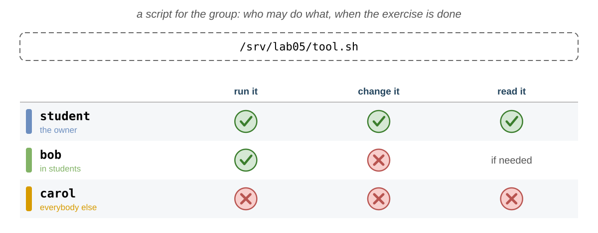

    Încercați întâi să-i dați grupului doar `x` și să-l rulați ca `bob`; apoi găsiți permisiunile corecte.

    **Verificare:** cu doar `x` pentru grup, `bob` primește `Permission denied`: gândiți-vă ce trebuie să facă `bash`
    cu fișierul ca să ruleze comenzile din el. Cu permisiunile corecte, `bob` îl rulează, iar scriptul afișează `bob`;
    `carol` nu îl poate nici citi, nici rula. <small>→ [`r`, `w` și `x`](#r-w-and-x)</small>

29. **Doar pentru cine știe numele**: Ascundeți un fișier într-un director, astfel încât să-l poată citi doar cei care
    îi știu numele.

    `/srv/lab05/hidden`, cu fișierul `key.txt`:

    - membrii grupului `students` pot citi `key.txt` dacă îi știu numele, dar nu pot lista directorul;
    - nimeni altcineva nu poate face nimic.

    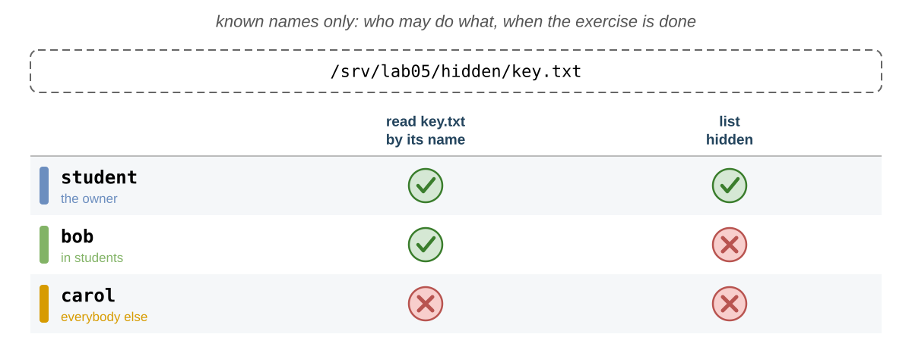

    **Verificare:** `bob` poate afișa `hidden/key.txt`, dar `ls hidden` este refuzat; `carol` nu poate ajunge la
    `key.txt`, nici măcar știindu-i numele. <small>→ [`r`, `w` și `x`](#r-w-and-x)</small>

30. **O listă privată**: Ajutați-l pe `bob` să partajeze un fișier din directorul lui cu grupul lui și cu nimeni
    altcineva.

    Ca `bob`:

    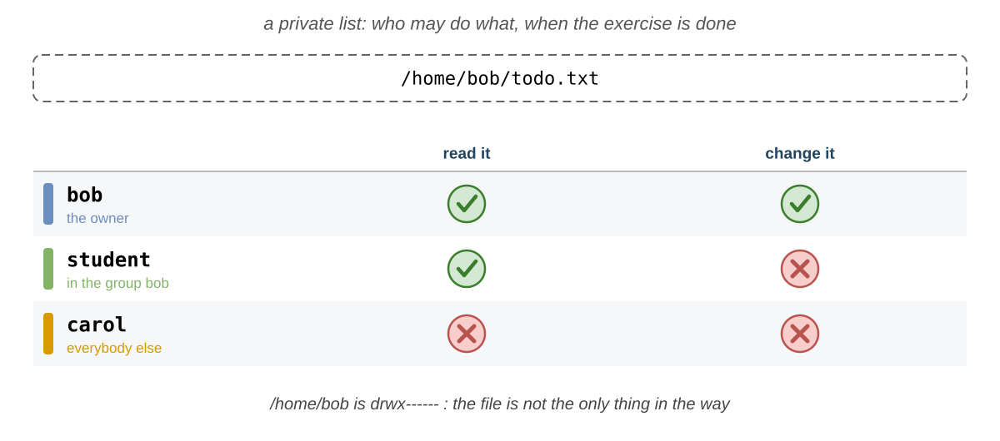

    1. închideți `/home/bob` pentru toată lumea în afară de `bob` (pe Fedora este deja așa, pe Ubuntu nu); creați
       `/home/bob/todo.txt` cu textul `Bob's TODO list`, pe care **doar** `bob` îl poate citi și scrie; verificați că
       `carol` nu îl poate citi;
    2. schimbați-l astfel încât să-l poată citi și membrii grupului `bob`, iar nimeni altcineva să nu poată face nimic;
    3. ieșiți, adăugați-vă (`student`) în grupul `bob` și încercați să citiți fișierul dintr-un **shell de
       autentificare nou**;
    4. aflați de ce tot eșuează și lăsați-l pe `bob` să modifice directorul potrivit ca să meargă, fără să o lase pe
       `carol` să intre;
    5. scoateți-vă din grupul `bob`.

    **Verificare:** la pasul 3 accesul este tot refuzat, deși sunteți în grupul `bob`, iar fișierul îi dă grupului său
    `r`: uitați-vă la **fiecare** director din cale. După corectură puteți citi fișierul, dar nu puteți lista
    `/home/bob`, iar `carol` tot nu are acces la nimic. <small>→ [Ce permisiuni se aplică?](#which-permissions-apply) · [`r`, `w` și `x`](#r-w-and-x)</small>

**Promptul**

31. **Un prompt care spune adevărul și rămâne**: Spre deosebire de `root`-ul fals din Primii pași, faceți un prompt care
    afișează UID-ul shell-ului, astfel încât să se schimbe singur, și păstrați-l pentru orice terminal nou.

    1. faceți un prompt care vă afișează UID-ul, dintr-o variabilă a lui `bash`, și `$`-ul sau `#`-ul;
    2. porniți un shell de autentificare al lui `root`, setați în el **același** `PS1` și uitați-vă la prompt; ieșiți
       din el;
    3. adăugați `PS1`-ul vostru la sfârșitul lui `~/.bashrc`, deschideți un terminal nou și verificați promptul;
    4. porniți un shell de autentificare al lui `root` și uitați-vă la promptul lui.

    💡 `man bash`: căutați `EUID`; scrieți `PS1` între ghilimele **simple**, ca variabila să fie înlocuită de fiecare
    dată când se afișează promptul, nu o singură dată, când îl setați.

    **Verificare:** promptul vostru afișează `1000` și `$`; shell-ul lui `root` afișează `0` și `#`: `\$` și `$EUID`
    vin din eticheta shell-ului, nu dintr-un text tastat de voi. Noul terminal are promptul vostru; shell-ul lui `root`
    nu îl are: citește `/root/.bashrc`, nu fișierul vostru. <small>→ [Schimbarea promptului](#changing-the-prompt)</small>

**Curățenie**

32. **Curățenie**: Lăsați sistemul așa cum era înainte de laborator.

    1. ștergeți utilizatorii `bob` și `carol`, cu directoarele lor, precum și grupul `students`;
    2. ștergeți `/srv/lab05` și `/tmp/student.txt`;
    3. ștergeți `~/lab05` (dacă eșuează, aflați ce director nu are `w` sau `x` pentru voi);
    4. eliminați `PS1`-ul vostru din `~/.bashrc`.

    **Verificare:** `id bob`, `id carol` și `getent group students` nu găsesc nimic; `/srv` nu mai conține `lab05`. <small>→ [Gestionarea utilizatorilor și a grupurilor](#managing-users-and-groups)</small>

### 📝 Provocări {/* #challenges */}

Aceste exerciții seamănă cu cele de la examen. Fiecare vă dă un **rezultat** de atins și **regulile** pe care trebuie
să le respectați, dar nu și pașii: comenzile le alegeți voi. Fiecare se termină cu **Verificarea** după care va fi
notat. Multe dintre ele au nevoie de [Credențialele unui proces](#the-credentials-of-a-process).

Toate provocările pornesc de la aceeași configurație, cea pe care o veți găsi la examen: utilizatorii `bob`, `carol` și
`dave`, grupul `students`, cu `bob` și `dave` ca membri, și directorul gol `/srv/exam`, al lui `root`. Copiați și
rulați aceste comenzi o singură dată, înainte de prima provocare (nu schimbă utilizatorii și grupurile care există
deja):

```bash
sudo groupadd -f students
for u in bob carol dave; do id "$u" &> /dev/null || sudo useradd -m -s /bin/bash "$u"; done
sudo usermod -aG students bob
sudo usermod -aG students dave
sudo mkdir -p /srv/exam
```

Utilizatorii nu au parole: rulați comenzi ca ei cu `sudo -u <USER>`. Când terminați toate provocările, ștergeți totul
cu:

```bash
sudo rm -rf /srv/exam
for u in bob carol dave grace; do id "$u" &> /dev/null && sudo userdel -r "$u"; done
sudo groupdel students
```

33. **Un atac offline**: Vedeți cum depinde un hash de parolă și de salt, apoi găsiți o parolă pornind de la hash-ul
    ei, așa cum ar face un atacator care are o copie a lui `/etc/shadow`.

    1. calculați hash-ul parolei `pass123` cu _SHA-512_ și salt-ul `abc`, de două ori; apoi cu salt-ul `xyz`; apoi
       calculați hash-ul lui `pass124` cu salt-ul `abc`;
    2. un utilizator are această linie într-o copie furată a lui `/etc/shadow`:

       ```text
       mallory:$6$uso2026$YT5ail.RilPFhAJ4Zo6bXZ6qayzFgl959rpxQZDutFYsI3F/Yq4zt5BFc04bFuFJN7PE9Scof6J8VZUPjp7Y20:20737:0:99999:7:::
       ```

       știți că parola este una dintre `123456`, `password`, `qwerty`, `dragon` și `letmein`; aflați care, cu **o
       singură** linie de comandă;
    3. explicați de ce `/etc/shadow` nu trebuie să poată fi citit de oricine.

    💡 `man openssl-passwd`: căutați `SHA512` și `salt`; o singură comandă poate calcula hash-urile mai multor parole.
    Găsiți algoritmul și salt-ul în hash-ul lui `mallory`; `man grep`: căutați `line-number`.

    **Verificare:** la pasul 1, primele două hash-uri sunt identice; cu alt salt sau cu o singură literă diferită,
    hash-ul este complet diferit. La pasul 2, linia voastră de comandă afișează exact un hash, cel al lui `mallory`, cu
    numărul liniei lui; numărul liniei vă spune parola. Oricine poate citi un hash poate încerca parole pe el, offline
    și fără să fie văzut: de aceea doar `root` poate citi `/etc/shadow`. <small>→ [Hash-uri și salt](#hashes-and-salt)</small>

34. **Prevedeți credențialele**: Prevedeți toate UID-urile și GID-urile a trei procese, verificați-le cu o singură
    comandă și găsiți toate procesele care au puterea lui `root` și au fost pornite dintr-un terminal.

    Cele trei procese: shell-ul vostru, un `sleep 300` pornit ca `bob` cu `sudo` și un `passwd` care așteaptă o parolă.

    1. **întâi** completați pe hârtie tabelul de mai jos, pornind de la
       [Cum se schimbă credențialele](#how-the-credentials-change);
    2. porniți cele două procese în alte terminale; afișați, cu **o singură** comandă `ps`, câte o coloană pentru
       fiecare: UID-ul real, cel efectiv, cel salvat și cel al sistemului de fișiere, precum și GID-ul real și cel
       efectiv, pentru cele trei procese; comparați;
    3. găsiți toate procesele care rulează cu utilizatorul efectiv `root`, dar au un terminal, și afișați pentru fiecare
       terminalul, utilizatorul real și cel efectiv și comanda.

    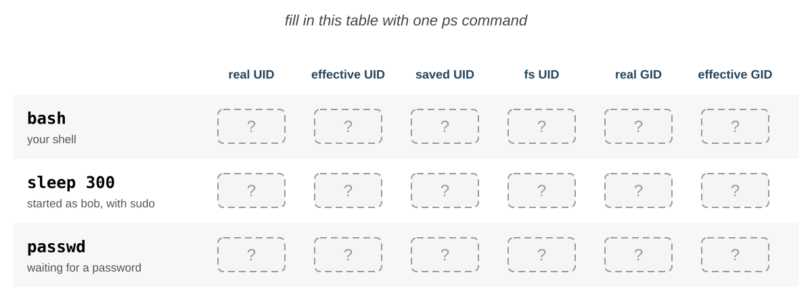

    💡 `man ps`, `STANDARD FORMAT SPECIFIERS`: căutați `saved` și `filesystem`; `-p` primește mai multe PID-uri,
    separate prin `,`; procesele fără terminal au `?` în coloana `TTY`.

    **Verificare:** shell-ul are `1000` peste tot; `sleep` are UID-ul lui `bob` peste tot și GID-ul lui `bob`; `passwd`
    are UID-ul real `1000`, celelalte trei `0`, și GID-urile `1000`: are doar bitul setuid, nu și pe cel setgid. La
    pasul 3 vedeți `agetty`-ul terminalelor virtuale pe care le-ați deschis, dar pe care nu este autentificat nimeni,
    `login`-ul fiecăruia pe care este autentificat cineva, procesele `sudo`, `su` și `passwd` care încă rulează și
    shell-urile lui `root`; utilizatorul real vă spune cine l-a pornit pe fiecare. <small>→ [Credențialele unui proces](#the-credentials-of-a-process)</small>

35. **Cine ce poate face**: Prevedeți ce utilizatori pot deschide ce fișiere și cine poate opri ce proces, apoi
    demonstrați fiecare răspuns cu o singură comandă.

    Creați două fișiere cu aceste comenzi:

    ```bash
    printf 'file a\n' | sudo tee /srv/exam/a.txt > /dev/null
    printf 'file b\n' | sudo tee /srv/exam/b.txt > /dev/null
    sudo chown root:students /srv/exam/a.txt
    sudo chmod 640 /srv/exam/a.txt
    sudo chown bob:students /srv/exam/b.txt
    sudo chmod 064 /srv/exam/b.txt
    ```

    Apoi porniți aceste procese; rulați `passwd` într-un al doilea terminal și nu tastați nimic:

    ```bash
    sudo -b -u bob sleep 601
    sudo -b sleep 602
    ```

    1. **întâi**, pe hârtie: pentru `student`, `bob`, `carol` și `dave`, pot citi `a.txt`? Pot citi `b.txt`? Pot scrie
       în `b.txt`?
    2. **întâi**, pe hârtie: pentru `student`, `bob` și `carol`, pot opri `sleep 601`? `sleep 602`? `passwd`?
    3. demonstrați fiecare răspuns din cele două tabele cu **o singură** comandă, ca utilizatorul potrivit;
    4. opriți cele trei procese.

    💡 `man sudo`: căutați `background`; `man pgrep`: căutați `full`, ca să găsiți un proces după toată linia lui de
    comandă; `man 2 kill`: căutați `If sig is 0`, ca să testați dacă aveți voie să trimiteți un semnal, fără să-l
    trimiteți.

    **Verificare:** fișierele:

    |           | citește `a.txt` | citește `b.txt` | scrie în `b.txt` |
    | --------- | --------------- | --------------- | ---------------- |
    | `student` | nu              | da              | nu               |
    | `bob`     | da              | **nu**          | **nu**           |
    | `carol`   | nu              | da              | nu               |
    | `dave`    | da              | da              | da               |

    `bob` este proprietarul lui `b.txt`, așa că primește setul `u`, `---`, chiar dacă grupul lui poate scrie în el.
    Procesele: `student` poate opri doar `passwd`, al cărui UID real este al lui; `bob` poate opri doar `sleep 601`,
    care rulează cu toate UID-urile lui; `carol` nu poate opri niciunul; nimeni în afară de `root` nu poate opri
    `sleep 602`. Fiecare răspuns trebuie să vină dintr-o comandă care afișează conținutul sau o eroare
    (`Permission denied`, `Operation not permitted`). <small>→ [Ce permisiuni se aplică?](#which-permissions-apply) · [Ce credențiale se verifică](#which-credentials-are-checked)</small>

36. **Un proiect pentru grup**: Construiți un director de proiect pentru un grup, în care fișierele aparțin grupului și
    nimeni nu poate șterge munca celorlalți.

    Faceți `/srv/exam/project` astfel încât:

    - `root` să fie proprietarul lui și doar membrii grupului `students` să poată intra în el, să-l poată lista și să
      poată crea fișiere în el;
    - orice fișier nou din el să aparțină grupului `students`, indiferent cine îl creează;
    - un membru să nu poată șterge sau redenumi fișierele altui membru.

    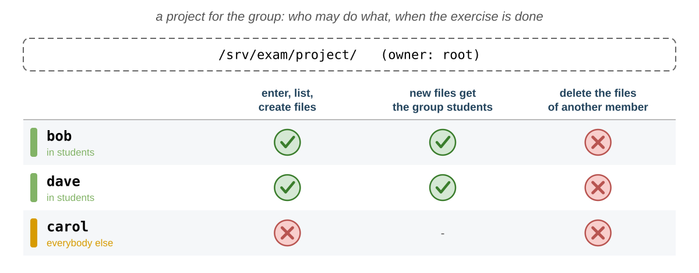

    **Verificare:** `stat -c '%A %U %G' /srv/exam/project` afișează `drwxrws--T root students`: ați avut nevoie de
    **doi** biți speciali. Un fișier creat de `bob` și unul creat de `dave` au amândouă grupul `students`, deși
    grupurile lor primare sunt `bob` și `dave`; `bob` primește `Operation not permitted` când șterge fișierul lui
    `dave`; `carol` primește `Permission denied` când listează directorul. <small>→ [`setgid` pe un director](#setgid-on-a-directory) · [Bitul sticky](#the-sticky-bit)</small>

37. **O cutie pentru teme**: Construiți o cutie în care studenții își predau temele fără să vadă numele fișierelor
    celorlalți și fără să le modifice, dar pe care profesorul o poate totuși curăța.

    Faceți `/srv/exam/homework` astfel încât:

    - `student`, profesorul, să fie proprietarul lui și să poată face orice în el;
    - membrii grupului `students` să poată preda fișiere (să le creeze), dar să nu poată lista directorul, deci să nu
      poată vedea numele celorlalți;
    - să nu poată șterge sau înlocui fișierele celorlalți, chiar dacă le ghicesc numele;
    - `carol` să nu poată face nimic.

    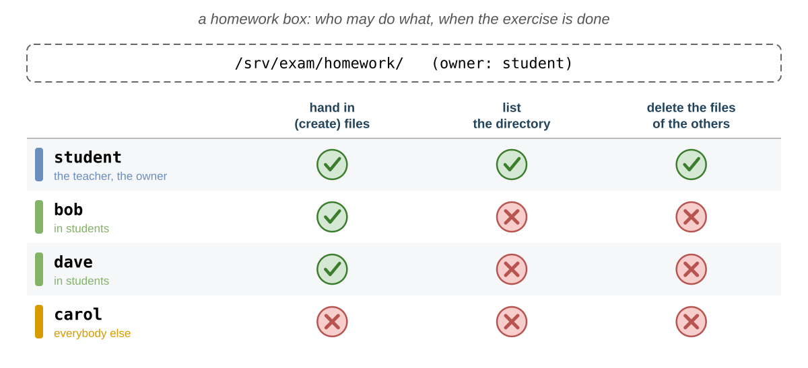

    Predați `bob.txt` ca `bob` și `dave.txt` ca `dave`; ca `bob`, încercați să listați directorul, să ștergeți
    `dave.txt` și să-l afișați; apoi, ca profesor, ștergeți `dave.txt`.

    **Verificare:** `stat -c '%A %U %G' /srv/exam/homework` afișează `drwx-wx--T student students`. `bob` poate crea
    fișiere, dar nu poate lista directorul și nici șterge `dave.txt` (`Operation not permitted`); **poate** însă afișa
    `dave.txt`, pentru că i-a ghicit numele: este `rw-r--r--`, iar `bob` are `x` pe director. Ascunderea numelor nu
    protejează conținutul; doar permisiunile fișierului o fac. Profesorul **poate** șterge `dave.txt`: **proprietarul
    directorului** poate șterge orice fișier din el, chiar și cu bitul sticky; `carol` primește `Permission denied` la
    orice. <small>→ [`r`, `w` și `x`](#r-w-and-x) · [Bitul sticky](#the-sticky-bit)</small>

38. **Programe setuid și scripturi**: Găsiți programele sistemului care rulează ca proprietarul lor și arătați de ce
    bitul setuid merge pentru programe, dar nu și pentru scripturi.

    1. listați toate fișierele setuid din `/usr`, în formatul lui `ls -l`, fără erori, și numărați-le;
    2. ca `root`, copiați `/usr/bin/id` în `/srv/exam/rootid` și dați-i bitul setuid și `rwxr-xr-x`; rulați-l ca voi
       înșivă și ca `bob`;
    3. ca `root`, creați scriptul `/srv/exam/rootid.sh`, cu cele două linii `#!/bin/bash` și `id`, cu aceleași
       permisiuni; rulați-l ca voi înșivă;
    4. creați `/tmp/cap.txt` și dați-i bitul setuid **fără** `x` pentru proprietar; creați directorul `/tmp/capdir` cu
       `rwxrwx---` și bitul sticky, cu **un singur** număr; afișați permisiunile amândurora, sub formă de litere și de
       numere;
    5. explicați de ce `/usr/bin/sudo` este `---s--x--x` pe Fedora și ce permite în plus `-rwsr-xr-x` pe Ubuntu;
    6. ștergeți `rootid`, `rootid.sh`, `cap.txt` și `capdir`.

    💡 `man find`: căutați `-perm` și `-ls`.

    **Verificare:** există câteva zeci de programe setuid, toate ale lui `root`. `rootid` afișează
    `uid=1000(student) gid=1000(student) euid=0(root) ...` (iar pentru `bob`, `uid=` al lui `bob`): `id` afișează
    `euid` când UID-ul efectiv nu este cel real. Scriptul afișează doar `uid=1000(student) ...`, fără `euid`: kernelul
    ignoră bitul setuid pe scripturi. `cap.txt` este `-rwSr--r--` (`4644`), iar `capdir` este `drwxrwx--T` (`1770`): o
    literă mare înseamnă că bitul este setat, dar `x`-ul de sub el nu. Pe Fedora, oricine poate rula `sudo`, ca `root`,
    dar nimeni nu poate citi fișierul; pe Ubuntu, oricine îl poate și citi, deci și copia. <small>→ [`setuid`](#setuid) · [Permisiuni speciale](#special-permissions)</small>

39. **Contează UID-ul**: Arătați că un fișier îi aparține unui UID, nu unui nume, și ce se întâmplă când un UID este
    refolosit.

    1. aflați UID-ul lui `carol`, apoi ștergeți-o **fără** directorul ei;
    2. listați `/home` cu nume, apoi cu numere;
    3. creați utilizatorul `grace`, fără director propriu, cu UID-ul pe care îl avea `carol`;
    4. listați din nou `/home`, apoi ștergeți-o pe `grace` și ștergeți `/home/carol`.

    💡 `man ls`: căutați `numeric`; `man useradd`: căutați `uid` și `no-create-home`.

    **Verificare:** după ce `carol` a fost ștearsă, `/home/carol` afișează numere în locul proprietarului și al
    grupului: fișierele păstrează doar UID-ul și GID-ul. Când `grace` primește acest UID, `ls -l` o arată drept
    proprietara tuturor fișierelor lui `carol`, iar ea le poate citi și modifica. Înainte ca un UID să fie refolosit,
    fișierele vechiului utilizator trebuie șterse sau date altcuiva. <small>→ [Utilizatori](#users) · [`chown` și `chgrp`](#chown-and-chgrp)</small>

## Întrebări de recapitulare {/* #wrap-up-questions */}

Folosiți **ultimele 5 minute** ale laboratorului ca să răspundeți la aceste întrebări împreună cu colegii și cu
asistentul. La ultimele două nu există răspunsuri greșite.

1. Ce este un **utilizator** pentru kernel? Dar un **grup**?
2. Unde se păstrează utilizatorii, grupurile și parolele locale? Ce comandă folosiți ca să căutați un utilizator?
3. De ce poate oricine să citească `/etc/passwd`, dar doar `root` poate citi `/etc/shadow`? Cum verifică `login` o
   parolă, dacă parola nu este păstrată nicăieri?
4. Ce set de permisiuni, **unul singur**, folosește kernelul pentru voi când deschideți un fișier? De ce nu poate
   proprietarul unui fișier `----rw----` să-l citească?
5. Care este diferența dintre `sudo` și `su`? De ce merge `sudo` pentru `student`, dar nu și pentru un utilizator nou?
6. De ce eșuează `sudo echo text > /etc/hosts`?
7. Ce înseamnă `r`, `w` și `x` pentru un director? De ce puteți șterge un fișier în care nu puteți scrie?
8. De ce nu vă puteți baza pe prompt ca să aflați cine sunteți?
9. Ce v-a surprins cel mai mult astăzi la permisiuni?
10. Ce permisiuni le veți da de acum înainte propriilor fișiere?
