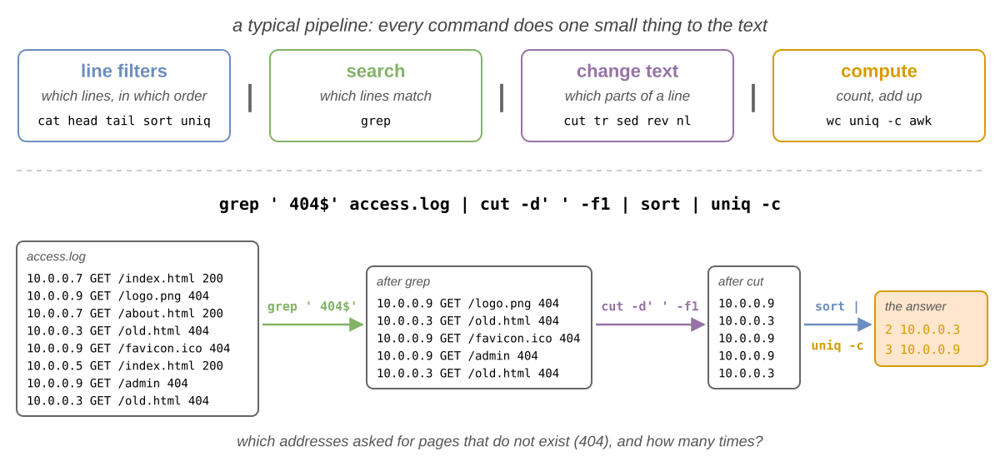
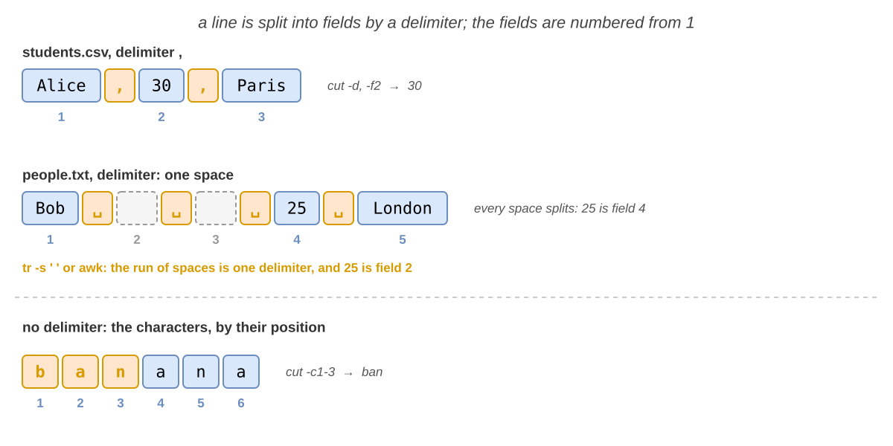
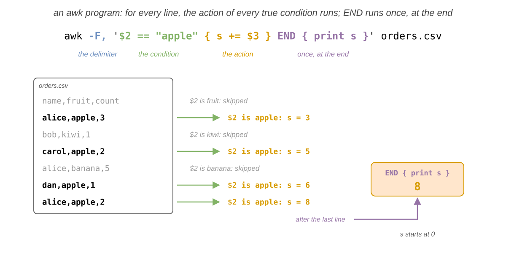
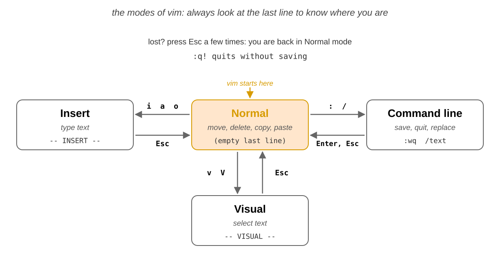
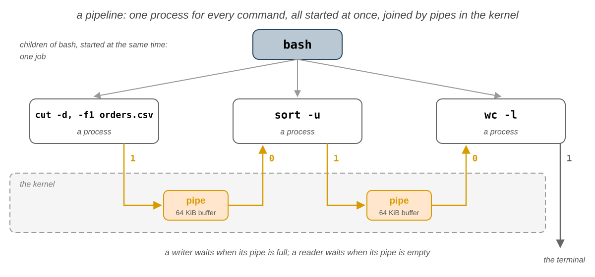

import Tabs from '@theme/Tabs';
import TabItem from '@theme/TabItem';

# 06. Procesarea textului

În laboratorul 5 ați aflat ce utilizator rulează fiecare program și cine are voie să citească și să scrie fiecare
fișier. În acest laborator lucrați cu ce se află **în** majoritatea acestor fișiere: **text**. Faceți cunoștință cu
**filtrele**, comenzi mici care citesc linii și scriu linii: `cat`, `head`, `tail` și `sort` lucrează cu linii întregi,
`grep` găsește liniile care se potrivesc cu o **expresie regulată**, `cut`, `tr` și `sed` schimbă conținutul fiecărei
linii, iar `wc` și `awk` numără și calculează. Le legați apoi în **înlănțuiri de comenzi** (*pipelines*) care răspund
la o întrebare într-o singură linie, aflați din **codul de ieșire** dacă o comandă a reușit și legați comenzi între ele
cu `&&` și `||`. La final, editați fișiere text în terminal cu `nano` și `vim` și încercați un editor mai nou, Helix (`hx`).

Ideea cea mai importantă a laboratorului este că textul este **limba comună** a comenzilor. Fiecare filtru citește
linii de text, face **un singur** lucru mic cu ele și scrie linii de text, așa că ieșirea oricărui filtru poate fi
intrarea oricărui alt filtru. Pipe-urile leagă filtrele într-o **înlănțuire**: fiecare comandă îi dă textul celei
următoare, cu un pas mai aproape de răspuns, iar ultima îl afișează. Pe lângă text, fiecare comandă întoarce și un
număr, **codul de ieșire**, prin care îi spune shell-ului dacă a reușit.

## Obiective {/* #objectives */}

- Să înțelegeți ce este un **filtru** și să construiți o **înlănțuire** de filtre care răspunde la o întrebare
- Să afișați, să inversați și să decupați linii cu `cat`, `tac`, `head` și `tail`
- Să sortați linii cu `sort`, ca text, ca numere și după un câmp, și să numărați liniile repetate cu `uniq`
- Să scrieți **expresii regulate**, de bază și extinse, și să căutați cu ele folosind `grep`
- Să extrageți **câmpuri** și caractere din fiecare linie cu `cut` și să inversați sau să numerotați liniile cu `rev` și `nl`
- Să schimbați, să ștergeți și să comprimați caractere cu `tr` și să înlocuiți text cu `sed`
- Să numărați liniile, cuvintele și caracterele cu `wc` și să calculați sume și medii cu `awk`
- Să aflați din **codul de ieșire** dacă o comandă a reușit și să legați comenzi cu `&&` și `||`
- Să editați un fișier text în terminal cu `nano` și cu `vim` și să încercați `hx`

## Resurse {/* #resources */}

1. _[Razvan Deaconescu, Razvan Rughinis, Mihai Carabas, Alexandru Radovici, Utilizarea Sistemelor de
   Operare, Printech 2021](https://github.com/systems-cs-pub-ro/carte-uso/releases/download/uso-ed1-2021/uso.pdf)_
   - Capitolul 4 - _Procese_, secțiunile 4.5.3 și 4.5.4
   - Capitolul 6 - _Dezvoltarea aplicațiilor_, secțiunile 6.6.1 și 6.6.2
   - Capitolul 7 - _Interfața în linia de comandă_, secțiunile 7.4 și 7.5
   - Capitolul 13 - _Automatizarea sarcinilor_, secțiunea 13.3.2
2. _Brian Ward, How LINUX Works, 3rd Edition, No Starch Press, 2021_
   - Capitolul 2 - _Basic Commands and Directory Hierarchy_, secțiunile 2.2.2, 2.5 și 2.14
   - Capitolul 11 - _Introduction to Shell Scripts_, secțiunile 11.4 și 11.5
3. _[The GNU Awk User's Guide](https://www.gnu.org/software/gawk/manual/gawk.html)_ și `vimtutor`, tutorialul de 30 de
   minute al lui `vim`
4. Slide-urile cursului: [06. Procesarea textului](/docs/lectures/06)
5. Paginile de manual: `man cat`, `man tac`, `man head`, `man tail`, `man sort`, `man uniq`, `man grep`, `man 7 regex`,
   `man cut`, `man tr`, `man sed`, `man rev`, `man nl`, `man wc`, `man awk`, `man nano`, `man vim` și `man bash`
   (căutați `Pipelines` și `Lists`)

## Fedora și Ubuntu {/* #fedora-and-ubuntu */}

Calculatoarele din laborator rulează **Fedora** cu **Sway**, iar exemplele de aici provin de pe ele. Acasă puteți folosi
și **Ubuntu**: comenzile din acest laborator sunt aceleași, cu câteva diferențe:

|                               | Fedora                                        | Ubuntu                                                         |
| ----------------------------- | --------------------------------------------- | -------------------------------------------------------------- |
| promptul                      | `[student@fedora ~]$`                         | `student@ubuntu:~$`                                            |
| programul din spatele lui `awk` | GNU `awk` (`gawk`)                          | `mawk`, un `awk` mai mic: laboratorul merge la fel și cu el    |
| `vim` și `vimtutor`           | dacă lipsesc: `sudo dnf install vim-enhanced` | dacă lipsesc: `sudo apt install vim`                           |
| instalarea Helix (`hx`)       | `sudo dnf install helix`                      | `sudo snap install --classic helix`                            |

## Filtre {/* #filters */}

Un **filtru** este o comandă care citește text, face **o singură** treabă cu el și scrie rezultatul la ieșirea
standard. Citește fișierele primite ca parametri sau, dacă nu primește niciunul, intrarea standard. În secțiunea
[Pipe-uri](/docs/labs/03#pipes-) din laboratorul 3 ați legat deja câteva filtre cu `|`: `sort fruits.txt | uniq -c`.
Un șir de comenzi legate prin pipe-uri formează o **înlănțuire**.

Gândiți-vă la o bandă de montaj dintr-o fabrică: fiecare muncitor face **o singură** operație mică pe piesă și o dă mai
departe. La fel, un filtru nu știe ce se află înaintea lui sau după el: cunoaște doar intrarea și ieșirea lui.

Filtrele din acest laborator fac patru feluri de treburi, iar o înlănțuire tipică le folosește în ordinea aceasta:

| Tip                       | Ce face                                        | Comenzi                                      |
| ------------------------- | ---------------------------------------------- | -------------------------------------------- |
| **filtre de linii**       | alege ce linii păstrează și în ce ordine       | `cat`, `tac`, `head`, `tail`, `sort`, `uniq` |
| **căutare**               | păstrează liniile care se potrivesc cu un tipar | `grep`                                      |
| **modificarea textului**  | schimbă conținutul fiecărei linii              | `cut`, `tr`, `sed`, `rev`, `nl`              |
| **calcul**                | transformă liniile într-un număr, o sumă, ...  | `wc`, `uniq -c`, `awk`                       |



Ce adrese au cerut pagini care nu există, și de câte ori? Răspunsul încape într-o singură linie:

```shell-session
[student@fedora lab06]$ grep ' 404$' access.log | cut -d' ' -f1 | sort | uniq -c
      2 10.0.0.3
      3 10.0.0.9
```

- `grep` a păstrat liniile care se termină cu `404`, adică cererile pentru pagini inexistente; `cut` a păstrat doar
  primul câmp, adresa; `sort | uniq -c` a numărat fiecare adresă. Secțiunile următoare explică pe rând fiecare comandă.

:::tip

**Construiți o înlănțuire comandă cu comandă**

Rulați prima comandă și uitați-vă la rezultat. Apoi apăsați <kbd>↑</kbd>, adăugați `|` și comanda următoare și uitați-vă
din nou: fiecare pas ar trebui să aducă textul puțin mai aproape de răspuns. Cât timp lucrați, puneți `| head` la final
ca să vedeți doar primele linii dintr-un rezultat lung, apoi scoateți-l când ați terminat.

:::

:::info

_„Scrieți programe care fac un singur lucru și îl fac bine. Scrieți programe care să lucreze împreună. Scrieți programe
care prelucrează fluxuri de text, pentru că textul este o interfață universală.”_ (Doug McIlroy, cel care a inventat
pipe-ul în Unix)

:::

Toate comenzile unei înlănțuiri rulează **în același timp**, fiecare în propriul proces, iar textul curge între ele cât
timp rulează. Exercițiile de acasă și provocările au nevoie de detalii: le găsiți în
[Cum rulează o înlănțuire](#how-a-pipeline-runs).

## Filtre de linii {/* #line-filters */}

Filtrele de linii lucrează cu **linii întregi**: aleg ce linii păstrează și în ce ordine, dar nu le modifică. Exemplele
folosesc fișierele pe care le creează [exercițiul 2](#first-steps) în `~/lab06`; `fruits.txt` are 7 linii:
`banana`, `apple`, `cherry`, `apple`, `kiwi`, `banana` și `apple`.

### Afișarea unui fișier: `cat` și `tac` {/* #showing-a-file-cat-and-tac */}

Ați întâlnit `cat` în [laboratorul 2](/docs/labs/02#cat). Opțiunile lui scot la iveală ce nu se vede în text:

| Comandă         | Ce face                                                                                  |
| --------------- | ---------------------------------------------------------------------------------------- |
| `cat <FILE>...` | afișează fișierele, unul după altul (_concatenate_)                                      |
| `cat`           | fără niciun fișier, afișează ce citește de la tastatură, până la <kbd>Ctrl</kbd>+<kbd>D</kbd> |
| `cat -n <FILE>` | numerotează fiecare linie                                                                |
| `cat -A <FILE>` | arată caracterele invizibile: un tab ca `^I`, sfârșitul fiecărei linii ca `$`            |
| `tac <FILE>`    | afișează liniile în ordine **inversă**, întâi pe ultima                                  |

```shell-session
[student@fedora lab06]$ tac fruits.txt
apple
banana
kiwi
apple
cherry
apple
banana
[student@fedora lab06]$ printf 'a\tb \n' | cat -A
a^Ib $
```

- `tac` a afișat aceleași 7 linii, de la ultima la prima.
- `cat -A` a scos la iveală tab-ul dintre `a` și `b` și spațiul de la sfârșitul liniei, dinaintea lui `$`.

### Primele și ultimele linii: `head` și `tail` {/* #the-first-and-the-last-lines-head-and-tail */}

| Comandă               | Ce afișează                                                                                            |
| --------------------- | ------------------------------------------------------------------------------------------------------ |
| `head -n <N> <FILE>`  | primele `N` linii; fără `-n`, primele 10                                                               |
| `head -n -<N> <FILE>` | toate liniile, mai puțin ultimele `N`                                                                  |
| `tail -n <N> <FILE>`  | ultimele `N` linii; fără `-n`, ultimele 10                                                             |
| `tail -n +<N> <FILE>` | liniile **începând cu** linia `N`, până la final: `-n +2` sare doar peste prima linie                  |
| `tail -f <FILE>`      | ultimele linii, apoi fiecare linie nouă scrisă în fișier, până la <kbd>Ctrl</kbd>+<kbd>C</kbd> (_follow_) |

```shell-session
[student@fedora lab06]$ head -n 3 fruits.txt
banana
apple
cherry
[student@fedora lab06]$ head -n 5 fruits.txt | tail -n 1
kiwi
[student@fedora lab06]$ tail -n +2 students.csv
Alice,30,Paris
Bob,25,London
Carol,22,Bucharest
```

- `head -n 5 | tail -n 1` a păstrat primele 5 linii, apoi ultima dintre ele: linia a 5-a.
- `tail -n +2` a sărit peste prima linie din `students.csv`, **antetul** cu numele coloanelor.

:::tip

Cu `tail -f` urmăresc administratorii un **jurnal** (*log*), un fișier în care un program adaugă câte o linie pentru tot
ce face. Lăsați comanda să ruleze într-un terminal și vedeți fiecare linie nouă în clipa în care apare.

:::

### Sortarea: `sort` {/* #sorting-sort */}

`sort` afișează liniile în ordine alfabetică. Opțiunile schimbă ce anume compară:

| Opțiune      | Ce face                                                             |
| ------------ | ------------------------------------------------------------------- |
| `-r`         | sortează în ordine **inversă**                                      |
| `-n`         | compară liniile ca **numere**: `9` înainte de `10`                  |
| `-u`         | afișează fiecare linie o **singură** dată (_unique_)                |
| `-t <C>`     | câmpurile sunt separate de caracterul `C` (implicit: spații)        |
| `-k <N>,<N>` | sortează doar după câmpul `N`; `-k 2,2n`: după câmpul `2`, ca număr; `-k 2`: de la câmpul `2` până la final |

Sortăm `numbers.txt` ca text, apoi ca numere, iar la final `students.csv` după vârstă:

```shell-session
[student@fedora lab06]$ sort numbers.txt
10
100
2
9
[student@fedora lab06]$ sort -n numbers.txt
2
9
10
100
[student@fedora lab06]$ sort -t, -k 2,2n students.csv
name,age,city
Carol,22,Bucharest
Bob,25,London
Alice,30,Paris
```

- Fără `-n`, `sort` a comparat numerele ca text, caracter cu caracter: `100` a ieșit înaintea lui `2`, pentru că `1`
  vine înaintea lui `2`.
- `-t, -k 2,2n` a sortat liniile din `students.csv` după al doilea câmp, vârsta, ca număr. Antetul nu are un număr în
  acest câmp, așa că valorează `0` și rămâne primul.

:::caution

Fără `-n`, numerele se sortează ca **text**: `100` înainte de `2`. Folosiți `-n` ori de câte ori liniile încep cu un
număr, sau `-k` cu `n` când numărul se află în alt câmp.

:::

### Numărarea liniilor repetate: `uniq` {/* #counting-repeated-lines-uniq */}

Ați întâlnit `uniq` în [Linii repetate](/docs/labs/03#repeated-lines-uniq) din laboratorul 3: compară o linie doar cu
linia **imediat de deasupra**, de aceea vine după `sort`. Împreună cu `sort -nr` și `head`, găsește liniile cele mai
frecvente:

```shell-session
[student@fedora lab06]$ sort fruits.txt | uniq -c | sort -nr | head -n 2
      3 apple
      2 banana
```

- `sort | uniq -c` a numărat fiecare fruct, `sort -nr` a pus primul cel mai mare număr, iar `head -n 2` a păstrat
  primele două.

| Opțiune   | Ce afișează                                            |
| --------- | ------------------------------------------------------ |
| `uniq -c` | fiecare linie o singură dată, cu numărul de apariții   |
| `uniq -d` | doar liniile care apar de mai multe ori                |
| `uniq -u` | doar liniile care apar exact o dată                    |

## Expresii regulate {/* #regular-expressions */}

O **expresie regulată** (*regular expression*, pe scurt _regex_) este un tipar care descrie un text. De exemplu, `c.l`
înseamnă „un `c`, apoi orice caracter, apoi un `l`”: se potrivește cu `col` din `color` și cu `cal` din `call`.
Majoritatea programelor care caută în text înțeleg expresii regulate: `grep`, `sed` și `awk`, căutarea cu <kbd>/</kbd>
din `less`, `man` și `vim` și aproape orice limbaj de programare.

Gândiți-vă cum descrieți o persoană unui prieten care o așteaptă la gară: nu știți cum se numește, dar „înaltă, cu o
pălărie roșie” îl ajută să o găsească în mulțime. La fel, un regex găsește liniile care se potrivesc cu descrierea.

`grep '<REGEX>' <FILE>` afișează liniile care conțin o potrivire a regex-ului. Exemplele folosesc `words.txt`:

```text
color
colour
cat
category
concatenate
dog
banana
bat
orange
gal
goal
gooooal
notes.txt
2026-10-04
call 0722 123 456
```

:::caution

**Un regex nu este un glob**

Într-un glob (vedeți [Globbing](/docs/labs/04#globbing) din laboratorul 4), `*` înseamnă „orice caractere”; într-un
regex, `*` înseamnă „elementul anterior, de oricâte ori”, iar „orice caractere” se scrie `.*`. Puneți întotdeauna
regex-ul între **ghilimele simple**: altfel, shell-ul îl poate expanda ca pe un glob, înainte să pornească `grep`. Dacă
în directorul curent există un fișier `banana.txt`, `grep ba* fruits.txt` devine `grep banana.txt fruits.txt`.

:::

### Expresii regulate de bază {/* #basic-regular-expressions */}

| Regex    | Înseamnă                                                       | Exemplu  | Liniile din `words.txt` care se potrivesc |
| -------- | -------------------------------------------------------------- | -------- | ----------------------------------------- |
| `abc`    | textul `abc`, oriunde în linie                                 | `cat`    | `cat`, `category`, `concatenate`          |
| `.`      | **orice** caracter, unul singur                                | `c.l`    | `color`, `colour`, `call ...`             |
| `^`      | **începutul** liniei                                           | `^ca`    | `cat`, `category`, `call ...`             |
| `$`      | **sfârșitul** liniei                                           | `r$`     | `color`, `colour`                         |
| `[abc]`  | **unul** dintre caracterele dintre paranteze (o **clasă**)     | `[0-9]`  | `2026-10-04`, `call ...`                  |
| `[^abc]` | un caracter care **nu** se află între paranteze; `^` înseamnă _nu_ doar imediat după `[` | `^[^c]`  | orice linie care nu începe cu `c` |
| `*`      | elementul **anterior**, de **0 sau mai multe** ori             | `go*al`  | `gal`, `goal`, `gooooal`                  |
| `.*`     | orice caractere, sau niciunul                                  | `^c.*e$` | `concatenate`                             |
| `\`      | următorul caracter este text obișnuit: `\.` este un punct adevărat | `\.` | `notes.txt`                              |

Să le vedem în acțiune pe câteva dintre ele:

```shell-session
[student@fedora lab06]$ grep 'go*al' words.txt
gal
goal
gooooal
[student@fedora lab06]$ grep '^[a-z]*$' words.txt | wc -l
12
[student@fedora lab06]$ grep '.' words.txt | wc -l
15
[student@fedora lab06]$ grep '\.' words.txt
notes.txt
```

- `go*al` s-a potrivit cu un `g`, urmat de oricâți `o`, chiar și de niciunul, apoi de `al`.
- `^[a-z]*$` s-a potrivit cu liniile care au doar litere mici, de la început până la sfârșit: 12 linii.
- `.` singur s-a potrivit cu **orice** linie care nu e goală; `\.` s-a potrivit doar cu linia care conține un punct
  adevărat.

### Expresii regulate extinse {/* #extended-regular-expressions */}

Cu `grep -E` devin speciale încă cinci caractere: `+`, `?`, `{ }`, `( )` și `|`, care scurtează regex-ul. Tabelul
arată și `\b`, pe care GNU `grep` îl înțelege cu sau fără `-E`:

| Regex | Înseamnă                                                  | Exemplu    | Liniile din `words.txt` care se potrivesc |
| ----- | --------------------------------------------------------- | ---------- | ----------------------------------------- |
| `+`   | elementul anterior, de **1 sau mai multe** ori            | `[0-9]+`   | `2026-10-04`, `call ...`                  |
| `?`   | elementul anterior, de **0 sau 1** dată: este opțional    | `colou?r`  | `color`, `colour`                         |
| `{n}` | elementul anterior, de exact `n` ori; `{n,m}`: între `n` și `m` ori | `[0-9]{4}` | `2026-10-04`, `call 0722 ...`   |
| `( )` | un **grup**, repetat ca un singur element                 | `b(an)*a`  | `banana`, `bat`                           |
| `\|`  | una dintre alternative (_sau_)                            | `cat\|dog` | `cat`, `category`, `concatenate`, `dog`   |
| `\b`  | o **margine de cuvânt**: începutul sau sfârșitul unui cuvânt | `\bcat\b` | doar `cat`                              |

```shell-session
[student@fedora lab06]$ grep -E 'colou?r' words.txt
color
colour
[student@fedora lab06]$ grep -E '^[0-9]{4}-[0-9]{2}-[0-9]{2}$' words.txt
2026-10-04
[student@fedora lab06]$ grep -E '\b[0-9]{3}\b' words.txt
call 0722 123 456
```

- `^[0-9]{4}-[0-9]{2}-[0-9]{2}$` s-a potrivit cu o linie care conține **doar** o dată calendaristică: 4 cifre, `-`,
  2 cifre, `-`, 2 cifre.
- `\b[0-9]{3}\b` s-a potrivit cu un număr de exact 3 cifre, `123`; fără `\b`, s-ar fi potrivit și în interiorul lui
  `0722` și al lui `2026`.

:::info

Fără `-E`, `grep` folosește expresiile regulate **de bază**, în care `+`, `?`, `{`, `(` și `|` sunt caractere obișnuite
(speciale sunt, în schimb, `\+`, `\?`, ...). Folosiți `-E` ori de câte ori aveți nevoie de unul dintre ele. Lista
completă se află în `man 7 regex`.

:::

### Opțiunile lui `grep` {/* #grep-options */}

| Opțiune | Ce face                                                                                  |
| ------- | ---------------------------------------------------------------------------------------- |
| `-E`    | folosește expresiile regulate **extinse**                                                |
| `-i`    | nu ține cont de majuscule și minuscule                                                   |
| `-v`    | afișează liniile care **nu** se potrivesc                                                |
| `-n`    | afișează numărul fiecărei linii în fața ei                                               |
| `-c`    | afișează doar numărul de linii care se potrivesc; o linie cu două potriviri se numără o dată |
| `-o`    | afișează doar **partea care se potrivește**, fiecare potrivire pe linia ei               |
| `-w`    | se potrivește doar cu **cuvinte** întregi, ca și cum regex-ul ar fi încadrat de `\b...\b` |
| `-q`    | nu afișează nimic (_quiet_): răspunsul se află în codul de ieșire (vedeți [Coduri de ieșire](#exit-codes)) |
| `-r`    | caută în toate fișierele dintr-un director și din subdirectoarele lui                    |

```shell-session
[student@fedora lab06]$ grep -n 'an' fruits.txt
1:banana
6:banana
[student@fedora lab06]$ grep -o -E '[0-9]+' words.txt
2026
10
04
0722
123
456
[student@fedora lab06]$ grep -v -c 'apple' fruits.txt
4
```

- `-n` a arătat că `banana` se află pe liniile `1` și `6`.
- `-o` a afișat fiecare număr din `words.txt` pe linia lui, fără restul liniei.
- `-v -c` a numărat liniile care **nu** conțin `apple`.

## Modificarea textului {/* #change-text */}

### Câmpuri și delimitatori {/* #fields-and-delimiters */}

Multe fișiere text sunt de fapt **tabele**: fiecare linie este un rând, iar un caracter, **delimitatorul**, o împarte în
**câmpuri**, adică în coloane. Câmpurile se numerotează de la `1`.

| Fișier                                       | O linie                                               | Delimitatorul |
| -------------------------------------------- | ----------------------------------------------------- | ------------- |
| un fișier **CSV** (_comma-separated values_) | `Alice,30,Paris`                                      | `,`           |
| `/etc/passwd` (laboratorul 5)                | `student:x:1000:1000:Student:/home/student:/bin/bash` | `:`           |
| un fișier jurnal, `access.log`               | `10.0.0.9 GET /logo.png 404`                          | un spațiu     |
| multe programe                               | câmpurile sunt aliniate în coloane                    | un **tab**    |



:::caution

**Fiecare** delimitator desparte. În `Bob   25 London`, cu trei spații după `Bob`, între spații există două câmpuri
**goale**, iar `25` este câmpul `4`, nu `2`.

:::

### Extragerea coloanelor: `cut` {/* #cutting-columns-cut */}

| Comandă                   | Ce afișează                                                            |
| ------------------------- | ---------------------------------------------------------------------- |
| `cut -d<C> -f<N> <FILE>`  | câmpul `N` al fiecărei linii; câmpurile sunt separate de caracterul `C` |
| `cut -d<C> -f1,3`         | câmpurile 1 și 3, separate de același `C`, în ordinea din linie: și `-f3,1` afișează întâi câmpul 1 |
| `cut -d<C> -f2-4`, `-f2-` | câmpurile de la 2 la 4; de la câmpul 2 până la final                   |
| `cut -f<N>`               | fără `-d`, delimitatorul este **tab-ul**; o linie fără niciun tab se afișează întreagă, oricare ar fi `N` |
| `cut -c<N>-<M> <FILE>`    | caracterele de la `N` la `M` ale fiecărei linii, numărate de la `1`    |

```shell-session
[student@fedora lab06]$ cut -d, -f1 students.csv
name
Alice
Bob
Carol
[student@fedora lab06]$ cut -d, -f2- students.csv
age,city
30,Paris
25,London
22,Bucharest
[student@fedora lab06]$ cut -d' ' -f2 people.txt
30

```

- `-d, -f1` a afișat primul câmp, numele; `-f2-` a afișat tot ce urmează, începând cu al doilea câmp.
- `people.txt` conține `Alice 30 Paris` și `Bob   25 London`: pentru `Bob`, câmpul `2` este câmpul gol dintre primele
  două spații, așa că `cut` a afișat o linie goală. `tr`, din secțiunea următoare, rezolvă problema.

### Schimbarea caracterelor: `tr` {/* #changing-characters-tr */}

`tr` (_translate_) schimbă **caractere** individuale, nu cuvinte. Citește **doar** de la intrarea standard: dați-i
fișierul cu `<` sau printr-un pipe.

| Comandă            | Ce face                                                                                 | Exemplu                         |
| ------------------ | --------------------------------------------------------------------------------------- | ------------------------------- |
| `tr <SET1> <SET2>` | transformă fiecare caracter din `SET1` în caracterul aflat pe **aceeași poziție** în `SET2` | `tr abc xyz`: `cab` → `zxy` |
| `tr -d <SET>`      | **șterge** fiecare caracter din `SET`                                                   | `tr -d a`: `banana` → `bnn`     |
| `tr -s <SET>`      | **comprimă** o secvență din același caracter din `SET` într-unul singur                 | `tr -s o`: `gooooal` → `goal`   |

Un set este o listă de caractere, `aeiou`, sau un interval, `a-z`, `0-9`; `'\n'` este sfârșitul de linie, iar `'\t'`
un tab.

```shell-session
[student@fedora lab06]$ tr a-z A-Z < fruits.txt | head -n 2
BANANA
APPLE
[student@fedora lab06]$ echo 'call 0722 123 456' | tr -d 0-9
call
[student@fedora lab06]$ tr -s ' ' < people.txt | cut -d' ' -f2
30
25
[student@fedora lab06]$ echo "$PATH" | tr : '\n'
/home/student/.local/bin
/home/student/bin
/usr/local/bin
/usr/bin
...
```

- `a-z` și `A-Z` au aceeași lungime: `a` a devenit `A`, `b` a devenit `B` și așa mai departe.
- `-d 0-9` a șters cifrele; spațiile au rămas.
- `tr -s ' '` a lăsat un singur spațiu între câmpurile din `people.txt`, așa că `cut` a găsit vârsta lui `Bob` în
  câmpul `2`.
- `tr : '\n'` a pus fiecare director din `PATH` (laboratorul 4) pe linia lui.

### Înlocuirea textului: `sed` {/* #replacing-text-sed */}

`sed` (_stream editor_) modifică textul pe măsură ce trece prin el, ca un muncitor la banda de montaj: citește o linie,
o modifică, o afișează și trece la următoarea. Fișierul în sine nu se schimbă. Spre deosebire de `tr`, `sed` lucrează
cu cuvinte și cu expresii regulate, nu cu caractere individuale. Comanda lui cea mai folosită este `s` (_substitute_),
care înlocuiește textul cu care se potrivește un regex:

```text
sed 's/<REGEX>/<NEW TEXT>/<FLAGS>' <FILE>
```

| Se scrie           | Ce face                                                            |
| ------------------ | ------------------------------------------------------------------ |
| `s/apple/pear/`    | înlocuiește **prima** potrivire din fiecare linie                  |
| `s/apple/pear/g`   | înlocuiește **toate** potrivirile din linie (_global_)             |
| `s/apple/pear/gi`  | la fel, fără să țină cont de majuscule și minuscule                |
| `sed -E 's/...//'` | regex-ul este unul **extins**, ca la `grep -E`                     |
| `s/apple//g`       | textul nou este gol: șterge potrivirile                            |
| `s\|/usr\|/opt\|`  | părțile pot fi separate de orice caracter: util când textul conține `/` |

```shell-session
[student@fedora lab06]$ echo 'apple and apple pie' | sed 's/apple/pear/'
pear and apple pie
[student@fedora lab06]$ echo 'apple and apple pie' | sed 's/apple/pear/g'
pear and pear pie
[student@fedora lab06]$ echo 'call 0722 123 456' | sed -E 's/[0-9]+/N/g'
call N N N
[student@fedora lab06]$ sed 's/,/ /g' students.csv
name age city
Alice 30 Paris
Bob 25 London
Carol 22 Bucharest
```

- Fără `g`, s-a schimbat doar primul `apple`.
- `[0-9]+` s-a potrivit cu fiecare număr, iar fiecare potrivire a devenit `N`.
- `sed` a afișat textul modificat; `students.csv` în sine **nu** s-a schimbat.

:::danger

`sed -i` scrie rezultatul **înapoi în fișier**, în loc să-l afișeze, și nu există undo. Rulați întâi comanda fără `-i`
și uitați-vă la rezultat.

:::

### Inversarea și numerotarea: `rev` și `nl` {/* #reversing-and-numbering-rev-and-nl */}

| Comandă      | Ce face                                                                                 |
| ------------ | --------------------------------------------------------------------------------------- |
| `rev <FILE>` | inversează **caracterele** fiecărei linii; ordinea liniilor rămâne aceeași (pe aceea o inversează `tac`) |
| `nl <FILE>`  | adaugă o primă coloană cu numărul liniei, urmat de un tab; liniile goale nu primesc număr |

```shell-session
[student@fedora lab06]$ rev fruits.txt | head -n 2
ananab
elppa
[student@fedora lab06]$ echo /usr/share/doc/bash | rev | cut -d/ -f1 | rev
bash
```

- `cut` nu poate număra câmpurile de la sfârșit. `rev` a adus ultimul câmp pe primul loc, `cut -f1` l-a luat, iar al
  doilea `rev` l-a întors la loc.

## Numărare și calcul {/* #counting-and-computing */}

### Numărarea: `wc` {/* #counting-wc */}

`wc` (_word count_) numără liniile, cuvintele și octeții:

| Opțiune | Ce numără                                                                    |
| ------- | ---------------------------------------------------------------------------- |
| `-l`    | **liniile**                                                                  |
| `-w`    | **cuvintele**: grupurile de caractere separate prin spații                   |
| `-c`    | **octeții**                                                                  |
| `-m`    | **caracterele**: o literă ca `ș` ocupă 2 octeți, dar este un singur caracter |

```shell-session
[student@fedora lab06]$ wc fruits.txt
 7  7 44 fruits.txt
[student@fedora lab06]$ wc -l < fruits.txt
7
[student@fedora lab06]$ echo 'mașină' | wc -c -m
      7       9
```

- Fără opțiuni, `wc` a afișat liniile, cuvintele și octeții, apoi numele fișierului.
- Cu `<`, `wc` nu a aflat numele fișierului (vedeți [Intrarea](/docs/labs/03#input-) din laboratorul 3), așa că a
  afișat doar numărul.
- `mașină` împreună cu sfârșitul de linie înseamnă 7 caractere, dar 9 octeți: `ș` și `ă` ocupă câte doi octeți.

### Calculul: `awk` {/* #computing-awk */}

`awk` este un mic limbaj de programare pentru tabele. Un program `awk` este o listă de **condiții**, fiecare cu o
**acțiune** între `{ }`: `awk` împarte fiecare linie în câmpuri și rulează acțiunea fiecărei condiții adevărate pentru
linia respectivă. Condiția este opțională; `END` este o condiție adevărată o singură dată, după ultima linie.



| Se scrie                   | Ce este                                                                     |
| -------------------------- | --------------------------------------------------------------------------- |
| `-F,`                      | delimitatorul este `,`; fără `-F`, orice secvență de spații și tab-uri      |
| `$1`, `$2`, ..., `$NF`     | câmpurile; `$NF` este ultimul câmp, a nu se confunda cu `NF`; `$0` este linia întreagă |
| `NF`, `NR`                 | numărul de câmpuri din linie; numărul liniei, de la `1`                     |
| `==`, `!=`, `<`, `>=`, ... | compară două valori: numerele ca numere, textul ca text; textul se pune între `"`: `$2 == "apple"` |
| `~ /regex/`, `!~ /regex/`  | se potrivește, nu se potrivește cu un regex                                 |
| `&&`, `\|\|`, `!`          | și, sau, nu                                                                 |
| `{ print $1, $3 }`         | afișează câmpurile 1 și 3, separate printr-un spațiu; `print $1 $3`, fără `,`, afișează `alice3` |
| `{ s += $3; n++ }`         | adună câmpul 3 la variabila `s` și adună 1 la `n`; variabilele pornesc de la `0` |

Exemplele folosesc `orders.csv`, un antet urmat de 6 comenzi de fructe:

```text
name,fruit,count
alice,apple,3
bob,kiwi,1
carol,apple,2
alice,banana,5
dan,apple,1
alice,apple,2
```

```shell-session
[student@fedora lab06]$ awk -F, '{ s += $3 } END { print s }' orders.csv
14
[student@fedora lab06]$ awk -F, 'NR > 1 { s += $3; n++ } END { print s / n }' orders.csv
2.33333
[student@fedora lab06]$ awk -F, '$2 == "apple" { s += $3 } END { print s }' orders.csv
8
[student@fedora lab06]$ awk -F, '$2 ~ /an/ { print $1, $2 }' orders.csv
alice banana
[student@fedora lab06]$ awk '{ print NF, $NF }' people.txt
3 Paris
3 London
```

- Primul program a adunat câmpul 3 al fiecărei linii și a afișat suma la final; antetul `count` nu este un număr, așa
  că a adunat `0`.
- `NR > 1` a sărit peste antet, iar `n` a numărat comenzile: 14 / 6 = 2.33333.
- `$2 == "apple"` a adunat doar merele; `$2 ~ /an/` a afișat comenzile al căror fruct conține `an`.
- Fără `-F`, `awk` a despărțit `Bob   25 London` la **secvența** de spații: 3 câmpuri, niciunul gol.

:::tip

Puneți programul `awk` între **ghilimele simple**: `$1` și `$3` sunt pentru `awk`, nu pentru shell.

:::

## O înlănțuire, pas cu pas {/* #a-pipeline-step-by-step */}

Câți clienți au comandat mere? Construim înlănțuirea comandă cu comandă și ne uităm la text după fiecare pas:

```shell-session
[student@fedora lab06]$ tail -n +2 orders.csv | grep ',apple,'
alice,apple,3
carol,apple,2
dan,apple,1
alice,apple,2
[student@fedora lab06]$ tail -n +2 orders.csv | grep ',apple,' | cut -d, -f1
alice
carol
dan
alice
[student@fedora lab06]$ tail -n +2 orders.csv | grep ',apple,' | cut -d, -f1 | sort -u
alice
carol
dan
[student@fedora lab06]$ tail -n +2 orders.csv | grep ',apple,' | cut -d, -f1 | sort -u | wc -l
3
```

- `tail -n +2` a sărit peste antet, iar `grep ',apple,'` a păstrat comenzile de mere; virgulele din jurul lui `apple`
  lasă deoparte un fruct ca `pineapple`.
- `cut` a păstrat numele; `alice` a comandat mere de două ori, așa că `sort -u` a păstrat fiecare nume o singură dată;
  `wc -l` le-a numărat.

## Coduri de ieșire {/* #exit-codes */}

Fiecare comandă se termină cu un număr între `0` și `255`, **codul de ieșire**: `0` înseamnă **succes**, orice alt
număr înseamnă o eroare. Shell-ul păstrează codul de ieșire al ultimei comenzi în `$?` (vedeți
[Parametri speciali](/docs/labs/04#special-parameters---and-) din laboratorul 4). Ce înseamnă fiecare număr aflați din
pagina de manual a comenzii, în secțiunea `EXIT STATUS`:

| `grep` se termină cu | Când                                            |
| -------------------- | ----------------------------------------------- |
| `0`                  | a găsit cel puțin o linie                       |
| `1`                  | nu a găsit nimic                                |
| `2`                  | a apărut o eroare: de exemplu, fișierul nu există |

```shell-session
[student@fedora lab06]$ grep -q kiwi fruits.txt
[student@fedora lab06]$ echo $?
0
[student@fedora lab06]$ grep -q mango fruits.txt
[student@fedora lab06]$ echo $?
1
[student@fedora lab06]$ grep kiwi nope.txt
grep: nope.txt: No such file or directory
[student@fedora lab06]$ echo $?
2
```

- `grep -q` nu a afișat nimic; codul de ieșire a spus dacă a găsit `kiwi` (`0`) sau nu (`1`).

| Comandă    | Ce face                                             |
| ---------- | --------------------------------------------------- |
| `true`     | nimic; se termină cu `0`                            |
| `false`    | nimic; se termină cu `1`                            |
| `exit <N>` | încheie shell-ul, sau un script, cu codul de ieșire `N` |

O comandă omorâtă de un semnal (laboratorul 4) se termină cu `128` plus numărul semnalului: <kbd>Ctrl</kbd>+<kbd>C</kbd>
(`SIGINT`, `2`) dă `130`.

### Legarea comenzilor: `&&` și `||` {/* #chaining-commands--and- */}

| Se scrie   | Ce face                                                               |
| ---------- | --------------------------------------------------------------------- |
| `a ; b`    | rulează `a`, apoi `b`, indiferent dacă `a` a reușit sau nu; ca pe două linii separate |
| `a && b`   | rulează `b` doar dacă `a` s-a terminat cu `0`: „`a`, **și apoi** `b`” |
| `a \|\| b` | rulează `b` doar dacă `a` **nu** s-a terminat cu `0`: „`a`, **altfel** `b`” |

```shell-session
[student@fedora lab06]$ grep -q kiwi fruits.txt && echo 'kiwi found'
kiwi found
[student@fedora lab06]$ grep -q mango fruits.txt && echo 'mango found'
[student@fedora lab06]$ grep -q mango fruits.txt || echo 'no mango'
no mango
[student@fedora lab06]$ mkdir -p backup && cp fruits.txt backup/ && echo 'saved'
saved
```

- `&&` a sărit peste `echo 'mango found'`, pentru că `grep` s-a terminat cu `1`; din același motiv, `||` a rulat
  `echo 'no mango'`.
- `cp` a rulat doar după ce a reușit `mkdir`, iar `echo` doar după ce a reușit `cp`.

:::caution

`a && b || c` **nu** înseamnă „dacă `a`, atunci `b`, altfel `c`”. Shell-ul citește de la stânga la dreapta, iar `||` se
uită la codul de ieșire al ultimei comenzi rulate înaintea lui: când `a` reușește, aceea este `b`. Așadar `c` rulează și
când `a` reușește, dar `b` eșuează: `true && false || echo C` afișează `C`. Puteți folosi `a && b || c` ca „dacă `a`,
atunci `b`, altfel `c`” doar când `b` nu poate eșua, cum e `echo`: atunci `c` rulează doar când eșuează `a`.

:::

### Codul de ieșire al unei înlănțuiri {/* #the-exit-code-of-a-pipeline */}

Codul de ieșire al unei înlănțuiri este codul de ieșire al **ultimei** comenzi:

```shell-session
[student@fedora lab06]$ cut -d, -f2 orders.csv | grep -q kiwi && echo 'kiwi ordered' || echo 'no kiwi'
kiwi ordered
[student@fedora lab06]$ cut -d, -f2 nope.csv | sort
cut: nope.csv: No such file or directory
[student@fedora lab06]$ echo $?
0
```

- Pe prima linie, `grep -q` a găsit `kiwi` în coloana fructelor: înlănțuirea s-a terminat cu `0`.
- Pe a doua, `cut` a eșuat, dar `sort`, ultima comandă, a reușit: înlănțuirea s-a terminat cu `0`. Mesajul de eroare
  apare pe ecran, dar `$?`, `&&` și `||` văd doar `0`-ul. [Cum rulează o înlănțuire](#how-a-pipeline-runs) arată cum
  puteți prinde eșecul.

## Editoare de text {/* #text-editors */}

Editați fișiere text tot timpul: setări în `/etc` și în `~/.config`, programe, notițe. Pe un server, prin rețea, sau
într-un terminal virtual (laboratorul 4) nu aveți nicio fereastră: aveți nevoie de un editor care rulează **în
terminal**.

| Editor              | Cum este                                                                                                                          |
| ------------------- | --------------------------------------------------------------------------------------------------------------------------------- |
| `nano`              | simplu: ce tastați ajunge în text, iar partea de jos a ecranului listează tastele; este editorul implicit pe Fedora și Ubuntu     |
| `vi`, `vim`, `nvim` | **modal**: tastele sunt comenzi, iar textul se scrie doar în modul Insert; `vi` există pe orice sistem Unix, `nvim` este un `vim` mai nou |
| `emacs`             | nemodal: fiecare comandă este o combinație cu <kbd>Ctrl</kbd> sau <kbd>Alt</kbd>; poate fi extins cu programe scrise în limbajul lui |
| `helix` (`hx`)      | modal ca `vim`, dar întâi selectați și abia apoi acționați; cunoaște limbajele de programare fără nicio setare                    |

### `nano` {/* #nano */}

Ați întâlnit `nano` în [laboratorul 2](/docs/labs/02#nano). Partea de jos a ecranului îi listează tastele: `^` înseamnă
<kbd>Ctrl</kbd>, iar `M-` înseamnă <kbd>Alt</kbd>.

| Tastă                         | Acțiune                                   |
| ----------------------------- | ----------------------------------------- |
| <kbd>Ctrl</kbd>+<kbd>O</kbd>  | salvare (_write out_), apoi <kbd>Enter</kbd> ca să păstrați numele |
| <kbd>Ctrl</kbd>+<kbd>X</kbd>  | ieșire; dacă fișierul s-a schimbat, vă întreabă dacă îl salvați: <kbd>Y</kbd> sau <kbd>N</kbd> |
| <kbd>Ctrl</kbd>+<kbd>K</kbd>  | taie linia                                |
| <kbd>Ctrl</kbd>+<kbd>U</kbd>  | lipește liniile tăiate                    |
| <kbd>Alt</kbd>+<kbd>U</kbd>   | undo                                      |
| <kbd>Ctrl</kbd>+<kbd>W</kbd>  | căutare (_where is_)                      |
| <kbd>Ctrl</kbd>+<kbd>\\</kbd> | căutare și înlocuire                      |
| <kbd>Ctrl</kbd>+<kbd>\_</kbd> | salt la o linie, după numărul ei          |

### `vim` {/* #vim */}

`vim` (_Vi IMproved_) este **modal**: aceeași tastă face lucruri diferite în **moduri** diferite. Pornește în modul
**Normal**, în care fiecare tastă este o **comandă**: <kbd>j</kbd> nu scrie un `j`, ci mută cursorul în jos, iar
<kbd>x</kbd> șterge un caracter. Ca să scrieți text, apăsați <kbd>i</kbd> și intrați în modul **Insert**; cu
<kbd>Esc</kbd> reveniți în modul Normal. Durează puțin până vă obișnuiți, dar tocmai aici stă puterea lui `vim`: când
editați, petreceți cea mai mare parte a timpului mutându-vă prin text și modificându-l, nu tastându-l, iar în modul
Normal fiecare literă este o comandă, fără vreun <kbd>Ctrl</kbd> de ținut apăsat.



| Mod              | Ce fac tastele                     | Intrați în el cu                                | Pe ultima linie apare |
| ---------------- | ---------------------------------- | ----------------------------------------------- | --------------------- |
| Normal           | mută cursorul, șterg, copiază, lipesc | <kbd>Esc</kbd>, din orice alt mod            | nimic                 |
| Insert           | scriu text                         | din Normal: <kbd>i</kbd>, <kbd>a</kbd>, <kbd>o</kbd> | `-- INSERT --`   |
| Linie de comandă | scrieți o comandă: salvare, ieșire, înlocuire; <kbd>Enter</kbd> o rulează | <kbd>:</kbd> (sau <kbd>/</kbd> pentru căutare) | `:` (sau `/`) și ce tastați |
| Visual           | selectați text, apoi acționați asupra lui: <kbd>d</kbd> îl șterge, <kbd>y</kbd> îl copiază | <kbd>v</kbd> (caractere), <kbd>V</kbd> (linii) | `-- VISUAL --`, `-- VISUAL LINE --` |

| În modul Normal                                                    | Acțiune                                                     |
| ------------------------------------------------------------------ | ----------------------------------------------------------- |
| <kbd>h</kbd> <kbd>j</kbd> <kbd>k</kbd> <kbd>l</kbd>, sau săgețile  | stânga, jos, sus, dreapta                                   |
| <kbd>w</kbd>, <kbd>b</kbd>                                         | cuvântul următor, cuvântul anterior                         |
| <kbd>0</kbd>, <kbd>$</kbd>                                         | începutul, sfârșitul liniei                                 |
| <kbd>g</kbd><kbd>g</kbd>, <kbd>G</kbd>                             | prima linie, ultima linie                                   |
| <kbd>i</kbd>, <kbd>a</kbd>                                         | modul Insert, înainte, după cursor                          |
| <kbd>o</kbd>, <kbd>O</kbd>                                         | o linie nouă dedesubt, deasupra, în modul Insert            |
| <kbd>x</kbd>, <kbd>d</kbd><kbd>d</kbd>                             | șterge un caracter, șterge (taie) linia: <kbd>p</kbd> o lipește înapoi |
| <kbd>y</kbd><kbd>y</kbd>, <kbd>p</kbd>                             | copiază (_yank_) linia, o lipește dedesubt                  |
| <kbd>u</kbd>, <kbd>Ctrl</kbd>+<kbd>R</kbd>                         | undo, redo                                                  |
| <kbd>/</kbd>`text`, <kbd>n</kbd>                                   | caută înainte, sare la următoarea potrivire                 |
| `:w`, `:q`, `:wq`, `:q!`                                           | salvare, ieșire, salvare și ieșire, ieșire **fără** salvare |
| `:%s/old/new/g`                                                    | înlocuire în toate liniile, ca la `sed`: `old` este un regex, iar `%` înseamnă toate liniile |

Un număr pus înaintea unei comenzi o repetă: <kbd>5</kbd><kbd>j</kbd> coboară 5 linii,
<kbd>3</kbd><kbd>d</kbd><kbd>d</kbd> șterge 3 linii. Tastele <kbd>h</kbd> <kbd>j</kbd> <kbd>k</kbd> <kbd>l</kbd>
sunt aceleași ca în Sway, din [laboratorul 1](/docs/labs/01).

:::tip

**V-ați rătăcit în `vim`?**

Uitați-vă la ultima linie ca să aflați în ce mod sunteți. Apăsați <kbd>Esc</kbd> de câteva ori ca să reveniți în modul
Normal, apoi tastați `:q!` și <kbd>Enter</kbd> ca să ieșiți fără să salvați. Restul vi-l predă `vimtutor` în 30 de minute.

:::

## Cum rulează o înlănțuire {/* #how-a-pipeline-runs */}

:::note

**Mai în profunzime**

Nu aveți nevoie de această secțiune pentru exercițiile din laborator, 🧪 Primii pași. Citiți-o acasă: o folosesc
exercițiile 🏠 Mai departe și 📝 Provocările.

:::

La o înlănțuire, shell-ul pornește **toate** comenzile în același timp, fiecare ca proces copil, și le leagă prin
**pipe-uri**. Un pipe este o mică zonă tampon (*buffer*) din kernel: ieșirea (`1`) unei comenzi scrie în ea, iar
intrarea (`0`) comenzii următoare citește din ea. Gândiți-vă la un tub între doi muncitori: primul aruncă piese la un
capăt, al doilea le scoate la celălalt.



| Ce se întâmplă                                              | Rezultatul                                                               |
| ----------------------------------------------------------- | ------------------------------------------------------------------------ |
| pipe-ul este **gol**, iar comanda următoare vrea să citească | aceasta așteaptă până apare text                                        |
| pipe-ul este **plin** (64 KiB)                              | comanda care scrie așteaptă până când cea care citește scoate o parte din text |
| comanda care scrie **se termină**                           | cea care citește primește _end of file_ (sfârșitul fișierului) și poate termina |
| comanda care citește **se termină** înaintea celei care scrie | la următoarea scriere, cea care scrie primește semnalul `SIGPIPE` (`13`) și se termină |
| <kbd>Ctrl</kbd>+<kbd>C</kbd>, <kbd>Ctrl</kbd>+<kbd>Z</kbd>  | ajung la **toate** comenzile: înlănțuirea este **un singur** job (laboratorul 4) |

```shell-session
[student@fedora lab06]$ yes | head -n 3
y
y
y
[student@fedora lab06]$ echo "${PIPESTATUS[@]}"
141 0
```

- `yes` afișează `y` la nesfârșit; `head` s-a terminat după 3 linii, iar `yes` a primit `SIGPIPE` la următoarea
  scriere: `128 + 13 = 141`.
- `PIPESTATUS` este o variabilă a lui `bash` care conține codurile de ieșire ale **tuturor** comenzilor din ultima
  înlănțuire; `$?` îl conține doar pe ultimul.

Pipe-urile unui proces se văd în directorul lui din `/proc` (vedeți
[Sistemul de fișiere `/proc`](/docs/labs/03#the-proc-file-system) din laboratorul 3): `readlink /proc/<PID>/fd/1`
afișează `pipe:[48211]` când ieșirea `1` merge într-un pipe; ambele capete ale aceluiași pipe au același număr.

| Setare                 | Ce face                                                                                                            |
| ---------------------- | ------------------------------------------------------------------------------------------------------------------ |
| `set -o pipefail`      | codul de ieșire al unei înlănțuiri devine cel al **ultimei comenzi din dreapta care a eșuat**, sau `0` dacă n-a eșuat niciuna; `set +o pipefail` dezactivează setarea |
| `grep --line-buffered` | `grep` scrie fiecare linie imediat; fără această opțiune, când ieșirea este un pipe, așteaptă până adună 4 KiB de text |

```shell-session
[student@fedora lab06]$ set -o pipefail
[student@fedora lab06]$ cut -d, -f2 nope.csv | sort
cut: nope.csv: No such file or directory
[student@fedora lab06]$ echo $?
1
[student@fedora lab06]$ set +o pipefail
```

- Cu `pipefail`, eșecul lui `cut` nu a mai rămas ascuns: înlănțuirea s-a terminat cu `1`.

## Depanare {/* #troubleshooting */}

| Problemă                                                  | Soluție                                                                                                                    |
| --------------------------------------------------------- | -------------------------------------------------------------------------------------------------------------------------- |
| O comandă așteaptă și promptul nu mai revine              | Citește de la tastatură: ați uitat fișierul sau `<`. Apăsați <kbd>Ctrl</kbd>+<kbd>D</kbd> sau <kbd>Ctrl</kbd>+<kbd>C</kbd> |
| `tr: extra operand ‘fruits.txt’`                          | `tr` citește doar de la intrare: `tr a-z A-Z < fruits.txt`                                                                 |
| `sort` pune `100` înainte de `2`                          | Sortează ca text: adăugați `-n`, sau `n` după `-k`                                                                         |
| `uniq` lasă linii repetate                                | Liniile nu sunt una lângă alta: rulați întâi `sort`                                                                        |
| `cut` afișează linii goale sau câmpul greșit              | Există mai mulți delimitatori la rând: comprimați-i cu `tr -s` sau folosiți `awk`                                          |
| `cut -f2` afișează linia întreagă                         | Fără `-d`, delimitatorul este tab-ul, iar linia nu conține niciunul: dați delimitatorul cu `-d`                            |
| `cut: the delimiter must be a single character`           | `-d` primește un singur caracter: `-d,`, `-d' '`, `-d:`                                                                    |
| `grep` găsește linii la care nu vă așteptați              | `.` și `*` sunt speciale într-un regex: scrieți `\.` pentru un punct adevărat, `\*` pentru un asterisc adevărat            |
| `grep: warning: stray \ before d`                         | `\d` nu înseamnă cifră în `grep`: folosiți `[0-9]`                                                                         |
| `grep -E 'a+'` merge, dar `grep 'a+'` nu găsește nimic    | În expresiile regulate de bază, `+` este un caracter obișnuit: folosiți `-E`                                               |
| `grep` cu `*` dă rezultate ciudate sau caută în alte fișiere | Regex-ul nu este între ghilimele simple, iar shell-ul l-a expandat ca pe un glob                                        |
| ``sed: -e expression #1, char 8: unknown option to `s'``  | Textul conține `/`: folosiți alt separator, `s\|/usr\|/opt\|`                                                              |
| `awk -F, '{ print $2 }'` afișează linii goale             | Delimitatorul este greșit: uitați-vă la o linie cu `cat -A` și dați-l pe cel corect cu `-F`                                |
| `awk "{ print $1 }"` afișează linii întregi               | Între ghilimele duble, shell-ul a înlocuit `$1` cu nimic: folosiți ghilimele simple                                        |
| `vim` scrie litere în locuri ciudate sau nu scrie deloc   | Sunteți în modul greșit: apăsați <kbd>Esc</kbd>, apoi <kbd>i</kbd> ca să scrieți                                           |
| `E37: No write since last change (add ! to override)`     | `vim` nu iese fără să salveze: `:wq` salvează, `:q!` renunță la modificări                                                 |
| `vim: command not found`                                  | Folosiți `vi` sau instalați `vim-enhanced` (pe Ubuntu: `vim`)                                                              |

## Exerciții {/* #exercises */}

- 🧪 [Primii pași](#first-steps) (exercițiile 1 - 15): câte o idee pe rând, în ordinea din laborator, de făcut în
  laborator;
- 🏠 [Mai departe](#going-further) (exercițiile 16 - 34): exerciții mai lungi, de făcut acasă; unele arată cum rulează
  împreună comenzile unei înlănțuiri, lucru explicat în [Cum rulează o înlănțuire](#how-a-pipeline-runs);
- 📝 [Provocări](#challenges) (exercițiile 35 - 40): cele mai grele, asemănătoare cu cele de la examen.

:::danger

Filtrele doar afișează: fișierele se schimbă numai prin `>`, `sed -i` sau un editor. Înainte să scrieți rezultatul peste
un fișier, uitați-vă la el pe ecran și nu redirectați niciodată ieșirea unei comenzi în propriul ei fișier de intrare:
`sort f.txt > f.txt` lasă `f.txt` gol, pentru că shell-ul golește fișierul pentru `>` înainte ca `sort` să înceapă să-l
citească.

:::

### 🧪 Primii pași {/* #first-steps */}

Faceți aceste exerciții în ordine, în timpul laboratorului. Fiecare începe cu ce vrea să obțineți și exersează **o
singură** idee din laborator: dacă vă blocați, citiți secțiunea indicată la finalul exercițiului. Rulați comenzile în
`~/lab06`, dacă exercițiul nu spune altfel.

1. **Alegeți-vă editorul**: Alegeți `vim`, `nvim` (Neovim), `hx` (Helix) sau `emacs` și începeți să-l învățați cu
    tutorialul lui, timp de 20 de minute. Continuați tutorialul acasă, în [exercițiul 16](#going-further).

    1. alegeți unul dintre cele patru editoare și instalați-l, dacă lipsește:

       | Editor  | Pe Fedora                       | Pe Ubuntu                           | Tutorialul                        |
       | ------- | ------------------------------- | ----------------------------------- | --------------------------------- |
       | `vim`   | `sudo dnf install vim-enhanced` | `sudo apt install vim`              | `vimtutor`                        |
       | `nvim`  | `sudo dnf install neovim`       | `sudo apt install neovim`           | `nvim +Tutor`                     |
       | `hx`    | `sudo dnf install helix`        | `sudo snap install --classic helix` | `hx --tutor`                      |
       | `emacs` | `sudo dnf install emacs`        | `sudo apt install emacs`            | `emacs -nw -f help-with-tutorial` |

    2. porniți tutorialul și parcurgeți-l timp de 20 de minute: este un fișier text pe care îl modificați pe măsură ce
       îl citiți;
    3. rețineți lecția la care v-ați oprit și ieșiți din tutorial fără să salvați.

    💡 Fiecare tutorial începe cu deplasarea prin text și cu ieșirea din editor. Helix selectează întâi, apoi acționează:
    <kbd>x</kbd> selectează o linie, <kbd>d</kbd> o șterge. În Emacs, <kbd>Ctrl</kbd>+<kbd>X</kbd>
    <kbd>Ctrl</kbd>+<kbd>C</kbd> iese din editor; `-nw` îl ține în terminal.

    **Verificare:** tutorialul se deschide în editor, la prima lecție; după 20 de minute vă puteți deplasa, puteți
    insera, șterge și ieși fără să vă uitați în el. <small>→ [Editoare de text](#text-editors)</small>

2. **Fișierele de lucru**: Creați în `~/lab06` fișierele pe care le folosesc celelalte exerciții.

    1. rulați comenzile de mai jos (copiați-le din browser cu <kbd>Ctrl</kbd>+<kbd>C</kbd> și lipiți-le în terminal
       cu <kbd>Ctrl</kbd>+<kbd>Shift</kbd>+<kbd>V</kbd>):

       ```bash
       mkdir -p ~/lab06
       cd ~/lab06
       printf '%s\n' banana apple cherry apple kiwi banana apple > fruits.txt
       printf '%s\n' 10 9 100 2 > numbers.txt
       printf '%s\n' color colour cat category concatenate dog banana bat orange \
           gal goal gooooal notes.txt 2026-10-04 'call 0722 123 456' > words.txt
       printf '%s\n' name,age,city Alice,30,Paris Bob,25,London Carol,22,Bucharest > students.csv
       printf '%s\n' 'Alice 30 Paris' 'Bob   25 London' > people.txt
       printf '%s\n' name,fruit,count alice,apple,3 bob,kiwi,1 carol,apple,2 \
           alice,banana,5 dan,apple,1 alice,apple,2 > orders.csv
       cat > access.log << 'END'
       10.0.0.7 GET /index.html 200
       10.0.0.9 GET /logo.png 404
       10.0.0.7 GET /about.html 200
       10.0.0.3 GET /old.html 404
       10.0.0.9 GET /favicon.ico 404
       10.0.0.5 GET /index.html 200
       10.0.0.9 GET /admin 404
       10.0.0.3 GET /old.html 404
       END
       ```

    2. listați fișierele din `~/lab06` și numărați liniile fiecăruia cu o **singură** comandă.

    **Verificare:** `~/lab06` conține 7 fișiere: `access.log` (8 linii), `fruits.txt` (7), `numbers.txt` (4),
    `orders.csv` (7), `people.txt` (2), `students.csv` (4) și `words.txt` (15). <small>→ [Numărarea: `wc`](#counting-wc)</small>

**Filtre de linii**

3. **Capetele fișierului**: Uitați-vă la bucăți dintr-un fișier, fără să-l afișați pe tot.

    1. afișați `fruits.txt` cu numărul fiecărei linii; apoi afișați-l de la ultima linie la prima;
    2. afișați primele 3 linii din `/etc/passwd`, apoi doar ultima lui linie;
    3. afișați doar linia a 5-a din `fruits.txt`;
    4. afișați `students.csv` fără antet;
    5. creați fișierul gol `live.log`; într-un al doilea terminal, urmăriți-l; în primul terminal, adăugați în el, pe
       rând, liniile `first` și `second`; opriți urmărirea.

    💡 `man cat`: căutați `number`; `man tail`: căutați `+NUM` și `follow`; o linie se adaugă cu `echo` și `>>`
    (laboratorul 3).

    **Verificare:** liniile sunt numerotate de la `1` la `7`, iar `tac` începe cu `apple`; prima linie din `/etc/passwd`
    este linia lui `root`; al 5-lea fruct este `kiwi`; fără antet, `students.csv` începe cu `Alice,30,Paris`. Fiecare
    linie apare în al doilea terminal imediat ce o adăugați. <small>→ [Afișarea unui fișier](#showing-a-file-cat-and-tac) · [Primele și ultimele linii](#the-first-and-the-last-lines-head-and-tail)</small>

4. **Sortați și numărați**: Puneți liniile în ordinea potrivită și găsiți liniile care se repetă.

    1. sortați `numbers.txt` ca text, apoi ca numere, apoi ca numere, de la cel mai mare;
    2. afișați studenții din `students.csv`, fără antet, de la cel mai în vârstă la cel mai tânăr; apoi sortați-i
       după oraș;
    3. afișați fiecare fruct din `fruits.txt` o singură dată, apoi doar fructele care apar exact o dată;
    4. afișați fructul cel mai frecvent, împreună cu numărul de apariții, printr-o **singură** înlănțuire.

    💡 `man sort`: căutați `field-separator` și `KEYDEF`; `man uniq`: căutați `unique`.

    **Verificare:** `10 100 2 9`, apoi `2 9 10 100`, apoi `100 10 9 2`. După vârstă: `Alice`, `Bob`, `Carol`; după
    oraș: `Carol` (`Bucharest`), `Bob` (`London`), `Alice` (`Paris`). Fructele sunt `apple`, `banana`, `cherry` și
    `kiwi`; doar `cherry` și `kiwi` apar o singură dată. Cel mai frecvent este `3 apple`. <small>→ [Sortarea: `sort`](#sorting-sort) · [Numărarea liniilor repetate](#counting-repeated-lines-uniq)</small>

**Expresii regulate**

5. **Expresii regulate de bază**: Descrieți linii printr-un tipar și găsiți-le în `words.txt` cu `grep`.

    Pentru fiecare caz, scrieți **întâi** regex-ul pe hârtie, apoi verificați-l. Găsiți liniile care:

    1. se termină cu `l`;
    2. încep cu o cifră;
    3. conțin un `o`, iar mai încolo în linie un `e`;
    4. au exact trei caractere, toate litere mici;
    5. au cel puțin un caracter care nu este nici literă mică, nici cifră.

    💡 Tabelul din [Expresii regulate de bază](#basic-regular-expressions). La pasul 4, gândiți-vă la `^` și `$`.

    **Verificare:** `gal`, `goal`, `gooooal`; `2026-10-04`; `concatenate`, `orange`, `notes.txt`; `cat`, `dog`,
    `bat`, `gal`; `notes.txt` (din cauza lui `.`), `2026-10-04` (din cauza lui `-`) și `call 0722 123 456` (din cauza
    spațiilor). <small>→ [Expresii regulate de bază](#basic-regular-expressions)</small>

6. **Expresii regulate extinse**: Scrieți tipare mai scurte cu `grep -E` și vedeți de ce un regex are nevoie de
    ghilimele.

    1. găsiți liniile care conțin un `g`, **unul** sau mai mulți `o`, apoi `al`;
    2. găsiți liniile care sunt exact `cat` sau exact `dog`;
    3. găsiți liniile cu un număr de telefon: 4 cifre, un spațiu, 3 cifre, un spațiu, 3 cifre;
    4. creați fișierul gol `banana.txt` și verificați cu `ls` că niciun alt fișier nu începe cu `ba`; ghiciți
       **întâi** ce afișează `grep ba* words.txt` și `grep 'ba*' words.txt`, apoi rulați-le; ștergeți `banana.txt`.

    💡 Tabelul din [Expresii regulate extinse](#extended-regular-expressions); la pasul 4, afișați cuvintele pe care
    le primește `grep` cu `echo grep ba* words.txt`.

    **Verificare:** `goal` și `gooooal`, dar nu `gal`; `cat` și `dog`, dar nu `category`; `call 0722 123 456`. Fără
    ghilimele, shell-ul a transformat `ba*` în `banana.txt`, iar `grep` a căutat textul `banana.txt`: nimic. Cu
    ghilimele, `grep` a primit `ba*`, adică un `b` urmat de oricâți `a`: `banana` și `bat`. <small>→ [Expresii regulate extinse](#extended-regular-expressions) · [Expresii regulate](#regular-expressions)</small>

7. **Opțiunile lui `grep`**: Faceți-l pe `grep` să afișeze exact ce vă trebuie: celelalte linii, doar o parte din ele
    sau doar un număr.

    1. afișați setările din `/etc/login.defs` (laboratorul 5), fără comentarii (liniile care încep cu `#`) și fără
       liniile goale; apoi numărați-le;
    2. afișați linia setării `UMASK`, împreună cu numărul ei;
    3. afișați doar shell-ul fiecărui utilizator (textul de după ultimul `:`) din baza de date a utilizatorilor;
       numărați câți utilizatori are fiecare shell;
    4. numărați liniile din `words.txt` care conțin `cat`, apoi afișați-le doar pe cele în care `cat` este un cuvânt
       întreg.

    💡 `man grep`: căutați `invert`, `line-number`, `only-matching` și `word-regexp`; o linie goală înseamnă `^$`.
    Utilizatorii îi găsiți cu `getent passwd` (laboratorul 5).

    **Verificare:** setările sunt linii ca `UID_MIN 1000`, câteva zeci; `UMASK` este `022`. Cei mai mulți utilizatori
    au `nologin` (`/sbin/nologin` pe Fedora, `/usr/sbin/nologin` pe Ubuntu) și doar câțiva au `/bin/bash`. `cat` apare
    în 3 linii, dar este cuvânt întreg doar în `cat`.
    <small>→ [Opțiunile lui `grep`](#grep-options)</small>

**Modificarea textului**

8. **Decupați coloane**: Păstrați doar unele câmpuri, sau unele caractere, din fiecare linie.

    1. afișați numele și orașele din `students.csv`, fără antet;
    2. afișați numele și shell-ul fiecărui utilizator, din baza de date a utilizatorilor;
    3. afișați primele 3 caractere ale fiecărui fruct;
    4. afișați doar numele directorului curent, cu `pwd`, `rev` și `cut`.

    💡 `man cut`: căutați `delimiter`, `fields` și `characters`; `/etc/passwd` are 7 câmpuri, separate prin `:`.

    **Verificare:** `Alice,Paris`, `Bob,London`, `Carol,Bucharest`; linii ca `student:/bin/bash`; `ban`, `app`, `che`,
    ...; `lab06`. <small>→ [Extragerea coloanelor: `cut`](#cutting-columns-cut) · [Inversarea și numerotarea](#reversing-and-numbering-rev-and-nl)</small>

9. **Schimbați caractere**: Schimbați, ștergeți și comprimați caractere cu `tr`.

    1. afișați `fruits.txt` cu majuscule;
    2. afișați fructele fără vocale;
    3. afișați cuvintele din `the quick brown fox` câte unul pe linie;
    4. afișați vârsta fiecărei persoane din `people.txt`, cu `tr` și `cut`;
    5. afișați directoarele din `PATH` câte unul pe linie și numărați-le.

    💡 `man tr`: căutați `delete` și `squeeze`; `tr` citește doar de la intrare.

    **Verificare:** `BANANA`, ...; `bnn`, `ppl`, `chrry`, `ppl`, `kw`, `bnn`, `ppl`; 4 linii; `30` și `25`; câte un
    director pe linie, printre ele `/usr/bin`. <small>→ [Schimbarea caracterelor: `tr`](#changing-characters-tr)</small>

10. **Înlocuiți text**: Schimbați cuvinte și bucăți de linii cu `sed`, fără să modificați fișierele.

    1. înlocuiți `apple` cu `pear` în `fruits.txt`; apoi verificați că `fruits.txt` nu s-a schimbat;
    2. afișați linia cu telefonul din `words.txt`, cu fiecare cifră înlocuită cu `#`;
    3. afișați `students.csv` cu tab-uri în loc de virgule, apoi extrageți a doua coloană **fără** `-d`;
    4. afișați linia `notes.txt` din `words.txt` fără extensie;
    5. afișați directorul utilizatorului, cu `/home` înlocuit de `/users`.

    💡 [Înlocuirea textului: `sed`](#replacing-text-sed); `\t` este un tab; la pasul 5, folosiți alt separator decât
    `/`.

    **Verificare:** de trei ori `pear`, iar `fruits.txt` conține tot `apple`; `call #### ### ###`; `age`, `30`, `25`,
    `22`; `notes`; `/users/student`. <small>→ [Înlocuirea textului: `sed`](#replacing-text-sed)</small>

**Numărare și calcul**

11. **Numărați**: Numărați liniile, cuvintele și caracterele unui text.

    1. numărați liniile, cuvintele și octeții din `words.txt`; apoi doar liniile, fără numele fișierului;
    2. numărați utilizatorii sistemului;
    3. numărați caracterele și octeții din `Iași`.

    💡 `man wc`: căutați `chars`.

    **Verificare:** `15 18 116 words.txt`, apoi `15`; câteva zeci de utilizatori; `Iași` împreună cu sfârșitul de
    linie înseamnă 5 caractere, dar 6 octeți: `ș` ocupă 2 octeți. <small>→ [Numărarea: `wc`](#counting-wc)</small>

12. **Calcule cu `awk`**: Răspundeți cu `awk` la întrebări despre comenzile din `orders.csv`.

    1. afișați numele și cantitatea din fiecare comandă, fără antet;
    2. calculați câte fructe a comandat `alice` în total;
    3. calculați cantitatea medie din comenzile de mere;
    4. afișați comenzile de cel puțin 2 fructe, apoi numărați-le;
    5. afișați numele și UID-ul utilizatorilor care au UID-ul cel puțin `1000`, din baza de date a utilizatorilor.

    💡 [Calculul: `awk`](#computing-awk) are tot ce vă trebuie; UID-ul este câmpul 3 din baza de date a
    utilizatorilor. Săriți peste antet cu `NR > 1`: `awk` compară textul `count` cu un număr ca pe un text, iar
    `"count" >= 2` este adevărat.

    **Verificare:** `alice 3`, `bob 1`, ...; `10`; `2`; 4 comenzi; `student 1000`, dar și `nobody 65534`. <small>→ [Calculul: `awk`](#computing-awk)</small>

**O înlănțuire**

13. **Citiți un jurnal**: Răspundeți la întrebări despre cererile din `access.log`, cu înlănțuiri pe care le
    construiți comandă cu comandă.

    1. afișați pagina fiecărei cereri (al treilea câmp);
    2. afișați de câte ori a fost cerută fiecare pagină, întâi cea mai cerută;
    3. afișați adresele care au cerut o pagină inexistentă (codul de stare `404`), fiecare o singură dată;
    4. numărați cererile care s-au terminat cu `404`.

    💡 [O înlănțuire, pas cu pas](#a-pipeline-step-by-step); uitați-vă la rezultat după fiecare comandă.

    **Verificare:** 8 pagini; `/index.html` și `/old.html` au fost cerute de două ori, celelalte o dată; `10.0.0.3` și
    `10.0.0.9`; `5`. <small>→ [O înlănțuire, pas cu pas](#a-pipeline-step-by-step) · [Filtre](#filters)</small>

**Coduri de ieșire**

14. **A mers?**: Citiți codul de ieșire al unei comenzi și rulați o comandă doar dacă alta a reușit sau a eșuat.

    1. ghiciți **întâi** codul de ieșire al fiecărei comenzi, apoi verificați-l: `grep -q apple fruits.txt`,
       `grep -q mango fruits.txt`, `grep apple nope.txt`, `ls /nope`, `true` și `false`;
    2. porniți `sleep 100`, opriți-l cu <kbd>Ctrl</kbd>+<kbd>C</kbd> și afișați-i codul de ieșire;
    3. afișați `found` doar dacă `cherry` se află în `fruits.txt`; apoi afișați `missing` doar dacă `mango` **nu** se
       află în el;
    4. creați directorul `save` și, doar dacă ați reușit, copiați în el `orders.csv`, totul pe o **singură** linie;
       rulați aceeași linie încă o dată.

    💡 [Coduri de ieșire](#exit-codes) și [Legarea comenzilor](#chaining-commands--and-); `man ls`: căutați
    `Exit status`.

    **Verificare:** `0`, `1`, `2`, `2`, `0`, `1`; `sleep` se termină cu `130`: `128 + 2`, pentru `SIGINT`. `found`,
    apoi `missing`. A doua oară, `mkdir` eșuează cu `File exists`, iar `cp` nu mai rulează. <small>→ [Coduri de ieșire](#exit-codes) · [Legarea comenzilor](#chaining-commands--and-)</small>

**Editoare de text**

15. **Două editoare**: Scrieți un fișier cu `nano`, apoi modificați-l cu `vim`.

    1. cu `nano`, creați `todo.txt` cu trei linii: `buy milk`, `learn vim` și `call bob`; tăiați ultima linie și
       lipiți-o deasupra primei; salvați și ieșiți;
    2. deschideți `todo.txt` cu `vim`; ștergeți linia `learn vim`, apoi dați undo; adăugați la final linia
       `practice awk`; înlocuiți `milk` cu `bread`, printr-o comandă; salvați și ieșiți;
    3. deschideți-l din nou, ștergeți o linie și ieșiți **fără** să salvați;
    4. afișați `todo.txt`.

    💡 Tabelele din [`nano`](#nano) și [`vim`](#vim); în `vim`, uitați-vă mereu la ultima linie ca să știți în ce mod
    sunteți.

    **Verificare:** `todo.txt` are 4 linii: `call bob`, `buy bread`, `learn vim` și `practice awk`. <small>→ [`nano`](#nano) · [`vim`](#vim)</small>

### 🏠 Mai departe {/* #going-further */}

Fiecare exercițiu începe cu **scopul** lui; comenzile le alegeți voi. La final, verificați că ați atins scopul, nu doar
că fiecare comandă a mers. Exercițiile folosesc fișierele din `~/lab06` de la Primii pași.

16. **Editorul ales: esențialul**: Continuați tutorialul editorului ales la exercițiul 1, până știți destul ca să-l
    folosiți zilnic, apoi lucrați cu el pe un fișier real.

    1. instalați editorul, dacă lipsește de pe calculatorul vostru:

       | Editor  | Pe Fedora                       | Pe Ubuntu                           | Tutorialul                        |
       | ------- | ------------------------------- | ----------------------------------- | --------------------------------- |
       | `vim`   | `sudo dnf install vim-enhanced` | `sudo apt install vim`              | `vimtutor`                        |
       | `nvim`  | `sudo dnf install neovim`       | `sudo apt install neovim`           | `nvim +Tutor`                     |
       | `hx`    | `sudo dnf install helix`        | `sudo snap install --classic helix` | `hx --tutor`                      |
       | `emacs` | `sudo dnf install emacs`        | `sudo apt install emacs`            | `emacs -nw -f help-with-tutorial` |

    2. porniți din nou tutorialul, mergeți la lecția la care v-ați oprit în laborator și parcurgeți-l până la finalul
       lecțiilor de mai jos; de restul tutorialului nu aveți nevoie încă:
       - `vim`, `nvim`: lecțiile 1 - 6, până când știți `o`, `y` și `p` (lecția 7 este despre help și setări);
       - `hx`: capitolele 1 - 6, până când știți comanda de înlocuire, <kbd>r</kbd>;
       - `emacs`: secțiunile până la _Searching_, inclusiv;
    3. ieșiți din tutorial fără să salvați;
    4. deschideți cu editorul ales `todo.txt` de la exercițiul 15, adăugați la final linia `use vim` (sau `use nvim`,
       `use hx`, `use emacs`), salvați și ieșiți; afișați `todo.txt`.

    💡 Fiecare tutorial începe cu deplasarea prin text și cu ieșirea din editor. Helix selectează întâi, apoi acționează:
    <kbd>x</kbd> selectează o linie, <kbd>d</kbd> o șterge. În Emacs, <kbd>Ctrl</kbd>+<kbd>X</kbd>
    <kbd>Ctrl</kbd>+<kbd>C</kbd> iese din editor; `-nw` îl ține în terminal.

    **Verificare:** ați parcurs lecțiile editorului ales și vă puteți deplasa, puteți insera, șterge, copia, lipi, da
    undo, căuta, salva și ieși fără să vă uitați în tutorial. `todo.txt` se termină cu linia editorului vostru, după
    `practice awk`.
    <small>→ [Editoare de text](#text-editors)</small>

**Filtre de linii și căutare**

17. **Comenzile preferate**: Folosiți terminalul de șase săptămâni. Aflați care sunt cele 5 comenzi pe care le rulați
    cel mai des.

    1. afișați istoricul shell-ului și găsiți câmpul care conține numele comenzii;
    2. afișați cele mai folosite 5 comenzi, fiecare cu numărul de rulări, întâi cea mai folosită.

    💡 `help history`; fiecare linie din `history` începe cu un număr.

    **Verificare:** 5 linii ca `   42 ls`, cu numere descrescătoare; de obicei, `ls` și `cd` sunt pe primele locuri.
    Fiecare terminal își adaugă comenzile în `~/.bash_history` abia când se închide, așa că un terminal nou nu știe
    comenzile celor încă deschise. <small>→ [Numărarea liniilor repetate](#counting-repeated-lines-uniq) · [Calculul: `awk`](#computing-awk)</small>

18. **Cele mai mari programe**: Discul calculatorului este aproape plin. Găsiți cele mai mari 5 fișiere din `/usr/bin`,
    cu dimensiuni ușor de citit.

    1. listați `/usr/bin` în format lung și sortați liniile după dimensiune, al 5-lea câmp, ca număr; păstrați cele
       mai mari 5;
    2. afișați doar dimensiunea și numele lor;
    3. refaceți totul cu dimensiunile scrise ca `2.1M` și sortați-le corect.

    💡 `man sort`: căutați `KEYDEF` și `human`; `man ls`: căutați `human`.

    **Verificare:** aceleași 5 fișiere la pașii 1 și 3, în aceeași ordine; la pasul 3, `sort -n` singur ar citi
    `900K` ca `900` și `2.1M` ca `2.1` și ar crede că `900K` este mai mare. <small>→ [Sortarea: `sort`](#sorting-sort) · [Calculul: `awk`](#computing-awk)</small>

19. **Un formular de înscriere**: Un formular a salvat tot ce au tastat oamenii, fără nicio verificare. Păstrați doar
    numerele de telefon și adresele de e-mail valide.

    Creați `contacts.txt`:

    ```bash
    cat > ~/lab06/contacts.txt << 'END'
    0722123456
    0722 123 456
    +40722123456
    072212345
    07221234567
    0312345678
    ana.pop@upb.ro
    bob@gmail
    carol@@yahoo.com
    dave_99@stud.upb.ro
    erin@example.com
    END
    ```

    1. afișați numerele de mobil: `07` urmat de încă 8 cifre, nimic altceva pe linie;
    2. acceptați și numerele scrise cu `+4` în față;
    3. afișați adresele de e-mail: litere mici, cifre, `.` sau `_`, apoi **un singur** `@`, apoi un domeniu format
       din litere mici și puncte, care se termină cu un `.` urmat de câteva litere;
    4. numărați, cu un **singur** `grep`, liniile care nu sunt nici număr de telefon, ca la pasul 2, nici adresă de
       e-mail.

    💡 [Expresii regulate extinse](#extended-regular-expressions); un `+` care este caracter obișnuit se scrie `\+`.

    **Verificare:** `0722123456`; apoi și `+40722123456`; `ana.pop@upb.ro`, `dave_99@stud.upb.ro` și
    `erin@example.com`; `6` linii nu sunt nici una, nici alta. <small>→ [Expresii regulate extinse](#extended-regular-expressions) · [Opțiunile lui `grep`](#grep-options)</small>

**Coloane și calcule**

20. **Numele de la secretariat**: Secretariatul a exportat numele sub forma `Popescu, Ana`, dar sistemul nou vrea
    `Ana Popescu` și câte o adresă pentru fiecare student.

    Creați `names.txt` cu `printf '%s\n' 'Popescu, Ana' 'Ionescu, Mihai' 'Georgescu, Ioana' > names.txt`:

    1. afișați fiecare nume sub forma `Ana Popescu`, cu un **singur** `sed`;
    2. sortați rezultatul după prenume;
    3. afișați o adresă de e-mail pentru fiecare student, de forma `ana.popescu@upb.ro`, numai cu litere mici.

    💡 `man sed`: căutați `\1`; într-un regex extins, `( )` reține textul cu care s-a potrivit, iar `\1`, `\2` îl pun
    înapoi în textul nou.

    **Verificare:** `Ana Popescu`, `Mihai Ionescu`, `Ioana Georgescu`; sortat: `Ana`, `Ioana`, `Mihai`;
    `ana.popescu@upb.ro`, `mihai.ionescu@upb.ro`, `ioana.georgescu@upb.ro`. <small>→ [Înlocuirea textului: `sed`](#replacing-text-sed) · [Schimbarea caracterelor: `tr`](#changing-characters-tr)</small>

21. **Cuvintele manualului**: Ce cuvinte folosește cel mai des manualul lui `bash` și câte cuvinte diferite conține?

    1. afișați textul din `man bash` câte un cuvânt pe linie: orice secvență de caractere care nu sunt litere devine
       un singur sfârșit de linie;
    2. transformați toate cuvintele în litere mici și afișați cele mai frecvente 10, cu numărul lor de apariții;
    3. numărați cuvintele diferite.

    💡 `man tr`: căutați `complement`; trimisă într-un pipe, pagina de manual este text simplu.

    **Verificare:** `the` este primul, la mare distanță; urmează cuvinte scurte ca `a`, `is`, `to` și `of`. Există
    câteva mii de cuvinte diferite. <small>→ [Schimbarea caracterelor: `tr`](#changing-characters-tr) · [Numărarea liniilor repetate](#counting-repeated-lines-uniq)</small>

22. **Memoria browserului**: Calculatorul merge greu și îl bănuiți pe Firefox. Aflați câtă memorie folosesc împreună
    toate procesele lui.

    Deschideți Firefox cu câteva tab-uri, apoi:

    1. listați memoria (`RSS`) și linia de comandă completă a fiecărui proces și păstrați-le doar pe cele ale lui
       Firefox; numărați-le;
    2. adunați-le memoria și afișați-o în MiB;
    3. afișați cele 3 procese din sistem care folosesc cea mai multă memorie.

    💡 `man ps`: căutați `rss` (unitatea de măsură este KiB) și `args`; și un tab din Firefox este un proces, care nu
    se numește `firefox`, dar are `firefox` în linia de comandă. Comanda `grep firefox` are și ea `firefox` în linia
    de comandă, așa că se găsește pe sine; `grep '[f]irefox'` se potrivește cu aceleași procese, dar nu și cu el
    însuși.

    **Verificare:** Firefox are mai multe procese, câte unul la câteva tab-uri; împreună folosesc câteva sute de MiB.
    De obicei, Firefox se numără printre cele mai mari 3 procese. <small>→ [Calculul: `awk`](#computing-awk) · [Listarea proceselor](/docs/labs/03#listing-processes-ps)</small>

23. **Notele de la examen**: Asistentul are nevoie de un raport despre examen, pe baza unui fișier cu note.

    Creați `grades.csv` cu
    `printf '%s\n' name,grade ana,9 bob,4 carol,7 dave,10 erin,3 grace,5 mallory,6 > grades.csv`, apoi calculați cu
    `awk`:

    1. câți studenți au promovat (cu o notă de cel puțin `5`);
    2. media tuturor notelor și media celor care au promovat;
    3. nota cea mai mare și studentul care a luat-o;
    4. numele studenților care nu au promovat, în ordine alfabetică.

    💡 Săriți peste antet la fiecare pas, cu `NR > 1`: `awk` compară textul `grade` cu un număr ca pe un text, așa că
    antetul ar „promova” și ar deveni chiar nota cea mai mare. O variabilă poate ține minte valoarea cea mai mare de
    până atunci: `NR > 1 && $2 > max { max = $2 }`.

    **Verificare:** `5`; `6.28571` și `7.4`; `dave 10`; `bob` și `erin`. <small>→ [Calculul: `awk`](#computing-awk)</small>

24. **Auditul utilizatorilor**: Scrieți raportul despre utilizatorii sistemului, așa cum l-ar face lunar un
    administrator.

    Folosiți baza de date a utilizatorilor:

    1. afișați fiecare shell și câți utilizatori îl au, întâi cel mai folosit;
    2. numărați utilizatorii de sistem (cu UID de la `1` la `999`);
    3. afișați numele și directorul utilizatorilor obișnuiți (cu UID de la `1000` la `60000`).

    💡 `man login.defs`: căutați `UID_MAX`; condițiile din `awk` pot folosi `&&`.

    **Verificare:** `nologin` este shell-ul cel mai folosit; există câteva zeci de utilizatori de sistem; utilizatorii
    obișnuiți sunt `student` și toți utilizatorii din laboratorul 5 care mai există, cu directorul în `/home`.
    `nobody` (`65534`) nu este un utilizator obișnuit. <small>→ [Calculul: `awk`](#computing-awk) · [Extragerea coloanelor: `cut`](#cutting-columns-cut)</small>

**Coduri de ieșire**

25. **Ghiciți lanțul**: Învățați să citiți `&&` și `||` fără să rulați comenzile.

    Scrieți **întâi** pe hârtie ce afișează fiecare linie, apoi verificați:

    1. `true && echo A || echo B`
    2. `false && echo A || echo B`
    3. `true || echo A && echo B`
    4. `false || false && echo C; echo $?`
    5. `true && false || echo D`

    **Verificare:** `A`; `B`; `B`; nimic, apoi `1`; `D`. Shell-ul citește de la stânga la dreapta, iar fiecare `&&` sau
    `||` se uită la codul de ieșire al ultimei comenzi rulate înaintea lui: la linia 5 se afișează `D`, deși prima
    comandă a reușit. <small>→ [Legarea comenzilor](#chaining-commands--and-)</small>

26. **Ce înseamnă numerele**: Aflați ce spun codurile de ieșire, dincolo de „succes” și „eroare”.

    1. căutați în manual ce înseamnă `1` și `2` pentru `ls` și obțineți-le pe fiecare;
    2. porniți `sleep 100`, încheiați-l cu `kill` dintr-un alt terminal și afișați-i codul de ieșire; repetați cu
       `kill -9`;
    3. rulați `bash -c 'exit 42'` și afișați-i codul de ieșire; apoi `bash -c 'exit 300'`.

    💡 `man ls`: căutați `Exit status`; ascundeți rezultatul lung al lui `ls -R` cu `> /dev/null 2>&1`; `kill -l 15`
    afișează numele semnalului `15`; un cod de ieșire ocupă un octet.

    **Verificare:** `ls /nope` se termină cu `2`; `ls -R /etc` se termină cu `1`, pentru că unele directoare din el nu
    pot fi citite. `kill` dă `143` (`128 + 15`, `SIGTERM`), `kill -9` dă `137` (`128 + 9`, `SIGKILL`). `42`, apoi
    `44`: `300` nu încape într-un octet și se păstrează doar `300 - 256`. <small>→ [Coduri de ieșire](#exit-codes) · [Semnale](/docs/labs/04#signals)</small>

27. **O modificare prudentă**: Trebuie să schimbați `kiwi` în `mango` direct în fișierul `orders.csv`. Faceți-o astfel
    încât să puteți reveni oricând.

    1. pe o **singură** linie: copiați `orders.csv` în `orders.bak`; doar dacă a reușit copierea, modificați fișierul
       cu `sed -i`; afișați `changed` dacă amândouă au reușit, altfel `not changed`;
    2. verificați conținutul ambelor fișiere;
    3. rulați din nou aceeași linie, dar copiați în `/nope/orders.bak`;
    4. readuceți `orders.csv` la forma originală, din `orders.bak`.

    💡 [Înlocuirea textului: `sed`](#replacing-text-sed) și [Legarea comenzilor](#chaining-commands--and-).

    **Verificare:** după pasul 1, `orders.csv` conține `bob,mango,1`, iar `orders.bak` conține `bob,kiwi,1`. La pasul 3,
    `cp` eșuează, `sed` nu rulează și se afișează `not changed`. La final, `grep -c kiwi orders.csv` afișează `1`.
    <small>→ [Legarea comenzilor](#chaining-commands--and-) · [Înlocuirea textului: `sed`](#replacing-text-sed)</small>

**Cum rulează o înlănțuire**

28. **Procesele unei înlănțuiri**: Vedeți cum comenzile unei înlănțuiri rulează împreună, ca un singur job.

    1. în al doilea terminal, afișați PID-ul shell-ului, apoi rulați `sleep 300 | sleep 301 | cat`;
    2. în primul terminal, afișați arborele de procese al celui de-al doilea shell, cu PID-uri; listați aceste procese
       cu PID-ul, PPID-ul, grupul de procese, starea și numele lor;
    3. opriți înlănțuirea cu <kbd>Ctrl</kbd>+<kbd>Z</kbd> și listați-le din nou; continuați-o cu `fg` și încheiați-o
       cu <kbd>Ctrl</kbd>+<kbd>C</kbd>.

    💡 `man pstree`: căutați `pid`; `man ps`: căutați `pgid` și `state`.

    **Verificare:** cele trei comenzi sunt copiii aceluiași `bash`, pornite în același timp, și au același grup de
    procese: PID-ul primului `sleep`. Toate sunt în starea `S` (în așteptare); după <kbd>Ctrl</kbd>+<kbd>Z</kbd>,
    toate sunt `T` (oprite); <kbd>Ctrl</kbd>+<kbd>C</kbd> le încheie pe toate trei. <small>→ [Cum rulează o înlănțuire](#how-a-pipeline-runs) · [Foreground și background](/docs/labs/04#foreground-and-background)</small>

29. **Pe urmele pipe-ului**: Găsiți în `/proc` pipe-ul dintre două comenzi.

    1. în al doilea terminal, rulați `sleep 300 | cat`;
    2. în primul terminal, aflați PID-urile lui `sleep` și `cat` și afișați unde duc intrările (`0`) și ieșirile (`1`)
       ale amândurora;
    3. încheiați înlănțuirea.

    💡 `man pgrep`; `man readlink`; descriptorii de fișier ai unui proces se află în `/proc/<PID>/fd` (laboratorul 3).

    **Verificare:** ieșirea lui `sleep` și intrarea lui `cat` sunt același `pipe:[...]`, cu același număr; intrarea lui
    `sleep` și ieșirea lui `cat` sunt terminalul, `/dev/pts/...`. <small>→ [Cum rulează o înlănțuire](#how-a-pipeline-runs) · [Sistemul de fișiere `/proc`](/docs/labs/03#the-proc-file-system)</small>

30. **Cine termină primul**: Aflați ce se întâmplă cu o comandă al cărei cititor s-a oprit din citit.

    Pentru fiecare linie, ghiciți **întâi** codurile de ieșire ale celor două comenzi, apoi afișați-le cu `PIPESTATUS`:

    1. `yes | head -n 3`;
    2. `seq 5 | sleep 2`;
    3. `seq 100000 | sleep 2`.

    💡 `kill -l 13`; `seq 100000 | wc -c` arată cât text scrie `seq`; într-un pipe încap 64 KiB.

    **Verificare:** `141 0`: `yes` a primit `SIGPIPE`. `0 0`: cele 5 linii scurte încap în pipe, iar `seq` s-a terminat
    înaintea lui `sleep`. `141 0`: aproximativ 575 KiB nu încap, așa că `seq` a așteptat un cititor; când `sleep` s-a
    terminat fără să citească nimic, `seq` a primit `SIGPIPE`. <small>→ [Cum rulează o înlănțuire](#how-a-pipeline-runs)</small>

31. **Un eșec la mijloc**: În fiecare noapte, o înlănțuire numără clienții magazinului. Într-o noapte fișierul lipsea,
    iar raportul a spus `0`, fără nicio eroare. Faceți înlănțuirea să spună adevărul.

    1. rulați `cut -d, -f1 nope.csv | sort -u | wc -l`; apoi, cu un **singur** `echo`, afișați codul ei de ieșire și
       codurile de ieșire ale fiecărei comenzi;
    2. adăugați `&& echo ok || echo failed` după înlănțuire;
    3. activați `pipefail` și repetați pasul 2; apoi dezactivați-l.

    💡 [Cum rulează o înlănțuire](#how-a-pipeline-runs); și `echo` este o comandă: după el, `$?` și `PIPESTATUS`
    descriu `echo`-ul, nu înlănțuirea.

    **Verificare:** înlănțuirea afișează `0` și se termină cu `0`, dar `PIPESTATUS` este `1 0 0`; fără `pipefail` spune
    `ok`, cu `pipefail` spune `failed`. <small>→ [Cum rulează o înlănțuire](#how-a-pipeline-runs) · [Codul de ieșire al unei înlănțuiri](#the-exit-code-of-a-pipeline)</small>

32. **Un jurnal în timp real**: Urmăriți cererile care se termină cu `404` pe măsură ce sosesc, și doar adresele lor.

    1. în al doilea terminal, urmăriți `live.log` și păstrați doar liniile care conțin `404`;
    2. în primul terminal, adăugați în `live.log` linia `10.0.0.9 GET /x 404`, apoi linia `10.0.0.7 GET / 200`;
    3. în al doilea terminal, adăugați `cut` la final, ca să păstrați doar adresa; adăugați încă o linie cu `404`;
    4. reparați înlănțuirea de la pasul 3, astfel încât adresa să apară imediat.

    💡 [Cum rulează o înlănțuire](#how-a-pipeline-runs); `man grep`: căutați `line-buffered`.

    **Verificare:** la pasul 2 apare imediat doar linia cu `404`. La pasul 3 nu apare nimic: acum ieșirea lui `grep`
    merge într-un pipe, iar `grep` așteaptă până adună 4 KiB de text. Cu `grep --line-buffered`, adresa apare pe loc.
    <small>→ [Cum rulează o înlănțuire](#how-a-pipeline-runs) · [Primele și ultimele linii](#the-first-and-the-last-lines-head-and-tail)</small>

**Editoare de text**

33. **Editorul ales, pe un fișier real**: Modificați un fișier cu editorul învățat la exercițiile 1 și 16, fără să
    retastați liniile care rămân la fel.

    1. copiați `students.csv` în `class.csv` și deschideți-l cu editorul ales;
    2. adăugați la final linia `Dave,27,Cluj`;
    3. copiați linia lui `Bob` și lipiți copia sub ea; transformați copia în `Erin,24,Iasi`;
    4. înlocuiți fiecare `,` cu `;`, printr-o **singură** comandă; salvați, ieșiți și afișați fișierul.

    💡 Alegeți editorul:

    <Tabs groupId="editor">
    <TabItem value="vim" label="vim">

    | Pas | Taste |
    | --- | --- |
    | deschideți fișierul | `vim class.csv` |
    | adăugați o linie la final | <kbd>G</kbd> sare la ultima linie, <kbd>o</kbd> deschide o linie nouă dedesubt; tastați-o, apoi <kbd>Esc</kbd> |
    | copiați o linie și lipiți-o dedesubt | pe `Bob`: <kbd>y</kbd><kbd>y</kbd> copiază linia, <kbd>p</kbd> o lipește dedesubt |
    | schimbați o linie întreagă | pe copie: <kbd>c</kbd><kbd>c</kbd> șterge textul liniei; tastați-l pe cel nou, apoi <kbd>Esc</kbd> |
    | înlocuiți în tot fișierul | `:%s/,/;/g`; `:s` fără `%` modifică doar linia curentă |
    | salvați și ieșiți | `:wq` |

    </TabItem>
    <TabItem value="nvim" label="nvim">

    Neovim are aceleași taste ca `vim`.

    | Pas | Taste |
    | --- | --- |
    | deschideți fișierul | `nvim class.csv` |
    | adăugați o linie la final | <kbd>G</kbd> sare la ultima linie, <kbd>o</kbd> deschide o linie nouă dedesubt; tastați-o, apoi <kbd>Esc</kbd> |
    | copiați o linie și lipiți-o dedesubt | pe `Bob`: <kbd>y</kbd><kbd>y</kbd> copiază linia, <kbd>p</kbd> o lipește dedesubt |
    | schimbați o linie întreagă | pe copie: <kbd>c</kbd><kbd>c</kbd> șterge textul liniei; tastați-l pe cel nou, apoi <kbd>Esc</kbd> |
    | înlocuiți în tot fișierul | `:%s/,/;/g`; `:s` fără `%` modifică doar linia curentă |
    | salvați și ieșiți | `:wq` |

    </TabItem>
    <TabItem value="hx" label="hx">

    | Pas | Taste |
    | --- | --- |
    | deschideți fișierul | `hx class.csv` |
    | adăugați o linie la final | <kbd>g</kbd><kbd>e</kbd> sare la ultima linie, <kbd>o</kbd> deschide o linie nouă dedesubt; tastați-o, apoi <kbd>Esc</kbd> |
    | copiați o linie și lipiți-o dedesubt | pe `Bob`: <kbd>x</kbd> selectează linia, <kbd>y</kbd> o copiază, <kbd>p</kbd> o lipește dedesubt |
    | schimbați o linie întreagă | pe copie: <kbd>x</kbd> selectează linia, <kbd>_</kbd> lasă deoparte sfârșitul ei, <kbd>c</kbd> o șterge; tastați-o pe cea nouă, apoi <kbd>Esc</kbd> |
    | înlocuiți în tot fișierul | <kbd>%</kbd> selectează tot fișierul, <kbd>s</kbd> `,` <kbd>Enter</kbd> selectează fiecare `,` din el, <kbd>r</kbd><kbd>;</kbd> le înlocuiește pe toate |
    | salvați și ieșiți | `:wq` |

    </TabItem>
    <TabItem value="emacs" label="emacs">

    | Pas | Taste |
    | --- | --- |
    | deschideți fișierul | `emacs -nw class.csv` |
    | adăugați o linie la final | <kbd>Alt</kbd>+<kbd>&gt;</kbd> sare la sfârșitul fișierului; tastați linia |
    | copiați o linie și lipiți-o dedesubt | la începutul liniei lui `Bob` (<kbd>Ctrl</kbd>+<kbd>A</kbd>): <kbd>Ctrl</kbd>+<kbd>K</kbd> de două ori taie linia, <kbd>Ctrl</kbd>+<kbd>Y</kbd> de două ori o lipește la loc și încă o dată, ca copie |
    | schimbați o linie întreagă | pe copie (<kbd>Ctrl</kbd>+<kbd>P</kbd> urcă o linie), la începutul ei: <kbd>Ctrl</kbd>+<kbd>K</kbd> taie textul; tastați-l pe cel nou |
    | înlocuiți în tot fișierul | <kbd>Alt</kbd>+<kbd>&lt;</kbd> sare la început, <kbd>Alt</kbd>+<kbd>%</kbd> `,` <kbd>Enter</kbd> `;` <kbd>Enter</kbd> vă întreabă la fiecare potrivire; <kbd>!</kbd> le înlocuiește pe toate |
    | salvați și ieșiți | <kbd>Ctrl</kbd>+<kbd>X</kbd> <kbd>Ctrl</kbd>+<kbd>S</kbd>, apoi <kbd>Ctrl</kbd>+<kbd>X</kbd> <kbd>Ctrl</kbd>+<kbd>C</kbd> |

    </TabItem>
    </Tabs>

    **Verificare:** `class.csv` are 6 linii: `name;age;city`, `Alice;30;Paris`, `Bob;25;London`, `Erin;24;Iasi`,
    `Carol;22;Bucharest` și `Dave;27;Cluj`. <small>→ [Editoare de text](#text-editors)</small>

**Curățenie**

34. **Curățenie**: Lăsați directorul utilizatorului așa cum era înainte de laborator.

    1. ștergeți `~/lab06`;
    2. dacă `set -o pipefail` mai este activ într-un shell, închideți terminalul respectiv.

    **Verificare:** `ls ~` nu mai afișează `lab06`; într-un terminal nou, `set -o | grep pipefail` afișează
    `pipefail off`.
    <small>→ [Cum rulează o înlănțuire](#how-a-pipeline-runs)</small>

### 📝 Provocări {/* #challenges */}

Aceste exerciții seamănă cu cele de la examen. Fiecare vă dă un **rezultat** de obținut, dar nu și pașii: comenzile le
alegeți voi. Fiecare se încheie cu **Verificarea** după care va fi notat. Unele au nevoie de
[Cum rulează o înlănțuire](#how-a-pipeline-runs).

Toate provocările pornesc de la aceeași configurație, pe care o veți găsi și la examen: directorul `~/exam`, cu patru
fișiere. `web.log` conține câte o cerere pe linie, cu 7 câmpuri separate printr-un spațiu: adresa, data, ora, metoda,
pagina, codul de stare și numărul de octeți trimiși. Copiați și rulați comenzile de mai jos înainte de prima provocare;
rulați-le din nou ca să recuperați fișierele originale:

```bash
mkdir -p ~/exam
cd ~/exam
cat > web.log << 'END'
10.0.0.7 2026-11-02 10:15:01 GET /index.html 200 5120
10.0.0.9 2026-11-02 10:15:04 GET /logo.png 404 0
10.0.0.7 2026-11-02 10:15:09 GET /about.html 200 2048
10.0.0.3 2026-11-02 10:16:12 GET /old.html 404 0
10.0.0.9 2026-11-02 10:16:30 GET /favicon.ico 404 0
10.0.0.5 2026-11-02 10:17:45 POST /login 200 512
10.0.0.9 2026-11-02 10:18:02 GET /admin 403 0
10.0.0.3 2026-11-02 10:18:40 GET /old.html 404 0
10.0.0.12 2026-11-02 11:02:11 GET /index.html 200 5120
10.0.0.5 2026-11-02 11:03:27 GET /exam.pdf 200 734003
10.0.0.9 2026-11-02 11:04:51 POST /login 401 0
10.0.0.9 2026-11-02 11:04:53 POST /login 401 0
10.0.0.9 2026-11-02 11:04:55 POST /login 401 0
10.0.0.7 2026-11-02 11:20:00 GET /index.html 200 5120
10.0.0.12 2026-11-02 12:01:10 GET /exam.pdf 200 734003
10.0.0.7 2026-11-02 12:30:44 GET /contact.html 200 1024
10.0.0.5 2026-11-02 12:31:02 POST /login 401 0
END
printf '%s\n' 'B 123 ABC' 'B 12 XYZ' 'IF 07 UPB' 'CJ 123 ABC' 'IS 99 ab' 'b 100 USO' \
    'TM 05 LNX' 'B1 23 ABC' 'AG 7 OOO' > plates.txt
printf '%s\n' name,lab,exam ana,4.5,3.5 bob,2,1.5 carol,3,4 dave,5,4.5 erin,1.5,2 \
    grace,3.5,1 mallory,4,2.5 > grades.csv
printf '%s\n' '# the settings of the exam server' port=8080 '# host=localhost' \
    host=0.0.0.0 debug=true users=ana,bob,carol > settings.conf
```

Când ați terminat toate provocările, ștergeți totul cu `rm -rf ~/exam`.

35. **Cele mai active adrese**: Aflați cine folosește cel mai mult serverul și câți octeți trimite acesta.

    Cu câte o **singură** înlănțuire pentru fiecare:

    1. afișați cele 3 adrese cu cele mai multe cereri, fiecare cu numărul ei de cereri, întâi cea mai activă;
    2. afișați numărul total de octeți trimiși de server;
    3. afișați numărul de octeți trimiși către `10.0.0.12`.

    **Verificare:** cele trei rezultate sunt exact:

    ```text
          6 10.0.0.9
          4 10.0.0.7
          3 10.0.0.5
    ```

    apoi `1486950`, apoi `739123`. <small>→ [Filtre](#filters) · [Calculul: `awk`](#computing-awk)</small>

36. **Cine ghicește parole**: O autentificare eșuată este o cerere `POST` pentru `/login` care se termină cu `401`.
    Găsiți adresele care au eșuat la autentificare de cel puțin 3 ori și aflați cât de încărcat a fost serverul în
    fiecare oră.

    1. afișați fiecare adresă cu cel puțin 3 autentificări eșuate, împreună cu numărul de eșecuri;
    2. afișați numărul de cereri din fiecare oră, în ordinea orelor.

    **Verificare:** pasul 1 afișează exact `      3 10.0.0.9` (`10.0.0.5` a eșuat o singură dată); pasul 2 afișează
    exact:

    ```text
          8 10
          6 11
          3 12
    ```

    <small>→ [Calculul: `awk`](#computing-awk) · [Extragerea coloanelor: `cut`](#cutting-columns-cut)</small>

37. **Numere de înmatriculare**: Păstrați doar numerele de înmatriculare valide din `plates.txt`, cu un **singur**
    `grep` și o **singură** expresie regulată.

    Un număr valid conține, separate prin câte un singur spațiu:

    - județul: `B` (București) sau două majuscule;
    - un număr: 2 sau 3 cifre pentru `B`, exact 2 cifre pentru celelalte județe;
    - trei majuscule.

    Pe linie nu mai poate fi nimic altceva.

    **Verificare:** comanda afișează exact `B 123 ABC`, `B 12 XYZ`, `IF 07 UPB` și `TM 05 LNX`, iar aceeași comandă cu
    `-c` afișează `4`. <small>→ [Expresii regulate extinse](#extended-regular-expressions)</small>

38. **Notele finale**: `grades.csv` conține, pentru fiecare student, nota de la laborator și nota de la examen. Nota
    finală este suma lor. Un student promovează cu o notă finală de cel puțin `5` **și** o notă la examen de cel puțin
    `2.5`.

    Cu o **singură** înlănțuire, afișați numele și nota finală ale fiecărui student promovat, întâi nota cea mai mare.

    **Verificare:** rezultatul este exact `dave 9.5`, `ana 8`, `carol 7` și `mallory 6.5`; `grace` are `4.5`, iar
    `bob` și `erin` au mai puțin, așa că nu apar. <small>→ [Calculul: `awk`](#computing-awk) · [Sortarea: `sort`](#sorting-sort)</small>

39. **Ghiciți codurile de ieșire**: Prevedeți ce afișează fiecare linie și cu ce coduri de ieșire se termină, apoi
    demonstrați fiecare răspuns.

    În `~/exam`, completați **întâi** tabelul pe hârtie; apoi rulați fiecare linie, urmată de `echo $?` sau, la liniile
    4 și 6, de `echo "${PIPESTATUS[@]}"`:

    | Linia                                                                      | Afișează | Cod(uri) de ieșire |
    | -------------------------------------------------------------------------- | -------- | ------------------ |
    | 1. `grep -c ' 404 ' web.log`                                               |          |                    |
    | 2. `grep -c ' 500 ' web.log`                                               |          |                    |
    | 3. `grep -q ' 500 ' web.log && echo yes \|\| echo no`                      |          |                    |
    | 4. `cut -d' ' -f1 web.log nope.log \| sort -u \| wc -l`                    |          |                    |
    | 5. aceeași linie, după `set -o pipefail`                                   |          |                    |
    | 6. `yes \| head -n 1 > /dev/null`                                          |          |                    |
    | 7. `mkdir -p backup && cp nope.log backup/ && echo saved \|\| echo failed` |          |                    |

    Dezactivați `pipefail` după linia 5.

    **Verificare:**

    |     | Afișează                          | Cod(uri) de ieșire                                       |
    | --- | --------------------------------- | -------------------------------------------------------- |
    | 1.  | `4`                               | `0`                                                      |
    | 2.  | `0`                               | `1`: `grep` nu a găsit nimic, chiar dacă a afișat un număr |
    | 3.  | `no`                              | `0`, codul de ieșire al lui `echo no`                    |
    | 4.  | o eroare de la `cut`, apoi `5`    | `1 0 0`: `cut` a eșuat, dar a citit `web.log`            |
    | 5.  | o eroare de la `cut`, apoi `5`    | `1`                                                      |
    | 6.  | nimic                             | `141 0`: `yes` a primit `SIGPIPE`                        |
    | 7.  | o eroare de la `cp`, apoi `failed` | `0`, codul de ieșire al lui `echo failed`               |

    <small>→ [Coduri de ieșire](#exit-codes) · [Legarea comenzilor](#chaining-commands--and-) · [Cum rulează o înlănțuire](#how-a-pipeline-runs)</small>

40. **Configurare cu `vim`**: Modificați `settings.conf` doar cu `vim`, fără să retastați liniile care rămân la fel.

    La final, fișierul trebuie să conțină exact aceste linii, în această ordine:

    ```text
    port=80
    host=0.0.0.0
    debug=false
    users=ana,bob,carol,dave
    timeout=30
    ```

    💡 În `vim`, `:help :g` explică cum rulați o comandă, de exemplu `d`, pe fiecare linie care se potrivește cu un
    regex; `:help A` explică cum adăugați text la sfârșitul unei linii.

    **Verificare:** `cat -A settings.conf` afișează cele 5 linii, fiecare terminată cu `$`, fără spații înainte de `$`
    și fără linii goale. <small>→ [`vim`](#vim)</small>

## Întrebări de recapitulare {/* #wrap-up-questions */}

Folosiți **ultimele 5 minute** ale laboratorului ca să răspundeți la aceste întrebări împreună cu colegii și cu
asistentul. La ultimele două nu există răspunsuri greșite.

1. Ce este un **filtru**? De ce poate fi ieșirea oricărui filtru intrarea oricărui alt filtru?
2. De ce are nevoie `uniq` de `sort` înaintea lui? De ce pune `sort` `100` înainte de `2` și cum reparați asta?
3. Care este diferența dintre `*` dintr-un **glob** și `*` dintr-o **expresie regulată**? De ce puneți un regex între
   ghilimele simple?
4. Când folosiți `cut` și când `awk`? Ce se întâmplă cu `cut` când câmpurile sunt separate prin mai multe spații?
5. Care este diferența dintre `tr` și `sed`?
6. Ce înseamnă **codul de ieșire** `0`? Ce fac `&&` și `||` cu el?
7. Ce cod de ieșire are o înlănțuire? Ce poate ascunde?
8. Cum ieșiți din `vim` fără să salvați?
9. Ce filtru v-a surprins cel mai mult azi?
10. Ce editor veți folosi de acum înainte și de ce?

## Extra {/* #extra */}

1. **`column`**: `column -t -s, students.csv` aliniază un fișier CSV sub formă de tabel, ca să se citească ușor.
   <small>→ `man column`</small>
2. **`jq`**: multe programe și servicii web scriu **JSON** în loc de linii; `jq` este filtrul pentru acest format, cu
   propriul lui mic limbaj. Instalați-l cu `sudo dnf install jq` (pe Ubuntu: `sudo apt install jq`). <small>→ `man jq`</small>
3. **Alte editoare**: `helix` (`hx --tutor`) și `emacs` (<kbd>Ctrl</kbd>+<kbd>H</kbd>, apoi <kbd>T</kbd>) au propriile
   tutoriale, ca `vimtutor`; Visual Studio Code și Zed pot folosi tastele lui `vim`.
