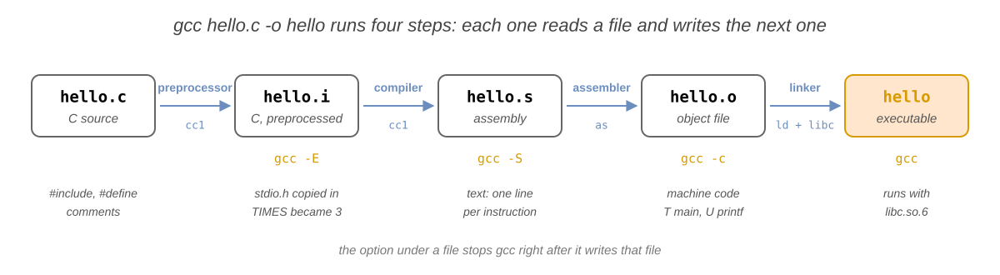
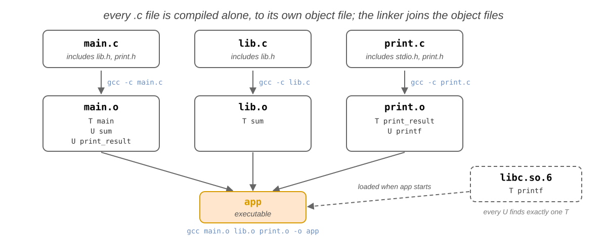
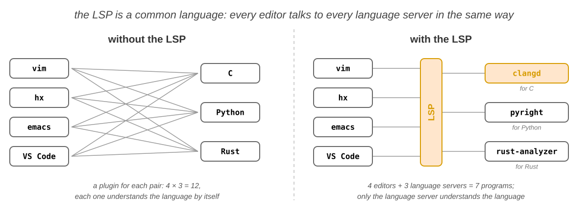
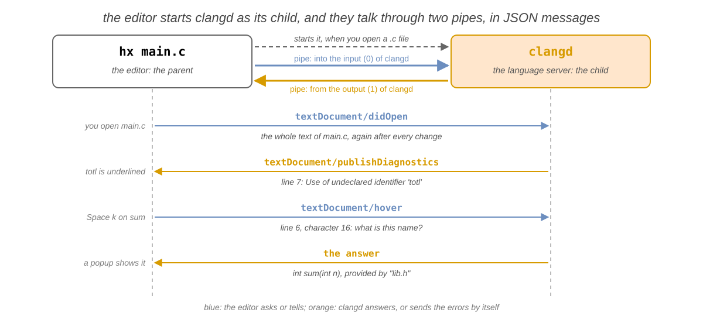
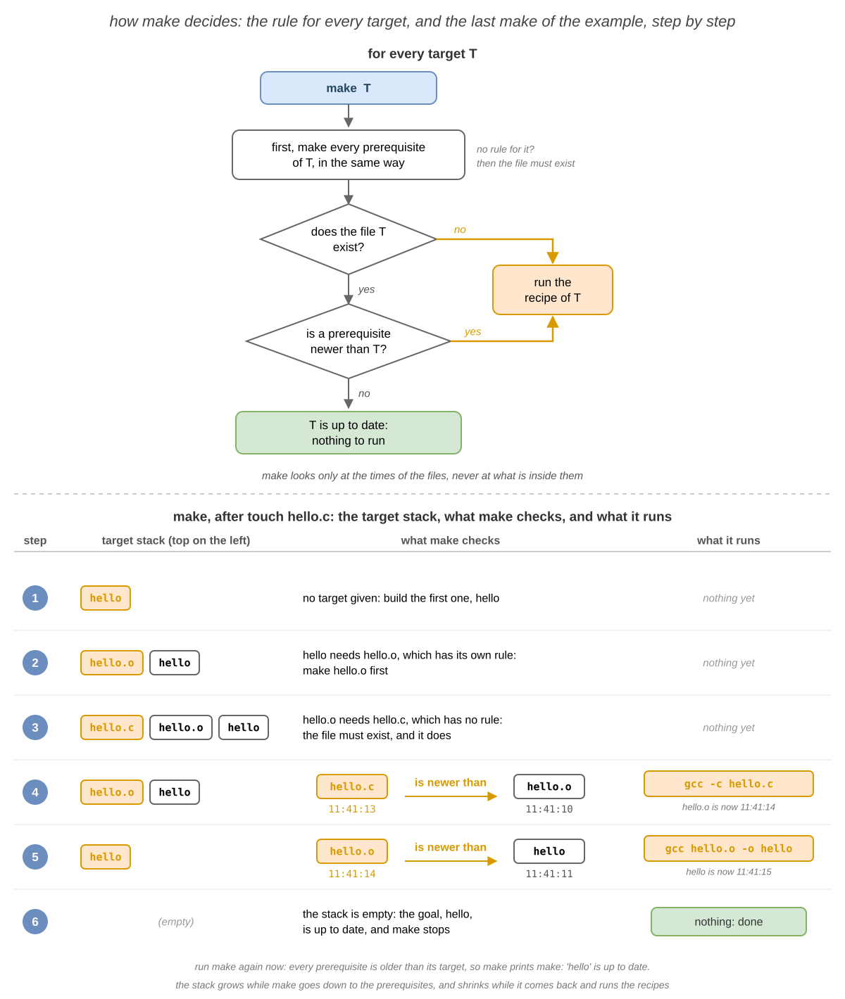
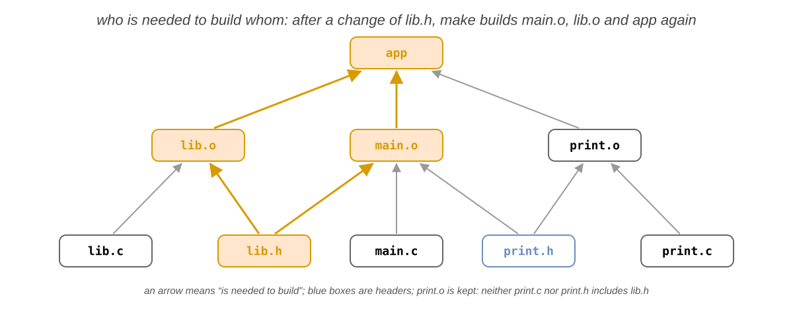
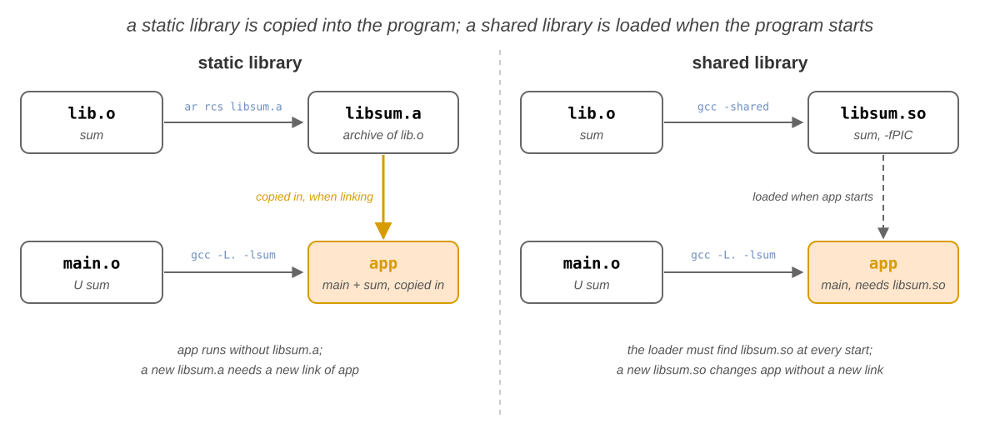

import Tabs from '@theme/Tabs';
import TabItem from '@theme/TabItem';

# 07. Dezvoltarea aplicațiilor

În laboratorul 6 ați procesat text cu filtre și ați editat fișiere text cu `vim` și `nano`. La cursul de programare
scrieți programe în **C**, iar IDE-ul le construiește și le rulează când apăsați un buton. În acest laborator le
construiți singuri, în terminal, și vedeți ce se întâmplă în spatele acelui buton. Vedeți prin ce diferă un limbaj
**compilat** de unul **interpretat**, compilați cu `gcc` și urmăriți cei patru pași ai **lanțului de compilare**:
**preprocesorul**, **compilatorul**, **asamblorul** și **linker-ul**. Împărțiți un program în **module**, citiți
**erorile de compilare** ale fiecărui pas și pregătiți un editor care arată aceste erori în timp ce scrieți, prin
**language server**-ul `clangd`. Apoi îl lăsați pe `make` să construiască programul în locul vostru, pornind de la un
**`Makefile`**: reguli, variabile automate, reguli cu șablon, **ținte false** (_phony targets_) și **dependențe de
antete**. La final, opriți un program care rulează cu depanatorul `gdb` și salvați versiunile proiectului cu `git`.

Ideea cea mai importantă a laboratorului este că a construi un program înseamnă un **lanț de fișiere**: fiecare fișier
pe care îl construiți (un fișier obiect, executabilul) se obține din alte fișiere (sursele, antetele, alte fișiere
obiect) printr-o **singură** comandă. Un `Makefile` scrie acest lanț sub formă de **reguli**, iar `make` compară
**momentele ultimei modificări** ale fișierelor: rulează o comandă doar atunci când rezultatul ei lipsește sau este mai
vechi decât unul dintre fișierele din care se obține.

## Obiective {/* #objectives */}

- Să înțelegeți diferența dintre un limbaj **compilat**, unul **interpretat** și unul cu **bytecode**
- Să compilați și să rulați un program C în terminal cu `gcc`, fără IDE, și să activați avertismentele cu `-Wall`
- Să urmăriți cei patru pași ai **lanțului de compilare** și să vă opriți după fiecare dintre ei cu `gcc -E`, `-S` și
  `-c`
- Să vă uitați în fișierele fiecărui pas cu `file`, `nm` și `ldd`
- Să împărțiți un program în **module** (un fișier `.h` și unul `.c`), să compilați fiecare fișier `.c` într-un
  **fișier obiect** și să legați fișierele obiect într-un executabil
- Să citiți o **eroare de compilare**, să aflați ce pas a raportat-o și să o reparați
- Să înțelegeți ce este un **language server** și cum vorbește editorul cu el și să folosiți `clangd` dintr-un
  editor: erori, informații, completare și mers la definiție
- Să scrieți un `Makefile` cu **reguli** și să înțelegeți cum decide `make` ce construiește, după momentele modificării
- Să scurtați un `Makefile` cu **variabile automate** (`$@`, `$<`, `$^`), **reguli cu șablon** și variabile (`CC`,
  `CFLAGS`)
- Să adăugați **țintele false** `all`, `run` și `clean` și să le declarați cu `.PHONY`
- Să scrieți **dependențele de antete** în regulile potrivite
- Să construiți un program cu informații de depanare (`-g`), să îl opriți cu `gdb` și să vă uitați la variabilele lui
- Să salvați versiunile unui proiect cu `git init`, `git add`, `git commit`, `git status`, `git diff` și `git log`

## Resurse {/* #resources */}

1. _[Razvan Deaconescu, Razvan Rughinis, Mihai Carabas, Alexandru Radovici, Utilizarea Sistemelor de
   Operare, Printech 2021](https://github.com/systems-cs-pub-ro/carte-uso/releases/download/uso-ed1-2021/uso.pdf)_
   - Capitolul 6 - _Dezvoltarea aplicațiilor_, secțiunile 6.2 - 6.5, 6.6.7, 6.7.1 și 6.8
2. _Brian Ward, How LINUX Works, 3rd Edition, No Starch Press, 2021_
   - Capitolul 15 - _Development Tools_, secțiunile 15.1 și 15.2
3. _[GNU Make Manual](https://www.gnu.org/software/make/manual/make.html)_, capitolul 2 - _An Introduction to
   Makefiles_, secțiunea 4.6 - _Phony Targets_ și secțiunea 10.5 - _Defining and Redefining Pattern Rules_;
   _[Pro Git](https://git-scm.com/book/en/v2)_, capitolele 1 - 3 și capitolul 6 - _GitHub_;
   _[clangd](https://clangd.llvm.org)_, _Getting started_;
   _[Language Server Protocol](https://microsoft.github.io/language-server-protocol/)_, _Overview_
4. Slide-urile cursului: [07. Dezvoltarea aplicațiilor](/docs/lectures/07)
5. Paginile de manual: `man gcc`, `man make`, `man file`, `man nm`, `man objdump`, `man ldd`, `man ar`, `man strip`,
   `man ld.so`, `man gdb`, `man git`, `man git-commit`, `man git-diff`, `man git-log`, `man git-restore`,
   `man gitignore`, `man git-push`, `man git-pull`, `man git-clone`, `man ssh-keygen`, `man bear` și `clangd --help`

## Fedora și Ubuntu {/* #fedora-and-ubuntu */}

Calculatoarele din laborator rulează **Fedora** cu **Sway**, iar exemplele de aici provin de pe ele. Acasă puteți folosi
și **Ubuntu**: comenzile sunt aceleași, cu câteva diferențe:

|                                                           | Fedora                                                | Ubuntu                                            |
| --------------------------------------------------------- | ----------------------------------------------------- | ------------------------------------------------- |
| promptul                                                  | `[student@fedora ~]$`                                 | `student@ubuntu:~$`                               |
| instalarea uneltelor din acest laborator                  | `sudo dnf install gcc make gdb git clang-tools-extra` | `sudo apt install build-essential gdb git clangd` |
| o funcție apelată fără declarație                         | o **eroare** (GCC 14 și mai nou)                      | Ubuntu 24.04 are GCC 13: doar un **avertisment**  |
| biblioteca C, în ieșirea lui `ldd`                        | `/lib64/libc.so.6`                                    | `/lib/x86_64-linux-gnu/libc.so.6`                 |
| directorul lui `cc1`, un program pe care îl rulează `gcc` | `/usr/libexec/gcc/x86_64-redhat-linux/<VERSION>/`     | `/usr/lib/gcc/x86_64-linux-gnu/<VERSION>/`        |
| `gcc -static` (în [Biblioteci](#libraries))               | are nevoie de `sudo dnf install glibc-static`         | merge                                             |

`gcc --version` afișează versiunea lui `gcc`. Exemplele sunt pentru un PC (x86-64); pe un calculator cu procesor ARM,
cum este un Mac cu Apple silicon, codul în limbaj de asamblare și adresele arată altfel.

## Compilarea {/* #compiling */}

### Limbaje compilate și interpretate {/* #compiled-and-interpreted-languages */}

Procesorul rulează doar **cod mașină**: instrucțiuni scrise ca octeți, diferite pentru fiecare familie de procesoare
(x86-64, ARM64, RISC-V). Oamenii scriu **cod sursă**: text, într-un limbaj de programare. Cineva trebuie să traducă
codul sursă în cod mașină, iar limbajele diferă prin **cine** face asta și **când**:

| Tip             | Cine traduce codul sursă                                                                                  | Exemple                      |
| --------------- | --------------------------------------------------------------------------------------------------------- | ---------------------------- |
| **compilat**    | un **compilator**, **o singură dată**, înainte ca programul să ruleze: rezultatul este un executabil      | C, C++, Rust, Go             |
| **interpretat** | un **interpretor**, un program care citește sursa și face ce scrie în ea, **de fiecare** dată             | `bash`, `sh`                 |
| **bytecode**    | un compilator, în **bytecode** (cod mașină pentru un procesor imaginar); o **mașină virtuală** îl rulează | Java, C#, Python, JavaScript |

Gândiți-vă la o carte într-o limbă străină: un program compilat este o traducere tipărită, făcută o dată și citită de
multe ori; un program interpretat este citit cu un traducător lângă voi, care traduce fiecare propoziție în timp ce
citiți.

```shell-session
[student@fedora lab07]$ ./hello.sh
Hello from bash!
[student@fedora lab07]$ file hello.sh /usr/bin/bash
hello.sh:      Bourne-Again shell script, ASCII text executable
/usr/bin/bash: ELF 64-bit LSB pie executable, x86-64, ...
```

- `hello.sh` este text: interpretorul, `bash`, îl citește linie cu linie. `bash` însuși este cod mașină, un fișier
  **ELF** (_Executable and Linkable Format_, formatul programelor pe Linux), scris în C și compilat.

| Compilat                                                 | Interpretat                                    |
| -------------------------------------------------------- | ---------------------------------------------- |
| rapid: procesorul rulează programul direct               | mai lent: sursa este tradusă la fiecare rulare |
| multe erori se găsesc **înainte** ca programul să ruleze | o eroare se găsește doar când rulează linia ei |
| compilați din nou după **fiecare** schimbare             | schimbați fișierul și îl rulați                |
| câte un executabil pentru fiecare procesor și sistem     | rulează oriunde rulează interpretorul          |

:::info

Un limbaj nu este compilat sau interpretat: **programul care îl rulează** este. `python3` compilează un script în
bytecode de fiecare dată când pornește, apoi mașina lui virtuală rulează bytecode-ul; doar modulele pe care le
importă scriptul rămân compilate, în `__pycache__`. Mașinile virtuale ale lui Java și JavaScript compilează în cod
mașină și codul care rulează des, în timp ce rulează: _just in time_ (JIT).

:::

### Compilarea unui program C: `gcc` {/* #compiling-a-c-program-gcc */}

`gcc` (_GNU Compiler Collection_) este compilatorul de C al Linux-ului și, de multe ori, cel care rulează în spatele
butonului **Build** al IDE-ului vostru. Exemplele folosesc `hello.c`, pe care îl
creează [exercițiul 1](#first-steps) în `~/lab07`:

```c title="~/lab07/hello.c"
#include <stdio.h>

#define TIMES 3

int main(void)
{
    // say hello a few times
    for (int i = 0; i < TIMES; i++) {
        printf("Hello, %d!\n", i);
    }
    return 0;
}
```

```shell-session
[student@fedora lab07]$ gcc hello.c -o hello
[student@fedora lab07]$ ./hello
Hello, 0!
Hello, 1!
Hello, 2!
```

- `gcc hello.c -o hello` a compilat `hello.c` în executabilul `hello`; nu a afișat nimic, pentru că nu a mers nimic
  prost. Programul pornește cu `./`: directorul curent nu este în `PATH` (vedeți
  [Căutarea în `PATH`](/docs/labs/04#the-path-search) în laboratorul 4).

| Opțiune          | Ce face                                                                                     |
| ---------------- | ------------------------------------------------------------------------------------------- |
| `-o <FILE>`      | numele fișierului de ieșire; fără ea, executabilul este `a.out`                             |
| `-Wall`          | activează **avertismentele** despre cod care este corect, dar probabil greșit               |
| `-g`             | adaugă **informațiile de depanare**, pentru `gdb` (vedeți [Depanarea](#debugging-gdb))      |
| `-c`, `-S`, `-E` | se opresc după un pas al lanțului (vedeți [Lanțul de compilare](#the-compilation-pipeline)) |
| `-l<NAME>`       | leagă biblioteca `<NAME>`: `-lm` pentru funcțiile matematice, ca `sqrt`                     |
| `-I <DIR>`       | caută fișierele antet și în `<DIR>`                                                         |

:::info

**În spatele butonului din IDE**

Butonul **Build** al unui IDE (Code::Blocks, Visual Studio Code, CLion) rulează `gcc` cu opțiuni ca acestea, iar
**Run** pornește executabilul; jurnalul de compilare al IDE-ului arată comenzile exacte. În terminal, niciun buton nu
construiește programul înainte să ruleze: după ce editați un fișier `.c`, rulați voi `gcc` (sau `make`).

:::

Scrieți fișierele C cu un editor de text din [Editoare de text](/docs/labs/06#text-editors), din laboratorul 6;
după [Erori de compilare](#build-errors), veți pregăti unul care înțelege C-ul.

### Lanțul de compilare {/* #the-compilation-pipeline */}

`gcc hello.c -o hello` pare un singur pas, dar sunt **patru**. Fiecare pas citește fișierul pasului dinainte și scrie un
fișier nou. O opțiune îl oprește pe `gcc` după un pas, ca să vă puteți uita la acel fișier:



| Pas             | Ce face                                                                            | Oprire după el              | Scrie                    |
| --------------- | ---------------------------------------------------------------------------------- | --------------------------- | ------------------------ |
| **preprocesor** | copiază fișierele din `#include`, înlocuiește `#define`-urile, șterge comentariile | `gcc -E hello.c -o hello.i` | `hello.i`, C             |
| **compilator**  | traduce C în **limbaj de asamblare**, forma text a codului mașină                  | `gcc -S hello.c`            | `hello.s`, asamblare     |
| **asamblor**    | traduce limbajul de asamblare în cod mașină: un **fișier obiect**                  | `gcc -c hello.c`            | `hello.o`, fișier obiect |
| **linker**      | leagă fișierele obiect și bibliotecile într-un executabil                          | `gcc hello.o -o hello`      | `hello`, executabil      |

Gândiți-vă la o fabrică de mașini: primul post adună piesele (preprocesorul), următoarele le dau formă (compilatorul
și asamblorul), iar ultimul asamblează mașina (linker-ul).

#### Preprocesorul: `gcc -E` {/* #the-preprocessor-gcc--e */}

Liniile care încep cu `#` sunt pentru **preprocesor**. El schimbă textul înainte să îl vadă compilatorul, puțin
ca `sed`, și nu verifică dacă rezultatul este C corect.

```shell-session
[student@fedora lab07]$ gcc -E hello.c -o hello.i
[student@fedora lab07]$ wc -l hello.c hello.i
   12 hello.c
  825 hello.i
  837 total
[student@fedora lab07]$ grep 'int printf' hello.i
extern int printf (const char *__restrict __format, ...);
[student@fedora lab07]$ tail -n 8 hello.i
int main(void)
{

    for (int i = 0; i < 3; i++) {
        printf("Hello, %d!\n", i);
    }
    return 0;
}
```

- `#include <stdio.h>` a copiat tot fișierul `/usr/include/stdio.h` (și fișierele pe care le include el) în `hello.i`:
  sute de linii, printre ele **declarația** lui `printf`. Numărul de linii depinde de versiunea bibliotecii C.
- `#define TIMES 3` a înlocuit `TIMES` cu `3`, iar comentariul a dispărut.

`#include <stdio.h>`, cu paranteze unghiulare, caută doar în directoarele sistemului, ca `/usr/include`;
`#include "lib.h"`, cu ghilimele, caută întâi în directorul fișierului `.c`.

#### Compilatorul: `gcc -S` {/* #the-compiler-gcc--s */}

**Compilatorul** traduce C în **limbaj de asamblare**: o linie pentru fiecare instrucțiune a procesorului, tot un fișier
text.

```shell-session
[student@fedora lab07]$ gcc -S hello.c
[student@fedora lab07]$ grep -E 'call|cmpl|jle' hello.s
	call	printf@PLT
	cmpl	$2, -4(%rbp)
	jle	.L3
```

- Bucla a devenit o comparație (`cmpl`, este `i` cel mult `2`?) și un salt înapoi (`jle`, _jump if less or equal_).
- `printf` este doar **apelată**: codul ei nu este în `hello.s`.

#### Asamblorul: `gcc -c` {/* #the-assembler-gcc--c */}

**Asamblorul** traduce limbajul de asamblare în cod mașină. Rezultatul este un **fișier obiect**: cod mașină care încă
nu rulează, pentru că mai are goluri, funcțiile pe care le folosește, dar nu le definește.

```shell-session
[student@fedora lab07]$ gcc -c hello.c
[student@fedora lab07]$ file hello.o
hello.o: ELF 64-bit LSB relocatable, x86-64, version 1 (SYSV), not stripped
[student@fedora lab07]$ nm hello.o
0000000000000000 T main
                 U printf
```

- `nm` a listat numele (**simbolurile**) din `hello.o`: `T` înseamnă **definit** aici (în _text_, adică în cod), `U`
  înseamnă **folosit** aici, dar **nedefinit**.
- `objdump -d hello.o` arată codul mașină, ca octeți, lângă limbajul de asamblare.

#### Linker-ul {/* #the-linker */}

**Linker-ul** (`ld`, pe care îl rulează `gcc` pentru voi) leagă fișierele obiect într-un executabil și umple golurile:
pentru fiecare simbol `U` trebuie să găsească **exact un** `T`, într-un fișier obiect sau într-o bibliotecă. `printf`
este în **biblioteca C**, fișierul `libc.so.6`, pe care linker-ul îl folosește pentru fiecare program.

```shell-session
[student@fedora lab07]$ gcc hello.o -o hello
[student@fedora lab07]$ file hello
hello: ELF 64-bit LSB pie executable, x86-64, ..., dynamically linked, ...
[student@fedora lab07]$ ldd hello
	linux-vdso.so.1 (0x00007ffc8d5f2000)
	libc.so.6 => /lib64/libc.so.6 (0x00007f2b6a200000)
	/lib64/ld-linux-x86-64.so.2 (0x00007f2b6a4b1000)
```

- `gcc` a văzut un fișier obiect, nu un fișier `.c`, așa că a rulat doar linker-ul.
- `ldd` a listat bibliotecile de care are nevoie `hello` când pornește: `printf` **nu** este copiată în `hello`, ea
  rămâne în `libc.so.6`, pe care sistemul o încarcă de fiecare dată când pornește `hello`. Numerele din paranteze se
  schimbă la fiecare rulare.

Cu `gcc -static`, linker-ul **copiază** `printf` și tot ce îi trebuie din biblioteca C în executabil: programul nu
mai are nevoie de `libc.so.6`, dar este mult mai mare. Pe Fedora, `-static` are nevoie de pachetul `glibc-static`.
Exercițiile de acasă și provocările își construiesc propriile biblioteci: detaliile sunt în [Biblioteci](#libraries).

:::tip

`gcc -save-temps hello.c -o hello` rulează cei patru pași și **păstrează** fișierele fiecărui pas: `hello.i`, `hello.s`
și `hello.o`.

:::

### Mai multe fișiere sursă {/* #several-source-files */}

Un program real are multe fișiere sursă. Fiecare parte a programului, un **modul**, este o pereche de fișiere:

| Fișier                        | Ce conține                                   | Exemplu                  |
| ----------------------------- | -------------------------------------------- | ------------------------ |
| `.h`, un **antet** (_header_) | **declarațiile**: ce oferă modulul, fără cod | `int sum(int n);`        |
| `.c`                          | **definițiile**: codul funcțiilor            | `int sum(int n) { ... }` |

Fiecare fișier `.c` care folosește un modul include antetul lui, ca să știe compilatorul numele și tipurile funcțiilor
pe care le apelează. Exemplele folosesc fișierele din `~/lab07/project`, un program care adună numerele de la 1 la
`MAX`:

```
project/
├── main.c      # includes lib.h and print.h; main() calls sum() and print_result()
├── lib.h       # #define MAX 10, declares sum()
├── lib.c       # includes lib.h, defines sum()
├── print.h     # declares print_result()
└── print.c     # includes <stdio.h> and print.h, defines print_result() with printf()
```

```c title="~/lab07/project/lib.h"
#ifndef LIB_H
#define LIB_H
#define MAX 10
int sum(int n);
#endif
```

- `#ifndef`, `#define` și `#endif` formează **garda de includere** (_include guard_): dacă un fișier `.c` include
  `lib.h` de două ori, a doua copie este sărită.

Fiecare fișier `.c` este compilat **singur**, în propriul fișier obiect, iar linker-ul leagă fișierele obiect:



```shell-session
[student@fedora project]$ gcc -c main.c
[student@fedora project]$ gcc -c lib.c
[student@fedora project]$ gcc -c print.c
[student@fedora project]$ gcc main.o lib.o print.o -o app
[student@fedora project]$ ./app
sum = 55
```

- În `main.o`, `sum` și `print_result` sunt `U`; linker-ul le-a găsit în `lib.o` și în `print.o`.

După o schimbare în `print.c`, doar `print.o` este depășit: `gcc -c print.c`, apoi legarea, și programul este gata.
`gcc main.c lib.c print.c -o app` dă același program, dar compilează **toate** fișierele de fiecare dată; nucleul Linux
are peste 30 000 de fișiere `.c`.

### Erori de compilare {/* #build-errors */}

Acestea sunt mesajele pe care le arată jurnalul de compilare al IDE-ului. **Cine** raportează eroarea vă spune ce este
greșit:

| Mesajul                                         | Raportat de | Cauza și soluția                                                                 |
| ----------------------------------------------- | ----------- | -------------------------------------------------------------------------------- |
| `fatal error: lib.h: No such file or directory` | preprocesor | un nume greșit în `#include`, sau antetul este în alt director: `-I <DIR>`       |
| `error: implicit declaration of function ‘sum’` | compilator  | funcția este apelată înainte să fie declarată: includeți antetul ei              |
| `error: expected ‘;’ before ‘}’ token`          | compilator  | o eroare de sintaxă, pe linia pe care o numește sau pe cea dinainte              |
| ``undefined reference to `sum'``                | linker      | niciun fișier obiect nu definește `sum`: adăugați fișierul `.o` care o definește |
| ``undefined reference to `sqrt'``               | linker      | funcția este într-o bibliotecă: adăugați `-lm` la sfârșitul comenzii             |

```shell-session
[student@fedora lab07]$ gcc roots.c -o roots
/usr/bin/ld: /tmp/ccx5idIu.o: in function `main':
roots.c:(.text+0x1c): undefined reference to `sqrt'
collect2: error: ld returned 1 exit status
[student@fedora lab07]$ gcc roots.c -o roots -lm
[student@fedora lab07]$ ./roots
sqrt(1) = 1.000
sqrt(2) = 1.414
sqrt(3) = 1.732
sqrt(4) = 2.000
```

- `/usr/bin/ld` și `collect2` înseamnă că a eșuat **linker-ul**: compilarea a mers, dar nimeni nu definește `sqrt`. Ea
  este în biblioteca matematică, `libm`, pe care o adaugă `-lm`.
- Erorile preprocesorului și ale compilatorului încep cu `<FILE>:<LINE>:<COLUMN>:`, locul problemei.

Un **avertisment** nu oprește construirea, dar arată des un bug. Compilați mereu cu `-Wall` și reparați fiecare
avertisment.

## Un editor cu un language server {/* #an-editor-with-a-language-server */}

În IDE-ul de la cursul de programare, codul este colorat, numele sunt completate și erorile sunt marcate în timp ce
scrieți. În terminal, fac asta împreună două programe: un **editor** și un **language server**, un program care
înțelege **un singur** limbaj. Pentru C, language server-ul este **`clangd`**.

**LSP** (_Language Server Protocol_) este limba comună dintre ele: orice editor care vorbește LSP poate folosi orice
language server. Fără el, fiecare editor are nevoie de propriul plugin pentru fiecare limbaj.



Gândiți-vă la un coleg care se uită peste umărul vostru în timp ce scrieți: editorul este caietul vostru, iar
language server-ul este colegul, care citește fiecare linie și vă răspunde la întrebări despre ea.

### Cum funcționează un language server {/* #how-a-language-server-works */}

Când deschideți un fișier C, editorul pornește `clangd` ca **proces copil** (laboratorul 3) și vorbește cu el prin
două **pipe-uri** (laboratorul 6), în mesaje JSON scurte. Editorul trimite textul după fiecare schimbare și pune
întrebări; `clangd` le răspunde și trimite singur erorile.



`clangd` verifică codul **în timp ce scrieți**, ca un compilator, dar nu construiește nimic.

### Alegerea unui editor {/* #choosing-an-editor */}

Instalați `clangd` (Fedora: `sudo dnf install clang-tools-extra`; Ubuntu: `sudo apt install clangd`) și **unul**
dintre aceste editoare:

| Editor                  | Unde rulează | De ce are nevoie ca să folosească `clangd`          |
| ----------------------- | ------------ | --------------------------------------------------- |
| `vim`                   | terminal     | un plugin, `vim-lsp`, și câteva linii în `~/.vimrc` |
| `nvim` 0.11 sau mai nou | terminal     | câteva linii în `~/.config/nvim/init.lua`           |
| `hx` (Helix)            | terminal     | de nimic                                            |
| `emacs` 29 sau mai nou  | amândouă     | o linie în `~/.emacs.d/init.el`                     |
| `code` (VS Code)        | fereastră    | extensia `clangd`                                   |
| `zed` (Zed)             | fereastră    | de nimic                                            |

:::tip

**`nvim`, nu `vim`**

Dacă vă plac tastele lui `vim` (vedeți [Editoare de text](/docs/labs/06#text-editors) în laboratorul 6), folosiți
`nvim`: are aceleași taste și un client LSP integrat, deci se configurează în câteva linii. `vim` are nevoie de un
plugin și de vreo 20 de linii de Vimscript. Celelalte editoare aproape că nu au nevoie de configurare.

:::

Instalați, configurați și verificați editorul vostru:

<Tabs groupId="editor">
<TabItem value="vim" label="vim">

:::caution

**Aceasta este cea mai grea configurare**

`vim` nu are un client LSP propriu, iar fiecare funcție nouă cere și mai mult Vimscript: folosiți `nvim` în loc,
cu aceleași taste (vedeți sfatul de mai sus).

:::

Instalați `vim` (Fedora: `sudo dnf install vim-enhanced`; Ubuntu: `sudo apt install vim`) și pluginul `vim-lsp`, în
directorul din care `vim` își încarcă singur pluginurile:

```bash
git clone https://github.com/prabirshrestha/vim-lsp ~/.vim/pack/lsp/start/vim-lsp
```

Apoi adăugați aceste linii în `~/.vimrc`: pornesc `clangd` pentru fișierele C și dau tastele din tabelul de mai jos.

```vim title="~/.vimrc"
let g:lsp_diagnostics_virtual_text_enabled = 1
if executable('clangd')
  au User lsp_setup call lsp#register_server({
        \ 'name': 'clangd',
        \ 'cmd': {server_info->['clangd']},
        \ 'allowlist': ['c', 'cpp'],
        \ })
endif
function! s:on_lsp_buffer_enabled() abort
  setlocal omnifunc=lsp#complete
  nmap <buffer> gd <plug>(lsp-definition)
  nmap <buffer> gr <plug>(lsp-references)
  nmap <buffer> K <plug>(lsp-hover)
  nmap <buffer> <leader>rn <plug>(lsp-rename)
  nmap <buffer> <leader>ca <plug>(lsp-code-action)
  nmap <buffer> ]d <plug>(lsp-next-diagnostic)
endfunction
augroup lsp_install
  au!
  autocmd User lsp_buffer_enabled call s:on_lsp_buffer_enabled()
augroup END
```

Verificare: deschideți un fișier `.c` și rulați `:LspStatus`; arată `clangd: running`.

| Ce vreți                       | Taste                                                                      |
| ------------------------------ | -------------------------------------------------------------------------- |
| vedeți erorile                 | la sfârșitul liniei; <kbd>]</kbd> <kbd>d</kbd> merge la următoarea         |
| despre numele de sub cursor    | <kbd>K</kbd>                                                               |
| completați un nume             | în modul Insert, <kbd>Ctrl</kbd>+<kbd>X</kbd> <kbd>Ctrl</kbd>+<kbd>O</kbd> |
| mergeți la definiție și înapoi | <kbd>g</kbd> <kbd>d</kbd>, <kbd>Ctrl</kbd>+<kbd>O</kbd>                    |
| listați folosirile unui nume   | <kbd>g</kbd> <kbd>r</kbd>                                                  |
| redenumiți un nume, peste tot  | <kbd>\\</kbd> <kbd>r</kbd> <kbd>n</kbd>                                    |
| aplicați reparația sugerată    | <kbd>\\</kbd> <kbd>c</kbd> <kbd>a</kbd>                                    |

</TabItem>
<TabItem value="nvim" label="nvim">

Instalați Neovim (Fedora: `sudo dnf install neovim`). Are nevoie de versiunea 0.11 sau mai nouă (`nvim --version`);
Ubuntu 24.04 are una mai veche: folosiți acolo Helix sau Zed. Apoi adăugați aceste linii în `~/.config/nvim/init.lua`:

```lua title="~/.config/nvim/init.lua"
vim.lsp.config('clangd', {
  cmd = { 'clangd' },
  filetypes = { 'c', 'cpp' },
  root_markers = { 'Makefile', '.git' },
})
vim.lsp.enable('clangd')
vim.diagnostic.config({ virtual_text = true })
```

Verificare: deschideți un fișier `.c` și rulați `:checkhealth vim.lsp`; îl listează pe `clangd` printre clienții activi.

**Configurații gata făcute**: în loc să scrieți singuri `init.lua`, puteți porni de la o configurație care are deja
`clangd`, completare și un explorator de fișiere; mutați întâi deoparte `~/.config/nvim`. Au nevoie de un Neovim
recent și de `git`:

- [kickstart.nvim](https://github.com/nvim-lua/kickstart.nvim): un singur fișier scurt, cu un comentariu pe fiecare
  linie; cel mai bun început dacă vreți să vă înțelegeți configurația;
- [LazyVim](https://www.lazyvim.org), [NvChad](https://nvchad.com) și [AstroNvim](https://astronvim.com): configurații
  complete, gata de folosit.

**Documentație**: `:help lsp` în Neovim ([online](https://neovim.io/doc/user/lsp/)) și
[nvim-lspconfig](https://github.com/neovim/nvim-lspconfig), setările multor language servere, gata de folosit.

| Ce vreți                       | Taste                                                                      |
| ------------------------------ | -------------------------------------------------------------------------- |
| vedeți erorile                 | la sfârșitul liniei; <kbd>]</kbd> <kbd>d</kbd> merge la următoarea         |
| despre numele de sub cursor    | <kbd>K</kbd>                                                               |
| completați un nume             | în modul Insert, <kbd>Ctrl</kbd>+<kbd>X</kbd> <kbd>Ctrl</kbd>+<kbd>O</kbd> |
| mergeți la definiție și înapoi | <kbd>Ctrl</kbd>+<kbd>]</kbd>, <kbd>Ctrl</kbd>+<kbd>T</kbd>                 |
| listați folosirile unui nume   | <kbd>g</kbd> <kbd>r</kbd> <kbd>r</kbd>                                     |
| redenumiți un nume, peste tot  | <kbd>g</kbd> <kbd>r</kbd> <kbd>n</kbd>                                     |
| aplicați reparația sugerată    | <kbd>g</kbd> <kbd>r</kbd> <kbd>a</kbd>                                     |

</TabItem>
<TabItem value="hx" label="hx">

Instalați Helix (Fedora: `sudo dnf install helix`; Ubuntu: `sudo snap install --classic helix`). Nu are nevoie de
nicio setare: pornește singur `clangd` pentru fiecare fișier `.c`.

```shell-session
[student@fedora project]$ hx --health c
...
Configured language servers:
  ✓ clangd: /usr/bin/clangd
...
```

- Helix a găsit `clangd` în `PATH`. Un `✘` acolo înseamnă că `clangd` nu este instalat.

| Ce vreți                       | Taste                                                          |
| ------------------------------ | -------------------------------------------------------------- |
| vedeți erorile                 | marcate în stânga; <kbd>Space</kbd> <kbd>d</kbd> le listează   |
| despre numele de sub cursor    | <kbd>Space</kbd> <kbd>k</kbd>                                  |
| completați un nume             | apare în timp ce scrieți                                       |
| mergeți la definiție și înapoi | <kbd>g</kbd> <kbd>d</kbd>, <kbd>Ctrl</kbd>+<kbd>O</kbd>        |
| listați folosirile unui nume   | <kbd>g</kbd> <kbd>r</kbd>                                      |
| redenumiți un nume, peste tot  | <kbd>Space</kbd> <kbd>r</kbd>                                  |
| aplicați reparația sugerată    | <kbd>Space</kbd> <kbd>a</kbd>                                  |

</TabItem>
<TabItem value="emacs" label="emacs">

Instalați Emacs (Fedora: `sudo dnf install emacs`; Ubuntu: `sudo apt install emacs`). De la versiunea 29 are integrat
un client LSP, **Eglot**, care îl cunoaște deja pe `clangd`. Această linie din `~/.emacs.d/init.el` îl pornește
pentru fiecare fișier C:

```lisp title="~/.emacs.d/init.el"
(add-hook 'c-mode-hook 'eglot-ensure)
```

Verificare: deschideți un fișier `.c` (`emacs -nw main.c` rămâne în terminal); linia de mod, jos, arată `eglot`.

| Ce vreți                       | Taste                                                                                 |
| ------------------------------ | ------------------------------------------------------------------------------------- |
| vedeți erorile                 | subliniate; <kbd>Alt</kbd>+<kbd>X</kbd> `flymake-show-buffer-diagnostics` le listează |
| despre numele de sub cursor    | apare jos, singur                                                                     |
| completați un nume             | <kbd>Ctrl</kbd>+<kbd>Alt</kbd>+<kbd>I</kbd>                                           |
| mergeți la definiție și înapoi | <kbd>Alt</kbd>+<kbd>.</kbd>, <kbd>Alt</kbd>+<kbd>,</kbd>                              |
| listați folosirile unui nume   | <kbd>Alt</kbd>+<kbd>?</kbd>                                                           |
| redenumiți un nume, peste tot  | <kbd>Alt</kbd>+<kbd>X</kbd> `eglot-rename`                                            |
| aplicați reparația sugerată    | <kbd>Alt</kbd>+<kbd>X</kbd> `eglot-code-actions`                                      |

</TabItem>
<TabItem value="vscode" label="VS Code">

Descărcați pachetul `.rpm` (Fedora) sau `.deb` (Ubuntu) de pe [code.visualstudio.com](https://code.visualstudio.com),
instalați-l cu `sudo dnf install ./code-*.rpm` (Ubuntu: `sudo apt install ./code_*.deb`) și adăugați extensia
`clangd`, din proiectul LLVM, din bara **Extensions**:

1. apăsați <kbd>Ctrl</kbd>+<kbd>Shift</kbd>+<kbd>X</kbd> sau dați click pe iconița cu patru pătrate, din bara din
   stânga;
2. scrieți `clangd` în căsuța de căutare de sus;
3. alegeți **clangd**, publicată de **LLVM**, și apăsați **Install**.

La fel, din terminal:

```bash
code --install-extension llvm-vs-code-extensions.vscode-clangd
```

Dacă este instalată și extensia `C/C++` a Microsoft, extensia `clangd` cere să îi opriți IntelliSense: acceptați,
ca să verifice codul doar `clangd`. VSCodium, același editor fără părțile Microsoft, merge la fel.

Verificare: deschideți directorul proiectului (`code ~/lab07/project`), apoi un fișier `.c`; bara de stare, jos,
arată `clangd`.

| Ce vreți                       | Taste                                                                                      |
| ------------------------------ | ------------------------------------------------------------------------------------------ |
| vedeți erorile                 | subliniere roșie; <kbd>Ctrl</kbd>+<kbd>Shift</kbd>+<kbd>M</kbd> le listează                |
| despre numele de sub cursor    | țineți mouse-ul deasupra lui sau <kbd>Ctrl</kbd>+<kbd>K</kbd> <kbd>Ctrl</kbd>+<kbd>I</kbd> |
| completați un nume             | apare în timp ce scrieți; <kbd>Ctrl</kbd>+<kbd>Space</kbd>                                 |
| mergeți la definiție și înapoi | <kbd>F12</kbd>, <kbd>Ctrl</kbd>+<kbd>Alt</kbd>+<kbd>-</kbd>                                |
| listați folosirile unui nume   | <kbd>Shift</kbd>+<kbd>F12</kbd>                                                            |
| redenumiți un nume, peste tot  | <kbd>F2</kbd>                                                                              |
| aplicați reparația sugerată    | <kbd>Ctrl</kbd>+<kbd>.</kbd>                                                               |

</TabItem>
<TabItem value="zed" label="Zed">

Instalați Zed cu scriptul lui, la fel pe Fedora și pe Ubuntu:

```bash
curl -f https://zed.dev/install.sh | sh
```

Zed merge **imediat după instalare**: nu are nevoie de nicio setare și de nicio extensie și pornește singur `clangd`
pentru fiecare fișier `.c`. Verificare: deschideți directorul proiectului (`zed ~/lab07/project`), apoi un fișier
`.c`, și faceți o greșeală: este subliniată imediat.

| Ce vreți                       | Taste                                                                       |
| ------------------------------ | --------------------------------------------------------------------------- |
| vedeți erorile                 | subliniere roșie; <kbd>Ctrl</kbd>+<kbd>Shift</kbd>+<kbd>M</kbd> le listează |
| despre numele de sub cursor    | țineți mouse-ul deasupra lui                                                |
| completați un nume             | apare în timp ce scrieți                                                    |
| mergeți la definiție și înapoi | <kbd>F12</kbd>, <kbd>Ctrl</kbd>+<kbd>Alt</kbd>+<kbd>-</kbd>                 |
| listați folosirile unui nume   | click dreapta, _Find All References_                                        |
| redenumiți un nume, peste tot  | <kbd>F2</kbd>                                                               |
| aplicați reparația sugerată    | <kbd>Ctrl</kbd>+<kbd>.</kbd>                                                |

</TabItem>
</Tabs>

Când proiectul are antete în alte directoare, `clangd` are nevoie de opțiunile lui `gcc`: ele sunt în
[Ce trebuie să știe `clangd`](#what-clangd-needs-to-know), după `Makefile`.

## Fișierul `Makefile` {/* #the-makefile */}

După fiecare schimbare trebuie să țineți minte ce comenzi rulați din nou și în ce ordine. `make` face asta pentru voi.
Citește un fișier numit `Makefile`, din directorul curent, care spune, pentru fiecare fișier de construit, din ce se
obține și ce comenzi îl obțin. Apoi `make` rulează **doar** comenzile care sunt necesare.

Gândiți-vă la o carte de rețete în care fiecare rețetă își listează ingredientele: ca să faceți un tort, faceți întâi
crema de care are nevoie, dar doar dacă nu aveți deja cremă proaspătă în frigider.

### O regulă {/* #a-rule */}

Un `Makefile` este o listă de **reguli**:

```makefile
target: prerequisites
	command 1
	command 2
```

| Parte                              | Ce este                                                                                |
| ---------------------------------- | -------------------------------------------------------------------------------------- |
| **țintă** (_target_)               | fișierul de construit                                                                  |
| **prerechizite** (_prerequisites_) | fișierele din care se obține, separate prin spații                                     |
| **rețetă** (_recipe_)              | comenzile care îl construiesc, câte una pe linie, fiecare linie începând cu un **TAB** |

`Makefile`-ul lui `hello` are două reguli:

```makefile title="~/lab07/Makefile"
hello: hello.o
	gcc hello.o -o hello

hello.o: hello.c
	gcc -c hello.c
```

- `hello` este **legat** din `hello.o`; `hello.o` este **compilat** din `hello.c`. `make` singur construiește **prima**
  țintă, `hello`; `make hello.o` construiește doar `hello.o`.

:::caution

**Un TAB, nu spații**

Fiecare linie a unei rețete începe cu un caracter TAB. Cu spații, `make` se oprește cu
`Makefile:2: *** missing separator.  Stop.` Majoritatea editoarelor păstrează TAB-urile într-un fișier numit
`Makefile`; în `vim`, `:set list` arată un TAB ca `^I`.

:::

### Cum decide `make` {/* #how-make-decides */}

Ca să construiască o țintă, `make`:

1. construiește întâi prerechizitele ei, fiecare cu regula ei, în același fel;
2. rulează rețeta dacă ținta **nu există** sau dacă o prerechizită este **mai nouă** decât ținta;
3. altfel, nu face nimic: ținta este **la zi** (_up to date_).

O prerechizită fără regulă, ca `hello.c`, trebuie să existe. `make` compară doar **momentele modificării** fișierelor
(`ls -l --full-time` le arată, cu fracțiuni de secundă); nu citește niciodată codul.

```shell-session
[student@fedora lab07]$ make
gcc -c hello.c
gcc hello.o -o hello
[student@fedora lab07]$ make
make: 'hello' is up to date.
[student@fedora lab07]$ touch hello.c
[student@fedora lab07]$ make
gcc -c hello.c
gcc hello.o -o hello
```

- Primul `make` a construit ambele fișiere: nu existau. `make` afișează fiecare comandă înainte să o ruleze.
- Al doilea `make` nu a făcut nimic: `hello.c` este mai vechi decât `hello.o`, iar `hello.o` este mai vechi decât
  `hello`.
- `touch` (vedeți [`touch`](/docs/labs/02#touch) în laboratorul 2) a pus momentul modificării lui `hello.c` la acum, ca
  și cum l-ați fi editat: `hello.c` a devenit mai nou decât `hello.o`, așa că `make` l-a compilat din nou, iar apoi
  `hello.o` a fost mai nou decât `hello`.

Desenul arată regula pe care o urmează `make` pentru fiecare țintă, apoi ultimul `make`, pas cu pas: `make` ține o
**stivă** cu țintele la care lucrează. Coboară până la prerechizite, apoi urcă înapoi și rulează rețetele necesare.



| Comandă              | Ce face                                                             |
| -------------------- | ------------------------------------------------------------------- |
| `make`               | construiește prima țintă din `Makefile`                             |
| `make <TARGET>`      | construiește `<TARGET>`                                             |
| `make -n`            | doar **arată** comenzile pe care le-ar rula (_dry run_)             |
| `make -B`            | construiește totul din nou, chiar și ce este la zi                  |
| `make <VAR>=<VALUE>` | schimbă o variabilă din `Makefile` (vedeți [Variabile](#variables)) |
| `make -C <DIR>`      | folosește `Makefile`-ul din `<DIR>`                                 |
| `make --debug=v`     | explică fiecare decizie                                             |

### Un `Makefile` pentru un proiect {/* #a-makefile-for-a-project */}

Pentru proiect, fiecare fișier obiect are o regulă, iar `app` este legat din cele trei fișiere obiect:

```makefile title="~/lab07/project/Makefile"
app: main.o lib.o print.o
	gcc main.o lib.o print.o -o app

main.o: main.c
	gcc -c main.c

lib.o: lib.c
	gcc -c lib.c

print.o: print.c
	gcc -c print.c
```

```shell-session
[student@fedora project]$ make
gcc -c main.c
gcc -c lib.c
gcc -c print.c
gcc main.o lib.o print.o -o app
[student@fedora project]$ touch print.c
[student@fedora project]$ make
gcc -c print.c
gcc main.o lib.o print.o -o app
```

- După `touch print.c`, `main.o` și `lib.o` erau încă la zi: `make` a compilat doar `print.c`, apoi a legat.

Cele trei reguli ale fișierelor obiect sunt aproape la fel. Următoarele trei secțiuni scurtează `Makefile`-ul.

### Variabile automate {/* #automatic-variables */}

În interiorul unei rețete, `make` înlocuiește **variabilele automate** cu numele din regulă:

| Variabilă | Ce înseamnă              | În regula `app: main.o lib.o print.o` |
| --------- | ------------------------ | ------------------------------------- |
| `$@`      | **ținta**                | `app`                                 |
| `$<`      | **prima** prerechizită   | `main.o`                              |
| `$^`      | **toate** prerechizitele | `main.o lib.o print.o`                |

Cu ele, rețeta lui `app` este `gcc $^ -o $@`, iar rețetele celor trei fișiere obiect devin **identice**:
`gcc -c $< -o $@`.

### Reguli cu șablon {/* #pattern-rules */}

O **regulă cu șablon** (_pattern rule_) este o singură regulă pentru multe fișiere: `%` se potrivește cu orice nume,
același în țintă și în prerechizită. `%.o: %.c` înseamnă `main.o: main.c`, `lib.o: lib.c`, `print.o: print.c` și orice
alt fișier obiect.

```makefile
app: main.o lib.o print.o
	gcc $^ -o $@

%.o: %.c
	gcc -c $< -o $@
```

- 11 linii au devenit 5. Un modul nou are nevoie doar de fișierul lui obiect în lista lui `app`.

`make` are și reguli **predefinite**: fără nicio regulă pentru `main.o`, compilează totuși `main.c`, cu `cc -c`.
Scrieți-vă propriile reguli, ca să alegeți voi comenzile.

### Variabile {/* #variables */}

O **variabilă** păstrează o valoare într-un singur loc: o scrieți ca `NAME = value` și o folosiți ca `$(NAME)`. Două
nume sunt o convenție, și orice programator C se așteaptă la ele:

| Variabilă | Ce conține               | Valoarea obișnuită |
| --------- | ------------------------ | ------------------ |
| `CC`      | compilatorul de C        | `gcc`              |
| `CFLAGS`  | opțiunile compilatorului | `-Wall -g`         |

```makefile
CC = gcc
CFLAGS = -Wall -g

app: main.o lib.o print.o
	$(CC) $^ -o $@

%.o: %.c
	$(CC) $(CFLAGS) -c $< -o $@
```

```shell-session
[student@fedora project]$ make -B
gcc -Wall -g -c main.c -o main.o
gcc -Wall -g -c lib.c -o lib.o
gcc -Wall -g -c print.c -o print.o
gcc main.o lib.o print.o -o app
[student@fedora project]$ make -n -B CFLAGS=-O2
gcc -O2 -c main.c -o main.o
...
```

- `make` a afișat fiecare comandă **după** ce a înlocuit variabilele.
- `CFLAGS=-O2` în linia de comandă a înlocuit valoarea din `Makefile`, fără să schimbe fișierul; `-n` doar a arătat
  comenzile.

### Ținte false {/* #phony-targets */}

Unele ținte nu sunt fișiere: sunt nume pentru ceva ce îi cereți lui `make` să facă. `clean` șterge ce a construit
`make`:

```makefile
clean:
	rm -f *.o app
```

`make clean` rulează `rm` de fiecare dată, pentru că nu există niciodată un fișier numit `clean`. Dar dacă apare unul,
`clean` nu are prerechizite și fișierul există, deci este la zi, iar `rm` **nu** rulează:

```shell-session
[student@fedora project]$ touch clean
[student@fedora project]$ make clean
make: 'clean' is up to date.
```

Ținta specială `.PHONY` listează țintele care nu sunt fișiere: `make` nu caută un fișier cu numele lor și le rulează
mereu rețetele. Țintele false obișnuite sunt:

| Țintă     | Ce face                                                                   |
| --------- | ------------------------------------------------------------------------- |
| `all`     | construiește totul; este **prima** țintă, deci `make` înseamnă `make all` |
| `run`     | construiește programul, apoi îl rulează                                   |
| `clean`   | șterge fișierele construite de `make`                                     |
| `install` | copiază programul în sistem                                               |

```makefile title="~/lab07/project/Makefile"
CC = gcc
CFLAGS = -Wall -g

.PHONY: all run clean

all: app

run: app
	./app

app: main.o lib.o print.o
	$(CC) $^ -o $@

%.o: %.c
	$(CC) $(CFLAGS) -c $< -o $@

clean:
	rm -f *.o app
```

```shell-session
[student@fedora project]$ make run
./app
sum = 55
[student@fedora project]$ make
make: Nothing to be done for 'all'.
```

- `make run` a verificat întâi `app`: era la zi, așa că `make` a rulat doar `./app`.
- `all` nu are rețetă, iar `app` era la zi: nimic de făcut.

### Dependențe de antete {/* #header-dependencies */}

Și un antet este o prerechizită: un fișier obiect trebuie compilat din nou când se schimbă un antet pe care îl include
fișierul lui `.c`. Cu `Makefile`-ul de mai sus, `make` nu știe asta:

```shell-session
[student@fedora project]$ sed -i 's/MAX 10/MAX 100/' lib.h
[student@fedora project]$ make
make: Nothing to be done for 'all'.
[student@fedora project]$ ./app
sum = 55
```

- Suma numerelor de la 1 la 100 este `5050`, dar `main.o` nu a fost compilat din nou: `lib.h` nu apare în nicio regulă.

Dependențele urmează liniile `#include`. Uitați-vă la liniile `#include` ale fiecărui fișier `.c` și adăugați fiecare
antet la regula **fișierului lui obiect**:



```makefile
main.o: lib.h print.h
lib.o: lib.h
print.o: print.h
```

- Aceste reguli nu au rețetă: doar **adaugă** prerechizite, iar rețeta vine tot din `%.o: %.c`. Puneți-le la sfârșitul
  `Makefile`-ului, ca `all` să rămână prima țintă.

```shell-session
[student@fedora project]$ make
gcc -Wall -g -c main.c -o main.o
gcc -Wall -g -c lib.c -o lib.o
gcc main.o lib.o print.o -o app
[student@fedora project]$ ./app
sum = 5050
```

- `main.c` și `lib.c` includ `lib.h`: fișierele lor obiect au fost compilate din nou; `print.o` a fost păstrat.

:::caution

Un antet merge pe regula unui **fișier obiect**, niciodată pe regula executabilului: cu
`app: main.o lib.o print.o lib.h`, `make` doar leagă din nou vechiul `main.o`, care are tot `MAX` egal cu `10`.

:::

### Ce trebuie să știe `clangd` {/* #what-clangd-needs-to-know */}

`clangd` verifică fiecare fișier așa cum l-ar compila `gcc`, deci are nevoie de aceleași opțiuni, ca `-I <DIR>`.
Fără ele, un antet din alt director dă `'<HEADER>' file not found` în editor, chiar dacă `make` merge. Dați-i
opțiunile într-un fișier din directorul proiectului:

| Fișier                  | Ce conține                                                    | Cum îl faceți                              |
| ----------------------- | ------------------------------------------------------------- | ------------------------------------------ |
| `compile_flags.txt`     | opțiunile, câte una pe linie, aceleași pentru toate fișierele | cu editorul: de exemplu, linia `-Iinclude` |
| `compile_commands.json` | comanda `gcc` exactă a fiecărui fișier                        | `make clean`, apoi `bear -- make`          |

`bear` (Fedora: `sudo dnf install bear`; Ubuntu: `sudo apt install bear`) notează fiecare comandă pe care o rulează
`make`, deci porniți de la o construire curată. Cu `compile_commands.json`, `clangd` cunoaște și fișierele pe care nu
le-ați deschis: o redenumire le schimbă pe toate. Ce află ține într-un **index** al proiectului, în directorul
`.cache`, care nu intră în repository (vedeți [Salvarea versiunilor](#saving-versions-git)).

`clangd --check=<FILE>` verifică un fișier în terminal; ultima lui linie se termină cu
`All checks completed, 0 errors` când fișierul nu are nicio eroare.

## Depanarea: `gdb` {/* #debugging-gdb */}

Un **depanator** (_debugger_) rulează un alt program sub controlul lui: îl oprește la o linie, îl rulează linie cu linie
și îi arată variabilele, în timp ce rulează. Este mai rapid decât să adăugați linii cu `printf` și să compilați din nou.
`gdb` este depanatorul GNU. Are nevoie de programul construit cu `-g`, care adaugă **informațiile de depanare**: ce cod
mașină provine din ce linie și unde se află fiecare variabilă. `Makefile`-ul proiectului are deja `-g` în `CFLAGS`.

| Comandă                                   | Scurt | Ce face                                                                                 |
| ----------------------------------------- | ----- | --------------------------------------------------------------------------------------- |
| `gdb ./app`                               |       | pornește `gdb` cu programul; acesta încă nu rulează                                     |
| `break <FUNCTION>`, `break <FILE>:<LINE>` | `b`   | pune un **breakpoint**: programul se oprește acolo                                      |
| `break <PLACE> if <CONDITION>`            |       | se oprește acolo doar când condiția C este adevărată                                    |
| `run`                                     | `r`   | pornește programul                                                                      |
| `next`                                    | `n`   | rulează linia următoare; un apel de funcție de pe ea rulează în întregime               |
| `step`                                    | `s`   | rulează linia următoare și intră în funcția pe care o apelează                          |
| `print <EXPRESSION>`                      | `p`   | afișează o variabilă sau orice expresie C: `print n * 2`                                |
| `backtrace`                               | `bt`  | afișează **stiva de apeluri**: funcția care rulează, cine a apelat-o și așa mai departe |
| `up`                                      |       | trece la funcția care a apelat-o pe aceasta, ca să îi afișați variabilele               |
| `finish`                                  |       | rulează până când funcția se întoarce și afișează valoarea pe care o întoarce           |
| `watch <VARIABLE>`                        |       | se oprește de fiecare dată când variabila se schimbă                                    |
| `continue`                                | `c`   | rulează până la următorul breakpoint sau până la sfârșit                                |
| `quit`                                    | `q`   | iese                                                                                    |

```shell-session
[student@fedora project]$ gdb -q ./app
Reading symbols from ./app...
(gdb) break sum
Breakpoint 1 at 0x1171: file lib.c, line 5.
(gdb) run
Starting program: /home/student/lab07/project/app
...
Breakpoint 1, sum (n=10) at lib.c:5
5	    int s = 0;
(gdb) print n
$1 = 10
(gdb) backtrace
#0  sum (n=10) at lib.c:5
#1  0x0000555555555150 in main () at main.c:6
(gdb) continue
Continuing.
sum = 55
[Inferior 1 (process 4211) exited normally]
(gdb) quit
```

- `-q` (_quiet_) a sărit textul despre licență. `break sum` a pus un breakpoint pe prima linie din corpul lui `sum`,
  linia 5 din `lib.c`; adresele și numărul procesului diferă de la un calculator la altul.
- Programul s-a oprit **înainte** să ruleze linia 5; `backtrace` a arătat că `main`, la linia 6 din `main.c`, a apelat
  `sum`.
- `continue` a lăsat programul să ruleze până la sfârșit.

:::note

Pe Fedora și Ubuntu, `gdb` poate întreba `Enable debuginfod for this session? (y or [n])`: răspundeți <kbd>n</kbd>. Se
oferă să descarce informațiile de depanare ale bibliotecilor sistemului, de care acest laborator nu are nevoie; săriți
în același fel peste liniile despre `Missing ... debuginfo`. `gdb -tui` arată codul sursă deasupra comenzilor.

:::

## Salvarea versiunilor: `git` {/* #saving-versions-git */}

**Git** este un **sistem de control al versiunilor**: păstrează istoria fișierelor unui proiect. Puteți reveni la orice
versiune, puteți vedea ce s-a schimbat și de ce și puteți lucra la același cod împreună cu alți oameni. Directorul cu
fișierele și istoria lor (în directorul ascuns `.git`) este un **depozit** (_repository_). Un **commit** este o
fotografie a tuturor fișierelor, cu un autor, o dată și un mesaj; numele lui este un **hash**, ca `ed6ba3b`.

Gândiți-vă la punctele de salvare dintr-un joc: salvați când lucrurile merg și puteți reveni oricând la un punct de
salvare.

O schimbare trece prin trei locuri de pe calculatorul vostru: **editați** fișierele, `git add` le pune în **zona de
staging** (ce va conține următorul commit), iar `git commit` salvează commit-ul în repository.

| Comandă                                                          | Ce face                                                                            |
| ---------------------------------------------------------------- | ---------------------------------------------------------------------------------- |
| `git config --global user.name "<NAME>"`, `user.email "<EMAIL>"` | numele și emailul vostru, scrise în fiecare commit; o dată pe calculator           |
| `git init`                                                       | transformă directorul curent într-un repository                                    |
| `git status`                                                     | arată fișierele schimbate și ce este în zona de staging                            |
| `git add <FILE>`                                                 | adaugă schimbările lui `<FILE>` în zona de staging; `git add .` le adaugă pe toate |
| `git commit -m "<MESSAGE>"`                                      | salvează zona de staging ca un commit                                              |
| `git diff`                                                       | arată schimbările care încă nu sunt în zona de staging                             |
| `git log --oneline`                                              | arată commit-urile, câte unul pe linie, cel mai nou primul                         |
| `git restore <FILE>`                                             | aruncă schimbările lui `<FILE>`, înapoi la ultimul commit                          |
| `git switch -c <BRANCH>`, `git switch <BRANCH>`                  | creează un **branch** și trece pe el; trece pe un branch                           |
| `git merge <BRANCH>`                                             | aduce commit-urile din `<BRANCH>` în branch-ul curent                              |

Fișierele construite de `make` pot fi oricând construite din nou: nu intră în repository, și nici directorul
`.cache`, în care `clangd` își ține indexul. Fișierul `.gitignore` listează, câte unul pe linie, numele (sau
globurile) pe care `git` le ignoră:

```shell-session
[student@fedora project]$ git init
Initialized empty Git repository in /home/student/lab07/project/.git/
[student@fedora project]$ printf '*.o\napp\n.cache/\n' > .gitignore
[student@fedora project]$ git add .
[student@fedora project]$ git status --short
A  .gitignore
A  Makefile
A  lib.c
A  lib.h
A  main.c
A  print.c
A  print.h
[student@fedora project]$ git commit -m "Add the sum program"
[main (root-commit) ed6ba3b] Add the sum program
 7 files changed, 60 insertions(+)
...
```

- `git status --short` a arătat `A` (_added_) pentru fișierele din zona de staging; fișierele obiect și `app` nu sunt
  acolo, din cauza lui `.gitignore`.
- Hash-ul commit-ului vostru este altul: depinde de conținut, de autor și de moment.

### Lucrul cu GitHub {/* #working-with-github */}

Primii pași folosesc doar calculatorul vostru; exercițiile de acasă și provocările folosesc și GitHub.

Un commit rămâne pe calculatorul vostru. Un **remote** este o copie a repository-ului pe un server, ca GitHub, GitLab
sau Codeberg: îi trimiteți commit-urile cu **push** și aduceți de la el commit-urile colegilor cu **pull**. Un coleg
începe prin a **clona** repository-ul: o copie a fișierelor și a întregului istoric, legată la același remote, `origin`.

Gândiți-vă la un director partajat în cloud, care păstrează fiecare punct de salvare, cu autorul lui.

| Comandă                                 | Ce face                                                                         |
| --------------------------------------- | ------------------------------------------------------------------------------- |
| `git remote add origin <URL>`           | leagă repository-ul de remote-ul `<URL>`, sub numele `origin`                   |
| `git remote -v`                         | listează remote-urile                                                           |
| `git push -u origin main`               | trimite `main` la `origin` prima dată; `-u` ține minte, apoi ajunge `git push`  |
| `git push origin <BRANCH>`              | trimite un alt branch                                                           |
| `git pull`                              | aduce commit-urile noi din `origin` și le unește cu branch-ul curent            |
| `git clone <URL> <DIR>`                 | copiază repository-ul în `<DIR>`, cu `origin` deja setat                        |
| `git branch -d <BRANCH>`                | șterge un branch local care a fost unit                                         |
| `git push origin --delete <BRANCH>`     | șterge un branch de pe remote                                                   |
| `git config --global pull.rebase false` | `git pull` face merge când ambele părți au commit-uri noi; o dată pe calculator |

GitHub nu acceptă parola voastră în terminal. Folosiți o **cheie SSH**: o pereche de fișiere, o **cheie privată**
care nu părăsește niciodată calculatorul vostru și o **cheie publică** pe care i-o dați lui GitHub. Cu o cheie, URL-ul
unui repository este `git@github.com:<USER>/<REPO>.git`. Creați cheia o singură dată pe calculator:

```bash
ssh-keygen -t ed25519 -C "<EMAIL>"    # press Enter at every question
cat ~/.ssh/id_ed25519.pub             # paste it in GitHub: Settings, SSH and GPG keys, New SSH key
ssh -T git@github.com                 # answer yes the first time
```

- Când GitHub vă cunoaște cheia, `ssh -T git@github.com` afișează
  `Hi <USER>! You've successfully authenticated, but GitHub does not provide shell access.`

Un **pull request** (PR) este o cerere, făcută pe GitHub, de a uni un branch în `main`. Colegii citesc schimbările în
fila _Files changed_, le comentează și apasă _Merge pull request_; apoi toată lumea rulează `git pull`. Regula celor
mai multe echipe: nu faceți commit direct pe `main`; creați un branch, trimiteți-l și deschideți un pull request.

Când doi oameni schimbă **aceleași linii**, `git pull` nu poate alege între ele și se oprește cu un **conflict**:

```shell-session
[student@fedora bob]$ git pull
...
CONFLICT (content): Merge conflict in motto.txt
Automatic merge failed; fix conflicts and then commit the result.
[student@fedora bob]$ cat motto.txt
<<<<<<< HEAD
keep it clear
=======
keep it short
>>>>>>> 6c37dc458b34401722a29eace880dec81e97dffb
```

- Între `<<<<<<<` și `=======` este versiunea voastră, între `=======` și `>>>>>>>` versiunea venită din `origin`.
  Editați fișierul până are textul corect și nicio linie de marcaj, apoi rulați `git add` pe el și `git commit`:
  rezultatul este un **commit de merge**, cu doi părinți.

## Biblioteci {/* #libraries */}

:::note

**Pentru cine vrea să afle mai mult**

Nu aveți nevoie de această secțiune pentru exercițiile din laborator, 🧪 Primii pași. Citiți-o acasă: exercițiile 🏠 Mai
departe și 📝 Provocările o folosesc.

:::

O **bibliotecă** este un fișier cu funcții compilate, gata de folosit de alte programe: `printf` este în biblioteca C,
`sqrt` în biblioteca matematică. Există două feluri:



|                               | **Bibliotecă statică**                    | **Bibliotecă partajată**                                                |
| ----------------------------- | ----------------------------------------- | ----------------------------------------------------------------------- |
| fișierul                      | `lib<NAME>.a`, o arhivă de fișiere obiect | `lib<NAME>.so`                                                          |
| linker-ul                     | **copiază** funcțiile în executabil       | doar notează că executabilul are nevoie de bibliotecă                   |
| când pornește programul       | nimic de încărcat                         | **încărcătorul** (`ld-linux-x86-64.so.2`) găsește și încarcă biblioteca |
| o versiune nouă a bibliotecii | legați din nou fiecare program            | fiecare program o folosește la următoarea pornire                       |
| dimensiunea                   | fiecare program are propria copie         | o singură copie, pe disc și în memorie, pentru toate programele         |

Implicit, `gcc` leagă biblioteca C ca bibliotecă partajată. `-static` o copiază în executabil:

```shell-session
[student@fedora lab07]$ gcc hello.c -o hello-dynamic
[student@fedora lab07]$ gcc -static hello.c -o hello-static
[student@fedora lab07]$ stat -c '%s %n' hello-dynamic hello-static
8880 hello-dynamic
650832 hello-static
[student@fedora lab07]$ ldd hello-static
	not a dynamic executable
```

- Cele două programe provin din aceeași sursă, cu aceeași comandă; diferă doar `-static`. `hello-static` este de
  aproximativ 70 de ori mai mare: are propria copie a lui `printf` și a tot ce îi trebuie lui `printf`. Dimensiunile
  diferă de la un sistem la altul și de la un procesor la altul.
- `hello-static` este totuși mai mic decât biblioteca C (`stat -L -c '%s' /lib64/libc.so.6` afișează peste 1 MiB):
  linker-ul a copiat doar părțile din bibliotecă pe care le folosește programul.

Vă puteți construi propriile biblioteci. `-l<NAME>` leagă `lib<NAME>.so` sau, dacă nu există, `lib<NAME>.a`; le caută
în directoarele date cu `-L <DIR>`, apoi în directoarele sistemului (`/usr/lib64` pe Fedora):

| Comandă                               | Ce face                                                                                                        |
| ------------------------------------- | -------------------------------------------------------------------------------------------------------------- |
| `ar rcs libsum.a lib.o`               | creează biblioteca statică `libsum.a` din `lib.o`                                                              |
| `ar t libsum.a`                       | listează fișierele obiect din arhivă                                                                           |
| `gcc -fPIC -c lib.c`                  | compilează cod care merge la orice adresă (_Position Independent Code_), cum are nevoie o bibliotecă partajată |
| `gcc -shared lib.o -o libsum.so`      | creează biblioteca partajată `libsum.so`                                                                       |
| `gcc main.o print.o -L. -lsum -o app` | leagă `app` cu `libsum` din directorul curent (`.`)                                                            |
| `LD_LIBRARY_PATH=. ./app`             | rulează `app` și îl lasă pe încărcător să caute biblioteci și în `.`                                           |

```shell-session
[student@fedora project]$ gcc -fPIC -c lib.c
[student@fedora project]$ gcc -shared lib.o -o libsum.so
[student@fedora project]$ gcc main.o print.o -L. -lsum -o app
[student@fedora project]$ ./app
./app: error while loading shared libraries: libsum.so: cannot open shared object file: No such file or directory
[student@fedora project]$ LD_LIBRARY_PATH=. ./app
sum = 55
```

- `-L.` i-a spus **linker-ului** unde este `libsum.so`, dar nu și **încărcătorului**: când pornește `app`, încărcătorul
  caută doar în directoarele sistemului. `LD_LIBRARY_PATH` (vedeți `man ld.so`) adaugă directoare pentru o singură
  comandă; instalarea bibliotecii în `/usr/lib64` este cealaltă cale.

## Depanare {/* #troubleshooting */}

| Problemă                                                          | Soluție                                                                                                                    |
| ----------------------------------------------------------------- | -------------------------------------------------------------------------------------------------------------------------- |
| `bash: gcc: command not found` (sau `make`, `gdb`)                | Unealta nu este instalată: vedeți [Fedora și Ubuntu](#fedora-and-ubuntu)                                                   |
| `bash: hello: command not found`, dar fișierul există             | Directorul curent nu este în `PATH`: rulați `./hello`                                                                      |
| Programul nu se schimbă după ce ați editat sursa                  | Spre deosebire de IDE, terminalul nu construiește programul înainte să îl ruleze: rulați din nou `gcc` sau `make`          |
| `fatal error: lib.h: No such file or directory`                   | Preprocesorul nu a găsit antetul: verificați numele sau adăugați `-I <DIR>`                                                |
| `implicit declaration of function ‘sum’`                          | Funcția nu este declarată: includeți antetul ei                                                                            |
| ``undefined reference to `sum'``                                  | Linker-ul nu a găsit `sum`: adăugați la comandă fișierul obiect care o definește                                           |
| ``undefined reference to `sqrt'``                                 | `sqrt` este în biblioteca matematică: adăugați `-lm` la sfârșitul comenzii                                                 |
| ``undefined reference to `main'``                                 | Ați legat module fără `main`: legați-le împreună cu fișierul obiect care are `main`                                        |
| ``multiple definition of `sum'``                                  | Două fișiere obiect definesc `sum`: păstrați doar unul; definiți funcțiile în fișiere `.c`, nu în antete                   |
| Editorul nu arată nicio eroare și nicio completare                | `clangd` lipsește sau editorul nu îl folosește: `clangd --version`, `hx --health c`; pentru `nvim`, liniile din `init.lua` |
| `'<HEADER>' file not found` în editor, dar `make` merge           | `clangd` nu cunoaște opțiunea `-I`: scrieți-o în `compile_flags.txt` sau rulați `bear -- make`                             |
| O redenumire schimbă doar fișierul deschis                        | `clangd` cunoaște celelalte fișiere doar din `compile_commands.json`: `make clean`, apoi `bear -- make`                    |
| `Makefile:2: *** missing separator.  Stop.`                       | Rețeta începe cu spații: înlocuiți-le cu un TAB                                                                            |
| `make: *** No rule to make target 'x.c', needed by 'x.o'.  Stop.` | O prerechizită lipsește sau are numele greșit                                                                              |
| `make: *** [Makefile:5: app] Error 1`                             | O comandă din rețetă a eșuat: citiți eroarea de **deasupra** acestei linii                                                 |
| `make` spune `up to date`, dar programul este greșit              | Lipsește un antet din reguli (vedeți [Dependențe de antete](#header-dependencies)); `make -B` construiește totul din nou   |
| `make: 'clean' is up to date.`                                    | Există un fișier numit `clean`: adăugați `clean` în `.PHONY`                                                               |
| `No symbol table is loaded.` în `gdb`                             | Programul a fost construit fără `-g`: adăugați-l în `CFLAGS` și rulați `make -B`                                           |
| `Author identity unknown` de la `git commit`                      | Spuneți-i lui `git` numele și emailul vostru, cu `git config --global`                                                     |
| `fatal: not a git repository`                                     | Nu sunteți în directorul repository-ului: intrați în el cu `cd`                                                            |
| `error while loading shared libraries: libsum.so`                 | Încărcătorul nu găsește biblioteca: `LD_LIBRARY_PATH=.` (vedeți [Biblioteci](#libraries))                                  |
| `Permission denied (publickey).`                                  | GitHub nu vă cunoaște cheia SSH: adăugați `~/.ssh/id_ed25519.pub` în GitHub și verificați cu `ssh -T git@github.com`       |
| `Support for password authentication was removed`                 | Remote-ul are un URL `https://`: `git remote set-url origin git@github.com:<USER>/<REPO>.git`                              |
| `! [rejected] main -> main (fetch first)`                         | `origin` are commit-uri pe care voi nu le aveți: întâi `git pull`, apoi `git push`                                         |
| `fatal: Need to specify how to reconcile divergent branches.`     | Rulați o dată `git config --global pull.rebase false`, apoi din nou `git pull`                                             |
| `CONFLICT (content): Merge conflict in <FILE>`                    | Editați `<FILE>`, păstrați textul corect, ștergeți liniile de marcaj, apoi `git add <FILE>` și `git commit`                |
| `/usr/bin/ld: cannot find -lc` cu `-static`                       | Pe Fedora, instalați `glibc-static`                                                                                        |

## Exerciții {/* #exercises */}

- 🧪 [Primii pași](#first-steps) (exercițiile 1 - 14): câte o idee pe rând, în ordinea laboratorului, de făcut în
  laborator;
- 🏠 [Mai departe](#going-further) (exercițiile 15 - 37): exerciții mai lungi, de făcut acasă; unele își construiesc
  propriile **biblioteci**, explicate în [Biblioteci](#libraries);
- 📝 [Provocări](#challenges) (exercițiile 38 - 45): cele mai grele, ca cele de la examen.

:::danger

`make clean` și `rm -f *.o` șterg fișiere fără să întrebe. Scrieți într-o regulă `clean` doar fișierele construite de
`make`, niciodată `*` sau `*.c`: o greșeală de tastare acolo vă șterge sursele. Faceți des commit cu `git`: un commit
este o copie pe care o puteți recupera oricând.

:::

### 🧪 Primii pași {/* #first-steps */}

Faceți aceste exerciții în ordine, în timpul laboratorului. Fiecare începe cu ce vrea să obțineți și încearcă **o
singură** idee din laborator: dacă vă blocați, citiți secțiunea din legătura de sub scopul lui. Rulați
comenzile în `~/lab07`, dacă exercițiul nu spune altfel.

1. **Arborele de exersare**: Verificați că uneltele sunt instalate și creați fișierele pe care le folosesc celelalte
    exerciții, în `~/lab07`. <small>→ [Fedora și Ubuntu](#fedora-and-ubuntu)</small>

    1. afișați versiunea lui `gcc`, `make`, `gdb`, `git` și `clangd`; instalați-le pe cele care lipsesc;
    2. rulați aceste comenzi (copiați-le din browser cu <kbd>Ctrl</kbd>+<kbd>C</kbd> și lipiți-le în terminal cu
       <kbd>Ctrl</kbd>+<kbd>Shift</kbd>+<kbd>V</kbd>):

       ```bash
       mkdir -p ~/lab07/project
       cd ~/lab07
       cat > hello.c << 'END'
       #include <stdio.h>

       #define TIMES 3

       int main(void)
       {
           // say hello a few times
           for (int i = 0; i < TIMES; i++) {
               printf("Hello, %d!\n", i);
           }
           return 0;
       }
       END
       printf '#!/bin/bash\necho "Hello from bash!"\n' > hello.sh
       chmod +x hello.sh
       cat > roots.c << 'END'
       #include <stdio.h>
       #include <math.h>

       int main(void)
       {
           for (int i = 1; i <= 4; i++) {
               printf("sqrt(%d) = %.3f\n", i, sqrt(i));
           }
           return 0;
       }
       END
       cd project
       cat > main.c << 'END'
       #include "lib.h"
       #include "print.h"

       int main(void)
       {
           int total = sum(MAX);
           print_result("sum", total);
           return 0;
       }
       END
       printf '%s\n' '#ifndef LIB_H' '#define LIB_H' '#define MAX 10' 'int sum(int n);' '#endif' > lib.h
       cat > lib.c << 'END'
       #include "lib.h"

       int sum(int n)
       {
           int s = 0;
           for (int i = 1; i <= n; i++) {
               s = s + i;
           }
           return s;
       }
       END
       printf '%s\n' '#ifndef PRINT_H' '#define PRINT_H' \
           'void print_result(const char *label, int value);' '#endif' > print.h
       cat > print.c << 'END'
       #include <stdio.h>
       #include "print.h"

       void print_result(const char *label, int value)
       {
           printf("%s = %d\n", label, value);
       }
       END
       cd ~/lab07
       ```

    3. listați fișierele din `~/lab07` și din `~/lab07/project`.

    <details className="reveal">
    <summary>Indiciu</summary>

    Majoritatea comenzilor își afișează versiunea cu `--version`. Pachetele sunt în
    [Fedora și Ubuntu](#fedora-and-ubuntu).

    </details>

    <details className="reveal">
    <summary>Verificare</summary>

    1. `gcc`, `make`, `gdb`, `git` și `clangd` afișează fiecare o versiune cu `--version`.
    2. Comenzile nu afișează nimic.
    3. `~/lab07` conține `hello.c`, `hello.sh`, `roots.c` și directorul `project`; `project` conține `lib.c`, `lib.h`,
       `main.c`, `print.c` și `print.h`.

    </details>

**Compilarea**

2. **Fără IDE**: Construiți `hello.c` și rulați-l în terminal, comparați-l cu un script și aflați de ce programul
    pornește cu `./`.
    <small>→ [Limbaje compilate și interpretate](#compiled-and-interpreted-languages) · [Compilarea unui program C](#compiling-a-c-program-gcc)</small>

    1. rulați `hello.sh`; compilați `hello.c` în executabilul `hello` și rulați-l;
    2. cu **o singură** comandă, afișați tipul lui `hello.sh`, al lui `hello` și al lui `/usr/bin/bash`, programul
       care rulează scriptul;
    3. compilați din nou `hello.c` **fără** să alegeți numele ieșirii; rulați fișierul creat de `gcc`, apoi
       ștergeți-l;
    4. rulați `hello` doar după nume, fără `./`; apoi mergeți în directorul home și rulați `hello` de acolo, **fără**
       să vă întoarceți în `~/lab07`.

    <details className="reveal">
    <summary>Indiciu</summary>

    `man file`; [Compilarea unui program C](#compiling-a-c-program-gcc): opțiunea `-o`;
    [Căutarea în `PATH`](/docs/labs/04#the-path-search) în laboratorul 4.

    </details>

    <details className="reveal">
    <summary>Verificare</summary>

    1. `./hello.sh` afișează `Hello from bash!`; `./hello` afișează `Hello, 0!`, `Hello, 1!` și `Hello, 2!`.
    2. `hello.sh` este un `Bourne-Again shell script, ASCII text executable`; `hello` și `/usr/bin/bash` sunt fiecare
       un `ELF 64-bit LSB pie executable, ...`.
    3. Fără `-o`, executabilul este `a.out`.
    4. `bash: hello: command not found` (Fedora se poate oferi să instaleze pachetul `hello`: răspundeți
       <kbd>N</kbd>); din `~`, `lab07/hello` afișează aceleași 3 linii.

    **De ce:** `hello` și `bash` sunt cod mașină, rulat de procesor; scriptul este text, citit de `bash`. Shell-ul
    caută numele unei comenzi doar în directoarele din `PATH`, iar `~/lab07` nu este unul dintre ele; o cale cu `/` se
    rulează direct.

    </details>

3. **În interiorul lanțului**: Uitați-vă la fișierele pe care le scriu primii trei pași ai lanțului pentru `hello.c`.
    <small>→ [Preprocesorul](#the-preprocessor-gcc--e) · [Compilatorul](#the-compiler-gcc--s) · [Asamblorul](#the-assembler-gcc--c)</small>

    1. opriți `gcc` după preprocesor și scrieți rezultatul în `hello.i`; numărați liniile din `hello.c` și din
       `hello.i` și găsiți declarația lui `printf` în `hello.i`;
    2. uitați-vă la ultimele linii din `hello.i`: aflați ce au devenit `TIMES` și comentariul;
    3. opriți `gcc` după compilator; în `hello.s`, găsiți linia care o apelează pe `printf` și linia care îl compară
       pe `i` cu `2`;
    4. opriți `gcc` după asamblor; afișați tipul lui `hello.o` și listați-i simbolurile: găsiți-l pe cel definit în el
       și pe cel pe care doar îl folosește.

    <details className="reveal">
    <summary>Indiciu</summary>

    Tabelul din [Lanțul de compilare](#the-compilation-pipeline); `grep`, `tail` și `wc` din laboratorul 6;
    `man nm`: căutați `"U"`.

    </details>

    <details className="reveal">
    <summary>Verificare</summary>

    1. `hello.c` are 12 linii; `hello.i` are câteva sute (numărul depinde de biblioteca C); declarația este
       `extern int printf (const char *__restrict __format, ...);`.
    2. Bucla are `i < 3`, iar comentariul a dispărut.
    3. `call printf@PLT` și `cmpl $2, -4(%rbp)` (pe ARM: `bl printf` și `cmp w0, 2`).
    4. `hello.o: ELF 64-bit LSB relocatable, ...`; `T main` este definit în `hello.o`, `U printf` este doar folosit.

    **De ce:** preprocesorul doar schimbă textul; compilatorul și asamblorul îl traduc, dar lasă un gol pentru
    `printf`, pe care îl completează linker-ul.

    </details>

4. **Linker-ul**: Transformați fișierul obiect într-un program, aflați de ce bibliotecă are nevoie și comparați-l
    cu o construire statică a aceluiași program.
    <small>→ [Linker-ul](#the-linker)</small>

    1. legați `hello.o` în `hello`, rulați-l și afișați-i tipul;
    2. listați bibliotecile pe care le încarcă `hello` când pornește;
    3. compilați `hello.c` în `hello` cu **o singură** comandă care păstrează și fișierele fiecărui pas; listați-le,
       apoi ștergeți `hello.i`, `hello.s` și `hello.o`;
    4. construiți `hello-static` din `hello.c`, cu biblioteca C copiată în el, și rulați-l; comparați-i dimensiunea
       cu dimensiunea lui `hello`, în octeți, și listați-i bibliotecile.

    <details className="reveal">
    <summary>Indiciu</summary>

    [Linker-ul](#the-linker); `man ldd`; `man gcc`: căutați `-static` (pe Fedora, instalați întâi `glibc-static`);
    `stat -c '%s %n'` afișează dimensiunea unui fișier, în octeți (laboratorul 5).

    </details>

    <details className="reveal">
    <summary>Verificare</summary>

    1. `hello` afișează cele 3 linii; `file` spune `ELF 64-bit LSB pie executable`, `dynamically linked`.
    2. `libc.so.6 => /lib64/libc.so.6` (Ubuntu: `/lib/x86_64-linux-gnu/libc.so.6`): biblioteca cu `printf`.
    3. `gcc -save-temps hello.c -o hello` păstrează `hello.i`, `hello.s` și `hello.o`.
    4. `gcc -static hello.c -o hello-static`; afișează aceleași 3 linii. `hello` are sub 20 KiB, `hello-static`
       câteva sute de KiB, de zeci de ori mai mult (numerele depind de sistem); `ldd hello-static` afișează
       `not a dynamic executable`.

    **De ce:** `hello-static` are propria copie a lui `printf`; `hello` o încarcă din `libc.so.6` de fiecare dată când
    pornește.

    </details>

5. **Mai multe fișiere sursă**: În `~/lab07/project`, construiți `app` din trei fișiere sursă, apoi reconstruiți-l
    după o schimbare, cu cât mai puține comenzi. <small>→ [Mai multe fișiere sursă](#several-source-files)</small>

    1. compilați fiecare fișier `.c` în fișierul lui obiect, apoi legați cele trei fișiere obiect în `app`; rulați-l;
    2. cu editorul vostru, schimbați `print.c` astfel încât programul să afișeze `sum: 55` în loc de `sum = 55`;
    3. reconstruiți `app` cu **doar** comenzile necesare și rulați-l;
    4. schimbați `print.c` înapoi și reconstruiți `app` în același fel.

    <details className="reveal">
    <summary>Indiciu</summary>

    [Mai multe fișiere sursă](#several-source-files): ce fișier obiect depinde de `print.c`?

    </details>

    <details className="reveal">
    <summary>Verificare</summary>

    1. `app` afișează `sum = 55`.
    2. `print.c` are linia `printf("%s: %d\n", label, value);`.
    3. Ajung două comenzi: `gcc -c print.c`, apoi `gcc main.o lib.o print.o -o app`; `app` afișează `sum: 55`.
    4. Aceleași două comenzi; `app` afișează din nou `sum = 55`.

    **De ce:** doar `print.o` se obține din `print.c`; celelalte fișiere obiect sunt încă la zi.

    </details>

6. **Erori de compilare**: Provocați trei erori, pe rând, și aflați ce pas al lanțului o raportează pe fiecare.
    <small>→ [Erori de compilare](#build-errors)</small>

    1. compilați `roots.c` în `roots`; citiți eroarea, reparați comanda și rulați `roots`;
    2. în `project`, legați `app` doar din `main.o` și `print.o`;
    3. în `project`, redenumiți `lib.h` în `lib.h.bak` și compilați `main.c`; apoi redenumiți-l înapoi;
    4. pentru fiecare eroare, notați pasul care a raportat-o.

    <details className="reveal">
    <summary>Indiciu</summary>

    Tabelul din [Erori de compilare](#build-errors); `ld` și `collect2` sunt linker-ul.

    </details>

    <details className="reveal">
    <summary>Verificare</summary>

    1. ``undefined reference to `sqrt'``; cu `-lm` la final, `roots` afișează `sqrt(1) = 1.000` până la
       `sqrt(4) = 2.000`.
    2. ``undefined reference to `sum'``.
    3. `fatal error: lib.h: No such file or directory`.
    4. Pașii 1 și 2: linker-ul (`ld`, `collect2`); pasul 3: preprocesorul.

    </details>

**Language server-ul**

7. **Editorul vostru și `clangd`**: Instalați un editor care folosește `clangd` și folosiți language server-ul pe
    proiect, fără să compilați nimic. <small>→ [Un editor cu un language server](#an-editor-with-a-language-server)</small>

    1. instalați `clangd` și **un** editor; verificați că editorul găsește `clangd`;
    2. deschideți `~/lab07/project/main.c`; afișați informațiile despre `sum`, apoi mergeți la definiția lui și
       întoarceți-vă;
    3. pe linia lui `print_result`, schimbați `total` în `totl` și citiți eroarea, fără să compilați; aplicați
       reparația pe care o sugerează `clangd`;
    4. pe o linie nouă în `main`, scrieți `pri`, alegeți `print_result` din completări și citiți-i parametrii;
       anulați toate schimbările și salvați fișierul.

    <details className="reveal">
    <summary>Indiciu</summary>

    Tabelele din [Alegerea unui editor](#choosing-an-editor); dacă vă plac tastele lui `vim`, folosiți `nvim`, nu
    `vim`.

    </details>

    <details className="reveal">
    <summary>Verificare</summary>

    1. `hx --health c` arată `✓ clangd: /usr/bin/clangd`; în `nvim`, `:checkhealth vim.lsp` îl listează pe `clangd`.
    2. Informațiile despre `sum` sunt `int sum(int n)`, provided by `"lib.h"`; definiția lui deschide `lib.c` (sau
       declarația lui, din `lib.h`).
    3. Eroarea este `Use of undeclared identifier 'totl'; did you mean 'total'?`; reparația scrie la loc `total`.
    4. Completarea arată `print_result(const char *label, int value)`; la final, `main.c` este ca înainte.

    **De ce:** totul a venit de la `clangd`, în timp ce scriați: nu s-a compilat nimic.

    </details>

**Fișierul `Makefile`**

8. **Primul `Makefile`**: Lăsați-l pe `make` să construiască `hello` și aflați când rulează comenzile.
    <small>→ [Fișierul `Makefile`](#the-makefile)</small>

    1. în `~/lab07`, scrieți un `Makefile` cu două reguli: `hello` din `hello.o` și `hello.o` din `hello.c`;
    2. ștergeți `hello` și `hello.o`; rulați `make`, apoi rulați-l din nou;
    3. cu editorul vostru, schimbați `Hello` în `Hi` în `hello.c`; arătați comenzile pe care le-ar rula `make`,
       **fără** să le rulați; apoi rulați `make` și rulați `hello`;
    4. schimbați `Hi` înapoi în `Hello` și rulați din nou `make`.

    <details className="reveal">
    <summary>Indiciu</summary>

    [O regulă](#a-rule) și [Cum decide `make`](#how-make-decides); `man make`: căutați `dry-run`.

    </details>

    <details className="reveal">
    <summary>Verificare</summary>

    1. `cat -A Makefile` arată `^I`, un TAB, la începutul celor două rețete.
    2. Primul `make` rulează `gcc -c hello.c` și `gcc hello.o -o hello`; al doilea afișează
       `make: 'hello' is up to date.`
    3. `make -n` și `make` afișează aceleași două comenzi; `./hello` afișează `Hi, 0!` până la `Hi, 2!`.
    4. `make` rulează din nou ambele comenzi, deși `hello.c` este ca la început.

    **De ce:** `make` compară doar momentele modificării, nu ce s-a schimbat: o țintă care lipsește sau este mai veche
    decât o prerechizită se construiește din nou.

    </details>

9. **Un `Makefile` pentru proiect**: În `~/lab07/project`, scrieți un `Makefile` cu o regulă pentru fiecare fișier
    pe care îl construiți. <small>→ [Un `Makefile` pentru un proiect](#a-makefile-for-a-project)</small>

    1. scrieți cele patru reguli: `app` din cele trei fișiere obiect și fiecare fișier obiect din fișierul lui `.c`;
    2. ștergeți fișierele obiect și `app`; rulați `make`, apoi rulați `app`;
    3. rulați `touch print.c`, apoi `make`;
    4. ștergeți `lib.o` și construiți **doar** `lib.o`.

    <details className="reveal">
    <summary>Indiciu</summary>

    [Un `Makefile` pentru un proiect](#a-makefile-for-a-project).

    </details>

    <details className="reveal">
    <summary>Verificare</summary>

    1. `cat -A Makefile` arată `^I` la începutul fiecărei rețete.
    2. `make` rulează 4 comenzi, 3 compilări și legarea; `app` afișează `sum = 55`.
    3. Doar `gcc -c print.c` și legarea.
    4. `make lib.o` rulează doar `gcc -c lib.c`.

    </details>

10. **Un `Makefile` mai scurt**: Scurtați `Makefile`-ul proiectului, fără să schimbați ce construiește.
    <small>→ [Variabile](#variables)</small>

    1. scrieți rețeta lui `app` cu variabile automate; înlocuiți cele trei reguli ale fișierelor obiect cu **o
       singură** regulă cu șablon;
    2. adăugați variabilele `CC`, cu `gcc`, și `CFLAGS`, cu `-Wall -g`, și folosiți-le în rețete;
    3. construiți totul din nou, chiar dacă este la zi.

    <details className="reveal">
    <summary>Indiciu</summary>

    [Variabile automate](#automatic-variables), [Reguli cu șablon](#pattern-rules) și [Variabile](#variables).

    </details>

    <details className="reveal">
    <summary>Verificare</summary>

    1. Rețeta lui `app` este `gcc $^ -o $@`; o singură regulă, `%.o: %.c`, cu `gcc -c $< -o $@`, construiește fiecare
       fișier obiect.
    2. `Makefile`-ul are 8 linii, cu cele goale.
    3. `make -B` rulează:
       ```text
       gcc -Wall -g -c main.c -o main.o
       gcc -Wall -g -c lib.c -o lib.o
       gcc -Wall -g -c print.c -o print.o
       gcc main.o lib.o print.o -o app
       ```

    </details>

11. **Ținte false**: Adăugați țintele `clean`, `all` și `run` în `Makefile`-ul proiectului.
    <small>→ [Ținte false](#phony-targets)</small>

    1. adăugați o regulă `clean` care șterge fișierele obiect și `app`; rulați `make clean`;
    2. rulați `make`, apoi creați un fișier gol numit `clean` și rulați din nou `make clean`; listați fișierele;
    3. reparați `Makefile`-ul cu `.PHONY` și rulați `make clean`; ștergeți fișierul `clean`;
    4. adăugați țintele `all`, prima, și `run`; rulați `make`, `make run`, apoi din nou `make`.

    <details className="reveal">
    <summary>Indiciu</summary>

    [Ținte false](#phony-targets): `Makefile`-ul de la sfârșitul secțiunii.

    </details>

    <details className="reveal">
    <summary>Verificare</summary>

    1. `make clean` rulează `rm -f *.o app`.
    2. `make: 'clean' is up to date.`; fișierele obiect și `app` sunt încă acolo.
    3. `make clean` rulează din nou `rm -f *.o app`.
    4. `make` construiește `app`; `make run` afișează `./app` și `sum = 55`; ultimul `make` afișează
       `make: Nothing to be done for 'all'.`

    **De ce:** pentru `make`, o țintă este un fișier; `.PHONY` spune că `clean`, `all` și `run` nu sunt fișiere.

    </details>

12. **Dependențe de antete**: Găsiți bug-ul unui `Makefile` fără antete și reparați-l.
    <small>→ [Dependențe de antete](#header-dependencies)</small>

    1. în `lib.h`, schimbați `MAX` în `100`; rulați `make`, apoi `./app`;
    2. adăugați o regulă pentru fiecare fișier obiect, cu antetele pe care le include fișierul lui `.c`; rulați `make`,
       apoi `./app`;
    3. în `print.h`, adăugați linia `// prints a label and a value` înaintea declarației; **întâi** notați comenzile
       pe care le va rula `make`, apoi rulați-l;
    4. schimbați `MAX` înapoi în `10` și rulați `make run`.

    <details className="reveal">
    <summary>Indiciu</summary>

    [Dependențe de antete](#header-dependencies); `grep '#include' *.c` listează toate liniile `#include`.

    </details>

    <details className="reveal">
    <summary>Verificare</summary>

    1. `make: Nothing to be done for 'all'.`, iar `app` afișează tot `sum = 55`: greșit, suma până la 100 este `5050`.
    2. Regulile sunt `main.o: lib.h print.h`, `lib.o: lib.h` și `print.o: print.h`; `make` compilează `main.c` și
       `lib.c`, leagă, iar `app` afișează `sum = 5050`.
    3. `make` compilează `main.c` și `print.c`, apoi leagă.
    4. `app` afișează `sum = 55`.

    **De ce:** un fișier obiect depinde de antetele pe care le include fișierul lui `.c`.

    </details>

**Depanare și versiuni**

13. **Opriți programul**: Rulați `app` sub `gdb`, opriți-l în `sum` și uitați-vă la variabilele lui.
    <small>→ [Depanarea](#debugging-gdb)</small>

    1. verificați că `make` compilează cu `-g`; porniți `gdb` cu `app`;
    2. opriți programul la începutul lui `sum`; afișați `n` și `n * 2`;
    3. afișați stiva de apeluri;
    4. rulați următoarele două linii, pe rând;
    5. lăsați `sum` să ruleze până la sfârșit și citiți valoarea pe care o întoarce; lăsați programul să se termine;
       ieșiți.

    <details className="reveal">
    <summary>Indiciu</summary>

    Tabelul din [Depanarea](#debugging-gdb). Dacă `gdb` întreabă despre `debuginfod`, răspundeți <kbd>n</kbd>.

    </details>

    <details className="reveal">
    <summary>Verificare</summary>

    1. `CFLAGS` are `-g`; `gdb` afișează `Reading symbols from ./app...`.
    2. Se oprește la `sum (n=10) at lib.c:5`, înainte de `int s = 0;`; `print n` dă `$1 = 10`, iar `print n * 2` dă
       `$2 = 20`.
    3. `#0  sum (n=10) at lib.c:5`, apoi `#1 ... in main () at main.c:6`.
    4. `next` arată linia 6, `for`-ul, apoi linia 7, `s = s + i;`.
    5. `finish` afișează `Value returned is $3 = 55`; `continue` afișează `sum = 55` și
       `[Inferior 1 (process ...) exited normally]`.

    </details>

14. **Salvați proiectul**: Transformați `~/lab07/project` într-un repository `git` și faceți commit pentru două
    versiuni ale lui. <small>→ [Salvarea versiunilor](#saving-versions-git)</small>

    1. spuneți-i lui `git` numele și emailul vostru și că primul branch se numește `main`:
       `git config --global init.defaultBranch main`;
    2. în `project`, creați repository-ul; scrieți un `.gitignore` care ignoră fișierele obiect, `app` și directorul
       `.cache` al lui `clangd`; afișați starea;
    3. adăugați toate fișierele și faceți commit cu mesajul `Add the sum program`;
    4. adăugați comentariul `// adds the numbers from 1 to n` pe linia dinaintea lui `int sum(int n)` în `lib.c`;
       arătați schimbarea, apoi faceți commit cu mesajul `Explain sum`;
    5. afișați istoria, câte un commit pe linie.

    <details className="reveal">
    <summary>Indiciu</summary>

    Tabelul din [Salvarea versiunilor](#saving-versions-git); `git commit -a` adaugă și fișierele schimbate.

    </details>

    <details className="reveal">
    <summary>Verificare</summary>

    1. `git config --global --list` arată `user.name`, `user.email` și `init.defaultbranch=main`.
    2. `git status` listează `.gitignore`, `Makefile`, `lib.c`, `lib.h`, `main.c`, `print.c` și `print.h`, dar niciun
       fișier obiect și niciun `app`.
    3. Commit-ul afișează `7 files changed`.
    4. `git diff` arată comentariul pe o linie care începe cu `+`.
    5. 2 linii, `Explain sum` prima; hash-urile voastre sunt altele.

    </details>

### 🏠 Mai departe {/* #going-further */}

Fiecare exercițiu începe cu **scopul** lui; voi alegeți comenzile. La final, verificați scopul însuși, nu doar că a
mers fiecare comandă. Exercițiile folosesc fișierele din `~/lab07`, precum și `Makefile`-ul și repository-ul din
`~/lab07/project` din Primii pași.

**Compilarea**

15. **În spatele lui `gcc`**: Un coleg spune că `gcc` este compilatorul. Aflați ce programe rulează de fapt `gcc` ca
    să construiască `hello`. <small>→ [Lanțul de compilare](#the-compilation-pipeline)</small>

    1. în `~/lab07`, compilați `hello.c` în `hello` și puneți-l pe `gcc` să afișeze fiecare program pe care îl
       rulează;
    2. din acea ieșire, păstrați doar liniile care rulează `cc1`, `as` și `collect2`;
    3. aflați directorul lui `cc1`.

    <details className="reveal">
    <summary>Indiciu</summary>

    `man gcc`: căutați `-v` (textul este lung: căutați `Print (on standard error output)`); `gcc` scrie acest text
    la ieșirea de erori, iar `2>&1` îl trimite în pipe (laboratorul 3).

    </details>

    <details className="reveal">
    <summary>Verificare</summary>

    1. `gcc -v` afișează multe linii: versiunea, directoarele și fiecare program pe care îl rulează.
    2. Trei linii:
       - `cc1 ... hello.c ...`, care scrie `/tmp/cc....s`;
       - `as ... -o /tmp/cc....o /tmp/cc....s`;
       - `collect2 ... -o hello ...`, care rulează `ld`.
    3. `/usr/libexec/gcc/x86_64-redhat-linux/<VERSION>/` (Ubuntu: `/usr/lib/gcc/x86_64-linux-gnu/<VERSION>/`).

    **De ce:** `gcc` este un **driver**: rulează preprocesorul și compilatorul (amândouă în `cc1`), asamblorul (`as`) și
    linker-ul (`collect2`, apoi `ld`).

    </details>

16. **Macro-urile sunt text**: Un coleg a scris un macro care ridică un număr la pătrat, iar programul spune că 3 la
    pătrat este 5. Aflați de ce și reparați macro-ul. <small>→ [Preprocesorul](#the-preprocessor-gcc--e)</small>

    1. creați `square.c` în `~/lab07`:

       ```bash
       cat > ~/lab07/square.c << 'END'
       #include <stdio.h>

       #define SQUARE(x) x * x

       int main(void)
       {
           printf("%d\n", SQUARE(1 + 2));
           return 0;
       }
       END
       ```

    2. compilați-l și rulați-l;
    3. uitați-vă la linia cu `printf` după preprocesor;
    4. reparați macro-ul, astfel încât programul să afișeze `9`.

    <details className="reveal">
    <summary>Indiciu</summary>

    Preprocesorul înlocuiește text, ca `sed`; nu calculează nimic. Ce operație face C întâi, `+` sau `*`?

    </details>

    <details className="reveal">
    <summary>Verificare</summary>

    2. Programul afișează `5`.
    3. `printf("%d\n", 1 + 2 * 1 + 2);`
    4. Cu `#define SQUARE(x) ((x) * (x))`, afișează `9`.

    **De ce:** preprocesorul doar înlocuiește text; apoi C calculează `*` înaintea lui `+`, deci macro-ul are nevoie de
    paranteze.

    </details>

17. **Avertismentele arată bug-uri**: Un program se compilează fără niciun mesaj, dar funcția lui `is_zero` este
    greșită. Lăsați compilatorul să găsească bug-urile. <small>→ [Erori de compilare](#build-errors)</small>

    1. creați `warn.c` în `~/lab07`:

       ```bash
       cat > ~/lab07/warn.c << 'END'
       #include <stdio.h>

       int is_zero(int n)
       {
           if (n = 0) {
               return 1;
           }
       }

       int main(void)
       {
           int unused;
           printf("is_zero(5) = %d\n", is_zero(5));
           return 0;
       }
       END
       ```

    2. compilați-l fără opțiuni, apoi cu `-Wall`;
    3. reparați fiecare avertisment și compilați din nou cu `-Wall`, până nu mai apare niciunul;
    4. găsiți opțiunea care transformă orice avertisment într-o eroare, astfel încât construirea să se oprească.

    <details className="reveal">
    <summary>Indiciu</summary>

    Citiți fiecare avertisment: fișierul, linia și numele dintre parantezele drepte de la sfârșitul lui. `man gcc`:
    căutați `-Werror`.

    </details>

    <details className="reveal">
    <summary>Verificare</summary>

    2. Fără opțiuni, `gcc` nu afișează nimic. Cu `-Wall`, 3 avertismente:
       - linia 5, `suggest parentheses around assignment used as truth value`: `=` în loc de `==`;
       - linia 12, `unused variable ‘unused’`;
       - linia 8, `control reaches end of non-void function`: niciun `return` când `n` nu este `0`.
    3. Nu mai rămâne niciun avertisment; programul afișează `is_zero(5) = 0`.
    4. Cu `-Werror`, un avertisment oprește construirea: `all warnings being treated as errors`.

    </details>

18. **Un nume, două definiții**: Un coleg a scris un `sum` mai rapid, cu formula `n * (n + 1) / 2`, și îl leagă lângă
    `lib.o`. Aflați ce spune linker-ul și construiți `app` cu `sum`-ul mai rapid.
    <small>→ [Linker-ul](#the-linker) · [Erori de compilare](#build-errors)</small>

    1. în `~/lab07/project`, creați `fast.c`:

       ```bash
       printf '%s\n' 'int sum(int n)' '{' '    return n * (n + 1) / 2;' '}' > ~/lab07/project/fast.c
       ```

    2. compilați `fast.c` în fișierul lui obiect; legați `app` din `main.o`, `lib.o`, `fast.o` și `print.o`;
    3. legați `app` cu `fast.o` **în loc de** `lib.o` și rulați-l;
    4. încercați să faceți un program doar din `lib.o`;
    5. ștergeți `fast.c` și `fast.o` și rulați `make -B`.

    <details className="reveal">
    <summary>Indiciu</summary>

    Pentru fiecare simbol `U`, linker-ul are nevoie de **exact un** `T`.

    </details>

    <details className="reveal">
    <summary>Verificare</summary>

    2. ``fast.c:(.text+0x0): multiple definition of `sum'``, apoi locul primei definiții, în `lib.o`, și
       `collect2: error: ld returned 1 exit status`.
    3. `app` afișează `sum = 55`.
    4. ``undefined reference to `main'``.
    5. `git status --short` nu afișează nimic.

    **De ce:** linker-ul are nevoie de exact o definiție pentru fiecare nume, iar fiecare program are nevoie de exact un
    `main`.

    </details>

**Biblioteci**

19. **Ce biblioteci?**: Înainte să copiați `app` pe calculatorul unui prieten, aflați de ce biblioteci are nevoie și
    comparați cu alte programe. <small>→ [Biblioteci](#libraries)</small>

    1. listați bibliotecile lui `app`, ale lui `/usr/bin/ls` și ale lui `/usr/bin/python3`;
    2. găsiți bibliotecile de care au nevoie toate trei;
    3. rulați `ldd app` de două ori și comparați numerele din paranteze.

    <details className="reveal">
    <summary>Indiciu</summary>

    [Biblioteci](#libraries); `man ldd`.

    </details>

    <details className="reveal">
    <summary>Verificare</summary>

    1. Bibliotecile:
       - `app`: `linux-vdso.so.1`, `libc.so.6` și `/lib64/ld-linux-x86-64.so.2`, încărcătorul;
       - `ls`: câteva în plus, printre ele `libselinux.so.1`;
       - `python3`: `libm.so.6`, iar pe Fedora și `libpython3...so`.
    2. `libc.so.6` și încărcătorul.
    3. Adresele se schimbă la fiecare rulare.

    **De ce:** sistemul încarcă bibliotecile la adrese aleatoare, ca să îngreuneze atacurile.

    </details>

20. **În interiorul executabilului static**: Înainte să-i trimiteți `hello-static` unui prieten cu un sistem vechi,
    aflați ce a pus `-static` în el și de unde vine dimensiunea lui. <small>→ [Biblioteci](#libraries)</small>

    1. în `~/lab07`, construiți două programe din `hello.c`: `hello-dynamic`, cu opțiunile implicite, și
       `hello-static`, cu biblioteca C copiată în el; rulați-le pe amândouă;
    2. afișați tipul amândurora; numărați simbolurile fiecăruia și găsiți `printf` printre ele;
    3. comparați dimensiunea lui `hello-static` cu dimensiunea bibliotecii C, `/lib64/libc.so.6` (Ubuntu:
       `/lib/x86_64-linux-gnu/libc.so.6`);
    4. faceți o copie a ambelor programe fără simbolurile lor și comparați dimensiunile copiilor.

    <details className="reveal">
    <summary>Indiciu</summary>

    [Biblioteci](#libraries) (pe Fedora, instalați întâi `glibc-static`); `nm ... | wc -l`; `stat -L -c '%s'` urmează
    o legătură simbolică; `man strip`: căutați `-o`.

    </details>

    <details className="reveal">
    <summary>Verificare</summary>

    1. Ambele programe afișează aceleași 3 linii.
    2. `file` spune `dynamically linked` și `statically linked`; `hello-dynamic` are câteva zeci de simboluri, cu
       `U printf@GLIBC_...`; `hello-static` are peste o mie, cu `T printf`.
    3. Biblioteca C are peste 1 MiB, mai mult decât `hello-static`.
    4. Ambele copii sunt mai mici, dar `hello-static` are tot câteva sute de KiB.

    **De ce:** linker-ul a copiat în `hello-static` doar părțile din biblioteca C pe care le folosește programul; cea
    mai mare parte a dimensiunii lui este acel cod, nu numele.

    </details>

21. **Propria voastră bibliotecă statică**: Puneți `sum` într-o bibliotecă statică, `libsum.a`, legați un program cu
    ea și aflați ce se întâmplă când biblioteca se schimbă.
    <small>→ [Biblioteci](#libraries) · [Salvarea versiunilor](#saving-versions-git)</small>

    1. în `~/lab07/project`, creați `libsum.a` din `lib.o` și listați-i conținutul;
    2. legați `app2` din `main.o`, `print.o` și bibliotecă; rulați-l; găsiți `sum` printre simbolurile lui `app2`;
    3. în `lib.c`, schimbați `s = s + i;` în `s = s + 2 * i;`; reconstruiți `lib.o` și `libsum.a` și rulați `app2`;
       legați din nou `app2` și rulați-l;
    4. recuperați ultima versiune din commit a lui `lib.c`.

    <details className="reveal">
    <summary>Indiciu</summary>

    Tabelul din [Biblioteci](#libraries); `nm app2 | grep sum`.

    </details>

    <details className="reveal">
    <summary>Verificare</summary>

    1. `ar t libsum.a` afișează `lib.o`.
    2. `app2` afișează `sum = 55`; `nm app2` arată `T sum`.
    3. `app2` afișează tot `sum = 55`; după o nouă legare, `sum = 110`.
    4. `lib.c` are din nou `s = s + i;`.

    **De ce:** codul lui `sum` a fost copiat în `app2` când l-ați legat.

    </details>

22. **Propria voastră bibliotecă partajată**: Faceți același lucru cu o bibliotecă partajată, `libsum.so`, și
    comparați. <small>→ [Biblioteci](#libraries)</small>

    1. compilați `lib.c` în `lib.o` pentru o bibliotecă partajată și creați `libsum.so`;
    2. legați `app3` din `main.o`, `print.o` și bibliotecă; listați-i bibliotecile; rulați-l;
    3. rulați-l din nou, astfel încât încărcătorul să găsească `libsum.so` în directorul curent;
    4. schimbați `lib.c` ca în exercițiul 21; reconstruiți `lib.o` și `libsum.so`, dar **nu** și `app3`; rulați `app3`;
    5. recuperați `lib.c`; ștergeți `libsum.a`, `libsum.so`, `app2` și `app3` și rulați `make -B`.

    <details className="reveal">
    <summary>Indiciu</summary>

    Tabelul din [Biblioteci](#libraries); `-lsum` alege `libsum.so` înaintea lui `libsum.a`.

    </details>

    <details className="reveal">
    <summary>Verificare</summary>

    1. `file libsum.so` spune `ELF 64-bit LSB shared object`.
    2. `ldd app3` arată `libsum.so => not found`; `app3` eșuează cu
       `error while loading shared libraries: libsum.so: cannot open shared object file: No such file or directory`.
    3. Cu `LD_LIBRARY_PATH=.`, `app3` afișează `sum = 55`.
    4. `app3` afișează `sum = 110`, fără o nouă legare; `nm app3` arată `U sum`.
    5. `git status --short` nu afișează nimic.

    **De ce:** `app3` spune doar că are nevoie de `libsum.so`; încărcătorul o găsește, în cea mai nouă versiune, la
    fiecare pornire.

    </details>

**Fișierul `Makefile`**

23. **Deciziile lui `make`**: Citiți cum decide `make`, pas cu pas, după ce se schimbă un antet.
    <small>→ [Cum decide `make`](#how-make-decides)</small>

    1. în `~/lab07/project`, adăugați linia `// the last number` înaintea liniei `#define MAX 10` din `lib.h`; rulați
       `make` astfel încât să explice fiecare decizie;
    2. găsiți prima țintă pe care o ia în considerare `make` și linia care spune de ce compilează din nou `main.o`;
    3. găsiți linia care spune de ce **nu** compilează din nou `print.o`.

    <details className="reveal">
    <summary>Indiciu</summary>

    [Cum decide `make`](#how-make-decides); `make --debug=v | less`. Indentarea arată la ce țintă lucrează `make`.

    </details>

    <details className="reveal">
    <summary>Verificare</summary>

    1. `make --debug=v` afișează câte o linie pentru fiecare decizie.
    2. Prima țintă este `all` (`Considering target file 'all'.`), apoi `app`, apoi `main.o`; apoi
       `Prerequisite 'lib.h' is newer than target 'main.o'.` și `Must remake target 'main.o'.`
    3. `No need to remake target 'print.o'.`

    </details>

24. **Doar momentele modificării**: Vreți o construire optimizată, dar `make CFLAGS=-O2` nu face nimic. Aflați de ce
    și construiți-o. <small>→ [Variabile](#variables) · [Cum decide `make`](#how-make-decides)</small>

    1. în `~/lab07/project`, rulați `make CFLAGS=-O2`;
    2. construiți totul din nou cu `-O2`;
    3. construiți totul din nou cu opțiunile din `Makefile`, rulând până la 4 comenzi în același timp.

    <details className="reveal">
    <summary>Indiciu</summary>

    Ce compară `make`? `man make`: căutați `always-make` și `jobs`.

    </details>

    <details className="reveal">
    <summary>Verificare</summary>

    1. `make: Nothing to be done for 'all'.`
    2. `make -B CFLAGS=-O2` compilează fiecare fișier cu `gcc -O2`.
    3. `make -B -j4`: cele trei compilări pot veni în altă ordine, dar legarea este mereu ultima.

    **De ce:** `make` compară doar momentele modificării și nu ține minte opțiunile pe care le-a folosit.

    </details>

25. **Un modul nou**: Programul trebuie să afișeze și media numerelor de la 1 la `MAX`. Adăugați un modul `avg` și
    actualizați `Makefile`-ul.
    <small>→ [Dependențe de antete](#header-dependencies) · [Reguli cu șablon](#pattern-rules)</small>

    1. în `~/lab07/project`, creați modulul:

       ```bash
       printf '%s\n' '#ifndef AVG_H' '#define AVG_H' 'double average(int n);' '#endif' > avg.h
       printf '%s\n' '#include "avg.h"' '#include "lib.h"' '' 'double average(int n)' '{' \
           '    return (double) sum(n) / n;' '}' > avg.c
       ```

    2. în `main.c`, includeți `<stdio.h>` și `avg.h` și adăugați linia `printf("average = %.1f\n", average(MAX));`
       după apelul lui `print_result`;
    3. adăugați `avg.o` în `Makefile` și antetele lui în regulile pentru antete; rulați `make run`;
    4. adăugați un comentariu în `avg.h`: **întâi** notați ce va compila `make`, apoi rulați-l; faceți la fel cu
       `lib.h`;
    5. adăugați fișierele noi și faceți commit cu toate, cu mesajul `Add the average`.

    <details className="reveal">
    <summary>Indiciu</summary>

    [Dependențe de antete](#header-dependencies): `avg.c` include două antete, iar `main.c` include acum trei.

    </details>

    <details className="reveal">
    <summary>Verificare</summary>

    3. `make run` afișează `sum = 55` și `average = 5.5`.
    4. După schimbarea lui `avg.h`: `main.c` și `avg.c`, apoi legarea; după schimbarea lui `lib.h`: `main.c`, `lib.c` și
       `avg.c`, apoi legarea.
    5. `git log --oneline` are 3 commit-uri.

    </details>

26. **Dependențe automate**: Într-un proiect cu 100 de fișiere, regulile pentru antete scrise de mână sunt mereu
    depășite. Lăsați-l pe `gcc` să le scrie. <small>→ [Dependențe de antete](#header-dependencies)</small>

    1. adăugați `-MMD` în `CFLAGS`: în timp ce compilează `X.c`, `gcc` scrie și `X.d`, cu regula lui `X.o` și fiecare
       antet pe care l-a citit;
    2. adăugați variabila `OBJS = main.o lib.o print.o avg.o` și folosiți-o în regula lui `app`;
    3. înlocuiți regulile pentru antete cu linia `-include $(OBJS:.o=.d)`, la **sfârșitul** `Makefile`-ului; faceți ca
       `clean` să șteargă și fișierele `.d` și adăugați `*.d` în `.gitignore`;
    4. rulați `make clean`, apoi `make`; afișați cele patru fișiere `.d`;
    5. adăugați încă un comentariu în `lib.h` și rulați `make`; faceți commit cu mesajul `Automatic dependencies`.

    <details className="reveal">
    <summary>Indiciu</summary>

    `$(OBJS:.o=.d)` este `main.d lib.d print.d avg.d`; `-` din fața lui `include` ignoră fișierele care încă nu
    există. De ce la sfârșit? Gândiți-vă ce țintă construiește `make` când nu îi dați niciuna.

    </details>

    <details className="reveal">
    <summary>Verificare</summary>

    4. Cele patru fișiere:
       - `main.d`: `main.o: main.c lib.h print.h avg.h`
       - `lib.d`: `lib.o: lib.c lib.h`
       - `print.d`: `print.o: print.c print.h`
       - `avg.d`: `avg.o: avg.c avg.h lib.h`
    5. `main.c`, `lib.c` și `avg.c`, apoi legarea, ca în exercițiul 25.

    **De ce:** `gcc` notează fiecare antet pe care l-a citit, în afară de cele ale sistemului, ca `stdio.h`.

    </details>

27. **Nu doar pentru C**: `make` construiește orice fișier care se obține din alte fișiere prin comenzi. Construiți un
    raport dintr-o listă de note, cu filtrele din laboratorul 6.
    <small>→ [Fișierul `Makefile`](#the-makefile) · [Ținte false](#phony-targets)</small>

    1. creați `~/lab07/report/grades.csv` cu liniile `erin,9`, `bob,6`, `carol,8` și `dave,7`;
    2. în `~/lab07/report`, scrieți un `Makefile` în care `report.txt` este `grades.csv` sortat după notă, cea mai mare
       prima; `best.txt` este prima linie din `report.txt`; `all` construiește `best.txt`; iar `clean` le șterge pe
       amândouă;
    3. rulați `make` de două ori; afișați `best.txt`;
    4. schimbați nota lui `bob` în `10` și rulați `make`; afișați `best.txt`; rulați `make clean`.

    <details className="reveal">
    <summary>Indiciu</summary>

    [Sortarea: `sort`](/docs/labs/06#sorting-sort) în laboratorul 6; o rețetă poate folosi orice comandă, cu `>`.

    </details>

    <details className="reveal">
    <summary>Verificare</summary>

    3. Primul `make` rulează comanda `sort`, apoi comanda `head`; al doilea afișează
       `make: Nothing to be done for 'all'.`; `best.txt` este `erin,9`.
    4. Ambele comenzi rulează din nou, iar `best.txt` este `bob,10`.

    </details>

28. **Instalați programul**: Adăugați țintele `install` și `uninstall`, ca să puteți rula `app` din orice director.
    <small>→ [Variabile](#variables) · [Ținte false](#phony-targets)</small>

    1. în `Makefile`-ul din `project`, adăugați variabila `PREFIX = $(HOME)/.local`;
    2. adăugați ținta falsă `install`: are nevoie de `app`, creează directorul `$(PREFIX)/bin` și copiază `app` în el;
       adăugați `uninstall`, care șterge `$(PREFIX)/bin/app`;
    3. rulați `make install`; din directorul vostru home, rulați `app` după nume și aflați unde se află;
    4. instalați-l în schimb în `/tmp/try`, **fără** să schimbați `Makefile`-ul; apoi rulați `make uninstall`;
    5. faceți commit cu mesajul `Add install`.

    <details className="reveal">
    <summary>Indiciu</summary>

    `mkdir -p`; `which app`. Pe Ubuntu, `~/.local/bin` este în `PATH` doar dacă exista când v-ați autentificat.

    </details>

    <details className="reveal">
    <summary>Verificare</summary>

    3. `app` afișează `sum = 55` și `average = 5.5` din orice director; `which app` afișează
       `~/.local/bin/app` (Ubuntu: `/home/student/.local/bin/app`).
    4. `make install PREFIX=/tmp/try` îl copiază în `/tmp/try/bin/app`; după `make uninstall`, `which app` nu găsește
       nimic.
    5. `git log --oneline` are 5 commit-uri.

    </details>

**Language server-ul**

29. **Urmăriți conversația**: Aflați unde rulează `clangd`, cum vorbește editorul cu el și verificați un fișier așa
    cum o face editorul. <small>→ [Cum funcționează un language server](#how-a-language-server-works)</small>

    1. deschideți `~/lab07/project/main.c` în editorul vostru; într-un al doilea terminal, găsiți procesul `clangd` și
       părintele lui;
    2. aflați unde merg intrarea (`0`) și ieșirea (`1`) lui `clangd`;
    3. în `~/lab07/project`, verificați `main.c` cu `clangd --check` și citiți ultima linie;
    4. închideți editorul și căutați din nou procesul `clangd`.

    <details className="reveal">
    <summary>Indiciu</summary>

    `pgrep`, `ps -o pid,ppid,comm` și `pstree -p` din laboratorul 3; `readlink /proc/<PID>/fd/0`, ca în
    [Cum rulează o înlănțuire](/docs/labs/06#how-a-pipeline-runs) în laboratorul 6.

    </details>

    <details className="reveal">
    <summary>Verificare</summary>

    1. `pstree -p` arată o linie ca `hx(4120)───clangd(4131)` (sau `nvim`, `zed`): editorul este părintele.
    2. `/proc/<PID>/fd/0` și `/proc/<PID>/fd/1` sunt amândouă `pipe:[...]`; unele editoare, ca `nvim` și VS Code,
       folosesc `socket:[...]`, un pipe care merge în ambele sensuri.
    3. Ultima linie se termină cu `All checks completed, 0 errors`.
    4. `clangd` a dispărut.

    **De ce:** editorul pornește `clangd`, scrie mesajele în intrarea lui, citește răspunsurile din ieșirea lui și îl
    oprește când se închide.

    </details>

30. **Spuneți-i lui `clangd` cum compilați**: `clangd` cunoaște doar fișierele pe care le deschideți. Dați-i
    comenzile proiectului, apoi redenumiți o funcție în toate fișierele cu o singură comandă a editorului.
    <small>→ [Ce trebuie să știe `clangd`](#what-clangd-needs-to-know)</small>

    1. instalați `bear`; în `~/lab07/project`, construiți totul de la zero cu `bear` și uitați-vă în
       `compile_commands.json`;
    2. deschideți `main.c` și listați toate folosirile lui `print_result`, în toate fișierele;
    3. redenumiți `print_result` în `show_result`, cu language server-ul; salvați toate fișierele;
    4. găsiți fiecare `show_result` cu `grep`, apoi construiți și rulați programul;
    5. aduceți înapoi fișierele din ultimul commit cu `git`, ștergeți `compile_commands.json` și rulați `make`.

    <details className="reveal">
    <summary>Indiciu</summary>

    Tabelul din [Ce trebuie să știe `clangd`](#what-clangd-needs-to-know); `grep -n show_result *.c *.h`;
    `git restore .` aduce înapoi toate fișierele schimbate.

    </details>

    <details className="reveal">
    <summary>Verificare</summary>

    1. `compile_commands.json` are câte o intrare pentru `main.c`, `lib.c`, `print.c` și `avg.c`, cu directorul și
       comanda `gcc` a fiecăruia.
    2. `print_result` este folosit în `print.h`, `print.c` și `main.c`.
    3. Cele trei fișiere spun acum `show_result`.
    4. `grep` găsește `show_result` în aceleași trei fișiere; `make run` afișează `sum = 55` și `average = 5.5`.
    5. `git status --short` nu afișează nimic.

    **De ce:** cu `compile_commands.json`, `clangd` cunoaște toate fișierele proiectului, nu doar pe cele deschise.

    </details>

**Depanare**

31. **O prăbușire**: Un program numără vocalele câtorva cuvinte și se prăbușește. Găsiți linia și cauza cu `gdb`.
    <small>→ [Depanarea](#debugging-gdb)</small>

    1. creați `crash.c` în `~/lab07`:

       ```bash
       cat > ~/lab07/crash.c << 'END'
       #include <stdio.h>

       int count_vowels(const char *word)
       {
           int count = 0;
           for (int i = 0; word[i] != '\0'; i++) {
               if (word[i] == 'a' || word[i] == 'e' || word[i] == 'i' || word[i] == 'o' || word[i] == 'u') {
                   count++;
               }
           }
           return count;
       }

       int main(void)
       {
           const char *words[] = { "banana", "kiwi", NULL, "apple" };
           for (int i = 0; i < 4; i++) {
               printf("%d\n", count_vowels(words[i]));
           }
           return 0;
       }
       END
       ```

    2. compilați-l cu informații de depanare și cu avertismente; rulați-l și afișați-i codul de ieșire;
    3. rulați-l în `gdb`, până se prăbușește; afișați stiva de apeluri și valoarea lui `word`;
    4. treceți în `main` și afișați `i`;
    5. reparați `main`, astfel încât să sară peste cuvintele `NULL`.

    <details className="reveal">
    <summary>Indiciu</summary>

    Tabelul din [Depanarea](#debugging-gdb); `128 +` numărul unui semnal: [Coduri de ieșire](/docs/labs/06#exit-codes)
    în laboratorul 6.

    </details>

    <details className="reveal">
    <summary>Verificare</summary>

    2. `3` și `2`, apoi `Segmentation fault`; codul de ieșire este `139`, `128 + 11`, pentru semnalul `SIGSEGV`.
    3. `Program received signal SIGSEGV, Segmentation fault.`, în `count_vowels (word=0x0) at crash.c:6`; `word` este
       `0x0`, pointerul `NULL`.
    4. În `main`, `i` este `2`: al treilea cuvânt.
    5. Programul afișează `3`, `2` și `2`.

    </details>

32. **Urmăriți o variabilă**: Aflați valoarea lui `s` din `sum` când `i` este `7`, apoi urmăriți cum se schimbă `s`,
    fără să adăugați niciun `printf`. <small>→ [Depanarea](#debugging-gdb)</small>

    1. porniți `gdb` cu `app` în `~/lab07/project`; opriți-vă la linia `s = s + i;` din `lib.c` (linia 8, după
       comentariul din exercițiul 14), dar doar când `i` este `7`; rulați; afișați `s`;
    2. ștergeți breakpoint-ul și opriți-vă de fiecare dată când se schimbă `s`; continuați de trei ori și citiți de
       fiecare dată valoarea veche și valoarea nouă a lui `s`;
    3. ieșiți.

    <details className="reveal">
    <summary>Indiciu</summary>

    Tabelul din [Depanarea](#debugging-gdb); `help delete` în `gdb`.

    </details>

    <details className="reveal">
    <summary>Verificare</summary>

    1. Programul se oprește cu `i` egal cu `7`; `s` este `21`, suma `1 + 2 + ... + 6`.
    2. `Old value = 21` și `New value = 28`; apoi `28` și `36`; apoi `36` și `45`.

    </details>

**Versiuni**

33. **Anulați o greșeală**: Ați șters din greșeală o linie din `lib.c`, ați salvat și ați șters și `print.h`.
    Recuperați-le pe amândouă cu `git`. <small>→ [Salvarea versiunilor](#saving-versions-git)</small>

    1. în `~/lab07/project`, ștergeți cu editorul linia `return s;` din `lib.c` și salvați; rulați `make`;
    2. ștergeți `print.h`; afișați starea repository-ului și schimbarea din `lib.c`;
    3. recuperați `lib.c` și `print.h` din ultimul commit; rulați `make run`.

    <details className="reveal">
    <summary>Indiciu</summary>

    Tabelul din [Salvarea versiunilor](#saving-versions-git).

    </details>

    <details className="reveal">
    <summary>Verificare</summary>

    1. `make` afișează avertismentul `control reaches end of non-void function`.
    2. `git status --short` arată ` M lib.c` (_modified_) și ` D print.h` (_deleted_); `git diff` arată
       `-    return s;`.
    3. După `git restore lib.c print.h`, starea este goală; `make run` afișează `sum = 55` și `average = 5.5`.

    </details>

34. **Un branch**: Vreți să încercați alt mesaj, `sum: 55`, fără să atingeți versiunea care merge. Încercați-l pe un
    **branch**, apoi aduceți-l în `main`. <small>→ [Salvarea versiunilor](#saving-versions-git)</small>

    1. creați branch-ul `colon` și treceți pe el;
    2. schimbați `print.c` ca să afișeze `sum: 55`; faceți commit; rulați `make run`;
    3. întoarceți-vă pe `main` și rulați `make run`;
    4. faceți merge pentru `colon` în `main`; rulați `make run`; afișați istoria.

    <details className="reveal">
    <summary>Indiciu</summary>

    Tabelul din [Salvarea versiunilor](#saving-versions-git); `git branch` listează branch-urile.

    </details>

    <details className="reveal">
    <summary>Verificare</summary>

    1. `git branch` arată `* colon` și `main`.
    2. `make run` afișează `sum: 55`.
    3. `make run` compilează din nou `print.c` și afișează `sum = 55`.
    4. `git merge colon` afișează `Fast-forward`; `make run` afișează `sum: 55`; istoricul are 6 commit-uri.

    **De ce:** `git switch` a schimbat `print.c` pe disc, așa că `make` a văzut un fișier mai nou.

    </details>

35. **Proiectul vostru pe GitHub**: Vreți `project` pe un server, ca să lucrați la el din laborator și de acasă.
    Puneți-l pe GitHub și luați-l înapoi pe un „al doilea calculator”. <small>→ [Lucrul cu GitHub](#working-with-github)</small>

    1. creați-vă un cont GitHub, dacă nu aveți unul; creați o cheie SSH și dați-i-o lui GitHub; spuneți-i lui `git` să
       facă merge la `git pull`;
    2. pe GitHub, creați un repository privat **gol**, numit `uso-lab07`: fără README, fără `.gitignore`, fără licență;
    3. legați `~/lab07/project` de el și trimiteți `main`;
    4. pe pagina web a repository-ului, uitați-vă la fișiere și la commit-uri;
    5. clonați repository-ul în `~/lab07/clone`, „laptopul” vostru; construiți-l acolo și rulați-l.

    <details className="reveal">
    <summary>Indiciu</summary>

    Comenzile din [Lucrul cu GitHub](#working-with-github); le listează și pagina repository-ului gol.

    </details>

    <details className="reveal">
    <summary>Verificare</summary>

    1. `ssh -T git@github.com` vă salută cu numele de utilizator.
    2. Pagina repository-ului gol arată comenzile pentru a trimite un repository existent.
    3. `git remote -v` arată `origin` de două ori, `(fetch)` și `(push)`, cu `git@github.com:<USER>/uso-lab07.git`;
       `git push -u origin main` se termină cu `* [new branch]      main -> main`.
    4. GitHub arată 6 commit-uri și sursele, dar niciun fișier obiect și niciun `app`.
    5. În `clone`, `make run` compilează toate fișierele și afișează `sum: 55` și `average = 5.5`.

    **De ce:** fișierele obiect nu sunt în repository: fiecare calculator și le construiește singur.

    </details>

36. **Două calculatoare, un repository**: Lucrați la `project` din două locuri: `~/lab07/project` este calculatorul din
    laborator, `~/lab07/clone` laptopul vostru. Trimiteți schimbări între ele prin GitHub, pe a doua printr-un pull
    request. <small>→ [Lucrul cu GitHub](#working-with-github)</small>

    1. în `clone`, creați `README.md` cu două linii, `# The sum program` și
       `Build it with make, run it with make run.`; faceți commit cu mesajul `Add the README` și trimiteți-l;
    2. în `project`, aduceți commit-ul nou;
    3. în `project`, creați branch-ul `max-20`; schimbați `MAX` în `20`, faceți commit cu mesajul `Sum up to 20` și
       trimiteți branch-ul; pe GitHub, deschideți un pull request din `max-20` în `main`, uitați-vă la _Files changed_
       și uniți-l;
    4. în `clone`, aduceți merge-ul și rulați `make run`; în `project`, întoarceți-vă pe `main` și aduceți-l și acolo;
    5. ștergeți branch-ul `max-20`, în `project` și pe GitHub.

    <details className="reveal">
    <summary>Indiciu</summary>

    Tabelul din [Lucrul cu GitHub](#working-with-github); un branch care nu este unit local cere `git branch -D`.

    </details>

    <details className="reveal">
    <summary>Verificare</summary>

    1. `git push` trimite commit-ul `Add the README`.
    2. În `project`, `README.md` există, iar `Add the README` este prima linie din `git log --oneline`.
    3. _Files changed_ arată o linie din `lib.h`: `-#define MAX 10` și `+#define MAX 20`.
    4. În `clone`, `make run` compilează din nou `main.c`, `lib.c` și `avg.c` și afișează `sum: 210` și
       `average = 10.5`.
    5. `git branch` arată doar `main`; `git ls-remote --heads origin` arată doar `refs/heads/main`.

    </details>

**Curățenie**

37. **Curățenie**: Lăsați directorul home așa cum era înainte de laborator.
    <small>→ [Ținte false](#phony-targets)</small>

    1. ștergeți `~/lab07`;
    2. ștergeți `~/.local/bin/app` și `/tmp/try`, dacă mai există;
    3. păstrați repository-ul `uso-lab07` pe GitHub sau ștergeți-l: _Settings_, în josul paginii.

    <details className="reveal">
    <summary>Verificare</summary>

    1. `ls ~` nu arată `lab07`.
    2. `which app` nu găsește nimic, iar `ls /tmp/try` spune `No such file or directory`.
    3. Setările voastre din `git` și cheia SSH rămân: laboratoarele următoare le folosesc.

    </details>

### 📝 Provocări {/* #challenges */}

Aceste exerciții seamănă cu cele de la examen. Fiecare vă dă un **rezultat** de obținut, dar nu și pașii: voi decideți
comenzile. Fiecare se termină cu **Verificarea** după care va fi notat. Unele au nevoie de
[Biblioteci](#libraries).

Toate provocările pornesc de la aceeași pregătire, cea pe care o veți găsi la examen: directorul `~/exam`, cu câte un
director pentru fiecare provocare. `shapes` este un program cu două module, `area` și `perimeter`; ambele antete includ
`shapes.h`. Copiați și rulați aceste comenzi înainte de prima provocare; rulați-le din nou ca să recuperați fișierele
originale:

```bash
mkdir -p ~/exam/shapes ~/exam/predict ~/exam/broken/include ~/exam/steps ~/exam/debug
cd ~/exam/shapes
printf '%s\n' '#ifndef SHAPES_H' '#define SHAPES_H' 'struct rect {' '    int width;' '    int height;' '};' \
    '#endif' > shapes.h
printf '%s\n' '#ifndef AREA_H' '#define AREA_H' '#include "shapes.h"' 'int area(struct rect r);' '#endif' > area.h
printf '%s\n' '#include "area.h"' '' 'int area(struct rect r)' '{' '    return r.width * r.height;' '}' > area.c
printf '%s\n' '#ifndef PERIMETER_H' '#define PERIMETER_H' '#include "shapes.h"' 'int perimeter(struct rect r);' \
    '#endif' > perimeter.h
printf '%s\n' '#include "perimeter.h"' '' 'int perimeter(struct rect r)' '{' \
    '    return 2 * (r.width + r.height);' '}' > perimeter.c
cat > main.c << 'END'
#include <stdio.h>
#include "area.h"
#include "perimeter.h"

int main(void)
{
    struct rect r = { 3, 4 };
    printf("area = %d\n", area(r));
    printf("perimeter = %d\n", perimeter(r));
    return 0;
}
END
cd ~/exam/predict
touch main.c util.c util.h
printf 'prog: main.o util.o\n\ttouch prog\n\nmain.o: main.c util.h\n\ttouch main.o\n\n' > Makefile
printf 'util.o: util.c util.h\n\ttouch util.o\n' >> Makefile
cd ~/exam/broken
printf '%s\n' '#ifndef STATS_H' '#define STATS_H' 'double mean(const double *values, int n);' \
    'double stddev(const double *values, int n);' '#endif' > include/stats.h
cat > stats.c << 'END'
#include <math.h>
#include "stats.h"

double mean(const double *values, int n)
{
    double s = 0;
    for (int i = 0; i < n; i++) {
        s = s + values[i];
    }
    return s / n;
}

double stddev(const double *values, int n)
{
    double m = mean(values, n);
    double s = 0;
    for (int i = 0; i < n; i++) {
        s = s + (values[i] - m) * (values[i] - m);
    }
    return sqrt(s / n);
}
END
cat > main.c << 'END'
#include <stdio.h>
#include "stats.h"

int main(void)
{
    double grades[] = { 4, 8, 6, 10, 7 };
    printf("mean = %.2f\n", mean(grades, 5));
    printf("stddev = %.2f\n", stddev(grades, 5));
    return 0;
}
END
printf 'CC = gcc\nCFLAGS = -Wall -g\n\nstats: main.o\n\t$(CC) $^ -o $@\n\n%%.o: %%.c\n\t$(CC) $(CFLAGS) -c $< -o $@\n' \
    > Makefile
cd ~/exam/steps
cat > power.c << 'END'
#include <stdio.h>
#include <math.h>

int square(int x)
{
    return x * x;
}

int main(void)
{
    for (int i = 1; i <= 3; i++) {
        printf("%d %d %.0f\n", i, square(i), pow(2, i));
    }
    return 0;
}
END
cd ~/exam/debug
cat > collatz.c << 'END'
#include <stdio.h>

int collatz(int n)
{
    int steps = 0;
    while (n != 1) {
        if (n % 2 == 0) {
            n = n / 2;
        } else {
            n = 3 * n + 1;
        }
        steps++;
    }
    return steps;
}

int main(void)
{
    int total = 0;
    for (int i = 1; i <= 10; i++) {
        total = total + collatz(i);
    }
    printf("total = %d\n", total);
    return 0;
}
END
cd ~/exam
```

Provocările 44 și 45 au nevoie și de un cont GitHub și de o cheie SSH, ca în [exercițiul 35](#going-further). Când
terminați toate provocările, ștergeți totul cu `rm -rf ~/exam` și ștergeți repository-urile `uso-exam-shapes` și
`uso-exam-conflict` de pe GitHub.

38. **`Makefile`-ul lui `shapes`**: Scrieți `~/exam/shapes/Makefile`, astfel încât `make` să construiască programul
    `shapes` și să reconstruiască exact ce este necesar după orice schimbare.
    <small>→ [Un `Makefile` pentru un proiect](#a-makefile-for-a-project) · [Ținte false](#phony-targets) · [Dependențe de antete](#header-dependencies)</small>

    `Makefile`-ul trebuie:

    - să folosească variabilele `CC = gcc` și `CFLAGS = -Wall -g` și **o singură** regulă cu șablon pentru toate
      fișierele obiect;
    - să lege `shapes` din `main.o area.o perimeter.o`, în această ordine, cu variabile automate;
    - să aibă țintele false `all` (prima), `run` și `clean` (care șterge doar fișierele obiect și `shapes`);
    - să aibă dependențele de antete corecte: urmăriți fiecare `#include`, și pe cele din antete.

    <details className="reveal">
    <summary>Verificare</summary>

    în `~/exam/shapes`, fiecare dintre aceste linii afișează ce urmează după ea:

    | Comandă                   | Afișează                                                                                                                |
    | ------------------------- | ----------------------------------------------------------------------------------------------------------------------- |
    | `make`                    | `gcc -Wall -g -c main.c -o main.o`, la fel pentru `area` și `perimeter`, apoi `gcc main.o area.o perimeter.o -o shapes` |
    | `make run`                | `./shapes`, `area = 12`, `perimeter = 14`                                                                               |
    | `touch shapes.h; make`    | cele 3 comenzi de compilare, apoi legarea                                                                               |
    | `touch perimeter.h; make` | comenzile de compilare pentru `main.c` și `perimeter.c`, apoi legarea                                                   |
    | `touch area.c; make`      | comanda de compilare pentru `area.c`, apoi legarea                                                                      |
    | `touch clean; make clean` | un `rm -f` care șterge fișierele obiect și `shapes`, ca `rm -f *.o shapes`; apoi `rm clean`                             |

    </details>

39. **Preziceți `make`**: `~/exam/predict` are un `Makefile` ale cărui rețete doar fac `touch` pe țintele lor, ca
    ieșirea să arate ce construiește `make`. Preziceți ieșirea fiecărei linii, apoi demonstrați-o.
    <small>→ [Cum decide `make`](#how-make-decides)</small>

    **Întâi** completați tabelul pe hârtie; apoi rulați liniile, în această ordine, în `~/exam/predict`:

    | Linie                   | Afișează |
    | ----------------------- | -------- |
    | 1. `make`               |          |
    | 2. `make`               |          |
    | 3. `touch util.h; make` |          |
    | 4. `touch main.c; make` |          |
    | 5. `rm util.o; make`    |          |
    | 6. `make util.o`        |          |
    | 7. `touch main.o; make` |          |
    | 8. `rm main.c; make`    |          |

    <details className="reveal">
    <summary>Verificare</summary>

    |     | Afișează                                                                |
    | --- | ----------------------------------------------------------------------- |
    | 1.  | `touch main.o`, `touch util.o`, `touch prog`                            |
    | 2.  | `make: 'prog' is up to date.`                                           |
    | 3.  | `touch main.o`, `touch util.o`, `touch prog`: ambele depind de `util.h` |
    | 4.  | `touch main.o`, `touch prog`                                            |
    | 5.  | `touch util.o`, `touch prog`                                            |
    | 6.  | `make: 'util.o' is up to date.`                                         |
    | 7.  | `touch prog`: `main.o` este mai nou decât `prog`                        |
    | 8.  | `make: *** No rule to make target 'main.c', needed by 'main.o'.  Stop.` |

    </details>

40. **Reparați construirea**: `make` eșuează în `~/exam/broken`. Reparați-l **fără** să schimbați fișierele `.c` și
    `.h` și faceți ca editorul să găsească și el antetele.
    <small>→ [Erori de compilare](#build-errors) · [Dependențe de antete](#header-dependencies) · [Ce trebuie să știe `clangd`](#what-clangd-needs-to-know)</small>

    `Makefile`-ul trebuie să construiască `stats` din `main.c` și `stats.c`; `stats.h` este în directorul `include`, iar
    `stats.c` folosește `sqrt`. O schimbare în `include/stats.h` trebuie să compileze din nou ambele fișiere obiect.
    Și editorul trebuie să găsească `stats.h`: adăugați un `compile_flags.txt` pentru `clangd`.

    <details className="reveal">
    <summary>Verificare</summary>

    - `make` construiește `stats` fără nicio eroare și fără niciun avertisment, iar `./stats` afișează exact:

      ```text
      mean = 7.00
      stddev = 2.00
      ```

    - după `touch include/stats.h`, `make` compilează `main.c` și `stats.c`, apoi leagă;
    - `clangd --check=main.c` se termină cu `All checks completed, 0 errors` (fără `compile_flags.txt`, raportează
      `'stats.h' file not found`);
    - fișierele `.c` și `.h` nu s-au schimbat.

    </details>

41. **Opriți-vă după fiecare pas**: În `~/exam/steps`, construiți `power` din `power.c` pas cu pas și uitați-vă în
    fișierele fiecărui pas.
    <small>→ [Lanțul de compilare](#the-compilation-pipeline) · [Erori de compilare](#build-errors)</small>

    1. scrieți `power.i`, `power.s` și `power.o`, fiecare cu propria comandă `gcc`, apoi legați `power`;
    2. listați simbolurile din `power.o` și bibliotecile lui `power`.

    <details className="reveal">
    <summary>Verificare</summary>

    - `ls` arată `power`, `power.c`, `power.i`, `power.o` și `power.s`;
    - `nm power.o` afișează exact aceste patru simboluri (adresele pot diferi):

      ```text
      0000000000000018 T main
                       U pow
                       U printf
      0000000000000000 T square
      ```

    - `ldd power` listează `libm.so.6` și `libc.so.6`;
    - `./power` afișează `1 1 2`, `2 4 4` și `3 9 8`.

    </details>

42. **Biblioteca lui `shapes`**: Construiți modulele `area` și `perimeter` din `shapes` ca bibliotecă statică și ca
    bibliotecă partajată, într-un director nou, `~/exam/lib`, și legați câte un program cu fiecare dintre ele.
    <small>→ [Biblioteci](#libraries)</small>

    1. copiați fișierele `.c` și `.h` din `~/exam/shapes` în `~/exam/lib`;
    2. construiți `libshapes.a` și legați `shapes-static` cu ea;
    3. construiți `libshapes.so` și legați `shapes-shared` cu ea.

    <details className="reveal">
    <summary>Verificare</summary>

    în `~/exam/lib`:

    | Comandă                             | Afișează                      |
    | ----------------------------------- | ----------------------------- |
    | `ar t libshapes.a`                  | `area.o` și `perimeter.o`     |
    | `nm shapes-static \| grep ' area$'` | o linie cu `T area`           |
    | `nm shapes-shared \| grep ' area$'` | `U area`                      |
    | `ldd shapes-shared \| grep shapes`  | `libshapes.so => not found`   |
    | `LD_LIBRARY_PATH=. ./shapes-shared` | `area = 12`, `perimeter = 14` |
    | `./shapes-static`                   | `area = 12`, `perimeter = 14` |

    </details>

43. **Depanați cu `gdb`**: `~/exam/debug/collatz.c` adună numărul de pași de care are nevoie fiecare număr de la 1 la
    10 ca să ajungă la 1 (dacă este par, îl înjumătățiți; dacă este impar, îl triplați și adunați 1). Aflați aceste
    valori doar cu `gdb`, fără să schimbați codul. <small>→ [Depanarea](#debugging-gdb)</small>

    1. valoarea lui `total` din `main` când `collatz` este apelată cu `n` egal cu `7`;
    2. valoarea pe care o întoarce `collatz` pentru `n` egal cu `9`;
    3. stiva de apeluri când `collatz` este apelată cu `n` egal cu `7`.

    <details className="reveal">
    <summary>Verificare</summary>

    1. `total` este `23`.
    2. `finish` afișează `Value returned is ... = 19`.
    3. Două linii: `#0  collatz (n=7) at collatz.c:5`, apoi `#1 ... in main () at collatz.c:21`.

    `./collatz` afișează `total = 67`.

    </details>

44. **`shapes` pe GitHub**: Transformați `~/exam/shapes` într-un repository `git`, publicați-l pe GitHub și adăugați un
    README printr-un pull request.
    <small>→ [Salvarea versiunilor](#saving-versions-git) · [Lucrul cu GitHub](#working-with-github)</small>

    - primul commit, `Add the sources`, conține toate fișierele din `~/exam/shapes`, în afară de cele construite de
      `make`;
    - al doilea commit, `Ignore the build files`, adaugă un `.gitignore` care ignoră fișierele obiect și `shapes`;
    - `main` este pe GitHub, într-un repository privat nou, `uso-exam-shapes`;
    - commit-ul `Add the README`, cu un `README.md` care are singura linie `# Shapes`, ajunge în `main` printr-un pull
      request din branch-ul `readme`, unit pe GitHub cu un commit de merge; apoi branch-ul `readme` nu mai există, nici
      pe GitHub, nici local, iar `main`-ul local este la zi.

    <details className="reveal">
    <summary>Verificare</summary>

    În `~/exam/shapes`:

    | Comandă                        | Afișează                                                                                                                                        |
    | ------------------------------ | ----------------------------------------------------------------------------------------------------------------------------------------------- |
    | `git log --oneline`            | 4 linii: `Merge pull request #1 from <USER>/readme`, `Add the README`, `Ignore the build files`, `Add the sources`                              |
    | `git ls-files`                 | `.gitignore`, `README.md`, `area.c`, `area.h`, `main.c`, `perimeter.c`, `perimeter.h`, `shapes.h` (și `Makefile`, dacă ați făcut provocarea 38) |
    | `git branch`                   | `* main`                                                                                                                                        |
    | `git ls-remote --heads origin` | o linie, care se termină cu `refs/heads/main`                                                                                                   |
    | `git status`                   | `Your branch is up to date with 'origin/main'.`; după `make`, tot nimic de adăugat în commit                                                    |

    </details>

45. **Un conflict**: Doi oameni, `carol` și `bob`, schimbă aceeași linie a aceluiași fișier în același timp. Jucați-i
    pe amândoi, cu două clone ale unui repository GitHub, și uniți-le munca. <small>→ [Lucrul cu GitHub](#working-with-github)</small>

    - pe GitHub, un repository privat nou și gol, `uso-exam-conflict`, clonat de două ori: `~/exam/carol` și
      `~/exam/bob`;
    - `carol` face commit cu `greeting.txt`, care are singura linie `hello`, ca `Add the greeting`, și îl trimite;
      `bob` îl aduce;
    - apoi `carol` schimbă linia în `hello, world`, face commit ca `Greet the world` și trimite; `bob`, **fără** să
      aducă întâi commit-ul, schimbă aceeași linie în `hi` și face commit ca `Say hi`;
    - `bob` aduce commit-ul lui `carol`, rezolvă conflictul astfel încât linia să fie `hi, world` și trimite; `carol`
      aduce totul.

    <details className="reveal">
    <summary>Verificare</summary>

    Atât în `~/exam/carol`, cât și în `~/exam/bob`:

    | Comandă                               | Afișează                                                     |
    | ------------------------------------- | ------------------------------------------------------------ |
    | `cat greeting.txt`                    | `hi, world` și nimic altceva                                 |
    | `git log --oneline \| wc -l`          | `4`: cele trei commit-uri și commit-ul de merge, cel mai nou |
    | `git log --merges --oneline \| wc -l` | `1`                                                          |
    | `grep -c '^<<<<<<<' greeting.txt`     | `0`                                                          |
    | `git status`                          | `Your branch is up to date with 'origin/main'.`              |

    </details>

## Întrebări de recapitulare {/* #wrap-up-questions */}

Folosiți **ultimele 5 minute** ale laboratorului ca să răspundeți la aceste întrebări împreună cu colegii și cu
asistentul. La ultimele două nu există răspunsuri greșite.

1. Care este diferența dintre un program **compilat** și unul **interpretat**? Care dintre ele este `hello` și care
   este `hello.sh`?
2. Care sunt cei patru pași ai lui `gcc` și ce fișier iese din fiecare dintre ei?
3. De ce este `printf` un simbol `U` în `hello.o`? Cine îl găsește și unde?
4. Ce intră într-un fișier `.h` și ce într-un fișier `.c`? De ce compilați fiecare fișier `.c` în propriul fișier
   obiect?
5. Cum aflați, dintr-o eroare de compilare, ce pas a raportat-o?
6. Ce face un **language server** și cum vorbește editorul cu el?
7. Cum decide `make` dacă rulează o rețetă? De ce are nevoie `clean` de `.PHONY` și pe ce regulă merge un antet?
8. Care este diferența dintre `git add` și `git commit`? De ce nu sunt fișierele obiect în repository?
9. Ce eroare de compilare v-a surprins cel mai mult astăzi?
10. Ce unealtă din acest laborator veți folosi la următoarea temă în C?

## Extra {/* #extra */}

1. **Un depanator în editor**: așa cum LSP aduce `clangd` în editor, **DAP** (_Debug Adapter Protocol_) aduce
   depanatorul: breakpoint-uri și variabile lângă cod. Zed și VS Code îl au integrat; `nvim` folosește pluginul
   `nvim-dap`. Cu amândouă, orice editor devine un **IDE** (_Integrated Development Environment_).
   <small>→ [07. Dezvoltarea aplicațiilor](/docs/lectures/07)</small>
2. **`clang`**: alt compilator de C, din proiectul LLVM, cu propriile mesaje. Instalați-l cu `sudo dnf install clang`
   (Ubuntu: `sudo apt install clang`) și construiți proiectul cu `make -B CC=clang`. <small>→ `man clang`</small>
3. **Compiler Explorer**: [godbolt.org](https://godbolt.org) arată codul în limbaj de asamblare al unei funcții C în
   timp ce o scrieți, pentru multe compilatoare și procesoare. Încercați `-O2` pe `sum`.
   <small>→ [Compilatorul](#the-compiler-gcc--s)</small>
4. **CMake și Meson**: proiectele mari nu scriu `Makefile`-ul de mână; o unealtă îl generează dintr-o descriere mai
   scurtă a proiectului. <small>→ [cmake.org](https://cmake.org), [mesonbuild.com](https://mesonbuild.com)</small>
