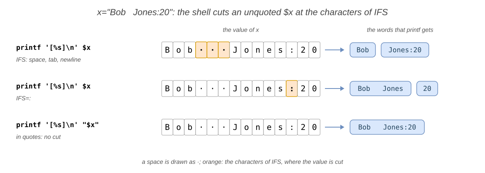

import Tabs from '@theme/Tabs';
import TabItem from '@theme/TabItem';

# 08. Scripturi de shell

În laboratorul 7 ați compilat programe C în terminal și ați văzut că un script de shell nu se compilează: `bash` îl
citește și îl rulează, linie cu linie. În acest laborator scrieți propriile **scripturi de shell**. Le rulați cu
**shebang**-ul `#!/bin/bash` sau cu `bash`, într-un proces nou, ori cu **`source`**, în propriul shell, și le găsiți
bug-urile cu **ShellCheck**, în terminal și, printr-un **server de limbaj** (*language server*), direct în editor.
Păstrați text în **variabile** și vedeți cum îl taie shell-ul în cuvinte la caracterele din **`IFS`**. **Citiți date de
intrare** cu `read`, preluați rezultatul unei comenzi cu **substituția de comenzi** și faceți calcule cu **expandarea
aritmetică** și cu `bc`. Apoi luați decizii cu `if`, `test` și `case`, repetați comenzi cu buclele `while` și `for`,
grupați comenzi în **funcții**, dați unui script **parametri** și îl faceți să se oprească la prima **eroare** cu
`set -e`.

Cea mai importantă idee a laboratorului: un script este o listă de **linii de comandă**, iar shell-ul o tratează pe
fiecare exact ca pe linia pe care o tastați voi: înlocuiește variabilele, taie rezultatul în **cuvinte** și rulează o
**comandă**. Chiar și condiția din `if` și din `while` este o comandă, iar decizia o ia doar **codul ei de ieșire**: `0`
înseamnă adevărat, orice altceva înseamnă fals.

## Obiective {/* #objectives */}

- Să scrieți un script cu **shebang** și comentarii, să îl rulați cu `./script.sh` și cu `bash script.sh` și să îl
  rulați în propriul shell cu `source script.sh`
- Să urmăriți un script, comandă cu comandă, cu `bash -x`
- Să găsiți bug-urile obișnuite ale unui script înainte să ruleze, cu `shellcheck`, și să le vedeți în editor prin
  serverul de limbaj `bash-language-server`
- Să păstrați text în **variabile** și să înțelegeți de ce un `$NAME` fără ghilimele este tăiat în cuvinte la
  caracterele din `IFS`
- Să citiți o linie tastată de utilizator sau o linie dintr-un fișier cu `read` (`-p`, `-r`, mai multe variabile,
  `IFS=: read`)
- Să puneți rezultatul unei comenzi într-o variabilă cu **substituția de comenzi**, `$(...)`
- Să faceți calcule cu numere întregi cu `$((...))` și `((...))`, iar cu numere zecimale cu `bc`
- Să luați decizii cu `if`, `elif` și `else`, pe baza codului de ieșire al unei comenzi, `test`, `[ ]`, `[[ ]]` sau
  `(( ))`
- Să comparați un text cu **tipare** (*patterns*) folosind `case`
- Să repetați comenzi cu `while`, `until` și `while read` și să ieșiți dintr-o buclă cu `break`
- Să parcurgeți o listă de cuvinte, fișierele dintr-un glob sau găsite de `find` ori un șir de numere, cu `for`,
  `while read`, `seq` și `{1..5}`
- Să scrieți **funcții** cu variabile `local`, care întorc un rezultat cu `echo`, iar succesul sau eșecul cu `return`
- Să citiți **parametrii** unui script, `$0`, `$1`, `$#` și `"$@"`, și să îl încheiați cu `exit`
- Să opriți un script la prima eroare cu `set -e`, `set -u` și `set -o pipefail` și să faceți curat cu `trap`

## Resurse {/* #resources */}

1. _[Razvan Deaconescu, Razvan Rughinis, Mihai Carabas, Alexandru Radovici, Utilizarea Sistemelor de
   Operare, Printech 2021](https://github.com/systems-cs-pub-ro/carte-uso/releases/download/uso-ed1-2021/uso.pdf)_
   - Capitolul 7 - _Interfața în linia de comandă_, secțiunile 7.2.2 - 7.2.5
   - Capitolul 13 - _Automatizarea sarcinilor_, secțiunile 13.1 - 13.3, 13.4.1 și 13.4.2
2. _Brian Ward, How LINUX Works, 3rd Edition, No Starch Press, 2021_
   - Capitolul 2 - _Basic Commands and Directory Hierarchy_, secțiunea 2.8
   - Capitolul 11 - _Introduction to Shell Scripts_, secțiunile 11.1 - 11.8 și 11.10 - 11.14
3. _[Bash Reference Manual](https://www.gnu.org/software/bash/manual/bash.html)_, secțiunea 3.2.5 - _Compound
   Commands_, secțiunea 3.3 - _Shell Functions_, secțiunea 3.5 - _Shell Expansions_ și secțiunea 4.3.1 - _The Set
   Builtin_;
   _[ShellCheck](https://www.shellcheck.net)_ și pagina fiecărui avertisment din
   _[wiki](https://www.shellcheck.net/wiki/)_-ul său;
   _[bash-language-server](https://github.com/bash-lsp/bash-language-server)_
4. Slide-urile cursului: [08. Scripturi de shell](/docs/lectures/08)
5. Paginile de manual: `man bash` (căutați `Compound Commands`, `Word Splitting` și `ARITHMETIC EVALUATION`),
   `man test`, `man seq`, `man bc`, `man expr`, `man basename`, `man dirname`, `man env`, `man find`,
   `man shellcheck`, `man mktemp`, iar pentru comenzile interne ale shell-ului `help read`, `help test`, `help for`,
   `help source`, `help set` și `help trap`

## Fedora și Ubuntu {/* #fedora-and-ubuntu */}

Calculatoarele din laborator rulează **Fedora** cu **Sway**, iar exemplele sunt luate de pe ele. Acasă puteți folosi și
**Ubuntu**: scripturile sunt aceleași, cu câteva diferențe:

|                                                 | Fedora                                                    | Ubuntu                                                                             |
| ----------------------------------------------- | --------------------------------------------------------- | ---------------------------------------------------------------------------------- |
| `/bin/sh`                                       | `bash`                                                    | `dash`, un shell mai mic: fără `[[ ]]`, `((...))`, `{1..5}`                        |
| instalarea `bc`, dacă lipsește                  | `sudo dnf install bc`                                     | `sudo apt install bc`                                                              |
| instalarea ShellCheck și a serverului de limbaj | `sudo dnf install ShellCheck nodejs-bash-language-server` | `sudo apt install shellcheck npm`, apoi `sudo npm install -g bash-language-server` |

## Scripturi de shell {/* #shell-scripts */}

Un **script de shell** este un fișier text cu linii de comandă. În loc să tastați comenzile una câte una, le scrieți în
fișier, iar `bash` le rulează în locul vostru, una după alta. Scripturile sunt foarte bune la lipit comenzi între ele
(copiază, verifică, redenumește, raportează); pentru calcule complicate, folosiți un limbaj ca Python sau C.

### Scrierea unui script {/* #writing-a-script */}

Exemplele din acest laborator rulează în `~/lab08`, director creat de [exercițiul 1](#first-steps). `backup.sh`
copiază `fruits.txt` într-un director:

```bash title="~/lab08/backup.sh"
#!/bin/bash
# copy the fruits into a backup folder
mkdir -p backup
cp fruits.txt \
   backup/
echo "backup done"; ls backup
```

| Scris ca                    | Ce înseamnă                                                                                    |
| --------------------------- | ---------------------------------------------------------------------------------------------- |
| `#!/bin/bash`               | **shebang**-ul, mereu pe prima linie: programul care rulează scriptul                          |
| `# ...`                     | un **comentariu**: `bash` ignoră restul liniei                                                 |
| sfârșitul unei linii        | sfârșitul unei comenzi: `bash` o rulează, așteaptă să se termine, apoi citește linia următoare |
| `command1; command2`        | două comenzi pe aceeași linie: întâi `command1`, apoi `command2`                               |
| `\` la sfârșitul unei linii | comanda continuă pe linia următoare: `cp` primește atât `fruits.txt`, cât și `backup/`         |

Scrieți scripturile cu unul dintre editoarele din [Editoare de text](/docs/labs/06#text-editors), din laboratorul 06.
Terminația `.sh` din nume este doar o convenție: Linux se uită la conținutul unui fișier, nu la numele lui.

### Rularea unui script {/* #running-a-script */}

Încercăm să rulăm scriptul în cele trei moduri:

```shell-session
[student@fedora lab08]$ ./backup.sh
bash: ./backup.sh: Permission denied
[student@fedora lab08]$ bash backup.sh
backup done
fruits.txt
[student@fedora lab08]$ chmod +x backup.sh
[student@fedora lab08]$ ./backup.sh
backup done
fruits.txt
[student@fedora lab08]$ source backup.sh
backup done
fruits.txt
```

- `./backup.sh` a eșuat: un fișier nou nu are permisiunea `x` (vedeți [`chmod`](/docs/labs/05#chmod) în laboratorul 05).
- `bash backup.sh` a mers totuși: programul este `bash`, iar scriptul e doar un fișier pe care acesta îl citește.
- După `chmod +x`, nucleul a citit shebang-ul din `./backup.sh` și a rulat `/bin/bash ./backup.sh`.
- `source backup.sh` nu a pornit niciun proces nou: shell-ul vostru a citit fișierul și i-a rulat singur liniile.


| Comandă            | Cine rulează liniile | De ce are nevoie                                                                                          |
| ------------------ | -------------------- | --------------------------------------------------------------------------------------------------------- |
| `./backup.sh`      | un `bash` nou        | de permisiunea `x` și de shebang; de `./`, pentru că directorul curent nu este în `PATH` (laboratorul 04) |
| `bash backup.sh`   | un `bash` nou        | doar de permisiunea `r`; pentru `bash`, shebang-ul este un comentariu                                     |
| `source backup.sh` | shell-ul vostru      | doar de permisiunea `r`; shebang-ul este un comentariu                                                    |

Shebang-ul funcționează pentru orice limbaj: un fișier care începe cu `#!/usr/bin/python3` este rulat de Python.

Cu `./` și cu `bash`, scriptul rulează într-un proces `bash` **nou**, copil al shell-ului vostru. Un `cd` sau o
variabilă din script schimbă doar acel proces, iar procesul se termină odată cu scriptul: shell-ul vostru rămâne unde
era. Cu `source`, ce schimbă scriptul rămâne în shell-ul vostru: vedeți
[secțiunea următoare](#running-a-script-in-your-shell-source). Exercițiile de acasă și provocările au nevoie de
detalii, pe care le găsiți în [Subshell-uri](#subshells).

:::caution

Rulați scripturile cu `./script.sh` sau cu `bash script.sh`, nu cu `sh script.sh`: `sh` ignoră shebang-ul, iar pe Ubuntu
este `dash`, care nu cunoaște multe dintre funcționalitățile `bash` (vedeți [Fedora și Ubuntu](#fedora-and-ubuntu)).

:::

### Rularea unui script în propriul shell: `source` {/* #running-a-script-in-your-shell-source */}

**`source <FILE>`**, sau numele lui scurt, **`. <FILE>`**, nu pornește niciun proces nou: este o comandă internă, iar
shell-ul **vostru** citește fișierul și îi rulează liniile, ca și cum le-ați fi tastat voi. Ce schimbă fișierul rămâne
în shell-ul vostru. Gândiți-vă la drumul până la un magazin: cu `bash`, trimiteți un prieten și voi rămâneți acasă; cu
`source`, mergeți chiar voi acolo.

```bash title="~/lab08/go.sh"
#!/bin/bash
cd photos
where="photos"
```

```shell-session
[student@fedora lab08]$ bash go.sh
[student@fedora lab08]$ echo "$PWD [$where]"
/home/student/lab08 []
[student@fedora lab08]$ source go.sh
[student@fedora photos]$ echo "$PWD [$where]"
/home/student/lab08/photos [photos]
[student@fedora photos]$ cd ..
```

- `bash go.sh` a intrat în `photos` și a setat `where` într-un `bash` nou, care apoi s-a terminat: shell-ul vostru nu
  s-a schimbat.
- `source go.sh` a rulat aceleași linii în shell-ul vostru: prompt-ul arată `photos`, iar `where` este încă setată.

| Comanda                   | Cine rulează liniile | De ce are nevoie                 | Ce schimbă fișierul       |
| ------------------------- | -------------------- | -------------------------------- | ------------------------- |
| `./go.sh`                 | un `bash` nou        | de permisiunea `x` și de shebang | se pierde când se termină |
| `bash go.sh`              | un `bash` nou        | de permisiunea `r`               | se pierde când se termină |
| `source go.sh`, `. go.sh` | shell-ul vostru      | de permisiunea `r`               | rămâne în shell-ul vostru |

Folosiți `source` doar pentru un fișier care trebuie să vă schimbe shell-ul: `~/.bashrc`, pe care `bash` îl citește în
același fel când pornește (după ce îl modificați, `source ~/.bashrc` îl aplică fără un terminal nou), sau un fișier cu
funcții folosite de mai multe scripturi. Rulați orice alt script cu `./` sau cu `bash`, ca să nu vă poată schimba
shell-ul din greșeală.

:::caution

`exit` într-un fișier rulat cu `source` încheie shell-ul **vostru**, iar terminalul se închide. Un fișier făcut pentru
`source` nu apelează `exit`.

:::

### Urmărirea unui script: `bash -x` {/* #following-a-script-bash--x */}

`bash -x` afișează fiecare comandă, precedată de un `+`, după ce shell-ul a înlocuit variabilele și înainte ca
comanda să ruleze. Este primul lucru de încercat când un script face altceva decât vă așteptați:

```shell-session
[student@fedora lab08]$ bash -x backup.sh
+ mkdir -p backup
+ cp fruits.txt backup/
+ echo 'backup done'
backup done
+ ls backup
fruits.txt
```

:::tip

O linie `set -x` în script pornește urmărirea de acolo înainte, iar `set +x` o oprește: urmăriți doar partea pe care o
bănuiți.

:::

## Verificarea scripturilor {/* #checking-scripts */}

`bash -x` arată ce face un script **în timp ce** rulează. **ShellCheck** găsește bug-urile obișnuite **înainte** ca
scriptul să ruleze, citindu-i textul, la fel ca avertismentele din `gcc -Wall` din laboratorul 07. Instalați-l, împreună
cu serverul de limbaj care îi afișează avertismentele în editor, ca în [Fedora și Ubuntu](#fedora-and-ubuntu).

### Găsirea bug-urilor: `shellcheck` {/* #finding-bugs-shellcheck */}

```bash title="~/lab08/notes.sh"
#!/bin/bash
# count the lines of a file
file="my notes.txt"
wc -l $file
```

```shell-session
[student@fedora lab08]$ bash notes.sh
wc: my: No such file or directory
wc: notes.txt: No such file or directory
0 total
[student@fedora lab08]$ shellcheck notes.sh

In notes.sh line 4:
wc -l $file
      ^---^ SC2086 (info): Double quote to prevent globbing and word splitting.

Did you mean:
wc -l "$file"
...
```

- `wc` a primit două cuvinte, `my` și `notes.txt`: `$file`, fără ghilimele, a fost tăiat la spațiu (vedeți
  [Ghilimele și caractere speciale](/docs/labs/04#quoting-and-escaping) în laboratorul 04).
- `shellcheck` a găsit bug-ul fără să ruleze scriptul: a afișat linia, un `^---^` sub cuvânt, un **cod**, `SC2086`, și
  corectura. `https://www.shellcheck.net/wiki/SC2086` explică fiecare cod, cu exemple.

Avertismentele pe care le întâlniți în acest laborator:

| Cod      | Ce înseamnă                                                                                              |
| -------- | -------------------------------------------------------------------------------------------------------- |
| `SC2086` | o variabilă fără ghilimele: este tăiată în cuvinte, iar globurile din ea sunt expandate                  |
| `SC2162` | `read` fără `-r`: elimină caracterele `\`                                                                |
| `SC2045` | `for f in $(ls ...)`: un nume de fișier cu spații se strică; folosiți un glob                            |
| `SC2044` | `for f in $(find ...)`: aceeași problemă; folosiți `find ... \| while read` sau `-exec`                  |
| `SC2034` | o variabilă care primește o valoare, dar nu e folosită niciodată: deseori, o greșeală de tastare în nume |
| `SC1009` | o eroare de sintaxă, de exemplu un `fi` sau un `done` care lipsește                                      |

:::tip

Când **vreți** să se taie în cuvinte, scrieți comentariul `# shellcheck disable=SC2086` pe linia de dinainte: așa îi
arătați cititorului că ați ales asta intenționat.

:::

### În editor: `bash-language-server` {/* #in-the-editor-bash-language-server */}

În [Un editor cu server de limbaj](/docs/labs/07#an-editor-with-a-language-server), din laboratorul 07, editorul folosea
`clangd` pentru C. Pentru scripturile de shell, serverul de limbaj este **`bash-language-server`**: rulează `shellcheck`
după fiecare modificare și marchează avertismentele în text, completează numele comenzilor și ale variabilelor și
afișează ajutorul pentru comanda de sub cursor. Tastele sunt cele din laboratorul 07.

Orice editor are nevoie de `shellcheck` instalat: fără el, serverul de limbaj completează nume, dar nu afișează niciun
avertisment. Configurați-vă editorul:

<Tabs groupId="editor">
<TabItem value="vim" label="vim">

`vim` are nevoie de pluginul `vim-lsp`:

```bash
git clone https://github.com/prabirshrestha/vim-lsp ~/.vim/pack/lsp/start/vim-lsp
```

:::info

**S-ar putea să fie deja instalat**

Dacă ați configurat `vim` în laboratorul 07, aveți deja `vim-lsp` (`ls ~/.vim/pack/lsp/start`) și liniile marcate
`s-ar putea să existe deja` în `~/.vimrc`: adăugați doar blocul marcat `nou`.

:::

Adăugați aceste linii în `~/.vimrc`: ele pornesc `bash-language-server` pentru scripturile de shell, afișează
avertismentele la capătul liniei și definesc tastele din laboratorul 07.

```vim title="~/.vimrc"
" s-ar putea să existe deja, din laboratorul 07
let g:lsp_diagnostics_virtual_text_enabled = 1

" nou, pentru scripturile de shell
filetype plugin on
if executable('bash-language-server')
  au User lsp_setup call lsp#register_server({
        \ 'name': 'bash-language-server',
        \ 'cmd': {server_info->['bash-language-server', 'start']},
        \ 'allowlist': ['sh', 'bash'],
        \ })
endif

" s-ar putea să existe deja, din laboratorul 07
function! s:on_lsp_buffer_enabled() abort
  setlocal omnifunc=lsp#complete
  nmap <buffer> gd <plug>(lsp-definition)
  nmap <buffer> gr <plug>(lsp-references)
  nmap <buffer> K <plug>(lsp-hover)
  nmap <buffer> <leader>rn <plug>(lsp-rename)
  nmap <buffer> <leader>ca <plug>(lsp-code-action)
  nmap <buffer> ]d <plug>(lsp-next-diagnostic)
endfunction
augroup lsp_install
  au!
  autocmd User lsp_buffer_enabled call s:on_lsp_buffer_enabled()
augroup END
```

Verificare: deschideți un fișier `.sh` și rulați `:LspStatus`; apare `bash-language-server: running`.

</TabItem>
<TabItem value="nvim" label="nvim">

Adăugați aceste linii în `~/.config/nvim/init.lua` (Neovim 0.11 sau mai nou). Ultima linie afișează avertismentele
la capătul liniei; fără ea, Neovim doar le marchează în stânga.

:::info

**S-ar putea să existe deja**

Dacă ați configurat `nvim` în laboratorul 07, fișierul `init.lua` are deja linia marcată `s-ar putea să existe deja`:
adăugați doar liniile marcate `nou`.

:::

```lua title="~/.config/nvim/init.lua"
-- nou, pentru scripturile de shell
vim.lsp.config('bashls', {
  cmd = { 'bash-language-server', 'start' },
  filetypes = { 'sh', 'bash' },
})
vim.lsp.enable('bashls')

-- s-ar putea să existe deja, din laboratorul 07
vim.diagnostic.config({ virtual_text = true })
```

Verificare: deschideți un fișier `.sh` și rulați `:checkhealth vim.lsp`; `bashls` apare printre clienții activi.

</TabItem>
<TabItem value="hx" label="hx">

Helix nu are nevoie de nicio setare: pornește singur `bash-language-server` pentru fiecare script de shell.

```shell-session
[student@fedora lab08]$ hx --health bash
...
Configured language servers:
  ✓ bash-language-server: /usr/bin/bash-language-server
...
```

- Helix a găsit `bash-language-server` în `PATH`. Un `✘` acolo înseamnă că serverul nu este instalat.

</TabItem>
<TabItem value="emacs" label="emacs">

Eglot cunoaște deja `bash-language-server`: adăugați această linie în `~/.emacs.d/init.el` (sau în `~/.emacs`, dacă
aveți acest fișier), lângă cele pe care s-ar putea să le aveți deja din laboratorul 07:

```lisp title="~/.emacs.d/init.el"
(add-hook 'sh-mode-hook 'eglot-ensure)
```

Verificare: deschideți un fișier `.sh` (`emacs -nw script.sh`); linia de mod, din partea de jos, afișează `eglot`.

</TabItem>
<TabItem value="vscode" label="VS Code">

Instalați extensia **Bash IDE**, care vine cu propriul server: din bara **Extensions**
(<kbd>Ctrl</kbd>+<kbd>Shift</kbd>+<kbd>X</kbd>, căutați `Bash IDE`, de la **Mads Hartmann**) sau din terminal:

```bash
code --install-extension mads-hartmann.bash-ide-vscode
```

Verificare: deschideți un fișier `.sh` și faceți o greșeală, de exemplu `x = 1`: este subliniată imediat.

</TabItem>
<TabItem value="zed" label="Zed">

Zed nu are nevoie de nicio setare: descarcă singur serverul prima dată când deschideți un script de shell.

Verificare: deschideți un fișier `.sh` și faceți o greșeală, de exemplu `x = 1`: este subliniată imediat.

</TabItem>
</Tabs>

## Variabile {/* #variables */}

Ați întâlnit variabilele în [Variabile de shell și `export`](/docs/labs/04#shell-variables-and-export), în laboratorul
04: `NAME=value` **fără spații** în jurul lui `=`, `$NAME` sau `${NAME}` pentru a o folosi, `unset` pentru a o șterge.
Într-un script, contează mai ales două reguli:

- O variabilă conține **text**. `msg="I like $fruit"` păstrează valoarea pe care o avea `fruit` **atunci**, nu o
  formulă, iar `$a+$b` este doar textul `2+3` (pentru calcule, vedeți [Aritmetică](#arithmetic)).
- O linie începe cu o **comandă**: în `fruit= kiwi`, spațiul încheie atribuirea, iar `kiwi` este comanda.

```shell-session
[student@fedora lab08]$ fruit=kiwi
[student@fedora lab08]$ echo "I like $fruit, ${fruit}s are green"
I like kiwi, kiwis are green
[student@fedora lab08]$ msg="I like $fruit"
[student@fedora lab08]$ fruit=plum
[student@fedora lab08]$ echo "$msg"
I like kiwi
[student@fedora lab08]$ a=2; b=3; echo $a+$b
2+3
[student@fedora lab08]$ fruit= kiwi
bash: kiwi: command not found
```

- `${fruit}s` a avut nevoie de acolade: `$fruits` este o altă variabilă, care nu există.
- `msg` nu s-a schimbat odată cu `fruit`: shell-ul a înlocuit `$fruit` în momentul în care a rulat linia `msg=...`.
- `fruit= kiwi` a rulat comanda `kiwi`, cu `fruit` gol doar pentru ea (vedeți
  [O variabilă pentru o singură comandă](/docs/labs/04#a-variable-for-one-command) în laboratorul 04).

### Împărțirea în cuvinte: `IFS` {/* #splitting-words-ifs */}

După ce înlocuiește un `$NAME` **fără ghilimele**, shell-ul taie valoarea în cuvinte la caracterele din variabila
**`IFS`** (*Internal Field Separator*). Implicit, `IFS` conține un spațiu, un tab și un caracter de linie nouă. Între
ghilimele duble, `"$NAME"` rămâne **un singur** cuvânt (vedeți [Ghilimele și caractere
speciale](/docs/labs/04#quoting-and-escaping) în laboratorul 04). Gândiți-vă la caracterele din `IFS` ca la locurile
în care taie foarfeca.

```shell-session
[student@fedora lab08]$ printf '%q\n' "$IFS"
$' \t\n'
[student@fedora lab08]$ x="Bob   Jones:20"
[student@fedora lab08]$ printf '[%s]\n' $x
[Bob]
[Jones:20]
[student@fedora lab08]$ printf '[%s]\n' "$x"
[Bob   Jones:20]
[student@fedora lab08]$ IFS=:
[student@fedora lab08]$ printf '[%s]\n' $x
[Bob   Jones]
[20]
[student@fedora lab08]$ unset IFS
```

- `printf '%q\n'` a afișat caracterele invizibile din `IFS`: un spațiu, `\t` (tab) și `\n` (linie nouă).
- `printf '[%s]\n'` afișează între paranteze drepte fiecare cuvânt primit (laboratorul 04): fără ghilimele, `$x` a
  devenit două cuvinte; cu ghilimele, unul.
- După `IFS=:`, valoarea s-a tăiat doar la `:`, iar spațiile au fost caractere obișnuite. `unset IFS` a revenit la
  valoarea implicită.



| Caracterul din `IFS`     | Cum taie                                                                                          |
| ------------------------ | ------------------------------------------------------------------------------------------------- |
| spațiu, tab, linie nouă  | mai multe la rând fac **o singură** tăietură; la începutul și la sfârșitul valorii sunt eliminate |
| oricare altul (`:`, `,`) | taie **fiecare**: `a::c` dă trei cuvinte, `a`, un cuvânt gol și `c`                               |

:::caution

Puneți fiecare variabilă între ghilimele duble, `"$NAME"`, în afară de cazul în care **vreți** să fie tăiată. După ce
schimbați `IFS`, rulați `unset IFS`: până atunci, orice variabilă fără ghilimele se taie la noile caractere.

:::

## Citirea datelor de intrare: `read` {/* #reading-input-read */}

`read` este o comandă internă a shell-ului (manualul ei se afișează cu `help read`). Așteaptă o linie, până la
<kbd>Enter</kbd>, și o pune în variabile:

| Comandă                 | Ce face                                                                                      |
| ----------------------- | -------------------------------------------------------------------------------------------- |
| `read NAME`             | citește o singură linie de la intrarea standard și o pune în `NAME`                          |
| `read -p "<TEXT>" NAME` | afișează mai întâi textul `<TEXT>` (un *prompt*)                                             |
| `read A B C`            | taie linia la `IFS`: câte un cuvânt pentru fiecare variabilă, iar **ultima** primește restul |
| `IFS=: read A B C`      | taie linia la `:`, doar pentru acest `read`                                                  |
| `read -r NAME`          | *raw*: păstrează caracterele `\`; fără `-r`, `read` le elimină                               |
| `IFS= read -r NAME`     | citește linia **exact** cum este, cu spațiile de la început și de la sfârșit                 |
| `read NAME < <FILE>`    | citește prima linie din `<FILE>`                                                             |

```shell-session
[student@fedora lab08]$ read -p "Full name: " first last
Full name: Carol Ann Smith
[student@fedora lab08]$ echo "$last, $first"
Ann Smith, Carol
[student@fedora lab08]$ head -n 1 /etc/passwd
root:x:0:0:Super User:/root:/bin/bash
[student@fedora lab08]$ IFS=: read user x uid rest < /etc/passwd
[student@fedora lab08]$ echo "$user has the UID $uid"
root has the UID 0
```

- `first` a primit `Carol`, iar `last`, ultima variabilă, a primit restul liniei.
- `IFS=:` înaintea lui `read` este o variabilă doar pentru acea comandă: linia s-a tăiat la `:`, iar `IFS` a rămas la
  valoarea implicită.

:::caution

**`IFS=:` înaintea altei comenzi nu îi taie parametrii**

```shell-session
[student@fedora lab08]$ x="Bob   Jones:20"
[student@fedora lab08]$ IFS=: printf '[%s]\n' $x
[Bob]
[Jones:20]
```

Shell-ul taie `$x` în cuvinte **înainte** să pornească `printf`, cu propriul `IFS`, cel implicit. `IFS=:` ajunge doar la
programul care pornește după aceea, iar `printf` nu taie nimic. `read` este altfel: taie linia pe care o citește
**el**, în timp ce rulează, așa că vede `IFS=:`. Ca să tăiați o variabilă la `:`, schimbați `IFS` în shell, separat:
`IFS=:; printf '[%s]\n' $x; unset IFS` afișează `[Bob   Jones]` și `[20]`.

:::

:::note

`read` se termină cu `0` când a citit o linie și cu `1` la sfârșitul intrării (<kbd>Ctrl</kbd>+<kbd>D</kbd> la
tastatură sau sfârșitul unui fișier): [`while read`](#reading-a-file-while-read) se oprește la acest cod.

:::


## Substituția de comenzi: `$(...)` {/* #command-substitution- */}

`$(command)` rulează comanda și pune în locul ei **rezultatul** afișat, ca text; abia apoi shell-ul rulează linia.
Folosiți-o ca să păstrați rezultatul unei comenzi într-o variabilă sau ca să îl puneți în mijlocul unui text.
Caracterele de linie nouă de la sfârșitul rezultatului se elimină.

```shell-session
[student@fedora lab08]$ count=$(wc -l < fruits.txt)
[student@fedora lab08]$ echo "$count fruits on $(date +%A)"
7 fruits on Monday
[student@fedora lab08]$ echo "$(sort -u fruits.txt | wc -l) kinds"
5 kinds
```

- `count` conține textul `7`, rezultatul lui `wc -l < fruits.txt`; `wc` nu mai rulează din nou când folosiți `$count`.
- `$(...)` funcționează și în interiorul `"..."` și poate conține un pipeline întreg.

Comanda rulează într-o **copie** a shell-ului: o variabilă pe care o schimbă se schimbă doar în copie (vedeți
[Subshell-uri](#subshells)). `` `command` `` este vechea formă de a scrie `$(command)`.

## Aritmetică {/* #arithmetic */}

Pentru shell, `2` și `3` sunt text: `echo $a+$b` afișează `2+3`. Ca să faceți un calcul, trebuie să îl cereți explicit.

### Numere întregi: `$((...))` și `((...))` {/* #integers--and- */}

| Scris ca         | Ce face                                                                                                           |
| ---------------- | ----------------------------------------------------------------------------------------------------------------- |
| `$((<EXPR>))`    | shell-ul calculează `<EXPR>` și pune **rezultatul** în locul expresiei, ca text                                   |
| `((<EXPR>))`     | o comandă care calculează `<EXPR>`: pentru a schimba o variabilă, `((n++))`, sau drept condiție                   |
| `expr <A> + <B>` | un **program** vechi care afișează rezultatul; fiecare număr și operator este un parametru, iar `*` se scrie `\*` |

În interiorul `((...))`, variabilele nu au nevoie de `$`, iar operatorii sunt cei din C:

| Operator          | Ce face                                                     | Exemplu                                           |
| ----------------- | ----------------------------------------------------------- | ------------------------------------------------- |
| `+ - * /`         | adunare, scădere, înmulțire, împărțire: doar numere întregi | `$((7 / 2))` este `3`                             |
| `% **`            | restul împărțirii, ridicare la putere                       | `$((7 % 2))` este `1`, `$((2 ** 10))` este `1024` |
| `< <= > >= == !=` | comparații: `1` înseamnă adevărat, `0` fals                 | `$((3 > 2))` este `1`                             |
| `&& \|\| !`       | și, sau, negație                                            | `$((1 && 0))` este `0`                            |
| `= += -= ++ --`   | schimbă o variabilă                                         | `((n += 2))`                                      |
| `( )`             | grupare                                                     | `$(( (2 + 3) * 4 ))` este `20`                    |

:::info

Unii dintre acești operatori, de exemplu `**`, `++` și `--`, nu există în orice shell; în `sh`, mai ales, nu există.
Verificați întotdeauna ce shell folosiți, cu comanda `echo $SHELL`.

:::

Calculăm cu două variabile:

```shell-session
[student@fedora lab08]$ a=7; b=2
[student@fedora lab08]$ echo "$a + $b = $((a + b))"
7 + 2 = 9
[student@fedora lab08]$ echo $((a / b)) $((a % b)) $((a ** b))
3 1 49
[student@fedora lab08]$ ((a++)); echo $a
8
[student@fedora lab08]$ echo $(a+b)
bash: a+b: command not found

```

- `$((a / b))` a renunțat la zecimale: `7 / 2` dă `3`, cu restul `1`.
- `$(a+b)`, cu **o singură** pereche de paranteze, este substituție de comenzi: shell-ul a căutat o comandă numită
  `a+b`.

### Numere zecimale: `bc` {/* #decimals-bc */}

`bash` calculează doar cu numere întregi. Pentru zecimale, scrieți expresia ca text și trimiteți-o la `bc`, un
calculator care citește expresii de la intrare și afișează rezultatele:

```shell-session
[student@fedora lab08]$ echo $((3.5 * 2))
bash: 3.5 * 2: syntax error: invalid arithmetic operator (error token is ".5 * 2")
[student@fedora lab08]$ echo "3.5 * 2" | bc
7.0
[student@fedora lab08]$ echo "10 / 3" | bc
3
[student@fedora lab08]$ echo "scale=2; 10 / 3" | bc
3.33
```

- `bc` împarte fără zecimale, în afară de cazul în care `scale` spune câte să păstreze.
- Ca să păstrați rezultatul, combinați-l cu substituția de comenzi: `total=$(echo "$price * $count" | bc)`.

## Condiții {/* #conditions */}

### `if` {/* #if */}

`if` rulează o **comandă** și se uită la codul ei de ieșire (vedeți [Coduri de ieșire](/docs/labs/06#exit-codes) în
laboratorul 06): dacă este `0`, rulează comenzile de după `then`; altfel, `if` încearcă următorul `elif` sau rulează
comenzile de după `else`. `fi` (`if` scris invers) încheie construcția; `elif` și `else` sunt opționale.

```bash title="~/lab08/kiwi.sh"
#!/bin/bash
if grep -q kiwi fruits.txt; then
    echo "we have kiwi"
elif grep -q plum fruits.txt; then
    echo "no kiwi, but we have plums"
else
    echo "no kiwi, no plums"
fi
```

`grep -q` nu afișează nimic: doar se termină cu `0` când găsește textul. `;` încheie comanda dinaintea lui `then`.

:::caution

Condiția este o **linie de comandă**, nu o formulă. `if $a > $b` rulează comanda `7` (cu `a=7`) și îi trimite
rezultatul într-un fișier nou numit `3`: apare `7: command not found`, așa că `if` intră pe ramura `else`. Pentru
comparații, folosiți `test`.

:::

### `test` și `[` {/* #test-and- */}

`test` este o comandă care verifică o condiție, nu afișează nimic și se termină cu `0` (adevărat) sau cu `1` (fals).
`[` este aceeași comandă, cu o regulă în plus: ultimul ei parametru trebuie să fie `]`.

| Test                                             | Adevărat când                                           |
| ------------------------------------------------ | ------------------------------------------------------- |
| `<A> -eq <B>`, `-ne`, `-lt`, `-le`, `-gt`, `-ge` | **numerele** sunt egale, diferite, `<`, `<=`, `>`, `>=` |
| `"<S>" = "<T>"`, `"<S>" != "<T>"`                | **textele** sunt egale, diferite                        |
| `-z "<S>"`, `-n "<S>"`                           | textul este gol, nu este gol                            |
| `-e <FILE>`, `-f <FILE>`, `-d <FILE>`            | există; este un fișier obișnuit; este un director       |
| `-r <FILE>`, `-w <FILE>`, `-x <FILE>`            | aveți voie să îl citiți, să îl scrieți, să îl rulați    |
| `! <TEST>`                                       | testul este fals                                        |

```shell-session
[student@fedora lab08]$ a=2; b=3
[student@fedora lab08]$ [ $a -lt $b ]; echo $?
0
[student@fedora lab08]$ [ -d fruits.txt ]; echo $?
1
[student@fedora lab08]$ type -a [
[ is a shell builtin
[ is /usr/bin/[
[student@fedora lab08]$ [$a -lt $b]
bash: [2: command not found
```

- `type -a` a arătat că `[` este o comandă internă a shell-ului și, în plus, un program din `/usr/bin`.
- `[$a -lt $b]` a devenit cuvântul `[2`, iar o comandă cu acest nume nu există.

:::caution

**`[` este o comandă**: shell-ul taie linia în cuvinte înainte să pornească `[`. Puneți spații în jurul lui `[`, `]` și
al fiecărui operator și puneți variabilele între ghilimele: cu `x` gol, `[ $x = abc ]` devine `[ = abc ]`, iar `[`
afișează `=: unary operator expected`; `[ "$x" = abc ]` funcționează. Comparați numerele cu `-lt`, nu cu `<`: în
interiorul `[ ]`, `<` și `>` sunt redirectări.

:::

### `[[ ]]` și `(( ))` {/* #--and-- */}

`bash` are două forme mai comode. Ele fac parte din limbajul `bash` (sunt cuvinte cheie), nu sunt comenzi, așa că
funcționează doar în `bash`, nu și în `sh`:

| Formă          | Ce aduce în plus                                                                                                         |
| -------------- | ------------------------------------------------------------------------------------------------------------------------ |
| `[[ <TEST> ]]` | ca `[`, dar o variabilă fără ghilimele **nu** se taie, `&&` și `\|\|` funcționează în interior, iar `==` acceptă un glob |
| `(( <EXPR> ))` | aritmetica din `$((...))`, folosită drept condiție: adevărată când rezultatul **nu** este `0`                            |

```shell-session
[student@fedora lab08]$ if (( a < b )); then echo "smaller"; fi
smaller
[student@fedora lab08]$ f="my notes.txt"; [[ $f == *.txt ]] && echo "a text file"
a text file
```

### Alegerea după tipar: `case` {/* #choosing-by-pattern-case */}

`case` compară un text cu niște **tipare**, de sus în jos, și rulează ramura **primului** tipar care se potrivește.
Tiparele sunt globuri (vedeți [Globbing](/docs/labs/04#globbing) în laboratorul 04), iar `|` între ele înseamnă *sau*:

```bash title="~/lab08/color.sh"
#!/bin/bash
read -p "Fruit: " fruit
case $fruit in
    banana | lemon)
        echo "yellow" ;;
    kiwi | lime)
        echo "green" ;;
    *berry)
        echo "a berry" ;;
    *)
        echo "I do not know $fruit" ;;
esac
```

- `;;` încheie o ramură: `case` sare după `esac` (`case` scris invers) și nu mai încearcă celelalte tipare.
- `*)` se potrivește cu orice: este ramura implicită, mereu ultima. Fără ea, când nu se potrivește nimic, nu rulează
  nimic.

## Bucle {/* #loops */}

### `while` și `until` {/* #while-and-until */}

`while` rulează o comandă înaintea fiecărei iterații: cât timp aceasta se termină cu `0`, `while` rulează **corpul**
buclei, adică comenzile dintre `do` și `done`. `until` face invers: repetă cât timp comanda **nu** se termină cu `0`.

```bash title="~/lab08/countdown.sh"
#!/bin/bash
n=3
while [ $n -gt 0 ]; do
    echo "$n..."
    n=$((n - 1))
done
echo "go!"
```

```shell-session
[student@fedora lab08]$ bash countdown.sh
3...
2...
1...
go!
```

| Scris ca                        | Ce face                                                   |
| ------------------------------- | --------------------------------------------------------- |
| `while <COMMAND>; do ...; done` | repetă cât timp `<COMMAND>` se termină cu `0`             |
| `until <COMMAND>; do ...; done` | repetă până când `<COMMAND>` se termină cu `0`            |
| `while true; do ...; done`      | repetă la nesfârșit, până la un `break`                   |
| `break`                         | iese din buclă                                            |
| `continue`                      | sare peste restul corpului și trece la iterația următoare |

:::caution

Corpul buclei trebuie să schimbe ceea ce testează condiția (în exemple, `n`), altfel bucla nu se mai termină: o opriți
cu <kbd>Ctrl</kbd>+<kbd>C</kbd>.

:::

### Citirea unui fișier: `while read` {/* #reading-a-file-while-read */}

`< <FILE>` scris după `done` este intrarea **întregii bucle**: fiecare `read` ia linia următoare, iar la sfârșitul
fișierului `read` se termină cu `1`, ceea ce oprește bucla.

```shell-session
[student@fedora lab08]$ while read fruit; do echo "buy $fruit"; done < shopping.txt
buy apple
buy kiwi
buy cherry
[student@fedora lab08]$ while IFS=, read user name; do echo "$user is $name"; done < people.csv
bob is Bob Jones
carol is Carol Smith
dave is Dave Brown
```

- `IFS=, read` a tăiat fiecare linie doar la `,`: spațiul din `Bob Jones` a rămas în `name`.

:::caution

Scrieți `done < <FILE>`, nu `cat <FILE> | while read ...`: după un pipe, bucla rulează într-o copie a shell-ului, iar
variabilele pe care le schimbă se pierd când se termină (vedeți [Subshell-uri](#subshells)).

:::

### `for` {/* #for */}

`for` dă unei variabile, pe rând, fiecare cuvânt dintr-o listă și rulează corpul o dată pentru fiecare cuvânt:

| Scris ca                | Cuvintele                                                                                 |
| ----------------------- | ----------------------------------------------------------------------------------------- |
| `for f in apple kiwi`   | cuvintele scrise după `in`                                                                |
| `for f in *.txt`        | numele fișierelor care se potrivesc cu globul, fiecare câte un cuvânt, chiar și cu spații |
| `for w in $(<COMMAND>)` | rezultatul comenzii, tăiat la `IFS`                                                       |
| `for p in "$@"`         | parametrii scriptului (vedeți [Parametrii scriptului](#script-parameters))                |

```shell-session
[student@fedora lab08]$ for f in *.txt; do echo "$f: $(wc -l < "$f") lines"; done
fruits.txt: 7 lines
my notes.txt: 2 lines
shopping.txt: 3 lines
[student@fedora lab08]$ for f in $(ls *.txt); do echo "[$f]"; done
[fruits.txt]
[my]
[notes.txt]
[shopping.txt]
```

- Globul a dat `my notes.txt` ca **un singur** cuvânt, iar `"$f"` l-a păstrat întreg pentru `wc`.
- Rezultatul lui `ls` a fost tăiat la `IFS`: `my notes.txt` a devenit două cuvinte. Parcurgeți fișierele cu un glob,
  niciodată cu `$(ls)`.

Ca să tăiați o valoare la alt caracter, setați `IFS` **înainte** de buclă și dați-i `unset` după ea: `IFS=: for ...`
este o eroare de sintaxă, pentru că `for` este un cuvânt cheie, nu o comandă.

```shell-session
[student@fedora lab08]$ line="apple:kiwi:cherry"
[student@fedora lab08]$ IFS=:
[student@fedora lab08]$ for f in $line; do echo "[$f]"; done
[apple]
[kiwi]
[cherry]
[student@fedora lab08]$ unset IFS
```

### Fișiere din subdirectoare: `find` {/* #files-in-subfolders-find */}

Un glob vede un singur director. `find` (vedeți [Găsirea fișierelor](/docs/labs/02#finding-files-find) în laboratorul
02) caută și în toate subdirectoarele și afișează câte o cale pe linie:

| Scris ca                                                          | Ce face                                                                                             |
| ----------------------------------------------------------------- | --------------------------------------------------------------------------------------------------- |
| `find <DIR> -name '<GLOB>' \| while IFS= read -r f; do ...; done` | o iterație pentru fiecare cale, chiar și cu spații; variabilele buclei se pierd după pipe           |
| `find <DIR> -name '<GLOB>' -exec <COMMAND> {} +`                  | `find` rulează singur `<COMMAND>`, cu căile în locul lui `{}`: fără buclă și fără tăiere în cuvinte |
| `for f in $(find ...)`                                            | rezultatul se taie la `IFS`: un nume cu spații se strică, la fel ca la `$(ls)`                      |

```shell-session
[student@fedora lab08]$ find . -name '*.jpeg' | sort | while IFS= read -r f; do echo "[$f]"; done
[./photos/cat.jpeg]
[./photos/dog.jpeg]
[./photos/summer beach.jpeg]
[student@fedora lab08]$ for f in $(find . -name '*.jpeg' | sort); do echo "[$f]"; done
[./photos/cat.jpeg]
[./photos/dog.jpeg]
[./photos/summer]
[beach.jpeg]
[student@fedora lab08]$ find photos -name '*.jpeg' -exec ls -s {} +
0 photos/cat.jpeg  0 photos/dog.jpeg  0 'photos/summer beach.jpeg'
```

- `find` afișează căile fără o ordine anume: `sort` le-a ordonat. `IFS= read -r` a citit fiecare linie exact, cu tot
  cu spațiu.
- `-exec ls -s {} +` a rulat **un singur** `ls`, cu cele trei căi ca parametri.

### Numărare: `seq`, `{1..5}` și `for ((...))` {/* #counting-seq-15-and-for- */}

| Scris ca                         | Numerele                                                                                                                                           |
| -------------------------------- | -------------------------------------------------------------------------------------------------------------------------------------------------- |
| `$(seq <FIRST> <STEP> <LAST>)`   | le afișează `seq`, un program; merge și cu variabile: `$(seq 1 $n)`                                                                                |
| `{<FIRST>..<LAST>..<STEP>}`      | le scrie `bash` (*brace expansion*, expandarea acoladelor), doar cu numere: cu `n=5`, `{1..$n}` nu este `1 2 3 4 5`, ci un singur cuvânt, `{1..5}` |
| `for ((i = 1; i <= 10; i += 3))` | `for`-ul în stil C din `bash`                                                                                                                      |

```shell-session
[student@fedora lab08]$ for i in $(seq 1 3 10); do echo -n "$i "; done; echo
1 4 7 10
[student@fedora lab08]$ for i in {1..10..3}; do echo -n "$i "; done; echo
1 4 7 10
[student@fedora lab08]$ for ((i = 1; i <= 10; i += 3)); do echo -n "$i "; done; echo
1 4 7 10
```

- `echo -n` nu încheie linia; ultimul `echo` o încheie.

## Funcții {/* #functions */}

O **funcție** este un grup de comenzi cu un nume. O apelați ca pe orice comandă, iar cuvintele de după numele ei sunt
parametrii ei: `$1`, `$2`, ... și `$#`, numărul lor. Definiți funcția înaintea liniei care o apelează.

```bash title="~/lab08/funcs.sh"
#!/bin/bash
greet() {
    if [ $# -eq 0 ]; then
        return 1
    fi
    echo "Hello, $1!"
}

add() {
    local sum=$(($1 + $2))
    echo "$sum"
}

greet bob && echo "ok"
greet || echo "nobody to greet"
total=$(add 2 3)
echo "total: $total, sum: [$sum]"
```

```shell-session
[student@fedora lab08]$ bash funcs.sh
Hello, bob!
ok
nobody to greet
total: 5, sum: []
```

| Scris ca                     | Ce face                                                                                                 |
| ---------------------------- | ------------------------------------------------------------------------------------------------------- |
| `<NAME>() { ... }`           | definește funcția; parantezele `()` sunt mereu goale                                                    |
| `$1`, `$2`, `$#`             | în interiorul funcției: parametrii apelului și numărul lor                                              |
| `local <VAR>=<VALUE>`        | o variabilă care există doar cât rulează funcția; celelalte variabile sunt cele ale scriptului          |
| `return <N>`                 | iese din funcție cu codul de ieșire `<N>`; fără el, funcția întoarce codul de ieșire al ultimei comenzi |
| `echo`, apoi `$(<NAME> ...)` | întoarce un **rezultat**: funcția îl afișează, iar apelantul îl preia                                   |

- `greet bob` s-a terminat cu `0`, așa că `&&` a rulat `echo "ok"`; `greet` fără parametri a întors `1`, așa că a rulat
  ce era după `||`.
- `$(add 2 3)` a preluat `5`; `sum` a fost `local`, așa că în afara lui `add` este goală.

:::caution

`return` spune doar dacă funcția a reușit sau a eșuat, nu întoarce date: un cod de ieșire este între `0` și `255`, iar
`return 300` dă `44`. Ca să întoarceți un număr sau un text, afișați-l cu `echo`.

:::

## Parametrii scriptului {/* #script-parameters */}

Cuvintele de după numele unui script sunt **parametrii** lui, la fel ca la o funcție:

| Parametru              | Valoare                                                           |
| ---------------------- | ----------------------------------------------------------------- |
| `$0`                   | numele scriptului, așa cum l-ați tastat                           |
| `$1` ... `$9`, `${10}` | parametrii                                                        |
| `$#`                   | câți parametri sunt                                               |
| `"$@"`                 | toți parametrii, fiecare un cuvânt separat, chiar dacă are spații |

```bash title="~/lab08/args.sh"
#!/bin/bash
echo "script: $0"
echo "first:  $1"
echo "count:  $#"
for p in "$@"; do
    echo "[$p]"
done
```

```shell-session
[student@fedora lab08]$ ./args.sh "Carol Smith" bob
script: ./args.sh
first:  Carol Smith
count:  2
[Carol Smith]
[bob]
```

- `"$@"` a păstrat `Carol Smith` ca un singur cuvânt; un `$@` fără ghilimele se taie la `IFS`, ca orice variabilă.

Un script se termină cu codul de ieșire al ultimei comenzi sau cu `exit <N>` (vedeți [Coduri de
ieșire](/docs/labs/06#exit-codes) în laboratorul 06). Un script care are nevoie de parametri verifică mai întâi `$#`:

```bash
if [ $# -ne 1 ]; then
    echo "usage: $0 <FILE>" >&2
    exit 1
fi
```

`>&2` trimite mesajul la ieșirea de eroare, `2`, cum se cuvine pentru o eroare (vedeți
[Erori](/docs/labs/03#errors-2-and-2) în laboratorul 03).

## Tratarea erorilor {/* #handling-errors */}

Când o comandă eșuează, `bash` îi afișează eroarea și trece la linia următoare, ca în terminal. Un script care continuă
după o eroare poate face lucrul corect în locul greșit:

```bash title="~/lab08/tidy.sh"
#!/bin/bash
# clean up the photos
cd photoz
rm -f *.tmp
echo "photos cleaned"
```

```shell-session
[student@fedora lab08]$ bash tidy.sh
tidy.sh: line 3: cd: photoz: No such file or directory
photos cleaned
[student@fedora lab08]$ echo $?
0
```

- `cd` a eșuat (directorul este `photos`), dar `rm` a rulat oricum, în `~/lab08`: a șters fișierele `.tmp` din
  directorul greșit.
- Scriptul s-a terminat cu `0`, codul de ieșire al lui `echo`, ultima lui comandă: cine l-a rulat crede că a mers.

Puteți verifica singuri o comandă: `cd photoz || exit 1` încheie scriptul când `cd` eșuează (vedeți
[Înlănțuirea comenzilor](/docs/labs/06#chaining-commands--and-) în laboratorul 06). Ca să verificați **fiecare**
comandă, folosiți `set`.

### Oprirea la prima eroare: `set -e` {/* #stopping-at-the-first-error-set--e */}

`set` schimbă opțiunile shell-ului care îl rulează. **`set -e`** (_errexit_), pe o linie separată, aproape de începutul
scriptului, oprește scriptul la **prima comandă care eșuează**, cu codul de ieșire al acelei comenzi:

```bash title="~/lab08/tidy.sh"
#!/bin/bash
# clean up the photos
set -e
cd photoz
rm -f *.tmp
echo "photos cleaned"
```

```shell-session
[student@fedora lab08]$ bash tidy.sh
tidy.sh: line 4: cd: photoz: No such file or directory
[student@fedora lab08]$ echo $?
1
```

O comandă al cărei cod de ieșire este **verificat** nu oprește scriptul: așa permiteți un eșec.

| Linia, cu `set -e`                          | Când prima comandă eșuează                                                          |
| ------------------------------------------- | ----------------------------------------------------------------------------------- |
| `cd photoz`                                 | scriptul se oprește                                                                 |
| `cd photoz \|\| exit 2`                     | rulează `exit 2`: voi alegeți codul de ieșire sau ce se face în loc                 |
| `grep -q mango fruits.txt \|\| echo "none"` | rulează `echo`, iar scriptul continuă                                               |
| `if grep -q mango fruits.txt; then`         | `if` rulează ramura `else`; la fel pentru `while` și `until`: o condiție poate eșua |
| `! grep -q mango fruits.txt`                | scriptul continuă: `!` inversează codul de ieșire                                   |

:::caution

Cu `set -e`, un `((...))` al cărui rezultat este `0` oprește scriptul: `n=0; ((n++))` calculează vechea valoare a lui
`n`, `0`, așa că se termină cu `1`. Numărați cu `n=$((n + 1))`.

:::

### Alte opțiuni: `set -u` și `set -o pipefail` {/* #more-options-set--u-and-set--o-pipefail */}

| Opțiunea          | Numele     | Ce face                                                                                 |
| ----------------- | ---------- | --------------------------------------------------------------------------------------- |
| `set -e`          | `errexit`  | oprește scriptul la prima comandă care eșuează, în afara unei condiții                  |
| `set -u`          | `nounset`  | o variabilă nesetată este o eroare care oprește scriptul, nu un text gol                |
| `set -o pipefail` | `pipefail` | un pipe eșuează când eșuează **oricare** dintre comenzile lui, nu doar ultima           |
| `set -x`          | `xtrace`   | afișează fiecare comandă înainte să ruleze, ca [`bash -x`](#following-a-script-bash--x) |

`set +e` (cu `+`) dezactivează din nou o opțiune. Majoritatea scripturilor le activează pe primele trei împreună, pe
linia de după shebang: `set -euo pipefail`.

```shell-session
[student@fedora lab08]$ cat like.sh
#!/bin/bash
set -u
fruit="kiwi"
echo "I like $fruti"
[student@fedora lab08]$ bash like.sh
like.sh: line 4: fruti: unbound variable
[student@fedora lab08]$ grep kiwi nope.txt | wc -l; echo $?
grep: nope.txt: No such file or directory
0
0
[student@fedora lab08]$ set -o pipefail
[student@fedora lab08]$ grep kiwi nope.txt | wc -l; echo $?
grep: nope.txt: No such file or directory
0
2
[student@fedora lab08]$ set +o pipefail
```

- Fără `set -u`, greșeala de scriere `$fruti` ar fi afișat `I like `. În `rm -r "$dri"/*`, aceeași greșeală șterge
  `/*`.
- `$1` nu este setat când scriptul nu primește parametri: cu `set -u`, verificați `$#` înainte să folosiți `$1`.
- Un pipe se termină cu codul de ieșire al ultimei comenzi (vedeți
  [Codul de ieșire al unui pipeline](/docs/labs/06#the-exit-code-of-a-pipeline) în laboratorul 06): `wc` a mers, așa
  că `set -e` nu ar vedea că `grep` a eșuat; cu `pipefail`, pipe-ul se termină cu `2`, codul lui `grep`.

### Curățenia: `trap` {/* #cleaning-up-trap */}

**`trap '<COMMANDS>' EXIT`** rulează comenzile când scriptul se termină, oricum s-ar termina: după ultima linie, la
`exit` sau oprit de `set -e`. Folosiți-l ca să ștergeți fișierele temporare, create cu **`mktemp`** (un fișier nou, gol,
cu un nume unic în `/tmp`). **`trap '<COMMANDS>' ERR`** rulează comenzile după fiecare comandă care eșuează, acolo unde
`set -e` s-ar opri: cu `$LINENO`, spune unde s-a oprit scriptul.

```bash title="~/lab08/mango.sh"
#!/bin/bash
set -e
tmp=$(mktemp)
trap 'rm -f "$tmp"; echo "removed $tmp"' EXIT
trap 'echo "failed at line $LINENO" >&2' ERR
sort fruits.txt > "$tmp"
grep -q mango "$tmp"
echo "found a mango"
```

```shell-session
[student@fedora lab08]$ bash mango.sh
failed at line 7
removed /tmp/tmp.7gIFP38nMM
[student@fedora lab08]$ echo $?
1
```

- `grep -q` nu a afișat nimic și s-a terminat cu `1`: `set -e` a oprit scriptul, care, fără trap-ul `ERR`, s-ar fi
  oprit în tăcere.
- Trap-ul `EXIT` a șters fișierul temporar, chiar dacă scriptul nu a ajuns la ultima linie.
- Ghilimelele simple păstrează `$tmp` și `$LINENO` neschimbate, până când rulează trap-ul.

## Subshell-uri {/* #subshells */}

:::note

**Pentru aprofundare**

Nu aveți nevoie de această secțiune pentru exercițiile din laborator, 🧪 Primii pași. Citiți-o acasă: exercițiile 🏠 Mai
departe și 📝 Provocările o folosesc.

:::

Unele comenzi rulează într-un proces nou, iar nimic din ce schimbă nu ajunge înapoi în shell-ul vostru, în afară de
rezultatul afișat și de codul de ieșire:

| Unde                                              | Cine o rulează                         | Cu ce pornește                                      |
| ------------------------------------------------- | -------------------------------------- | --------------------------------------------------- |
| `./script.sh`, `bash script.sh`                   | un program `bash` nou                  | doar cu variabilele **exportate** (laboratorul 04)  |
| `( ... )`, `$(...)`, fiecare comandă din `a \| b` | un **subshell**: o copie a shell-ului  | cu o copie a **tuturor** variabilelor și funcțiilor |
| `source script.sh`                                | chiar shell-ul vostru, fără proces nou | cu **toate** variabilele, iar schimbările lui rămân |

Gândiți-vă la o fotocopie a caietului: puteți scrie pe copie, dar originalul nu se schimbă.

```shell-session
[student@fedora lab08]$ echo "$$ $BASHPID"
4210 4210
[student@fedora lab08]$ (echo "$$ $BASHPID")
4210 4268
[student@fedora lab08]$ (cd /tmp; pwd); pwd
/tmp
/home/student/lab08
[student@fedora lab08]$ x=1; y=$(x=2; echo "inside: $x"); echo "$y, outside: $x"
inside: 2, outside: 1
[student@fedora lab08]$ c=0; cat fruits.txt | while read f; do ((c++)); done; echo "$c"
0
[student@fedora lab08]$ c=0; while read f; do ((c++)); done < fruits.txt; echo "$c"
7
```

- `$$` este PID-ul shell-ului vostru, chiar și în interiorul unui subshell; `$BASHPID` este PID-ul procesului care
  rulează efectiv comanda, așa că subshell-ul are altul.
- `cd`-ul și `x=2` au schimbat doar copia.
- După `|`, `while` a numărat într-un subshell, iar `c`-ul lui s-a pierdut; cu `< fruits.txt`, bucla a rulat în shell-ul
  vostru.

Și o funcție apelată în `$(...)` rulează într-un subshell: nu poate întoarce decât ce afișează. Doar
[`source`](#running-a-script-in-your-shell-source) rulează un fișier în shell-ul vostru.

## Depanare {/* #troubleshooting */}

| Problemă                                                          | Soluție                                                                                                                                                            |
| ----------------------------------------------------------------- | ------------------------------------------------------------------------------------------------------------------------------------------------------------------ |
| `bash: ./x.sh: Permission denied`                                 | Scriptul nu are permisiunea `x`: rulați `chmod +x x.sh` sau `bash x.sh`                                                                                            |
| `bash: x.sh: command not found`, deși fișierul există             | Directorul curent nu este în `PATH`: rulați `./x.sh`                                                                                                               |
| `/bin/bash^M: bad interpreter: No such file or directory`         | Fișierul are terminații de linie Windows: `sed -i 's/\r$//' x.sh`                                                                                                  |
| Editorul nu afișează niciun avertisment într-un script            | Lipsește `shellcheck` sau serverul: `shellcheck --version`, `bash-language-server --version`; pentru `nvim`, verificați liniile din `init.lua`                     |
| `bash: name: command not found` după `name = value`               | Fără spații în jurul lui `=`: `name=value`                                                                                                                         |
| Un nume de fișier cu spații este tăiat în două                    | Puneți variabila între ghilimele, `"$f"`; parcurgeți fișierele cu un glob sau cu `find ... \| while IFS= read -r f`, nu cu `$(ls)` sau `$(find)`                   |
| `syntax error: invalid arithmetic operator`                       | `bash` nu lucrează cu zecimale: folosiți `bc`                                                                                                                      |
| `bash: a+b: command not found`                                    | O singură pereche de paranteze înseamnă substituție de comenzi: scrieți `$((a + b))`                                                                               |
| `[2: command not found`                                           | `[` este o comandă: puneți un spațiu după el, `[ $a -lt $b ]`                                                                                                      |
| ``[: missing `]'``                                                | Puneți un spațiu înaintea lui `]`                                                                                                                                  |
| `[: =: unary operator expected` sau `[: too many arguments`       | O variabilă este goală sau conține spații: puneți-o între ghilimele, `[ "$x" = abc ]`                                                                              |
| `syntax error near unexpected token` `` `fi' `` (sau `done`, `)`) | Lipsește un `;` sau o linie nouă înaintea lui `then` sau `do`, ori un `;;` după o ramură din `case`                                                                |
| `syntax error: unexpected end of file`                            | Lipsește un `fi`, `done`, `esac` sau `}`                                                                                                                           |
| `[[: not found` sau `Syntax error: Bad for loop variable`         | Scriptul a rulat cu `sh`, care pe Ubuntu este `dash`: rulați-l cu `bash` sau cu `./x.sh`                                                                           |
| Scriptul nu se mai termină                                        | Condiția din `while` nu se schimbă niciodată: apăsați <kbd>Ctrl</kbd>+<kbd>C</kbd>, apoi modificați variabila în corpul buclei                                     |
| Un contor este `0` după `cat <FILE> \| while read`                | Bucla a rulat într-un subshell: scrieți `done < <FILE>`                                                                                                            |
| Un `cd` din script nu schimbă directorul vostru                   | Scriptul rulează într-un proces nou: folosiți `source x.sh`                                                                                                        |
| `exit` dintr-un script închide terminalul                         | Scriptul a rulat cu `source`, în shell-ul vostru: rulați-l cu `./x.sh` sau cu `bash x.sh`                                                                          |
| Scriptul se oprește fără niciun mesaj, după `set -e`              | O comandă a eșuat fără să afișeze ceva (`grep -q`, `((n++))` când `n` este `0`): rulați `bash -x x.sh` sau adăugați `trap 'echo "failed at line $LINENO" >&2' ERR` |
| `<NAME>: unbound variable`                                        | `set -u` și o variabilă nesetată: verificați-i numele; pentru `$1`, verificați mai întâi `$#`                                                                      |

## Exerciții {/* #exercises */}

- 🧪 [Primii pași](#first-steps) (exercițiile 1 - 13): câte o idee pe rând, în ordinea din laborator, de făcut în
  laborator;
- 🏠 [Mai departe](#going-further) (exercițiile 14 - 32): scripturi mai lungi, de făcut acasă; unele se uită la ce
  rulează într-o **copie** a shell-ului, explicată în [Subshell-uri](#subshells);
- 📝 [Provocări](#challenges) (exercițiile 33 - 39): cele mai grele, asemănătoare cu cele de la examen.

:::danger

Un script își rulează comenzile fără să întrebe. Înaintea unei bucle care mută sau șterge fișiere, puneți `echo` în
fața comenzii și citiți ce ar face. Puneți fiecare variabilă între ghilimele și verificați că nu este goală înainte să o
folosiți într-o cale: cu `dir` gol, `rm -r "$dir"/*` înseamnă `rm -r /*`, chiar și cu ghilimele. `shellcheck` vă
avertizează (`SC2115`).

:::

### 🧪 Primii pași {/* #first-steps */}

Faceți aceste exerciții în ordine, în timpul laboratorului. Fiecare începe cu ce vrea să obțineți și încearcă **o
singură** idee din laborator: dacă v-ați blocat, citiți secțiunea indicată sub obiectiv. Rulați comenzile în `~/lab08`,
dacă exercițiul nu spune altfel.

1. **Directorul de lucru**: Verificați că uneltele sunt instalate și creați în `~/lab08` fișierele pe care le folosesc
    celelalte exerciții. <small>→ [Fedora și Ubuntu](#fedora-and-ubuntu)</small>

    1. afișați versiunea lui `shellcheck` și a lui `bash-language-server`; instalați-le pe cele care lipsesc;
    2. rulați comenzile de mai jos (copiați-le din browser cu <kbd>Ctrl</kbd>+<kbd>C</kbd> și lipiți-le în terminal cu
       <kbd>Ctrl</kbd>+<kbd>Shift</kbd>+<kbd>V</kbd>):

       ```bash
       mkdir -p ~/lab08/photos
       cd ~/lab08
       printf '%s\n' banana apple kiwi cherry apple plum kiwi > fruits.txt
       printf '%s\n' apple kiwi cherry > shopping.txt
       printf '%s\n' 'bob,Bob Jones' 'carol,Carol Smith' 'dave,Dave Brown' > people.csv
       printf '%s\n' 'buy milk' 'call grace' > 'my notes.txt'
       touch photos/cat.jpeg photos/dog.jpeg 'photos/summer beach.jpeg'
       ```

    3. listați fișierele din `~/lab08` și din `~/lab08/photos`.

    <details className="reveal">
    <summary>Indiciu</summary>

    Majoritatea comenzilor își afișează versiunea cu `--version`. Pachetele sunt în [Fedora și Ubuntu](#fedora-and-ubuntu).

    </details>

    <details className="reveal">
    <summary>Verificare</summary>

    1. `shellcheck --version` și `bash-language-server --version` afișează fiecare o versiune.
    3. `~/lab08` conține `fruits.txt`, `my notes.txt`, `people.csv`, `shopping.txt` și directorul `photos`; `photos`
       conține `cat.jpeg`, `dog.jpeg` și `summer beach.jpeg`.

    </details>

**Scripturi de shell**

2. **Primul script**: Scrieți un script care vă salută și trece în alt director, rulați-l în trei moduri și aflați
    unde se află shell-ul vostru după ce scriptul se termină. <small>→ [Scrierea unui script](#writing-a-script) · [Rularea unui script](#running-a-script) · [Rularea unui script în propriul shell](#running-a-script-in-your-shell-source) · [Urmărirea unui script](#following-a-script-bash--x)</small>

    1. scrieți `hello.sh`: un shebang, un comentariu pe o linie separată, apoi comenzi care afișează `Hello, ` urmat de
       numele vostru de utilizator, trec în `/tmp` și afișează directorul curent;
    2. rulați-l cu `bash`; apoi rulați-l folosind calea lui, citiți eroarea, rezolvați-o și rulați-l din nou;
    3. afișați directorul curent al shell-ului vostru;
    4. rulați scriptul încă o dată, astfel încât fiecare comandă să fie afișată înainte să ruleze;
    5. rulați-l în propriul shell, afișați din nou directorul curent al shell-ului vostru, apoi reveniți cu `cd -`;
    6. adăugați o linie care dă variabilei `where` valoarea `tmp`; rulați scriptul cu `bash`, apoi cu `source`, și după
       fiecare afișați `where` în shell-ul vostru; apoi reveniți cu `cd -`.

    <details className="reveal">
    <summary>Indiciu</summary>

    Variabila `USER` ([laboratorul 04](/docs/labs/04#variables-defined-by-the-system)); `man chmod`; `man bash`: căutați
    `-x` sau citiți [Urmărirea unui script](#following-a-script-bash--x); `help source`.

    </details>

    <details className="reveal">
    <summary>Verificare</summary>

    1. Linia 1 este `#!/bin/bash`; comenzile sunt, de exemplu, `echo "Hello, $USER"`, `cd /tmp` și `pwd`.
    2. `bash hello.sh` afișează `Hello, student` și `/tmp`; `./hello.sh` afișează `Permission denied` până la
       `chmod +x hello.sh`.
    3. `/home/student/lab08`.
    4. `bash -x hello.sh` afișează `+ echo 'Hello, student'`, `+ cd /tmp` și `+ pwd`, fiecare înaintea rezultatului ei.
    5. `source hello.sh` afișează `Hello, student` și `/tmp`; acum și shell-ul vostru este în `/tmp` (prompt-ul arată
       `tmp`).
    6. După `bash hello.sh`, `echo "$where"` afișează o linie goală; după `source hello.sh`, afișează `tmp`.

    **De ce:** `./` și `bash` rulează scriptul într-un proces `bash` nou: `cd`-ul și variabilele lui schimbă doar acel
    proces, care se termină odată cu scriptul; `source` rulează liniile în shell-ul vostru.

    </details>

**Variabile**

3. **Text, nu formule**: În terminal, aflați ce conține de fapt o variabilă și unde o taie shell-ul în cuvinte.
    <small>→ [Variabile](#variables) · [Împărțirea în cuvinte](#splitting-words-ifs)</small>

    1. dați lui `fruit` valoarea `kiwi`, iar lui `msg` valoarea `I like ` urmată de valoarea lui `fruit`; schimbați
       `fruit` în `plum` și afișați `msg`;
    2. afișați valoarea lui `fruit` urmată de `_salad`, **fără** spațiu între ele;
    3. dați lui `x` valoarea `Bob   Jones:20` (cu trei spații); afișați cuvintele pe care shell-ul le obține din `$x`,
       câte unul pe linie și între paranteze drepte, întâi fără ghilimele, apoi cu ghilimele;
    4. faceți shell-ul să taie `$x` doar la `:`, afișați din nou cuvintele, apoi reveniți la valoarea implicită.

    <details className="reveal">
    <summary>Indiciu</summary>

    [Împărțirea în cuvinte](#splitting-words-ifs) afișează cuvintele unei variabile cu `printf '[%s]\n'`. De ce este
    `$fruit_salad` gol?

    </details>

    <details className="reveal">
    <summary>Verificare</summary>

    1. `I like kiwi`.
    2. `echo "${fruit}_salad"` afișează `plum_salad`; `$fruit_salad` este o variabilă care nu există.
    3. Fără ghilimele: `[Bob]` și `[Jones:20]`; cu ghilimele: `[Bob   Jones:20]`.
    4. După `IFS=:`: `[Bob   Jones]` și `[20]`; apoi `unset IFS`.

    **De ce:** o variabilă conține text, pe care shell-ul îl pune în locul ei când rulează linia; fără ghilimele, textul
    se taie la caracterele din `IFS`.

    </details>

**Citirea datelor de intrare**

4. **Întrebați utilizatorul**: Scrieți `ask.sh`, care cere un nume complet și îl afișează sub forma `<LAST>, <FIRST>`,
    apoi citește câmpurile primei linii din `/etc/passwd`. <small>→ [Citirea datelor de intrare](#reading-input-read)</small>

    1. scrieți `ask.sh`: afișează `Full name: ` pe aceeași linie cu răspunsul, pune primul cuvânt al răspunsului în
       `first` și restul în `last` și afișează `<LAST>, <FIRST>`;
    2. rulați-l și răspundeți `Carol Ann Smith`; rulați-l din nou și răspundeți doar `bob`;
    3. adăugați linii care citesc prima linie din `/etc/passwd`, o taie la `:` și afișează
       `<USER> has the UID <UID> and the shell <SHELL>`.

    <details className="reveal">
    <summary>Indiciu</summary>

    `help read`: căutați `-p`; o linie din `/etc/passwd` are 7 câmpuri (laboratorul 05).

    </details>

    <details className="reveal">
    <summary>Verificare</summary>

    2. `Ann Smith, Carol`; apoi `, bob`: `last` este goală.
    3. `IFS=: read user x uid gid info home shell < /etc/passwd`; scriptul afișează
       `root has the UID 0 and the shell /bin/bash`.

    </details>

**Substituția de comenzi**

5. **Un raport**: Scrieți `report.sh`, care afișează `<N> fruits, <K> kinds, on <DAY>` pe baza fișierului `fruits.txt`.
    <small>→ [Substituția de comenzi](#command-substitution-)</small>

    1. păstrați numărul de linii din `fruits.txt` în `count`, iar numărul de fructe diferite în `kinds`;
    2. afișați linia, cu numele zilei de azi luat din `date`;
    3. rulați scriptul cu `bash -x` și găsiți comenzile care au rulat în interiorul `$(...)`.

    <details className="reveal">
    <summary>Indiciu</summary>

    `sort -u` și `wc -l` din laboratorul 06; `man date`: căutați `%A`.

    </details>

    <details className="reveal">
    <summary>Verificare</summary>

    2. `7 fruits, 5 kinds, on Monday` (cu numele zilei de azi).
    3. Încep cu `++`: `++ wc -l`, `++ sort -u fruits.txt`, `++ wc -l` și `++ date +%A`.

    **De ce:** fiecare `$(...)` rulează într-o copie a shell-ului, cu un nivel mai jos, așa că `bash -x` îi pune un `+`
    în plus.

    </details>

**Aritmetică**

6. **Prețul unei pardoseli**: Faceți calcule cu numere întregi în terminal, apoi scrieți `area.sh`, care calculează
    aria unei camere și prețul pardoselii. <small>→ [Numere întregi](#integers--and-) · [Numere zecimale](#decimals-bc)</small>

    1. dați lui `a` valoarea `7` și lui `b` valoarea `2`; afișați `$a+$b`, apoi suma, câtul și restul împărțirii lui `a`
       la `b`;
    2. scrieți `area.sh`: cu **un singur** `read`, citește lățimea și lungimea unei camere, în metri, și afișează
       `area: <AREA> m2`;
    3. adăugați o linie care afișează `price: <PRICE> lei`, prețul pardoselii, la `12.5` lei metrul pătrat;
    4. rulați-l cu lățimea `4` și lungimea `3`.

    <details className="reveal">
    <summary>Indiciu</summary>

    [Aritmetică](#arithmetic); de ce eșuează `$((w * h * 12.5))`?

    </details>

    <details className="reveal">
    <summary>Verificare</summary>

    1. `7+2`; apoi `9`, `3` și `1`.
    4. `area: 12 m2` și `price: 150.0 lei` (de exemplu, cu `echo "$w * $h * 12.5" | bc`).

    </details>

**Condiții**

7. **Ce este?**: Scrieți `what.sh`, care citește un nume și spune dacă este un director, un fișier sau nu există.
    <small>→ [`if`](#if) · [`test` și `[`](#test-and-)</small>

    1. scrieți `what.sh`: citește un nume și afișează `<NAME> is a directory`, `<NAME> is a file` sau
       `<NAME> does not exist`;
    2. rulați-l de trei ori, cu `photos`, `my notes.txt` și `nope`;
    3. scoateți ghilimelele din jurul variabilei din teste, rulați-l din nou cu `my notes.txt` și citiți eroarea;
       verificați scriptul cu `shellcheck`, apoi puneți ghilimelele la loc;
    4. adăugați la sfârșit: dacă `fruits.txt` conține `plum`, afișați `plums: <N>`, numărul de linii care conțin
       `plum`; altfel, afișați `no plums`; condiția este chiar `grep`, nu `[`.

    <details className="reveal">
    <summary>Indiciu</summary>

    Tabelul din [`test` și `[`](#test-and-); tabelul din [Găsirea bug-urilor](#finding-bugs-shellcheck); `man grep`:
    căutați `--quiet` și `--count`.

    </details>

    <details className="reveal">
    <summary>Verificare</summary>

    2. `photos is a directory`, `my notes.txt is a file`, `nope does not exist`.
    3. `./what.sh: line 3: [: my: binary operator expected` (și la fel pentru al doilea test), apoi
       `my notes.txt does not exist`; `shellcheck` marchează `$name` pe liniile 3 și 5 cu `SC2086`, iar `read`-ul de
       pe linia 2 cu `SC2162`.
    4. `if grep -q plum fruits.txt; then`; scriptul afișează `plums: 1`.

    **De ce:** `[` este o comandă: shell-ul a tăiat `my notes.txt` în două cuvinte înainte să pornească `[`.

    </details>

8. **Ce fel de fișier?**: Scrieți `kind.sh`, care citește un nume de fișier și afișează tipul lui, după terminația
    numelui. <small>→ [Alegerea după tipar](#choosing-by-pattern-case)</small>

    1. scrieți `kind.sh` cu un `case`: fișierele `.txt` și `.md` sunt `text`; fișierele `.jpg`, `.jpeg` și `.png` sunt
       `picture`; fișierele `.sh` sunt `script`; orice altceva este `unknown`;
    2. rulați-l cu `my notes.txt`, `photos/summer beach.jpeg`, `hello.sh` și `Makefile`;
    3. adăugați o ramură pentru numele care încep cu `cat.`, care afișează `a cat`, **după** ramura pentru imagini;
       rulați-l cu `cat.jpeg`; apoi mutați noua ramură **înaintea** celei pentru imagini și rulați-l din nou.

    <details className="reveal">
    <summary>Indiciu</summary>

    Tiparele sunt globuri ([Globbing](/docs/labs/04#globbing) în laboratorul 04); `|` separă tiparele unei ramuri.

    </details>

    <details className="reveal">
    <summary>Verificare</summary>

    2. `text`, `picture`, `script`, `unknown`.
    3. După imagini: `picture`; înaintea lor: `a cat`.

    **De ce:** `case` rulează doar prima ramură care se potrivește.

    </details>

**Bucle**

9. **Numărătoare inversă, linie cu linie**: Repetați o comandă cât timp o condiție este adevărată și o dată pentru
    fiecare linie a unui fișier. <small>→ [`while` și `until`](#while-and-until) · [Citirea unui fișier](#reading-a-file-while-read)</small>

    1. scrieți `countdown.sh`: citește un număr și numără invers până la `1`, câte un număr pe linie, apoi afișează
       `go!`; rulați-l cu `3`;
    2. schimbați bucla din `while` în `until`, cu același rezultat;
    3. în terminal, cu **o singură** buclă, afișați `<NAME> (<USER>)` pentru fiecare linie din `people.csv`, apoi
       numărul de linii citite, `<N> people`.

    <details className="reveal">
    <summary>Indiciu</summary>

    `until` repetă cât timp condiția lui este **falsă**: schimbați testul, nu corpul buclei. Numărați cu `n=0` înainte
    de buclă și `n=$((n + 1))` în corpul ei.

    </details>

    <details className="reveal">
    <summary>Verificare</summary>

    1. `3...` (sau `3`), `2...`, `1...`, `go!`.
    2. De exemplu, `until [ $n -eq 0 ]; do`.
    3. `Bob Jones (bob)`, `Carol Smith (carol)`, `Dave Brown (dave)`, `3 people`; bucla este
       `while IFS=, read user name; do ...; done < people.csv`.

    </details>

10. **Fiecare fișier, fiecare număr**: Parcurgeți fișierele unui glob, fișierele găsite de `find` și un șir de numere.
    <small>→ [`for`](#for) · [Fișiere din subdirectoare](#files-in-subfolders-find) · [Numărare](#counting-seq-15-and-for-)</small>

    1. cu o buclă `for`, afișați `<FILE>: <N> lines` pentru fiecare fișier `.txt`;
    2. cu `find` și o buclă `while read`, afișați între paranteze drepte, în ordine, fiecare fișier `.jpeg` din
       `~/lab08` și din subdirectoarele lui; apoi faceți același lucru cu `for` și `$(find ...)` și găsiți numele care
       se strică;
    3. afișați `0 20 40 60 80 100` pe o singură linie în două moduri, cu `seq` și cu acolade; apoi dați lui `n` valoarea
       `100` și încercați acoladele cu `$n` în loc de `100`.

    <details className="reveal">
    <summary>Indiciu</summary>

    `"$f"`, între ghilimele, în corpul buclei; `man find`: căutați `-name`; `man seq`: pasul este la mijloc.

    </details>

    <details className="reveal">
    <summary>Verificare</summary>

    1. `fruits.txt: 7 lines`, `my notes.txt: 2 lines`, `shopping.txt: 3 lines`.
    2. `find . -name '*.jpeg' | sort | while IFS= read -r f; do echo "[$f]"; done` afișează `[./photos/cat.jpeg]`,
       `[./photos/dog.jpeg]` și `[./photos/summer beach.jpeg]`; cu `for`, ultimul devine `[./photos/summer]` și
       `[beach.jpeg]`.
    3. `echo $(seq 0 20 100)` și `echo {0..100..20}`; cu `$n`, `echo {0..$n..20}` afișează `{0..100..20}`.

    **De ce:** globul și `IFS= read -r` păstrează un nume cu spații ca un singur cuvânt, dar `$(...)` se taie la `IFS`;
    acoladele se expandează înaintea variabilelor: `{0..$n..20}` nu este încă un interval, așa că acoladele rămân și se
    înlocuiește doar `$n`.

    </details>

**Funcții**

11. **Două funcții**: Scrieți `max.sh`, cu o funcție care întoarce un număr și una care răspunde cu da sau nu.
    <small>→ [Funcții](#functions)</small>

    1. scrieți funcția `max`, care păstrează în variabila `local` `result` pe cel mai mare dintre cei doi parametri și
       îl afișează;
    2. apelați-o cu `m=$(max 7 12)`, apoi afișați `max: <M>, result: [<RESULT>]`;
    3. scrieți funcția `is_even`, care **nu** afișează nimic: se termină cu `0` când parametrul ei este par și cu `1`
       altfel;
    4. pentru fiecare număr de la `1` la `4`, afișați `<N> is even` sau `<N> is odd`, folosind `is_even` drept condiție
       într-un `if`.

    <details className="reveal">
    <summary>Indiciu</summary>

    O funcție se termină cu codul de ieșire al ultimei comenzi: `[ ... ]` poate fi acea comandă.

    </details>

    <details className="reveal">
    <summary>Verificare</summary>

    2. `max: 12, result: []`.
    4. `1 is odd`, `2 is even`, `3 is odd`, `4 is even`.

    **De ce:** o funcție întoarce date afișându-le, iar succesul sau eșecul prin codul de ieșire; `result` există doar
    în interiorul lui `max`.

    </details>

**Parametrii scriptului**

12. **Recapitulare: suma**: Scrieți `sum.sh`, care adună numerele primite ca parametri și refuză să ruleze fără ele.
    <small>→ [Parametrii scriptului](#script-parameters)</small>

    1. când nu primește niciun parametru, afișează `usage: <SCRIPT> <NUMBER>...` la ieșirea de eroare și se termină cu
       codul de ieșire `1`;
    2. altfel, adună toți parametrii și afișează `<N> numbers, sum <SUM>`;
    3. rulați `./sum.sh 4 8 15` și afișați codul de ieșire; apoi rulați `./sum.sh > out.txt`, afișați codul de ieșire
       și dimensiunea lui `out.txt`; ștergeți `out.txt`.

    <details className="reveal">
    <summary>Indiciu</summary>

    `$#`, `"$@"` și `exit` din [Parametrii scriptului](#script-parameters); `$((sum + n))`.

    </details>

    <details className="reveal">
    <summary>Verificare</summary>

    3. `3 numbers, sum 27`, apoi `0`; `usage: ./sum.sh <NUMBER>...` pe ecran, apoi `1`; `out.txt` are `0` octeți.

    **De ce:** mesajul a ajuns la ieșirea de eroare, așa că `>` nu l-a prins; codul de ieșire îi spune apelantului că
    scriptul a eșuat.

    </details>

**Erori**

13. **Oprirea la prima eroare**: Aflați ce face un script după o comandă care eșuează și faceți-l să se oprească acolo.
    <small>→ [Tratarea erorilor](#handling-errors) · [Alte opțiuni](#more-options-set--u-and-set--o-pipefail)</small>

    1. scrieți `fail.sh`, care intră în directorul `pictures` (care nu există), afișează directorul curent, apoi
       afișează `done`; rulați-l cu `bash` și afișați-i codul de ieșire;
    2. faceți-l să se oprească la prima comandă care eșuează, cu o linie după shebang; rulați-l din nou și afișați-i
       codul de ieșire;
    3. înainte de `cd`, adăugați o linie care afișează `no mango` când `fruits.txt` nu conține `mango`; rulați-l din
       nou;
    4. faceți-l să se oprească și la o variabilă nesetată; înainte de `cd`, afișați `first: ` urmat de primul
       parametru; rulați-l fără parametri, apoi cu parametrul `kiwi`.

    <details className="reveal">
    <summary>Indiciu</summary>

    `help set`: căutați `-e` și `-u`; `grep -q` și `||` din
    [Înlănțuirea comenzilor](/docs/labs/06#chaining-commands--and-) în laboratorul 06.

    </details>

    <details className="reveal">
    <summary>Verificare</summary>

    1. `fail.sh: line 2: cd: pictures: No such file or directory`, apoi `/home/student/lab08`, `done` și `0`.
    2. Linia este `set -e`; doar eroarea lui `cd` (acum pe linia 3), apoi `1`.
    3. `no mango`, apoi eroarea lui `cd`: scriptul nu s-a oprit la `grep`.
    4. Linia este `set -eu`; fără parametri: `no mango`, apoi `fail.sh: line <N>: $1: unbound variable`; cu `kiwi`:
       `no mango`, `first: kiwi`, apoi eroarea lui `cd`.

    **De ce:** `set -e` se oprește la prima comandă al cărei cod de ieșire nu îl verifică nimeni; `||` a verificat codul
    de ieșire al lui `grep`.

    </details>

### 🏠 Mai departe {/* #going-further */}

Fiecare exercițiu începe cu **obiectivul** lui; comenzile le alegeți voi. La final, verificați chiar obiectivul, nu doar
că fiecare comandă a mers. Exercițiile folosesc fișierele și scripturile din `~/lab08` de la Primii pași.

**Scripturi**

14. **Orice limbaj**: `bob` își scrie uneltele în Python și vrea să le ruleze ca pe orice program. Faceți un script
    Python să ruleze cu `./` și aflați ce face nucleul cu un shebang greșit. <small>→ [Rularea unui script](#running-a-script)</small>

    1. scrieți `hello.py`, cu shebang-ul `#!/usr/bin/python3` și linia `print("Hello from Python!")`; rulați-l cu
       `./hello.py` și afișați-i tipul;
    2. schimbați shebang-ul în `#!/usr/bin/env python3` și rulați-l din nou;
    3. schimbați shebang-ul în `#!/usr/bin/nope` și rulați-l cu `./`, apoi cu `bash`; ștergeți `hello.py`.

    <details className="reveal">
    <summary>Indiciu</summary>

    `man file`; `man env`; pentru `bash`, shebang-ul este doar un comentariu, iar restul fișierului este Python.

    </details>

    <details className="reveal">
    <summary>Verificare</summary>

    1. `Hello from Python!`; `file` afișează `Python script, ASCII text executable`.
    2. Același rezultat: `env` a găsit `python3` în `PATH`.
    3. `bash: ./hello.py: /usr/bin/nope: bad interpreter: No such file or directory`; `bash hello.py` afișează
       ``syntax error near unexpected token `"Hello from Python!"'``.

    **De ce:** cu `./`, nucleul rulează programul numit în shebang; `bash` citește fișierul ca pe un script de shell.

    </details>

15. **Un editor care verifică scripturile**: `dave` vrea să vadă bug-urile scripturilor chiar în timp ce tastează, așa
    cum a văzut erorile de C în laboratorul 07. Configurați `bash-language-server` în editor și folosiți-l pe un script
    cu bug-uri. <small>→ [În editor](#in-the-editor-bash-language-server) · [Găsirea bug-urilor](#finding-bugs-shellcheck)</small>

    1. configurați pentru `bash-language-server` editorul folosit în laboratorul 07 și verificați că serverul rulează;
    2. creați un script cu `printf '%s\n' '#!/bin/bash' 'for f in $(ls *.txt); do' '    wc -l $f' 'done' > count.sh`,
       deschideți-l în editor și găsiți avertismentele pe care le marchează;
    3. rezolvați ambele avertismente în editor, folosind corectura sugerată acolo unde există una; rulați
       `shellcheck count.sh`;
    4. puneți cursorul pe `wc` și întrebați editorul ce este.

    <details className="reveal">
    <summary>Indiciu</summary>

    Tabelul din [În editor](#in-the-editor-bash-language-server); tastele pentru „aplică corectura sugerată” și „vezi ce
    este numele de sub cursor” din [laboratorul 07](/docs/labs/07#choosing-an-editor).

    </details>

    <details className="reveal">
    <summary>Verificare</summary>

    1. `vim`: `:LspStatus` afișează `bash-language-server: running`; `nvim`: `:checkhealth vim.lsp` listează `bashls`;
       `hx --health bash` afișează `✓ bash-language-server`; Emacs, VS Code și Zed marchează avertismentele de la pasul 2.
    2. `SC2045` sub `$(ls *.txt)` și `SC2086` sub `$f`.
    3. `for f in *.txt; do` și `wc -l "$f"`; `shellcheck count.sh` nu afișează nimic.
    4. Un scurt ajutor despre `wc`, luat din pagina lui de manual.

    **De ce:** editorul trimite textul la `bash-language-server`, care rulează `shellcheck` pe el după fiecare
    modificare.

    </details>

16. **Găsiți bug-ul**: `carol` a scris un script care ar trebui să afișeze media notelor ei, dar afișează doar o eroare.
    Găsiți cele două bug-uri cu `bash -x` și rezolvați-le. <small>→ [Urmărirea unui script](#following-a-script-bash--x) · [Subshell-uri](#subshells)</small>

    1. creați notele și scriptul:

       ```bash
       printf '%s\n' 9 7 10 8 > grades.txt
       cat > avg.sh << 'END'
       #!/bin/bash
       # print the average of the grades in grades.txt
       sum=0
       count=0
       cat grades.txt | while read g; do
           sum=$sum+$g
           count=$((count + 1))
       done
       echo "average: $(echo "scale=2; $sum / $count" | bc)"
       END
       ```

    2. rulați-l cu `bash`, apoi cu `bash -x`: găsiți valoarea lui `sum` în buclă și valorile lui `sum` și `count` care
       ajung la `bc`;
    3. rezolvați cele două bug-uri, modificând cât mai puține linii.

    <details className="reveal">
    <summary>Indiciu</summary>

    [Aritmetică](#arithmetic); după `|`, unde rulează bucla?

    </details>

    <details className="reveal">
    <summary>Verificare</summary>

    2. `bc` afișează `Divide by zero`; în buclă, `bash -x` arată `sum=0+9+7+10+8` și `count=4`, dar `bc` primește
       `scale=2; 0 / 0`.
    3. `sum=$((sum + g))` și `done < grades.txt` în loc de `cat grades.txt |`; scriptul afișează `average: 8.50`.

    **De ce:** `$sum+$g` este text; iar după `|` bucla rulează într-un subshell, ale cărui variabile se pierd când se
    termină.

    </details>

**Variabile și date de intrare**

17. **Ghiciți cuvintele**: Înainte să aveți încredere într-un script care lucrează cu nume de fișiere, trebuie să știți
    ce face shell-ul cu o variabilă fără ghilimele. Pentru fiecare linie, scrieți **mai întâi** ce afișează, apoi
    rulați-o. <small>→ [Împărțirea în cuvinte](#splitting-words-ifs) · [Globbing](/docs/labs/04#globbing)</small>

    | Linie                                                  |
    | ------------------------------------------------------ |
    | `v="  one  two  "; printf '[%s]' $v; echo`             |
    | `printf '[%s]' "$v"; echo`                             |
    | `v="a,b,,c"; IFS=,; printf '[%s]' $v; echo; unset IFS` |
    | `v="a, b"; IFS=,; printf '[%s]' $v; echo; unset IFS`   |
    | `v="*.txt"; printf '[%s]' $v; echo`                    |
    | `printf '[%s]' "$v"; echo`                             |

    <details className="reveal">
    <summary>Indiciu</summary>

    Tabelul din [Împărțirea în cuvinte](#splitting-words-ifs); pasul 5 din [Linia de comandă](/docs/labs/04#the-command-line),
    în laboratorul 04: globurile se expandează **după** tăiere.

    </details>

    <details className="reveal">
    <summary>Verificare</summary>

    | Linie | Afișează                                               |
    | ----- | ------------------------------------------------------ |
    | 1     | `[one][two]`                                           |
    | 2     | `[  one  two  ]`                                       |
    | 3     | `[a][b][][c]`                                          |
    | 4     | `[a][ b]`                                              |
    | 5     | `[fruits.txt][grades.txt][my notes.txt][shopping.txt]` |
    | 6     | `[*.txt]`                                              |

    **De ce:** o variabilă fără ghilimele se taie la `IFS`, apoi fiecare cuvânt care este un glob devine numele
    fișierelor potrivite; un nume de fișier nu se mai taie încă o dată.

    </details>

18. **Linii exacte**: `grace` păstrează căi Windows într-un fișier, cu spații în jurul lor. Citiți linia înapoi exact așa
    cum este. <small>→ [Citirea datelor de intrare](#reading-input-read)</small>

    1. creați fișierul cu `printf '%s\n' '  C:\Users\grace  ' > path.txt`;
    2. citiți linia lui în `p` cu `read`, cu `read -r` și cu `IFS= read -r`; după fiecare, afișați `[$p]`.

    <details className="reveal">
    <summary>Verificare</summary>

    2. `[C:Usersgrace]`, apoi `[C:\Users\grace]`, apoi `[  C:\Users\grace  ]`.

    **De ce:** fără `-r`, `read` elimină caracterele `\`; cu `IFS` implicit, elimină spațiile de la capete.

    </details>

**Subshell-uri**

19. **Pierdut într-o copie**: Aflați ce modificări se întorc dintr-o copie a shell-ului. Pentru fiecare linie, scrieți
    **mai întâi** ce afișează, apoi rulați-o. <small>→ [Subshell-uri](#subshells)</small>

    | Linie                                        |
    | -------------------------------------------- |
    | `n=1; set_n() { n=2; }; set_n; echo $n`      |
    | `n=1; x=$(set_n; echo $n); echo "$n $x"`     |
    | `echo hello \| read w; echo "[$w]"`          |
    | `unset v; (cd /tmp; v=in); echo "$PWD [$v]"` |
    | `bash -c 'cd /tmp'; pwd`                     |

    <details className="reveal">
    <summary>Verificare</summary>

    | Linie | Afișează                 |
    | ----- | ------------------------ |
    | 1     | `2`                      |
    | 2     | `1 2`                    |
    | 3     | `[]`                     |
    | 4     | `/home/student/lab08 []` |
    | 5     | `/home/student/lab08`    |

    **De ce:** o funcție apelată direct rulează în shell-ul vostru; `$(...)`, comenzile unui pipe, `( ... )` și un
    `bash` nou rulează în alte procese, iar modificările lor se pierd.

    </details>

20. **Exportată sau nu**: `dave` vrea un script care afișează o setare a shell-ului lui. Aflați când vede un script
    variabilele shell-ului vostru. <small>→ [Subshell-uri](#subshells) · [Rularea unui script în propriul shell](#running-a-script-in-your-shell-source)</small>

    1. scrieți `show.sh`, care afișează `color: [<COLOR>]` cu valoarea lui `color`, și faceți-l executabil;
    2. în shell-ul vostru, dați lui `color` valoarea `red`; rulați `show.sh` cu `./`, apoi cu `source`; exportați
       `color` și rulați-l din nou cu `./`.

    <details className="reveal">
    <summary>Verificare</summary>

    2. `color: []`, apoi `color: [red]`, apoi `color: [red]`.

    **De ce:** un script rulat cu `./` este un `bash` nou, care primește doar variabilele exportate; `source` îl rulează
    în shell-ul vostru.

    </details>

**Condiții și bucle**

21. **Ghiciți numărul**: `grace` vrea un joc pentru fratele ei mai mic: scriptul alege un număr de la `1` la `100` și
    spune `too small` sau `too big` după fiecare încercare, până când numărul este ghicit. <small>→ [`while` și `until`](#while-and-until) · [`[[ ]]` și `(( ))`](#--and--)</small>

    1. scrieți `guess.sh`: alege `secret` cu `$RANDOM`, apoi repetă: citește o încercare cu promptul `Your guess: ` și
       afișează `too small`, `too big` sau `found in <N> tries`, caz în care se oprește;
    2. ca să îl testați, adăugați după linia cu numărul aleator o linie care dă lui `secret` valoarea `42` și încercați
       `50`, `25`, `42`; apoi ștergeți acea linie.

    <details className="reveal">
    <summary>Indiciu</summary>

    `man bash`: căutați `RANDOM`; `$((RANDOM % 100 + 1))`; `while true` și `break`.

    </details>

    <details className="reveal">
    <summary>Verificare</summary>

    2. `too big`, `too small`, `found in 3 tries`.

    </details>

22. **Redenumiți pozele**: Camera foto a lui `erin` scrie fișiere `.jpeg`, dar albumul ei vrea `.jpg`. Redenumiți fiecare
    fișier `.jpeg` din `photos` și din subdirectoarele lui, inclusiv pe cel cu spațiu în nume, cu **o singură** buclă.
    <small>→ [Fișiere din subdirectoare](#files-in-subfolders-find) · [Împărțirea în cuvinte](#splitting-words-ifs)</small>

    1. creați o poză mai veche într-un subdirector, cu `mkdir -p photos/2025 && touch photos/2025/old.jpeg`;
    2. **mai întâi**, afișați comenzile `mv` în loc să le rulați: puneți `echo` în fața lui `mv`; verificați fiecare
       linie;
    3. scoateți `echo`, rulați bucla din nou și listați în ordine toate fișierele din `photos`.

    <details className="reveal">
    <summary>Indiciu</summary>

    `find ... | while IFS= read -r f`; `man basename`: `basename photos/cat.jpeg .jpeg` afișează `cat`; `man dirname`:
    `dirname photos/2025/old.jpeg` afișează `photos/2025`.

    </details>

    <details className="reveal">
    <summary>Verificare</summary>

    2. Patru linii, în orice ordine, printre care `mv photos/2025/old.jpeg photos/2025/old.jpg` și
       `mv photos/summer beach.jpeg photos/summer beach.jpg`.
    3. `find photos -type f | sort` afișează `photos/2025/old.jpg`, `photos/cat.jpg`, `photos/dog.jpg` și
       `photos/summer beach.jpg`.

    **De ce:** un glob ar vedea doar `photos`; `find` intră și în `photos/2025`, iar `IFS= read -r` păstrează spațiul.

    </details>

23. **Raportul notelor**: `carol` are notele grupei ei într-un fișier CSV. Scrieți `grades.sh`, care afișează media
    fiecărui student, cu două zecimale, și pe cel mai bun dintre ei. <small>→ [Citirea unui fișier](#reading-a-file-while-read) · [Numere zecimale](#decimals-bc)</small>

    1. creați fișierul cu `printf '%s\n' name,math,physics bob,9,7 carol,10,8 dave,6,9 > grades.csv`;
    2. parcurgeți-i liniile, săriți peste prima (numele coloanelor) cu `continue` și afișați `<NAME>: <AVERAGE>`;
    3. la final, afișați `best: <NAME>`, studentul cu cea mai mare sumă.

    <details className="reveal">
    <summary>Verificare</summary>

    3. `bob: 8.00`, `carol: 9.00`, `dave: 7.50`, `best: carol`.

    </details>

24. **O listă de sarcini**: Scrieți `todo.sh`, un mic program care citește comenzi până la `quit` și păstrează sarcinile
    lui `grace` în `todo.txt`. <small>→ [`while` și `until`](#while-and-until) · [Alegerea după tipar](#choosing-by-pattern-case)</small>

    1. programul repetă: afișează promptul `> `, citește o comandă și restul liniei și:
       - `add <TEXT>` adaugă `<TEXT>` ca linie la sfârșitul lui `todo.txt`;
       - `list` afișează liniile din `todo.txt`, cu numerele lor;
       - `clear` șterge `todo.txt`;
       - `quit` încheie programul;
       - orice alt cuvânt afișează `unknown command: <WORD>`;
    2. rulați-l și tastați `add buy milk`, `add call grace`, `list`, `fly`, `quit`.

    <details className="reveal">
    <summary>Indiciu</summary>

    `read cmd text`: ultima variabilă primește restul liniei; `nl` (laboratorul 06) numerotează liniile.

    </details>

    <details className="reveal">
    <summary>Verificare</summary>

    2. `list` afișează `1` și `buy milk`, `2` și `call grace`; `fly` afișează `unknown command: fly`; `quit` vă dă
       înapoi promptul shell-ului.

    </details>

25. **Tabla înmulțirii**: Scrieți `table.sh`, care citește `n` și afișează tabla înmulțirii de la `1` la `n`, pe coloane
    de câte 4 caractere. <small>→ [Numărare](#counting-seq-15-and-for-)</small>

    1. scrieți-l cu două bucle `for ((...))`, una în interiorul celeilalte;
    2. rulați-l cu `3`, apoi cu `10`.

    <details className="reveal">
    <summary>Indiciu</summary>

    `printf '%4d' <N>` afișează un număr pe 4 caractere, fără linie nouă; un `echo` singur încheie linia.

    </details>

    <details className="reveal">
    <summary>Verificare</summary>

    2. Pentru `3`: `   1   2   3`, `   2   4   6`, `   3   6   9`; pentru `10`, ultima linie se termină cu `100`.

    </details>

**Funcții și parametri**

26. **Codurile de ieșire ale funcțiilor**: Pentru fiecare linie, scrieți **mai întâi** ce afișează, apoi rulați-o.
    <small>→ [Funcții](#functions)</small>

    | Linie                                             |
    | ------------------------------------------------- |
    | `f() { return 300; }; f; echo $?`                 |
    | `g() { false; }; g; echo $?`                      |
    | `h() { echo 5; return 3; }; x=$(h); echo "$x $?"` |
    | `bash -c 'exit 256'; echo $?`                     |

    <details className="reveal">
    <summary>Verificare</summary>

    | Linie | Afișează |
    | ----- | -------- |
    | 1     | `44`     |
    | 2     | `1`      |
    | 3     | `5 3`    |
    | 4     | `0`      |

    **De ce:** un cod de ieșire se păstrează într-un singur octet, deci este restul împărțirii la `256`; `x=$(h)` se
    termină cu codul de ieșire al lui `h`.

    </details>

27. **O bibliotecă de funcții**: `bob` vrea să folosească `max` și `is_even` în mai multe scripturi, fără să le copieze.
    Puneți-le într-un fișier separat. <small>→ [Funcții](#functions) · [Rularea unui script în propriul shell](#running-a-script-in-your-shell-source)</small>

    1. mutați cele două funcții din `max.sh` în `lib.sh`, care doar le definește;
    2. scrieți `use.sh`, care încarcă `lib.sh` cu `source` și afișează `max: <MAX>` pentru cei doi parametri ai săi,
       precum și dacă primul este par;
    3. rulați `./use.sh 7 12`, apoi `bash lib.sh`.

    <details className="reveal">
    <summary>Verificare</summary>

    2. `use.sh` conține linia `source ./lib.sh` (sau `. ./lib.sh`).
    3. `max: 12` și `7 is odd`; `bash lib.sh` nu afișează nimic: doar definește funcțiile, într-un `bash` care se termină
       imediat.

    </details>

28. **Fiecare parametru**: Aflați ce păstrează `"$@"` și pierde `$@`. <small>→ [Parametrii scriptului](#script-parameters)</small>

    1. scrieți `words.sh`, care afișează pe o linie fiecare cuvânt din `"$@"` între paranteze drepte, apoi, pe a doua
       linie, fiecare cuvânt din `$@`, fără ghilimele;
    2. rulați `./words.sh "Carol Smith" '*.txt'`.

    <details className="reveal">
    <summary>Verificare</summary>

    2. Prima linie este `[Carol Smith][*.txt]`; a doua începe cu `[Carol][Smith][fruits.txt]` și are câte un cuvânt
       pentru fiecare fișier `.txt` din `~/lab08`, cu `[my notes.txt]` ca un singur cuvânt.

    **De ce:** un `$@` fără ghilimele se taie la `IFS`, apoi globurile din el se expandează, ca la orice variabilă fără
    ghilimele.

    </details>

29. **O copie de rezervă sigură**: `erin` vrea să facă o copie de rezervă pentru mai multe directoare cu o singură
    comandă și să afle dacă ceva a eșuat. Scrieți `save.sh`, care copiază fiecare director primit ca parametru în
    `~/lab08/backups/<NAME>-<DATE>`. <small>→ [Parametrii scriptului](#script-parameters)</small>

    1. fără parametri, afișează un mesaj de utilizare la ieșirea de eroare și se termină cu `1`;
    2. pentru fiecare parametru care este un director, îl copiază și afișează `saved <NAME>`; pentru orice alt
       parametru, afișează `<NAME> is not a directory` la ieșirea de eroare și trece la următorul;
    3. se termină cu `1` dacă cel puțin un parametru nu a fost director și cu `0` altfel;
    4. rulați `./save.sh photos nope`, afișați codul de ieșire și listați `backups`.

    <details className="reveal">
    <summary>Indiciu</summary>

    `date +%F` afișează `2026-11-16`; `mkdir -p` creează `backups` dacă lipsește; `cp -r` copiază un director; păstrați
    codul de ieșire într-o variabilă și încheiați la final cu `exit` și acea valoare.

    </details>

    <details className="reveal">
    <summary>Verificare</summary>

    4. `saved photos`, `nope is not a directory`, apoi `1`; `backups` conține `photos-<DATE>`, de exemplu
       `photos-2026-11-16`, cu cele patru poze, inclusiv `2025/old.jpg`.

    </details>

**Erori**

30. **Când se oprește `set -e`?**: Înainte să îi încredințați fișierele lui `set -e`, trebuie să știți când **nu**
    oprește un script. Pentru fiecare linie, scrieți **mai întâi** ce afișează, apoi rulați-o.
    <small>→ [Oprirea la prima eroare](#stopping-at-the-first-error-set--e) · [Alte opțiuni](#more-options-set--u-and-set--o-pipefail)</small>

    | Linia                                                                              |
    | ---------------------------------------------------------------------------------- |
    | `bash -c 'set -e; false; echo end'; echo $?`                                       |
    | `bash -c 'set -e; false \|\| echo no; echo end'; echo $?`                          |
    | `bash -c 'set -e; n=0; ((n++)); echo "end $n"'; echo $?`                           |
    | `bash -c 'set -e; x=$(false); echo end'; echo $?`                                  |
    | `bash -c 'set -e; f() { false; echo in; }; f \|\| echo failed; echo end'; echo $?` |
    | `bash -c 'set -e; grep kiwi nope.txt \| wc -l; echo end'; echo $?`                 |
    | `bash -c 'set -eo pipefail; grep kiwi nope.txt \| wc -l; echo end'; echo $?`       |

    <details className="reveal">
    <summary>Verificare</summary>

    | Linia | Afișează                            |
    | ----- | ----------------------------------- |
    | 1     | `1`                                 |
    | 2     | `no`, `end`, `0`                    |
    | 3     | `1`                                 |
    | 4     | `1`                                 |
    | 5     | `in`, `end`, `0`                    |
    | 6     | eroarea lui `grep`, `0`, `end`, `0` |
    | 7     | eroarea lui `grep`, `0`, `2`        |

    **De ce:** `set -e` se oprește doar la un eșec pe care nu îl verifică nimeni; o funcție apelată înainte de `||` este
    verificată ca întreg, așa că `set -e` este dezactivat în ea, iar un pipe eșuează doar cu `pipefail`.

    </details>

31. **Faceți curat după voi**: `grace` vrea un script care folosește un fișier temporar și nu îl lasă niciodată în
    urmă, nici când eșuează. <small>→ [Alte opțiuni](#more-options-set--u-and-set--o-pipefail) · [Curățenia](#cleaning-up-trap)</small>

    1. scrieți `top.sh <FILE>`, care începe cu `set -euo pipefail`, verifică că a primit un parametru, sortează liniile
       din `<FILE>` într-un fișier temporar și afișează primele 3 linii din acel fișier;
    2. faceți-l să șteargă fișierul temporar când se termină și să afișeze `removed <NAME>` la ieșirea de eroare; când
       o comandă eșuează, faceți-l să afișeze și `failed at line <N>` la ieșirea de eroare;
    3. rulați `./top.sh fruits.txt`, apoi `./top.sh nope.txt`, și afișați de fiecare dată codul de ieșire; verificați
       că cele două fișiere temporare au dispărut.

    <details className="reveal">
    <summary>Indiciu</summary>

    `man mktemp`; `help trap`: căutați `EXIT` și `ERR`; variabila `LINENO`.

    </details>

    <details className="reveal">
    <summary>Verificare</summary>

    3. `apple`, `apple`, `banana`, `removed /tmp/tmp.<...>`, apoi `0`; `sort: cannot read: nope.txt: No such file or
       directory`, `failed at line <N>`, `removed /tmp/tmp.<...>`, apoi `2`; `ls` pentru fiecare nume afișează
       `No such file or directory`.

    **De ce:** trap-ul `EXIT` rulează oricum s-ar termina scriptul, și atunci când îl oprește `set -e`.

    </details>

**Curățenie**

32. **Curățenie**: Ștergeți tot ce a creat acest laborator.

    1. ieșiți din `~/lab08` cu `cd ~`, apoi ștergeți-l;
    2. închideți terminalul sau dați `unset` variabilelor și funcțiilor setate în el (`fruit`, `msg`, `x`, `a`, `b`,
       `n`, `v`, `p`, `color`, `set_n`).

    <details className="reveal">
    <summary>Verificare</summary>

    1. `ls ~/lab08` afișează `No such file or directory`.

    </details>

### 📝 Provocări {/* #challenges */}

Aceste exerciții seamănă cu cele de la examen. Fiecare vă dă un **rezultat** de obținut, dar nu și pașii: comenzile le
alegeți voi. Fiecare se încheie cu **Verificarea** după care va fi notat. Unele au nevoie de
[Subshell-uri](#subshells).

Toate provocările pornesc de la aceeași configurație, cea pe care o veți găsi la examen: directorul `~/exam`, cu o copie
a unui fișier de parole, două directoare cu fișiere, un director gol și două scripturi. Copiați și rulați comenzile de
mai jos înainte de prima provocare; rulați-le din nou ca să obțineți înapoi fișierele originale:

```bash
mkdir -p ~/exam
cd ~/exam
printf '%s\n' 'root:x:0:0:Super User:/root:/bin/bash' 'daemon:x:2:2:daemon:/sbin:/usr/sbin/nologin' \
    'bob:x:1001:1001:Bob Jones:/home/bob:/bin/bash' 'carol:x:1002:1002:Carol Smith:/home/carol:/bin/zsh' \
    'dave:x:1003:1003:Dave Brown:/home/dave:/bin/bash' \
    'nobody:x:65534:65534:Kernel Overflow User:/:/usr/sbin/nologin' > passwd
rm -rf mess organize empty
mkdir mess organize empty
touch mess/a.txt mess/b.TXT 'mess/my notes.txt' 'mess/c d.jpg' mess/e.png mess/notes
touch organize/report.txt organize/README.md 'organize/summer beach.JPG' organize/cat.png organize/run.sh \
    organize/Makefile
cat > predict.sh << 'END'
#!/bin/bash
v="a  b:c"
printf '[%s]' $v; echo
IFS=:
printf '[%s]' $v; echo
unset IFS
n=1
inc() { local n=5; n=$((n + 1)); m=$n; }
inc
echo "$n $m"
x=$(n=9; echo $((n * 2)))
echo "$n $x"
case photo.jpeg in
    *.jp*) echo "A" ;;
    *.jpeg) echo "B" ;;
    *) echo "C" ;;
esac
f() { return 257; }
f; echo $?
for w in "1 2" 3; do echo -n "<$w>"; done; echo
c=0; printf '%s\n' a b c | while read l; do c=$((c + 1)); done; echo $c
END
cat > broken.sh << 'END'
#!/bin/bash
# print the text files of mess (.txt, in any case), then how many there are
count = 0
for f in $(ls mess); do
    case $f in
        *.txt)
            echo "text: $f"
            count=$count+1 ;;
    esac
done
if [$count -eq 0]; then
    echo "no text files"
else
    echo "$count text files"
fi
END
chmod +x broken.sh
```

Când ați terminat, ștergeți tot cu `rm -rf ~/exam`. Scrieți fiecare script în `~/exam`, faceți-l executabil și rulați-l
din `~/exam`.

33. **FizzBuzz**: Scrieți `fizzbuzz.sh <N>`, care afișează numerele de la `1` la `<N>`, câte unul pe linie, dar scrie
    `Fizz` în locul multiplilor lui `3`, `Buzz` în locul multiplilor lui `5` și `FizzBuzz` în locul multiplilor
    amândurora. Dacă nu primește exact un parametru, afișează `usage: <SCRIPT> <N>` la ieșirea de eroare și se termină
    cu `1`.

    <details className="reveal">
    <summary>Verificare</summary>

    | Comandă                               | Afișează                   |
    | ------------------------------------- | -------------------------- |
    | `./fizzbuzz.sh 15 \| tail -n 3`       | `13`, `14`, `FizzBuzz`     |
    | `./fizzbuzz.sh 15 \| grep -c Fizz`    | `5`                        |
    | `./fizzbuzz.sh 15 \| wc -l`           | `15`                       |
    | `./fizzbuzz.sh 2> /dev/null; echo $?` | `1`                        |
    | `./fizzbuzz.sh 1 2`                   | `usage: ./fizzbuzz.sh <N>` |

    </details>

34. **Utilizatorii reali**: Scrieți `users.sh <FILE>`, care citește un fișier în formatul lui `/etc/passwd` și afișează,
    pentru fiecare utilizator cu UID între `1000` și `65533`, o linie `<USER> (<UID>): <SHELL>`, apoi `<N> users`.
    Folosiți doar comenzile shell-ului: fără `awk`, `cut` sau `grep`.

    <details className="reveal">
    <summary>Verificare</summary>

    `./users.sh passwd` afișează:

    ```text
    bob (1001): /bin/bash
    carol (1002): /bin/zsh
    dave (1003): /bin/bash
    3 users
    ```

    `grep -cwE 'awk|cut|grep' users.sh` afișează `0`.

    </details>

35. **Ghiciți rezultatul**: Pe hârtie, scrieți cele 8 linii pe care le afișează `predict.sh`, **fără** să îl rulați.
    Apoi rulați `bash predict.sh` și explicați fiecare linie pe care ați greșit-o.

    <details className="reveal">
    <summary>Verificare</summary>

    | Linie | Afișează    | De ce                                                 |
    | ----- | ----------- | ----------------------------------------------------- |
    | 1     | `[a][b:c]`  | tăiere la spații; două la rând fac o singură tăietură |
    | 2     | `[a  b][c]` | tăiere doar la `:`; spațiile se păstrează             |
    | 3     | `1 6`       | `n` a fost `local` în `inc`; `m` nu                   |
    | 4     | `1 18`      | `n=9` a schimbat doar subshell-ul din `$(...)`        |
    | 5     | `A`         | `photo.jpeg` se potrivește cu `*.jp*`, primul tipar   |
    | 6     | `1`         | `257` se păstrează într-un octet: `257 % 256`         |
    | 7     | `<1 2><3>`  | `"1 2"` este un singur cuvânt                         |
    | 8     | `0`         | `while` de după `\|` a numărat într-un subshell       |

    </details>

36. **Reparați scriptul**: `broken.sh` ar trebui să afișeze fișierele text din `mess` (numele care se termină cu
    `.txt`, scris cu litere mari sau mici), apoi câte sunt. Are cinci bug-uri. Rezolvați-le, modificând doar liniile
    greșite.

    <details className="reveal">
    <summary>Verificare</summary>

    `./broken.sh` afișează exact 4 linii: numele `a.txt`, `b.TXT` și `my notes.txt` (cu sau fără `mess/` în față),
    fiecare după `text: `, apoi `3 text files`; nu afișează nicio eroare (`./broken.sh 2>&1 > /dev/null` nu afișează
    nimic).

    </details>

37. **Un calculator**: Scrieți `calc.sh <A> <OP> <B>`, care face calcule cu două numere întregi. `<OP>` este `+`, `-`,
    `x` (nu `*`: shell-ul l-ar expanda ca pe un glob) sau `/`, care dă un rezultat cu două zecimale. Fiecare eroare
    ajunge la ieșirea de eroare, cu un cod de ieșire: `1` când numărul de parametri nu este `3`, `2` pentru alt
    operator, `3` pentru o împărțire la zero.

    <details className="reveal">
    <summary>Verificare</summary>

    | Comandă                        | Rezultat | `$?` |
    | ------------------------------ | -------- | ---- |
    | `./calc.sh 7 + 5`              | `12`     | `0`  |
    | `./calc.sh 7 - 10`             | `-3`     | `0`  |
    | `./calc.sh 7 x 6`              | `42`     | `0`  |
    | `./calc.sh 10 / 4`             | `2.50`   | `0`  |
    | `./calc.sh 10 / 3`             | `3.33`   | `0`  |
    | `./calc.sh 1 / 0 2> /dev/null` | nimic    | `3`  |
    | `./calc.sh 2 % 3 2> /dev/null` | nimic    | `2`  |
    | `./calc.sh 1 + 2> /dev/null`   | nimic    | `1`  |

    </details>

38. **Faceți ordine într-un director**: Scrieți `organize.sh <DIR>`, care mută fiecare fișier din `<DIR>` într-un
    director din interiorul lui `<DIR>`, după terminația numelui, scrisă cu litere mari sau mici: `.txt` și `.md` în
    `text`, `.jpg`, `.jpeg` și `.png` în `images`, `.sh` în `scripts`, iar orice altceva în `other`. Mută doar fișiere,
    nu și directoare, așa că o a doua rulare nu mai schimbă nimic. Trebuie să funcționeze cu nume care conțin spații.

    <details className="reveal">
    <summary>Verificare</summary>

    După `./organize.sh organize` (rulat de două ori, fără erori), `find organize -type f | sort` afișează:

    ```text
    organize/images/cat.png
    organize/images/summer beach.JPG
    organize/other/Makefile
    organize/scripts/run.sh
    organize/text/README.md
    organize/text/report.txt
    ```

    </details>

39. **Un script strict**: Scrieți `strict.sh <DIR>`, a cărui a doua linie este `set -euo pipefail` și care afișează
    `<N> text files`, unde `<N>` este numărul de nume din `<DIR>` care se termină în `.txt`, cu litere mari sau mici.
    Fără exact un parametru, afișează `usage: <SCRIPT> <DIR>` la ieșirea de eroare și se termină cu `1`; când nu poate
    intra în `<DIR>`, se oprește la eroarea lui `cd`, cu `1`.

    <details className="reveal">
    <summary>Verificare</summary>

    | Comanda                         | Afișează                                            | `$?` |
    | ------------------------------- | --------------------------------------------------- | ---- |
    | `./strict.sh mess`              | `3 text files`                                      | `0`  |
    | `./strict.sh empty`             | `0 text files`                                      | `0`  |
    | `./strict.sh nope 2> /dev/null` | nimic                                               | `1`  |
    | `./strict.sh`                   | `usage: ./strict.sh <DIR>`, fără `unbound variable` | `1`  |
    | `./strict.sh mess empty`        | `usage: ./strict.sh <DIR>`                          | `1`  |
    | `sed -n 2p strict.sh`           | `set -euo pipefail`                                 |      |

    </details>

## Întrebări de recapitulare {/* #wrap-up-questions */}

Folosiți **ultimele 5 minute** ale laboratorului ca să răspundeți la aceste întrebări împreună cu colegii și cu
asistentul. La ultimele două nu există răspunsuri greșite.

1. Care este diferența dintre `./script.sh`, `bash script.sh` și `source script.sh`? Ce face **shebang**-ul?
2. Ce găsește `shellcheck` și nu poate găsi `bash -x`, și invers?
3. De ce nu se schimbă `msg="I like $fruit"` când se schimbă `fruit`? Care este diferența dintre `$(...)` și
   `$((...))`?
4. Când taie shell-ul o variabilă în cuvinte și unde? Cum îl opriți?
5. Ce verifică de fapt `if`? De ce trebuie să existe spații în interiorul `[ ... ]`?
6. Cum parcurgeți liniile unui fișier și cum parcurgeți fișierele unui director? De ce nu `for f in $(ls)`?
7. Cum întoarce o funcție un număr și cum anunță că a eșuat? Ce sunt `$1`, `$#` și `"$@"`?
8. Ce schimbă `set -e` într-un script? De ce nu se oprește la o condiție eșuată a lui `if`?
9. Ce eroare a shell-ului v-a surprins cel mai mult azi?
10. Ce sarcină pe care o făceați până acum de mână o veți transforma într-un script?

## Extra {/* #extra */}

1. **`shfmt`**: un program care formatează un script, cu aceeași indentare peste tot, așa cum face `clang-format`
   pentru C. Instalați-l (`sudo dnf install shfmt`; pe Ubuntu: `sudo apt install shfmt`), apoi `shfmt -d what.sh` arată
   ce ar schimba; `bash-language-server` îl folosește ca să formateze fișierul direct din editor.
   <small>→ [github.com/mvdan/sh](https://github.com/mvdan/sh)</small>
2. **Expandarea parametrilor**: `bash` poate schimba valoarea unei variabile fără alte programe: `${f%.jpeg}` elimină
   terminația `.jpeg`, `${f##*/}` păstrează ce urmează după ultimul `/`, iar `${name:-guest}` dă `guest` când `name`
   este goală. <small>→ `man bash`, căutați `Parameter Expansion`</small>
3. **Vectori** (*arrays*): `fruits=(apple kiwi "star fruit")` păstrează mai multe valori într-o singură variabilă;
   `"${fruits[@]}"` le dă înapoi, fiecare ca un cuvânt separat, la fel ca `"$@"`. <small>→ `man bash`, căutați
   `Arrays`</small>
