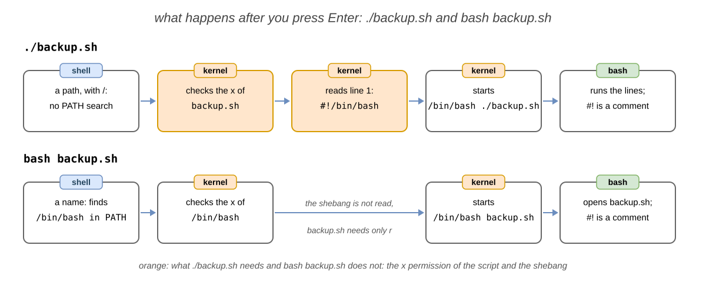

# 08. Scripturi shell

În laboratorul 7 ați compilat programe C în terminal și ați văzut că un script shell nu se compilează: `bash` îl
citește și îl rulează, linie cu linie. În acest laborator vă scrieți propriile **scripturi shell**. Le rulați cu
**shebang-ul** `#!/bin/bash` sau cu `bash` și le găsiți bug-urile cu **ShellCheck**, în terminal și, printr-un **server
de limbaj**, în editor. Păstrați text în **variabile** și vedeți cum le taie shell-ul în cuvinte la caracterele din
**`IFS`**. **Citiți date** cu `read`, prindeți rezultatul unei comenzi cu **substituția de comenzi** și
calculați cu **expansiunea aritmetică** și cu `bc`. Apoi luați decizii cu `if`, `test` și `case`, repetați comenzi cu
buclele `while` și `for`, grupați comenzi în **funcții** și dați unui script **parametri**.

Cea mai importantă idee a laboratorului este că un script este o listă de **linii de comandă**, iar shell-ul o tratează
pe fiecare la fel ca pe linia pe care o tastați: înlocuiește variabilele, taie rezultatul în **cuvinte** și rulează o
**comandă**. Chiar și condiția lui `if` și `while` este o comandă, și decide doar **codul ei de ieșire**: `0` înseamnă
adevărat, orice altceva înseamnă fals.

## Obiective {/* #objectives */}

- Să scrieți un script cu **shebang** și comentarii și să îl rulați cu `./script.sh` și cu `bash script.sh`
- Să urmăriți un script, comandă cu comandă, cu `bash -x`
- Să găsiți bug-urile obișnuite ale unui script înainte să ruleze, cu `shellcheck`, și să le vedeți în editor prin
  serverul de limbaj `bash-language-server`
- Să păstrați text în **variabile** și să înțelegeți de ce un `$NAME` fără ghilimele este tăiat în cuvinte la
  caracterele din `IFS`
- Să citiți o linie tastată de utilizator sau o linie dintr-un fișier cu `read` (`-p`, `-r`, mai multe variabile,
  `IFS=: read`)
- Să puneți rezultatul unei comenzi într-o variabilă cu **substituția de comenzi**, `$(...)`
- Să calculați cu numere întregi cu `$((...))` și `((...))`, și cu zecimale cu `bc`
- Să luați decizii cu `if`, `elif` și `else`, pe baza codului de ieșire al unei comenzi, al lui `test`, `[ ]`, `[[ ]]`
  sau `(( ))`
- Să comparați un text cu **șabloane** folosind `case`
- Să repetați comenzi cu `while`, `until` și `while read` și să ieșiți dintr-o buclă cu `break`
- Să parcurgeți o listă de cuvinte, fișierele unui glob sau ale lui `find`, ori un șir de numere, cu `for`,
  `while read`, `seq` și `{1..5}`
- Să scrieți **funcții** cu variabile `local`, să întoarceți un rezultat cu `echo` și succesul sau eșecul cu `return`
- Să citiți **parametrii** unui script, `$0`, `$1`, `$#` și `"$@"`, și să îl încheiați cu `exit`

## Resurse {/* #resources */}

1. _[Răzvan Deaconescu, Răzvan Rughiniș, Mihai Carabaș, Alexandru Radovici, Utilizarea Sistemelor de
   Operare, Printech 2021](https://github.com/systems-cs-pub-ro/carte-uso/releases/download/uso-ed1-2021/uso.pdf)_
   - Capitolul 7 - _Interfața în linia de comandă_, secțiunile 7.2.2 - 7.2.5
   - Capitolul 13 - _Automatizarea sarcinilor_, secțiunile 13.1 - 13.3, 13.4.1 și 13.4.2
2. _Brian Ward, How LINUX Works, 3rd Edition, No Starch Press, 2021_
   - Capitolul 2 - _Basic Commands and Directory Hierarchy_, secțiunea 2.8
   - Capitolul 11 - _Introduction to Shell Scripts_, secțiunile 11.1 - 11.7, 11.10, 11.11, 11.13 și 11.14
3. _[Bash Reference Manual](https://www.gnu.org/software/bash/manual/bash.html)_, secțiunea 3.2.5 - _Compound
   Commands_, secțiunea 3.3 - _Shell Functions_ și secțiunea 3.5 - _Shell Expansions_;
   _[ShellCheck](https://www.shellcheck.net)_ și pagina fiecărui avertisment din
   _[wiki](https://www.shellcheck.net/wiki/)_;
   _[bash-language-server](https://github.com/bash-lsp/bash-language-server)_
4. Slide-urile cursului: [08. Scripturi shell](/docs/lectures/08)
5. Paginile de manual: `man bash` (căutați `Compound Commands`, `Word Splitting` și `ARITHMETIC EVALUATION`),
   `man test`, `man seq`, `man bc`, `man expr`, `man basename`, `man dirname`, `man env`, `man find`,
   `man shellcheck`, și `help read`,
   `help test`, `help for` pentru comenzile interne

## Fedora și Ubuntu {/* #fedora-and-ubuntu */}

Calculatoarele din laborator rulează **Fedora** cu **Sway**, iar exemplele sunt luate de pe ele. Acasă puteți folosi
și **Ubuntu**: scripturile sunt aceleași, cu câteva diferențe:

|                                                 | Fedora                                                    | Ubuntu                                                                             |
| ----------------------------------------------- | --------------------------------------------------------- | ---------------------------------------------------------------------------------- |
| `/bin/sh`                                       | `bash`                                                    | `dash`, un shell mai mic: fără `[[ ]]`, `((...))`, `{1..5}`                        |
| instalarea `bc`, dacă lipsește                  | `sudo dnf install bc`                                     | `sudo apt install bc`                                                              |
| instalarea ShellCheck și a serverului de limbaj | `sudo dnf install ShellCheck nodejs-bash-language-server` | `sudo apt install shellcheck npm`, apoi `sudo npm install -g bash-language-server` |

## Scripturi shell {/* #shell-scripts */}

Un **script shell** este un fișier text cu linii de comandă. În loc să tastați comenzile una câte una, le scrieți în
fișier, iar `bash` le rulează pentru voi, una după alta. Scripturile sunt bune la lipit comenzi între ele (copiere,
verificare, redenumire, raport); pentru calcule grele, folosiți un limbaj ca Python sau C.

### Scrierea unui script {/* #writing-a-script */}

Exemplele din acest laborator rulează în `~/lab08`, pe care îl creează [exercițiul 1](#first-steps). `backup.sh`
copiază `fruits.txt` într-un director:

```bash title="~/lab08/backup.sh"
#!/bin/bash
# copy the fruits into a backup folder
mkdir -p backup
cp fruits.txt \
   backup/
echo "backup done"; ls backup
```

| Scris ca                    | Ce înseamnă                                                                                    |
| --------------------------- | ---------------------------------------------------------------------------------------------- |
| `#!/bin/bash`               | **shebang-ul**, mereu pe prima linie: programul care rulează scriptul                          |
| `# ...`                     | un **comentariu**: `bash` ignoră restul liniei                                                 |
| sfârșitul unei linii        | sfârșitul unei comenzi: `bash` o rulează, așteaptă să se termine, apoi citește linia următoare |
| `a; b`                      | două comenzi pe o linie: `a`, apoi `b`                                                         |
| `\` la sfârșitul unei linii | comanda continuă pe linia următoare: `cp` primește atât `fruits.txt`, cât și `backup/`         |

Scrieți scripturile cu un editor din [Editoare de text](/docs/labs/06#text-editors) din laboratorul 6. `.sh` de la
sfârșitul numelui este doar o convenție: Linux se uită la conținutul unui fișier, nu la numele lui.

### Rularea unui script {/* #running-a-script */}

```shell-session
[student@fedora lab08]$ ./backup.sh
bash: ./backup.sh: Permission denied
[student@fedora lab08]$ bash backup.sh
backup done
fruits.txt
[student@fedora lab08]$ chmod +x backup.sh
[student@fedora lab08]$ ./backup.sh
backup done
fruits.txt
```

- `./backup.sh` a eșuat: un fișier nou nu are permisiunea `x` (vedeți [`chmod`](/docs/labs/05#chmod) în laboratorul 5).
- `bash backup.sh` a mers totuși: programul este `bash`, iar scriptul este doar un fișier pe care îl citește.
- După `chmod +x`, kernelul a citit shebang-ul lui `./backup.sh` și a rulat `/bin/bash ./backup.sh`.



| Comanda          | De ce are nevoie                                                                                         |
| ---------------- | -------------------------------------------------------------------------------------------------------- |
| `./backup.sh`    | de permisiunea `x` și de shebang; de `./`, pentru că directorul curent nu este în `PATH` (laboratorul 4) |
| `bash backup.sh` | doar de permisiunea `r`; pentru `bash`, shebang-ul este un comentariu                                    |

Shebang-ul merge pentru orice limbaj: un fișier care începe cu `#!/usr/bin/python3` este rulat de Python.

Scriptul rulează într-un proces `bash` **nou**, un copil al shell-ului vostru. Un `cd` sau o variabilă din script
schimbă doar acel proces, iar procesul se termină odată cu scriptul: shell-ul vostru rămâne unde era. Exercițiile de
acasă și provocările au nevoie de detalii: le găsiți în [Subshell-uri](#subshells).

:::caution

Rulați scripturile cu `./script.sh` sau cu `bash script.sh`, nu cu `sh script.sh`: `sh` sare peste shebang, iar pe
Ubuntu este `dash`, care nu cunoaște multe dintre facilitățile lui `bash` (vedeți
[Fedora și Ubuntu](#fedora-and-ubuntu)).

:::

### Urmărirea unui script: `bash -x` {/* #following-a-script-bash--x */}

`bash -x` afișează fiecare comandă, cu un `+` în față, după ce shell-ul a înlocuit variabilele și înainte ca acea
comandă să ruleze. Este primul lucru de încercat când un script face ceva la care nu vă așteptați:

```shell-session
[student@fedora lab08]$ bash -x backup.sh
+ mkdir -p backup
+ cp fruits.txt backup/
+ echo 'backup done'
backup done
+ ls backup
fruits.txt
```

:::tip

`set -x` pe o linie a scriptului pornește urmărirea de acolo, iar `set +x` o oprește: urmăriți doar partea pe care o
bănuiți.

:::

## Verificarea scripturilor {/* #checking-scripts */}

`bash -x` arată ce face un script **în timp ce** rulează. **ShellCheck** găsește bug-urile obișnuite **înainte** să
ruleze, citind textul scriptului, ca avertismentele lui `gcc -Wall` din laboratorul 7. Instalați-l, împreună cu
serverul de limbaj care îi arată avertismentele în editor, cum spune [Fedora și Ubuntu](#fedora-and-ubuntu).

### Găsirea bug-urilor: `shellcheck` {/* #finding-bugs-shellcheck */}

```bash title="~/lab08/notes.sh"
#!/bin/bash
# count the lines of a file
file="my notes.txt"
wc -l $file
```

```shell-session
[student@fedora lab08]$ bash notes.sh
wc: my: No such file or directory
wc: notes.txt: No such file or directory
0 total
[student@fedora lab08]$ shellcheck notes.sh

In notes.sh line 4:
wc -l $file
      ^---^ SC2086 (info): Double quote to prevent globbing and word splitting.

Did you mean:
wc -l "$file"
...
```

- `wc` a primit două cuvinte, `my` și `notes.txt`: `$file` fără ghilimele a fost tăiat la spațiu (vedeți
  [Ghilimele și escaping](/docs/labs/04#quoting-and-escaping) în laboratorul 4).
- `shellcheck` a găsit bug-ul fără să ruleze scriptul: linia, un `^---^` sub cuvânt, un **cod**, `SC2086`, și
  corectura. `https://www.shellcheck.net/wiki/SC2086` explică fiecare cod, cu exemple.

Avertismentele pe care le veți întâlni în acest laborator:

| Cod      | Ce înseamnă                                                                             |
| -------- | --------------------------------------------------------------------------------------- |
| `SC2086` | o variabilă fără ghilimele: este tăiată în cuvinte, iar globurile ei sunt expandate     |
| `SC2162` | `read` fără `-r`: elimină caracterele `\`                                               |
| `SC2045` | `for f in $(ls ...)`: un nume de fișier cu spații strică bucla; folosiți un glob        |
| `SC2044` | `for f in $(find ...)`: aceeași problemă; folosiți `find ... \| while read` sau `-exec` |
| `SC2034` | o variabilă setată, dar nefolosită niciodată: deseori o greșeală de tastare în nume     |
| `SC1009` | o eroare de sintaxă, de exemplu un `fi` sau un `done` care lipsește                     |

:::tip

Când **vreți** tăierea, scrieți comentariul `# shellcheck disable=SC2086` pe linia dinainte: îi spune cititorului că
ați ales-o.

:::

### În editor: `bash-language-server` {/* #in-the-editor-bash-language-server */}

În [Un editor cu server de limbaj](/docs/labs/07#an-editor-with-a-language-server) din laboratorul 7, editorul vostru a
folosit `clangd` pentru C. Pentru scripturi shell, serverul de limbaj este **`bash-language-server`**: rulează
`shellcheck` după fiecare modificare și marchează avertismentele în text, completează numele comenzilor și ale
variabilelor și arată ajutorul comenzii de sub cursor. Tastele sunt cele din laboratorul 7.

| Editor                  | De ce are nevoie ca să folosească `bash-language-server`                                                                                                                 |
| ----------------------- | ------------------------------------------------------------------------------------------------------------------------------------------------------------------------ |
| `vim`                   | în `~/.vimrc`, un al doilea `lsp#register_server`, ca cel pentru `clangd`, cu `'cmd': {server_info->['bash-language-server', 'start']}` și `'allowlist': ['sh', 'bash']` |
| `nvim` 0.11 sau mai nou | liniile de mai jos, în `~/.config/nvim/init.lua`                                                                                                                         |
| `hx` (Helix)            | nimic: `hx --health bash` arată `✓ bash-language-server`                                                                                                                 |
| `emacs` 29 sau mai nou  | `(add-hook 'sh-mode-hook 'eglot-ensure)` în `~/.emacs.d/init.el`                                                                                                         |
| `code` (VS Code)        | extensia **Bash IDE** (`code --install-extension mads-hartmann.bash-ide-vscode`), care își aduce propriul server                                                         |
| `zed` (Zed)             | nimic: descarcă singur serverul                                                                                                                                          |

```lua title="~/.config/nvim/init.lua (add)"
vim.lsp.config('bashls', {
  cmd = { 'bash-language-server', 'start' },
  filetypes = { 'sh', 'bash' },
})
vim.lsp.enable('bashls')
```

Fiecare editor are nevoie de `shellcheck` instalat: fără el, serverul de limbaj completează nume, dar nu arată niciun
avertisment.

## Variabile {/* #variables */}

Ați întâlnit variabilele în [Variabile shell și `export`](/docs/labs/04#shell-variables-and-export) în laboratorul 4:
`NAME=value` **fără spații** în jurul lui `=`, `$NAME` sau `${NAME}` ca să o folosiți, `unset` ca să o ștergeți. Într-un
script, două reguli contează cel mai mult:

- O variabilă conține **text**. `msg="I like $fruit"` păstrează valoarea pe care `fruit` o avea **atunci**, nu o
  formulă, iar `$a+$b` este doar textul `2+3` (ca să calculați, vedeți [Aritmetică](#arithmetic)).
- O linie începe cu o **comandă**: în `fruit= kiwi`, spațiul încheie atribuirea, iar `kiwi` este comanda.

```shell-session
[student@fedora lab08]$ fruit=kiwi
[student@fedora lab08]$ echo "I like $fruit, ${fruit}s are green"
I like kiwi, kiwis are green
[student@fedora lab08]$ msg="I like $fruit"
[student@fedora lab08]$ fruit=plum
[student@fedora lab08]$ echo "$msg"
I like kiwi
[student@fedora lab08]$ a=2; b=3; echo $a+$b
2+3
[student@fedora lab08]$ fruit= kiwi
bash: kiwi: command not found
```

- `${fruit}s` a avut nevoie de acolade: `$fruits` este altă variabilă, care nu există.
- `msg` nu s-a schimbat odată cu `fruit`: shell-ul a înlocuit `$fruit` când a rulat linia `msg=...`.
- `fruit= kiwi` a rulat comanda `kiwi`, cu un `fruit` gol doar pentru ea (vedeți
  [O variabilă pentru o singură comandă](/docs/labs/04#a-variable-for-one-command) în laboratorul 4).

### Tăierea în cuvinte: `IFS` {/* #splitting-words-ifs */}

După ce înlocuiește un `$NAME` **fără ghilimele**, shell-ul taie valoarea în cuvinte la caracterele din variabila
**`IFS`** (_Internal Field Separator_). Implicit, `IFS` conține un spațiu, un tab și un newline. Între ghilimele duble,
`"$NAME"` rămâne **un singur** cuvânt (vedeți [Ghilimele și escaping](/docs/labs/04#quoting-and-escaping) în
laboratorul 4). Gândiți-vă la caracterele din `IFS` ca la locurile în care taie foarfeca.

```shell-session
[student@fedora lab08]$ printf '%q\n' "$IFS"
$' \t\n'
[student@fedora lab08]$ x="Bob   Jones:20"
[student@fedora lab08]$ printf '[%s]\n' $x
[Bob]
[Jones:20]
[student@fedora lab08]$ printf '[%s]\n' "$x"
[Bob   Jones:20]
[student@fedora lab08]$ IFS=:
[student@fedora lab08]$ printf '[%s]\n' $x
[Bob   Jones]
[20]
[student@fedora lab08]$ unset IFS
```

- `printf '%q\n'` a arătat caracterele invizibile din `IFS`: un spațiu, `\t` (tab) și `\n` (newline).
- `printf '[%s]\n'` afișează între paranteze fiecare cuvânt primit (laboratorul 4): fără ghilimele, `$x` a devenit
  două cuvinte; cu ghilimele, unul.
- După `IFS=:`, doar `:` a tăiat valoarea, iar spațiile au fost caractere obișnuite. `unset IFS` a revenit la valoarea
  implicită.


| Caracterul din `IFS`     | Cum taie                                                                                         |
| ------------------------ | ------------------------------------------------------------------------------------------------ |
| spațiu, tab, newline     | mai multe la rând fac **o singură** tăietură; la începutul și la sfârșitul valorii sunt ignorate |
| oricare altul (`:`, `,`) | **fiecare** taie: `a::c` dă trei cuvinte, `a`, un cuvânt gol și `c`                              |

:::caution

Puneți fiecare variabilă între ghilimele duble, `"$NAME"`, dacă nu **vreți** să fie tăiată. După ce schimbați `IFS`,
rulați `unset IFS`: până atunci, fiecare variabilă fără ghilimele este tăiată la noile caractere.

:::

## Citirea datelor: `read` {/* #reading-input-read */}

`read` este o comandă internă a shell-ului (manualul ei este `help read`). Așteaptă o linie, până la <kbd>Enter</kbd>,
și o pune în variabile:

| Comanda                 | Ce face                                                                                |
| ----------------------- | -------------------------------------------------------------------------------------- |
| `read NAME`             | citește o linie în `NAME`                                                              |
| `read -p "<TEXT>" NAME` | scrie întâi întrebarea `<TEXT>` (un _prompt_)                                          |
| `read A B C`            | taie linia la `IFS`: câte un cuvânt pentru fiecare variabilă, iar **ultima** ia restul |
| `IFS=: read A B C`      | taie linia la `:`, doar pentru acest `read`                                            |
| `read -r NAME`          | _raw_: păstrează caracterele `\`; fără `-r`, `read` le elimină                         |
| `IFS= read -r NAME`     | citește linia **exact**, cu spațiile de la începutul și de la sfârșitul ei             |
| `read NAME < <FILE>`    | citește prima linie din `<FILE>`                                                       |

```shell-session
[student@fedora lab08]$ read -p "Full name: " first last
Full name: Carol Ann Smith
[student@fedora lab08]$ echo "$last, $first"
Ann Smith, Carol
[student@fedora lab08]$ head -n 1 /etc/passwd
root:x:0:0:Super User:/root:/bin/bash
[student@fedora lab08]$ IFS=: read user x uid rest < /etc/passwd
[student@fedora lab08]$ echo "$user has the UID $uid"
root has the UID 0
```

- `first` a primit `Carol`, iar `last`, ultima variabilă, a primit restul liniei.
- `IFS=:` înaintea lui `read` este o variabilă doar pentru acea comandă: linia a fost tăiată la `:`, iar `IFS` a rămas
  cel implicit.

`read` se termină cu `0` când a citit o linie și cu `1` la sfârșitul intrării (<kbd>Ctrl</kbd>+<kbd>D</kbd> la
tastatură sau sfârșitul unui fișier): [`while read`](#reading-a-file-while-read) se oprește la el.

## Substituția de comenzi: `$(...)` {/* #command-substitution- */}

`$(command)` rulează comanda și pune în locul ei **rezultatul afișat**, ca text; apoi shell-ul rulează linia. Folosiți-o
ca să păstrați rezultatul unei comenzi într-o variabilă sau ca să îl puneți în mijlocul unui text. Newline-urile de la
sfârșitul rezultatului sunt eliminate.

```shell-session
[student@fedora lab08]$ count=$(wc -l < fruits.txt)
[student@fedora lab08]$ echo "$count fruits on $(date +%A)"
7 fruits on Monday
[student@fedora lab08]$ echo "$(sort -u fruits.txt | wc -l) kinds"
5 kinds
```

- `count` conține textul `7`, rezultatul lui `wc -l < fruits.txt`; `wc` nu mai rulează din nou când folosiți `$count`.
- `$(...)` merge și în interiorul lui `"..."` și poate conține un pipeline întreg.

Comanda rulează într-o **copie** a shell-ului: o variabilă pe care o schimbă se schimbă doar în copie (vedeți
[Subshell-uri](#subshells)). `` `command` `` este vechiul mod de a scrie `$(command)`.

## Aritmetică {/* #arithmetic */}

Pentru shell, `2` și `3` sunt text: `echo $a+$b` afișează `2+3`. Ca să calculați, trebuie să cereți asta explicit.

### Numere întregi: `$((...))` și `((...))` {/* #integers--and- */}

| Scris ca         | Ce face                                                                                                   |
| ---------------- | --------------------------------------------------------------------------------------------------------- |
| `$((<EXPR>))`    | shell-ul calculează `<EXPR>` și pune **rezultatul** în locul ei, ca text                                  |
| `((<EXPR>))`     | o comandă care calculează `<EXPR>`: ca să schimbați o variabilă, `((n++))`, sau ca o condiție             |
| `expr <A> + <B>` | un **program** vechi care afișează rezultatul; fiecare număr și operator este un parametru, `*` este `\*` |

În interiorul lui `((...))`, variabilele nu au nevoie de `$`, iar operatorii sunt cei din C:

| Operator          | Ce face                                              | Exemplu                                           |
| ----------------- | ---------------------------------------------------- | ------------------------------------------------- |
| `+ - * /`         | adunare, scădere, înmulțire, împărțire: doar întregi | `$((7 / 2))` este `3`                             |
| `% **`            | restul, puterea                                      | `$((7 % 2))` este `1`, `$((2 ** 10))` este `1024` |
| `< <= > >= == !=` | comparație: `1` este adevărat, `0` este fals         | `$((3 > 2))` este `1`                             |
| `&& \|\| !`       | și, sau, nu                                          | `$((1 && 0))` este `0`                            |
| `= += -= ++ --`   | schimbă o variabilă                                  | `((n += 2))`                                      |
| `( )`             | grupare                                              | `$(( (2 + 3) * 4 ))` este `20`                    |

```shell-session
[student@fedora lab08]$ a=7; b=2
[student@fedora lab08]$ echo "$a + $b = $((a + b))"
7 + 2 = 9
[student@fedora lab08]$ echo $((a / b)) $((a % b)) $((a ** b))
3 1 49
[student@fedora lab08]$ ((a++)); echo $a
8
[student@fedora lab08]$ echo $(a+b)
bash: a+b: command not found

```

- `$((a / b))` a renunțat la zecimale: `7 / 2` este `3`, cu restul `1`.
- `$(a+b)`, cu **o singură** pereche de paranteze, este substituție de comenzi: shell-ul a căutat o comandă numită
  `a+b`.

### Zecimale: `bc` {/* #decimals-bc */}

`bash` calculează doar cu numere întregi. Pentru zecimale, scrieți expresia ca text și trimiteți-o lui `bc`, un
calculator care citește expresii de la intrare și afișează rezultatele:

```shell-session
[student@fedora lab08]$ echo $((3.5 * 2))
bash: 3.5 * 2: syntax error: invalid arithmetic operator (error token is ".5 * 2")
[student@fedora lab08]$ echo "3.5 * 2" | bc
7.0
[student@fedora lab08]$ echo "10 / 3" | bc
3
[student@fedora lab08]$ echo "scale=2; 10 / 3" | bc
3.33
```

- `bc` împarte fără zecimale, dacă `scale` nu spune câte să păstreze.
- Ca să păstrați rezultatul, combinați-l cu substituția de comenzi: `total=$(echo "$price * $count" | bc)`.

## Condiții {/* #conditions */}

### `if` {/* #if */}

`if` rulează o **comandă** și se uită la codul ei de ieșire (vedeți [Coduri de ieșire](/docs/labs/06#exit-codes) în
laboratorul 6): când acesta este `0`, rulează comenzile de după `then`; altfel, `if` încearcă următorul `elif` sau
rulează comenzile de după `else`. `fi` (`if` de la coadă la cap) îl încheie; `elif` și `else` sunt opționale.

```bash title="~/lab08/kiwi.sh"
#!/bin/bash
if grep -q kiwi fruits.txt; then
    echo "we have kiwi"
elif grep -q plum fruits.txt; then
    echo "no kiwi, but we have plums"
else
    echo "no kiwi, no plums"
fi
```

`grep -q` nu afișează nimic: doar se termină cu `0` când găsește textul. `;` încheie comanda dinaintea lui `then`.

:::caution

Condiția este o **linie de comandă**, nu o formulă. `if $a > $b` rulează comanda `7` (cu `a=7`) și îi trimite
rezultatul într-un fișier nou numit `3`: `7: command not found`, așa că `if` alege ramura `else`. Ca să comparați,
folosiți `test`.

:::

### `test` și `[` {/* #test-and- */}

`test` este o comandă care verifică o condiție, nu afișează nimic și se termină cu `0` (adevărat) sau `1` (fals). `[`
este aceeași comandă, cu o regulă în plus: ultimul ei parametru trebuie să fie `]`.

| Test                                             | Adevărat când                                           |
| ------------------------------------------------ | ------------------------------------------------------- |
| `<A> -eq <B>`, `-ne`, `-lt`, `-le`, `-gt`, `-ge` | **numerele** sunt egale, diferite, `<`, `<=`, `>`, `>=` |
| `"<S>" = "<T>"`, `"<S>" != "<T>"`                | **textele** sunt egale, diferite                        |
| `-z "<S>"`, `-n "<S>"`                           | textul este gol, nu este gol                            |
| `-e <FILE>`, `-f <FILE>`, `-d <FILE>`            | există; este un fișier obișnuit; este un director       |
| `-r <FILE>`, `-w <FILE>`, `-x <FILE>`            | aveți voie să îl citiți, să îl scrieți, să îl rulați    |
| `! <TEST>`                                       | testul este fals                                        |

```shell-session
[student@fedora lab08]$ a=2; b=3
[student@fedora lab08]$ [ $a -lt $b ]; echo $?
0
[student@fedora lab08]$ [ -d fruits.txt ]; echo $?
1
[student@fedora lab08]$ type -a [
[ is a shell builtin
[ is /usr/bin/[
[student@fedora lab08]$ [$a -lt $b]
bash: [2: command not found
```

- `type -a` a arătat că `[` este o comandă internă și, în plus, un program din `/usr/bin`.
- `[$a -lt $b]` a devenit cuvântul `[2` și nu există nicio comandă cu acest nume.

:::caution

**`[` este o comandă**: shell-ul taie linia în cuvinte înainte să pornească `[`. Puneți spații în jurul lui `[`, `]` și
al fiecărui operator și puneți variabilele între ghilimele: cu un `x` gol, `[ $x = abc ]` devine `[ = abc ]`, iar `[`
spune `=: unary operator expected`; `[ "$x" = abc ]` merge. Comparați numere cu `-lt`, nu cu `<`: în interiorul lui
`[ ]`, `<` și `>` sunt redirectări.

:::

### `[[ ]]` și `(( ))` {/* #--and-- */}

`bash` are două forme mai ușoare. Ele fac parte din limbajul lui `bash` (cuvinte cheie), nu sunt comenzi, deci merg
doar în `bash`, nu și în `sh`:

| Forma          | Ce aduce în plus                                                                                                  |
| -------------- | ----------------------------------------------------------------------------------------------------------------- |
| `[[ <TEST> ]]` | ca `[`, dar o variabilă fără ghilimele **nu** este tăiată, `&&` și `\|\|` merg înăuntru, iar `==` acceptă un glob |
| `(( <EXPR> ))` | aritmetica lui `$((...))` ca o condiție: adevărată când rezultatul **nu** este `0`                                |

```shell-session
[student@fedora lab08]$ if (( a < b )); then echo "smaller"; fi
smaller
[student@fedora lab08]$ f="my notes.txt"; [[ $f == *.txt ]] && echo "a text file"
a text file
```

### Alegerea după șablon: `case` {/* #choosing-by-pattern-case */}

`case` compară un text cu **șabloane**, de sus în jos, și rulează ramura **primului** șablon care se potrivește.
Șabloanele sunt globuri (vedeți [Globbing](/docs/labs/04#globbing) în laboratorul 4), iar `|` între ele înseamnă _sau_:

```bash title="~/lab08/color.sh"
#!/bin/bash
read -p "Fruit: " fruit
case $fruit in
    banana | lemon)
        echo "yellow" ;;
    kiwi | lime)
        echo "green" ;;
    *berry)
        echo "a berry" ;;
    *)
        echo "I do not know $fruit" ;;
esac
```

- `;;` încheie o ramură: `case` sare după `esac` (`case` de la coadă la cap) și nu le mai încearcă pe celelalte.
- `*)` se potrivește cu orice: ramura implicită, mereu ultima. Fără ea, când nu se potrivește nimic, nu rulează nimic.

## Bucle {/* #loops */}

### `while` și `until` {/* #while-and-until */}

`while` rulează o comandă înainte de fiecare tură: cât timp aceasta se termină cu `0`, `while` rulează **corpul**,
comenzile dintre `do` și `done`. `until` face invers: repetă cât timp comanda **nu** se termină cu `0`.

```bash title="~/lab08/countdown.sh"
#!/bin/bash
n=3
while [ $n -gt 0 ]; do
    echo "$n..."
    n=$((n - 1))
done
echo "go!"
```

```shell-session
[student@fedora lab08]$ bash countdown.sh
3...
2...
1...
go!
```

| Scris ca                        | Ce face                                               |
| ------------------------------- | ----------------------------------------------------- |
| `while <COMMAND>; do ...; done` | repetă cât timp `<COMMAND>` se termină cu `0`         |
| `until <COMMAND>; do ...; done` | repetă până când `<COMMAND>` se termină cu `0`        |
| `while true; do ...; done`      | repetă la nesfârșit, până la un `break`               |
| `break`                         | iese din buclă                                        |
| `continue`                      | sare peste restul corpului și trece la tura următoare |

:::caution

Corpul trebuie să schimbe ce testează condiția (aici, `n`), altfel bucla nu se mai termină: opriți-o cu
<kbd>Ctrl</kbd>+<kbd>C</kbd>.

:::

### Citirea unui fișier: `while read` {/* #reading-a-file-while-read */}

`< <FILE>` după `done` este intrarea **întregii bucle**: fiecare `read` ia linia următoare, iar la sfârșitul fișierului
`read` se termină cu `1`, ceea ce oprește bucla.

```shell-session
[student@fedora lab08]$ while read fruit; do echo "buy $fruit"; done < shopping.txt
buy apple
buy kiwi
buy cherry
[student@fedora lab08]$ while IFS=, read user name; do echo "$user is $name"; done < people.csv
bob is Bob Jones
carol is Carol Smith
dave is Dave Brown
```

- `IFS=, read` a tăiat fiecare linie doar la `,`: spațiul din `Bob Jones` a rămas în `name`.

:::caution

Scrieți `done < <FILE>`, nu `cat <FILE> | while read ...`: după un pipe, bucla rulează într-o copie a shell-ului, iar
variabilele pe care le schimbă se pierd când se termină (vedeți [Subshell-uri](#subshells)).

:::

### `for` {/* #for */}

`for` dă unei variabile fiecare cuvânt dintr-o listă, pe rând, și rulează corpul o dată pentru fiecare cuvânt:

| Scris ca                | Cuvintele                                                                            |
| ----------------------- | ------------------------------------------------------------------------------------ |
| `for f in apple kiwi`   | cuvintele scrise după `in`                                                           |
| `for f in *.txt`        | numele fișierelor care se potrivesc cu globul, fiecare un cuvânt, chiar și cu spații |
| `for w in $(<COMMAND>)` | rezultatul comenzii, tăiat la `IFS`                                                  |
| `for p in "$@"`         | parametrii scriptului (vedeți [Parametrii unui script](#script-parameters))          |

```shell-session
[student@fedora lab08]$ for f in *.txt; do echo "$f: $(wc -l < "$f") lines"; done
fruits.txt: 7 lines
my notes.txt: 2 lines
shopping.txt: 3 lines
[student@fedora lab08]$ for f in $(ls *.txt); do echo "[$f]"; done
[fruits.txt]
[my]
[notes.txt]
[shopping.txt]
```

- Globul a dat `my notes.txt` ca **un singur** cuvânt, iar `"$f"` l-a păstrat întreg pentru `wc`.
- Rezultatul lui `ls` a fost tăiat la `IFS`: `my notes.txt` a devenit două cuvinte. Parcurgeți fișierele cu un glob,
  niciodată cu `$(ls)`.

Ca să tăiați o valoare la alt caracter, setați `IFS` **înaintea** buclei și dați-i `unset` după: `IFS=: for ...` este o
eroare de sintaxă, pentru că `for` este un cuvânt cheie, nu o comandă.

```shell-session
[student@fedora lab08]$ line="apple:kiwi:cherry"
[student@fedora lab08]$ IFS=:
[student@fedora lab08]$ for f in $line; do echo "[$f]"; done
[apple]
[kiwi]
[cherry]
[student@fedora lab08]$ unset IFS
```

### Fișiere din subdirectoare: `find` {/* #files-in-subfolders-find */}

Un glob vede doar un director. `find` (vedeți [Căutarea fișierelor](/docs/labs/02#finding-files-find) în
laboratorul 2) caută și în fiecare subdirector și afișează câte o cale pe linie:

| Scris ca                                                          | Ce face                                                                                    |
| ----------------------------------------------------------------- | ------------------------------------------------------------------------------------------ |
| `find <DIR> -name '<GLOB>' \| while IFS= read -r f; do ...; done` | câte o tură pentru fiecare cale, chiar și cu spații; variabilele buclei se pierd după pipe |
| `find <DIR> -name '<GLOB>' -exec <COMMAND> {} +`                  | `find` rulează singur `<COMMAND>`, cu căile în locul lui `{}`: fără buclă și fără tăiere   |
| `for f in $(find ...)`                                            | rezultatul este tăiat la `IFS`: un nume cu spații se strică, ca la `$(ls)`                 |

```shell-session
[student@fedora lab08]$ find . -name '*.jpeg' | sort | while IFS= read -r f; do echo "[$f]"; done
[./photos/cat.jpeg]
[./photos/dog.jpeg]
[./photos/summer beach.jpeg]
[student@fedora lab08]$ for f in $(find . -name '*.jpeg' | sort); do echo "[$f]"; done
[./photos/cat.jpeg]
[./photos/dog.jpeg]
[./photos/summer]
[beach.jpeg]
[student@fedora lab08]$ find photos -name '*.jpeg' -exec ls -s {} +
0 photos/cat.jpeg  0 photos/dog.jpeg  0 'photos/summer beach.jpeg'
```

- `find` afișează căile în nicio ordine anume: `sort` le-a ordonat. `IFS= read -r` a citit fiecare linie exact, cu
  spațiul ei.
- `-exec ls -s {} +` a rulat **un singur** `ls`, cu cele trei căi ca parametri.

### Numărarea: `seq`, `{1..5}` și `for ((...))` {/* #counting-seq-15-and-for- */}

| Scris ca                         | Numerele                                                                                |
| -------------------------------- | --------------------------------------------------------------------------------------- |
| `$(seq <FIRST> <STEP> <LAST>)`   | `seq` este un program care le afișează; merge cu variabile: `$(seq 1 $n)`               |
| `{<FIRST>..<LAST>..<STEP>}`      | scrise de `bash` (_brace expansion_); **fără** variabile: `{1..$n}` rămâne așa cum este |
| `for ((i = 1; i <= 10; i += 3))` | `for`-ul în stil C al lui `bash`                                                        |

```shell-session
[student@fedora lab08]$ for i in $(seq 1 3 10); do echo -n "$i "; done; echo
1 4 7 10
[student@fedora lab08]$ for i in {1..10..3}; do echo -n "$i "; done; echo
1 4 7 10
[student@fedora lab08]$ for ((i = 1; i <= 10; i += 3)); do echo -n "$i "; done; echo
1 4 7 10
```

- `echo -n` nu încheie linia; ultimul `echo` o încheie.

## Funcții {/* #functions */}

O **funcție** este un grup de comenzi cu un nume. O apelați ca pe orice comandă, iar cuvintele de după numele ei sunt
parametrii ei: `$1`, `$2`, ... și `$#`, câți sunt. Definiți o funcție înaintea liniei care o apelează.

```bash title="~/lab08/funcs.sh"
#!/bin/bash
greet() {
    if [ $# -eq 0 ]; then
        return 1
    fi
    echo "Hello, $1!"
}

add() {
    local sum=$(($1 + $2))
    echo "$sum"
}

greet bob && echo "ok"
greet || echo "nobody to greet"
total=$(add 2 3)
echo "total: $total, sum: [$sum]"
```

```shell-session
[student@fedora lab08]$ bash funcs.sh
Hello, bob!
ok
nobody to greet
total: 5, sum: []
```

| Scris ca                     | Ce face                                                                                        |
| ---------------------------- | ---------------------------------------------------------------------------------------------- |
| `<NAME>() { ... }`           | definește funcția; `()` sunt mereu goale                                                       |
| `$1`, `$2`, `$#`             | în interiorul funcției: parametrii apelului și câți sunt                                       |
| `local <VAR>=<VALUE>`        | o variabilă care există doar cât rulează funcția; celelalte variabile sunt cele ale scriptului |
| `return <N>`                 | iese din funcție cu codul de ieșire `<N>`; fără el, cu codul ultimei comenzi                   |
| `echo`, apoi `$(<NAME> ...)` | întoarce un **rezultat**: funcția îl afișează, apelantul îl prinde                             |

- `greet bob` s-a terminat cu `0`, așa că `&&` a rulat `echo "ok"`; `greet` fără parametri a întors `1`, așa că a rulat
  `||`.
- `$(add 2 3)` a prins `5`; `sum` a fost `local`, deci este gol în afara lui `add`.

:::caution

`return` spune succes sau eșec, nu întoarce date: un cod de ieșire este între `0` și `255`, iar `return 300` dă `44`.
Ca să întoarceți un număr sau un text, afișați-l cu `echo`.

:::

## Parametrii unui script {/* #script-parameters */}

Cuvintele de după numele unui script sunt **parametrii** lui, ca la o funcție:

| Parametru              | Valoare                                                        |
| ---------------------- | -------------------------------------------------------------- |
| `$0`                   | numele scriptului, așa cum l-ați tastat                        |
| `$1` ... `$9`, `${10}` | parametrii                                                     |
| `$#`                   | câți parametri sunt                                            |
| `"$@"`                 | toți parametrii, fiecare un cuvânt separat, chiar și cu spații |

```bash title="~/lab08/args.sh"
#!/bin/bash
echo "script: $0"
echo "first:  $1"
echo "count:  $#"
for p in "$@"; do
    echo "[$p]"
done
```

```shell-session
[student@fedora lab08]$ ./args.sh "Carol Smith" bob
script: ./args.sh
first:  Carol Smith
count:  2
[Carol Smith]
[bob]
```

- `"$@"` a păstrat `Carol Smith` ca un singur cuvânt; un `$@` fără ghilimele este tăiat la `IFS`, ca orice variabilă.

Un script se termină cu codul de ieșire al ultimei comenzi sau cu `exit <N>` (vedeți
[Coduri de ieșire](/docs/labs/06#exit-codes) în laboratorul 6). Un script care are nevoie de parametri verifică întâi
`$#`:

```bash
if [ $# -ne 1 ]; then
    echo "usage: $0 <FILE>" >&2
    exit 1
fi
```

`>&2` trimite mesajul la ieșirea de erori, `2`, cum se cuvine unei erori (vedeți
[Erori](/docs/labs/03#errors-2-and-2) în laboratorul 3).

## Subshell-uri {/* #subshells */}

:::note

**Pentru cine vrea să afle mai mult**

Nu aveți nevoie de această secțiune pentru exercițiile din laborator, 🧪 Primii pași. Citiți-o acasă: exercițiile
🏠 Mai departe și 📝 Provocări o folosesc.

:::

Unele comenzi rulează într-un proces nou și nimic din ce schimbă nu se întoarce în shell-ul vostru, în afară de
rezultatul afișat și de codul de ieșire:

| Unde                                              | Cine le rulează                       | Cu ce pornește                                      |
| ------------------------------------------------- | ------------------------------------- | --------------------------------------------------- |
| `./script.sh`, `bash script.sh`                   | un program `bash` nou                 | doar cu variabilele **exportate** (laboratorul 4)   |
| `( ... )`, `$(...)`, fiecare comandă din `a \| b` | un **subshell**: o copie a shell-ului | cu o copie a **tuturor** variabilelor și funcțiilor |

Gândiți-vă la o fotocopie a caietului vostru: puteți scrie pe copie, dar originalul nu se schimbă.

```shell-session
[student@fedora lab08]$ echo "$$ $BASHPID"
4210 4210
[student@fedora lab08]$ (echo "$$ $BASHPID")
4210 4268
[student@fedora lab08]$ (cd /tmp; pwd); pwd
/tmp
/home/student/lab08
[student@fedora lab08]$ x=1; y=$(x=2; echo "inside: $x"); echo "$y, outside: $x"
inside: 2, outside: 1
[student@fedora lab08]$ c=0; cat fruits.txt | while read f; do ((c++)); done; echo "$c"
0
[student@fedora lab08]$ c=0; while read f; do ((c++)); done < fruits.txt; echo "$c"
7
```

- `$$` este PID-ul shell-ului vostru, chiar și într-un subshell; `$BASHPID` este PID-ul procesului care rulează de fapt
  comanda, deci subshell-ul are altul.
- `cd` și `x=2` au schimbat doar copia.
- După `|`, `while` a numărat într-un subshell, iar `c`-ul lui s-a pierdut; cu `< fruits.txt`, bucla a rulat în
  shell-ul vostru.

Ca să rulați un script **în shell-ul vostru**, astfel încât `cd`-ul și variabilele lui să rămână, folosiți
`source script.sh` (sau `. script.sh`): așa citește `bash` fișierul `~/.bashrc`. O funcție apelată în `$(...)` rulează
și ea într-un subshell: poate întoarce doar ce afișează.

## Depanare {/* #troubleshooting */}

| Problema                                                          | Soluția                                                                                                                                          |
| ----------------------------------------------------------------- | ------------------------------------------------------------------------------------------------------------------------------------------------ |
| `bash: ./x.sh: Permission denied`                                 | Scriptul nu are permisiunea `x`: `chmod +x x.sh` sau rulați `bash x.sh`                                                                          |
| `bash: x.sh: command not found`, dar fișierul există              | Directorul curent nu este în `PATH`: rulați `./x.sh`                                                                                             |
| `/bin/bash^M: bad interpreter: No such file or directory`         | Fișierul are sfârșituri de linie Windows: `sed -i 's/\r$//' x.sh`                                                                                |
| Editorul nu arată niciun avertisment într-un script               | Lipsește `shellcheck` sau serverul: `shellcheck --version`, `bash-language-server --version`; pentru `nvim`, liniile din `init.lua`              |
| `bash: name: command not found` după `name = value`               | Fără spații în jurul lui `=`: `name=value`                                                                                                       |
| Un nume de fișier cu spații este tăiat în două                    | Puneți variabila între ghilimele, `"$f"`; parcurgeți fișierele cu un glob sau cu `find ... \| while IFS= read -r f`, nu cu `$(ls)` sau `$(find)` |
| `syntax error: invalid arithmetic operator`                       | `bash` nu are zecimale: folosiți `bc`                                                                                                            |
| `bash: a+b: command not found`                                    | O singură pereche de paranteze este substituție de comenzi: scrieți `$((a + b))`                                                                 |
| `[2: command not found`                                           | `[` este o comandă: puneți un spațiu după el, `[ $a -lt $b ]`                                                                                    |
| ``[: missing `]'``                                                | Puneți un spațiu înainte de `]`                                                                                                                  |
| `[: =: unary operator expected` sau `[: too many arguments`       | O variabilă este goală sau are spații: puneți-o între ghilimele, `[ "$x" = abc ]`                                                                |
| `syntax error near unexpected token` `` `fi' `` (sau `done`, `)`) | Lipsește un `;` sau o linie nouă înainte de `then` sau `do`, sau un `;;` după o ramură a lui `case`                                              |
| `syntax error: unexpected end of file`                            | Lipsește un `fi`, `done`, `esac` sau `}`                                                                                                         |
| `[[: not found` sau `Syntax error: Bad for loop variable`         | Scriptul a rulat cu `sh`, care pe Ubuntu este `dash`: rulați-l cu `bash` sau cu `./x.sh`                                                         |
| Scriptul nu se mai termină                                        | Condiția lui `while` nu se schimbă niciodată: <kbd>Ctrl</kbd>+<kbd>C</kbd>, apoi schimbați variabila în corp                                     |
| Un contor este `0` după `cat <FILE> \| while read`                | Bucla a rulat într-un subshell: scrieți `done < <FILE>`                                                                                          |
| Un `cd` dintr-un script nu vă schimbă directorul                  | Scriptul rulează într-un proces nou: `source x.sh`                                                                                               |

## Exerciții {/* #exercises */}

- 🧪 [Primii pași](#first-steps) (exercițiile 1 - 12): câte o idee pe rând, în ordinea din laborator, de făcut în
  laborator;
- 🏠 [Mai departe](#going-further) (exercițiile 13 - 29): scripturi mai lungi, de făcut acasă; unele se uită la ce
  rulează într-o **copie** a shell-ului, explicată în [Subshell-uri](#subshells);
- 📝 [Provocări](#challenges) (exercițiile 30 - 35): cele mai grele, asemănătoare cu cele de la examen.

:::danger

Un script își rulează comenzile fără să întrebe. Înaintea unei bucle care mută sau șterge fișiere, puneți `echo` în
fața comenzii și citiți ce ar face; și puneți fiecare variabilă între ghilimele: cu un `dir` gol, `rm -r $dir/*` este
`rm -r /*`.

:::

### 🧪 Primii pași {/* #first-steps */}

Faceți aceste exerciții în ordine, în timpul laboratorului. Fiecare începe cu ce trebuie să obțineți și încearcă **o**
singură idee din laborator: dacă vă împotmoliți, citiți secțiunea indicată sub obiectiv. Rulați comenzile în
`~/lab08`, dacă exercițiul nu spune altceva.

1. **Directorul de lucru**: Verificați că uneltele sunt instalate și creați în `~/lab08` fișierele pe care le folosesc
    celelalte exerciții. <small>→ [Fedora și Ubuntu](#fedora-and-ubuntu)</small>

    1. afișați versiunea lui `shellcheck` și a lui `bash-language-server`; instalați-le pe cele care lipsesc;
    2. rulați aceste comenzi (copiați-le din browser cu <kbd>Ctrl</kbd>+<kbd>C</kbd> și lipiți-le în terminal cu
       <kbd>Ctrl</kbd>+<kbd>Shift</kbd>+<kbd>V</kbd>):

       ```bash
       mkdir -p ~/lab08/photos
       cd ~/lab08
       printf '%s\n' banana apple kiwi cherry apple plum kiwi > fruits.txt
       printf '%s\n' apple kiwi cherry > shopping.txt
       printf '%s\n' 'bob,Bob Jones' 'carol,Carol Smith' 'dave,Dave Brown' > people.csv
       printf '%s\n' 'buy milk' 'call grace' > 'my notes.txt'
       touch photos/cat.jpeg photos/dog.jpeg 'photos/summer beach.jpeg'
       ```

    3. listați fișierele din `~/lab08` și din `~/lab08/photos`.

    <details className="reveal">
    <summary>Indiciu</summary>

    Majoritatea comenzilor își afișează versiunea cu `--version`. Pachetele sunt în
    [Fedora și Ubuntu](#fedora-and-ubuntu).

    </details>

    <details className="reveal">
    <summary>Verificare</summary>

    1. `shellcheck --version` și `bash-language-server --version` afișează fiecare o versiune.
    3. `~/lab08` conține `fruits.txt`, `my notes.txt`, `people.csv`, `shopping.txt` și directorul `photos`; `photos`
       conține `cat.jpeg`, `dog.jpeg` și `summer beach.jpeg`.

    </details>

**Scripturi shell**

2. **Primul script**: Scrieți un script care vă salută și se mută în alt director, rulați-l în două feluri și aflați
    unde este shell-ul vostru după ce scriptul se termină. <small>→ [Scrierea unui script](#writing-a-script) · [Rularea unui script](#running-a-script) · [Urmărirea unui script](#following-a-script-bash--x)</small>

    1. scrieți `hello.sh`: un shebang, un comentariu pe linia lui, apoi comenzi care afișează `Hello, ` urmat de
       numele vostru de utilizator, merg în `/tmp` și afișează directorul curent;
    2. rulați-l cu `bash`; apoi rulați-l după cale, citiți eroarea, corectați-o și rulați-l din nou;
    3. afișați directorul curent al shell-ului vostru;
    4. rulați scriptul încă o dată, astfel încât fiecare comandă să fie afișată înainte să ruleze.

    <details className="reveal">
    <summary>Indiciu</summary>

    Variabila `USER` ([laboratorul 4](/docs/labs/04#variables-defined-by-the-system)); `man chmod`; `man bash`: căutați
    `-x`, sau citiți [Urmărirea unui script](#following-a-script-bash--x).

    </details>

    <details className="reveal">
    <summary>Verificare</summary>

    1. Linia 1 este `#!/bin/bash`; comenzile sunt, de exemplu, `echo "Hello, $USER"`, `cd /tmp` și `pwd`.
    2. `bash hello.sh` afișează `Hello, student` și `/tmp`; `./hello.sh` spune `Permission denied` până la
       `chmod +x hello.sh`.
    3. `/home/student/lab08`.
    4. `bash -x hello.sh` afișează `+ echo 'Hello, student'`, `+ cd /tmp` și `+ pwd`, fiecare înaintea rezultatului ei.

    **De ce:** scriptul rulează într-un proces `bash` nou: `cd`-ul lui schimbă doar acel proces, care se termină odată
    cu scriptul.

    </details>

**Variabile**

3. **Text, nu formule**: În terminal, aflați ce conține de fapt o variabilă și unde o taie shell-ul în cuvinte.
    <small>→ [Variabile](#variables) · [Tăierea în cuvinte](#splitting-words-ifs)</small>

    1. setați `fruit` la `kiwi` și `msg` la `I like ` urmat de valoarea lui `fruit`; schimbați `fruit` în `plum` și
       afișați `msg`;
    2. afișați valoarea lui `fruit` urmată de `_salad`, **fără** spațiu între ele;
    3. setați `x` la `Bob   Jones:20` (cu trei spații); afișați cuvintele pe care le face shell-ul din `$x`, câte unul
       pe linie și între paranteze, fără ghilimele, apoi cu ghilimele;
    4. faceți shell-ul să taie `$x` doar la `:`, afișați din nou cuvintele, apoi reveniți la valoarea implicită.

    <details className="reveal">
    <summary>Indiciu</summary>

    [Tăierea în cuvinte](#splitting-words-ifs) afișează cuvintele unei variabile cu `printf '[%s]\n'`. De ce este
    `$fruit_salad` gol?

    </details>

    <details className="reveal">
    <summary>Verificare</summary>

    1. `I like kiwi`.
    2. `echo "${fruit}_salad"` afișează `plum_salad`; `$fruit_salad` este o variabilă care nu există.
    3. Fără ghilimele: `[Bob]` și `[Jones:20]`; cu ghilimele: `[Bob   Jones:20]`.
    4. După `IFS=:`: `[Bob   Jones]` și `[20]`; apoi `unset IFS`.

    **De ce:** o variabilă conține text, pe care shell-ul îl pune în locul ei când rulează linia; fără ghilimele,
    textul este tăiat la caracterele din `IFS`.

    </details>

**Citirea datelor**

4. **Întrebați utilizatorul**: Scrieți `ask.sh`, care cere un nume complet și îl scrie ca `<LAST>, <FIRST>`, apoi
    citește câmpurile primei linii din `/etc/passwd`. <small>→ [Citirea datelor](#reading-input-read)</small>

    1. scrieți `ask.sh`: întreabă `Full name: ` pe aceeași linie, pune primul cuvânt al răspunsului în `first` și
       restul în `last` și afișează `<LAST>, <FIRST>`;
    2. rulați-l și răspundeți `Carol Ann Smith`; rulați-l din nou și răspundeți doar `bob`;
    3. adăugați linii care citesc prima linie din `/etc/passwd`, tăiată la `:`, și afișează
       `<USER> has the UID <UID> and the shell <SHELL>`.

    <details className="reveal">
    <summary>Indiciu</summary>

    `help read`: căutați `-p`; o linie din `/etc/passwd` are 7 câmpuri (laboratorul 5).

    </details>

    <details className="reveal">
    <summary>Verificare</summary>

    2. `Ann Smith, Carol`; apoi `, bob`: `last` este gol.
    3. `IFS=: read user x uid gid info home shell < /etc/passwd`; afișează
       `root has the UID 0 and the shell /bin/bash`.

    </details>

**Substituția de comenzi**

5. **Un raport**: Scrieți `report.sh`, care afișează `<N> fruits, <K> kinds, on <DAY>` pe baza lui `fruits.txt`.
    <small>→ [Substituția de comenzi](#command-substitution-)</small>

    1. păstrați numărul de linii din `fruits.txt` în `count` și numărul de fructe diferite în `kinds`;
    2. afișați linia, cu numele zilei de azi luat de la `date`;
    3. rulați-l cu `bash -x` și găsiți comenzile care au rulat în interiorul lui `$(...)`.

    <details className="reveal">
    <summary>Indiciu</summary>

    `sort -u` și `wc -l` din laboratorul 6; `man date`: căutați `%A`.

    </details>

    <details className="reveal">
    <summary>Verificare</summary>

    2. `7 fruits, 5 kinds, on Monday` (cu numele zilei de azi).
    3. Încep cu `++`: `++ wc -l`, `++ sort -u fruits.txt`, `++ wc -l` și `++ date +%A`.

    **De ce:** fiecare `$(...)` rulează într-o copie a shell-ului, cu un nivel mai jos, așa că `bash -x` îi pune un `+`
    în plus.

    </details>

**Aritmetică**

6. **Prețul unei pardoseli**: Calculați cu numere întregi în terminal, apoi scrieți `area.sh`, care calculează aria
    unei camere și prețul pardoselii ei. <small>→ [Numere întregi](#integers--and-) · [Zecimale](#decimals-bc)</small>

    1. setați `a` la `7` și `b` la `2`; afișați `$a+$b`, apoi suma, câtul și restul lui `a` și `b`;
    2. scrieți `area.sh`: cu **un singur** `read`, citește lățimea și lungimea unei camere, în metri, și afișează
       `area: <AREA> m2`;
    3. adăugați o linie care afișează `price: <PRICE> lei`, prețul pardoselii, la `12.5` lei pe metru pătrat;
    4. rulați-l, cu lățimea `4` și lungimea `3`.

    <details className="reveal">
    <summary>Indiciu</summary>

    [Aritmetică](#arithmetic); de ce eșuează `$((w * h * 12.5))`?

    </details>

    <details className="reveal">
    <summary>Verificare</summary>

    1. `7+2`; apoi `9`, `3` și `1`.
    4. `area: 12 m2` și `price: 150.0 lei` (de exemplu, `echo "$w * $h * 12.5" | bc`).

    </details>

**Condiții**

7. **Ce este?**: Scrieți `what.sh`, care citește un nume și spune dacă este un director, un fișier sau nimic.
    <small>→ [`if`](#if) · [`test` și `[`](#test-and-)</small>

    1. scrieți `what.sh`: citește un nume și afișează `<NAME> is a directory`, `<NAME> is a file` sau
       `<NAME> does not exist`;
    2. rulați-l de trei ori, cu `photos`, `my notes.txt` și `nope`;
    3. scoateți ghilimelele din jurul variabilei în teste, rulați-l din nou cu `my notes.txt` și citiți eroarea;
       verificați scriptul cu `shellcheck`, apoi puneți ghilimelele la loc;
    4. adăugați la sfârșit: dacă `fruits.txt` conține `plum`, afișați `plums: <N>`, numărul de linii cu `plum`; altfel,
       afișați `no plums`; condiția este chiar `grep`, nu `[`.

    <details className="reveal">
    <summary>Indiciu</summary>

    Tabelul din [`test` și `[`](#test-and-); tabelul din [Găsirea bug-urilor](#finding-bugs-shellcheck); `man grep`:
    căutați `--quiet` și `--count`.

    </details>

    <details className="reveal">
    <summary>Verificare</summary>

    2. `photos is a directory`, `my notes.txt is a file`, `nope does not exist`.
    3. `./what.sh: line 3: [: my: binary operator expected` (și la fel pentru al doilea test), apoi
       `my notes.txt does not exist`; `shellcheck` marchează `$name` pe liniile 3 și 5 cu `SC2086` și `read`-ul de pe
       linia 2 cu `SC2162`.
    4. `if grep -q plum fruits.txt; then`; afișează `plums: 1`.

    **De ce:** `[` este o comandă: shell-ul a tăiat `my notes.txt` în două cuvinte înainte să pornească `[`.

    </details>

8. **Ce fel de fișier?**: Scrieți `kind.sh`, care citește un nume de fișier și afișează tipul lui, după sfârșitul
    numelui. <small>→ [Alegerea după șablon](#choosing-by-pattern-case)</small>

    1. scrieți `kind.sh` cu un `case`: fișierele `.txt` și `.md` sunt `text`; fișierele `.jpg`, `.jpeg` și `.png` sunt
       `picture`; fișierele `.sh` sunt `script`; orice altceva este `unknown`;
    2. rulați-l cu `my notes.txt`, `photos/summer beach.jpeg`, `hello.sh` și `Makefile`;
    3. adăugați o ramură pentru numele care încep cu `cat.`, care afișează `a cat`, **după** ramura imaginilor;
       rulați-l cu `cat.jpeg`; apoi mutați noua ramură **înaintea** imaginilor și rulați-l din nou.

    <details className="reveal">
    <summary>Indiciu</summary>

    Șabloanele sunt globuri ([Globbing](/docs/labs/04#globbing) în laboratorul 4); `|` separă șabloanele unei ramuri.

    </details>

    <details className="reveal">
    <summary>Verificare</summary>

    2. `text`, `picture`, `script`, `unknown`.
    3. După imagini: `picture`; înaintea lor: `a cat`.

    **De ce:** `case` rulează doar prima ramură care se potrivește.

    </details>

**Bucle**

9. **Numărătoare inversă, linie cu linie**: Repetați o comandă cât timp o condiție este adevărată, și o dată pentru
    fiecare linie a unui fișier. <small>→ [`while` și `until`](#while-and-until) · [Citirea unui fișier](#reading-a-file-while-read)</small>

    1. scrieți `countdown.sh`: citește un număr și numără invers până la `1`, câte un număr pe linie, apoi afișează
       `go!`; rulați-l cu `3`;
    2. schimbați bucla din `while` în `until`, cu același rezultat;
    3. în terminal, cu **o singură** buclă, afișați `<NAME> (<USER>)` pentru fiecare linie din `people.csv`, apoi
       numărul de linii citite, `<N> people`.

    <details className="reveal">
    <summary>Indiciu</summary>

    `until` repetă cât timp condiția lui este **falsă**: schimbați testul, nu corpul. Numărați cu
    `n=$((n + 1))`.

    </details>

    <details className="reveal">
    <summary>Verificare</summary>

    1. `3...` (sau `3`), `2...`, `1...`, `go!`.
    2. De exemplu, `until [ $n -eq 0 ]; do`.
    3. `Bob Jones (bob)`, `Carol Smith (carol)`, `Dave Brown (dave)`, `3 people`; bucla este
       `while IFS=, read user name; do ...; done < people.csv`.

    </details>

10. **Fiecare fișier, fiecare număr**: Parcurgeți fișierele unui glob, fișierele lui `find` și un șir de numere.
    <small>→ [`for`](#for) · [Fișiere din subdirectoare](#files-in-subfolders-find) · [Numărarea](#counting-seq-15-and-for-)</small>

    1. cu o buclă `for`, afișați `<FILE>: <N> lines` pentru fiecare fișier `.txt`;
    2. cu `find` și o buclă `while read`, afișați între paranteze, în ordine, fiecare fișier `.jpeg` din `~/lab08` și
       din subdirectoarele lui; apoi faceți la fel cu `for` și `$(find ...)` și găsiți numele care se strică;
    3. afișați `0 20 40 60 80 100` pe o linie în două feluri, cu `seq` și cu acolade; apoi setați `n` la `100` și
       încercați acoladele cu `$n` în loc de `100`.

    <details className="reveal">
    <summary>Indiciu</summary>

    `"$f"`, între ghilimele, în corp; `man find`: căutați `-name`; `man seq`: pasul este la mijloc.

    </details>

    <details className="reveal">
    <summary>Verificare</summary>

    1. `fruits.txt: 7 lines`, `my notes.txt: 2 lines`, `shopping.txt: 3 lines`.
    2. `find . -name '*.jpeg' | sort | while IFS= read -r f; do echo "[$f]"; done` afișează `[./photos/cat.jpeg]`,
       `[./photos/dog.jpeg]` și `[./photos/summer beach.jpeg]`; cu `for`, ultimul devine `[./photos/summer]` și
       `[beach.jpeg]`.
    3. `echo $(seq 0 20 100)` și `echo {0..100..20}`; `{0..$n..20}` este afișat așa cum este.

    **De ce:** globul și `IFS= read -r` păstrează un nume cu spații ca un singur cuvânt, dar `$(...)` este tăiat la
    `IFS`; acoladele sunt expandate înaintea variabilelor, deci nu le pot folosi.

    </details>

**Funcții**

11. **Două funcții**: Scrieți `max.sh`, cu o funcție care întoarce un număr și una care răspunde da sau nu.
    <small>→ [Funcții](#functions)</small>

    1. scrieți funcția `max`, care păstrează cel mai mare dintre cei doi parametri ai ei în variabila `local`
       `result` și îl afișează;
    2. apelați-o ca `m=$(max 7 12)`, apoi afișați `max: <M>, result: [<RESULT>]`;
    3. scrieți funcția `is_even`, care nu afișează **nimic**: se termină cu `0` când parametrul ei este par și cu `1`
       altfel;
    4. pentru fiecare număr de la `1` la `4`, afișați `<N> is even` sau `<N> is odd`, cu `is_even` drept condiție a
       unui `if`.

    <details className="reveal">
    <summary>Indiciu</summary>

    O funcție se termină cu codul de ieșire al ultimei ei comenzi: `[ ... ]` poate fi acea comandă.

    </details>

    <details className="reveal">
    <summary>Verificare</summary>

    2. `max: 12, result: []`.
    4. `1 is odd`, `2 is even`, `3 is odd`, `4 is even`.

    **De ce:** o funcție întoarce date afișându-le, iar succesul sau eșecul prin codul ei de ieșire; `result` există
    doar în interiorul lui `max`.

    </details>

**Parametrii unui script**

12. **Recapitulare: suma**: Scrieți `sum.sh`, care adună numerele primite ca parametri și refuză să ruleze fără ele.
    <small>→ [Parametrii unui script](#script-parameters)</small>

    1. când nu primește parametri, afișează `usage: <SCRIPT> <NUMBER>...` la ieșirea de erori și se termină cu codul
       de ieșire `1`;
    2. altfel, adună toți parametrii și afișează `<N> numbers, sum <SUM>`;
    3. rulați `./sum.sh 4 8 15` și afișați codul de ieșire; apoi rulați `./sum.sh > out.txt`, afișați codul de ieșire
       și dimensiunea lui `out.txt`; ștergeți `out.txt`.

    <details className="reveal">
    <summary>Indiciu</summary>

    `$#`, `"$@"` și `exit` din [Parametrii unui script](#script-parameters); `$((sum + n))`.

    </details>

    <details className="reveal">
    <summary>Verificare</summary>

    3. `3 numbers, sum 27`, apoi `0`; `usage: ./sum.sh <NUMBER>...` pe ecran, apoi `1`; `out.txt` are `0` octeți.

    **De ce:** mesajul a mers la ieșirea de erori, deci `>` nu l-a prins; codul de ieșire îi spune apelantului că
    scriptul a eșuat.

    </details>

### 🏠 Mai departe {/* #going-further */}

Fiecare exercițiu începe cu **obiectivul** lui; comenzile le alegeți voi. La final, verificați obiectivul în sine, nu
doar că fiecare comandă a mers. Exercițiile folosesc fișierele și scripturile din `~/lab08`, de la Primii pași.

**Scripturi**

13. **Orice limbaj**: `bob` își scrie uneltele în Python și vrea să le ruleze ca pe orice program. Faceți un script
    Python să ruleze cu `./` și aflați ce face kernelul cu un shebang greșit. <small>→ [Rularea unui script](#running-a-script)</small>

    1. scrieți `hello.py`, cu shebang-ul `#!/usr/bin/python3` și linia `print("Hello from Python!")`; rulați-l cu
       `./hello.py` și afișați-i tipul;
    2. schimbați shebang-ul în `#!/usr/bin/env python3` și rulați-l din nou;
    3. schimbați shebang-ul în `#!/usr/bin/nope` și rulați-l cu `./`, apoi cu `bash`; ștergeți `hello.py`.

    <details className="reveal">
    <summary>Indiciu</summary>

    `man env`; pentru `bash`, shebang-ul este doar un comentariu, iar restul fișierului este Python.

    </details>

    <details className="reveal">
    <summary>Verificare</summary>

    1. `Hello from Python!`; `file` spune `Python script, ASCII text executable`.
    2. Același rezultat: `env` a găsit `python3` în `PATH`.
    3. `bash: ./hello.py: /usr/bin/nope: bad interpreter: No such file or directory`; `bash hello.py` spune
       ``syntax error near unexpected token `"Hello from Python!"'``.

    **De ce:** cu `./`, kernelul rulează programul numit în shebang; `bash` citește fișierul ca pe un script shell.

    </details>

14. **Un editor care verifică scripturi**: `dave` vrea să vadă bug-urile scripturilor lui în timp ce scrie, cum a
    văzut erorile din C în laboratorul 7. Configurați `bash-language-server` în editorul vostru și folosiți-l pe un
    script cu bug-uri.
    <small>→ [În editor](#in-the-editor-bash-language-server) · [Găsirea bug-urilor](#finding-bugs-shellcheck)</small>

    1. configurați editorul folosit în laboratorul 7 pentru `bash-language-server` și verificați că rulează;
    2. creați un script cu `printf '%s\n' '#!/bin/bash' 'for f in $(ls *.txt); do' '    wc -l $f' 'done' > count.sh`,
       deschideți-l în editor și găsiți avertismentele pe care le marchează;
    3. corectați ambele avertismente în editor, folosind corectura pe care o propune acolo unde are una; rulați
       `shellcheck count.sh`;
    4. puneți cursorul pe `wc` și întrebați editorul ce este.

    <details className="reveal">
    <summary>Indiciu</summary>

    Tabelul din [În editor](#in-the-editor-bash-language-server); tastele „aplicați corectura propusă” și „vedeți ce
    este numele de sub cursor” din [laboratorul 7](/docs/labs/07#choosing-an-editor).

    </details>

    <details className="reveal">
    <summary>Verificare</summary>

    1. `nvim`: `:checkhealth vim.lsp` listează `bashls`; `hx --health bash` arată `✓ bash-language-server`; VS Code
       și Zed marchează avertismentele de la pasul 2.
    2. `SC2045` sub `$(ls *.txt)` și `SC2086` sub `$f`.
    3. `for f in *.txt; do` și `wc -l "$f"`; `shellcheck count.sh` nu afișează nimic.
    4. Un scurt ajutor despre `wc`, luat din pagina lui de manual.

    **De ce:** editorul trimite textul lui `bash-language-server`, care rulează `shellcheck` pe el după fiecare
    modificare.

    </details>

15. **Găsiți bug-ul**: `carol` a scris un script care ar trebui să afișeze media notelor ei, dar afișează doar o
    eroare. Găsiți cele două bug-uri cu `bash -x` și corectați-le. <small>→ [Urmărirea unui script](#following-a-script-bash--x) · [Subshell-uri](#subshells)</small>

    1. creați notele și scriptul:

       ```bash
       printf '%s\n' 9 7 10 8 > grades.txt
       cat > avg.sh << 'END'
       #!/bin/bash
       # print the average of the grades in grades.txt
       sum=0
       count=0
       cat grades.txt | while read g; do
           sum=$sum+$g
           count=$((count + 1))
       done
       echo "average: $(echo "scale=2; $sum / $count" | bc)"
       END
       ```

    2. rulați-l cu `bash`, apoi cu `bash -x`: găsiți valoarea lui `sum` în buclă și valorile lui `sum` și `count` care
       ajung la `bc`;
    3. corectați cele două bug-uri, schimbând cât mai puține linii.

    <details className="reveal">
    <summary>Indiciu</summary>

    [Aritmetică](#arithmetic); după `|`, unde rulează bucla?

    </details>

    <details className="reveal">
    <summary>Verificare</summary>

    2. `bc` spune `Divide by zero`; în buclă, `bash -x` arată `sum=0+9+7+10+8` și `count=4`, dar `bc` primește
       `scale=2; 0 / 0`.
    3. `sum=$((sum + g))` și `done < grades.txt` în loc de `cat grades.txt |`; afișează `average: 8.50`.

    **De ce:** `$sum+$g` este text; iar după `|` bucla rulează într-un subshell, ale cărui variabile se pierd când se
    termină.

    </details>

**Variabile și citirea datelor**

16. **Ghiciți cuvintele**: Înainte să lăsați un script să lucreze cu nume de fișiere, trebuie să știți ce face shell-ul
    cu o variabilă fără ghilimele. Pentru fiecare linie, **întâi** scrieți ce afișează, apoi rulați-o.
    <small>→ [Tăierea în cuvinte](#splitting-words-ifs) · [Globbing](/docs/labs/04#globbing)</small>

    | Linia                                                  |
    | ------------------------------------------------------ |
    | `v="  one  two  "; printf '[%s]' $v; echo`             |
    | `printf '[%s]' "$v"; echo`                             |
    | `v="a,b,,c"; IFS=,; printf '[%s]' $v; echo; unset IFS` |
    | `v="a, b"; IFS=,; printf '[%s]' $v; echo; unset IFS`   |
    | `v="*.txt"; printf '[%s]' $v; echo`                    |
    | `printf '[%s]' "$v"; echo`                             |

    <details className="reveal">
    <summary>Indiciu</summary>

    Tabelul din [Tăierea în cuvinte](#splitting-words-ifs); pasul 5 din
    [Linia de comandă](/docs/labs/04#the-command-line) în laboratorul 4: globurile sunt expandate **după** tăiere.

    </details>

    <details className="reveal">
    <summary>Verificare</summary>

    | Linia | Afișează                                               |
    | ----- | ------------------------------------------------------ |
    | 1     | `[one][two]`                                           |
    | 2     | `[  one  two  ]`                                       |
    | 3     | `[a][b][][c]`                                          |
    | 4     | `[a][ b]`                                              |
    | 5     | `[fruits.txt][grades.txt][my notes.txt][shopping.txt]` |
    | 6     | `[*.txt]`                                              |

    **De ce:** o variabilă fără ghilimele este tăiată la `IFS`, apoi fiecare cuvânt care este un glob devine numele
    fișierelor; un nume de fișier nu mai este tăiat din nou.

    </details>

17. **Linii exacte**: `grace` păstrează căi Windows într-un fișier, cu spații în jurul lor. Citiți linia înapoi exact
    așa cum este. <small>→ [Citirea datelor](#reading-input-read)</small>

    1. creați fișierul cu `printf '%s\n' '  C:\Users\grace  ' > path.txt`;
    2. citiți linia lui în `p` cu `read`, cu `read -r` și cu `IFS= read -r`; după fiecare, afișați `[$p]`.

    <details className="reveal">
    <summary>Verificare</summary>

    2. `[C:Usersgrace]`, apoi `[C:\Users\grace]`, apoi `[  C:\Users\grace  ]`.

    **De ce:** fără `-r`, `read` elimină `\`; cu `IFS` implicit, ignoră spațiile de la capete.

    </details>

**Subshell-uri**

18. **Pierdut într-o copie**: Aflați ce schimbări se întorc dintr-o copie a shell-ului. Pentru fiecare linie,
    **întâi** scrieți ce afișează, apoi rulați-o. <small>→ [Subshell-uri](#subshells)</small>

    | Linia                                        |
    | -------------------------------------------- |
    | `n=1; set_n() { n=2; }; set_n; echo $n`      |
    | `n=1; x=$(set_n; echo $n); echo "$n $x"`     |
    | `echo hello \| read w; echo "[$w]"`          |
    | `unset v; (cd /tmp; v=in); echo "$PWD [$v]"` |
    | `bash -c 'cd /tmp'; pwd`                     |

    <details className="reveal">
    <summary>Verificare</summary>

    | Linia | Afișează                 |
    | ----- | ------------------------ |
    | 1     | `2`                      |
    | 2     | `1 2`                    |
    | 3     | `[]`                     |
    | 4     | `/home/student/lab08 []` |
    | 5     | `/home/student/lab08`    |

    **De ce:** o funcție apelată direct rulează în shell-ul vostru; `$(...)`, comenzile unui pipe, `( ... )` și un
    `bash` nou rulează în alte procese, iar schimbările lor se pierd.

    </details>

19. **Rulați-l aici**: `dave` vrea un script care îl duce la fotografiile lui și unul care arată o setare. Aflați când
    vede un script variabilele shell-ului vostru și când vă schimbă shell-ul. <small>→ [Subshell-uri](#subshells)</small>

    1. scrieți `show.sh`, care afișează `color: [<COLOR>]` cu valoarea lui `color`, și faceți-l executabil;
    2. în shell-ul vostru, setați `color` la `red`; rulați `show.sh` cu `./`, apoi cu `source`; exportați `color` și
       rulați-l din nou cu `./`;
    3. scrieți `goto.sh`, care merge în `~/lab08/photos`; rulați-l cu `bash`, apoi cu `source`, și de fiecare dată
       afișați directorul curent; întoarceți-vă cu `cd -`.

    <details className="reveal">
    <summary>Verificare</summary>

    2. `color: []`, apoi `color: [red]`, apoi `color: [red]`.
    3. Cu `bash`: `/home/student/lab08`; cu `source`: `/home/student/lab08/photos`.

    **De ce:** un script rulat cu `./` este un `bash` nou, care primește doar variabilele exportate; `source` îl rulează
    în shell-ul vostru.

    </details>

**Condiții și bucle**

20. **Ghiciți numărul**: `grace` vrea un joc pentru fratele ei mai mic: scriptul alege un număr de la `1` la `100` și
    spune `too small` sau `too big` după fiecare încercare, până când numărul este ghicit. <small>→ [`while` și `until`](#while-and-until) · [`[[ ]]` și `(( ))`](#--and--)</small>

    1. scrieți `guess.sh`: alege `secret` cu `$RANDOM`, apoi repetă: citește o încercare cu promptul `Your guess: ` și
       afișează `too small`, `too big`, sau `found in <N> tries` și se oprește;
    2. ca să îl testați, adăugați după linia cu numărul aleator o linie care setează `secret` la `42` și încercați `50`,
       `25`, `42`; apoi ștergeți acea linie.

    <details className="reveal">
    <summary>Indiciu</summary>

    `man bash`: căutați `RANDOM`; `$((RANDOM % 100 + 1))`; `while true` și `break`.

    </details>

    <details className="reveal">
    <summary>Verificare</summary>

    2. `too big`, `too small`, `found in 3 tries`.

    </details>

21. **Redenumiți fotografiile**: Camera lui `erin` scrie `.jpeg`, dar albumul ei vrea `.jpg`. Redenumiți fiecare fișier
    `.jpeg` din `photos` și din subdirectoarele lui, inclusiv pe cel cu spațiu în nume, cu **o singură** buclă.
    <small>→ [Fișiere din subdirectoare](#files-in-subfolders-find) · [Tăierea în cuvinte](#splitting-words-ifs)</small>

    1. creați o fotografie mai veche într-un subdirector, cu `mkdir -p photos/2025 && touch photos/2025/old.jpeg`;
    2. **întâi**, afișați comenzile `mv` în loc să le rulați: puneți `echo` în fața lui `mv`; verificați fiecare linie;
    3. scoateți `echo`, rulați bucla din nou și listați, în ordine, toate fișierele din `photos`.

    <details className="reveal">
    <summary>Indiciu</summary>

    `find ... | while IFS= read -r f`; `man basename`: `basename photos/cat.jpeg .jpeg` afișează `cat`; `man dirname`:
    `dirname photos/2025/old.jpeg` afișează `photos/2025`.

    </details>

    <details className="reveal">
    <summary>Verificare</summary>

    2. Patru linii, în orice ordine, printre care `mv photos/2025/old.jpeg photos/2025/old.jpg` și
       `mv photos/summer beach.jpeg photos/summer beach.jpg`.
    3. `find photos -type f | sort` afișează `photos/2025/old.jpg`, `photos/cat.jpg`, `photos/dog.jpg` și
       `photos/summer beach.jpg`.

    **De ce:** un glob ar vedea doar `photos`; `find` intră și în `photos/2025`, iar `IFS= read -r` păstrează spațiul.

    </details>

22. **Raportul notelor**: `carol` are notele grupei ei într-un fișier CSV. Scrieți `grades.sh`, care afișează media
    fiecărui student, cu două zecimale, și pe cel mai bun. <small>→ [Citirea unui fișier](#reading-a-file-while-read) · [Zecimale](#decimals-bc)</small>

    1. creați fișierul cu `printf '%s\n' name,math,physics bob,9,7 carol,10,8 dave,6,9 > grades.csv`;
    2. parcurgeți-i liniile, săriți peste prima (numele coloanelor) cu `continue` și afișați `<NAME>: <AVERAGE>`;
    3. la final, afișați `best: <NAME>`, studentul cu cea mai mare sumă.

    <details className="reveal">
    <summary>Verificare</summary>

    3. `bob: 8.00`, `carol: 9.00`, `dave: 7.50`, `best: carol`.

    </details>

23. **O listă de sarcini**: Scrieți `todo.sh`, un mic program care citește comenzi până la `quit` și păstrează
    sarcinile lui `grace` în `todo.txt`. <small>→ [`while` și `until`](#while-and-until) · [Alegerea după șablon](#choosing-by-pattern-case)</small>

    1. repetă: arată promptul `> `, citește o comandă și restul liniei, și:
       - `add <TEXT>` adaugă `<TEXT>` ca linie la sfârșitul lui `todo.txt`;
       - `list` afișează liniile din `todo.txt`, cu numerele lor;
       - `clear` șterge `todo.txt`;
       - `quit` încheie programul;
       - orice alt cuvânt afișează `unknown command: <WORD>`;
    2. rulați-l și tastați `add buy milk`, `add call grace`, `list`, `fly`, `quit`.

    <details className="reveal">
    <summary>Indiciu</summary>

    `read cmd text`: ultima variabilă ia restul liniei; `nl` (laboratorul 6) numerotează liniile.

    </details>

    <details className="reveal">
    <summary>Verificare</summary>

    2. `list` afișează `1` și `buy milk`, `2` și `call grace`; `fly` afișează `unknown command: fly`; `quit` vă dă
       înapoi promptul shell-ului.

    </details>

24. **Tabla înmulțirii**: Scrieți `table.sh`, care citește `n` și afișează tabla înmulțirii de la `1` la `n`, în
    coloane de 4 caractere. <small>→ [Numărarea](#counting-seq-15-and-for-)</small>

    1. scrieți-l cu două bucle `for ((...))`, una în interiorul celeilalte;
    2. rulați-l cu `3`, apoi cu `10`.

    <details className="reveal">
    <summary>Indiciu</summary>

    `printf '%4d' <N>` afișează un număr pe 4 caractere, fără newline; un `echo` singur încheie linia.

    </details>

    <details className="reveal">
    <summary>Verificare</summary>

    2. Pentru `3`: `   1   2   3`, `   2   4   6`, `   3   6   9`; pentru `10`, ultima linie se termină cu `100`.

    </details>

**Funcții și parametri**

25. **Codurile de ieșire ale funcțiilor**: Pentru fiecare linie, **întâi** scrieți ce afișează, apoi rulați-o.
    <small>→ [Funcții](#functions)</small>

    | Linia                                             |
    | ------------------------------------------------- |
    | `f() { return 300; }; f; echo $?`                 |
    | `g() { false; }; g; echo $?`                      |
    | `h() { echo 5; return 3; }; x=$(h); echo "$x $?"` |
    | `bash -c 'exit 256'; echo $?`                     |

    <details className="reveal">
    <summary>Verificare</summary>

    | Linia | Afișează |
    | ----- | -------- |
    | 1     | `44`     |
    | 2     | `1`      |
    | 3     | `5 3`    |
    | 4     | `0`      |

    **De ce:** un cod de ieșire este păstrat într-un octet, deci este restul împărțirii la `256`; `x=$(h)` se termină cu
    codul de ieșire al lui `h`.

    </details>

26. **O bibliotecă de funcții**: `bob` vrea să folosească `max` și `is_even` în mai multe scripturi, fără să le
    copieze. Puneți-le într-un fișier separat. <small>→ [Funcții](#functions) · [Subshell-uri](#subshells)</small>

    1. mutați cele două funcții din `max.sh` în `lib.sh`, care doar le definește;
    2. scrieți `use.sh`, care încarcă `lib.sh` cu `source` și afișează `max: <MAX>` pentru cei doi parametri ai lui,
       precum și dacă primul este par;
    3. rulați `./use.sh 7 12`, apoi `bash lib.sh`.

    <details className="reveal">
    <summary>Verificare</summary>

    2. `use.sh` are linia `source ./lib.sh` (sau `. ./lib.sh`).
    3. `max: 12` și `7 is odd`; `bash lib.sh` nu afișează nimic: doar definește funcțiile, într-un `bash` care se
       termină.

    </details>

27. **Fiecare parametru**: Aflați ce păstrează `"$@"` și pierde `$@`. <small>→ [Parametrii unui script](#script-parameters)</small>

    1. scrieți `words.sh`, care afișează fiecare cuvânt din `"$@"` între paranteze, pe o linie, apoi fiecare cuvânt
       din `$@`, fără ghilimele, pe a doua linie;
    2. rulați `./words.sh "Carol Smith" '*.txt'`.

    <details className="reveal">
    <summary>Verificare</summary>

    2. Prima linie este `[Carol Smith][*.txt]`; a doua începe cu `[Carol][Smith][fruits.txt]` și are câte un cuvânt
       pentru fiecare fișier `.txt` din `~/lab08`, cu `[my notes.txt]` ca un singur cuvânt.

    **De ce:** un `$@` fără ghilimele este tăiat la `IFS`, apoi globurile lui sunt expandate, ca la orice variabilă
    fără ghilimele.

    </details>

28. **O copie de siguranță sigură**: `erin` vrea să salveze mai multe directoare cu o singură comandă și să afle dacă
    ceva a eșuat. Scrieți `save.sh`, care copiază fiecare director primit ca parametru în
    `~/lab08/backups/<NAME>-<DATE>`. <small>→ [Parametrii unui script](#script-parameters)</small>

    1. fără parametri, afișează un mesaj de utilizare la ieșirea de erori și se termină cu `1`;
    2. pentru fiecare parametru care este un director, îl copiază și afișează `saved <NAME>`; pentru orice alt
       parametru, afișează `<NAME> is not a directory` la ieșirea de erori și trece la următorul;
    3. se termină cu `1` dacă cel puțin un parametru nu a fost director și cu `0` altfel;
    4. rulați `./save.sh photos nope`, afișați codul de ieșire și listați `backups`.

    <details className="reveal">
    <summary>Indiciu</summary>

    `date +%F` afișează `2026-11-16`; `cp -r` copiază un director; păstrați codul de ieșire într-o variabilă și
    ieșiți cu `exit` cu el la final.

    </details>

    <details className="reveal">
    <summary>Verificare</summary>

    4. `saved photos`, `nope is not a directory`, apoi `1`; `backups` conține `photos-<DATE>`, de exemplu
       `photos-2026-11-16`, cu cele patru fotografii, inclusiv `2025/old.jpg`.

    </details>

**Curățenie**

29. **Curățenie**: Ștergeți tot ce a creat acest laborator.

    1. ștergeți `~/lab08`;
    2. închideți terminalul sau dați `unset` variabilelor setate în el (`color`, `fruit`, `msg`, `x`).

    <details className="reveal">
    <summary>Verificare</summary>

    1. `ls ~/lab08` spune `No such file or directory`.

    </details>

### 📝 Provocări {/* #challenges */}

Aceste exerciții seamănă cu cele de la examen. Fiecare vă dă un **rezultat** de obținut, dar nu și pașii: comenzile le
alegeți voi. Fiecare se termină cu **Verificarea** după care va fi notat. Unele au nevoie de
[Subshell-uri](#subshells).

Toate provocările pornesc de la aceeași configurație, cea pe care o veți găsi la examen: directorul `~/exam`, cu o
copie a unui fișier de parole, două directoare cu fișiere și două scripturi. Copiați și rulați aceste comenzi înainte
de prima provocare; rulați-le din nou ca să recuperați fișierele originale:

```bash
mkdir -p ~/exam
cd ~/exam
printf '%s\n' 'root:x:0:0:Super User:/root:/bin/bash' 'daemon:x:2:2:daemon:/sbin:/usr/sbin/nologin' \
    'bob:x:1001:1001:Bob Jones:/home/bob:/bin/bash' 'carol:x:1002:1002:Carol Smith:/home/carol:/bin/zsh' \
    'dave:x:1003:1003:Dave Brown:/home/dave:/bin/bash' \
    'nobody:x:65534:65534:Kernel Overflow User:/:/usr/sbin/nologin' > passwd
rm -rf mess organize
mkdir mess organize
touch mess/a.txt mess/b.TXT 'mess/my notes.txt' 'mess/c d.jpg' mess/e.png mess/notes
touch organize/report.txt organize/README.md 'organize/summer beach.JPG' organize/cat.png organize/run.sh \
    organize/Makefile
cat > predict.sh << 'END'
#!/bin/bash
v="a  b:c"
printf '[%s]' $v; echo
IFS=:
printf '[%s]' $v; echo
unset IFS
n=1
inc() { local n=5; n=$((n + 1)); m=$n; }
inc
echo "$n $m"
x=$(n=9; echo $((n * 2)))
echo "$n $x"
case photo.jpeg in
    *.jp*) echo "A" ;;
    *.jpeg) echo "B" ;;
    *) echo "C" ;;
esac
f() { return 257; }
f; echo $?
for w in "1 2" 3; do echo -n "<$w>"; done; echo
c=0; printf '%s\n' a b c | while read l; do c=$((c + 1)); done; echo $c
END
cat > broken.sh << 'END'
#!/bin/bash
# print the text files of mess (.txt, in any case), then how many there are
count = 0
for f in $(ls mess); do
    case $f in
        *.txt)
            echo "text: $f"
            count=$count+1 ;;
    esac
done
if [$count -eq 0]; then
    echo "no text files"
else
    echo "$count text files"
fi
END
chmod +x broken.sh
```

Când terminați, ștergeți totul cu `rm -rf ~/exam`. Scrieți fiecare script în `~/exam`, faceți-l executabil și rulați-l
din `~/exam`.

30. **FizzBuzz**: Scrieți `fizzbuzz.sh <N>`, care afișează numerele de la `1` la `<N>`, câte unul pe linie, dar scrie
    `Fizz` în locul multiplilor lui `3`, `Buzz` în locul multiplilor lui `5` și `FizzBuzz` în locul multiplilor
    amândurora. Fără exact un parametru, afișează `usage: <SCRIPT> <N>` la ieșirea de erori și se termină cu `1`.

    <details className="reveal">
    <summary>Verificare</summary>

    | Comanda                               | Afișează                   |
    | ------------------------------------- | -------------------------- |
    | `./fizzbuzz.sh 15 \| tail -n 3`       | `13`, `14`, `FizzBuzz`     |
    | `./fizzbuzz.sh 15 \| grep -c Fizz`    | `5`                        |
    | `./fizzbuzz.sh 15 \| wc -l`           | `15`                       |
    | `./fizzbuzz.sh 2> /dev/null; echo $?` | `1`                        |
    | `./fizzbuzz.sh 1 2`                   | `usage: ./fizzbuzz.sh <N>` |

    </details>

31. **Utilizatorii reali**: Scrieți `users.sh <FILE>`, care citește un fișier în formatul lui `/etc/passwd` și
    afișează, pentru fiecare utilizator cu un UID de la `1000` la `65533`, o linie `<USER> (<UID>): <SHELL>`, apoi
    `<N> users`. Folosiți doar comenzile shell-ului: fără `awk`, `cut` sau `grep`.

    <details className="reveal">
    <summary>Verificare</summary>

    `./users.sh passwd` afișează:

    ```text
    bob (1001): /bin/bash
    carol (1002): /bin/zsh
    dave (1003): /bin/bash
    3 users
    ```

    `grep -cE 'awk|cut|grep' users.sh` afișează `0`.

    </details>

32. **Ghiciți rezultatul**: Pe hârtie, scrieți cele 8 linii pe care le afișează `predict.sh`, **fără** să îl rulați.
    Apoi rulați `bash predict.sh` și explicați fiecare linie pe care ați greșit-o.

    <details className="reveal">
    <summary>Verificare</summary>

    | Linia | Afișează    | De ce                                                |
    | ----- | ----------- | ---------------------------------------------------- |
    | 1     | `[a][b:c]`  | tăiat la spații, două la rând fac o singură tăietură |
    | 2     | `[a  b][c]` | tăiat doar la `:`, spațiile se păstrează             |
    | 3     | `1 6`       | `n` a fost `local` în `inc`; `m` nu                  |
    | 4     | `1 18`      | `n=9` a schimbat doar subshell-ul lui `$(...)`       |
    | 5     | `A`         | `photo.jpeg` se potrivește cu `*.jp*`, primul șablon |
    | 6     | `1`         | `257` este păstrat într-un octet: `257 % 256`        |
    | 7     | `<1 2><3>`  | `"1 2"` este un singur cuvânt                        |
    | 8     | `0`         | `while` de după `\|` a numărat într-un subshell      |

    </details>

33. **Corectați scriptul**: `broken.sh` ar trebui să afișeze fișierele text din `mess` (numele care se termină în
    `.txt`, cu litere mari sau mici), apoi câte sunt. Are cinci bug-uri. Corectați-le, schimbând doar liniile greșite.

    <details className="reveal">
    <summary>Verificare</summary>

    `./broken.sh` afișează exact 4 linii: numele `a.txt`, `b.TXT` și `my notes.txt` (cu sau fără `mess/` în față),
    fiecare după `text: `, apoi `3 text files`; nu afișează nicio eroare (`./broken.sh 2>&1 > /dev/null` nu afișează
    nimic).

    </details>

34. **Un calculator**: Scrieți `calc.sh <A> <OP> <B>`, care calculează cu două numere întregi. `<OP>` este `+`, `-`,
    `x` (nu `*`: shell-ul l-ar expanda ca pe un glob) sau `/`, care dă un rezultat cu două zecimale. Fiecare eroare
    merge la ieșirea de erori, cu un cod de ieșire: `1` când numărul de parametri nu este `3`, `2` pentru alt operator,
    `3` pentru o împărțire la zero.

    <details className="reveal">
    <summary>Verificare</summary>

    | Comanda                        | Rezultat | `$?` |
    | ------------------------------ | -------- | ---- |
    | `./calc.sh 7 + 5`              | `12`     | `0`  |
    | `./calc.sh 7 - 10`             | `-3`     | `0`  |
    | `./calc.sh 7 x 6`              | `42`     | `0`  |
    | `./calc.sh 10 / 4`             | `2.50`   | `0`  |
    | `./calc.sh 10 / 3`             | `3.33`   | `0`  |
    | `./calc.sh 1 / 0 2> /dev/null` | nimic    | `3`  |
    | `./calc.sh 2 % 3 2> /dev/null` | nimic    | `2`  |
    | `./calc.sh 1 + 2> /dev/null`   | nimic    | `1`  |

    </details>

35. **Faceți ordine într-un director**: Scrieți `organize.sh <DIR>`, care mută fiecare fișier din `<DIR>` într-un
    director din `<DIR>`, după sfârșitul numelui, cu litere mari sau mici: `.txt` și `.md` în `text`, `.jpg`, `.jpeg`
    și `.png` în `images`, `.sh` în `scripts` și orice altceva în `other`. Mută doar fișiere, nu directoare, deci a
    doua rulare nu mai schimbă nimic. Trebuie să meargă și cu nume care conțin spații.

    <details className="reveal">
    <summary>Verificare</summary>

    După `./organize.sh organize` (rulați-l de două ori, fără erori), `find organize -type f | sort` afișează:

    ```text
    organize/images/cat.png
    organize/images/summer beach.JPG
    organize/other/Makefile
    organize/scripts/run.sh
    organize/text/README.md
    organize/text/report.txt
    ```

    </details>

## Întrebări de recapitulare {/* #wrap-up-questions */}

Folosiți **ultimele 5 minute** ale laboratorului ca să răspundeți la aceste întrebări împreună cu colegii și cu
asistentul. La ultimele două nu există răspunsuri greșite.

1. Care este diferența dintre `./script.sh` și `bash script.sh`? Ce face **shebang-ul**?
2. Ce găsește `shellcheck` și nu poate găsi `bash -x`, și invers?
3. De ce nu se schimbă `msg="I like $fruit"` când se schimbă `fruit`? De ce `$a+$b` nu este o sumă?
4. Când taie shell-ul o variabilă în cuvinte, și unde? Cum îl opriți?
5. Care este diferența dintre `$(...)` și `$((...))`?
6. Ce verifică de fapt `if`? De ce trebuie să existe spații în interiorul lui `[ ... ]`?
7. Cum parcurgeți liniile unui fișier și cum parcurgeți fișierele unui director? De ce nu `for f in $(ls)`?
8. Cum întoarce o funcție un număr și cum spune că a eșuat? Ce sunt `$1`, `$#` și `"$@"`?
9. Ce eroare a shell-ului v-a surprins cel mai mult azi?
10. Ce sarcină de-a voastră, făcută de mână până acum, o veți transforma într-un script?

## Extra {/* #extra */}

1. **`shfmt`**: un program care formatează un script, cu aceeași indentare peste tot, cum face `clang-format` pentru
   C. Instalați-l (`sudo dnf install shfmt`; Ubuntu: `sudo apt install shfmt`), apoi `shfmt -d what.sh` arată ce ar
   schimba; `bash-language-server` îl folosește ca să formateze fișierul din editor.
   <small>→ [github.com/mvdan/sh](https://github.com/mvdan/sh)</small>
2. **Scripturi mai sigure**: `set -euo pipefail` la începutul unui script îl oprește la prima comandă eșuată (`-e`), la
   o variabilă nesetată (`-u`) și când eșuează orice comandă dintr-un pipe. <small>→ `help set`</small>
3. **Expansiunea parametrilor**: `bash` poate schimba valoarea unei variabile fără alte programe: `${f%.jpeg}` taie
   `.jpeg` de la sfârșit, `${f##*/}` păstrează ce urmează după ultimul `/`, `${name:-guest}` dă `guest` când `name`
   este gol. <small>→ `man bash`, căutați `Parameter Expansion`</small>
4. **Vectori**: `fruits=(apple kiwi "star fruit")` păstrează mai multe valori într-o singură variabilă;
   `"${fruits[@]}"` le dă înapoi, fiecare un cuvânt, ca `"$@"`. <small>→ `man bash`, căutați `Arrays`</small>
