# 09. Infrastructura rețelei

În laboratorul 8 ați scris scripturi shell. Acum vedem cum vorbește calculatorul vostru cu alte calculatoare. Aflați
mai întâi ce este o **rețea** și care sunt **nivelurile** ei, apoi trecem prin **plăcile de rețea** și **adresele lor
MAC**, **adresa IP** și **masca**, **vecini**, **tabela de rutare** și **gateway-ul implicit**, numele din **DNS** și
setările pe care le dă **DHCP**. Testați rețeaua cu `ping` și `traceroute`, construiți o mică rețea de **containere**
cu **Podman**, găsiți **porturile** programelor din ea, obțineți o adresă cu **`dhclient`** și urmăriți pachetele cu
**`tcpdump`**.

Ideea cea mai importantă a laboratorului este că un pachet poartă câte o adresă pentru fiecare nivel: **adresa MAC**
găsește placa în rețeaua locală, **adresa IP** găsește calculatorul printre toate rețelele, iar **portul** găsește
programul. Unui calculator îi ajung o **adresă IP cu masca ei**, un **gateway implicit** și un **server DNS**, iar
DHCP i le dă pe toate trei.

## Obiective {/* #objectives */}

- Să înțelegeți ce sunt o rețea, un pachet, un switch și un router, și ce adresă folosește fiecare nivel
- Să listați plăcile de rețea și adresele lor MAC cu `ip link` și `nmcli`
- Să afișați o singură valoare din rezultatul unei comenzi (o adresă MAC, o adresă IP) cu `awk` și `cut`
- Să aflați adresele IP și măștile unui calculator cu `ip address`, să calculați rețeaua unei adrese și să deosebiți
  adresele private, publice și speciale
- Să testați cu `ping` dacă un calculator răspunde și să înțelegeți de ce nu răspunde
- Să aflați adresele MAC ale vecinilor cu `ip neigh`
- Să citiți tabela de rutare cu `ip route` și `ip route get`, să găsiți gateway-ul implicit și, cu `traceroute`,
  routerele de pe drum
- Să transformați un nume în adresă IP cu `host` și să aflați serverul DNS al unui calculator cu `resolvectl`
- Să aflați cu `nmcli` ce a primit un calculator prin DHCP și să cereți unui server DHCP o adresă cu `dhclient`
- Să rulați containere cu `podman` și să le inspectați rețeaua din interior și din exterior
- Să listați cu `ss` porturile TCP și UDP care așteaptă conexiuni, împreună cu programele lor
- Să capturați pachete cu `tcpdump`, alegându-le prin filtre
- Să aflați de ce un calculator nu are Internet, verificând nivelurile de jos în sus

## Resurse {/* #resources */}

1. _[Razvan Deaconescu, Razvan Rughinis, Mihai Carabas, Alexandru Radovici, Utilizarea Sistemelor de
   Operare, Printech 2021](https://github.com/systems-cs-pub-ro/carte-uso/releases/download/uso-ed1-2021/uso.pdf)_
   - Capitolul 11 - _Rețelistică și Internet_, secțiunile 11.1 - 11.6
2. _Brian Ward, How LINUX Works, 3rd Edition, No Starch Press, 2021_
   - Capitolul 9 - _Understanding Your Network and Its Configuration_, secțiunile 9.1 - 9.9, 9.13, 9.14, 9.16, 9.18,
     9.21 și 9.22
   - Capitolul 10 - _Network Applications and Services_
3. _Andrew S. Tanenbaum, Nick Feamster, David Wetherall, Computer Networks, 6th Edition, Pearson, 2021_
   - Capitolul 4 - _The Medium Access Control Sublayer_, secțiunile 4.3 și 4.8
   - Capitolul 5 - _The Network Layer_, secțiunea 5.6
   - Capitolul 6 - _The Transport Layer_, secțiunile 6.4 și 6.5
   - Capitolul 7 - _The Application Layer_, secțiunea 7.1
4. _[Documentația Podman](https://docs.podman.io/)_; _[tcpdump și pcap-filter](https://www.tcpdump.org/manpages/)_
5. Slide-urile cursului: [09. Infrastructura rețelei](/docs/lectures/09)
6. Paginile de manual: `man ip-link`, `man ip-address`, `man ip-neighbour`, `man ip-route`, `man ping`,
   `man traceroute`, `man ss`, `man curl`, `man host`, `man resolvectl`, `man nmcli`, `man tcpdump`, `man pcap-filter`,
   `man podman-run`, `man podman-exec`, `man podman-logs` și, online (containerele nu au pagini de manual),
   _[`man dhclient`](https://manpages.debian.org/trixie/isc-dhcp-client/dhclient.8.en.html)_,
   _[`man dhclient.leases`](https://manpages.debian.org/trixie/isc-dhcp-client/dhclient.leases.5.en.html)_ și
   _[`man dnsmasq`](https://manpages.debian.org/trixie/dnsmasq-base/dnsmasq.8.en.html)_

## Fedora și Ubuntu {/* #fedora-and-ubuntu */}

Exemplele vin de pe calculatoarele cu Fedora din laborator. Pe Ubuntu comenzile sunt aceleași, cu câteva diferențe:

|                                         | Fedora                                                                    | Ubuntu                                                                        |
| --------------------------------------- | ------------------------------------------------------------------------- | ----------------------------------------------------------------------------- |
| instalarea uneltelor din laborator      | `sudo dnf install podman tcpdump traceroute bind-utils`                   | `sudo apt install podman tcpdump traceroute bind9-host`                       |
| serviciul care configurează plăcile     | NetworkManager (`nmcli`)                                                  | NetworkManager pe Ubuntu Desktop; `systemd-networkd` pe Ubuntu Server         |
| `ipcalc` (un exercițiu de acasă)        | instalat                                                                  | `sudo apt install ipcalc`; afișează aceleași valori, în altă așezare          |
| switch-ul virtual al lui `sudo podman`  | `podman0`                                                                 | `podman0` (versiunile mai vechi de Podman: `cni-podman0`)                     |
| într-o mașină virtuală VirtualBox, cu NAT | placa `enp0s3`, adresa `10.0.2.15/24`, gateway-ul `10.0.2.2`            | la fel                                                                        |

Numele și adresele calculatorului vostru diferă de cele din exemple: comparați ce vedeți pe ecran cu secțiunile
**Verificare**.

## Ce este o rețea {/* #what-is-a-network */}

O **rețea** este un grup de calculatoare legate între ele ca să-și poată trimite date. Datele circulă în **pachete**:
blocuri mici de octeți (cel mult în jur de 1500), fiecare cu adresa calculatorului care l-a trimis și a celui care
trebuie să-l primească. Gândiți-vă la o poveste lungă trimisă prin poștă ca multe scrisori, fiecare în plicul ei.

| Dispozitiv          | Ce face                                                                                  |
| ------------------- | ---------------------------------------------------------------------------------------- |
| **placă de rețea**  | leagă un calculator la o rețea, prin cablu sau prin unde radio (Wi-Fi)                   |
| **switch**          | leagă prin cabluri calculatoarele dintr-o **singură** rețea locală (sala de laborator)   |
| **router**          | leagă **două sau mai multe** rețele și trimite pachetele dintr-una în alta                |
| un router de acasă  | un switch, un punct de acces Wi-Fi și un router în aceeași cutie                          |

:::note

**Internetul** este o rețea de rețele, unite prin routere.

:::

Un **server** este un program care așteaptă cereri (de exemplu, un server web), iar un **client** este un program
care le trimite (browserul).

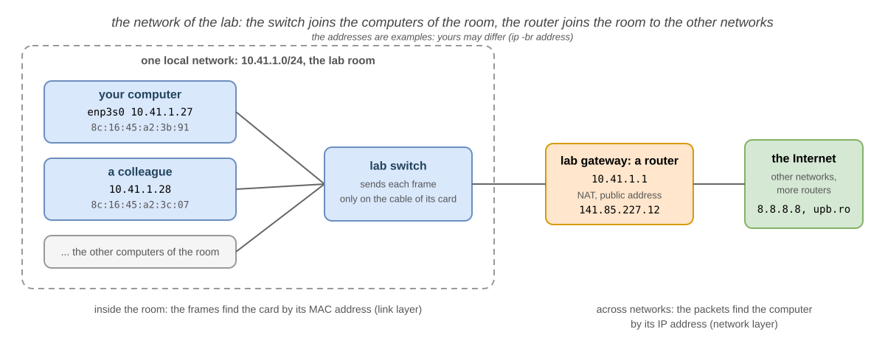

### Nivelurile {/* #the-layers */}

Trimiterea datelor se împarte pe **niveluri** (*layers*). Fiecare nivel rezolvă o singură problemă, are propriul tip
de adresă și se sprijină pe nivelul de sub el:

| Nivel                   | Întrebarea la care răspunde                  | Adresă                          | Exemplu             |
| ----------------------- | -------------------------------------------- | ------------------------------- | ------------------- |
| 5. aplicație            | ce vrea programul?                           | un nume                         | `upb.ro`            |
| 4. transport            | care program, pe acel calculator?            | un **port**                     | `443`               |
| 3. rețea                | care calculator, din toate rețelele?         | o **adresă IP**                 | `10.41.1.27`        |
| 2. legătură de date     | care placă, în rețeaua locală?               | o **adresă MAC**                | `8c:16:45:a2:3b:91` |
| 1. fizic                | cum circulă biții?                           | niciuna: un cablu sau unde radio |                     |

Placa nu trimite pachetul așa cum este: îl pune într-un **cadru** (*frame*), care adaugă adresele MAC ale plăcii care
trimite și ale plăcii care trebuie să primească. Un cadru circulă doar în interiorul unei singure rețele locale. E ca
o scrisoare pusă într-un al doilea plic, adresat doar următoarei opriri.

Laboratorul parcurge nivelurile de jos în sus: plăcile de rețea și adresele lor MAC (legătura de date), adresele IP
și rutele (rețea), porturile (transport) și DNS (aplicație).

## Plăci de rețea {/* #network-cards */}

O placă **Ethernet** folosește un cablu, iar o placă **Wi-Fi** unde radio. Fiecare cadru conține adresa MAC a plăcii
care l-a trimis și pe cea a plăcii care trebuie să-l primească.

O **adresă MAC** are 48 de biți, scriși ca 6 octeți în hexazecimal: `8c:16:45:a2:3b:91`. Primii 3 octeți identifică
producătorul. Adresa MAC are sens doar **în rețeaua locală**: switch-ul o folosește ca să trimită fiecare cadru doar
pe cablul plăcii căreia îi este destinat. Un cadru trimis la `ff:ff:ff:ff:ff:ff`, adresa de **broadcast**, ajunge la
toate plăcile din rețea.

### Interfețe de rețea: `ip link` {/* #network-interfaces-ip-link */}

Linux numește fiecare placă **interfață de rețea**:

```shell-session
[student@fedora ~]$ ip -br link
lo               UNKNOWN        00:00:00:00:00:00 <LOOPBACK,UP,LOWER_UP>
enp3s0           UP             8c:16:45:a2:3b:91 <BROADCAST,MULTICAST,UP,LOWER_UP>
[student@fedora ~]$ cat /sys/class/net/enp3s0/address
8c:16:45:a2:3b:91
```

- `-br` (_brief_) a afișat câte o linie pentru fiecare interfață: numele, starea, adresa MAC și indicatorii ei;
  `/sys` conține aceleași informații, în fișiere.

| Partea din linie         | Ce înseamnă                                                                      |
| ------------------------ | -------------------------------------------------------------------------------- |
| `lo`                     | **loopback**-ul: o placă virtuală prin care calculatorul vorbește cu el însuși   |
| `en...`, `wl...`         | o placă Ethernet, o placă Wi-Fi; `p3s0` este locul ei pe magistrala PCI           |
| `UP`, `DOWN`             | placa poate trimite date acum, respectiv nu poate                                |
| `LOWER_UP`               | cablul (sau legătura radio) este conectat; `NO-CARRIER`: nu există cablu         |
| `BROADCAST`, `MULTICAST` | placa poate trimite către toate plăcile din rețea, respectiv către un grup de plăci |

### Afișarea unei singure valori {/* #printing-one-value */}

Un script sau o verificare are deseori nevoie de o singură valoare: o adresă MAC, o adresă IP. `ip -br` afișează câte
o linie pentru fiecare placă, cu valorile separate prin spații; `show <IF>` păstrează o singură placă, iar `-4` doar
adresele IPv4. Valoarea se decupează cu uneltele din laboratorul 06: [`awk`](/docs/labs/06#computing-awk) și
[`cut`](/docs/labs/06#cutting-columns-cut).

```shell-session
[student@fedora ~]$ ip -br link show enp3s0
enp3s0           UP             8c:16:45:a2:3b:91 <BROADCAST,MULTICAST,UP,LOWER_UP>
[student@fedora ~]$ ip -br link show enp3s0 | awk '{print $2}'
UP
```

| Comandă            | Ce afișează                                                                           |
| ------------------ | ------------------------------------------------------------------------------------- |
| `awk '{print $3}'` | al treilea cuvânt de pe fiecare linie; `$NF` este ultimul cuvânt                      |
| `cut -d/ -f1`      | ce se află înainte de primul `/` (`-d` este separatorul, `-f` numărul câmpului)        |
| `grep <WORD>`      | doar liniile care conțin `<WORD>`                                                     |

### NetworkManager: `nmcli` {/* #networkmanager-nmcli */}

Pe Fedora, plăcile sunt configurate de serviciul **NetworkManager**, iar `nmcli` este comanda lui. Setările unei plăci
formează o **conexiune** (*connection*), care are un nume:

```shell-session
[student@fedora ~]$ nmcli device status
DEVICE  TYPE      STATE                   CONNECTION
enp3s0  ethernet  connected               Wired connection 1
lo      loopback  connected (externally)  lo
```

| Comandă                  | Ce face                                                                  |
| ------------------------ | ------------------------------------------------------------------------ |
| `nmcli device status`    | Afișează plăcile, starea lor și conexiunea fiecăreia                     |
| `nmcli device show <IF>` | Afișează toate detaliile unei plăci: adresa MAC, adresa IP, gateway, DNS |
| `nmcli device wifi list` | Afișează rețelele Wi-Fi din jur (pe un calculator cu placă Wi-Fi)        |

:::danger

În acest laborator doar vă **uitați** la setările de rețea. Nu rulați comenzi `nmcli` care le schimbă (`modify`, `up`,
`down`, `connect`, `disconnect`): și voi, și colegii voștri aveți nevoie de rețea.

:::

## Adrese IP {/* #ip-addresses */}

Ca să ajungă la un calculator dintr-o **altă** rețea, fiecare calculator are și o **adresă IP**: 32 de biți, scriși
ca 4 numere de la `0` la `255`, de exemplu `10.41.1.27`. Gândiți-vă la o adresă poștală: strada este **rețeaua**, iar
numărul este **calculatorul** de pe acea stradă.

### Adrese și măști: `ip address` {/* #addresses-and-masks-ip-address */}

**Masca de rețea**, scrisă după `/`, spune câți biți, numărați de la stânga, identifică rețeaua: în `10.41.1.27/24`,
rețeaua este `10.41.1.0/24`, iar ultimii 8 biți (`27`) identifică calculatorul. Calculatoarele din aceeași rețea
vorbesc direct între ele; pentru orice altă rețea au nevoie de un router.

```shell-session
[student@fedora ~]$ ip -br address
lo               UNKNOWN        127.0.0.1/8 ::1/128
enp3s0           UP             10.41.1.27/24 fe80::6a1c:3e0f:7d24:9b11/64
[student@fedora ~]$ ip address show enp3s0
2: enp3s0: <BROADCAST,MULTICAST,UP,LOWER_UP> mtu 1500 qdisc fq_codel state UP group default qlen 1000
    link/ether 8c:16:45:a2:3b:91 brd ff:ff:ff:ff:ff:ff
    inet 10.41.1.27/24 brd 10.41.1.255 scope global dynamic noprefixroute enp3s0
       valid_lft 85127sec preferred_lft 85127sec
    inet6 fe80::6a1c:3e0f:7d24:9b11/64 scope link noprefixroute
       valid_lft forever preferred_lft forever
```

- `inet` este adresa IPv4, iar `brd` adresa de broadcast a rețelei; `dynamic` și `valid_lft` arată că adresa vine de
  la DHCP, pentru un timp limitat (vedeți [Configurarea automată: DHCP](#automatic-configuration-dhcp)).
- `inet6` este o adresă **IPv6**: 128 de biți, în hexazecimal. Laboratorul folosește IPv4 și se uită doar la adresa
  `fe80::...`, pe care și-o dă singură fiecare placă.

### Calculul rețelei {/* #computing-the-network */}

Exercițiile din Primii pași folosesc doar `/24`, `/16` și `/8`, unde masca se termină la granița unui octet.
Exercițiile de acasă și examenul folosesc și măști care se termină în mijlocul unui octet, de exemplu `/26`: scrieți
acel octet în binar, păstrați biții de rețea, iar ceilalți biți faceți-i `0` pentru **rețea** și `1` pentru
**broadcast**. Adresele dintre ele sunt pentru calculatoare: cu `n` biți pentru calculator, încap 2ⁿ - 2 calculatoare.

| `192.168.10.77/26`: 24 + **2** biți de rețea | Ultimul octet, în binar | Adresă                      |
| -------------------------------------------- | ----------------------- | --------------------------- |
| adresa                                       | `01` `001101`           | `192.168.10.77`             |
| rețeaua: ceilalți biți `0`                   | `01` `000000`           | `192.168.10.64`             |
| broadcastul: ceilalți biți `1`               | `01` `111111`           | `192.168.10.127`            |
| calculatoarele                               |                         | `.65` - `.126`: 2⁶ - 2 = 62 |

### Adrese speciale {/* #special-addresses */}

| Adresă                                          | Ce înseamnă                                                                         |
| ----------------------------------------------- | ----------------------------------------------------------------------------------- |
| `127.0.0.0/8` (de obicei `127.0.0.1`), `::1`    | **loopback**-ul (`localhost`): calculatorul acesta                                  |
| `10.0.0.0/8`, `172.16.0.0/12`, `192.168.0.0/16` | rețele **private**: libere pentru oricine, **nu sunt rutate** în Internet            |
| `169.254.0.0/16`, `fe80::/10`                   | **link-local**: doar pentru rețeaua locală                                          |
| `0.0.0.0`                                       | orice adresă a calculatorului: un server care așteaptă pe toate adresele lui        |
| ultima adresă dintr-o rețea (`10.41.1.255`)     | **broadcastul** rețelei: toate calculatoarele din ea                                |

### Adrese private și NAT {/* #private-addresses-and-nat */}

O casă sau un laborator primește de la furnizorul de Internet o singură adresă **publică**. Calculatoarele din
interior folosesc adrese private, iar routerul înlocuiește adresa sursă a fiecărui pachet care iese cu adresa lui
publică, apoi face schimbarea inversă la răspunsuri. Mecanismul se numește **NAT** (_Network Address Translation_).
Gândiți-vă la o firmă cu un singur număr de telefon: recepționera știe la ce birou trebuie să ajungă fiecare apel.

```shell-session
[student@fedora ~]$ curl -s https://ifconfig.me; echo
141.85.227.12
```

- `ifconfig.me` a răspuns cu adresa pe care o vede: `141.85.227.12`, nu `10.41.1.27`, pentru că un router a făcut NAT.

## Testarea unui calculator: `ping` {/* #testing-a-computer-ping */}

`ping` trimite o cerere ICMP _echo request_, iar celălalt calculator răspunde cu un _echo reply_:

```shell-session
[student@fedora ~]$ ping -c 3 8.8.8.8
PING 8.8.8.8 (8.8.8.8) 56(84) bytes of data.
64 bytes from 8.8.8.8: icmp_seq=1 ttl=117 time=12.4 ms
64 bytes from 8.8.8.8: icmp_seq=2 ttl=117 time=12.1 ms
64 bytes from 8.8.8.8: icmp_seq=3 ttl=117 time=12.3 ms

--- 8.8.8.8 ping statistics ---
3 packets transmitted, 3 received, 0% packet loss, time 2003ms
rtt min/avg/max/mdev = 12.104/12.266/12.402/0.123 ms
```

- `-c 3` a trimis 3 pachete; fără această opțiune, `ping` rulează până la <kbd>Ctrl</kbd>+<kbd>C</kbd>. `time` este
  **timpul dus-întors** (*round trip time*), de la cerere până la răspuns; `ttl` este explicat în
  [Routerele de pe drum](#the-routers-on-the-way-traceroute).

| Mesaj                                | Ce înseamnă                                                                                                |
| ------------------------------------ | ---------------------------------------------------------------------------------------------------------- |
| `Network is unreachable`             | nu există nicio rută către acea rețea: de obicei lipsește gateway-ul implicit                              |
| `Destination Host Unreachable`       | o adresă din propria rețea, pe care nu o are nimeni: calculatorul este oprit sau adresa este greșită       |
| `100% packet loss`, fără alte linii  | nu a venit niciun răspuns: calculatorul este căzut sau un **firewall** blochează `ping`, cum fac multe servere |

## Vecini: `ip neigh` {/* #neighbors-ip-neigh */}

Ca să trimită un pachet către `10.41.1.28`, din propria rețea, calculatorul are nevoie de adresa MAC a plăcii
respective. O cere întregii rețele printr-un broadcast („cine are `10.41.1.28`?”), iar placa ce are adresa răspunde.
Acesta este protocolul **ARP**. Răspunsurile se păstrează în **tabela de vecini** (*neighbor table*):

```shell-session
[student@fedora ~]$ ip neigh
10.41.1.1 dev enp3s0 lladdr 70:b5:e8:2d:91:4c REACHABLE
10.41.1.28 dev enp3s0 lladdr 8c:16:45:a2:3c:07 STALE
```

- Fiecare linie conține o adresă din rețeaua locală și adresa ei MAC (`lladdr`). `REACHABLE`: folosită chiar acum;
  `STALE`: un răspuns mai vechi; `FAILED`: nu a răspuns nimeni. Ignorați liniile IPv6, cu adrese `fe80::`.

Pentru o adresă dintr-o **altă** rețea, cadrul pleacă spre adresa MAC a **gateway-ului** (vedeți
[Tabela de rutare](#the-routing-table-ip-route)); detaliile sunt în [Drumul unui pachet](#the-way-of-a-packet).

## Rutare {/* #routing */}

Un **router** este un calculator care are câte o placă în fiecare rețea pe care o leagă (vedeți
[Ce este o rețea](#what-is-a-network)).

### Tabela de rutare: `ip route` {/* #the-routing-table-ip-route */}

Pentru fiecare pachet, nucleul se uită în **tabela de rutare** (*routing table*): câte o linie pentru fiecare rețea
la care poate ajunge.

```shell-session
[student@fedora ~]$ ip route
default via 10.41.1.1 dev enp3s0 proto dhcp src 10.41.1.27 metric 100
10.41.1.0/24 dev enp3s0 proto kernel scope link src 10.41.1.27 metric 100
[student@fedora ~]$ ip route get 8.8.8.8
8.8.8.8 via 10.41.1.1 dev enp3s0 src 10.41.1.27 uid 1000
    cache
[student@fedora ~]$ ip route get 10.41.1.28
10.41.1.28 dev enp3s0 src 10.41.1.27 uid 1000
    cache
```

- `10.41.1.0/24 dev enp3s0`: propria rețea, în care se ajunge **direct**.
- `default via 10.41.1.1`: orice altă adresă pleacă spre **gateway-ul implicit** (*default gateway*), routerul
  `10.41.1.1`.
- `ip route get` a afișat linia aleasă pentru o anumită adresă: `8.8.8.8` trece `via` gateway, iar `10.41.1.28` merge
  direct.

Când se potrivesc mai multe linii, nucleul o alege pe cea **mai specifică**, cu masca cea mai lungă: pentru
`10.41.1.28`, `/24` câștigă în fața lui `default` (`/0`). E ca la indicatoarele dintr-o intersecție: „București
centru” are prioritate față de „Toate direcțiile”.

### Routerele de pe drum: `traceroute` {/* #the-routers-on-the-way-traceroute */}

```shell-session
[student@fedora ~]$ traceroute -n 8.8.8.8
traceroute to 8.8.8.8 (8.8.8.8), 30 hops max, 60 byte packets
 1  10.41.1.1  0.512 ms  0.488 ms  0.471 ms
 2  141.85.241.1  1.203 ms  1.187 ms  1.164 ms
 3  * * *
 4  37.128.225.9  3.880 ms  3.871 ms  3.902 ms
 5  142.250.212.98  4.415 ms  4.402 ms  4.396 ms
 6  8.8.8.8  4.211 ms  4.198 ms  4.176 ms
```

- Câte o linie pentru fiecare router, în ordine: linia `1` este gateway-ul implicit, iar ultima linie este
  destinația. `-n` a afișat adrese în loc de nume; `* * *` este un router care nu a răspuns, dar a trimis totuși
  pachetele mai departe.

Fiecare pachet IP are un **TTL** (_Time To Live_), pe care fiecare router îl scade cu 1; routerul care îl aduce la `0`
aruncă pachetul și îl anunță pe expeditor (ICMP _time exceeded_). `traceroute` trimite pachete cu TTL 1, 2, 3, ...:
fiecare „moare” cu un router mai departe decât precedentul, iar acel router își spune adresa. `tracepath -n` face
aproape același lucru și este instalat întotdeauna. Unele firewalluri blochează pachetele lui `traceroute`: atunci
toate liniile de după ultimul router care le-a lăsat să treacă sunt `* * *`.

## Nume: DNS {/* #names-dns */}

**DNS** (_Domain Name System_) transformă numele, de exemplu `upb.ro`, în adrese IP: calculatorul întreabă un **server
DNS**, care fie știe răspunsul, fie îl întreabă pe alte servere DNS. Gândiți-vă la agenda telefonului: alegeți un
nume, iar telefonul formează numărul.

```shell-session
[student@fedora ~]$ host upb.ro
upb.ro has address 141.85.220.33
upb.ro mail is handled by 0 ironport.upb.ro.
[student@fedora ~]$ resolvectl dns
Global:
Link 2 (enp3s0): 10.41.1.1
```

- Un nume are mai multe **înregistrări** (*records*): aici adresa IPv4 (`A`) și serverul de e-mail (`MX`).
- Pentru `enp3s0`, întrebările merg la serverul DNS `10.41.1.1`. `resolvectl` vorbește cu `systemd-resolved`,
  serviciul care face cererile DNS pentru toate programele (îl configurați în laboratorul următor).

| Comandă                 | Ce face                                                           |
| ----------------------- | ----------------------------------------------------------------- |
| `host <NAME>`           | Afișează adresele și serverul de e-mail ale unui nume             |
| `host -t <TYPE> <NAME>` | Afișează un singur tip de înregistrare: `A`, `AAAA` (IPv6), `MX`, `NS` |
| `host <IP>`             | Afișează numele unei adrese                                       |
| `host <NAME> <SERVER>`  | Întreabă alt server DNS                                           |
| `resolvectl dns`        | Afișează serverele DNS ale calculatorului                         |

:::caution

Fără DNS, `ping 8.8.8.8` merge în continuare, dar `ping google.com` afișează `Temporary failure in name resolution`.
De aceea, când „nu merge Internetul”, testați atât o adresă, **cât și** un nume.

:::

## Configurarea automată: DHCP {/* #automatic-configuration-dhcp */}

Adresa, masca, gateway-ul și serverul DNS se scriu fie de mână (o configurație **statică**, pentru servere), fie le dă
un **server DHCP**. Adresa este **închiriată** (*leased*) pentru o perioadă, iar clientul reînnoiește închirierea
înainte să expire. Acasă, serverul DHCP este chiar routerul. Clientul nu are încă nicio adresă, așa că începe cu un
broadcast, prin UDP (de pe portul `68` către portul `67`):

| Mesaj      | De la, către               | Ce spune                                                                   |
| ---------- | -------------------------- | -------------------------------------------------------------------------- |
| `DISCOVER` | clientul, către toți       | există vreun server DHCP?                                                  |
| `OFFER`    | serverul, către client     | îți pot da `10.41.1.27/24`, gateway-ul, DNS-ul, pentru 24 de ore           |
| `REQUEST`  | clientul, către toți       | iau `10.41.1.27`, de la serverul `10.41.1.1`                               |
| `ACK`      | serverul, către client     | e a ta                                                                     |

### Ce a primit calculatorul vostru {/* #what-your-computer-received */}

Pe calculatoarele din laborator, NetworkManager este clientul DHCP:

```shell-session
[student@fedora ~]$ nmcli device show enp3s0 | grep IP4
IP4.ADDRESS[1]:                         10.41.1.27/24
IP4.GATEWAY:                            10.41.1.1
IP4.ROUTE[1]:                           dst = 10.41.1.0/24, nh = 0.0.0.0, mt = 100
IP4.ROUTE[2]:                           dst = 0.0.0.0/0, nh = 10.41.1.1, mt = 100
IP4.DNS[1]:                             10.41.1.1
```

- Sunt aceleași valori ca la `ip -br address`, `ip route` și `resolvectl dns`. `nmcli -f DHCP4 device show enp3s0`
  adaugă durata închirierii (`dhcp_lease_time`, în secunde) și serverul (`dhcp_server_identifier`).

Veți cere și voi o adresă, într-un container, în [Cererea unei adrese](#asking-for-an-address-dhclient).

## Containere {/* #containers */}

Un **container** seamănă cu o mașină virtuală ușoară, care folosește însă nucleul calculatorului vostru. Are propriile
fișiere, propriile procese și **propria rețea**: plăci, adrese, tabelă de rutare și porturi. Nu rulează un nucleu al
lui, așa că pornește într-o secundă și consumă puțină memorie. Gândiți-vă la un apartament dintr-un bloc: are ușa și
adresa lui, dar clădirea (nucleul) este aceeași. **Podman** construiește imagini și rulează containere.

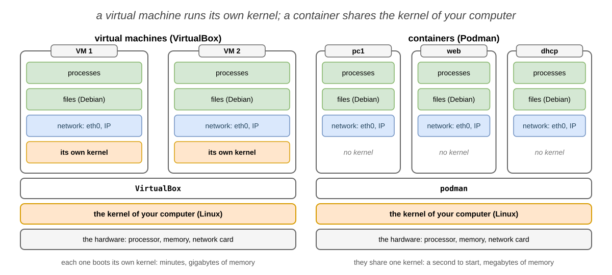

În acest laborator, containerul este doar o unealtă: un calculator mic, în interiorul celui pe care lucrați, pe care
testăm rețeaua. Pentru exerciții ajunge [Lucrul într-un container](#working-in-a-container);
[Rularea containerelor](#running-containers-podman) explică cum se face un container.

### Lucrul într-un container {/* #working-in-a-container */}

Fiecare container are un **nume** (`pc1`, `web`, `dhcp`, `client`, `lost`), ales de comanda care îl pornește.
Exercițiile vă dau această comandă: copiați-o exact așa cum este. Apoi, dintr-un terminal al calculatorului vostru:

| Ce vreți                                        | Comandă                             | Promptul                                |
| ----------------------------------------------- | ----------------------------------- | --------------------------------------- |
| să tastați mai multe comenzi **în** container   | `sudo podman exec -it <NAME> bash`  | `root@<NAME>:/#`; `exit` vă întoarce    |
| să rulați **o singură** comandă în container    | `sudo podman exec <NAME> <COMMAND>` | rămâne `[student@fedora lab09]$`        |
| să listați containerele care rulează, cu numele lor | `sudo podman ps`                |                                         |
| să opriți un container și să-l ștergeți         | `sudo podman rm -f <NAME>`          |                                         |

```shell-session
[student@fedora lab09]$ sudo podman exec -it pc1 bash
root@pc1:/# ip -br address
lo               UNKNOWN        127.0.0.1/8 ::1/128
eth0@if4         UP             10.88.0.11/16 fe80::6c2b:91ff:fe5a:c7d/64
root@pc1:/# exit
exit
[student@fedora lab09]$ sudo podman exec pc1 ip -br address
lo               UNKNOWN        127.0.0.1/8 ::1/128
eth0@if4         UP             10.88.0.11/16 fe80::6c2b:91ff:fe5a:c7d/64
```

- `sudo podman exec -it pc1 bash` a deschis un shell în `pc1`: promptul a devenit `root@pc1:/#`, iar `ip` a afișat
  rețeaua lui `pc1`, nu pe cea a calculatorului vostru. `exit` ne-a întors pe calculatorul nostru.
- `sudo podman exec pc1 ip -br address` a rulat doar acea comandă în `pc1` și a afișat același lucru.

:::caution

Uitați-vă la prompt înainte de fiecare comandă: `[student@fedora lab09]$` înseamnă că o rulați pe calculatorul vostru,
iar `root@pc1:/#` că o rulați în `pc1`. Aceeași comandă afișează lucruri diferite în cele două locuri. Țineți câte un
terminal pentru fiecare loc în care lucrați.

:::

### Rularea containerelor: `podman` {/* #running-containers-podman */}

Imaginea `lab09` se construiește din fișierul de mai jos. Pe calculatoarele din laborator este gata făcută; acasă, o
construiește [exercițiul 1](#first-steps):

```bash title="~/lab09/Containerfile"
FROM docker.io/library/debian:trixie-slim
RUN apt-get update && apt-get install -y --no-install-recommends iproute2 iputils-ping bind9-host traceroute \
        curl ca-certificates python3 isc-dhcp-client dnsmasq-base && rm -rf /var/lib/apt/lists/*
```

- `FROM` este imaginea de la care se pornește: un Debian minimal, de 30 MB. `RUN` descarcă lista de pachete, instalează
  doar uneltele laboratorului, apoi șterge lista, ca imaginea să rămână mică.

**Imaginea** este un șablon: fișiere care nu se schimbă niciodată, construite o singură dată cu `podman build`. Un
**container** este o copie a imaginii care rulează, pornită cu `podman run`, cu propriile modificări, propriul program
și propria rețea. `podman rm` șterge un container, nu și imaginea lui. Imaginea este ca fișierul unui program, iar
containerul ca un proces (vedeți [Inspectarea proceselor](/docs/labs/03#inspecting-processes) din laboratorul 03).

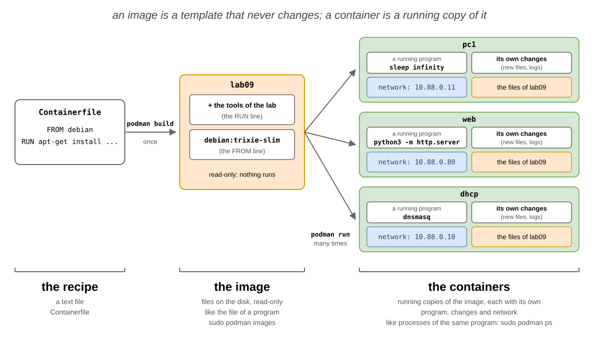

```shell-session
[student@fedora lab09]$ sudo podman run -d --name pc1 --hostname pc1 --ip 10.88.0.11 lab09 sleep infinity
3f9c2a7d1e5b8c04a6d2f1e9b7c3a5d8e0f2b4c6a8d1e3f5a7c9b2d4e6f8a0c1
[student@fedora lab09]$ sudo podman ps
CONTAINER ID  IMAGE                   COMMAND         CREATED        STATUS        PORTS       NAMES
3f9c2a7d1e5b  localhost/lab09:latest  sleep infinity  5 seconds ago  Up 5 seconds              pc1
```

- `podman run -d` a pornit `pc1` în background, cu adresa `10.88.0.11`. Programul lui, `sleep infinity`, nu face nimic,
  la nesfârșit: un container trăiește cât timp trăiește programul lui. Într-un shell din `pc1` sunteți `root`, dar doar
  în interiorul containerului.

| Comandă                                              | Ce face                                                             |
| ---------------------------------------------------- | ------------------------------------------------------------------- |
| `sudo podman build -t <IMAGE> .`                     | Construiește o imagine din `Containerfile`-ul din directorul curent |
| `sudo podman images`                                 | Listează imaginile                                                  |
| `sudo podman run -d --name <NAME> <IMAGE> <PROGRAM>` | Pornește un container în background, care rulează `<PROGRAM>`       |
| `sudo podman ps -a`                                  | Listează containerele, inclusiv pe cele oprite                      |
| `sudo podman logs <NAME>`                            | Afișează ce a scris programul containerului                         |

| Opțiune a lui `run`           | Ce face                                                                                 |
| ----------------------------- | --------------------------------------------------------------------------------------- |
| `--hostname <NAME>`           | Stabilește numele calculatorului, în interiorul containerului                           |
| `--ip <IP>`                   | Stabilește o adresă IP fixă                                                             |
| `--dns <IP>`                  | Stabilește serverul DNS al containerului, în locul celui al calculatorului vostru       |
| `--cap-add NET_ADMIN,NET_RAW` | Îi permite containerului să-și schimbe **propriile** setări de rețea (necesar pentru `dhclient`) |

:::caution

Scrieți întotdeauna `sudo podman`: doar așa primește fiecare container propria adresă. Imaginile lui `root` și ale lui
`student` sunt separate, așa că `sudo podman run` nu vede o imagine construită fără `sudo`.

:::

### Rețeaua containerelor {/* #the-network-of-the-containers */}

`sudo podman` construiește un **switch virtual**, `podman0`, și conectează la el fiecare container și **calculatorul
vostru**:

| Conectat la switch      | Prin placa                                                    | Adresa          |
| ----------------------- | ------------------------------------------------------------- | --------------- |
| calculatorul vostru     | `podman0` (același nume ca switch-ul)                          | `10.88.0.1/16`  |
| `pc1`                   | `eth0` din `pc1`, legată printr-un cablu virtual de `veth0`    | `10.88.0.11/16` |

Așadar, calculatorul vostru vorbește cu containerele ca orice calculator din rețeaua lor. Tot el este și **routerul**
lor (gateway-ul lor este `10.88.0.1`) și face **NAT** pentru ele, ca un router de acasă.

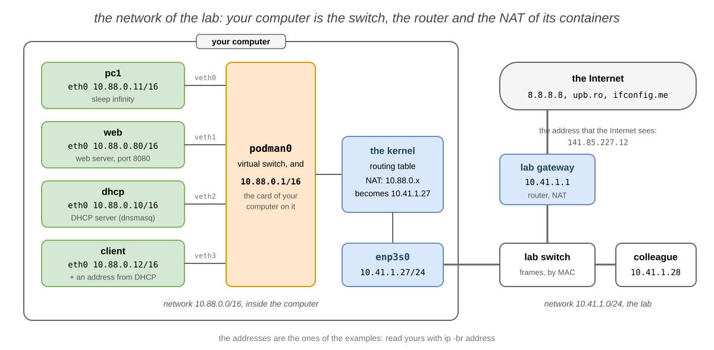

```shell-session
[student@fedora lab09]$ sudo podman exec pc1 ip -br address
lo               UNKNOWN        127.0.0.1/8 ::1/128
eth0@if4         UP             10.88.0.11/16 fe80::6c2b:91ff:fe5a:c7d/64
[student@fedora lab09]$ sudo podman exec pc1 ip route
default via 10.88.0.1 dev eth0 proto static metric 100
10.88.0.0/16 dev eth0 proto kernel scope link src 10.88.0.11
[student@fedora lab09]$ ip -br address
lo               UNKNOWN        127.0.0.1/8 ::1/128
enp3s0           UP             10.41.1.27/24 fe80::6a1c:3e0f:7d24:9b11/64
podman0          UP             10.88.0.1/16 fe80::cc5e:9aff:fe1b:2207/64
veth0@if2        UP             fe80::5812:6bff:fe40:9a1e/64
```

- `pc1` are placa, adresa și tabela de rutare proprii; gateway-ul lui, `10.88.0.1`, este calculatorul vostru. `@if4`
  este celălalt capăt al cablului: interfața cu numărul `4` de pe calculator, adică `veth0`.
- Pe calculator au apărut `podman0`, placa lui din switch, și `veth0`, capătul cablului lui `pc1` (`veth0` nu are
  adresă IPv4: doar transportă cadre). Ruta nouă `10.88.0.0/16 dev podman0` trimite prin `podman0` pachetele destinate
  containerelor.
- `pc1` întreabă același server DNS ca și calculatorul: podman îl scrie în `/etc/resolv.conf` din container (`--dns`
  alege altul).

## Porturi: TCP și UDP {/* #ports-tcp-and-udp */}

Un **port**, un număr de la `1` la `65535`, găsește programul din interiorul unui calculator. Un server așteaptă pe un
port fix: `22` pentru SSH, `53` pentru DNS, `80` și `443` pentru web; un client primește un port liber, ales la
întâmplare, pentru fiecare conexiune. Datele sunt transportate de două protocoale:

|               | TCP (ca un apel telefonic)                | UDP (ca o carte poștală)                          |
| ------------- | ----------------------------------------- | ------------------------------------------------- |
| o conexiune   | da: se deschide întâi, se închide la final | nu: fiecare datagramă circulă singură            |
| datele pierdute | sunt observate și trimise din nou       | se pierd: programul se ocupă de ele, dacă îi pasă |
| folosit de    | web, SSH, e-mail                          | DNS, DHCP, apeluri video, jocuri                  |

### Programe care ascultă: `ss` {/* #listening-programs-ss */}

`ss` listează **socketurile** (*sockets*): obiectele prin care un program trimite și primește date pe un port.

```shell-session
[student@fedora ~]$ ss -tuln
Netid State  Recv-Q Send-Q  Local Address:Port  Peer Address:Port Process
udp   UNCONN 0      0          127.0.0.54:53         0.0.0.0:*
udp   UNCONN 0      0       127.0.0.53%lo:53         0.0.0.0:*
udp   UNCONN 0      0           127.0.0.1:323        0.0.0.0:*
tcp   LISTEN 0      4096       127.0.0.54:53         0.0.0.0:*
tcp   LISTEN 0      4096    127.0.0.53%lo:53         0.0.0.0:*
tcp   LISTEN 0      4096        127.0.0.1:631        0.0.0.0:*
...
[student@fedora ~]$ sudo ss -tlnp
State  Recv-Q Send-Q  Local Address:Port  Peer Address:Port Process
LISTEN 0      4096       127.0.0.54:53         0.0.0.0:*     users:(("systemd-resolve",pid=812,fd=20))
LISTEN 0      4096    127.0.0.53%lo:53         0.0.0.0:*     users:(("systemd-resolve",pid=812,fd=18))
LISTEN 0      4096        127.0.0.1:631        0.0.0.0:*     users:(("cupsd",pid=1104,fd=7))
...
```

- `127.0.0.53%lo:53` este portul `53` (DNS), doar pe loopback: serviciul DNS al calculatorului vostru. `0.0.0.0:22`
  ar însemna portul `22` pe **toate** adresele.

| Opțiune sau coloană | Ce înseamnă                                                                         |
| ------------------- | ----------------------------------------------------------------------------------- |
| `-t`, `-u`          | socketuri TCP, socketuri UDP                                                        |
| `-l`                | doar socketurile care așteaptă clienți; fără ea, conexiunile deschise               |
| `-n`                | numere în loc de nume: `53`, nu `domain`                                            |
| `-p`                | programul socketului (cu `sudo`, pentru programele tuturor utilizatorilor)          |
| `LISTEN`            | un server TCP așteaptă conexiuni; `ESTAB` este o conexiune deschisă                 |
| `UNCONN`            | un socket UDP: UDP nu are conexiuni                                                 |

Un container are propriile porturi. [Exercițiul 10](#first-steps) pornește un server web în containerul `web`:

```bash
sudo podman run -d --name web --hostname web --ip 10.88.0.80 lab09 python3 -m http.server --bind 0.0.0.0 8080
```

```shell-session
[student@fedora lab09]$ sudo podman exec web ss -tln
State  Recv-Q Send-Q Local Address:Port  Peer Address:Port Process
LISTEN 0      5            0.0.0.0:8080       0.0.0.0:*
[student@fedora lab09]$ ss -tln | grep 8080
[student@fedora lab09]$ curl -I http://10.88.0.80:8080
HTTP/1.0 200 OK
...
```

- Portul `8080` se află în rețeaua lui `web`, nu în cea a calculatorului vostru, de aceea `ss` de pe calculator nu
  l-a găsit. `curl -I` a cerut doar antetele paginii.

## Cererea unei adrese: `dhclient` {/* #asking-for-an-address-dhclient */}

`dhclient` este un client DHCP: trimite mesajele [DHCP](#automatic-configuration-dhcp) pentru o placă și configurează
adresa primită. Nu îl puteți încerca pe calculatorul vostru, unde NetworkManager este deja clientul, așa că îl
încercați într-un container. În rețeaua `podman0` nu există niciun server DHCP, așa că laboratorul vă dă un **server
DHCP de exercițiu**, gata făcut: containerul `dhcp` rulează `dnsmasq`, un server DHCP mic, deja setat să împrumute
adresele `10.88.0.200` - `10.88.0.209`, pentru 10 minute, cu gateway-ul `10.88.0.1`. Voi doar îl porniți, cu comanda
de mai jos, și nu îl modificați niciodată; rolul vostru este cel de **client**, în containerul `client`.
[Exercițiul 11](#first-steps) le pornește pe amândouă:

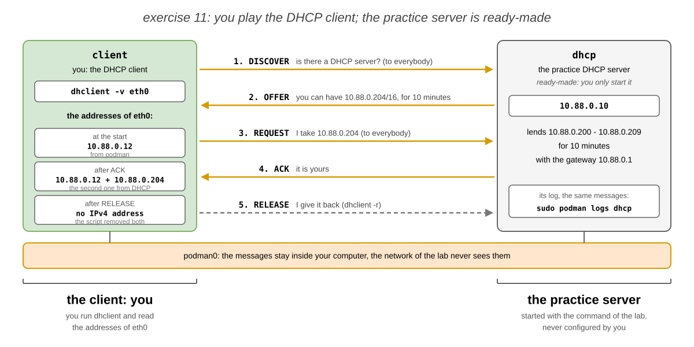

```bash
sudo podman run -d --name dhcp --hostname dhcp --ip 10.88.0.10 --cap-add NET_ADMIN,NET_RAW lab09 \
    dnsmasq -d --conf-file=/dev/null --user=root --no-ping --dhcp-range=10.88.0.200,10.88.0.209,10m \
    --dhcp-option=option:router,10.88.0.1
sudo podman run -d --name client --hostname client --ip 10.88.0.12 --cap-add NET_ADMIN,NET_RAW lab09 sleep infinity
```

- Prima comandă pornește serverul de exercițiu, `dhcp`, la adresa `10.88.0.10`; nu trebuie să-i înțelegeți opțiunile.
- A doua pornește `client`, la adresa `10.88.0.12`. Această primă adresă vine de la podman, nu de la DHCP; `--cap-add`
  îi permite lui `dhclient` să mai adauge una.

```shell-session
[student@fedora lab09]$ sudo podman exec -it client bash
root@client:/# dhclient -v eth0
Internet Systems Consortium DHCP Client 4.4.3-P1
...
DHCPDISCOVER on eth0 to 255.255.255.255 port 67 interval 5 (xid=0x5e2a1c07)
DHCPOFFER of 10.88.0.204 from 10.88.0.10
DHCPREQUEST for 10.88.0.204 on eth0 to 255.255.255.255 port 67 (xid=0x5e2a1c07)
DHCPACK of 10.88.0.204 from 10.88.0.10 (xid=0x5e2a1c07)
bound to 10.88.0.204 -- renewal in 274 seconds.
root@client:/# ip -br address
lo               UNKNOWN        127.0.0.1/8 ::1/128
eth0@if7         UP             10.88.0.12/16 10.88.0.204/16 fe80::a05c:17ff:fee8:4430/64
```

- `dhclient -v eth0` a afișat cele patru mesaje: `client` a întrebat pe toată lumea (`DISCOVER`), `dhcp` a oferit
  `10.88.0.204` (`OFFER`), `client` a acceptat-o (`REQUEST`), iar `dhcp` a confirmat (`ACK`). Apoi `dhclient` a rămas
  în background, ca să reînnoiască închirierea înainte să treacă cele 10 minute. Dacă afișează și
  `mv: cannot move ... /etc/resolv.conf`, ignorați mesajul: fișierul este gestionat de podman.
- `eth0` avea două adrese: `10.88.0.12`, de la podman, și `10.88.0.204`, de la DHCP.

| Comandă sau fișier              | Ce face                                                                          |
| ------------------------------- | -------------------------------------------------------------------------------- |
| `dhclient -v <IF>`              | Cere o adresă și afișează mesajele                                               |
| `dhclient -r -v <IF>`           | Eliberează adresa (_release_) și oprește `dhclient`-ul plăcii                    |
| `/var/lib/dhcp/dhclient.leases` | Închirierile primite de client                                                   |
| `sudo podman logs dhcp`         | Jurnalul serverului: fiecare mesaj, cu adresa MAC a clientului                   |

După `dhclient -r`, placa rămâne **fără** nicio adresă IPv4, nici măcar cu cea de la podman: scriptul Debian
`dhclient-script`, care configurează placa pentru `dhclient`, presupune că DHCP este singura sursă de adrese.

:::danger

Rulați `dhclient` doar în `client`: pe calculatorul vostru, NetworkManager este deja clientul DHCP. Porniți serverul de
exercițiu doar cu comanda din laborator: așa răspunde doar în interiorul calculatorului vostru, pe `podman0`. Cu alte
opțiuni (de exemplu `--network host`), ar răspunde calculatoarelor din tot laboratorul.

:::

## Capturarea pachetelor: `tcpdump` {/* #capturing-packets-tcpdump */}

`tcpdump` afișează pachetele care trec printr-o placă, câte unul pe linie: `sudo tcpdump <OPTIONS> <FILTER>`. Opțiunile
spun unde se ascultă și cum se afișează, iar filtrul, scris la final, alege pachetele.

```shell-session
[student@fedora ~]$ sudo tcpdump -i enp3s0 -n -t icmp
tcpdump: verbose output suppressed, use -v[v]... for full protocol decode
listening on enp3s0, link-type EN10MB (Ethernet), snapshot length 262144 bytes
IP 10.41.1.27 > 8.8.8.8: ICMP echo request, id 7, seq 1, length 64
IP 8.8.8.8 > 10.41.1.27: ICMP echo reply, id 7, seq 1, length 64
^C
2 packets captured
2 packets received by filter
0 packets dropped by kernel
```

- Între timp, în alt terminal a rulat `ping -c 1 8.8.8.8`; `a > b` este un pachet de la `a` către `b`.
  <kbd>Ctrl</kbd>+<kbd>C</kbd> a oprit captura.

| Opțiune     | Ce face                                                            |
| ----------- | ------------------------------------------------------------------ |
| `-i <IF>`   | Placa pe care se ascultă (`any`: toate); `-D` listează plăcile      |
| `-n`        | Numere în loc de nume                                              |
| `-t`        | Fără ora pe fiecare linie                                          |
| `-c <N>`    | Se oprește după `<N>` pachete                                      |
| `-e`        | Adaugă adresele MAC                                                |
| `-v`        | Mai multe detalii (tipul unui mesaj DHCP)                          |
| `-w <FILE>` | Salvează pachetele, pentru `-r <FILE>` sau Wireshark               |

| Filtru                      | Ce pachete alege                                               |
| --------------------------- | -------------------------------------------------------------- |
| `icmp`, `arp`, `udp`, `tcp` | ale unui protocol                                              |
| `host <IP>`                 | de la sau către o adresă                                       |
| `port <N>`                  | de la sau către un port                                        |
| `not`, `and`, `or`, `( )`   | combină filtre: `'host 10.88.0.11 and (icmp or arp)'`          |

Pe placa voastră vedeți propriile pachete și broadcasturile, dar nu și pachetele colegilor: switch-ul trimite fiecare
cadru doar către placa lui. Pachetele containerelor trec prin `podman0`. Puneți între ghilimele un filtru care conține
`(`, `)` sau `!`. **Wireshark** arată aceleași pachete într-o fereastră și deschide fișierele salvate cu `tcpdump -w`.

## Nu merge Internetul? {/* #no-internet */}

Verificați nivelurile **de jos în sus**: fiecare verificare are nevoie ca cele dinaintea ei să fi trecut.

| Verificare                                            | Comandă                  | Dacă răspunsul este „nu”                         |
| ----------------------------------------------------- | ------------------------ | ------------------------------------------------ |
| 1. este placa conectată? (fizic, legătură de date)    | `ip -br link`            | conectați cablul, porniți Wi-Fi-ul               |
| 2. am o adresă IP? (rețea)                            | `ip -br address`         | DHCP a eșuat: cereți din nou o adresă            |
| 3. am un gateway implicit? (rețea)                    | `ip route`               | setările sunt greșite (laboratorul următor)      |
| 4. răspunde Internetul? (rețea)                       | `ping -c 2 8.8.8.8`      | routerul sau furnizorul are o problemă           |
| 5. merg numele? (aplicație: DNS)                      | `host upb.ro`            | serverul DNS este greșit sau căzut               |
| 6. răspunde serverul? (transport, aplicație)          | `curl -I https://upb.ro` | problema este la server, nu la rețeaua voastră   |

## Drumul unui pachet {/* #the-way-of-a-packet */}

:::note

**Pentru cei curioși**

Nu aveți nevoie de această secțiune pentru exercițiile din laborator, 🧪 Primii pași. Citiți-o acasă: o folosesc
exercițiile 🏠 Mai departe și 📝 Provocările.

:::

Ca să trimită un pachet, nucleul caută în tabela de rutare **următorul salt** (*next hop*): destinația, dacă se află
în rețeaua plăcii, altfel gateway-ul. Îi află adresa MAC prin ARP și trimite pachetul într-un **cadru** către acea
adresă MAC. Fiecare router scoate pachetul din cadru, îi scade TTL-ul și îl trimite într-un cadru **nou** către
propriul următor salt. Astfel, adresele MAC se schimbă la fiecare router, iar adresele IP rămân aceleași, cu excepția
**NAT**-ului, care schimbă adresa sursă. Gândiți-vă la un colet care traversează țara: adresa de pe el rămâne aceeași,
dar fiecare dubă are alt șofer și altă oprire următoare.

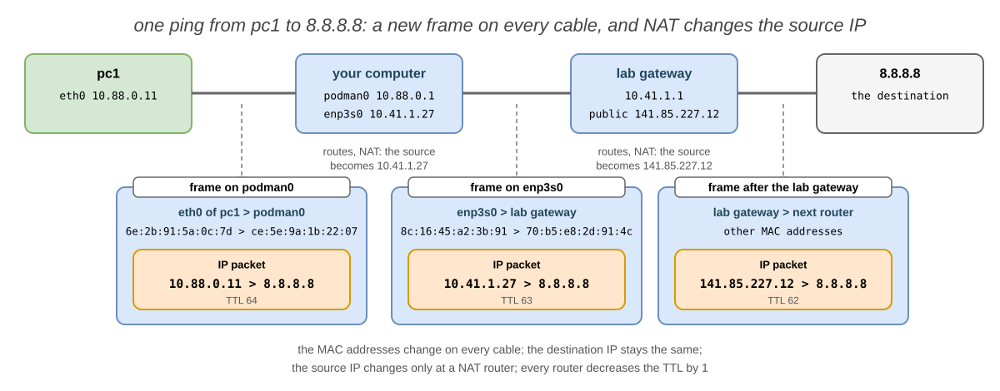

```shell-session
[student@fedora ~]$ sudo tcpdump -i podman0 -n -t -e -c 1 icmp
6e:2b:91:5a:0c:7d > ce:5e:9a:1b:22:07, ethertype IPv4 (0x0800), length 98: 10.88.0.11 > 8.8.8.8: ICMP echo request, id 3, seq 1, length 64
[student@fedora ~]$ sudo tcpdump -i enp3s0 -n -t -e -c 1 icmp
8c:16:45:a2:3b:91 > 70:b5:e8:2d:91:4c, ethertype IPv4 (0x0800), length 98: 10.41.1.27 > 8.8.8.8: ICMP echo request, id 3, seq 1, length 64
```

- Ambele capturi au rulat în timp ce `pc1` dădea ping la `8.8.8.8`. Pe `podman0`, cadrul a mers de la `pc1` la
  `podman0`, cu IP-ul sursă `10.88.0.11`; pe `enp3s0`, un cadru nou a mers de la placa voastră la gateway-ul
  laboratorului (vedeți `ip neigh`), cu IP-ul sursă `10.41.1.27`: calculatorul vostru a făcut NAT.

## Depanare {/* #troubleshooting */}

| Problemă                                                                                          | Soluție                                                                                                                                                                                           |
| ------------------------------------------------------------------------------------------------- | ------------------------------------------------------------------------------------------------------------------------------------------------------------------------------------------------- |
| `ping: connect: Network is unreachable`                                                           | `ip route` nu are o linie `default`; un container pornit cu `--network none` nu are deloc placă de rețea                                                                                          |
| `Destination Host Unreachable`                                                                    | Nimeni din rețeaua voastră nu are acea adresă (`ip neigh` arată `FAILED`)                                                                                                                          |
| `Temporary failure in name resolution`, `Could not resolve host` sau `no servers could be reached` | DNS nu merge: verificați serverul DNS cu `resolvectl dns` (într-un container, `/etc/resolv.conf`)                                                                                                 |
| `sudo podman run` vă cere să alegeți un registry sau nu găsește `lab09`                           | Imaginea nu a fost construită sau a fost construită fără `sudo`: rulați `sudo podman build -t lab09 .` în `~/lab09`                                                                                |
| `toomanyrequests: You have reached your pull rate limit`                                          | Docker Hub limitează descărcările pentru fiecare adresă publică, iar tot laboratorul (sau toată casa) folosește una singură: construiți imaginea mai târziu sau, în laborator, folosiți imaginea gata făcută |
| `the container name "pc1" is already in use` sau `requested ip address ... is already allocated`  | Un container vechi are deja acel nume sau acea adresă: `sudo podman rm -f <NAME>`                                                                                                                  |
| `ss` pe calculatorul vostru nu arată portul unui container                                        | Fiecare container are propriile porturi: `sudo podman exec <NAME> ss -tln`                                                                                                                        |
| `curl: (7) Failed to connect to <IP> port <PORT>`                                                 | `curl -v` spune de ce: `Connection refused` înseamnă că nu ascultă nimic acolo (un server pe `127.0.0.1` răspunde doar propriului calculator); `No route to host`, că nimeni nu are acea adresă      |
| `Open a socket for LPF: Operation not permitted`                                                  | Porniți din nou containerul cu `--cap-add NET_ADMIN,NET_RAW`                                                                                                                                       |
| `dhclient` repetă `DHCPDISCOVER`, apoi afișează `No DHCPOFFERS received`                          | Nu răspunde niciun server DHCP: rulează `dhcp` (`sudo podman ps`)?                                                                                                                                 |
| `dhclient` afișează `mv: cannot move ... '/etc/resolv.conf': Device or resource busy`             | Nu e nicio problemă: podman gestionează `/etc/resolv.conf` din container, așa că `dhclient` nu îl poate înlocui                                                                                    |
| `tcpdump` nu afișează nimic                                                                       | Placa (`sudo tcpdump -D`) sau filtrul este greșit; pachetele containerelor trec prin `podman0`                                                                                                     |
| `tcpdump: <FILE>: Permission denied`, cu `-w`                                                     | `tcpdump` nu mai rulează ca `root` după ce pornește: scrieți fișierul în `/tmp`                                                                                                                     |

## Exerciții {/* #exercises */}

- 🧪 [Primii pași](#first-steps) (exercițiile 1 - 13): câte o idee pe rând, în ordinea din laborator, de făcut în
  laborator;
- 🏠 [Mai departe](#going-further) (exercițiile 14 - 29): exerciții mai lungi, de făcut acasă; multe dintre ele se uită
  la **cadrele** unui pachet, explicate în [Drumul unui pachet](#the-way-of-a-packet);
- 📝 [Provocări](#challenges) (exercițiile 30 - 36): cele mai grele, asemănătoare celor de la examen.

:::danger

Doar vă **uitați** la setările de rețea ale calculatorului vostru: nicio comandă `nmcli` care le schimbă, niciun
`ip address add` sau `ip route add`, niciun `dhclient` pe calculatorul vostru. Folosiți `sudo` doar pentru `podman`,
`ss -p` și `tcpdump`, ca să instalați pachete și ca să ștergeți fișierele salvate de `tcpdump`.

:::

### 🧪 Primii pași {/* #first-steps */}

Faceți aceste exerciții în ordine, în timpul laboratorului. Fiecare începe cu ce vrea să obțineți și încearcă **o
singură** idee din laborator: dacă vă blocați, citiți secțiunea de sub obiectivul exercițiului. Rulați comenzile în
`~/lab09`, dacă exercițiul nu spune altfel.

1. **Gata de start**: Verificați că uneltele sunt instalate și că imaginea pentru containerele din acest laborator este
    gata.
    <small>→ [Fedora și Ubuntu](#fedora-and-ubuntu) · [Rularea containerelor](#running-containers-podman)</small>

    1. creați `~/lab09` și intrați în el;
    2. afișați versiunea lui `podman`, `tcpdump` și `traceroute` și verificați că `host` există;
    3. listați imaginile lui `sudo podman`.

    Pe calculatoarele din laborator totul este gata. Acasă, instalați ce lipsește, apoi construiți imaginea cu
    comenzile de mai jos (copiați-le cu <kbd>Ctrl</kbd>+<kbd>C</kbd> și lipiți-le în terminal cu
    <kbd>Ctrl</kbd>+<kbd>Shift</kbd>+<kbd>V</kbd>):

    ```bash
    sudo podman pull ghcr.io/upb-cs-iso/lab09:latest
    sudo podman tag ghcr.io/upb-cs-iso/lab09:latest lab09
    sudo podman untag localhost/lab09:latest ghcr.io/upb-cs-iso/lab09:latest
    ```

    <details className="reveal">
    <summary>Indiciu</summary>

    Majoritatea comenzilor își afișează versiunea cu `--version`; `host` rulat singur afișează cum se folosește.

    </details>

    <details className="reveal">
    <summary>Verificare</summary>

    2. Fiecare își afișează versiunea (`podman` 5, `tcpdump` 4.99, `traceroute` 2.1); `host` singur afișează
       `Usage: host ...`.
    3. `localhost/lab09` (`latest`).

    </details>

**Plăci de rețea**

2. **Plăcile voastre de rețea**: Găsiți plăcile calculatorului, pe cea care îl leagă la rețeaua laboratorului și
    adresa ei MAC.
    <small>→ [Interfețe de rețea](#network-interfaces-ip-link) · [NetworkManager](#networkmanager-nmcli)</small>

    1. listați plăcile, câte una pe linie, cu starea lor;
    2. afișați din `/sys` adresa MAC a plăcii Ethernet; care octeți identifică producătorul?
    3. aflați de la NetworkManager ce conexiune folosește fiecare placă.

    <details className="reveal">
    <summary>Indiciu</summary>

    `man ip-link`: căutați `-brief`; `ls /sys/class/net/`; `man nmcli`: căutați `device status`.

    </details>

    <details className="reveal">
    <summary>Verificare</summary>

    1. `ip -br link`: `lo` și o placă al cărei nume începe cu `en` (`enp3s0`; în VirtualBox: `enp0s3`), `UP`, cu
       `LOWER_UP`.
    2. `cat /sys/class/net/enp3s0/address`: `8c:16:45:a2:3b:91`; primii 3 octeți identifică producătorul (în
       VirtualBox: `08:00:27`).
    3. `nmcli device status`: placa Ethernet este `connected`, cu o conexiune precum `Wired connection 1`.

    </details>

**Adrese IP**

3. **Adresa voastră**: Găsiți adresa IP a calculatorului, rețeaua lui și adresa pe care o vede Internetul.
    <small>→ [Adrese și măști](#addresses-and-masks-ip-address) · [Afișarea unei singure valori](#printing-one-value) · [Adrese speciale](#special-addresses) · [Adrese private și NAT](#private-addresses-and-nat)</small>

    1. afișați adresa IPv4 și masca plăcii; notați rețeaua și câți biți identifică calculatorul;
    2. afișați **doar** adresa IPv4, fără mască, cu o singură linie de comandă;
    3. adresa este privată sau publică?
    4. afișați adresa pe care o vede `ifconfig.me` și comparați.

    <details className="reveal">
    <summary>Indiciu</summary>

    [Afișarea unei singure valori](#printing-one-value): `-4`, `awk` și `cut`.

    </details>

    <details className="reveal">
    <summary>Verificare</summary>

    1. De exemplu `10.41.1.27/24`: rețeaua `10.41.1.0/24`, 8 biți pentru calculator (în VirtualBox: `10.0.2.15/24`).
    2. `ip -br -4 address show enp3s0 | awk '{print $3}' | cut -d/ -f1` afișează `10.41.1.27`.
    3. Privată (`10.0.0.0/8`, `172.16.0.0/12` sau `192.168.0.0/16`).
    4. `curl -s https://ifconfig.me`: o adresă publică, de exemplu `141.85.227.12`: un router a făcut NAT.

    </details>

**Ping și vecini**

4. **E cineva acolo?**: Verificați că alte calculatoare răspund și aflați-le adresele MAC fără să le întrebați.
    <small>→ [Testarea unui calculator](#testing-a-computer-ping) · [Vecini](#neighbors-ip-neigh)</small>

    1. dați ping de două ori la loopback, apoi de trei ori la `8.8.8.8`; comparați timpii;
    2. dați ping de două ori la calculatorul unui coleg (cereți-i adresa; acasă, într-o mașină virtuală VirtualBox,
       dați ping la gateway-ul `10.0.2.2`);
    3. găsiți adresa MAC a acelui calculator în tabela de vecini și comparați-o cu cea găsită de coleg în exercițiul 2;
    4. apare `8.8.8.8` în tabelă?

    <details className="reveal">
    <summary>Indiciu</summary>

    `man ping`: căutați `-c count`; `man ip-neighbour`.

    </details>

    <details className="reveal">
    <summary>Verificare</summary>

    1. Sub `0.1 ms` pentru `127.0.0.1`, câteva sau zeci de ms pentru `8.8.8.8`; `0% packet loss`.
    2. Două răspunsuri.
    3. `10.41.1.28 dev enp3s0 lladdr 8c:16:45:a2:3c:07 REACHABLE`: aceeași adresă MAC (în VirtualBox:
       `10.0.2.2 dev enp0s3 lladdr 52:54:00:12:35:02`).
    4. Nu: tabela conține doar adrese din rețeaua voastră, de exemplu gateway-ul `10.41.1.1`; cadrele pentru alte rețele
       pleacă spre el.

    </details>

**Rutare**

5. **Pe unde?**: Aflați pe unde trimite calculatorul vostru pachetele pentru fiecare adresă.
    <small>→ [Tabela de rutare](#the-routing-table-ip-route)</small>

    1. afișați tabela de rutare; găsiți gateway-ul implicit;
    2. ghiciți **întâi** ce linie folosește fiecare adresă, apoi întrebați nucleul: colegul vostru, `8.8.8.8`,
       `10.41.200.1`;
    3. întrebați nucleul despre `127.0.0.1`: de ce nu apare în tabelă?

    <details className="reveal">
    <summary>Indiciu</summary>

    `man ip-route`: căutați `ip route get`.

    </details>

    <details className="reveal">
    <summary>Verificare</summary>

    1. `default via 10.41.1.1 dev enp3s0` (în VirtualBox: `10.0.2.2`).
    2. `10.41.1.28 dev enp3s0`: direct; `8.8.8.8` și `10.41.200.1` merg `via 10.41.1.1`: `10.41.200.1` nu este în
       `10.41.1.0/24`.
    3. `local 127.0.0.1 dev lo`: adresele calculatorului însuși sunt în altă tabelă, `local`.

    </details>

6. **Routerele de pe drum**: Găsiți routerele dintre calculatorul vostru și `8.8.8.8`.
    <small>→ [Routerele de pe drum](#the-routers-on-the-way-traceroute)</small>

    1. afișați routerele până la `8.8.8.8`, după adresă;
    2. găsiți în listă gateway-ul implicit și routerele care nu au răspuns.

    <details className="reveal">
    <summary>Verificare</summary>

    1. `traceroute -n 8.8.8.8`: câte o linie pentru fiecare router.
    2. Linia `1` este `10.41.1.1` (în VirtualBox: `10.0.2.2`); liniile `* * *` nu au răspuns. Dacă toate liniile de după
       primele sunt `* * *`, un firewall blochează pachetele lui `traceroute`.

    </details>

**DNS**

7. **Nume și adrese**: Transformați nume în adrese și invers și găsiți serverul DNS pe care îl întreabă calculatorul.
    <small>→ [Nume: DNS](#names-dns)</small>

    1. găsiți adresa IPv4 și serverul de e-mail al lui `upb.ro`;
    2. găsiți serverul DNS al calculatorului vostru;
    3. găsiți numele lui `8.8.8.8`.

    <details className="reveal">
    <summary>Verificare</summary>

    1. `upb.ro has address 141.85.220.33`, `mail is handled by 0 ironport.upb.ro.`
    2. `resolvectl dns`: `Link 2 (enp3s0): 10.41.1.1`.
    3. `host 8.8.8.8`: `dns.google.`

    </details>

**DHCP**

8. **Ce v-a dat DHCP**: Găsiți setările pe care calculatorul le-a primit prin DHCP și pentru cât timp.
    <small>→ [Configurarea automată: DHCP](#automatic-configuration-dhcp) · [Ce a primit calculatorul vostru](#what-your-computer-received)</small>

    1. găsiți adresa, gateway-ul și serverul DNS pe care NetworkManager le are pentru placa voastră;
    2. găsiți serverul DHCP și durata închirierii;
    3. aflați câte secunde mai are adresa voastră.

    <details className="reveal">
    <summary>Indiciu</summary>

    `man nmcli`: căutați `--fields`; `ip address show <IF>`.

    </details>

    <details className="reveal">
    <summary>Verificare</summary>

    1. `nmcli device show enp3s0 | grep IP4`: `10.41.1.27/24`, gateway și DNS `10.41.1.1`: aceleași valori ca în
       exercițiile 3, 5 și 7.
    2. `nmcli -f DHCP4 device show enp3s0`: `dhcp_server_identifier = 10.41.1.1`, `dhcp_lease_time = 86400` (24 de ore).
    3. `ip address show enp3s0`: `valid_lft 85127sec`, puțin mai puțin decât durata închirierii (o adresă statică nu are
       linii `DHCP4` și are `valid_lft forever`).

    **De ce:** adresa este doar împrumutată; NetworkManager reînnoiește închirierea înainte să expire.

    </details>

**Containere**

9. **Un calculator în calculator**: Porniți un container și comparați-i rețeaua cu cea a calculatorului vostru.
    <small>→ [Lucrul într-un container](#working-in-a-container) · [Rularea containerelor](#running-containers-podman) · [Rețeaua containerelor](#the-network-of-the-containers)</small>

    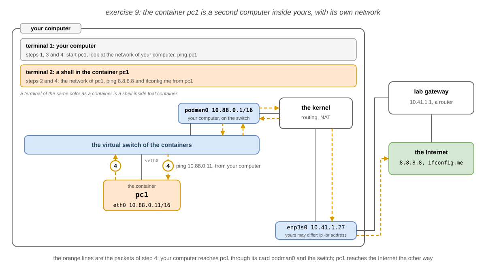

    ```shell-session title="terminalul 1: calculatorul vostru (pașii 1, 3, 4)"
    [student@fedora lab09]$ <COMMAND>
    ```

    ```shell-session title="terminalul 2: un shell în pc1 (pașii 2, 4)"
    [student@fedora lab09]$ sudo podman exec -it pc1 bash
    root@pc1:/# <COMMAND>
    ```

    1. porniți containerul `pc1`:

       ```bash
       sudo podman run -d --name pc1 --hostname pc1 --ip 10.88.0.11 lab09 sleep infinity
       ```

    2. deschideți un shell în `pc1` (într-un al doilea terminal) și afișați plăcile, adresele și tabela de rutare ale
       lui `pc1`;
    3. afișați-le și pe calculatorul vostru, în primul terminal: ce a apărut nou?
    4. dați ping de două ori la `pc1` de pe calculatorul vostru; din `pc1`, dați ping de două ori la `8.8.8.8` și
       afișați adresa pe care o vede `ifconfig.me`.

    <details className="reveal">
    <summary>Verificare</summary>

    2. `eth0` cu `10.88.0.11/16`; `default via 10.88.0.1 dev eth0`.
    3. `podman0` (`10.88.0.1/16`) și `veth0`; ruta `10.88.0.0/16 dev podman0`.
    4. Răspunsuri în ambele cazuri; aceeași adresă publică precum în exercițiul 3: calculatorul vostru face NAT pentru
       `pc1`.

    </details>

**Porturi**

10. **Cine ascultă?**: Găsiți programele care așteaptă clienți, pe calculatorul vostru și într-un container.
    <small>→ [Lucrul într-un container](#working-in-a-container) · [Porturi](#ports-tcp-and-udp) · [Programe care ascultă](#listening-programs-ss)</small>

    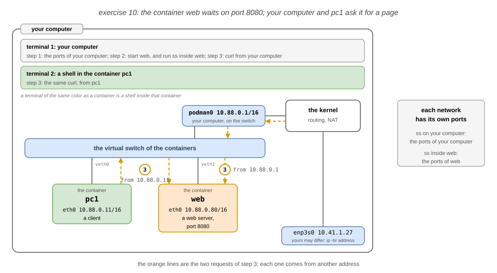

    ```shell-session title="terminalul 1: calculatorul vostru (pașii 1, 2, 3)"
    [student@fedora lab09]$ <COMMAND>
    [student@fedora lab09]$ sudo podman exec web <COMMAND>
    ```

    ```shell-session title="terminalul 2: un shell în pc1 (pasul 3)"
    [student@fedora lab09]$ sudo podman exec -it pc1 bash
    root@pc1:/# <COMMAND>
    ```

    1. listați porturile TCP și UDP care așteaptă pe calculatorul vostru, cu programele lor; găsiți portul DNS;
    2. porniți `web` și listați-i porturile (rulați `ss` în `web`); se află `8080` pe calculatorul vostru?

       ```bash
       sudo podman run -d --name web --hostname web --ip 10.88.0.80 lab09 python3 -m http.server --bind 0.0.0.0 8080
       ```

    3. cereți-i lui `web` antetele paginii lui, de pe calculatorul vostru, apoi dintr-un shell din `pc1`.

    <details className="reveal">
    <summary>Indiciu</summary>

    `man curl`: căutați `--head`.

    </details>

    <details className="reveal">
    <summary>Verificare</summary>

    1. `sudo ss -tulnp`: `systemd-resolve` pe `127.0.0.53%lo:53`, UDP și TCP, și altele (`chronyd`, `cupsd`).
    2. `sudo podman exec web ss -tlnp`: `0.0.0.0:8080`, `python3`; portul nu este pe calculatorul vostru: un container
       are propriile porturi.
    3. `HTTP/1.0 200 OK` de două ori.

    </details>

**Cererea unei adrese**

11. **O adresă de la DHCP**: Jucați rolul unui client DHCP: cereți o adresă serverului de exercițiu și urmăriți cum
    răspunde serverul.
    <small>→ [Lucrul într-un container](#working-in-a-container) · [Cererea unei adrese](#asking-for-an-address-dhclient)</small>

    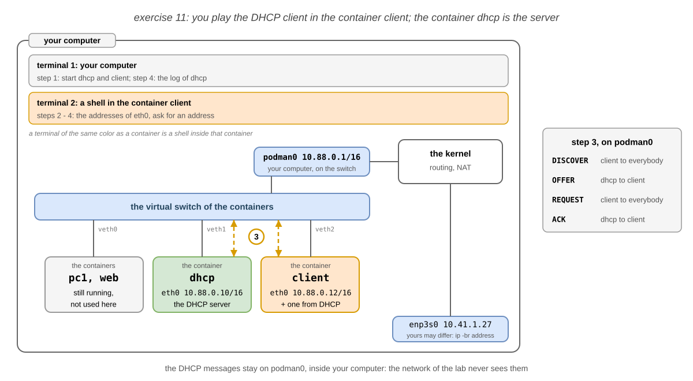

    ```shell-session title="terminalul 1: calculatorul vostru (pașii 1, 4)"
    [student@fedora lab09]$ <COMMAND>
    ```

    ```shell-session title="terminalul 2: un shell în client (pașii 2, 3, 4)"
    [student@fedora lab09]$ sudo podman exec -it client bash
    root@client:/# <COMMAND>
    ```

    1. porniți serverul DHCP de exercițiu, `dhcp`, și containerul `client` (copiați comenzile exact așa cum sunt: nu
       configurați voi serverul);

       ```bash
       sudo podman run -d --name dhcp --hostname dhcp --ip 10.88.0.10 --cap-add NET_ADMIN,NET_RAW lab09 \
           dnsmasq -d --conf-file=/dev/null --user=root --no-ping --dhcp-range=10.88.0.200,10.88.0.209,10m \
           --dhcp-option=option:router,10.88.0.1
       sudo podman run -d --name client --hostname client --ip 10.88.0.12 --cap-add NET_ADMIN,NET_RAW lab09 \
           sleep infinity
       ```

    2. deschideți un shell în `client` și afișați adresele lui `eth0`: de unde vine această adresă?
    3. cereți o adresă pentru `eth0`, afișând cele patru mesaje; ce adresă a oferit serverul?
    4. afișați din nou adresele lui `eth0`, apoi, din alt terminal, jurnalul lui `dhcp`.

    <details className="reveal">
    <summary>Indiciu</summary>

    `man dhclient` (vedeți [Resurse](#resources)): căutați `-v`.

    </details>

    <details className="reveal">
    <summary>Verificare</summary>

    2. Doar `10.88.0.12/16`: a dat-o podman când a pornit containerul.
    3. `dhclient -v eth0`: `DHCPDISCOVER`, `DHCPOFFER of 10.88.0.20x from 10.88.0.10` (`x` este o cifră), `DHCPREQUEST`,
       `DHCPACK`, apoi `bound to 10.88.0.20x`.
    4. `10.88.0.12/16` și `10.88.0.20x/16`; `sudo podman logs dhcp` se termină cu `DHCPDISCOVER`, `DHCPOFFER`,
       `DHCPREQUEST` și `DHCPACK`, fiecare cu adresa MAC a lui `client`.

    **De ce:** DHCP a adăugat o a doua adresă, împrumutată pentru 10 minute; cea de la podman rămâne.

    </details>

**Capturarea pachetelor**

12. **Urmăriți pachetele**: Vedeți cum trec ping-urile lui `pc1` prin `podman0`, apoi prin placa voastră.
    <small>→ [Lucrul într-un container](#working-in-a-container) · [Capturarea pachetelor](#capturing-packets-tcpdump)</small>

    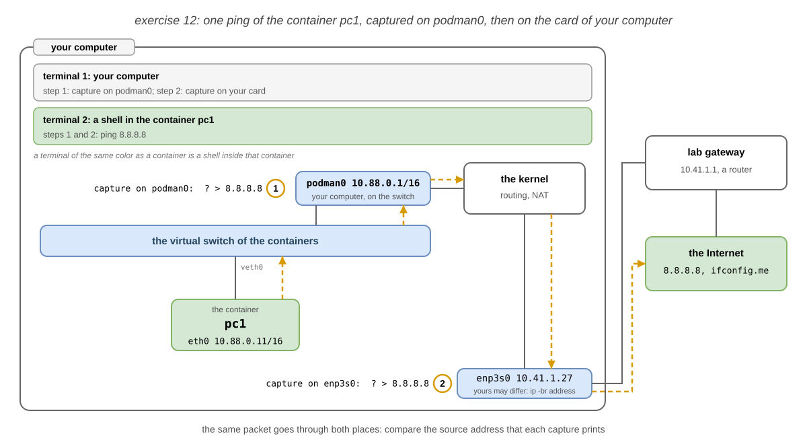

    ```shell-session title="terminalul 1: calculatorul vostru (pașii 1, 2)"
    [student@fedora lab09]$ <COMMAND>
    ```

    ```shell-session title="terminalul 2: un shell în pc1 (pașii 1, 2)"
    [student@fedora lab09]$ sudo podman exec -it pc1 bash
    root@pc1:/# <COMMAND>
    ```

    1. capturați pachetele ICMP de pe `podman0` pe calculatorul vostru, în timp ce un shell din `pc1` dă ping de două
       ori la `8.8.8.8`;
    2. capturați pachetele ICMP de pe placa voastră în timp ce `pc1` dă din nou ping; comparați adresele sursă.

    <details className="reveal">
    <summary>Indiciu</summary>

    Porniți întâi captura, apoi `ping`-ul; <kbd>Ctrl</kbd>+<kbd>C</kbd> oprește captura.

    </details>

    <details className="reveal">
    <summary>Verificare</summary>

    1. `sudo tcpdump -i podman0 -n -t icmp`: `IP 10.88.0.11 > 8.8.8.8: ICMP echo request`, apoi răspunsul, de două ori.
    2. `IP 10.41.1.27 > 8.8.8.8`: calculatorul vostru a înlocuit adresa lui `pc1` cu propria adresă (NAT).

    </details>

**Recapitulare**

13. **Recapitulare: nu merge Internetul?**: Găsiți ce s-a stricat în rețeaua unui container, verificând nivelurile de
    jos în sus.
    <small>→ [Lucrul într-un container](#working-in-a-container) · [Nu merge Internetul?](#no-internet)</small>

    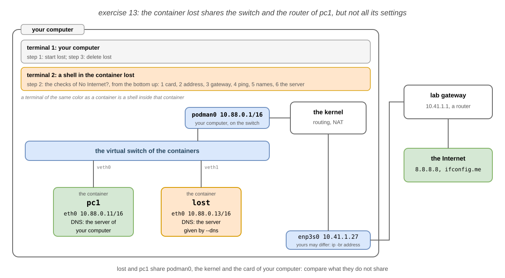

    ```shell-session title="terminalul 1: calculatorul vostru (pașii 1, 3)"
    [student@fedora lab09]$ <COMMAND>
    ```

    ```shell-session title="terminalul 2: un shell în lost (pasul 2)"
    [student@fedora lab09]$ sudo podman exec -it lost bash
    root@lost:/# <COMMAND>
    ```

    1. porniți `lost`:

       ```bash
       sudo podman run -d --name lost --hostname lost --ip 10.88.0.13 --dns 192.0.2.53 lab09 sleep infinity
       ```

    2. într-un shell din `lost`, rulați verificările din [Nu merge Internetul?](#no-internet), în ordine, până când una
       eșuează;
    3. numiți nivelul și cauza; apoi ștergeți `lost`.

    <details className="reveal">
    <summary>Verificare</summary>

    2. Verificările 1 - 4 merg; `host upb.ro` afișează `no servers could be reached`.
    3. Nivelul aplicație, DNS: serverul DNS al lui `lost`, `192.0.2.53` (`/etc/resolv.conf`), nu răspunde.

    </details>

### 🏠 Mai departe {/* #going-further */}

Fiecare exercițiu începe cu **obiectivul** lui; comenzile le alegeți voi. La final, verificați obiectivul însuși, nu
doar că fiecare comandă a mers. Exercițiile folosesc `pc1`, `web`, `dhcp` și `client` din Primii pași; dacă nu mai
există, porniți-le din nou cu comenzile din exercițiile 9, 10 și 11.

**Plăci și adrese**

14. **Câte o valoare**: Un script are nevoie de o singură valoare, nu de un tabel. Afișați fiecare valoare de mai jos
    cu o singură linie de comandă și nimic altceva. <small>→ [Afișarea unei singure valori](#printing-one-value)</small>

    1. adresa MAC a plăcii Ethernet, din rezultatul lui `ip`;
    2. masca adresei IPv4, ca număr (`24`);
    3. numele plăcii rutei implicite;
    4. adresa gateway-ului implicit;
    5. adresa MAC a gateway-ului;
    6. serverul DNS al plăcii voastre;
    7. adresa IPv4 a lui `upb.ro`;
    8. durata închirierii adresei voastre, în secunde;
    9. porturile TCP pe care așteaptă clienți pe calculatorul vostru, ca numere, câte unul pe linie, fără repetări.

    <details className="reveal">
    <summary>Indiciu</summary>

    `awk '{print $N}'` și `$NF`; `awk -F:` desparte la `:`; `cut`, `grep` și `sort -un` (laboratorul 06); `ss -H` nu
    afișează antetul.

    </details>

    <details className="reveal">
    <summary>Verificare</summary>

    Este corectă orice linie de comandă care afișează aceeași valoare, de exemplu:

    1. `ip -br link show enp3s0 | awk '{print $3}'`: `8c:16:45:a2:3b:91`.
    2. `ip -br -4 address show enp3s0 | awk '{print $3}' | cut -d/ -f2`: `24`.
    3. `ip route show default | awk '{print $5}'`: `enp3s0`.
    4. `ip route show default | awk '{print $3}'`: `10.41.1.1`.
    5. `ip neigh show 10.41.1.1 | awk '{print $5}'`: `70:b5:e8:2d:91:4c`.
    6. `resolvectl dns enp3s0 | awk '{print $NF}'`: `10.41.1.1`.
    7. `host -t A upb.ro | awk '{print $NF}'`: `141.85.220.33`.
    8. `nmcli -f DHCP4 device show enp3s0 | grep dhcp_lease_time | awk '{print $NF}'`: `86400`.
    9. `ss -tlnH | awk '{print $4}' | awk -F: '{print $NF}' | sort -un`: `53`, `631`, ...

    </details>

15. **Reală sau inventată?**: O placă virtuală primește o adresă MAC inventată, a cărei a doua cifră hexazecimală este
    `2`, `6`, `a` sau `e`. Aflați ce plăci au adrese inventate și cine a fabricat placa voastră.
    <small>→ [Plăci de rețea](#network-cards) · [Adrese și măști](#addresses-and-masks-ip-address) · [Adrese speciale](#special-addresses)</small>

    1. afișați adresele MAC ale lui `eth0` din `pc1`, ale lui `podman0` și ale plăcii voastre și uitați-vă la a doua
       cifră;
    2. găsiți producătorul plăcii voastre după primii trei octeți;
    3. afișați adresele IPv6 ale plăcii voastre și ale lui `eth0` din `pc1`: ce fel de adrese sunt?

    <details className="reveal">
    <summary>Indiciu</summary>

    `/usr/share/hwdata/oui.txt` (pe Ubuntu: `/usr/share/ieee-data/oui.txt`) scrie octeții cu majuscule, separați prin `-`.

    </details>

    <details className="reveal">
    <summary>Verificare</summary>

    1. `pc1` și `podman0`: `2`, `6`, `a` sau `e`; placa voastră: altă cifră.
    2. `grep -i '^8C-16-45' /usr/share/hwdata/oui.txt` (cu octeții voștri) afișează numele unei firme; în VirtualBox:
       `PCS Systemtechnik GmbH`.
    3. `fe80::.../64` pentru amândouă: adrese **link-local**, valabile doar în propria rețea locală.

    </details>

16. **Măști pe hârtie**: La examen, măștile se calculează de mână. Pentru fiecare adresă, scrieți **întâi** rețeaua,
    broadcastul, prima și ultima adresă de calculator și câte calculatoare încap; apoi verificați cu `ipcalc`.
    <small>→ [Adrese și măști](#addresses-and-masks-ip-address) · [Calculul rețelei](#computing-the-network)</small>

    1. `192.168.1.105/24` și `10.88.0.11/16`;
    2. `172.16.5.130/25`;
    3. `10.41.1.27/30`: poate un calculator să aibă această adresă?
    4. sunt `172.16.5.100/25` și `172.16.5.130/25` în aceeași rețea?

    <details className="reveal">
    <summary>Indiciu</summary>

    Scrieți ultimul octet în binar. Prima adresă dintr-o rețea dă numele rețelei; ultima este broadcastul ei.

    </details>

    <details className="reveal">
    <summary>Verificare</summary>

    1. `192.168.1.0`, `192.168.1.255`, `.1` - `.254`, 254; `10.88.0.0`, `10.88.255.255`, `10.88.0.1` -
       `10.88.255.254`, 65534.
    2. `172.16.5.128`, `172.16.5.255`, `.129` - `.254`, 126.
    3. `10.41.1.24`, `10.41.1.27`, `.25` - `.26`, 2: `10.41.1.27` este broadcastul, deci niciun calculator nu o poate
       avea.
    4. Nu: `172.16.5.0/25` și `172.16.5.128/25`.

    </details>

**Drumul unui pachet**

17. **Următorul salt**: `bob` spune că un ping la `8.8.8.8` pleacă spre adresa MAC a lui `8.8.8.8`. Arătați-i că
    greșește și urmăriți un ping al lui `pc1` prin calculatorul vostru. <small>→ [Drumul unui pachet](#the-way-of-a-packet)</small>

    1. capturați un cadru ICMP de pe placa voastră, cu adresele lui MAC, în timp ce dați ping la `8.8.8.8`, apoi la
       colegul vostru;
    2. capturați, în două terminale, un cadru ICMP pe `podman0` și unul pe placa voastră, în timp ce `pc1` dă ping la
       `8.8.8.8` dintr-un al treilea terminal;
    3. aflați ale cui sunt adresele MAC.

    <details className="reveal">
    <summary>Indiciu</summary>

    `man tcpdump`: căutați `-e`; `/sys/class/net/<IF>/address`; `ip neigh`.

    </details>

    <details className="reveal">
    <summary>Verificare</summary>

    1. Spre `8.8.8.8`, adresa MAC destinație este a gateway-ului; spre colegul vostru, este a colegului.
    2. Pe `podman0`: `pc1` > `podman0`, `10.88.0.11 > 8.8.8.8`; pe placa voastră: placa voastră > gateway-ul,
       `10.41.1.27 > 8.8.8.8`.

    **De ce:** la fiecare salt, pachetul este pus într-un cadru nou, adresat adresei MAC a următorului salt.

    </details>

18. **ARP pe fir**: Urmăriți cum cere `pc1` o adresă MAC, o dată cu răspuns și o dată fără.
    <small>→ [Vecini](#neighbors-ip-neigh)</small>

    1. într-un al doilea terminal, capturați cadrele ARP de pe `podman0`, cu adresele lor MAC;
    2. din `pc1`, dați o dată ping la `dhcp` (`10.88.0.10`), apoi la `10.88.0.99`, pe care nu o are nimeni; afișați
       tabela de vecini a lui `pc1`.

    <details className="reveal">
    <summary>Verificare</summary>

    2. `Request who-has 10.88.0.10 tell 10.88.0.11` către `ff:ff:ff:ff:ff:ff` și `Reply 10.88.0.10 is-at ...`; pentru
       `10.88.0.99`, trei cereri fără răspuns și `Destination Host Unreachable`; tabela conține
       `10.88.0.10 ... REACHABLE` și `10.88.0.99 dev eth0 FAILED`.

    </details>

19. **Rutele unui container**: Pentru `pc1`, laboratorul este „altă rețea”. Ghiciți **întâi** cum ajunge `pc1` la
    fiecare adresă, apoi verificați. <small>→ [Tabela de rutare](#the-routing-table-ip-route) · [Routerele de pe drum](#the-routers-on-the-way-traceroute)</small>

    1. în `pc1`, întrebați nucleul despre `10.88.0.80`, `10.41.1.27` (calculatorul vostru) și `8.8.8.8`;
    2. afișați routerele dintre `pc1` și `8.8.8.8` și comparați-le cu exercițiul 6;
    3. de pe calculatorul vostru, afișați routerele până la `upb.ro` și comparați primele linii cu exercițiul 6.

    <details className="reveal">
    <summary>Verificare</summary>

    1. `10.88.0.80 dev eth0`: direct; `10.41.1.27` și `8.8.8.8` merg `via 10.88.0.1`, pentru că nu sunt în
       `10.88.0.0/16`.
    2. O linie în plus la început: `1  10.88.0.1`, apoi `2  10.41.1.1`.
    3. Primele linii sunt aceleași: orice pachet pentru o altă rețea pleacă prin gateway.

    </details>

20. **`traceroute` de mână**: Găsiți primele două routere cu `ping` și un TTL mic.
    <small>→ [Routerele de pe drum](#the-routers-on-the-way-traceroute)</small>

    1. dați o dată ping la `8.8.8.8` cu un TTL de `1`, apoi de `2`, de pe calculatorul vostru și din `pc1`.

    <details className="reveal">
    <summary>Indiciu</summary>

    `man ping`: căutați `-t ttl`.

    </details>

    <details className="reveal">
    <summary>Verificare</summary>

    1. De pe calculatorul vostru: `From 10.41.1.1 icmp_seq=1 Time to live exceeded`, apoi al doilea router din
       exercițiul 6; din `pc1`: `From 10.88.0.1 ...`, apoi `From 10.41.1.1 ...`.

    </details>

**DNS**

21. **Mai multe înregistrări**: Găsiți înregistrările pe care `host` nu le afișează implicit.
    <small>→ [Nume: DNS](#names-dns)</small>

    1. găsiți adresa IPv6 a lui `google.com`, serverele de e-mail ale lui `gmail.com` și serverele DNS ale lui `upb.ro`;
    2. găsiți adresa lui `upb.ro` întrebând serverul `8.8.8.8`.

    <details className="reveal">
    <summary>Verificare</summary>

    1. `host -t AAAA google.com`: `has IPv6 address 2a00:1450:...`; `host -t MX gmail.com`; `host -t NS upb.ro`.
    2. `host upb.ro 8.8.8.8`: `Using domain server: ... 8.8.8.8#53`, apoi `141.85.220.33` (sau
       `no servers could be reached`, dacă laboratorul blochează alte servere DNS).

    </details>

22. **Serviciul DNS al calculatorului vostru**: Pe Fedora, programele nu întreabă direct serverul DNS al rețelei.
    Aflați pe cine întreabă. <small>→ [Nume: DNS](#names-dns)</small>

    1. găsiți programul care ascultă pe portul `53`;
    2. afișați `/etc/resolv.conf` și aflați ce fel de fișier este;
    3. rulați de două ori `resolvectl query upb.ro`: de unde a venit fiecare răspuns?
    4. afișați `/etc/resolv.conf` din `pc1`: ce server întreabă și de ce nu `127.0.0.53`?

    <details className="reveal">
    <summary>Verificare</summary>

    1. `systemd-resolve`, pe `127.0.0.53` și `127.0.0.54`.
    2. `nameserver 127.0.0.53`; o legătură simbolică spre `../run/systemd/resolve/stub-resolv.conf`.
    3. `Data from: network`, apoi `Data from: cache`.
    4. `nameserver 10.41.1.1`: în `pc1`, `127.0.0.53` ar fi loopback-ul lui `pc1`, unde nu răspunde nimeni la DNS.

    </details>

**Porturi și conexiuni**

23. **Cele două capete ale unei conexiuni**: Țineți deschisă o conexiune de la `pc1` la `web` și priviți-o de la
    ambele capete. <small>→ [Programe care ascultă](#listening-programs-ss)</small>

    1. într-un shell din `pc1`, deschideți o conexiune cu `exec 3<>/dev/tcp/10.88.0.80/8080`;
    2. listați conexiunile TCP deschise ale lui `pc1` și ale lui `web`;
    3. găsiți intervalul porturilor folosite de clienți;
    4. închideți conexiunea cu `exec 3>&-` și listați din nou conexiunile lui `pc1`;
    5. afișați jurnalul lui `web`: ce adrese de clienți apar?

    <details className="reveal">
    <summary>Indiciu</summary>

    `man bash`: căutați `/dev/tcp`; `ss -tn`; `/proc/sys/net/ipv4/ip_local_port_range`; `man podman-logs`.

    </details>

    <details className="reveal">
    <summary>Verificare</summary>

    2. `ESTAB ... 10.88.0.11:45312 10.88.0.80:8080` (cu alt port ales la întâmplare), iar în `web` la fel, cu capetele
       inversate.
    3. `32768 60999`.
    4. `TIME-WAIT` cam un minut, apoi nimic.
    5. `sudo podman logs web`: `10.88.0.1` (calculatorul vostru, prin `podman0`, în exercițiul 10) și `10.88.0.11`
       (`pc1`); conexiunea de la pasul 1 nu a trimis nicio cerere, de aceea nu apare în jurnal.

    </details>

24. **Refuzat sau tăcere?**: `carol` nu poate deschide o pagină. Aflați cum vede un client un port închis și o adresă pe
    care nu o are nimeni. <small>→ [Porturi](#ports-tcp-and-udp) · [Capturarea pachetelor](#capturing-packets-tcpdump)</small>

    1. capturați pachetele TCP de pe `podman0`;
    2. din `pc1`, rulați `curl -v` pe portul `9999` al lui `web`, apoi pe portul `8080` al lui `10.88.0.99`.

    <details className="reveal">
    <summary>Verificare</summary>

    2. `failed: Connection refused` imediat, cu `Flags [S]` de la `pc1` și `Flags [R.]` (un _reset_) de la `web`; apoi,
       după câteva secunde, `failed: No route to host`, fără niciun pachet TCP: ARP nu a găsit pe nimeni.

    </details>

**DHCP**

25. **Închirierea**: `dave` vrea să știe ce a dat serverul DHCP și pentru cât timp. Citiți închirierea lui `client`, de
    la ambele capete. <small>→ [Cererea unei adrese](#asking-for-an-address-dhclient)</small>

    1. în `client`, afișați fișierul cu închirieri (dacă `client` a fost repornit, cereți întâi o adresă);
    2. afișați `/var/lib/misc/dnsmasq.leases` din `dhcp` și transformați primul număr într-o dată;
    3. eliberați adresa și afișați adresele lui `eth0`: care au rămas?

    <details className="reveal">
    <summary>Indiciu</summary>

    `man dhclient.leases` (vedeți [Resurse](#resources)); `man date`: căutați `@`.

    </details>

    <details className="reveal">
    <summary>Verificare</summary>

    1. Ultimul bloc `lease { ... }` conține `fixed-address 10.88.0.20x`, `subnet-mask 255.255.0.0`, `routers 10.88.0.1`,
       `domain-name-servers 10.88.0.10`, `dhcp-lease-time 600` și `dhcp-server-identifier 10.88.0.10`.
    2. `1795430400 a2:5c:17:e8:44:30 10.88.0.204 ...`: sfârșitul închirierii, 10 minute mai târziu
       (`date -d @1795430400`), adresa MAC și adresa IP.
    3. `dhclient -r -v eth0`: `DHCPRELEASE of 10.88.0.20x`; `eth0` nu mai are nicio adresă IPv4, nici măcar
       `10.88.0.12`.

    **De ce:** la eliberare, scriptul Debian șterge toate adresele IPv4 ale plăcii, inclusiv pe cea de la podman.

    </details>

26. **DHCP pe fir**: Urmăriți o conversație DHCP completă, apoi citiți-i câmpurile în Wireshark.
    <small>→ [Cererea unei adrese](#asking-for-an-address-dhclient) · [Capturarea pachetelor](#capturing-packets-tcpdump)</small>

    1. într-un al doilea terminal, capturați cu detalii pachetele DHCP de pe `podman0`; în `client`, ștergeți fișierul
       cu închirieri (altfel `dhclient` cere direct adresa veche), cereți o adresă și apoi eliberați-o;
    2. instalați Wireshark;
    3. salvați pachetele DHCP de pe `podman0` în `/tmp/dhcp.pcap`, în timp ce `client` repetă pașii de mai sus;
    4. deschideți fișierul în Wireshark; în mesajul `Offer`, găsiți masca, gateway-ul, serverul DNS și durata
       închirierii.

    <details className="reveal">
    <summary>Indiciu</summary>

    DHCP folosește porturile `67` și `68`; cu `-v`, tipul mesajului apare după `DHCP-Message`; fișierul cu închirieri
    este în tabelul din [Cererea unei adrese](#asking-for-an-address-dhclient).

    </details>

    <details className="reveal">
    <summary>Verificare</summary>

    1. `sudo tcpdump -i podman0 -n -v port 67 or port 68`: `Discover`, `Offer`, `Request`, `ACK`, `Release`.
    3. `sudo tcpdump -i podman0 -n -w /tmp/dhcp.pcap port 67 or port 68`.
    4. `(1) Subnet Mask (255.255.0.0)`, `(3) Router` (`10.88.0.1`), `(6) Domain Name Server` (`10.88.0.10`),
       `(51) IP Address Lease Time (10m)`.

    </details>

**Capturare**

27. **Ce vă arată switch-ul**: Aflați ce cadre ajung la placa voastră.
    <small>→ [Capturarea pachetelor](#capturing-packets-tcpdump)</small>

    1. capturați 50 de cadre de pe placa voastră, cu adresele lor MAC, și numărați-le după destinație.

    <details className="reveal">
    <summary>Indiciu</summary>

    Cu `-t -e`, destinația este al treilea cuvânt; `awk`, `tr`, `sort` și `uniq -c` (laboratorul 06).

    </details>

    <details className="reveal">
    <summary>Verificare</summary>

    1. `sudo tcpdump -i enp3s0 -n -t -e -c 50 | awk '{print $3}' | tr -d , | sort | uniq -c`: aproape numai placa
       voastră, gateway-ul, `ff:ff:ff:ff:ff:ff` și multicast (`01:00:5e:...`, `33:33:...`): switch-ul nu vă trimite
       cadrele celorlalți. Din când în când poate apărea un cadru pentru altă placă: cât timp nu știe încă unde se află
       destinația, un switch trimite cadrul către toate plăcile.

    </details>

**Depanare**

28. **De jos în sus**: `erin` spune că în `pc1` nu merge Internetul. Arătați-i că merge, nivel cu nivel.
    <small>→ [Nu merge Internetul?](#no-internet)</small>

    1. în `pc1`, rulați în ordine cele șase verificări din [Nu merge Internetul?](#no-internet) și notați nivelul
       fiecăreia;
    2. pentru fiecare verificare, notați ce exercițiu anterior a folosit aceeași comandă.

    <details className="reveal">
    <summary>Verificare</summary>

    1. Toate verificările merg; `curl -I https://upb.ro` afișează o linie care începe cu `HTTP`.
    2. De exemplu: `ip -br link`, exercițiul 2; `ip -br address`, exercițiul 3; `ip route`, exercițiul 5;
       `ping`, exercițiul 4; `host`, exercițiul 7; `curl -I`, exercițiul 10.

    </details>

**Curățenie**

29. **Curățenie**: Ștergeți tot ce a creat acest laborator.

    1. ștergeți containerele `pc1`, `web`, `dhcp` și `client`, apoi imaginea `lab09` (păstreaz-o dacă
       faceți Provocările, care folosesc și ele `lab09`);
    2. ștergeți `~/lab09` și `/tmp/dhcp.pcap`, care aparține utilizatorului `tcpdump`.

    <details className="reveal">
    <summary>Verificare</summary>

    1. `sudo podman ps -a` și `sudo podman images` afișează doar antetul; `podman0` a dispărut.
    2. `ls ~/lab09 /tmp/dhcp.pcap` afișează de două ori `No such file or directory`.

    </details>

### 📝 Provocări {/* #challenges */}

Aceste exerciții seamănă cu cele de la examen: fiecare cere un **rezultat**, nu pașii până la el, și se încheie cu
**Verificarea** după care va fi notat. Unele au nevoie de [Drumul unui pachet](#the-way-of-a-packet). Toate pornesc de
la configurația de mai jos; rulați-o din nou ca să o luați de la capăt:

```bash
mkdir -p ~/exam
cd ~/exam
sudo podman rm -f -t 0 pc1 web dhcp client lost exam-a exam-b exam-c exam-web exam-dhcp exam-nonet \
    exam-nodns exam-local &> /dev/null
sudo podman image exists lab09 || { sudo podman pull ghcr.io/upb-cs-iso/lab09:latest &&
    sudo podman tag ghcr.io/upb-cs-iso/lab09:latest lab09 &&
    sudo podman untag localhost/lab09:latest ghcr.io/upb-cs-iso/lab09:latest; }
run() { sudo podman run -d --name "$1" --hostname "$1" "${@:2}" > /dev/null; }
run exam-a --ip 10.88.0.21 lab09 sleep infinity
run exam-b --ip 10.88.0.22 lab09 sleep infinity
run exam-c --ip 10.88.0.23 --cap-add NET_ADMIN,NET_RAW lab09 sleep infinity
run exam-web --ip 10.88.0.24 lab09 python3 -m http.server --bind 0.0.0.0 $((RANDOM % 1000 + 5000))
run exam-dhcp --ip 10.88.0.25 --cap-add NET_ADMIN,NET_RAW lab09 dnsmasq -d --conf-file=/dev/null --user=root --no-ping \
    --dhcp-range=10.88.0.150,10.88.0.159,5m --dhcp-option=option:router,10.88.0.1
run exam-nonet --network none lab09 sleep infinity
run exam-nodns --ip 10.88.0.26 --dns 192.0.2.53 lab09 sleep infinity
run exam-local --ip 10.88.0.27 lab09 python3 -m http.server --bind 127.0.0.1 8080
sudo podman ps --format '{{.Names}}'
```

La final, faceți curățenie:

```bash
sudo podman rm -f -t 0 exam-a exam-b exam-c exam-web exam-dhcp exam-nonet exam-nodns exam-local
sudo podman rmi lab09    # doar acasă: pe calculatoarele din laborator, păstrați imaginea
rm -rf ~/exam
sudo rm -f /tmp/exam-ping.pcap
```

30. **Un raport de rețea**: Scrieți `~/exam/netinfo.sh`, care afișează cele patru valori de care are nevoie
    calculatorul vostru, câte una pe linie:

    ```
    card: enp3s0
    address: 10.41.1.27/24
    gateway: 10.41.1.1
    dns: 10.41.1.1
    ```

    Placa este cea a rutei implicite; dacă sunt mai multe servere DNS, ele stau pe aceeași linie, separate prin spații.
    Scriptul citește fiecare valoare din comenzi (nicio adresă scrisă în el), rulează fără `sudo`, iar `shellcheck` nu
    găsește nimic.

    <details className="reveal">
    <summary>Verificare</summary>

    `bash netinfo.sh` afișează aceleași valori ca `ip route show default` (`dev` și `via`),
    `ip -br address show <CARD>` (prima adresă IPv4) și `resolvectl dns <CARD>`;
    `grep -E '[0-9]+\.[0-9]+\.' netinfo.sh` și `shellcheck netinfo.sh` nu afișează nimic.

    </details>

31. **Ghiciți ruta**: Scrieți pe hârtie cum trimite `exam-a` un pachet către fiecare adresă: **direct**, **prin** un
    gateway, **local** (către el însuși) sau **către toți** (un broadcast). Demonstrați fiecare răspuns cu o singură
    comandă în `exam-a`.

    `10.88.0.22`, `10.88.0.1`, `10.89.0.5`, adresa calculatorului vostru de pe placa lui, `8.8.8.8`, `127.0.0.1`,
    `10.88.255.255`.

    <details className="reveal">
    <summary>Verificare</summary>

    | Adresă                | Răspuns                | `sudo podman exec exam-a ip route get <ADDRESS>` începe cu |
    | --------------------- | ---------------------- | ---------------------------------------------------------- |
    | `10.88.0.22`          | direct                 | `10.88.0.22 dev eth0 src 10.88.0.21`                       |
    | `10.88.0.1`           | direct                 | `10.88.0.1 dev eth0 src 10.88.0.21`                        |
    | `10.89.0.5`           | prin `10.88.0.1`       | `10.89.0.5 via 10.88.0.1 dev eth0`                         |
    | calculatorul vostru   | prin `10.88.0.1`       | `10.41.1.27 via 10.88.0.1 dev eth0`                        |
    | `8.8.8.8`             | prin `10.88.0.1`       | `8.8.8.8 via 10.88.0.1 dev eth0`                           |
    | `127.0.0.1`           | local                  | `local 127.0.0.1 dev lo`                                   |
    | `10.88.255.255`       | direct, către toți     | `broadcast 10.88.255.255 dev eth0 src 10.88.0.21`          |

    </details>

32. **Trei containere stricate**: `exam-nonet` și `exam-nodns` nu pot deschide `https://upb.ro`, iar `exam-a` nu poate
    deschide portul `8080` al lui `exam-local`. Pentru fiecare, găsiți **prima** verificare din
    [Nu merge Internetul?](#no-internet) care eșuează, nivelul ei și cauza, împreună cu comanda care o demonstrează. Nu
    le reparați.

    <details className="reveal">
    <summary>Verificare</summary>

    | Container    | Prima verificare care eșuează                                   | Nivel                                         | Cauza și dovada                                                                  |
    | ------------ | --------------------------------------------------------------- | --------------------------------------------- | -------------------------------------------------------------------------------- |
    | `exam-nonet` | 1, placa                                                        | fizic, legătură de date                       | doar `lo`, nicio placă de rețea (`--network none`): `ip -br link`                |
    | `exam-nodns` | 5, numele                                                       | aplicație                                     | serverul DNS `192.0.2.53` nu răspunde: `/etc/resolv.conf`, `host upb.ro`         |
    | `exam-local` | 6, serverul: `ping 10.88.0.27` merge, `curl` este refuzat       | transport sau aplicație (ambele sunt corecte) | ascultă doar pe `127.0.0.1:8080`: `sudo podman exec exam-local ss -tln`          |

    </details>

33. **Găsiți serverul**: `exam-web` rulează un server web pe un port între `5000` și `5999`. Găsiți-l **din `exam-a`**,
    fără să vă uitați în `exam-web` (fără `podman ps`, `inspect`, `logs` sau `exec exam-web`). Scrieți-l în
    `~/exam/port.txt` și explicați de ce `ss` de pe calculatorul vostru nu îl arată.

    <details className="reveal">
    <summary>Verificare</summary>

    - `cat ~/exam/port.txt` este egal cu portul din `sudo podman exec exam-web ss -tlnH`, iar
      `sudo podman exec exam-a curl -s "http://10.88.0.24:$(cat ~/exam/port.txt)/" | head -1` afișează `<!DOCTYPE HTML>`.
    - Portul a fost găsit din `exam-a`, de exemplu cu o buclă de la `5000` la `5999` care deschide
      `/dev/tcp/10.88.0.24/<PORT>`.
    - De ce: portul se află în rețeaua containerului, nu în cea a calculatorului vostru.

    </details>

34. **Închirierea DHCP**: Dați-i lui `exam-c` o adresă de la `exam-dhcp` și păstrați-o. Scrieți în `~/exam/lease.txt`,
    din închirierea lui, liniile `server: <IP>`, `lease: <SECONDS>`, `router: <IP>` și `dns: <IP>`.

    <details className="reveal">
    <summary>Verificare</summary>

    - `sudo podman exec exam-c ip -br address show eth0` arată `10.88.0.23/16` și o adresă între `10.88.0.150` și
      `10.88.0.159`, pe care o arată și `sudo podman logs exam-dhcp | grep DHCPACK`.
    - `~/exam/lease.txt`: `server: 10.88.0.25`, `lease: 300`, `router: 10.88.0.1`, `dns: 10.88.0.25`.

    </details>

35. **Exact patru pachete**: Salvați în `/tmp/exam-ping.pcap` doar cele 4 pachete ICMP ale comenzii
    `ping -c 2 10.88.0.22` rulate în `exam-a`. Captura se oprește singură.

    <details className="reveal">
    <summary>Verificare</summary>

    `tcpdump -r /tmp/exam-ping.pcap -n -t` afișează `reading from file ...`, apoi exact 4 linii: cererea
    `IP 10.88.0.21 > 10.88.0.22` și răspunsul, de două ori. De exemplu, cu
    `sudo tcpdump -i podman0 -n -c 4 -w /tmp/exam-ping.pcap 'icmp and host 10.88.0.21'`.

    </details>

36. **Cele patru adrese ale unui ping**: `exam-a` dă o dată ping la `8.8.8.8`. Scrieți pe hârtie adresele MAC și IP
    sursă și destinație ale cererii _echo request_ când trece prin `podman0` și când trece prin placa voastră: valoarea
    fiecăreia și placa sau calculatorul căruia îi aparține. Demonstrați fiecare linie cu `tcpdump`.

    <details className="reveal">
    <summary>Verificare</summary>

    | Unde           | MAC sursă                                                | MAC destinație                               | IP sursă       | IP destinație |
    | -------------- | -------------------------------------------------------- | -------------------------------------------- | -------------- | ------------- |
    | `podman0`      | `eth0` din `exam-a` (`/sys/class/net/eth0/address` al lui) | `podman0` (`/sys/class/net/podman0/address`) | `10.88.0.21`   | `8.8.8.8`     |
    | placa voastră  | placa voastră                                            | gateway-ul laboratorului (`ip neigh`)        | adresa voastră | `8.8.8.8`     |

    Dovada: `sudo tcpdump -i <IF> -n -t -e -c 1 icmp` pe fiecare placă, în timp ce `exam-a` dă ping.

    </details>

## Întrebări de recapitulare {/* #wrap-up-questions */}

Folosiți **ultimele 5 minute** ale laboratorului ca să răspundeți la aceste întrebări împreună cu colegii și cu
asistentul. La ultimele două nu există răspunsuri greșite.

1. Ce **adresă** folosește fiecare **nivel**? Unde are sens o **adresă MAC** și unde o **adresă IP**?
2. Ce spune **masca** `/24`? Sunt `10.41.1.27/24` și `10.41.2.5/24` în aceeași rețea?
3. De ce lipsa unui răspuns la `ping` nu dovedește că un calculator este căzut?
4. Cum alege nucleul unde să trimită un pachet? La ce folosește **gateway-ul implicit**?
5. Prin ce se deosebește un **container** de o mașină virtuală și de o **imagine**? Cine este routerul lui?
6. Ce este un **port**? Care este diferența dintre **TCP** și **UDP**?
7. Ce face **DNS**? Ce merge în continuare fără el?
8. Ce patru valori dă **DHCP** și prin ce patru mesaje?
9. Ce comandă de azi veți folosi prima data viitoare când nu merge Internetul?
10. Ce v-a surprins cel mai mult la rețeaua calculatorului vostru?

## Extra {/* #extra */}

1. **`ethtool`**: `ethtool enp3s0` arată viteza și modul duplex negociate de placă cu switch-ul
   (`Speed: 1000Mb/s`, `Duplex: Full`). <small>→ `man ethtool`</small>
2. **`mtr`**: `traceroute` și `ping` într-unul singur, actualizat în fiecare secundă (`sudo dnf install mtr`, apoi
   `mtr -n 8.8.8.8`). <small>→ `man mtr`</small>
3. **Containere fără `sudo`**: construiți imaginea și fără `sudo` și rulați `podman run --rm lab09 ip -br address`:
   containerul primește o copie a adresei calculatorului vostru. <small>→ `man podman-run`, căutați `pasta`</small>
